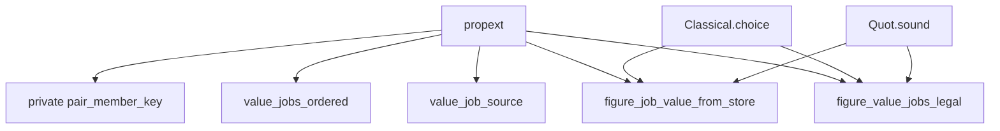
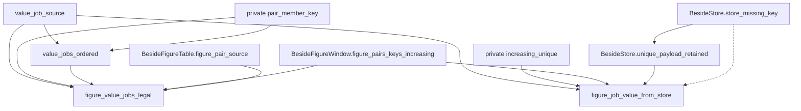

# [root ADR 0352](../adr/0352-prove-pagination-in-lean.md) の図版値と job 状態

## 範囲

基準は `38e53fbbc` の本体と既存モデルである。
[FigureJobValues.lean](../../experiments/pagination-proof/FigureJobValues.lean) を Lean 4.7.0（`aarch64-apple-darwin`）で検査した。
本体と公開 API は変更していない。
この増分は、[図版の組からの選択](0352-figure-window-dependencies.md) の job の初期状態を、元の図版の値から作る経路へ接続する。

前の `rowJobs` は添字を受け取る callback から job の状態を作る。
`valueJobs` は、添字と、選んだ元の組の値を callback へ渡す。
各 job の所有者と値が元の同じ組に由来し、状態がその添字と値から作られることを示す。

元の組のキーが昇順なら、生成した job の所有者の昇順も保つ。
現在の図版から組を生成する場合、その組の昇順と図版の条件を既存の証明から導く。
さらに、job の初期状態に渡した値が、同じキーの格納表の値でもあることを示す。
この最後の定理では、格納表との値の一致やキーの重複のなさを自由な前提として残さない。

本体の [job](../../modules/golem-typeset/src/Golem/Typeset/Flow.hs#L4867) は図版の値を持ち、[新規生成の呼び出し](../../modules/golem-typeset/src/Golem/Typeset/Flow.hs#L4868) はその値を `composeBeside` へ渡す。
`composeBeside` はその値の [pfExclusion](../../modules/golem-typeset/src/Golem/Typeset/Flow.hs#L4080) などを使う。
今回のモデルの値は任意の型であるが、本体の配置の全フィールドと callback の計算の一般的一致は証明していない。
Map の内部と IO の意味論も残る。

## 定理と公理

Lean の環境から宣言の種類、型、elaboration 後の証明項を取得した。
公開定理 4 件、手書きの private 定理 2 件、生成定理 8 件、定義 16 件、公理宣言 0 件だった。
定義は手書きの `valueJobs` 1 件と生成定義を含む。
全 14 定理について、元の定理を参照する同じ型の別名を一時環境に作り、`#print axioms` を実行した。
別名も kernel が検査する。

公開名には共通接頭辞 `BesideJobValues.` を付ける。
標準三公理は `propext`、`Classical.choice`、`Quot.sound` を指す。

| 名前 | 位置 | 前提と結論 | 公理 |
| --- | --- | --- | --- |
| `root_adr0352_i5_value_job_source` | [20 行](../../experiments/pagination-proof/FigureJobValues.lean#L20) | 各 job は元の同じ添字と値の組から来ており、選択条件、残りの長さ、初期状態の callback の引数が一致する。 | `propext` |
| `root_adr0352_i5_value_jobs_ordered` | [40 行](../../experiments/pagination-proof/FigureJobValues.lean#L40) | 元の組のキーが昇順なら、値から初期状態を作った job も昇順になる。 | `propext` |
| `root_adr0352_i5_figure_value_jobs_legal` | [56 行](../../experiments/pagination-proof/FigureJobValues.lean#L56) | 現在の図版から生成した組を使う job は、所有者の順序と図版の条件を満たす。 | 標準三公理 |
| `root_adr0352_i5_figure_job_value_from_store` | [78 行](../../experiments/pagination-proof/FigureJobValues.lean#L78) | 現在の図版からの各 job の値は、同じキーの格納表の値であり、初期状態の callback もその値を受け取る。 | 標準三公理 |

private 定理の共通接頭辞は `_private.experiments.«pagination-proof».FigureJobValues.0.BesideJobValues.` である。

| 名前 | 位置 | 前提と結論 | 公理 |
| --- | --- | --- | --- |
| `pair_member_key` | [11 行](../../experiments/pagination-proof/FigureJobValues.lean#L11) | 組が列に含まれれば、そのキーもキー列に含まれる。 | `propext` |
| `increasing_unique` | [69 行](../../experiments/pagination-proof/FigureJobValues.lean#L69) | キーが厳密な昇順なら重複しない。 | なし |

生成定理 8 件の共通接頭辞は `_private.experiments.«pagination-proof».FigureJobValues.0.` である。
表の名前の後ろへ列挙した suffix をそれぞれ付けると、全 8 件の名前になる。
いずれも公理に依存しない。
生成位置は取得できなかった。

| 名前の前半 | suffix | 件数と由来 |
| --- | --- | --- |
| `BesideJobValues.valueJobs` | `._eq_1`, `._eq_2`, `.match_1.eq_1`, `.match_1.eq_2` | 4 件。値を渡す job の生成の分岐の等式 |
| `BesideReuse.jobsOrdered` | `._eq_1`, `._eq_2`, `.match_1.eq_1`, `.match_1.eq_2` | 4 件。既存の job の順序の条件の簡約 |

標準公理には、既存の証明を経由する依存も含む。
`propext` は命題の同値からの等値（Lean の `Init/Core.lean:1287`）、`Classical.choice` は空でない型からの選択（`Init/Prelude.lean:730`）、`Quot.sound` は同値関係で結ばれた値の商での等値（`Init/Core.lean:1459`）である。
対象内に新しい公理宣言はない。

公理の図の矢印は推移的な依存を示す。
公理に依存しない private 定理 1 件と生成定理 8 件は図から除いた。



定理の図では実線を elaboration 後の型か証明項の直接参照、点線を示した補助定理を経由する依存とする。
標準の論理の補助定理は省略し、今回の全手書き定理と必要な既存定理を載せた。



公開定理のラベルには共通接頭辞 `root_adr0352_i5_` を付ける。
今回の公開定理にはさらに `BesideJobValues.` を付ける。
private の名前は上の表の接頭辞を使う。

## 境界と実装との照合

先に境界を追加し、正規の `LEAN_PATH` で検査すると未定義の namespace と API のため終了コード 1 になった。
実装した後は直接の境界 11 件が kernel で通った。
同じ選択条件でも異なる値を持つ二つの組、選択しない組、空の列、選択条件の反転、初期状態の callback の変更、生成と格納からの読み取りを含む。

[FigureJobValues.hs](../../experiments/pagination-proof/FigureJobValues.hs) は、containers の `Data.Map.Strict` と比較する。
段落、制御、その他、配置されない図版、配置されて選ばれない図版、配置されて選ばれる図版という六つの状態を、長さ 0 から 4 まで列挙した。
各値は位置ごとに異なる整数と選択の真偽を持つ。
初期状態の callback は元の添字と値の整数部分を使うため、ほかの添字や値を渡す変更を区別する。
1,555 表について、元の表の列、真か偽の値を選ぶ二つの job の列の計 4,665 式が kernel で通った。
これは containers の API の有限な比較であり、Map の内部の一般証明ではない。

[FigureJobValuesFonts.hs](../../experiments/pagination-proof/FigureJobValuesFonts.hs) は、実フォントの初期原稿から、同じ原稿、段落の短縮、旧本文位置への図版、要素の削除、制御の挿入という六つの入力を使う。
前の `Built` を渡す場合と渡さない場合の行数と採番も比較した。
図版の値は、実際の `PlacedFigure.pfSpan` の `spanStart` と、最初の診断列が空で回り込みの exclusion があるかという真偽へ射影する。
観測したソース位置が負でないことを確かめ、有限な照合では Nat として渡す。
この値のソース位置を job の初期状態へ渡し、実際の図版の表から得たソース位置と比較する。

初期入力の二つの job は、図版のソース位置 27 と 208 をそれぞれ受け取った。
元の表の列 6 件、格納後の範囲での読み取り 6 件、値から初期状態を作った job の列 6 件、前の payload 表を引き継いだ出力の列 6 件の計 24 式が kernel で通った。
job の残りの長さは実際の単位数と所有者から算定し、本体の job に fuel のフィールドがあるとは扱わない。

二つの照合の計 4,689 式で Lean の診断はなかった。
実フォントの入力は caption のない回り込み図版であり、caption の計算をこの照合で検証したとは扱わない。
図版の配置の全フィールドを有限な照合で比較したわけではない。
行数と offset は本体で観測した値を callback に渡すため、それらの算出の一般的な正しさの証明とも区別する。

検証した runtime のソースは `0aa78f65ac691cdd8d1a3bd5fc4c8bffb1feabdb`、コンパイラは GHC 9.10.3 である。
既存の package database を読み取り専用で使い、この tree の通常の Cabal 環境を再構築した検証とは区別する。
private 宣言の観測には既存の adapter を使い、module の export 以外のソースが変わっていないことを比較した。
共用の package database や cache は変更しない。

```sh
/private/tmp/golem-0352-numbered-tools-nov28/runghc-driver -package=containers \
  experiments/pagination-proof/FigureJobValues.hs > /private/tmp/golem-0352-job-values-examples-nov28.lean
FIGURE_JOB_VALUES_LEAN=1 RUNGHC=/private/tmp/golem-0352-built-probe-nov28/runner \
  sh experiments/pagination-proof/check-built-first-ids.sh \
  "$PWD/experiments/pagination-proof/FigureJobValuesFonts.hs" > /private/tmp/golem-0352-job-values-fonts-examples-nov28.lean
```

両方の出力を `LEAN_PATH=/private/tmp/golem-0352-numbered-output-cache-nov28` と Lean 4.7.0 で検査した。
初期状態の callback に一つ先の添字を渡すモデルの変異は、生成元との一致の証明で失敗した。
次の組の値を渡す変異も、同じ添字の元の値を渡すことの証明で失敗した。
いずれも一時コピーだけで実行し、終了コード 1 だった。
これだけで本体の全ての変更を検出できるとは扱わない。

既存のローカル `check.sh` に、このモデルと境界を接続し、全体の終了コード 0 を確認した。
grid 55,838 件、free 156,520 件、回り込みの試し置き 10,368 件、causal 4,864 件、制御の 216 件、改行の評価 34,586 件、実フォントの caption 40 件、Alloy の 42 コマンドの Lean への対応を保った。
Alloy の件数は既存の対応の検査であり、今回 solver を新しく 42 回実行した意味ではない。
新しい CI workflow は追加していない。

読み取り前後の plan の SHA-256 は `981a01138b41bf0d6b1e8ea82155b2ed1227297b7339699bbc60005bc4c83957`、package database の `package.cache` は `dd7fdb3fca241d4a7039e18fccf8ff7065a265540225c2cf813e5b07cbe75fc8` で一致した。
この tree と検証した runtime の `modules/` の差分も空だった。

## 残件

対象の Lean の診断と全 14 定理の公理依存に、証明の穴はなかった。
`sorry`、`admit`、`sorryAx` の候補も対象ソースにはなかった。
job の初期状態を作る callback への元の値の受け渡しはモデルで示したが、本体の Map の実装、配置の全フィールド、callback の計算や IO との一般的一致は残る。
Int と Nat の添字や値の範囲、前の payload の妥当性も未証明である。

また、`Built` と `hb` の全呼び出し元、全制御、本文の全量と順序、`captionCompared` と改行器の一般的一致も残る。
[末尾保持の再試行の反例](0352-last-retry-counter-dependencies.md) はこの増分では変更していない。
root [ADR 0352](../adr/0352-prove-pagination-in-lean.md) の全範囲は未完了のままである。
