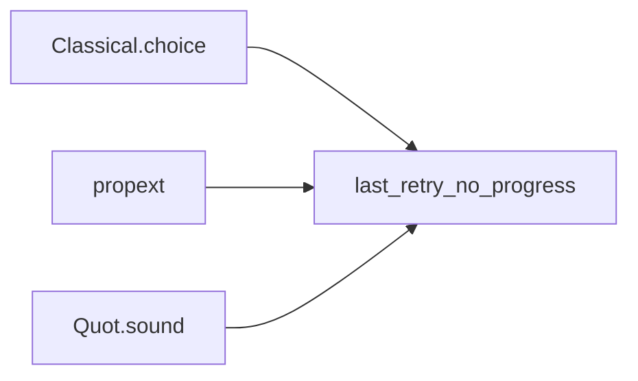
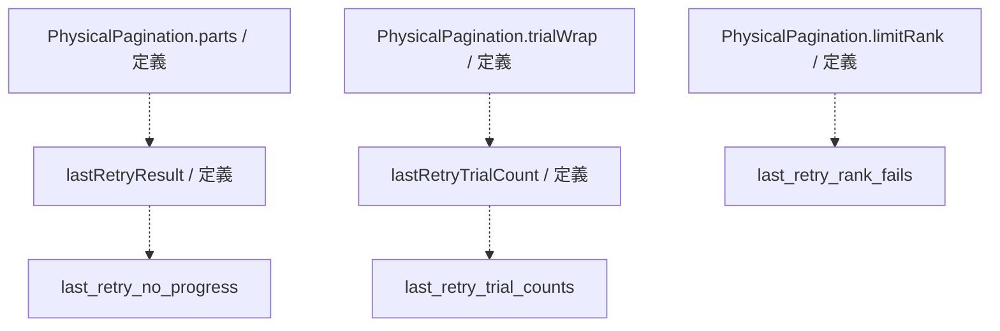
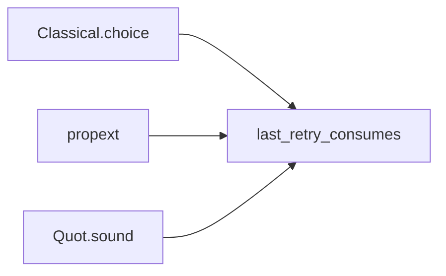
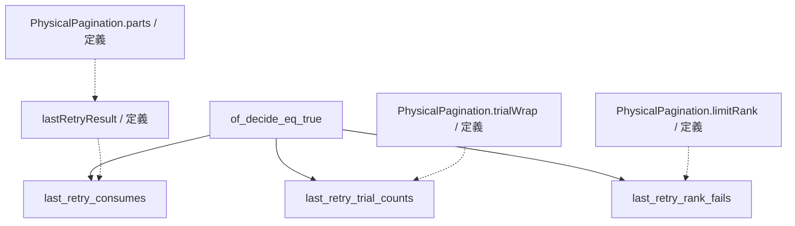

# [root ADR 0352](../adr/0352-prove-pagination-in-lean.md) の末尾保持の再試行の反例と修正後の回帰


この文書は、旧版の反例と、[root ADR 0483](../adr/0483-finish-forced-paragraph-placement-without-repeating-the-retry.md) 後の回帰を分けて記録する。
次の「旧版の範囲と結果」から「旧版の実装との比較と残り」までは、`472733a1cb322729911c43f758ba4b4b7d6e0355` に保存した反例の記録である。
その本体と既存モデルは `0aa78f65ac691cdd8d1a3bd5fc4c8bffb1feabdb` であり、宣言名と位置と依存図も旧版のものである。
現在のモデルが同じ失敗を返すという主張にはしない。
修正後の同じ入力の結果と現在の宣言は、末尾に記録する。

## 旧版の範囲と結果

基準は `91b224c15` の本体と既存モデルである。
[RetryLastCounter.lean](../../experiments/pagination-proof/RetryLastCounter.lean) を Lean 4.7.0（`aarch64-apple-darwin`）で検査した。
本体、モデルの規則、診断の方針は変えていない。
この増分は、[先の調査](0352-retry-prefix-dependencies.md) に記した一部の行の採用後の再試行について、減少の条件を満たさない具体例を kernel で確認する。
修正を実装したという記録ではない。

入力は五行、モデルの寸法単位で段の容量 30、行送りと文字サイズ 10、先頭の保持二行、末尾の保持四行である。
注も次の段落の保持もなく、各行がソースの一要素を消費する合成入力を使う。
試し置きは、上限が未指定、2、1 のいずれでも三行を返す。
残りの二行が末尾の四行に足りず、採用三行が先頭の二行より多いため、採用数から一行を引いた上限 2 で同じ接尾部を試し直す。
しかし再試行の上限は再び 2 となり、上限 2 からの減少を満たさない。

既存モデルの [parts](https://github.com/tett23/golem/blob/0aa78f65ac691cdd8d1a3bd5fc4c8bffb1feabdb/experiments/pagination-proof/Physical.lean#L3309) は、この減少を `h6` で検査する。
今回の入力では、この分岐に到達して `noProgress 0` を返すことを、等式の証明で示した。
本体の [対応する分岐](https://github.com/tett23/golem/blob/0aa78f65ac691cdd8d1a3bd5fc4c8bffb1feabdb/modules/golem-typeset/src/Golem/Typeset/Flow.hs#L5326) にはこの検査がなく、同じ `count - 1` で試し直す。
モデルが `noProgress` を返したことを、本体の生成中止という仕様や診断へ読み替えない。

これは具体的なモデルの反例であり、Haskell 全体の無限実行を証明したものではない。
実フォントの通常の CLI の保存済み対照では、同じ原稿の `keep-last-lines = 2` は PDF を生成し、4 は 15 秒の検証タイムアウトとなった。
原稿と設定とコマンドの記録は `/private/tmp/golem-0352-last-lines-loop-nov28/reproduction.md` にある。
今回の合成行のソース位置と、実フォントの原稿の文字位置を同じものとして扱わない。
この反例を除外して全体の終了の証明が済んだとはしない。

## 旧版の定理と依存

Lean の環境で、名前付き宣言の種類、型、elaboration 後の証明項を調べた。
公開定理 3 件、手書き定義 10 件、生成定義 46 件、公理宣言 0 件だった。
今回のモジュールに private 定理と生成定理はない。
3 定理すべてを、元の定理を参照する同じ型の別名を一時環境に作って `#print axioms` で調べた。
別名も kernel が検査する。

次の名前には、共通接頭辞 `PhysicalPagination.` を付ける。

| 名前 | 位置 | 内容 | 公理 |
| --- | --- | --- | --- |
| `root_adr0352_i4_last_retry_trial_counts` | 旧 34 行 | 同じ五行に対する上限未指定、2、1 の試し置きが、いずれも三行を採用する。 | なし |
| `root_adr0352_i4_last_retry_no_progress` | 旧 40 行 | 初期状態と未指定の上限から始めた既存 `parts` が、この入力で `noProgress 0` を返す。 | 標準三公理 |
| `root_adr0352_i4_last_retry_rank_fails` | 旧 43 行 | 上限 2、元の五行、採用三行では、`3 - 1` が `limitRank` より小さいという式は偽である。 | なし |

三つとも閉じた入力の命題であり、計算結果や減少の失敗を仮定として与えていない。
`trial_counts` と `rank_fails` は `decide`、`no_progress` は `rfl` で kernel が検査する。
`#eval` とネイティブの実行結果だけを証明の代わりにしていない。

手書きの公開定義は `PhysicalPagination.lastRetryRows`（7 行）、`PhysicalPagination.lastRetryEnv`（18 行）、`PhysicalPagination.lastRetryResult`（24 行）、`PhysicalPagination.lastRetryTrialCount`（28 行）である。
private 定義の共通接頭辞は `_private.experiments.«pagination-proof».RetryLastCounter.0.PhysicalPagination.` である。
接尾辞は `rowPitch`（11 行）、`noHeading`（12 行）、`noGap`（13 行）、`noPadding`（14 行）、`noFollowing`（15 行）、`notHeld`（16 行）である。
これらはこの入力の行送りと、注などがない環境を定義する。
生成定義は、再帰、分岐、定数と関数のコンパイラ補助宣言である。

標準三公理は `propext`、`Classical.choice`、`Quot.sound` を指す。
`no_progress` は `parts` などの定義を経由してこれらに依存する。
ほかの二定理には公理依存がない。

| 標準公理 | Lean 4.7.0 の位置 | 内容 |
| --- | --- | --- |
| `Classical.choice` | `Init.Prelude:730` | `Nonempty α` から要素を選ぶ。 |
| `propext` | `Init.Core:1287` | 命題の同値から等式を導く。 |
| `Quot.sound` | `Init.Core:1459` | 関係を満たす二要素が同じ商の値を持つ。 |

公理の図は、定義を経由する推移的な依存を示す。
公理に依存しない二定理には辺がない。



対象の三定理間に直接の定理参照はない。
次の破線は、インポートした定義を経由する依存を示す。
標準の `of_decide_eq_true` の直接参照は省いた。



対象ソースに `sorry`、`admit`、`sorryAx` の使用はない。
Lean の diagnostic と三定理の公理依存にも証明の穴はなかった。
今回の範囲に、穴の影響を受ける定理はない。

## 旧版の実装との比較と残り

[RetryLastCounter.hs](../../experiments/pagination-proof/RetryLastCounter.hs) は、公開の `trialParagraphPartLimit` に同じ行数と保持を渡す。
三つの上限で、いずれも三行を採用し、保持の先頭二行と末尾四行も変わらないことを検査する。
この比較だけで通常の `causalFreeFlow` の全経路とモデルの対応を証明したとは扱わない。

末尾の保持を二行へ変えた入力でも同じ `noProgress` になるとする誤変更は、Lean の等式で拒否された。
実装が二行だけ採用するとする誤変更も、ネイティブの検査で拒否された。

本体の `modules/` は `0aa78f65ac691cdd8d1a3bd5fc4c8bffb1feabdb` と一致する。
照合は GHC 9.10.3 と、この版の既存 runtime DB の登録済み package ID を読み取り専用で使う。
標準 Cabal 環境を新規構築したという検証ではない。
Cabal plan と package cache の実行前後の SHA-256 は一致した。

`check.sh` 全体も終了コード 0 で通った。
既存の 55,838 件と 156,520 件の配置、10,368 件の回り込み、4,864 件の因果的配置、216 件の制御、34,586 件の改行、実フォントのキャプション 40 件、Alloy 42 件の対応検査を含む。
今回の反例の試し置き三件と閉じた命題の検査も同じ手順に含む。

次のコマンドは、上記の旧版の作業ツリーで実行したものであり、現在のファイルへ適用した記録ではない。

```sh
LEAN_PATH=/private/tmp/golem-0352-numbered-output-cache-nov28 \
  /Users/tett23/.elan/toolchains/leanprover--lean4---v4.7.0/bin/lean \
  experiments/pagination-proof/RetryLastCounter.lean
/private/tmp/golem-0352-numbered-tools-nov28/runghc-driver \
  experiments/pagination-proof/RetryLastCounter.hs
```

この反例への対応は未実装である。
モデルと本体の任意の計測と行列の対応、全制御、内容の全量と順序、一般のキャプションの接続も残る。
[root ADR 0352](../adr/0352-prove-pagination-in-lean.md) 全体は採択済みで未実装のままである。


## 修正後の同じ入力の回帰

[root ADR 0483](../adr/0483-finish-forced-paragraph-placement-without-repeating-the-retry.md) を実装した main `365b43c4ab5e01c863916504f417b0e596a0b3c6` のモデルへ証明増分を移した。
旧版の `last_retry_no_progress` をそのまま検査すると、期待する失敗と実際の結果の等式が成り立たず、kernel の検査に失敗した。
入力を除外したり、保持数や容量を変えたりして成功させてはいない。
同じ `lastRetryRows`、`lastRetryEnv`、`lastRetryResult` に対し、呼び出し元が成功して行 ID `0, 1, 2, 3, 4` を一度ずつ消費する回帰へ変更した。
公開の試し置きが三行を返す定理と、`3 - 1 < limitRank (some 2) 5` が偽である定理は変更していない。
新しい呼び出し元は、この反例の不等式を使う再試行へ進まない。

現在の対象は [RetryLastCounter.lean](../../experiments/pagination-proof/RetryLastCounter.lean) 全体である。
Lean 4.7.0 の環境で、公開定理 3 件、手書き定義 10 件、生成定義 46 件、公理宣言 0 件を確認した。
生成定理と private 定理はなく、3 定理の公理と直接参照をすべて取得した。
定義の名前と本体の式は変えていない。
インポートする `parts` の規則が変わったため、同じ式の結果が変わる。

次の名前の共通接頭辞は `PhysicalPagination.` である。

| 名前 | 位置 | 内容 | 公理 |
| --- | --- | --- | --- |
| `root_adr0352_i4_last_retry_trial_counts` | [34 行](../../experiments/pagination-proof/RetryLastCounter.lean#L34) | 未指定、2、1 の試し置きの採用数が三行である。 | なし |
| `root_adr0352_i4_last_retry_consumes` | [40 行](../../experiments/pagination-proof/RetryLastCounter.lean#L40) | 同じ五行の `parts` が成功し、行 ID を順に一度ずつ配置する。 | 標準三公理 |
| `root_adr0352_i4_last_retry_rank_fails` | [43 行](../../experiments/pagination-proof/RetryLastCounter.lean#L43) | 上限を減らす式の旧反例の不等式が偽である。 | なし |

現在の三定理はいずれも `of_decide_eq_true` を直接参照する。
この補題は公理に依存しない。
現在の公理の依存図は、定義を経由する推移的な依存を示す。
標準三公理の内容と位置は上の表と同じである。



次の図の実線は定理の直接参照、破線は定義を経由する参照である。
定義のノードには「定義」と付けた。



`sorry`、`admit`、`sorryAx` はなく、公理依存にも証明の穴はなかった。
取得できない証明項はなく、新たな公理、証明専用 CI、予算の変更は加えていない。
この五行の閉じた回帰は、任意の原稿や本体の全制御の終了証明とは区別する。
[root ADR 0352](../adr/0352-prove-pagination-in-lean.md) 全体は未実装のままである。

## 現在の main との増分全体の検査

証明増分を main `bead6802895091038fc1870e4d67ae098c847582` に統合し、Lean 4.7.0 で `experiments/pagination-proof/check.sh` 全体が終了コード 0 で通った。
製品コードはこの main と同一である。
既存の配置 55,838 件と 156,520 件、回り込み 10,368 件、因果的配置 4,864 件、制御 216 件、改行 34,586 件、実フォントのキャプション 40 件と Alloy 42 件の対応に加え、公開試し置き 1,344 入力を照合した。
Alloy 自体を再実行した結果とは区別する。

```sh
TMPDIR=/private/tmp/golem-0352-current-full-temp-nov28 \
PATH=/private/tmp/golem-0352-tcy-main-tools-nov28:$PATH \
CABAL_PLAN=/private/tmp/golem-0479-main-integration-dist/cache/plan.json \
RUNGHC=/private/tmp/golem-0352-tcy-main-tools-nov28/runghc-driver \
LEAN=/Users/tett23/.elan/toolchains/leanprover--lean4---v4.7.0/bin/lean \
sh experiments/pagination-proof/check.sh
```

GHC 9.10.3 の登録済み runtime DB を読み取り専用で利用した。
この DB は main `365b43c4ab5e01c863916504f417b0e596a0b3c6` と同じ製品コードで構築され、今回の main まで製品コードの変更はない。
Cabal plan と package cache の実行前後の SHA-256 は一致した。
標準の Cabal 環境を新たに構築した検証ではない。
実装の内部の行列を観測する別の 64 入力についても、480 個の閉じた式を Lean のカーネルで確認した。

三つの入口の述語から、完全採用と部分採用の強制配置の条件をそれぞれ削除した六つの変異は、実装との分岐照合ですべて拒否した。
この節の五行の結果から最後の行を除く変異と、途中の行を重ねる変異も、`decide` が命題を偽と判定して拒否した。
これらは閉じた回帰と実装形の確認であり、任意の `Built`、全制御、本文の全量と順序、一般のキャプションを接続する証明は残る。
