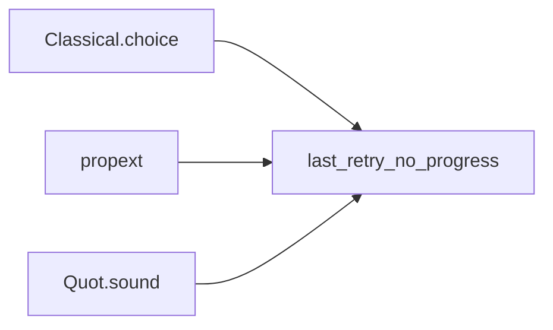
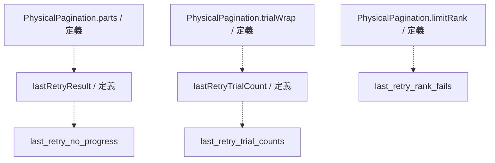

# [root ADR 0352](../adr/0352-prove-pagination-in-lean.md) の末尾保持の再試行の反例

## 範囲と結果

基準は `91b224c15` の本体と既存モデルである。
[RetryLastCounter.lean](../../experiments/pagination-proof/RetryLastCounter.lean) を Lean 4.7.0（`aarch64-apple-darwin`）で検査した。
本体、モデルの規則、診断の方針は変えていない。
この増分は、[先の調査](0352-retry-prefix-dependencies.md) に記した一部の行の採用後の再試行について、減少の条件を満たさない具体例を kernel で確認する。
修正を実装したという記録ではない。

入力は五行、モデルの寸法単位で段の容量 30、行送りと文字サイズ 10、先頭の保持二行、末尾の保持四行である。
注も次の段落の保持もなく、各行がソースの一要素を消費する合成入力を使う。
試し置きは、上限が未指定、2、1 のいずれでも三行を返す。
残りの二行が末尾の四行に足りず、採用三行が先頭の二行より多いため、採用数から一行を引いた上限 2 で同じ接尾部を試し直す。
しかし再試行の上限は再び 2 となり、上限 2 からの減少を満たさない。

既存モデルの [parts](../../experiments/pagination-proof/Physical.lean#L3309) は、この減少を `h6` で検査する。
今回の入力では、この分岐に到達して `noProgress 0` を返すことを、等式の証明で示した。
本体の [対応する分岐](../../modules/golem-typeset/src/Golem/Typeset/Flow.hs#L5326) にはこの検査がなく、同じ `count - 1` で試し直す。
モデルが `noProgress` を返したことを、本体の生成中止という仕様や診断へ読み替えない。

これは具体的なモデルの反例であり、Haskell 全体の無限実行を証明したものではない。
実フォントの通常の CLI の保存済み対照では、同じ原稿の `keep-last-lines = 2` は PDF を生成し、4 は 15 秒の検証タイムアウトとなった。
原稿と設定とコマンドの記録は `/private/tmp/golem-0352-last-lines-loop-nov28/reproduction.md` にある。
今回の合成行のソース位置と、実フォントの原稿の文字位置を同じものとして扱わない。
この反例を除外して全体の終了の証明が済んだとはしない。

## 定理と依存

Lean の環境で、名前付き宣言の種類、型、elaboration 後の証明項を調べた。
公開定理 3 件、手書き定義 10 件、生成定義 46 件、公理宣言 0 件だった。
今回のモジュールに private 定理と生成定理はない。
3 定理すべてを、元の定理を参照する同じ型の別名を一時環境に作って `#print axioms` で調べた。
別名も kernel が検査する。

次の名前には、共通接頭辞 `PhysicalPagination.` を付ける。

| 名前 | 位置 | 内容 | 公理 |
| --- | --- | --- | --- |
| `root_adr0352_i4_last_retry_trial_counts` | [34 行](../../experiments/pagination-proof/RetryLastCounter.lean#L34) | 同じ五行に対する上限未指定、2、1 の試し置きが、いずれも三行を採用する。 | なし |
| `root_adr0352_i4_last_retry_no_progress` | [40 行](../../experiments/pagination-proof/RetryLastCounter.lean#L40) | 初期状態と未指定の上限から始めた既存 `parts` が、この入力で `noProgress 0` を返す。 | 標準三公理 |
| `root_adr0352_i4_last_retry_rank_fails` | [43 行](../../experiments/pagination-proof/RetryLastCounter.lean#L43) | 上限 2、元の五行、採用三行では、`3 - 1` が `limitRank` より小さいという式は偽である。 | なし |

三つとも閉じた入力の命題であり、計算結果や減少の失敗を仮定として与えていない。
`trial_counts` と `rank_fails` は `decide`、`no_progress` は `rfl` で kernel が検査する。
`#eval` とネイティブの実行結果だけを証明の代わりにしていない。

手書きの公開定義は `PhysicalPagination.lastRetryRows`（7 行）、`PhysicalPagination.lastRetryEnv`（18 行）、`PhysicalPagination.lastRetryResult`（24 行）、`PhysicalPagination.lastRetryTrialCount`（28 行）である。
private 定義の共通接頭辞は `_private.experiments.«pagination-proof».RetryLastCounter.0.PhysicalPagination.` である。
接尾辞は `rowPitch`（11 行）、`noHeading`（12 行）、`noGap`（13 行）、`noPadding`（14 行）、`noFollowing`（15 行）、`notHeld`（16 行）である。
これらはこの入力の行送りと、注などがない環境を定義する。
生成定義は、再帰、分岐、定数と関数のコンパイラ補助宣言である。

標準三公理は `propext`、`Classical.choice`、`Quot.sound` を指す。
`no_progress` は `parts` などの定義を経由してこれらに依存する。
ほかの二定理には公理依存がない。

| 標準公理 | Lean 4.7.0 の位置 | 内容 |
| --- | --- | --- |
| `Classical.choice` | `Init.Prelude:730` | `Nonempty α` から要素を選ぶ。 |
| `propext` | `Init.Core:1287` | 命題の同値から等式を導く。 |
| `Quot.sound` | `Init.Core:1459` | 関係を満たす二要素が同じ商の値を持つ。 |

公理の図は、定義を経由する推移的な依存を示す。
公理に依存しない二定理には辺がない。



対象の三定理間に直接の定理参照はない。
次の破線は、インポートした定義を経由する依存を示す。
標準の `of_decide_eq_true` の直接参照は省いた。



対象ソースに `sorry`、`admit`、`sorryAx` の使用はない。
Lean の diagnostic と三定理の公理依存にも証明の穴はなかった。
今回の範囲に、穴の影響を受ける定理はない。

## 実装との比較と残り

[RetryLastCounter.hs](../../experiments/pagination-proof/RetryLastCounter.hs) は、公開の `trialParagraphPartLimit` に同じ行数と保持を渡す。
三つの上限で、いずれも三行を採用し、保持の先頭二行と末尾四行も変わらないことを検査する。
この比較だけで通常の `causalFreeFlow` の全経路とモデルの対応を証明したとは扱わない。

末尾の保持を二行へ変えた入力でも同じ `noProgress` になるとする誤変更は、Lean の等式で拒否された。
実装が二行だけ採用するとする誤変更も、ネイティブの検査で拒否された。

本体の `modules/` は `0aa78f65ac691cdd8d1a3bd5fc4c8bffb1feabdb` と一致する。
照合は GHC 9.10.3 と、この版の既存 runtime DB の登録済み package ID を読み取り専用で使う。
標準 Cabal 環境を新規構築したという検証ではない。
Cabal plan と package cache の実行前後の SHA-256 は一致した。

`check.sh` 全体も終了コード 0 で通った。
既存の 55,838 件と 156,520 件の配置、10,368 件の回り込み、4,864 件の因果的配置、216 件の制御、34,586 件の改行、実フォントのキャプション 40 件、Alloy 42 件の対応検査を含む。
今回の反例の試し置き三件と閉じた命題の検査も同じ手順に含む。

```sh
LEAN_PATH=/private/tmp/golem-0352-numbered-output-cache-nov28 \
  /Users/tett23/.elan/toolchains/leanprover--lean4---v4.7.0/bin/lean \
  experiments/pagination-proof/RetryLastCounter.lean
/private/tmp/golem-0352-numbered-tools-nov28/runghc-driver \
  experiments/pagination-proof/RetryLastCounter.hs
```

この反例への対応は未実装である。
モデルと本体の任意の計測と行列の対応、全制御、内容の全量と順序、一般のキャプションの接続も残る。
[root ADR 0352](../adr/0352-prove-pagination-in-lean.md) 全体は採択済みで未実装のままである。
