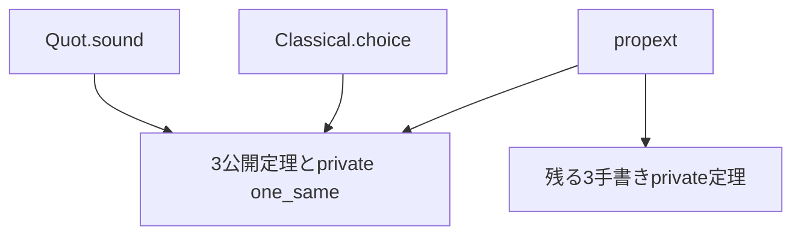
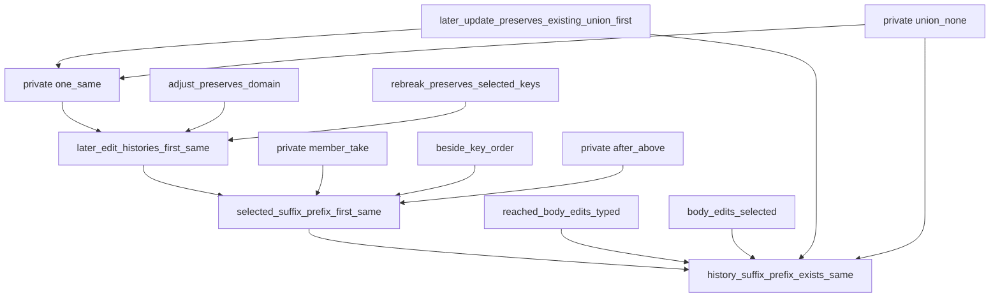

# [root ADR 0352](../adr/0352-prove-pagination-in-lean.md) の選択した接尾部の更新列

## 範囲

基準は `b47aacbd7` の本体と既存モデルである。
[LaterEdits.lean](../../experiments/pagination-proof/LaterEdits.lean) を Lean 4.7.0（`aarch64-apple-darwin`）で検査した。
本体と公開 API は変更していない。
[対象以上のキーへの一回の更新](0352-suffix-count-dependencies.md) を、任意の有限な更新列へ接続する。

最初の結果は、全ての更新キーが照会対象以上である任意の有限列を扱う。
更新キーが列の中で昇順に並ぶことは要求せず、同じキーを繰り返す場合も含む。
帰納の各段階に、本文の型、領域と選択の保存を渡し、対象の先頭 ID が変わらないことを導く。

次の結果では、そのキーの条件もモデルの選択列から導く。
現在の図版が選ぶ昇順の列を、照会対象とその後ろのキーの列に分ける。
この接尾部の先頭から指定数だけ取り、各キーに対応する値の更新関数を割り当てる。
先頭から取る数は任意の自然数であり、0 でも列の長さを超えてもよい。
選択列の昇順から、これらの更新キーが全て対象以上であることを内部で導く。

最後の結果は、初期 cache の到達と任意の先行更新履歴から、現在の本文の型と選択を導いて接続する。
履歴後の cache への新しい到達や、キーの大小の条件を別に仮定しない。
選択した接尾部の先頭から任意の数だけ更新しても、その段落を始める時点の同じ ID が、左優先の合成後にも存在する。
本全体の初期の ID と一致することは要求しない。

本体の [tryVerses](../../modules/golem-typeset/src/Golem/Typeset/Flow.hs#L5230) は、渡された段落列を順に更新する。
この増分は、そのような更新列を扱うモデルの条件を、選択列から導く部分を追加する。
本体の全呼び出し元の列が、このモデルの選択した接尾部に対応することは引き続き未証明である。
任意の有限列の一致を示すことと、実際の再試行が終了することも区別する。

## 定理と公理

Lean の環境から宣言の種類、型、証明項と直接の定理参照を取得した。
最終の環境は公開定理 3 件、手書きの private 定理 4 件、生成定理 11 件、定義 9 件、公理宣言 0 件だった。
全 18 定理へ同じ型の別名を一時環境で作り、kernel の検査と `#print axioms` を行った。

公開名の共通接頭辞は `BesideLaterEdits.` である。
標準三公理は `propext`、`Classical.choice`、`Quot.sound` を指す。

| 名前 | 位置 | 前提と結論 | 公理 |
| --- | --- | --- | --- |
| `root_adr0352_i5_later_edit_histories_first_same` | [22 行](../../experiments/pagination-proof/LaterEdits.lean#L22) | 本文の型、現在の図版 job と選択、全更新キーが対象以上という条件から、任意の有限更新列の前後で対象の先頭 ID は一致する。 | 標準三公理 |
| `root_adr0352_i5_selected_suffix_prefix_first_same` | [71 行](../../experiments/pagination-proof/LaterEdits.lean#L71) | 本文の型、現在の job と選択から、選択した接尾部の任意の先頭部分を更新しても同じ先頭 ID となる。キーの大小は内部で導く。 | 標準三公理 |
| `root_adr0352_i5_history_suffix_prefix_exists_same` | [91 行](../../experiments/pagination-proof/LaterEdits.lean#L91) | 初期の到達と先行更新履歴、初期の job と選択から、現在と選択した接尾部の更新後に同じ ID が合成後も存在する。右側の表は任意に異なってよい。 | 標準三公理 |

private 定理の共通接頭辞は `_private.experiments.«pagination-proof».LaterEdits.0.BesideLaterEdits.` である。

| 名前 | 位置 | 概要 | 公理 |
| --- | --- | --- | --- |
| `union_none` | [5 行](../../experiments/pagination-proof/LaterEdits.lean#L5) | 右側が空の左優先合成を元の表へ戻す。 | `propext` |
| `one_same` | [8 行](../../experiments/pagination-proof/LaterEdits.lean#L8) | 一回の更新の存在定理から、所有段落の表での一致を導く。 | 標準三公理 |
| `after_above` | [46 行](../../experiments/pagination-proof/LaterEdits.lean#L46) | 昇順の列で対象より後ろのキーは対象より大きい。 | `propext` |
| `member_take` | [56 行](../../experiments/pagination-proof/LaterEdits.lean#L56) | 先頭から取った列のキーは元の列にも属する。 | `propext` |

生成定理の共通接頭辞は `_private.experiments.«pagination-proof».LaterEdits.0.` である。
次の前半と suffix を組み合わせると全 11 件の名前になる。
いずれも生成位置は取得できず、公理への依存はない。

| 名前の前半 | suffix | 件数 |
| --- | --- | --- |
| `List.take` | `._eq_1`, `._eq_2`, `._eq_3` | 3 |
| `BesideOwnedFirst.afterTarget` | `._eq_1`, `._eq_2` | 2 |
| `BesideReuse.candidateKeys` | `._eq_1` | 1 |
| `BesideOwnedFirst.beforeTarget.match_1` | `.eq_1`, `.eq_2` | 2 |
| `List.drop.match_1` | `.eq_1`, `.eq_2`, `.eq_3` | 3 |

手書きの定義は [suffixPrefixEdits](../../experiments/pagination-proof/LaterEdits.lean#L68) の 1 件である。
証明だけで使う列の変換として `noncomputable` にしている。
初回は `List.mapTR.loop._at.BesideLaterEdits.suffixPrefixEdits._spec_1` という specialization の公理宣言が生成されたが、最終の環境ではなくなった。
定理の公理の一覧だけでなく、環境の全公理宣言も取得して確かめた。

生成定義は、前の共通接頭辞の下の `BesideOwnedFirst.beforeTarget.match_1.splitter` と `List.drop.match_1.splitter` が名前の前半である。
それぞれ suffix がない名前と、`._cstage1`、`._cstage2`、`._rarg._cstage2` の 4 件、計 8 件である。
分岐と実行コードの生成に由来し、定理としては数えていない。

`propext` は命題の同値からの等値（Lean の `Init/Core.lean:1287`）、`Classical.choice` は空でない型からの選択（`Init/Prelude.lean:730`）、`Quot.sound` は同値関係で結ばれた値の商での等値（`Init/Core.lean:1459`）である。
最終のモデルに新しい公理、`sorry`、`admit` はない。
公理の図は既存の補助定理を経由する推移的な依存も表し、公理に依存しない生成定理は省略した。

定理の図の実線は型か証明項の直接参照である。
標準の論理の定理は省略した。

既存の依存は [後続段落の更新](0352-suffix-count-dependencies.md) と [任意の更新履歴](0352-body-edits-dependencies.md) にまとめた。

## 境界と実装との照合

新しい API がない状態で試験が終了コード 1 を返し、追加後に [LaterEditsBoundary.lean](../../experiments/pagination-proof/LaterEditsBoundary.lean) の 14 式が通った。
先頭から取る数の 0、1、2、列より大きい 9 と、実際の更新後の値を含む。
最初の段落から二段落を更新すると、最初の ID は 1 のままだが、二つ目の ID は 3 から 8 へ変わる。
二つ目自身からの接尾部を更新する場合は 3 が保たれる。
先行履歴でその ID が 10 になった場合も、新しい到達を仮定せず公開定理へ接続した。

[LaterEditsFonts.hs](../../experiments/pagination-proof/LaterEditsFonts.hs) は、実フォントで組んだ表、コード、制御、二つの図版と三つの所有段落を使う。
七つの先行更新で得た八つの状態で、三つの対象から始まる選択した接尾部の先頭部分を使う。
取る数を 0、1、2、3、変更後の行数を 0、7 とした計 192 列である。
元の空でない行の列をテンプレートとして本文を手で置き換え、改行器からその行数を生成したとは扱わない。

各列の途中でも本体の採番を呼び直し、最初に照会した対象の ID が変わらないことを調べる。
本体の最初の採番から再構成した右側の表と所有段落の表の合成、本体の全 ID の表、人工的な右側の値が採用されないことも比較する。
現在と列の後の ID、三つの本文の実際の行数、公開の存在定理を各列で検査する。
初期 cache の 1 式と合わせた 1,153 式が、最終のモデルの kernel の検査で通った。
これは全呼び出し元や終了の一般証明ではない。

モデルへ渡す更新列だけを先頭の一件までに制限する変異では、Haskell の実行は終了コード 0 だった。
後続の本文の行数を比較する式のうち 30 件を kernel が false と判定し、Lean は終了コード 1 となった。
先頭の ID の一致だけで後続の値の更新まで保証するとは扱わない。

本体のソースは `0aa78f65ac691cdd8d1a3bd5fc4c8bffb1feabdb` であり、この作業ツリーの `modules/` と一致する。
GHC 9.10.3 と既存の専用 package DB を read-only で使い、共有の build と依存の版は変えない。
通常の Cabal の再ビルドとは区別する。

## 全体の検査

`check.sh` にモデルと局所境界を加え、GHC 9.10.3 と Lean 4.7.0 の既存の全検査が終了コード 0 で通った。
grid 55,838 件、free 156,520 件、回り込みの試し置き 10,368 件、causal 4,864 件、制御 216 件、改行の評価 34,586 件、実フォントの caption 40 件を保った。
Alloy の 42 コマンドに対応する既存の Lean の検査も保ち、Alloy の新しい実行回数とは区別する。

plan の SHA-256 は `981a01138b41bf0d6b1e8ea82155b2ed1227297b7339699bbc60005bc4c83957`、package DB の cache は `dd7fdb3fca241d4a7039e18fccf8ff7065a265540225c2cf813e5b07cbe75fc8` で、検査の前後で変わらなかった。
新規の証明専用 CI や予算の変更は加えていない。

## 未証明の範囲

全 `Built` と全呼び出し元から、初期の到達、job と対象の選択、本体の段落列とモデルの選択した接尾部の対応を導く接続は残る。
任意の有限列とその先頭部分を扱うこの結果は、実際の再試行が有限で終わるという証明ではない。
図版の所有者自身の照会、固定の採番件数、Map の意味論、Int と Nat、図版の全フィールドや配置の callback、caption の計算との一般的一致も未証明である。

原稿の全データと行の順序、全制御の終了、`hb` の全呼び出し元、`captionCompared` と改行器の一般的一致は完成扱いしない。
root [ADR 0352](../adr/0352-prove-pagination-in-lean.md) は採択済み未実装のままとする。
