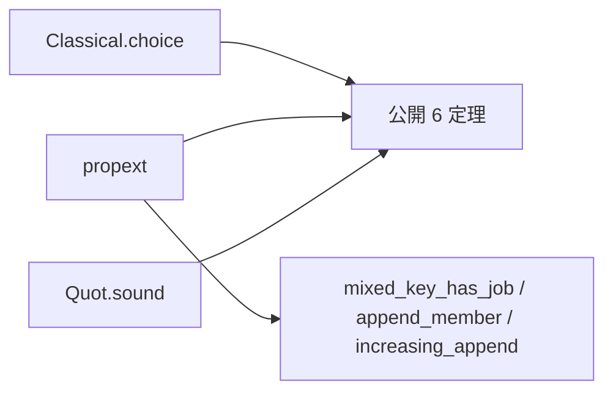
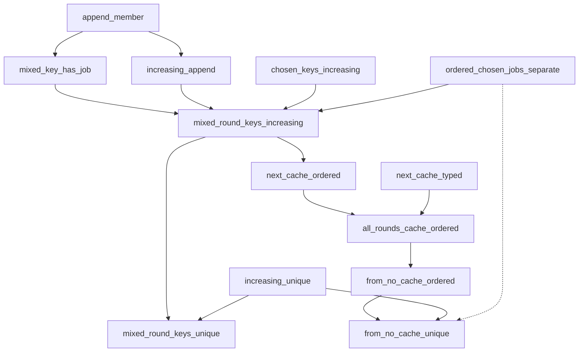

# [root ADR 0352](../adr/0352-prove-pagination-in-lean.md) の全ジョブのキーの順序

## 範囲

基準は `212a99b3f` の本体と既存モデルである。
[MixedRoundOrder.lean](../../experiments/pagination-proof/MixedRoundOrder.lean) を Lean 4.7.0（`aarch64-apple-darwin`）で検査した。
本体と公開 API は変更していない。
この増分は、[二つのジョブの分離](0352-beside-reuse-order-dependencies.md) を、全ジョブの連結と、次のラウンドへ渡すキーの列へ接続する。

`jobsOrdered` は、各ジョブの所有者のキーが後のジョブの所有者より小さいという条件である。
`roundJobsLegal` は、この条件と、各所有者が現在の図版を指すことの論理積である。
選択結果が並んでいるという結論を、そのまま前提にしたものではない。
同じ所有者を二回並べる入力と、所有者を逆順に並べる入力は、この条件を満たさない。

全出力の一つのキーは、いずれかのジョブの出力に属する。
一つのジョブ内の順序と、前後のジョブの範囲の分離を使い、連結した全出力が狭義単調増加することを導く。
そこから、全出力でキーが重複しないことも導く。
前の結果の型の条件は使うが、前の結果のキーの順序や重複のなさは、この一回の生成の前提には使わない。

`cacheOrdered` は、保存した脇の本文のキーが狭義単調増加する条件である。
[前の結果から型を渡す定理](0352-beside-reuse-rounds-dependencies.md) と合わせ、各入力が `roundJobsLegal` を満たす任意の有限ラウンド列へ、この条件を渡す。
前の結果がない状態から始めた場合は、保存する全キーの順序と重複のなさを、初期の結果の条件なしで導く。
現在の結果の順序を、現在の遷移の前提へ置かない。

この証明は、選んだ脇の本文のキーを対象とする。
すべての本文が必ずこの表に含まれるという証明ではない。
通常の本文として別に組む部分や、図版のキャプションや注を含めた最終出力の内容の保存は残る。
任意回の有限のラウンドの証明を、製品の再計算が常に有限回で止まる証明とも扱わない。

## 定理と依存

Lean の環境で、宣言の種類、型、elaboration 後の証明項を調べた。
公開定理 7 件、手書きの private 定理 3 件、生成定理 4 件、定義 11 件、公理宣言 0 件だった。
定義は手書きの 3 件と生成定義を含む。
14 定理のすべてについて、元の定理を参照する同じ型の別名を一時環境に作り、`#print axioms` を実行した。
別名も kernel が検査する。

次の公開名には、共通接頭辞 `BesideReuse.` を付ける。
標準三公理は `propext`、`Classical.choice`、`Quot.sound` を指す。

| 名前 | 位置 | 前提と結論 | 公理 |
| --- | --- | --- | --- |
| `root_adr0352_i5_mixed_key_has_job` | [43 行](../../experiments/pagination-proof/MixedRoundOrder.lean#L43) | 全出力のキーは、どれかのジョブの出力に属する。 | `propext` |
| `root_adr0352_i5_mixed_round_keys_increasing` | [60 行](../../experiments/pagination-proof/MixedRoundOrder.lean#L60) | 前の表の型と、所有者の順序と図版の条件から、全出力のキーが狭義単調増加する。 | 標準三公理 |
| `root_adr0352_i5_mixed_round_keys_unique` | [84 行](../../experiments/pagination-proof/MixedRoundOrder.lean#L84) | 同じ条件から、全出力のキーが重複しない。 | 標準三公理 |
| `root_adr0352_i5_next_cache_ordered` | [102 行](../../experiments/pagination-proof/MixedRoundOrder.lean#L102) | 前の結果の型と現在の入力の条件から、次の結果のキーが狭義単調増加する。 | 標準三公理 |
| `root_adr0352_i5_all_rounds_cache_ordered` | [117 行](../../experiments/pagination-proof/MixedRoundOrder.lean#L117) | 型と順序の条件を満たす前の結果と、各入力の条件から、ラウンド列の結果の順序を導く。 | 標準三公理 |
| `root_adr0352_i5_from_no_cache_ordered` | [135 行](../../experiments/pagination-proof/MixedRoundOrder.lean#L135) | 前の結果がない状態から、各入力の条件を満たすラウンド列の結果の順序を導く。 | 標準三公理 |
| `root_adr0352_i5_from_no_cache_unique` | [141 行](../../experiments/pagination-proof/MixedRoundOrder.lean#L141) | 同じ初期状態と入力の条件から、結果のキーが重複しない。 | 標準三公理 |

private 定理には、共通接頭辞 `_private.experiments.«pagination-proof».MixedRoundOrder.0.BesideReuse.` を付ける。

| 名前 | 位置 | 前提と結論 | 公理 |
| --- | --- | --- | --- |
| `append_member` | [11 行](../../experiments/pagination-proof/MixedRoundOrder.lean#L11) | 連結した列の要素は左右どちらかの列に属する。 | `propext` |
| `increasing_append` | [22 行](../../experiments/pagination-proof/MixedRoundOrder.lean#L22) | 左右それぞれの順序と、左の全要素が右の全要素より小さいことから、連結の順序を導く。 | `propext` |
| `increasing_unique` | [34 行](../../experiments/pagination-proof/MixedRoundOrder.lean#L34) | 狭義単調増加する列の要素は重複しない。 | なし |

生成定理 4 件には、同じ private の接頭辞を付ける。
`chooseAll._eq_1`、`chooseAll._eq_2`、`chooseAll.match_1.eq_1`、`chooseAll.match_1.eq_2` である。
インポートした連結の再帰を簡約する分岐の等式に由来し、すべて公理に依存しない。
生成位置は取得できなかった。

標準公理の宣言元と内容は次のとおりである。
対象内に、新しい公理を宣言していない。

| 公理 | Lean 4.7.0 の位置 | 内容 |
| --- | --- | --- |
| `Classical.choice` | `Init.Prelude:730` | `Nonempty α` から要素を選ぶ。 |
| `propext` | `Init.Core:1287` | 命題の同値から等式を導く。 |
| `Quot.sound` | `Init.Core:1459` | 関係を満たす二要素が同じ商の値を持つ。 |

公理の図は、定義や補助定理を経由する推移的な依存を示す。
公理に依存しない private 1 件と生成 4 件には辺がない。



次の定理の図の実線は、型か証明項の定理の直接参照である。
破線は定義や補助定理を経由する間接依存を示す。
標準の等式と算術の補題と生成定理は省いた。



対象ソースに `sorry`、`admit`、`sorryAx` の使用はない。
Lean の diagnostic と 14 定理の公理依存にも証明の穴はなかった。
この範囲に、穴の影響を受ける定理はない。

## 境界と実装との照合

追加前には、未追加のモジュールと定理を読む検査が失敗することを確認した。
追加後は [MixedRoundOrderBoundary.lean](../../experiments/pagination-proof/MixedRoundOrderBoundary.lean) の 8 件の具体例を検査した。
再利用と新規生成の四通り、現在の図版への置換、重複する所有者、逆順の所有者を含む。
重複する所有者ではキーの重複が起こり、逆順の所有者では結果が狭義単調増加しない対照を含む。

既存の [BesideReuseOrder.hs](../../experiments/pagination-proof/BesideReuseOrder.hs) を同じ本体で再実行した。
実フォントの 6 回の計算で 13 ジョブを調べ、全ジョブの連結が本文の Map のキーの昇順の列と一致した。
同じ原稿、短縮、段落から図版への置換、削除、段送りへの置換を含む。
新規生成との行数と `bUnitFirsts` の比較も維持した。

既存の [BesideReuseRounds.hs](../../experiments/pagination-proof/BesideReuseRounds.hs) から、6 回の入力と結果のキーもモデルへ渡した。
6 本の出力キーの閉じた等式と、その 6 本のキーの重複のなさを kernel で検査した。
有限の出力の等式は `decide` で検査し、重複のなさは計算した列へ簡約して `NoRepeat` を展開した。
この有限の一致を、任意の本体の Map と連結の一般的一致の証明とは扱わない。

検証用の一時コピーで `PdfInput.piParallel` を真にした系列も実行した。
同じ 6 回の計算と新規生成の比較が通り、モデルへ渡す入力と結果の出力は逐次版とバイト単位で一致した。
並列版の 6 本の出力キーの等式も kernel で検査した。
この有限の比較を、任意の IO の終了や並列処理の一般的な正しさの証明とは扱わない。

所有者の順序を非減少へ弱める変異は、前後のジョブを分離する証明で拒否された。
実装の観測で所有者を逆順にすると、連結と Map の昇順の列の比較が失敗した。
本体は変更していない。
観測の export list を開いた前後で、本体の残りが元と同一であることを確認した。

本体の `modules/` は `0aa78f65ac691cdd8d1a3bd5fc4c8bffb1feabdb` と一致する。
GHC 9.10.3 と peg-hs の正規固定版 `4b4adc7046` の、既存の runtime DB を読み取り専用で使う。
標準 Cabal 環境を新規構築したという検証ではない。
この内部のキーと採番の比較は、通常 CLI の PDF の視認を代用しない。

`check.sh` 全体も終了コード 0 で通った。
既存の 55,838 件と 156,520 件の配置、10,368 件の回り込み、4,864 件の因果的配置、216 件の制御、34,586 件の改行、実フォントのキャプション 40 件、Alloy 42 件の対応検査を含む。
Cabal plan と package cache の実行前後の SHA-256 は一致した。

## 再現と残り

`check.sh` は `BesideReuseOrder.olean` と `BesideReuseRounds.olean` を作った後、このモデルと境界の具体例を検査する。
同じ環境での局所検査と、実装の観測は次のコマンドで行う。

```sh
LEAN_PATH="$work" lean -o "$work/MixedRoundOrder.olean" \
  experiments/pagination-proof/MixedRoundOrder.lean
LEAN_PATH="$work" lean experiments/pagination-proof/MixedRoundOrderBoundary.lean
RUNGHC=/private/tmp/golem-0352-built-probe-nov28/runner \
  sh experiments/pagination-proof/check-built-first-ids.sh \
  "$PWD/experiments/pagination-proof/BesideReuseOrder.hs"
BESIDE_REUSE_LEAN=1 RUNGHC=/private/tmp/golem-0352-built-probe-nov28/runner \
  sh experiments/pagination-proof/check-built-first-ids.sh \
  "$PWD/experiments/pagination-proof/BesideReuseRounds.hs" > /tmp/MixedRoundOrderRaw.lean
```

後者の出力へ `import MixedRoundOrder` を加え、各出力キーの等式の直後へ次の形の検査を加えた。
`r0` の後の五回にも同じ形を使い、それぞれの計算したキーの列へ簡約した。

```lean
example : BesideOwnership.NoRepeat (keysOf (runRounds none [r0])) := by
  change BesideOwnership.NoRepeat [2, 3, 5]
  simp [BesideOwnership.NoRepeat]
```

依存調査では `import Lean` と `import MixedRoundOrder` の環境から宣言を列挙した。
各 `.thmInfo` の型と証明項の `getUsedConstants` を環境の宣言種別と照合し、定理の直接参照を調べた。
生成定理を含むすべての定理の別名へ `#print axioms` を実行した。
ソースの穴は次の検索でも確認した。

```sh
rg -n '\b(sorry|admit|sorryAx)\b' experiments/pagination-proof/MixedRoundOrder.lean
```

本体の `Map.toList` から図版のジョブを作る経路と、モデルの所有者の順序と図版の条件との一般の接続は残る。
実際の Map の内容、値全体の一致、Int と Nat の対応も未証明である。
この増分は、最終出力のすべての内容と順序や、図版を所有しない通常の本文の生成までを証明していない。

単位の採番量の分類、`Built` と `hb` の全呼び出し元、全制御、`captionCompared` と改行器の一般的一致も残る。
[末尾の保持の再試行の反例](0352-last-retry-counter-dependencies.md) も、この増分では修正していない。
root [ADR 0352](../adr/0352-prove-pagination-in-lean.md) の全範囲は未完了のままである。
