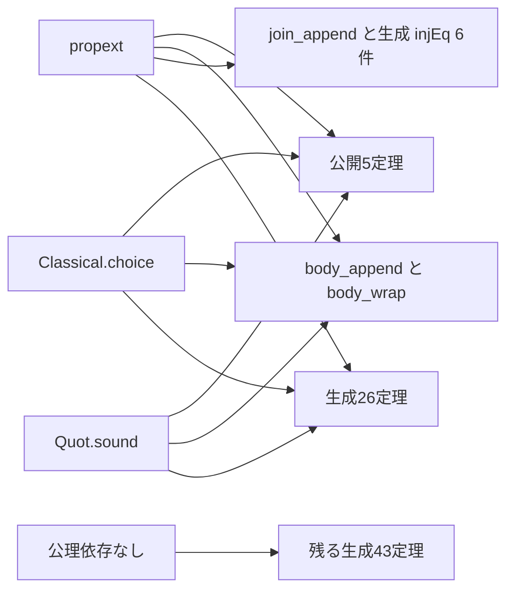
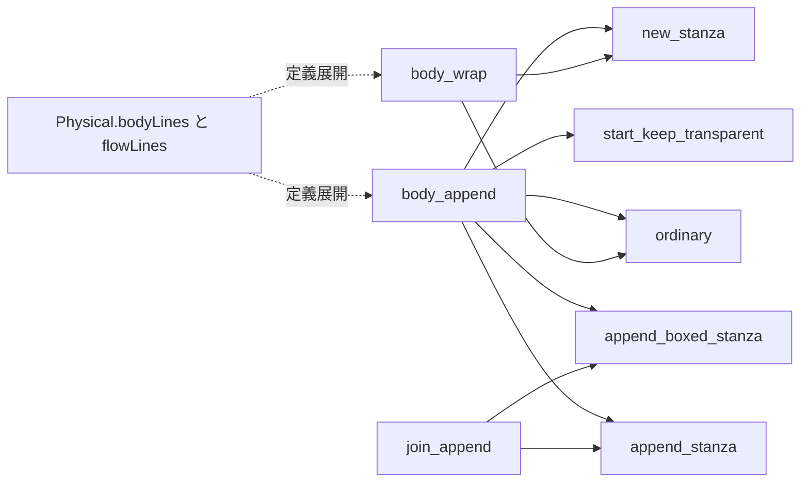

# root [ADR 0352](../adr/0352-prove-pagination-in-lean.md): numberText が追加する行の順序

## 対象と範囲

この文書は、`numberText` が採番した行を flow に加える四つの分岐を対象とする。
基準は `dce38539f8380403f07f17e255dd4a26facc74ae` と、この文書と同じ変更に含める `NumberTextOrder.lean` である。
Lean 4.7.0 で、公開一般定理 5 本と補助定理の証明項を確認した。
[root ADR 0352](../adr/0352-prove-pagination-in-lean.md) 全体の実装は未完了である。

本体の [Flow.hs の numberText](../../modules/golem-typeset/src/Golem/Typeset/Flow.hs#L4742) は、既存の stanza、単一 stanza を入れた既存の箱、新しい stanza、通常の本文などで、追加する flow の形を変える。
既存 stanza の二経路は、それまでの verse の後へ新しい行の列を加える。
新しい stanza と通常の経路は、既存の flow の後へ新しい flow を加える。
開始の制御と keep-with-next は行を持たず、箱は内部の行の順序を変えない。

`PhysicalPagination.bodyLines` は、flow の構造から行の列を取り出す既存の射影である。
`NumberTextOrder` はこの既存の射影を使い、先行する flow や行の内容を任意にしたまま、追加後の列が旧列と新行の連結になると示す。
行には ID、注、はみ出しの値が含まれ、これらを消した ID の比較だけではない。
ただし、この行型には本体のラベルや索引印の全情報がなく、それらの一般的な対応はこの定理に含まれない。
この射影は、見出しの先頭 ID や表のキャプションの上下を扱う `PhysicalPagination.sourceText` と同じではない。
book part の内部や、任意の表の描画順序との一致もこの増分では主張しない。

この増分は、各分岐が選ばれた後の構成を証明する。
任意の `Unit` の style 選択、`unsnoc` による分類、配置後の `Built` 全体との対応を一般証明したものではない。
有限の本体比較を、この一般的な接続の代わりにはしない。

## 定理と公理

対象の Lean 環境には、公開定理 5 件、手書きの private 定理 3 件、生成定理 75 件、手書き定義 2 件、生成定義 28 件、公理宣言 0 件があった。
全 83 定理の型と証明項を取得し、`#print axioms` を実行した。
取得できなかった証明項はない。

公開定理の完全名は、次の名前に `NumberTextOrder.` を付けたものである。

| 定理 | 位置 | 前提と結論 |
| --- | --- | --- |
| `root_adr0352_i5_ordinary` | [52 行](../../experiments/pagination-proof/NumberTextOrder.lean#L52) | 任意の先行 flow、通常の七種類の形式、箱の有無、新行で、旧列の後へ新行をそのまま加える。 |
| `root_adr0352_i5_append_stanza` | [59 行](../../experiments/pagination-proof/NumberTextOrder.lean#L59) | 任意の先行 flow と既存 verse に、新行を最後の verse として加えると、旧列の後に新行が続く。 |
| `root_adr0352_i5_append_boxed_stanza` | [66 行](../../experiments/pagination-proof/NumberTextOrder.lean#L66) | 同じ性質が、単一 stanza を含む既存の箱にも成立する。 |
| `root_adr0352_i5_new_stanza` | [73 行](../../experiments/pagination-proof/NumberTextOrder.lean#L73) | 新しい stanza を箱の有無にかかわらず加えると、旧列の後に新行が続く。 |
| `root_adr0352_i5_start_keep_transparent` | [80 行](../../experiments/pagination-proof/NumberTextOrder.lean#L80) | 開始の制御と keep-with-next を前後に加えても、内部の行の列を変えない。 |

private 定理の共通接頭辞は `_private.experiments.«pagination-proof».NumberTextOrder.0.NumberTextOrder.` である。
`body_append` は [12 行](../../experiments/pagination-proof/NumberTextOrder.lean#L12) で flow の連結と行の連結が一致することを示す。
`body_wrap` は [18 行](../../experiments/pagination-proof/NumberTextOrder.lean#L18) で箱の射影が内部の列と一致することを示す。
`join_append` は [24 行](../../experiments/pagination-proof/NumberTextOrder.lean#L24) で verse の連結を行の連結へ移す。
いずれも、公開定理の結論そのものを前提にしていない。

生成された 75 定理は次の群である。
`TextForm` のコンストラクターと、証明中で展開した既存の射影から生成された。
生成宣言の位置情報はない。

- `NumberTextOrder.TextForm` の七コンストラクターの `sizeOf_spec`、引数を持つ六コンストラクターの `inj` と `injEq` の計 19 件。
- 共通接頭辞 `_private.experiments.«pagination-proof».NumberTextOrder.0.` の `PhysicalPagination.flowLines._eq_1`〜`_eq_24` と `PhysicalPagination.flowLines.match_1.eq_1`〜`eq_24` の計 48 件。
- 同じ接頭辞の `PhysicalPagination.bodyLines._eq_1`、`_eq_2` と `PhysicalPagination.bodyLines.match_1.eq_1`、`eq_2` の計 4 件。
- 同じ接頭辞の `List.join._eq_1`、`_eq_2` と `List.join.match_1.eq_1`、`eq_2` の計 4 件。

公開の五定理、private の `body_append` と `body_wrap`、生成定理 26 件は、標準三公理 `propext`、`Classical.choice`、`Quot.sound` に依存する。
private の `join_append` と生成された六つの `injEq` は `propext` だけに依存する。
残る生成定理 43 件は公理に依存しない。
`propext` は命題の同値から等式を作り、`Classical.choice` は存在から値を選び、`Quot.sound` は商の関係から等式を作る標準公理である。

手書き定義は `wrap` と `ordinary` の二つで、どちらも `safe` である。
全 30 定義の安全性は `safe` が 14 件、`unsafe` が 16 件、`partial` が 0 件だった。
`unsafe` はコンパイラーが生成した実行用の補助定義である。
全 83 定理の型と証明項から定理と定義の本体をたどった 1,351 定数には、`unsafe` と `partial` の参照がなかった。



公理の図は推移的な依存を示す。
次の図の実線は、証明項に現れる対象内の定理の直接参照である。
破線は定義を経由する接続を示し、標準ライブラリと生成展開等式は図から省く。



## 検証と再現

最初の一般適用は、新しい定理名が未定義のため失敗した。
その後に定理を加え、[NumberTextOrderBoundary.lean](../../experiments/pagination-proof/NumberTextOrderBoundary.lean) の閉じた境界 120 件と一般定理の適用 5 件が通った。
閉じた境界では、通常の七形式、箱の有無、空と重複行、先行 flow、空 verse、既存 stanza と箱入り stanza を確かめる。
初期の `decide` による境界は展開の再帰深度上限に達したため、同じ命題を定義展開の `simp` で証明し直した。
一般定理の前提や対象を弱めたものではない。

本体との比較は [NumberTextOrderFonts.hs](../../experiments/pagination-proof/NumberTextOrderFonts.hs) で行う。
正規のフォントで作った `Composed` を入力に、公開範囲だけを一時的に広げた同じ `Flow.hs` の `numberText` を直接呼ぶ。
公開リストより後の本体は、既存の [check-built-first-ids.sh](../../experiments/pagination-proof/check-built-first-ids.sh) で元のソースと byte 一致を確認する。
この一時コピーは製品の export や package DB を変更しない。

各配置設定で、七形式、箱二通り、stanza 三状態、既存履歴四通り、開始と終了のフラグ二通り、行数三通りの 1,008 条件を比較した。
横組みと縦組み、grid と free の四設定で計 4,032 条件が成功した。
各条件で、flow の行 ID が旧列と新列の連結になること、保存した本体の行が元の `cLines` と一致すること、カウンターの増分、以前の行の内容の保持を確かめた。
開始と keep-with-next が実際に選ばれる style であることも検査する。
この入力は内部関数の境界比較であり、七形式すべての通常原稿の構文解析を保証するものではない。

通常行を逆順にするモデル、旧 stanza を捨てるモデル、箱内の旧 stanza だけを捨てるモデルの三変異を Lean が拒否した。
本体の一時コピーだけで verse の追加順を逆にした変異も、実比較が `paragraph/stanza/Just 1/行数 1` で拒否した。
元の本体には変更していない。

```sh
LEAN_PATH=/private/tmp/golem-0352-main-checkpoint-cache-nov28 \
  /Users/tett23/.elan/toolchains/leanprover--lean4---v4.7.0/bin/lean \
  experiments/pagination-proof/NumberTextOrderBoundary.lean
for writing in horizontal vertical; do
  for alignment in free grid; do
    NUMBER_TEXT_ORDER_WRITING="$writing" NUMBER_TEXT_ORDER_ALIGNMENT="$alignment" \
      RUNGHC=/private/tmp/golem-0352-current-private-tools-nov28/runghc \
      sh experiments/pagination-proof/check-built-first-ids.sh \
        experiments/pagination-proof/NumberTextOrderFonts.hs
  done
done
```

この環境では、製品のソースが同じ main `365b43c4ab5e01c863916504f417b0e596a0b3c6` 用の GHC 9.10.3 の plan と package DB を読み取り専用で利用した。
peg-hs は正規 pin `4b4adc7046a14d18c8eec711f18dbcaa9b059cca` である。
通常の Cabal 環境で新しくビルドしたとの主張ではない。
同じ読み取り専用の plan と package DB を明示した `check.sh` の全検査は終了コード 0 で完了した。
既存の比較では grid 55,838 例、free 156,520 例、wrap 10,368 例、causal 4,864 例、改行 34,586 例、実フォントのキャプション 40 例を保った。
42 件は既存の Alloy コマンドと Lean の転記との対応検査であり、Alloy solver を再実行した結果ではない。
実行前後の新規ソースのハッシュ、読み取り専用の plan と package DB のハッシュは一致した。

## 検証したソースのハッシュ

実行中に証明の入力を変えていないことを、SHA-256 で確かめる。
この表は全検査の前後で一致した値である。

| ファイル | SHA-256 |
| --- | --- |
| `NumberTextOrder.lean` | `92782457192659eaf70614fb50d5565f8f9da128af20f18667f16341a204d95d` |
| `NumberTextOrderBoundary.lean` | `f26135d7cf7e34e85d00a4fae17528c2c2c446ac086c2a35109d92f4748414aa` |
| `NumberTextOrderFonts.hs` | `8583a4c5b7c949300ce66068f4d7fd2840245daa8f2aafd7558e45c696274884` |
| `check.sh` | `39e745d7719e6c43a324687f2fae6bb15a9e0158f0988b6e9fb06eebb9b5d9e8` |

## 証明の穴と残る接続

対象の新規ソースに `sorry`、`admit`、`sorryAx` はなく、公理依存にも証明の穴は現れなかった。
五定理は配置前の flow 構成で行の順序を保つことを示す。
行を採番する既存の一般定理との合成、本体の全 `Unit` とモデルの分岐の一般的な対応、任意の `Built` からの入力構成、配置後の内容保存は、この増分の完了範囲に含めない。
