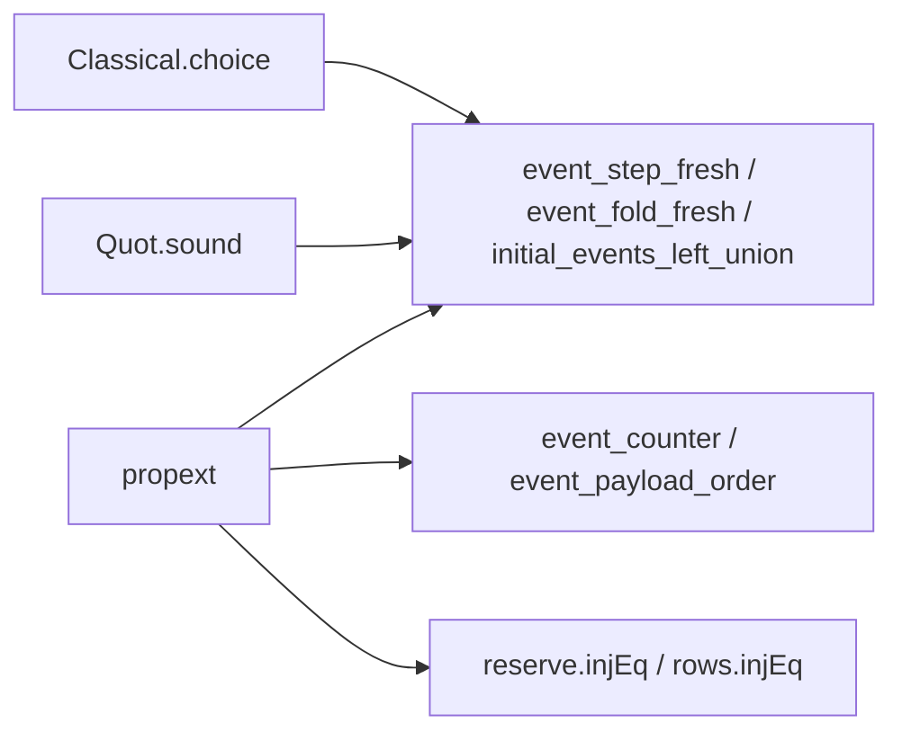
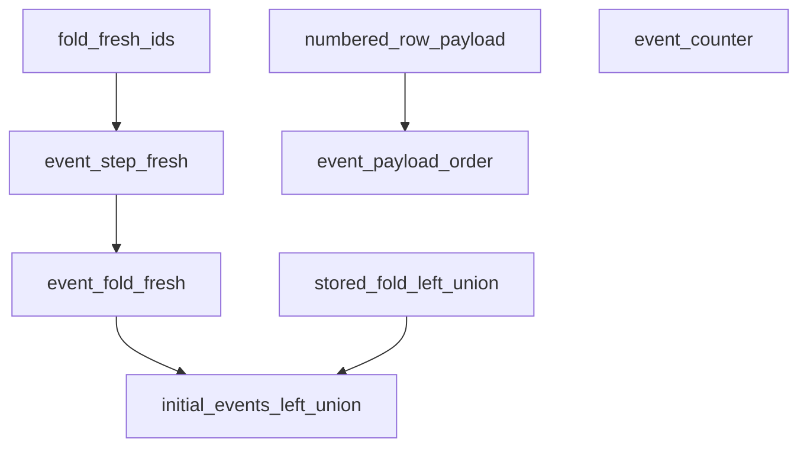

# root [ADR 0352](../adr/0352-prove-pagination-in-lean.md): 予約する ID を含む採番の列と行の保存

[NumberedEventStore.lean](../../experiments/pagination-proof/NumberedEventStore.lean) 全体を Lean 4.7.0 で調べた。
基準は、製品コードが main `8aeab8cac9e554ee32ea1c864a06c67868607e04` と同じ証明増分 `6645dac0de37a88b107733c9f79abd2465654cf5` である。
[行だけの fold](0352-numbered-store-fresh-dependencies.md) に加え、行を作らずに ID だけを予約する操作をモデルに含める。
[root ADR 0352](../adr/0352-prove-pagination-in-lean.md) 全体の実装完了は記録しない。

## 操作と主張

`RowEvent` は、自然数個の ID を予約する `reserve` と、行の列を追加する `rows` の二種類である。
`stepEvent` は一つの操作を次の番号と行の列を持つ状態に適用し、`runEvents` は操作の列を先頭から fold する。
予約では次の番号だけを進め、既存の行は保持する。
行の追加には、既存の `addChunk` の採番を使う。
予約数 0 と空の行の列も許す。
行は順序付きの列として保存する。
列の内容と順序の定理は、重複する旧キーのすべての値を表の検索から取り出せることを主張しない。

`Fresh` は、保存済みの表から値が返るすべてのキーが次の番号より小さいという条件である。
三本の一般定理は、一つの操作と操作の列がこの条件を保ち、空の表から始めた列では条件を前提にせず導けることを示す。
導いた条件を、後続の行の追加と旧表優先の union の検索との一致に使う。
残りの二本は、次の番号が予約数と追加行数の和だけ進むことと、すべての行の値が操作の順のまま保存されることを示す。
この二本では番号の条件を要求しない。

本体の [numberFigure](../../modules/golem-typeset/src/Golem/Typeset/Flow.hs#L4662) は図版に一つの ID を予約し、その後から本文の行を採番する。
今回の操作にはこのような空きを表せるが、任意の `numberUnit` の実行をこの操作列へ写した証明ではない。
本体の `Int` の全範囲とモデルの `Nat` の一般的一致も証明していない。

## 宣言と依存

環境には、手書きの公開定理 5 件、生成定理 19 件、手書き定義 5 件、生成定義 30 件と、一つの帰納型があった。
手書きの private 定理と公理宣言はない。
全 24 定理の型と証明項を取得し、`#print axioms` を実行した。
取得できなかった証明項はない。

公開定理名の共通接頭辞は `NumberedEventStore.` である。

| 定理 | 位置 | 前提と結論 |
| --- | --- | --- |
| `root_adr0352_i5_event_step_fresh` | [18 行](../../experiments/pagination-proof/NumberedEventStore.lean#L18) | 番号の条件を満たす旧状態に任意の一つの操作を適用しても条件が保たれる。 |
| `root_adr0352_i5_event_fold_fresh` | [31 行](../../experiments/pagination-proof/NumberedEventStore.lean#L31) | 同じ条件が任意の操作列の fold で保たれる。 |
| `root_adr0352_i5_initial_events_left_union` | [39 行](../../experiments/pagination-proof/NumberedEventStore.lean#L39) | 任意の開始番号の空の表から操作列を fold すると、後続の行の追加後の検索と旧表優先の union の検索が一致する。番号の条件は初期状態から導く。 |
| `root_adr0352_i5_event_counter` | [61 行](../../experiments/pagination-proof/NumberedEventStore.lean#L61) | 次の番号は初期の番号と、操作列の予約数と追加行数の和になる。 |
| `root_adr0352_i5_event_payload_order` | [70 行](../../experiments/pagination-proof/NumberedEventStore.lean#L70) | 保存した全行の値の列は、旧状態の値の列に操作列の行の値を順に連結したものである。 |

生成定理には、帰納型に由来する次の六つがある。
共通接頭辞は `NumberedEventStore.RowEvent.` である。

- `reserve.injEq` と `rows.injEq` は、同じコンストラクターの等式と引数の等式の同値を示し、`propext` に依存する。
- `reserve.inj` と `rows.inj` は、コンストラクターの等式から引数の等式を取り出し、公理に依存しない。
- `reserve.sizeOf_spec` と `rows.sizeOf_spec` は、生成されたサイズ関数の式を示し、公理に依存しない。

残り 13 件は展開等式であり、公理に依存しない。
共通接頭辞は `_private.experiments.«pagination-proof».NumberedEventStore.0.` である。

- `List.foldl._eq_1` と `_eq_2`
- `List.foldl.match_1.eq_1` と `eq_2`
- `NumberedEventStore.eventCount._eq_1`、`_eq_2`、`_eq_3`
- `NumberedEventStore.eventCount.match_1.eq_1`、`eq_2`、`eq_3`
- `NumberedEventStore.eventPayload._eq_1`、`_eq_2`、`_eq_3`

これらは操作の fold、個数と内容の列の定義を証明内で展開した際に生成された。
生成された宣言の位置の情報はない。
手書き定義は `stepEvent`、`runEvents`、`Fresh`、`eventCount`、`eventPayload` の五つである。
生成定義 30 件は、帰納型の補助関数とこれらの分岐や展開に由来する。
安全性の分類では、全 35 定義のうち `safe` が 18 件、`unsafe` が 15 件、`partial` が 2 件だった。
後二者は生成された実行用の補助定義であり、手書きの五定義はすべて `safe` である。
`partial` の二件は `NumberedEventStore.eventCount._unsafe_rec` と `NumberedEventStore.eventPayload._unsafe_rec` である。
公開の `eventCount` と `eventPayload` の論理上の本体は、いずれも `List.brecOn` を使い、この二件を直接呼ばない。
全 24 定理の型と証明項から定理と定義の本体をたどった 1,259 定数には、`unsafe` と `partial` の定義の参照はなかった。
この参照の列挙と `#print axioms` の結果を、コンパイラーの実行用の補助定義の分類と区別する。

全 24 定理のうち、番号の条件を扱う公開三定理は標準三公理に依存する。
個数と内容の公開二定理と生成された `injEq` 二定理は `propext` だけに依存する。
残り 17 定理は公理に依存しない。

| 公理 | Lean 4.7.0 の位置 | 内容 |
| --- | --- | --- |
| `Classical.choice` | `Init.Prelude:730` | `Nonempty α` から要素を選ぶ。 |
| `propext` | `Init.Core:1287` | 命題の同値から等式を導く。 |
| `Quot.sound` | `Init.Core:1459` | 関係を満たす二要素が同じ商の値を持つ。 |

次の図は定義と補助定理を経由した公理の推移的な依存である。
公理に依存しない 17 件には辺がない。



次の図の実線は、型または証明項に現れた定理の直接参照である。
標準の算術、等式とリストの補題と生成された展開等式は省略した。
`event_counter` はプロジェクトのほかの定理を直接参照しないため、独立のノードとして載せる。



対象ソースに `sorry`、`admit`、`sorryAx` はなく、全 24 定理の公理依存にも証明の穴はなかった。
独自の公理と取得できなかった証明項はない。

## 境界と実装の観測

[NumberedEventStoreBoundary.lean](../../experiments/pagination-proof/NumberedEventStoreBoundary.lean) は、12 個の閉じた式と一般定理の四つの利用を検査する。
開始番号 5 から一つ予約し、二行追加し、二つ予約し、もう一行を追加する例では、行の ID が 6、7、10、次の番号が 11 となる。
予約数 0、空の本文、予約した番号の空きも保持する。
予約数を個数から除く変異、予約の空きを詰めた ID の変異、行の値を逆順にする変異は、`decide` が命題を偽と判定して拒否した。
予約時に既存の行を捨てる定義の変異も、証明で使う旧表との対応の型が合わず拒否した。

[BesideScanRowsFonts.hs](../../experiments/pagination-proof/BesideScanRowsFonts.hs) の `NUMBERED_EVENT_STORE_LEAN=1` は、実フォントを使う既存の 64 例から旧表を再現する操作列を作る。
旧表のキーと図版の予約番号までの各 ID を順に見て、値のある ID は一行の追加、ない ID は一つの予約とする。
行を表す自然数は、既存の完全な行の値の照合を済ませた後の射影である。
生成する操作列は旧表のスナップショットからの再構成であり、unit の実行順から操作を抽出したものではない。
本体の任意の採番経路を形式的に翻訳した証拠とはしない。

八つの履歴、二つの図版、四つの初期状態の 64 例について、再構成した次の番号と旧行の列、および後続の行の追加後の列を確認する。
16 例は本体の先行する unit を採番した旧表、48 例は独立した初期状態を使う。
追加の 256 例は、128 個の閉じた式と、番号の条件と任意の検索キーについての 128 個の一般定理の適用である。
既存の 955 例と合わせ、全 1,211 例を Lean のカーネルで確認した。
追加の import と 256 例を除くと、既存の 955 例と一致した。

行の列と次の番号を直接確認するため、状態の等式に決定可能性のインスタンスを新設せず、その二つのフィールドの組を比較する。
検索の一般定理を適用するときは、旧表から値がある場合とない場合に分け、生成された `match` の展開の違いを取り除いている。
前提や結論を弱める変更ではない。

```sh
RUNGHC=/private/tmp/golem-0352-current-private-tools-nov28/runghc \
NUMBERED_EVENT_STORE_LEAN=1 \
sh experiments/pagination-proof/check-built-first-ids.sh \
  experiments/pagination-proof/BesideScanRowsFonts.hs > /tmp/numbered-events-native.lean
LEAN_PATH="$MODEL_CACHE" lean /tmp/numbered-events-native.lean
```

`MODEL_CACHE` は `check.sh` で構築したモデルのディレクトリを指定する。
実装の観測は GHC 9.10.3 と同じ製品コードの登録済み runtime DB を読み取り専用で使う。
本体のコピーでは export list だけを変え、それ以後の本文が元のソースと同一であることを `check-built-first-ids.sh` で確認する。
標準の Cabal 環境を新たに構築したという検証ではない。
任意の `Built`、全制御、本文の全量と順序の実装との接続、一般のキャプションの一致は残る。
新しい証明専用 CI、製品コードの変更と予算の変更は加えない。

Lean 4.7.0 の `check.sh` 全体も終了コード 0 となった。
新しい五つの一般定理と 12 個の境界に加え、公開試し置き 1,792 入力、既存の配置 55,838 件と 156,520 件、回り込み 10,368 件、因果的配置 4,864 件、制御 216 件、改行 34,586 件、実フォントのキャプション 40 件と Alloy 42 件の対応を含む。
Alloy のソルバー自体の再実行ではない。
この実行と別の実フォントの観測の後も、既存 runtime の plan と package cache の SHA-256 は実行前の値と一致した。
