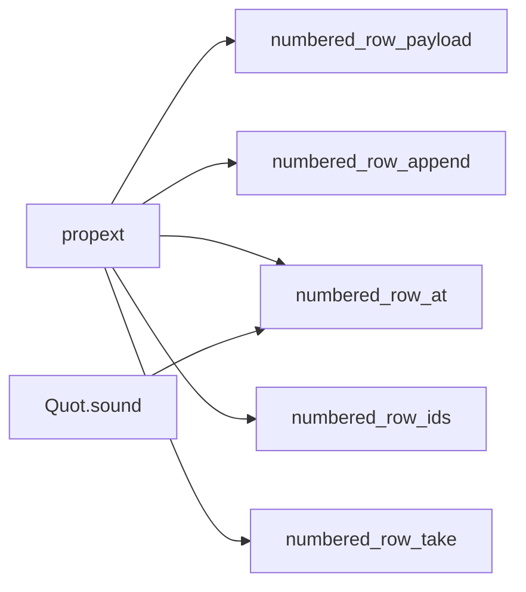
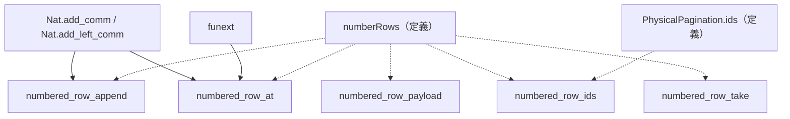

# [root ADR 0352](../adr/0352-prove-pagination-in-lean.md) の採番と既成行の内容

## 範囲

基準は `b75e5373d5944f828fb1407c554063c412a1cb1b` の本体と既存モデルである。
[NumberedPayload.lean](../../experiments/pagination-proof/NumberedPayload.lean) を Lean 4.7.0（`aarch64-apple-darwin`）で検査した。
この増分は、既に組んだ同一の行列に ID を付ける段階だけを扱う。
行を表す型 `α` の値を内容として持ち、ID の射影を既存の `PhysicalPagination.ids` と接続する。
本体と `Physical.lean` は変更していない。

[Flow.hs:4367](../../modules/golem-typeset/src/Golem/Typeset/Flow.hs#L4367) の `numberedLines` は、行列 `cLines` と連続 ID を組み合わせる。
[Flow.hs:4381](../../modules/golem-typeset/src/Golem/Typeset/Flow.hs#L4381) は、その行を `SetLine` に格納する。
今回のモデルでは、ID を消して行の値を読むと、重複も順序も含めてもとの列が残ることを証明する。
先に採用する行とその後ろを分けて採番した場合も、後半の開始 ID を採用行数だけ進めれば、連結した行列を一度に採番した結果と等しい。

これは再組版の前後で行の区切りが同一だと仮定する証明ではない。
モデルは既成行の列に対する局所的な性質を述べ、再組版で異なる行列に分かれた文字列の全量や順序はまだ扱わない。
本体の [Flow.hs:5298](../../modules/golem-typeset/src/Golem/Typeset/Flow.hs#L5298) と [Flow.hs:5339](../../modules/golem-typeset/src/Golem/Typeset/Flow.hs#L5339) の採用済みの行と残りの再組版への接続も残る。
本体の `Int` の範囲、注やリンクなどの付随情報、任意の `Built` の所有関係を証明済みとはしない。

## 定理と公理

Lean の環境で、名前付き宣言の種類、型、elaboration 後の証明項を照合した。
手書き定理 6 件、生成定理 8 件、手書き定義 1 件、生成定義 15 件、公理宣言 0 件だった。
14 定理すべてで `#print axioms` を実行した。

| 完全修飾名 | 位置 | 前提と結論 | 公理 |
| --- | --- | --- | --- |
| `NumberedPayload.root_adr0352_i5_numbered_row_payload` | [NumberedPayload.lean:11](../../experiments/pagination-proof/NumberedPayload.lean#L11) | 任意の行列と開始 ID で、採番後の内容の射影がもとの行列と等しい。 | `propext` |
| `NumberedPayload.root_adr0352_i5_numbered_row_append` | [NumberedPayload.lean:19](../../experiments/pagination-proof/NumberedPayload.lean#L19) | 二つの行列を連結して採番することと、後半の開始 ID を進めて別々に採番することが等しい。 | `propext` |
| `NumberedPayload.root_adr0352_i5_numbered_row_at` | [NumberedPayload.lean:30](../../experiments/pagination-proof/NumberedPayload.lean#L30) | 指定位置の内容を保ち、開始 ID にその位置を加える。位置が範囲外ならどちらも `none`。 | `propext`、`Quot.sound` |
| `NumberedPayload.root_adr0352_i5_numbered_row_ids` | [NumberedPayload.lean:41](../../experiments/pagination-proof/NumberedPayload.lean#L41) | ID の射影が既存の `PhysicalPagination.ids` と等しい。 | `propext` |
| `NumberedPayload.root_adr0352_i5_numbered_row_take` | [NumberedPayload.lean:49](../../experiments/pagination-proof/NumberedPayload.lean#L49) | 先頭を取ってから採番することと、採番後に同じ数を取ることが等しい。 | `propext` |
| `NumberedPayload.root_adr0352_i5_numbered_row_boundaries` | [NumberedPayload.lean:59](../../experiments/pagination-proof/NumberedPayload.lean#L59) | 空、単一、重複、連結、空の採用、超過する採用、範囲外位置の七つの境界。 | なし |

生成定理の共通接頭辞は `_private.experiments.«pagination-proof».NumberedPayload.0.` である。
次の接尾辞を加えたものが、それぞれの完全修飾名になる。
いずれも定義の分岐の等式で、公理への依存はない。
生成位置を取得できなかったため行番号は付けない。

| 接尾辞 | 由来 |
| --- | --- |
| `NumberedPayload.numberRows._eq_1`、`NumberedPayload.numberRows._eq_2` | 行を採番する再帰の等式 |
| `NumberedPayload.numberRows.match_1.eq_1`、`NumberedPayload.numberRows.match_1.eq_2` | 同じ再帰のパターン分岐 |
| `PhysicalPagination.ids._eq_1`、`PhysicalPagination.ids._eq_2` | 読み込んだ ID 列の定義の等式 |
| `PhysicalPagination.ids.match_1.eq_1`、`PhysicalPagination.ids.match_1.eq_2` | 同じ定義のパターン分岐 |

手書き定義は `NumberedPayload.numberRows` である。
生成定義は、再帰とその分岐、インポートした定義を使う際の補助宣言である。
標準公理 `propext` は Lean 4.7.0 の `Init.Core:1287` にあり、命題の同値から等式を導く。
`Quot.sound` は同じファイルの 1459 行にあり、関係を満たす二要素が同じ商の値を持つことを述べる。
位置の定理は標準の `funext` を使い、その依存を含めて `#print axioms` で検査した。

公理の図は、補助定理を経由した推移的依存を示す。
境界の定理と生成 8 定理に、公理への依存はない。



次の図の実線は、型か証明項の定理の直接参照である。
破線は、共通の定義を読むことを示す。
手書きの定理同士には直接参照がない。
一般の五つの定理はそれぞれリストの帰納から導く。
標準の等式と論理の補題は省いた。



対象ソースに `sorry`、`admit`、`sorryAx` の使用はない。
Lean の diagnostic と 14 定理の公理依存にも証明の穴はなかった。
今回の範囲に、穴の影響を受ける定理はない。

## 境界と実装の観測

七つの有限境界も Lean の kernel が `decide` による証明を検査する。
`native_decide` や実行結果を根拠とする公理は使わない。
行を逆順にする、行を重複させる、ID をずらす、分割後の開始 ID を一つずらす四つの誤変更は、Lean の証明で拒否された。
有限境界を、任意の行列に関する定理の前提には使わない。

[NumberedPayload.hs](../../experiments/pagination-proof/NumberedPayload.hs) は、実装の非公開の `numberedLines` を直接呼ぶ。
実フォントで組んだ三つの段落の行を使い、比較のために目標幅を一行ずつ変えて行を識別する。
比較する段階で再シェーピングは行わない。
開始 ID 0、3、17 と行数 0、1、4 の 27 入力で、`LineBox` と `SetLine` の ID と、全 `Line` 値の順序を比較する。
それぞれの全分割位置で、別々に採番した二つの表を統合し、行内容と ID が一度に採番したものと等しいことも確認する。
分割の比較は計 72 件である。
行内容の期待順を逆にする誤変更も、この観測で拒否された。

[check-built-first-ids.sh](../../experiments/pagination-proof/check-built-first-ids.sh) の export list だけを開く手順を使い、その後のソースは `cmp` で元と一致させる。
追加した第一引数で観測する Haskell ファイルを選ぶ。
第一引数を省いた既存の採番表の観測も保つ。
この方法は本番の API を変えず、通常の CLI の検証とも区別する。

観測は GHC 9.10.3 と `0aa78f65ac691cdd8d1a3bd5fc4c8bffb1feabdb` の既存 runtime DB を読み取り専用で使う。
本体の `modules/` は今回の基準の版と一致する。
`RUNGHC` に登録済み package ID を明示するラッパーを指定し、次のコマンドで実行した。
これは標準 Cabal 環境を新規構築したという検証ではない。
Cabal plan と package cache の実行前後の SHA-256 は一致した。

`check.sh` 全体も終了コード 0 で通った。
既存の 55,838 件と 156,520 件の配置、10,368 件の回り込み、4,864 件の因果的配置、216 件の制御、34,586 件の改行、実フォントのキャプション 40 件、Alloy 42 件の対応検査を含む。

```sh
RUNGHC=/private/tmp/golem-0352-built-probe-nov28/runner \
  sh experiments/pagination-proof/check-built-first-ids.sh \
  "$PWD/experiments/pagination-proof/NumberedPayload.hs"
```

未消費の文字列から行を作る過程、再組版後の全内容の保存、実装の全 `Built` への射影、全制御、一般のキャプションの対応は残る。
[root ADR 0352](../adr/0352-prove-pagination-in-lean.md) 全体は採択済みで未実装のままである。
