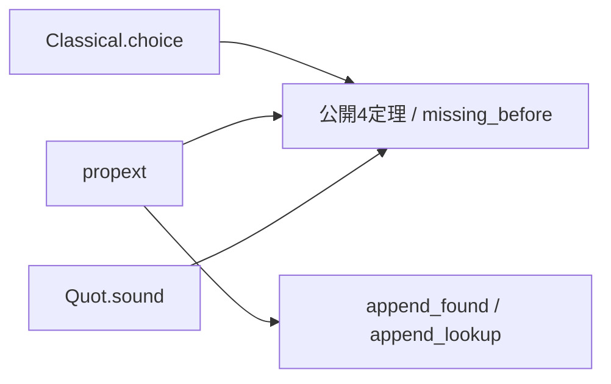
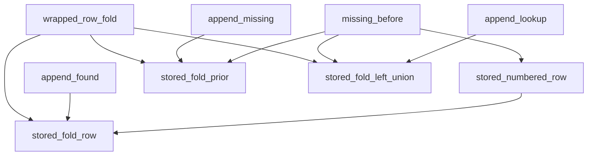

# root [ADR 0352](../adr/0352-prove-pagination-in-lean.md): 採番済みの行を保存して検索する対応

[NumberedStore.lean](../../experiments/pagination-proof/NumberedStore.lean) 全体を Lean 4.7.0 で調べた。
基準は main `bead6802895091038fc1870e4d67ae098c847582` と製品コードが同じ局所証明群 `ec13f15d1ce6631a5bdb1b58c852aea05728a53c` である。
採番した行の順序付き列からの検索を、既存の行を含む fold と接続する。
[root ADR 0352](../adr/0352-prove-pagination-in-lean.md) 全体の実装完了は記録しない。

## 表と入力の範囲

`numberRows` は任意の開始番号から、行の列に連続する番号を付ける。
[WrappedRowFold.lean](../../experiments/pagination-proof/WrappedRowFold.lean) の `runChunks` は、本文の複数の行列を順に追加し、次の番号とそれまでの行の列を返す。
保存は [RoundPayloadStore.lean](../../experiments/pagination-proof/RoundPayloadStore.lean#L11) の `fromPairs` で表し、同じキーには最後の値を返す。
今回の四つの公開定理は任意の行の型、行列、開始番号を扱う。
行の一意性は要求せず、同じ本文の行を複数含めても番号は異なることから、検索した位置の行が保たれると導く。

本体の [numberFigure](../../modules/golem-typeset/src/Golem/Typeset/Flow.hs#L4651) は、各本文の行数だけ番号を進め、[4669 行](../../modules/golem-typeset/src/Golem/Typeset/Flow.hs#L4669) で旧表を優先する `Map.union` を使う。
後勝ちの列の保存が、この union と常に同じとはしない。
旧表優先の union は、旧表に値があればそれを返し、なければ新表を検索する式で表す。
`Data.Map` ライブラリ自体を Lean へ移して検証したものではない。
旧表に現れる番号が次の番号より小さい場合に限り、追加する行の番号と重ならず、旧表優先の union と列からの検索が一致することを四本目で証明する。
この前提を任意の `Built` から導く証明は残る。

## 公理と定理の一覧

モジュールの環境には、公開定理 4 件、手書きの private 定理 4 件、生成定理 10 件、生成定義 16 件、公理宣言 0 件があった。
対象の全 18 定理について型と証明項の参照を取得し、`#print axioms` を実行した。
取得できなかった証明項はない。
手書きの定義はない。

公開定理名の共通接頭辞は `NumberedStore.` である。

| 定理 | 位置 | 前提と結論 |
| --- | --- | --- |
| `root_adr0352_i5_stored_numbered_row` | [16 行](../../experiments/pagination-proof/NumberedStore.lean#L16) | 採番した列を開始番号と位置の和で検索すると、元の列のその位置の行が返る。範囲外ではともに `none` になる。 |
| `root_adr0352_i5_stored_fold_row` | [41 行](../../experiments/pagination-proof/NumberedStore.lean#L41) | 追加する行列の平坦な列のある位置に行があれば、任意の既存の行の列を含む fold 後の保存からその行を検索できる。列の保存は後勝ちである。 |
| `root_adr0352_i5_stored_fold_prior` | [59 行](../../experiments/pagination-proof/NumberedStore.lean#L59) | 次の番号より小さいキーでの旧表の検索結果は、fold の前後で同じである。 |
| `root_adr0352_i5_stored_fold_left_union` | [80 行](../../experiments/pagination-proof/NumberedStore.lean#L80) | 旧表に現れる全キーが次の番号より小さいとき、fold 後の列からの検索は旧表優先の union の検索と一致する。 |

private 定理の共通接頭辞は `_private.experiments.«pagination-proof».NumberedStore.0.NumberedStore.` である。

| 定理 | 位置 | 内容 | 公理 |
| --- | --- | --- | --- |
| `missing_before` | [6 行](../../experiments/pagination-proof/NumberedStore.lean#L6) | 開始番号より小さいキーは、新たな採番済み行の表にない。 | 標準三公理 |
| `append_found` | [32 行](../../experiments/pagination-proof/NumberedStore.lean#L32) | 後半の列に値があれば、任意の前半を付けても同じ値が返る。 | `propext` |
| `append_missing` | [48 行](../../experiments/pagination-proof/NumberedStore.lean#L48) | 後半の列に値がなければ、連結後の結果は前半からの検索と同じである。 | なし |
| `append_lookup` | [67 行](../../experiments/pagination-proof/NumberedStore.lean#L67) | 連結列の検索は、後半に値があればその値、なければ前半の値を返す。 | `propext` |

生成定理名の共通接頭辞は `_private.experiments.«pagination-proof».NumberedStore.0.` である。
次の 10 件は `simp` でインポートした採番と検索を展開した際の等式であり、いずれも公理に依存しない。
宣言位置の情報はなく、生成元は上の四つの private 定理と公開の採番済み行の定理である。

- `NumberedPayload.numberRows._eq_1` と `_eq_2`
- `NumberedPayload.numberRows.match_1.eq_1` と `eq_2`
- `BesideStore.fromPairs._eq_1` と `_eq_2`
- `BesideStore.fromPairs.match_1.eq_1` と `eq_2`
- `BesideStore.fromPairs.match_2.eq_1` と `eq_2`

生成定義 16 件は、これらの展開と `append_missing`、`append_lookup` のパターン分岐を処理する補助定義である。
新しい公理として扱わない。
公開四定理と `missing_before` は標準三公理に依存する。
全 18 定理では、標準三公理に依存するものが 5 件、`propext` だけに依存するものが 2 件、公理に依存しないものが 11 件である。

| 公理 | Lean 4.7.0 の位置 | 内容 |
| --- | --- | --- |
| `Classical.choice` | `Init.Prelude:730` | `Nonempty α` から要素を選ぶ。 |
| `propext` | `Init.Core:1287` | 命題の同値から等式を導く。 |
| `Quot.sound` | `Init.Core:1459` | 関係を満たす二要素が同じ商の値を持つ。 |

公理の図は定義と補助定理を経由する推移的な依存を示す。
公理に依存しない 11 件には辺がない。



次の図の実線は型または証明項に現れた定理の直接参照である。
標準の算術、等式、リストの補題と生成された展開等式は省略した。



対象ソースに `sorry`、`admit`、`sorryAx` はなく、全 18 定理の公理依存にも証明の穴はなかった。
独自の公理と取得できなかった証明項はない。

## 境界と実装の観測

[NumberedStoreBoundary.lean](../../experiments/pagination-proof/NumberedStoreBoundary.lean) は、15 個の閉じた式と公開四定理の利用を検査する。
開始番号 0 と 5、同じ値の行、範囲外、空の行列、空の本文、重複する旧キー、旧値の保存と新値による上書きを含む。
旧表と新表のキーが衝突すると旧表優先の union とは一致しない対照も保持する。
後勝ちの値を旧値にする変異と、開始番号を一つずらす変異は、`decide` が命題を偽と判定して拒否した。

[BesideScanRowsFonts.hs](../../experiments/pagination-proof/BesideScanRowsFonts.hs) の `NUMBERED_ROW_STORE_LEAN=1` は、実フォントで観測した 64 例について保存後の行の値も検索する。
二つの図版、八つの本文の更新履歴、四つの初期状態を組み合わせ、16 例は実装のそれまでの unit を採番した旧表を使う。
実装の完全な行の値と ID の列を照合した後に、Lean には行を表す自然数の列を渡す。
行を表す値は重なる場合もあり、行の順序や数のチェックをこの値の一意性には依存させない。
旧表の全 ID が図版の予約番号より小さいことを実装の観測で確認する。
これは四本目の補題の前提を 64 例で確認した結果であり、任意の `Built` から導く一般証明ではない。

旧 480 式に、保存した旧行と新行の検索 347 式、予約した図版の番号と次の空き番号で `none` を確認する 128 式を加え、全 955 式を Lean のカーネルで確認した。
新しい 475 式を除き追加の import を外すと、残りは以前の 480 式と一致した。
従来の `BESIDE_SCAN_STORE_LEAN=1` の出力も以前のファイルと同一だった。

実装の観測は、GHC 9.10.3 と同じ製品コードの登録済み runtime DB を読み取り専用で使った。
Cabal plan と package cache の実行前後の SHA-256 は一致した。
標準 Cabal 環境を新たに構築したという検証ではない。
本体の private 宣言を読む際は、コピーで export list だけを変え、以後のソースが元の本文と一致することを `check-built-first-ids.sh` で確認する。

```sh
RUNGHC=/private/tmp/golem-0352-current-private-tools-nov28/runghc \
NUMBERED_ROW_STORE_LEAN=1 \
sh experiments/pagination-proof/check-built-first-ids.sh \
  experiments/pagination-proof/BesideScanRowsFonts.hs > /tmp/numbered-store-native.lean
LEAN_PATH="$MODEL_CACHE" lean /tmp/numbered-store-native.lean
```

`MODEL_CACHE` は `check.sh` で構築したモデルのディレクトリを指定する。
任意の本体の `Built`、全制御、一般のキャプション、旧表の ID の前提を初回から全経路で導く証明は残る。
新しい証明専用 CI、製品コードの変更と予算の変更は加えない。

Lean 4.7.0 の `check.sh` 全体も終了コード 0 となった。
配置 55,838 件と 156,520 件、回り込み 10,368 件、因果的配置 4,864 件、制御 216 件、改行 34,586 件、実フォントのキャプション 40 件、公開試し置き 1,344 入力と Alloy 42 件の対応を含む。
Alloy ソルバー自体の再実行とは区別する。
この実行後も、既存 runtime の plan と package cache の SHA-256 は実行前と同じだった。
