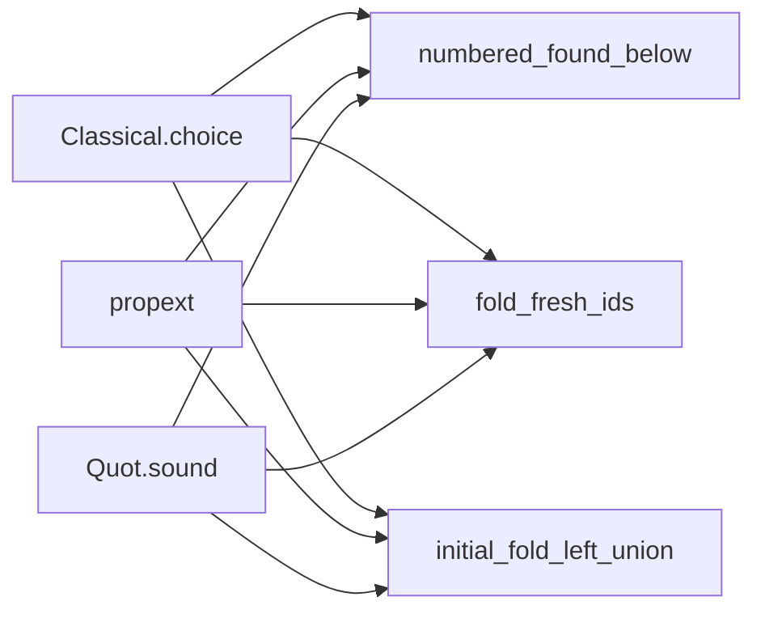
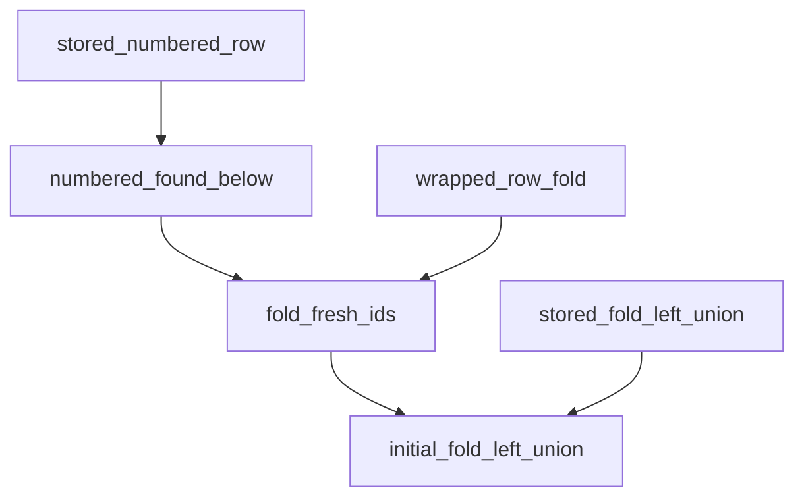

# root [ADR 0352](../adr/0352-prove-pagination-in-lean.md): 行を追加しても既存の番号が次の番号より小さいこと

[NumberedStoreFresh.lean](../../experiments/pagination-proof/NumberedStoreFresh.lean) 全体を Lean 4.7.0 で調べた。
基準は main `bead6802895091038fc1870e4d67ae098c847582` と製品コードが同じ証明増分 `ec13f15d1ce6631a5bdb1b58c852aea05728a53c` である。
[採番済み行の保存](0352-numbered-row-store-dependencies.md) では、旧表のキーが次の番号より小さいことを条件にして、列からの検索と旧表優先の union を接続した。
今回はこの番号の条件が本文の行列の fold で保たれることを示し、空の表から始める経路では条件自体を導く。
[root ADR 0352](../adr/0352-prove-pagination-in-lean.md) 全体の実装完了は記録しない。

## 対象と主張

行の列に連続する番号を付ける `numberRows` と、複数の行列を順に追加する `runChunks` を対象にする。
次の番号と保存済みの行を持つ状態を `RowState` と呼ぶ。
番号の条件は、保存済みの表から値を検索できるすべてのキーが、状態の次の番号より小さいことである。
保存済みの行の値は重複してよく、空の本文も許す。

一本目は、番号の条件を満たす任意の状態から本文の行列を fold しても、条件が保たれると主張する。
新しい行が検索できる場合は、採番した列の位置からキーの上界を導く。
旧表にしか値がない場合は旧状態の条件と、次の番号が減らないことを使う。
二本目は任意の開始番号の空の表から任意の先行する行列を fold し、そこへさらに行列を足す場合を扱う。
空の表にはキーがないことから旧状態の条件を満たし、一本目を使って後続の旧表優先の union との一致を導く。
二本目では、旧表の番号の条件を前提にしていない。

これは行の列を追加するモデルの経路である。
本体の全 unit の採番や、図版用の ID を行以外に予約する経路を、空の表からのこの fold へ写した一般証明ではない。
[本体の観測](0352-numbered-row-store-dependencies.md#境界と実装の観測) の 64 例で旧表の番号の条件を確認した結果と、モデルの一般定理を区別する。

## 公理と定理の一覧

モジュールの環境には、公開定理 2 件、手書きの private 定理 1 件、生成定理 10 件、生成定義 14 件、公理宣言 0 件があった。
全 13 定理について型と証明項の参照を取得し、`#print axioms` を実行した。
取得できなかった証明項はなく、手書きの定義もない。
証明内の局所補題の依存は、展開後の証明項に含めて取得した。

公開定理の共通接頭辞は `NumberedStoreFresh.` である。

| 定理 | 位置 | 前提と結論 |
| --- | --- | --- |
| `root_adr0352_i5_fold_fresh_ids` | [26 行](../../experiments/pagination-proof/NumberedStoreFresh.lean#L26) | 旧表から値が返るキーが次の番号より小さい状態なら、任意の行列の fold 後にも同じ番号の条件が成り立つ。 |
| `root_adr0352_i5_initial_fold_left_union` | [58 行](../../experiments/pagination-proof/NumberedStoreFresh.lean#L58) | 空の表から先行する行列を fold してから行列を足すと、列からの検索と旧表優先の union が一致する。番号の条件はこの経路から導く。 |

private 定理の完全名は `_private.experiments.«pagination-proof».NumberedStoreFresh.0.NumberedStoreFresh.numbered_found_below` である。
[5 行](../../experiments/pagination-proof/NumberedStoreFresh.lean#L5) で、採番した列から値を検索できるキーは、開始番号と行数の和より小さいと証明する。
公開二定理とこの private 定理は標準三公理に依存する。

生成定理の共通接頭辞は `_private.experiments.«pagination-proof».NumberedStoreFresh.0.` である。
次の 10 件はインポートした採番と検索を展開する等式であり、公理に依存しない。
宣言位置の情報はなく、上の private 定理と一本目の公開定理の展開が生成元である。

- `NumberedPayload.numberRows._eq_1` と `_eq_2`
- `NumberedPayload.numberRows.match_1.eq_1` と `eq_2`
- `BesideStore.fromPairs._eq_1` と `_eq_2`
- `BesideStore.fromPairs.match_1.eq_1` と `eq_2`
- `BesideStore.fromPairs.match_2.eq_1` と `eq_2`

生成定義 14 件は、これらの展開と証明内のパターン分岐に由来する補助定義である。
新しい公理ではない。

| 公理 | Lean 4.7.0 の位置 | 内容 |
| --- | --- | --- |
| `Classical.choice` | `Init.Prelude:730` | `Nonempty α` から要素を選ぶ。 |
| `propext` | `Init.Core:1287` | 命題の同値から等式を導く。 |
| `Quot.sound` | `Init.Core:1459` | 関係を満たす二要素が同じ商の値を持つ。 |

次の公理の図は、補助定理と定義を経由する推移的な依存である。
公理に依存しない生成定理 10 件には辺がない。



次の図の実線は型または証明項の定理の直接参照である。
標準の算術、等式、リストと生成された展開等式は省略した。



対象ソースに `sorry`、`admit`、`sorryAx` はなく、全 13 定理の公理依存にも証明の穴はなかった。
独自の公理と取得できなかった証明項はない。

## 境界と残り

[NumberedStoreFreshBoundary.lean](../../experiments/pagination-proof/NumberedStoreFreshBoundary.lean) は、九つの閉じた式と、任意の引数で二本目の定理を利用する例を検査する。
空の本文、同じ値の二行、開始番号 4 から行を三つ追加した後の番号 7、検索できる末尾 6 と範囲外 7 を含む。
次の番号 5 に対し旧表がキー 99 を持つと、空の本文を足しても番号の条件が成り立たない対照を保持する。
これは任意の旧表に対して一本目の条件を単に取り除けない例である。
追加後の次の番号を 4 にする変異と、キー 99 の条件を真へ変える変異は、`decide` が命題を偽と判定して拒否した。

```sh
LEAN_PATH="$MODEL_CACHE" lean -o "$MODEL_CACHE/NumberedStoreFresh.olean" \
  experiments/pagination-proof/NumberedStoreFresh.lean
LEAN_PATH="$MODEL_CACHE" lean experiments/pagination-proof/NumberedStoreFreshBoundary.lean
```

`MODEL_CACHE` は `check.sh` で構築したモデルのディレクトリを指定する。
新しい本体の観測や任意の計測を、今回の定理の前提にはしていない。
任意の `Built`、全 unit の採番、全制御、一般のキャプションと実装の接続は残る。
新しい証明専用 CI、製品コードの変更と予算の変更は加えない。

部分採用の rank と採番済み行の保存の増分を合わせ、Lean 4.7.0 の `check.sh` 全体も終了コード 0 となった。
今回の二つの公開定理と九つの境界に加え、公開試し置き 1,792 入力、既存の配置 55,838 件と 156,520 件、回り込み 10,368 件、因果的配置 4,864 件、制御 216 件、改行 34,586 件、実フォントのキャプション 40 件と Alloy 42 件の対応を含む。
Alloy のソルバー自体の再実行ではない。
GHC 9.10.3 と同じ製品コードの既存 runtime DB を読み取り専用で利用し、実行前後の plan と package cache の SHA-256 は一致した。
標準の Cabal 環境を新たに構築したという検証ではない。
