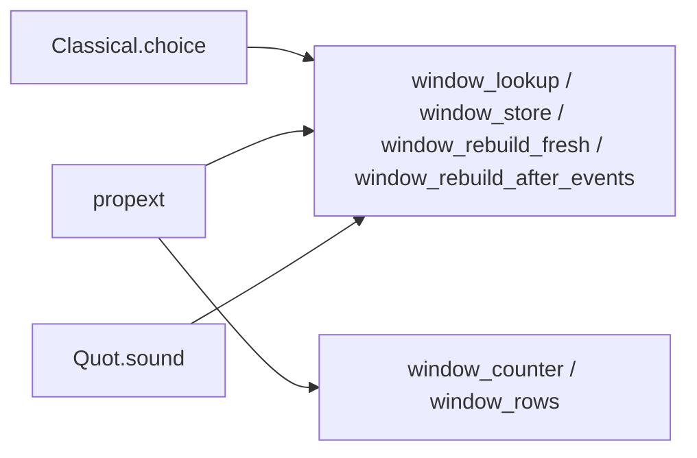
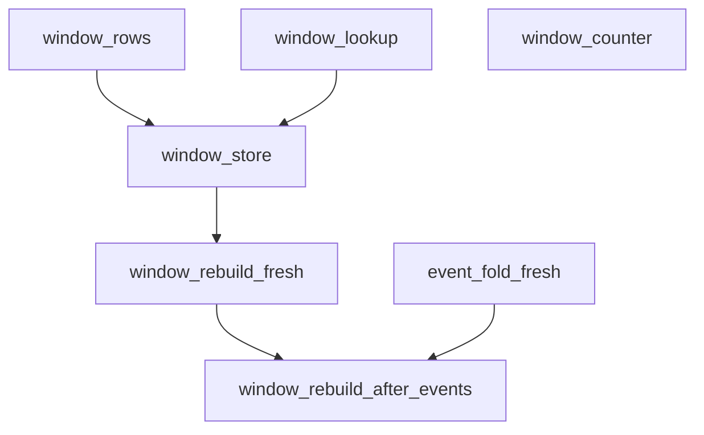

# root [ADR 0352](../adr/0352-prove-pagination-in-lean.md): 表の有限区間から採番操作と検索を再構成する

[NumberedWindowStore.lean](../../experiments/pagination-proof/NumberedWindowStore.lean) 全体を Lean 4.7.0 で調べた。
基準は、製品コードが main `8aeab8cac9e554ee32ea1c864a06c67868607e04` と同じ証明増分 `00dab7bcb45e9736db651cd661f1c48bd8550460` である。
[予約を含む操作列](0352-numbered-event-store-dependencies.md) では、実装の表のスナップショットから操作列を作る有限の例を検査した。
今回は任意の検索関数の有限区間を操作列へ移し、同じ検索結果を得る一般定理を追加する。
[root ADR 0352](../adr/0352-prove-pagination-in-lean.md) 全体の実装完了は記録しない。

モデル、境界と実装の観測器のソースは、次の SHA-256 で固定する。

| ファイル | SHA-256 |
| --- | --- |
| `NumberedWindowStore.lean` | `f80e1488fc0eaaa236ec011493a06772438a8a71b85acf6fc036e75f65fc804c` |
| `NumberedWindowStoreBoundary.lean` | `02cc05ad28bd8387a776ce6a1d7712732bb8c630db760b010cde71e2b69768c8` |
| `BesideScanRowsFonts.hs` | `cda1b641118dfb96c9b89ba5f2ae8ab6c12229a17ccf76edab0029d701c64152` |
| `check.sh` | `0888748d22afb14cfe14446dd4848dbd102d6f75db0a550fefc3323ddfe1d842` |

## 区間と主張

表は `Nat → Option α` という検索関数で表す。
表全体の有限性や、区間外に値がないことは要求しない。
`eventAt` はキーに値があれば一行の追加、なければ一つの ID の予約を返す。
`windowEvents` は開始キーから指定した個数だけ、キーを一つずつ進めて操作を作る。
`windowRows` は同じ区間の値があるキーと値だけを、キーの順に並べる。
個数 0 は空の区間である。

最初の三定理は、消費する ID の数が区間の個数と一致し、操作後の行が `windowRows` に対応することを示す。
検索は開始キー以上かつ開始キーと個数の和未満なら元の表と同じ値を返し、区間外なら `none` を返す。
この区間の式は結論であり、検索キーを区間内だけに制限する前提ではない。

四本目は、保存済みのキーが次の番号より小さいという `Fresh` の条件を満たす状態を扱う。
0 から次の番号までの区間を使って状態の表を再構成すると、すべての検索キーで元の結果を保つ。
範囲外に値がないことは、`Fresh` と検索結果から導く。
五本目では空の表から予約と行追加の操作を fold し、既存の定理で `Fresh` を導いて四本目に接続する。
この経路では `Fresh` 自体も前提にしない。

保存する行の列と、キーによる検索の意味は区別する。
重複する旧キーや元の列の並べ方にかかわらず、再構成は表の検索結果を保つが、元の順序付き列とそのまま等しいとは主張しない。
任意の本体の `numberUnit` をこの操作列へ写した証明でもない。
モデルの ID は `Nat` であり、本体の `Int` の全範囲との一般的一致は残る。

## 定理と公理

対象モジュールの環境には、公開定理 5 件、手書きの private 定理 1 件、生成定理 20 件、手書き定義 3 件、生成定義 36 件、公理宣言 0 件があった。
全 26 定理の型と証明項の参照を取得し、`#print axioms` を実行した。
取得できなかった証明項はない。

公開定理名の共通接頭辞は `NumberedWindowStore.` である。

| 定理 | 位置 | 前提と結論 |
| --- | --- | --- |
| `root_adr0352_i5_window_counter` | [21 行](../../experiments/pagination-proof/NumberedWindowStore.lean#L21) | 任意の表と開始キーで、操作の ID 消費数は指定した個数になる。 |
| `root_adr0352_i5_window_rows` | [28 行](../../experiments/pagination-proof/NumberedWindowStore.lean#L28) | 任意の旧状態から次の番号を開始キーとして操作すると、旧行の列の後に区間内のキーと値の列を追加する。 |
| `root_adr0352_i5_window_store` | [63 行](../../experiments/pagination-proof/NumberedWindowStore.lean#L63) | 空の表から操作すると、指定区間内の検索は元の表と同じになり、区間外では `none` になる。 |
| `root_adr0352_i5_window_rebuild_fresh` | [70 行](../../experiments/pagination-proof/NumberedWindowStore.lean#L70) | `Fresh` を満たす状態の表を 0 から次の番号まで再構成すると、すべてのキーで検索結果を保つ。 |
| `root_adr0352_i5_window_rebuild_after_events` | [83 行](../../experiments/pagination-proof/NumberedWindowStore.lean#L83) | 空の表から任意の予約と行追加の操作を fold した状態では、番号の条件を導き、再構成後の検索結果が元の結果と一致する。 |

private 定理の完全名は `_private.experiments.«pagination-proof».NumberedWindowStore.0.NumberedWindowStore.window_lookup` である。
[43 行](../../experiments/pagination-proof/NumberedWindowStore.lean#L43) で、`windowRows` の列からの検索が区間内で元の表と一致し、区間外で `none` となると示す。

生成された 20 定理はすべて展開等式で、公理に依存しない。
共通接頭辞は `_private.experiments.«pagination-proof».NumberedWindowStore.0.` である。

- `NumberedWindowStore.windowRows._eq_1` と `_eq_2`
- `NumberedWindowStore.windowEvents._eq_1` と `_eq_2`
- `NumberedWindowStore.windowEvents.match_1.eq_1` と `eq_2`
- `NumberedEventStore.eventCount._eq_1`、`_eq_2`、`_eq_3`
- `NumberedEventStore.eventCount.match_1.eq_1`、`eq_2`、`eq_3`
- `NumberedPayload.numberRows._eq_1` と `_eq_2`
- `NumberedPayload.numberRows.match_1.eq_1` と `eq_2`
- `BesideStore.fromPairs._eq_1` と `_eq_2`
- `BesideStore.fromPairs.match_2.eq_1` と `eq_2`

これらは区間を進める定義、行数の計算、採番と検索を証明内で展開した際に生成された。
宣言位置の情報はない。
手書き定義は `eventAt`、`windowEvents`、`windowRows` の三つで、すべて `safe` である。
全 39 定義の安全性は `safe` が 12 件、`unsafe` が 25 件、`partial` が 2 件だった。
後二者は生成された実行用の補助定義である。
`partial` の二件は `windowEvents._unsafe_rec` と `windowRows._unsafe_rec` である。
公開の安全な本体はどちらも `Nat.brecOn` を使い、この二件を直接呼ばない。
全 26 定理の型と証明項から定理と定義の本体をたどった 1,264 定数に、`unsafe` と `partial` の定義の参照はなかった。

区間を保存する公開定理と再構成の公開二定理、private の検索定理は標準三公理に依存する。
行数と行の列の公開二定理は `propext` だけに依存し、生成された 20 定理は公理に依存しない。

| 公理 | Lean 4.7.0 の位置 | 内容 |
| --- | --- | --- |
| `Classical.choice` | `Init.Prelude:730` | `Nonempty α` から要素を選ぶ。 |
| `propext` | `Init.Core:1287` | 命題の同値から等式を導く。 |
| `Quot.sound` | `Init.Core:1459` | 関係を満たす二要素が同じ商の値を持つ。 |

次の公理の図は、定義や補助定理を経由する推移的な依存を示す。
公理に依存しない生成定理 20 件には辺がない。



次の図の実線は型または証明項に現れた定理の直接参照である。
標準の算術、等式とリストの補題と生成された展開等式は省略した。
`window_counter` はプロジェクトのほかの定理を直接参照しない。



対象ソースに `sorry`、`admit`、`sorryAx` はなく、全 26 定理の公理依存にも証明の穴はなかった。
独自の公理と取得できなかった証明項はない。

## 境界と実装の観測

[NumberedWindowStoreBoundary.lean](../../experiments/pagination-proof/NumberedWindowStoreBoundary.lean) は、15 個の閉じた式と公開五定理の利用を検査する。
区間の開始は 0、1、2、個数は 0、1、5 とする。
区間外にも値がある表、重複する元のキーの最後の値、値 0、空きの ID、下限を含み上限を含まないことを対照にする。
下限より前と上限の値を含める変異、同じキーの古い値を返す変異、値 0 を `none` にする変異は、`decide` が命題を偽と判定して拒否した。
値のないキーで ID を予約しない定義の変異も、ID 消費数の定理で拒否した。

[BesideScanRowsFonts.hs](../../experiments/pagination-proof/BesideScanRowsFonts.hs) の `NUMBERED_WINDOW_STORE_LEAN=1` は、既存の 64 例の旧表を区間の検索関数としてモデルへ渡す。
次の番号の計算と、区間内の行の列が旧表の全キーと値の列に一致することを、128 個の閉じた式で確認する。
区間の一般的な検索式と、その有限の行の列の一致から任意の検索キーでも元の表と一致する式を、128 個のキーを限定しない式で確認する。
既存の 1,211 例と合わせた全 1,467 例が Lean のカーネルで通った。
この一致は実装のスナップショット 64 例についてのもので、任意の本体の採番経路の翻訳ではない。

生成するファイルでは `set_option autoImplicit false` を指定し、未定義の識別子を暗黙の変数にしない。
関数の名前空間を省く変異は、未知の識別子として拒否した。
追加の import とこの指定、256 例を除いた部分は以前の 1,211 例と同じであり、従来のモードの生成出力も以前のファイルと同一だった。

```sh
RUNGHC=/private/tmp/golem-0352-current-private-tools-nov28/runghc \
NUMBERED_WINDOW_STORE_LEAN=1 \
sh experiments/pagination-proof/check-built-first-ids.sh \
  experiments/pagination-proof/BesideScanRowsFonts.hs > /tmp/numbered-windows-native.lean
LEAN_PATH="$MODEL_CACHE" lean /tmp/numbered-windows-native.lean
```

`MODEL_CACHE` は `check.sh` で構築したモデルのディレクトリを指定する。
実装の観測は GHC 9.10.3 と同じ製品コードの登録済み runtime DB を読み取り専用で使い、private 宣言を読むコピーは export list 以後の本文が元と同一であることを検査する。
標準の Cabal 環境を新たに構築したという検証ではない。
任意の `Built`、全制御、元の本文の全量と順序、一般のキャプションと実装の接続は残る。
新しい証明専用 CI、製品コードの変更と予算の変更は加えない。

Lean 4.7.0 の `check.sh` 全体も終了コード 0 となった。
新しい五つの公開定理と 15 個の境界に加え、公開試し置き 1,792 入力、既存の配置 55,838 件と 156,520 件、回り込み 10,368 件、因果的配置 4,864 件、制御 216 件、改行 34,586 件、実フォントのキャプション 40 件と Alloy 42 件の対応を含む。
Alloy のソルバー自体の再実行ではない。
この実行と実装の観測の後も、既存 runtime の plan と package cache の SHA-256 は実行前の値と一致した。
