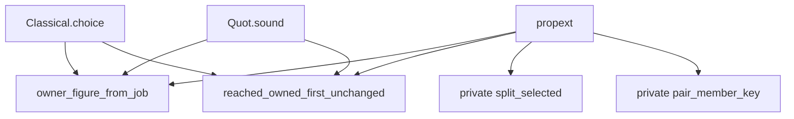
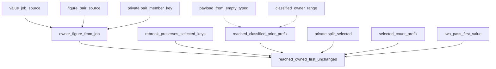

# [root ADR 0352](../adr/0352-prove-pagination-in-lean.md) の到達した本文と所有段落の先頭 ID

## 範囲

基準は `e1fb6bf34` の本体と既存モデルである。
[OwnedFirst.lean](../../experiments/pagination-proof/OwnedFirst.lean) を Lean 4.7.0（`aarch64-apple-darwin`）で検査した。
本体と公開 API は変更していない。
この増分は、[単位の分類から導いた先行採番増分](0352-classified-prefix-dependencies.md) を、現在の図版 job と対象の本文の先頭 ID へ接続する。

`ownedFirstId` は、その図版が所有する本文の先頭 ID だけを返す。
現在の本文の表と単位から `candidateKeys` を作り、対象が含まれなければ `none` を返す。
含まれる場合は、最初の対象より前と後のキーを分け、既存の二段階の採番を使う。
呼び出し側が自由な分割の等式を渡す構成ではない。
後続の単位を空の列とするのは、先頭 ID が後続の採番増分に依存しない既存の定理を使うためであり、本体の後続の単位が空であるという前提ではない。

最後の定理では、空の cache からの到達と、現在の図版の表から生成した job の所属を前提にする。
job の所有者が現在の図版であること、cache の型、先行所有者の範囲、対象より前の本文の分割を既存の定理と局所補題から導く。
本文の値だけを変えたとき、その図版の `ownedFirstId` が一致することを示す。
対象の所属は前提にせず、所属しない場合は両方が `none` となる。

この `none` は、本全体でその単位に ID がないという意味ではない。
別の図版が所有する本文や普通の単位は、本体の `bUnitFirsts` では ID を持つ場合がある。
また、先行する別の図版の本文を変えれば対象図版より前の採番増分は変わりうる。
この場合でも、対象図版の選択外のキーに対する `none` が変わらないという限定した結論である。

本体の [job の生成](../../modules/golem-typeset/src/Golem/Typeset/Flow.hs#L4867) は、現在の図版の表から選ぶ。
選択条件は最初の診断列が空で回り込みの exclusion があることであり、caption の本文の空判定ではない。
[numberComposedFlow](../../modules/golem-typeset/src/Golem/Typeset/Flow.hs#L4914) は単位の採番後に、回り込み図版の本文の先頭 ID を加える。
その [besideFirsts](../../modules/golem-typeset/src/Golem/Typeset/Flow.hs#L4966) の計算が、この増分の照合対象である。

## 定理と公理

Lean の環境から宣言の種類、型、elaboration 後の証明項を取得した。
公開定理 2 件、手書きの private 定理 2 件、生成定理 6 件、定義 20 件、公理宣言 0 件だった。
手書きの定義は `beforeTarget`、`afterTarget`、`ownedFirstId` の 3 件であり、残りは生成定義である。
全 10 定理に同じ型の別名を一時環境で作り、kernel の検査と `#print axioms` を行った。

公開名の共通接頭辞は `BesideOwnedFirst.` である。
標準三公理は `propext`、`Classical.choice`、`Quot.sound` を指す。

| 名前 | 位置 | 前提と結論 | 公理 |
| --- | --- | --- | --- |
| `root_adr0352_i5_owner_figure_from_job` | [35 行](../../experiments/pagination-proof/OwnedFirst.lean#L35) | 現在の図版の列から生成した job の所属から、所有者が現在の図版であることを導く。 | 標準三公理 |
| `root_adr0352_i5_reached_owned_first_unchanged` | [52 行](../../experiments/pagination-proof/OwnedFirst.lean#L52) | 空の cache からの到達と現在の図版 job の所属から、対象本文の値を変えても所有段落の先頭 ID の照会結果は変わらない。 | 標準三公理 |

private 定理の共通接頭辞は `_private.experiments.«pagination-proof».OwnedFirst.0.BesideOwnedFirst.` である。

| 名前 | 位置 | 前提と結論 | 公理 |
| --- | --- | --- | --- |
| `split_selected` | [13 行](../../experiments/pagination-proof/OwnedFirst.lean#L13) | 所属する対象の前後を `beforeTarget` と `afterTarget` で分けると元の列になる。 | `propext` |
| `pair_member_key` | [26 行](../../experiments/pagination-proof/OwnedFirst.lean#L26) | 組の列への所属からキーの列への所属を導く。 | `propext` |

生成定理 6 件の共通接頭辞も上の private 接頭辞と同じである。
生成位置は取得できず、いずれも公理への依存はない。

| 名前の前半 | suffix | 由来 |
| --- | --- | --- |
| `beforeTarget` | `._eq_1`, `._eq_2`, `.match_1.eq_1`, `.match_1.eq_2` | 対象より前の列を取る再帰の簡約 |
| `afterTarget` | `._eq_1`, `._eq_2` | 対象の後の列を取る再帰の簡約 |

標準公理への依存には、既存の定理を経由する依存も含む。
`propext` は命題の同値からの等値（Lean の `Init/Core.lean:1287`）、`Classical.choice` は空でない型からの選択（`Init/Prelude.lean:730`）、`Quot.sound` は同値関係で結ばれた値の商での等値（`Init/Core.lean:1459`）である。
新しい公理宣言、`sorry`、`admit` はなく、それらによる未証明の結論はない。

公理の図は推移的な依存を示す。
公理に依存しない生成定理 6 件は省略した。



定理の図では、実線が elaboration 後の型か証明項の直接参照、点線が示した補助定理を経由する依存である。
標準の論理と算術の補助定理は省略した。



前二つの既存定理の依存は [図版値と job 状態](0352-job-values-dependencies.md) と [図版の表](0352-figure-table-dependencies.md) を参照する。
到達、範囲、先行採番増分の経路は [単位の分類](0352-classified-prefix-dependencies.md) を参照する。
二段階の採番の式は [二段階の採番の依存](0352-built-first-id-dependencies.md) に記録している。

## 境界と実装との照合

最初は新しい名前空間と API がない状態で試験し、Lean が終了コード 1 を返した。
[OwnedFirstBoundary.lean](../../experiments/pagination-proof/OwnedFirstBoundary.lean) の 12 式は修正後に通った。
二つの図版、自分の本文の 0 行への変更、別の図版の本文、図版自身のキー、範囲外、先行する別の本文を変える場合を含む。
最後の式は、空の cache からの到達と実際の job の所属を与え、最後の公開定理を使う。

[OwnedFirstFonts.hs](../../experiments/pagination-proof/OwnedFirstFonts.hs) は、表、コード、改ページと回り込みの制御、二つの図版と三つの所有段落を含む有効な原稿を実フォントで組む。
脇の本文の行列を配置後に 0、1、3、7 行へ手で変え、実際の `numberUnit` と `numberComposedFlow` を呼び直す 12 例である。
12 冊の通常 CLI の出力を比較したとは扱わない。
単位と図版の表から得た値をモデルへ渡す。
図版の値は実際のソース位置と選択条件の真偽へ射影し、観測したソース位置が負でないことを確かめた。
job の初期状態は、その図版のソース位置である。
本体の job が fuel のフィールドを持つとは扱わず、モデルの残りの長さは単位数と所有者から算定する。

最初に、モデルの到達した cache の組の列が実際の本文のキーと行数の列になることを 1 式で比較した。
各変更について、変更前と変更後の `ownedFirstId` を本体の先頭 ID と比較する 2 式と、最後の公開定理を適用する 1 式を出力した。
計 37 式が kernel で通った。
非所有のキーの `none` は局所境界で調べ、本体の全単位の ID がないという誤った比較はしていない。

照合に使った本体のソースは `0aa78f65ac691cdd8d1a3bd5fc4c8bffb1feabdb` であり、今回の作業ツリーの `modules/` との差はない。
GHC 9.10.3 と、既存の専用 package DB を read-only で使った。
plan と package cache の hash を前後で確認し、通常の Cabal による再ビルドと混同しない。

```sh
OWNED_FIRST_LEAN=1 RUNGHC=/private/tmp/golem-0352-built-probe-nov28/runner \
  sh experiments/pagination-proof/check-built-first-ids.sh \
  "$PWD/experiments/pagination-proof/OwnedFirstFonts.hs" > /private/tmp/golem-0352-owned-first-fonts-examples-nov28.lean
LEAN_PATH=/private/tmp/golem-0352-numbered-output-cache-nov28 \
  /Users/tett23/.elan/toolchains/leanprover--lean4---v4.7.0/bin/lean \
  /private/tmp/golem-0352-owned-first-fonts-examples-nov28.lean
```

対象自身の行数も先頭 ID に加算する変異では、最後の公開定理の正の所属の分岐が証明できず、Lean は終了コード 1 を返した。
先頭 ID が自分の本文の長さに依存する誤った式を、この定理は受け入れない。
この変異の拒否は、任意の製品実装の全ての誤りを検出する保証ではない。

## 全体の検査

`check.sh` にこのモデルと局所境界を加え、GHC 9.10.3 と Lean 4.7.0 の既存の全検査が終了コード 0 で通った。
grid 55,838 件、free 156,520 件、回り込みの試し置き 10,368 件、causal 4,864 件、制御 216 件、改行の評価 34,586 件、実フォントの caption 40 件を保った。
Alloy の 42 コマンドに対応する既存の Lean の検査も通ったが、Alloy を新たに 42 回動かしたという意味ではない。

plan の SHA-256 は `981a01138b41bf0d6b1e8ea82155b2ed1227297b7339699bbc60005bc4c83957`、package DB の cache は `dd7fdb3fca241d4a7039e18fccf8ff7065a265540225c2cf813e5b07cbe75fc8` で、検査の前後で変わらなかった。
共有の build や依存の版は更新していない。

## 未証明の範囲

現在の図版 job の所属と空からの到達は、モデルの呼び出し元に必要な前提として残る。
本体の全 `Built` からこの到達と job の所属を導く一般的な接続は、まだ証明していない。
固定の採番件数の計算、Int と Nat の対応、Map の意味論、配置の callback と図版の全フィールド、caption の計算も残る。

この定理は、所有段落の先頭 ID の更新に関する局所的な不変性である。
ページ付けの全制御、本文の全量と順序、`hb` の全呼び出し元、`captionCompared` と改行器の一般的一致を完成扱いしない。
呼び出し側の強制配置の変更は、この増分へ取り込んでいない。
root [ADR 0352](../adr/0352-prove-pagination-in-lean.md) の状態は採択済み未実装のままとする。
