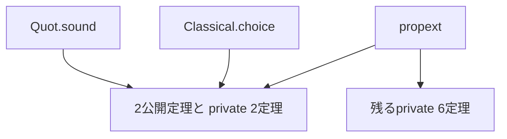
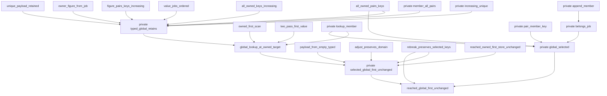

# [root ADR 0352](../adr/0352-prove-pagination-in-lean.md) の全図版の所有段落の先頭 ID

## 範囲

基準は `1bae1f283` の本体と既存モデルである。
[OwnedGlobal.lean](../../experiments/pagination-proof/OwnedGlobal.lean) を Lean 4.7.0（`aarch64-apple-darwin`）で検査した。
本体と公開 API は変更していない。
この増分は、[全図版の採番列の連結](0352-owned-rows-dependencies.md) に渡していた開始 ID を、[分類した先行単位の寄与](0352-classified-prefix-dependencies.md) から計算する。

`derivedStart` は、その図版より前の単位の寄与を足し、図版自身の次の ID を得る。
全図版の `allPairs` が同じ規則を使う。
最初の公開定理では、ある図版の選択に入る対象について、この全列の格納後の照会が一つの図版の `storedOwnedFirst` と一致することを示す。

最後の公開定理は、空から到達した cache と現在の図版の表からの job の生成だけを使う。
対象と同じキーの本文の値を変えても、その対象を全列の格納から照会した先頭 ID が変わらないことを、全ての Nat の対象に対して示す。
job の選択、対象の所属、図版の開始 ID を、自由な前提として要求しない。
格納に値があればその元の局所的な組と所有者を導き、新しい側だけで値が見つかった場合も、選択キーの不変性から元の側の所有者を得る。
どちらにも値がない場合は両方が `none` となる。

ここで照会する表は、全図版が所有する段落の表である。
通常の単位を含む本体の `unitFirsts` 全体ではない。
また、変える本文のキーと照会するキーは同じである。
先行する別の本文を変えれば、後の本文の ID は変わりうるため、表全体の値が不変だとは扱わない。

固定の採番件数は引き続き単位の分類の入力である。
開始 ID の加算式をモデル内で接続したことと、本体の全分岐がその固定件数を返す一般的一致とは区別する。
本体の対象は [numberComposedFlow](../../modules/golem-typeset/src/Golem/Typeset/Flow.hs#L4914) と [besideFirsts](../../modules/golem-typeset/src/Golem/Typeset/Flow.hs#L4966) である。

## 定理と公理

Lean の環境から宣言の種類、型、elaboration 後の証明項と直接の定理参照を取得した。
公開定理 2 件、手書きの private 定理 9 件、生成定理 9 件、定義 9 件、公理宣言 0 件だった。
手書きの定義は `derivedStart` の 1 件である。
全 20 定理について同じ型の別名を一時環境で作り、kernel の検査と `#print axioms` を行った。

公開名の共通接頭辞は `BesideOwnedGlobal.` である。
標準三公理は `propext`、`Classical.choice`、`Quot.sound` を指す。

| 名前 | 位置 | 前提と結論 | 公理 |
| --- | --- | --- | --- |
| `root_adr0352_i5_global_lookup_at_owned_target` | [70 行](../../experiments/pagination-proof/OwnedGlobal.lean#L70) | 型の合う本文と現在の図版 job、その選択の対象から、開始 ID を計算した全列の照会と局所的な照会の一致を導く。 | 標準三公理 |
| `root_adr0352_i5_reached_global_first_unchanged` | [166 行](../../experiments/pagination-proof/OwnedGlobal.lean#L166) | 空からの到達と現在の図版 job の生成から、同じ対象の本文の値の更新前後で全図版の表からの照会が一致する。所有者と対象の選択の前提を取り除く。 | 標準三公理 |

private 定理の共通接頭辞は `_private.experiments.«pagination-proof».OwnedGlobal.0.BesideOwnedGlobal.` である。

| 名前 | 位置 | 概要 | 公理 |
| --- | --- | --- | --- |
| `increasing_unique` | [5 行](../../experiments/pagination-proof/OwnedGlobal.lean#L5) | 厳密な昇順からキーの一意性を導く。 | なし |
| `member_all_pairs` | [13 行](../../experiments/pagination-proof/OwnedGlobal.lean#L13) | 局所的な採番列の組は全列にも含まれる。 | `propext` |
| `typed_global_retains` | [27 行](../../experiments/pagination-proof/OwnedGlobal.lean#L27) | 本文の型と現在の図版 job から、局所的な組の値が全列の格納後も残る。 | 標準三公理 |
| `lookup_member` | [44 行](../../experiments/pagination-proof/OwnedGlobal.lean#L44) | 格納後に見つかった組は元の列に含まれる。 | `propext` |
| `selected_global_first_unchanged` | [94 行](../../experiments/pagination-proof/OwnedGlobal.lean#L94) | 選択された対象について、更新前後の本文の型と選択キーを保ち、全列の照会の一致を局所の先頭 ID の一致から導く。 | 標準三公理 |
| `append_member` | [126 行](../../experiments/pagination-proof/OwnedGlobal.lean#L126) | 連結したキーの所属を左右に分ける。 | `propext` |
| `belongs_job` | [136 行](../../experiments/pagination-proof/OwnedGlobal.lean#L136) | 全選択のキーには、それを選んだ job がある。 | `propext` |
| `pair_member_key` | [147 行](../../experiments/pagination-proof/OwnedGlobal.lean#L147) | 組の所属からキーの所属を導く。 | `propext` |
| `global_selected` | [156 行](../../experiments/pagination-proof/OwnedGlobal.lean#L156) | 全列の格納に値があれば、その対象を選んだ job を導く。 | `propext` |

生成定理の共通接頭辞は `_private.experiments.«pagination-proof».OwnedGlobal.0.` である。
次の前半と suffix を組み合わせると全 9 件の名前になる。
いずれも生成位置は取得できず、公理への依存はない。

| 名前の前半 | suffix | 件数 |
| --- | --- | --- |
| `BesideOwnedRows.allKeys` | `._eq_1`, `._eq_2`, `.match_1.eq_1`, `.match_1.eq_2` | 4 |
| `BesideStore.fromPairs` | `._eq_1`, `._eq_2`, `.match_2.eq_1`, `.match_2.eq_2` | 4 |
| `BesideReuse.candidateKeys` | `._eq_1` | 1 |

標準公理への依存には既存の補助定理を経由するものも含む。
`propext` は命題の同値からの等値（Lean の `Init/Core.lean:1287`）、`Classical.choice` は空でない型からの選択（`Init/Prelude.lean:730`）、`Quot.sound` は同値関係で結ばれた値の商での等値（`Init/Core.lean:1459`）である。
新しい公理宣言、`sorry`、`admit` はない。

公理の図は推移的な依存を表す。
公理に依存しない private 1 定理と生成定理 9 件は省略した。

定理の図の実線は型か証明項の直接参照、点線は示した補助定理を経由する依存である。
標準の論理と算術の補助定理は省略した。

既存の根拠は [所有段落の先頭 ID](0352-owned-first-dependencies.md)、[採番列と格納](0352-owned-scan-dependencies.md)、[全図版の列の連結](0352-owned-rows-dependencies.md) を参照する。

## 境界、変異と実装との照合

新しい API がない状態で試験が終了コード 1 を返し、追加後に [OwnedGlobalBoundary.lean](../../experiments/pagination-proof/OwnedGlobalBoundary.lean) の 9 式が通った。
8 件の閉じた式と、任意の対象を引数に持つ最後の式である。
図版自身と不在のキー、自分の本文の 0 行への変更を含む。
先行する別の本文を変えると後の対象の ID が 4 から 11 へ変わる対照も残し、表全体の不変性と混同しない。

開始 ID に所有者の直後の本文の行数も加える変異は、局所と全列の照会をつなぐ証明に失敗し、Lean が終了コード 1 を返した。
別に、その変異の計算式では対象自身の本文の変更で先頭 ID が 3 から 10 へ変わる具体例と、その不等式の 3 式を kernel で確認した。
証明項の書き方の違いだけを反例とは扱わない。

[OwnedGlobalFonts.hs](../../experiments/pagination-proof/OwnedGlobalFonts.hs) は、表、コード、制御、二つの図版と三つの所有段落を実フォントで組む。
配置後の本文の行列を 0、1、3、7 行へ手で変え、実際の採番を呼び直す 12 例である。
本体の図版ごとの採番列を連結し、モデルの `derivedStart` と固定の単位の分類から計算した全列と、変更前後で比較する。
開始 ID の正解を callback へ渡す前の増分と異なり、この照合のモデルは先行する寄与から開始 ID を計算する。

最初の cache の 1 式と、各例の変更前後の全列、対象の照会、最後の公開定理の適用の 4 式の計 49 式が kernel で通った。
最後の公開定理の適用には、所有者の所属や対象の選択を渡していない。
入力の 12 例を 12 冊の通常 CLI の比較とは扱わず、全 `Built` の到達の一般証明とも区別する。

図版の値は実際のソース位置と、最初の診断列が空で exclusion があるかの真偽へ射影する。
ソース位置が負でないことを確かめ、job の初期状態へ渡す。
本体の job に fuel のフィールドがあるとは扱わない。
本体のソースは `0aa78f65ac691cdd8d1a3bd5fc4c8bffb1feabdb` であり、この作業ツリーの `modules/` と一致する。
GHC 9.10.3 と既存の専用 package DB の read-only 環境を使い、共有の build と依存の版は変えない。

## 全体の検査

`check.sh` にこのモデルと局所境界を加え、GHC 9.10.3 と Lean 4.7.0 の既存の全検査が終了コード 0 で通った。
grid 55,838 件、free 156,520 件、回り込みの試し置き 10,368 件、causal 4,864 件、制御 216 件、改行の評価 34,586 件、実フォントの caption 40 件を保った。
Alloy の 42 コマンドに対応する既存の Lean の検査も保ち、Alloy の新しい実行回数とは区別する。

plan の SHA-256 は `981a01138b41bf0d6b1e8ea82155b2ed1227297b7339699bbc60005bc4c83957`、package DB の cache は `dd7fdb3fca241d4a7039e18fccf8ff7065a265540225c2cf813e5b07cbe75fc8` で、検査の前後で変わらなかった。
新規の証明専用 CI や予算の変更は加えていない。

## 未証明の範囲

全 `Built` からモデルの到達と job を導く一般的な接続、固定の採番件数と本体の全分岐の一般的一致は残る。
`baseFirsts` との Map の合成、Map の意味論、Int と Nat、図版の全フィールドと配置の callback、caption の計算も未証明である。

この増分は、全図版が所有する段落の表で、本文を変えた対象自身の先頭 ID が保たれることを示す。
原稿の全データと全行の順序、全制御の終了、`hb` の全呼び出し元、`captionCompared` と改行器の一般的一致は完成扱いしない。
root [ADR 0352](../adr/0352-prove-pagination-in-lean.md) は採択済み未実装のままとする。
