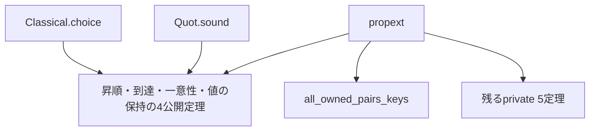
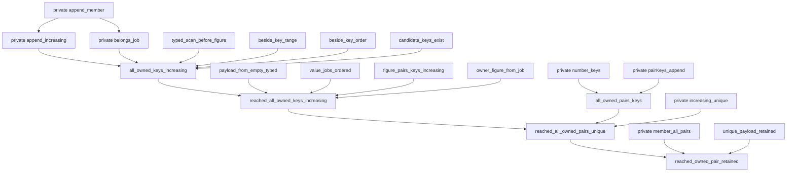

# [root ADR 0352](../adr/0352-prove-pagination-in-lean.md) の図版ごとの採番列の連結

## 範囲

基準は `d2cd00048` の本体と既存モデルである。
[OwnedRows.lean](../../experiments/pagination-proof/OwnedRows.lean) を Lean 4.7.0（`aarch64-apple-darwin`）で検査した。
本体と公開 API は変更していない。
この増分は、[一つの図版の採番列と格納](0352-owned-scan-dependencies.md) を、複数の図版の列を連結して格納する経路へ進める。

`allKeys` は、図版 job の順に現在の本文の選択キーを連結する。
本文の表の型、job の所有者の昇順と図版の条件から、全てのキーの厳密な昇順を導く。
先行する図版の選択は次の図版より手前で止まり、後の図版の本文はその所有者より後にあるため、異なる図版の選択も重ならない。

空からの到達を使う公開定理では、本文の型を到達した cache から、job の順序と図版の条件を現在の図版の表からの job の生成から導く。
これらを自由な前提として最終の呼び出し側に渡してはいない。
一方、到達と現在の図版の表からの job の生成そのものを本体の全 `Built` へ接続する部分は残る。

`allPairs` は各図版の選択キーを `numberPairs` で採番し、job の順に連結する。
各図版の開始 ID は `startOf` から渡す。
この callback は入力のままであり、全図版の開始 ID を本体の前の採番から導く一般証明を今回完成させたとは扱わない。

出力のキーは `allKeys` と同じなので、到達と job の生成から全てのキーの一意性を導ける。
ある図版の局所的な採番列に含まれる組は、全列を連結して後の同じキーを優先する格納へ渡しても、同じ ID で読み出せる。
最後の定理が受け取るのは、その図版の局所的な採番列への所属であり、全列の格納後の照会結果を前提としていない。

本体では [besideFirsts](../../modules/golem-typeset/src/Golem/Typeset/Flow.hs#L4966) が図版ごとの採番列を連結する。
この増分はその経路に対応するモデルを検査し、通常の単位の `baseFirsts` との Map の合成や containers の Map の意味論の一般証明とは区別する。

## 定理と公理

Lean の環境から宣言の種類、型、elaboration 後の証明項と直接の定理参照を取得した。
公開定理 5 件、手書きの private 定理 7 件、生成定理 14 件、定義 22 件、公理宣言 0 件だった。
手書きの定義は `allKeys` と `allPairs` の 2 件である。
全 26 定理について同じ型の別名を一時環境に作り、kernel の検査と `#print axioms` を行った。

公開名の共通接頭辞は `BesideOwnedRows.` である。
標準三公理は `propext`、`Classical.choice`、`Quot.sound` を指す。

| 名前 | 位置 | 前提と結論 | 公理 |
| --- | --- | --- | --- |
| `root_adr0352_i5_all_owned_keys_increasing` | [41 行](../../experiments/pagination-proof/OwnedRows.lean#L41) | 本文の型、所有者の順序と図版の条件から、連結した選択キーが厳密な昇順になる。 | 標準三公理 |
| `root_adr0352_i5_reached_all_owned_keys_increasing` | [65 行](../../experiments/pagination-proof/OwnedRows.lean#L65) | 空からの到達と現在の図版 job の生成から、前の定理の型、順序と図版の条件を導く。 | 標準三公理 |
| `root_adr0352_i5_all_owned_pairs_keys` | [102 行](../../experiments/pagination-proof/OwnedRows.lean#L102) | 全ての採番列を連結した出力のキーが、選択キーの連結と一致する。 | `propext` |
| `root_adr0352_i5_reached_all_owned_pairs_unique` | [118 行](../../experiments/pagination-proof/OwnedRows.lean#L118) | 空からの到達と現在の図版 job の生成から、全採番列のキーに重複がないことを導く。 | 標準三公理 |
| `root_adr0352_i5_reached_owned_pair_retained` | [145 行](../../experiments/pagination-proof/OwnedRows.lean#L145) | 生成した job への所属とその局所採番列の組から、全図版の列を連結した格納後もその値を読み出せることを導く。 | 標準三公理 |

手書きの private 定理の共通接頭辞は `_private.experiments.«pagination-proof».OwnedRows.0.BesideOwnedRows.` である。

| 名前 | 位置 | 概要 | 公理 |
| --- | --- | --- | --- |
| `append_member` | [9 行](../../experiments/pagination-proof/OwnedRows.lean#L9) | 連結したキーの所属を左右に分ける。 | `propext` |
| `append_increasing` | [19 行](../../experiments/pagination-proof/OwnedRows.lean#L19) | 左右の昇順と左右間の大小関係から、連結後の昇順を導く。 | `propext` |
| `belongs_job` | [30 行](../../experiments/pagination-proof/OwnedRows.lean#L30) | 全選択のキーに、それを選んだ job がある。 | `propext` |
| `number_keys` | [88 行](../../experiments/pagination-proof/OwnedRows.lean#L88) | 採番してもキーの列は変わらない。 | `propext` |
| `pairKeys_append` | [94 行](../../experiments/pagination-proof/OwnedRows.lean#L94) | 組の列の連結とキーの列の連結が一致する。 | なし |
| `increasing_unique` | [110 行](../../experiments/pagination-proof/OwnedRows.lean#L110) | 厳密な昇順から重複がないことを導く。 | なし |
| `member_all_pairs` | [131 行](../../experiments/pagination-proof/OwnedRows.lean#L131) | 一つの job の採番列の組は、全 job の採番列にも含まれる。 | `propext` |

生成定理の共通接頭辞は `_private.experiments.«pagination-proof».OwnedRows.0.` である。
次の前半と suffix を組み合わせると全 14 件の名前になる。
いずれも生成位置は取得できず、公理への依存はない。

| 名前の前半 | suffix | 件数 |
| --- | --- | --- |
| `BesideOwnedRows.allKeys` | `._eq_1`, `._eq_2`, `.match_1.eq_1`, `.match_1.eq_2` | 4 |
| `BesideOwnedRows.allPairs` | `._eq_1`, `._eq_2` | 2 |
| `BesideOwnedScan.numberPairs` | `._eq_1`, `._eq_2`, `.match_1.eq_1`, `.match_1.eq_2` | 4 |
| `BesideStore.pairKeys` | `._eq_1`, `._eq_2`, `.match_1.eq_1`, `.match_1.eq_2` | 4 |

標準公理への依存には既存の補助定理を経由するものも含む。
`propext` は命題の同値からの等値（Lean の `Init/Core.lean:1287`）、`Classical.choice` は空でない型からの選択（`Init/Prelude.lean:730`）、`Quot.sound` は同値関係で結ばれた値の商での等値（`Init/Core.lean:1459`）である。
新しい公理宣言、`sorry`、`admit` はない。

公理の図は推移的な依存を表す。
公理に依存しない生成定理 14 件と private 定理 2 件は省略した。

定理の図の実線は型か証明項の直接参照、点線は示した補助定理を経由する依存である。
標準の論理と算術の補助定理は省略した。

既存の型、job と格納の依存は [到達した本文と所有段落](0352-owned-first-dependencies.md)、[図版値と job](0352-job-values-dependencies.md)、[格納後の読み戻し](0352-round-payload-store-dependencies.md) を参照する。

## 境界、変異と実装との照合

新しい API がない状態で試験が終了コード 1 を返し、追加後に [OwnedRowsBoundary.lean](../../experiments/pagination-proof/OwnedRowsBoundary.lean) の 11 式が通った。
二つの図版と局所値の読み出し、不在のキー、空の job、異なるキーが同じ ID を持つ場合を含む。
job の逆順、同じ所有者の重複、図版のキーまで本文に含めた不正な表は、期待する昇順や一意性が失われる具体例として残す。
最後の式は、空から到達した cache と生成した job を使い、局所的な組の所属から全列の格納後の照会を公開定理で導く。

選択キーを同じ job から二度連結する変異では、所属を分ける補題の証明が通らず、Lean は終了コード 1 を返した。
この検査だけで任意の製品実装の誤りを全て検出するとは扱わない。

[OwnedRowsFonts.hs](../../experiments/pagination-proof/OwnedRowsFonts.hs) は、表、コード、制御、二つの図版と三つの所有段落を実フォントで組む。
配置後の本文の行列を 0、1、3、7 行へ手で変え、実際の採番を呼び直す 12 例である。
各例で、その行数を返す callback を持つ新しいモデルの round を空の cache から実行する。
前後で格納値が同じだと仮定する比較ではなく、その時点の実際の本文のキーと行数の列がモデルの新しい cache の列になることを検査する。
12 冊の通常 CLI の比較や、全ての本体の cache の到達の一般証明とは区別する。

各例で、本体の図版ごとの `mapAccumL` を連結した列を作り、実際の `bUnitFirsts` とも一致することを確かめる。
モデルの列、対象の格納後の照会、全キーの一意性と局所値の保持の公開定理を比較する。
最初の cache の 1 式と各例の 5 式の計 61 式が kernel で通った。
図版の開始 ID はその時点の本体の採番結果を渡しており、その計算を今回の一般定理から導いたとは扱わない。

図版の値は実際のソース位置と、最初の診断列が空で exclusion があるかの真偽へ射影する。
ソース位置が負でないことを確かめ、job の初期状態へ渡す。
本体の job に fuel のフィールドがあるとは扱わない。
本体のソースは `0aa78f65ac691cdd8d1a3bd5fc4c8bffb1feabdb` であり、この作業ツリーの `modules/` と一致する。
GHC 9.10.3 と既存の専用 package DB の read-only 環境を使い、共有の build と依存の版は変えない。

## 全体の検査

`check.sh` にこのモデルと局所境界を加え、GHC 9.10.3 と Lean 4.7.0 の既存の全検査が終了コード 0 で通った。
grid 55,838 件、free 156,520 件、回り込みの試し置き 10,368 件、causal 4,864 件、制御 216 件、改行の評価 34,586 件、実フォントの caption 40 件を保った。
Alloy の 42 コマンドに対応する既存の Lean の検査も保ち、Alloy の新しい実行回数とは区別する。

plan の SHA-256 は `981a01138b41bf0d6b1e8ea82155b2ed1227297b7339699bbc60005bc4c83957`、package DB の cache は `dd7fdb3fca241d4a7039e18fccf8ff7065a265540225c2cf813e5b07cbe75fc8` で、検査の前後で変わらなかった。
新規の証明専用 CI や予算の変更は加えていない。

## 未証明の範囲

全 `Built` からモデルの到達と job を導く一般的な接続、全図版の開始 ID の計算、`baseFirsts` との Map の合成は残る。
Map の意味論、Int と Nat、図版の全フィールドと配置の callback、caption の計算との一般的一致も未証明である。

この増分は、図版が所有する段落のキーと採番列の順序、一意性、格納後の値の保持を扱う。
原稿の全データと全行の順序、全制御の終了、`hb` の全呼び出し元、`captionCompared` と改行器の一般的一致は完成扱いしない。
root [ADR 0352](../adr/0352-prove-pagination-in-lean.md) は採択済み未実装のままとする。
