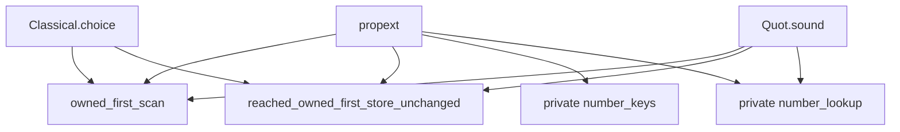
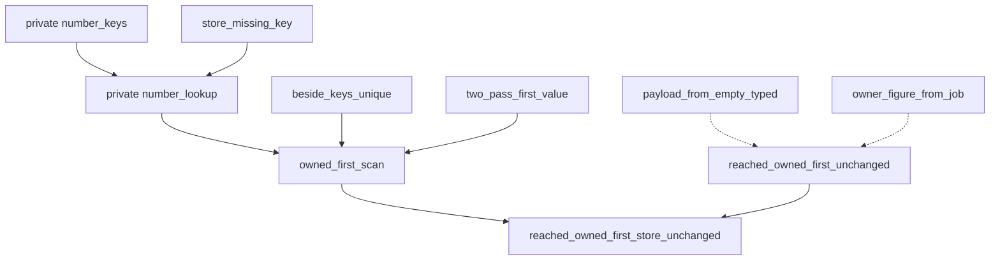

# [root ADR 0352](../adr/0352-prove-pagination-in-lean.md) の所有段落の採番列と格納後の照会

## 範囲

基準は `30789e251` の本体と既存モデルである。
[OwnedFirstScan.lean](../../experiments/pagination-proof/OwnedFirstScan.lean) を Lean 4.7.0（`aarch64-apple-darwin`）で検査した。
製品のコードと公開 API は変更していない。
この増分は、[所有段落の先頭 ID](0352-owned-first-dependencies.md) を、キーと ID の列を作って格納する経路へ接続する。

`numberPairs` は、入力のキーの順に `(key, next)` を出力し、その本文の行数を次の ID に加える。
0 行の本文にも現在の ID を与える。
出力のキーの列は入力と同じであり、異なるキーが同じ ID を持つ場合も許す。
この処理は、本体の [besideFirsts](../../modules/golem-typeset/src/Golem/Typeset/Flow.hs#L4966) が行う `mapAccumL` の内側の走査に対応するモデルである。

`storedOwnedFirst` は、この列を既存の `fromPairs` へ渡して対象を照会する。
`fromPairs` は後の同じキーを優先するため、自由なキーの列では最初の対象の前までの加算量と一致しない場合がある。
局所補題はキーの重複がないことを前提とし、公開定理では現在の選択の走査からその性質を導く。
公開定理の呼び出し側に、重複がないという前提を追加していない。

格納後の照会は、対象が選択に含まれるかどうかも含めて、前の `ownedFirstId` と一致する。
もう一つの公開定理は、この一致と前の到達した cache の定理を使い、対象本文の値だけを変えても格納後の照会が変わらないことを導く。
対象の所属を自由な前提にはしていない。

この照会は一つの図版が所有する本文だけを対象にする。
本体の `unitFirsts` にある他の図版や通常の単位の ID と合成する経路まで証明したものではない。
`fromPairs` は格納のモデルであり、containers の Map の全意味論との一般的一致も残る。

## 定理と公理

Lean の環境から宣言の種類、型、elaboration 後の証明項と直接の定理参照を取得した。
公開定理 2 件、手書きの private 定理 2 件、生成定理 22 件、定義 32 件、公理宣言 0 件だった。
手書きの定義は `numberPairs` と `storedOwnedFirst` の 2 件である。
全 26 定理へ同じ型の別名を一時環境で作り、kernel の検査と `#print axioms` を行った。

公開名の共通接頭辞は `BesideOwnedScan.` である。
標準三公理は `propext`、`Classical.choice`、`Quot.sound` を指す。

| 名前 | 位置 | 前提と結論 | 公理 |
| --- | --- | --- | --- |
| `root_adr0352_i5_owned_first_scan` | [38 行](../../experiments/pagination-proof/OwnedFirstScan.lean#L38) | 選択キーを採番して格納した照会が、所有段落の先頭 ID のモデルと一致する。キーの重複がないことは選択の走査から導く。 | 標準三公理 |
| `root_adr0352_i5_reached_owned_first_store_unchanged` | [53 行](../../experiments/pagination-proof/OwnedFirstScan.lean#L53) | 空からの cache の到達と現在の図版 job の所属から、本文の値の更新前後で格納後の照会が一致する。 | 標準三公理 |

手書きの private 定理の共通接頭辞は `_private.experiments.«pagination-proof».OwnedFirstScan.0.BesideOwnedScan.` である。

| 名前 | 位置 | 前提と結論 | 公理 |
| --- | --- | --- | --- |
| `number_keys` | [9 行](../../experiments/pagination-proof/OwnedFirstScan.lean#L9) | 採番してもキーの列は変わらない。 | `propext` |
| `number_lookup` | [15 行](../../experiments/pagination-proof/OwnedFirstScan.lean#L15) | 重複がないキーの列では、格納後の照会は対象より前の加算量で決まり、不在なら `none` となる。 | `propext`, `Quot.sound` |

生成定理の共通接頭辞は `_private.experiments.«pagination-proof».OwnedFirstScan.0.` である。
次の各行の前半と suffix を組み合わせると全 22 件の名前になる。
いずれも生成位置は取得できず、公理への依存はない。

| 名前の前半 | suffix | 件数 |
| --- | --- | --- |
| `BesideStore.fromPairs` | `._eq_1`, `._eq_2`, `.match_1.eq_1`, `.match_1.eq_2`, `.match_2.eq_1`, `.match_2.eq_2` | 6 |
| `BesideStore.pairKeys` | `._eq_1`, `._eq_2`, `.match_1.eq_1`, `.match_1.eq_2` | 4 |
| `BesideOwnership.countsFor` | `._eq_1`, `._eq_2`, `.match_1.eq_1`, `.match_1.eq_2` | 4 |
| `BesideOwnedScan.numberPairs` | `._eq_1`, `._eq_2`, `.match_1.eq_1`, `.match_1.eq_2` | 4 |
| `BesideOwnedFirst.beforeTarget` | `._eq_1`, `._eq_2`, `.match_1.eq_1`, `.match_1.eq_2` | 4 |

初回の環境調査では、実行コードを生成する定義に compiler の特殊化による公理宣言が 1 件あった。
`storedOwnedFirst` を `noncomputable` にして再検査し、この宣言を含めて公理宣言が 0 件であることを確かめた。
定理は同じ論理上の定義を使い、`decide` による閉じた式の検査も通る。
`#print axioms` だけでなく、対象モジュールの公理宣言の全件も調べた。

標準公理への依存には既存の補助定理を経由するものも含む。
`propext` は命題の同値からの等値（Lean の `Init/Core.lean:1287`）、`Classical.choice` は空でない型からの選択（`Init/Prelude.lean:730`）、`Quot.sound` は同値関係で結ばれた値の商での等値（`Init/Core.lean:1459`）である。
新しい公理宣言、`sorry`、`admit` は残っていない。

公理の図は推移的な依存を表す。
公理に依存しない生成定理 22 件は省略した。

定理の図は実線が型か証明項の直接参照、点線が示した補助定理を経由する依存である。
標準の論理と算術の補助定理は省略した。

既存の図版 job と到達の依存は [所有段落の先頭 ID の調査](0352-owned-first-dependencies.md) を参照する。
選択キーの一意性と格納のモデルは [キーの走査](0352-beside-ownership-dependencies.md) と [格納後の読み戻し](0352-round-payload-store-dependencies.md) に記録している。

## 境界、変異と実装との照合

新しい API がない状態では試験が終了コード 1 を返した。
[OwnedFirstScanBoundary.lean](../../experiments/pagination-proof/OwnedFirstScanBoundary.lean) の 13 式は追加後に通った。
空の列、不在のキー、0 行の本文、制御を挟んだ選択、先頭 ID の共有、前のモデルとの一致を含む。

重複したキー `[1, 1]` をそれぞれ 2 行として 0 から採番すると、格納後のキー 1 は後の ID 2 を返す。
一方、最初のキー 1 より前の加算量は 0 である。
この対照を残し、重複がある任意の列でも一致すると仕様を広げていない。
また、採番で次の ID に余計な 1 を加える変異は `number_lookup` の証明に失敗し、Lean が終了コード 1 を返した。

[OwnedFirstScanFonts.hs](../../experiments/pagination-proof/OwnedFirstScanFonts.hs) は、前の増分と同じ表、コード、制御、二つの図版と三つの所有段落を実フォントで組む。
配置後の本文の行列を 0、1、3、7 行へ手で変える 12 例であり、12 冊の通常 CLI を比較したとは扱わない。
実際の `mapAccumL` が作るキーと ID の列を、モデルの `numberPairs` と比較する。
変更前後の照会と本体の先頭 ID の比較、到達した cache に関する最後の公開定理の適用も行う。
cache の出力の 1 式と、各例の 4 式の計 49 式が kernel で通った。

図版の値は、ソース位置と、最初の診断列が空で exclusion があるかの真偽へ射影する。
ソース位置が負でないことを確かめ、モデルの初期状態へ実際の値を渡す。
本体の job に fuel のフィールドがあるとは扱わない。
共有のソース、依存の版、build、package DB を書き換えず、前の増分と同じ read-only 環境を使う。
本体の版は `0aa78f65ac691cdd8d1a3bd5fc4c8bffb1feabdb` であり、この作業ツリーの `modules/` と一致する。

## 全体の検査

`check.sh` にモデルと局所境界を加え、GHC 9.10.3 と Lean 4.7.0 の既存の全検査が終了コード 0 で通った。
grid 55,838 件、free 156,520 件、回り込みの試し置き 10,368 件、causal 4,864 件、制御 216 件、改行の評価 34,586 件、実フォントの caption 40 件を保った。
Alloy の 42 コマンドに対応する既存の Lean の検査も保ち、Alloy の新しい実行回数とは区別する。

plan の SHA-256 は `981a01138b41bf0d6b1e8ea82155b2ed1227297b7339699bbc60005bc4c83957`、package DB の cache は `dd7fdb3fca241d4a7039e18fccf8ff7065a265540225c2cf813e5b07cbe75fc8` で、検査の前後で変わらなかった。
新規の証明専用 CI や予算の変更は加えていない。

## 未証明の範囲

現在の図版 job の所属と空からの到達を本体の全 `Built` から導く一般的な接続は残る。
全図版の採番列の連結と `baseFirsts` との Map の合成、Int と Nat の対応も未証明である。
この増分の式を、本体の任意の単位の ID にそのまま適用しない。

固定の採番件数、図版の全フィールドと配置の callback、caption の計算も残る。
全制御の終了、本文全量と順序、`hb` の全呼び出し元、`captionCompared` と改行器の一般的一致を完了扱いしない。
root [ADR 0352](../adr/0352-prove-pagination-in-lean.md) は採択済み未実装のままとする。
