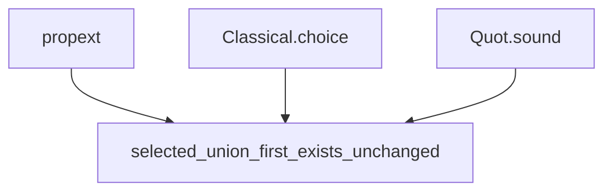
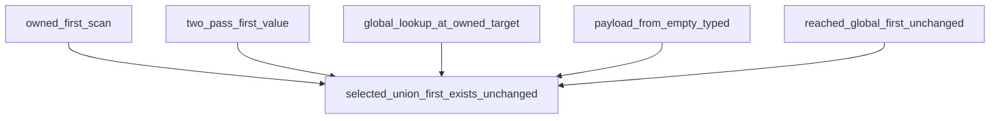

# [root ADR 0352](../adr/0352-prove-pagination-in-lean.md) の ID の存在と左優先の合成

## 範囲

基準は `396725f9b` の本体と既存モデルである。
[OwnedUnion.lean](../../experiments/pagination-proof/OwnedUnion.lean) を Lean 4.7.0（`aarch64-apple-darwin`）で検査した。
本体と公開 API は変更していない。
この増分は、[全図版の所有段落の先頭 ID](0352-owned-global-dependencies.md) を使い、選ばれた所有段落の ID が最初の採番の表との合成後にも存在し、同じ値で残ることを示す。

本体は [unitFirsts](../../modules/golem-typeset/src/Golem/Typeset/Flow.hs#L4970) で、所有段落の表を左、全単位の最初の採番で作る `baseFirsts` を右として `Map.union` する。
`baseFirsts` は採番数が増えた単位の開始 ID を記録し、図版の所有者自身も含む。
再改行では [numberedLines へ渡す ID](../../modules/golem-typeset/src/Golem/Typeset/Flow.hs#L5148) や [採用済み行数を加える ID](../../modules/golem-typeset/src/Golem/Typeset/Flow.hs#L5301) を `Map.!` で取得する。
この取得には、不在の結果同士が一致するだけでは足りない。

モデルの `leftUnion` は、左の表に値があればその値を返し、不在のときだけ右の表を使う。
`ownedTable` は前の増分の全図版の採番列の格納を表す。
空から到達した cache と現在の図版 job、その job が選ぶ対象から、局所の採番式によって `some ident` があることを導く。
対象自身の本文を変えた後も同じ値であり、合成の右側の表を任意に変えても、更新前後で同じ `some ident` を返す。

結論は、同じ ID が存在することを量化する。
左の表に値があることや、二つの右側の表が等しいことを前提に置いていない。
一方、選ばれた対象という条件は残しており、通常の単位を含む任意のキーに保証を広げていない。
本体の全呼び出し元からこの選択の条件を導く接続と、containers の Map の一般的な意味論の証明も残る。

## 定理と公理

Lean の環境から宣言の種類、型、elaboration 後の証明項と直接の定理参照を取得した。
公開定理 1 件、定義 6 件、公理宣言 0 件だった。
手書きの定義は [leftUnion](../../experiments/pagination-proof/OwnedUnion.lean#L5) と [ownedTable](../../experiments/pagination-proof/OwnedUnion.lean#L10) の 2 件である。
生成定理と手書きの private 定理はない。
公開定理へ同じ型の別名を一時環境で作り、kernel の検査と `#print axioms` を行った。

| 定理 | 位置 | 前提と結論 | 公理 |
| --- | --- | --- | --- |
| `BesideOwnedUnion.root_adr0352_i5_selected_union_first_exists_unchanged` | [16 行](../../experiments/pagination-proof/OwnedUnion.lean#L16) | 空からの到達、現在の図版 job への所属、その job が選ぶ対象から、任意の更新前後の右側の表との合成でも同じ先頭 ID が存在する。 | `propext`, `Classical.choice`, `Quot.sound` |

生成定義の共通接頭辞は `BesideOwnedUnion.leftUnion` であり、suffix は `._cstage1`、`._cstage2`、`.match_1`、`.match_1._cstage1` の 4 件である。
分岐の処理と実行コードの生成に由来し、それ自体を定理として数えていない。

公理への依存には既存の補助定理を経由するものも含む。
`propext` は命題の同値からの等値（Lean の `Init/Core.lean:1287`）、`Classical.choice` は空でない型からの選択（`Init/Prelude.lean:730`）、`Quot.sound` は同値関係で結ばれた値の商での等値（`Init/Core.lean:1459`）である。
新しい公理宣言、`sorry`、`admit` はない。

公理の図は推移的な依存を表す。

定理の図の実線は型か証明項の直接参照である。
標準の論理と算術の補助定理は省略した。

既存の依存は [全図版の所有段落の先頭 ID](0352-owned-global-dependencies.md)、[局所の採番列と格納](0352-owned-scan-dependencies.md)、[二段階の採番](0352-built-first-id-dependencies.md) を参照する。

## 境界、変異と実装との照合

新しい API がない状態で試験が終了コード 1 を返し、追加後に [OwnedUnionBoundary.lean](../../experiments/pagination-proof/OwnedUnionBoundary.lean) の 9 式が通った。
右側に 999 と 888 があっても所有段落の ID が残る場合、0 行への更新、不在の表、左側に ID 0 がある場合を含む。
所有段落ではないキーについては、右側の変更で 999 と 888 を返し分ける対照も残す。
最後の式は、到達した cache と現在の job、その選択の対象を使い、同じ値が存在することを公開定理で導く。

左側に値があっても右側を返す変異では、公開定理の最後の合成が証明できず、Lean は終了コード 1 を返した。
本体との照合でも、合成の引数を逆にすると人工的な衝突値が勝ち、検証側の明示的な条件が失敗して終了コード 1 を返した。
コンパイルの偶発的な失敗を左優先の違反として数えたものではない。

[OwnedUnionFonts.hs](../../experiments/pagination-proof/OwnedUnionFonts.hs) は、表、コード、制御、二つの図版と三つの所有段落を実フォントで組む。
配置後の本文の行列を 0、1、3、7 行へ手で変えて採番を呼び直す 12 例である。
`baseFirsts` に対応する表は、実際の `numberUnit` を同じ順に呼び、採番数が増えた単位だけを記録して作る。
この表と図版ごとの採番列の表を containers の `Map.union` で合成し、更新前後の `bUnitFirsts` の全体と一致することを確かめる。
対象の所有段落はこの最初の表にはなく、人工的に 999 と 888 を入れても、左側の値が残ることも確かめた。

モデルの全図版の ID は、分類済みの寄与と先行する行数から計算する。
その表と観測した最初の採番の表を合成し、有限な単位の範囲の読み出しを本体の全 ID の列と比較する。
対象の照会と人工的な衝突、公開定理による同じ値の存在も調べた。
最初の cache の 1 式と各例の 5 式の計 61 式が kernel で通った。
12 冊の通常 CLI の比較や、全ての `Built` と Map の一般的な意味論の証明とは区別する。

図版の値は実際のソース位置と、最初の診断列が空で exclusion があるかの真偽へ射影する。
ソース位置が負でないことを確かめ、job の初期状態へ渡す。
本体の job に fuel のフィールドがあるとは扱わない。
本体のソースは `0aa78f65ac691cdd8d1a3bd5fc4c8bffb1feabdb` であり、この作業ツリーの `modules/` と一致する。
GHC 9.10.3 と既存の専用 package DB の read-only 環境を使い、共有の build と依存の版は変えない。

## 全体の検査

`check.sh` にこのモデルと局所境界を加え、GHC 9.10.3 と Lean 4.7.0 の既存の全検査が終了コード 0 で通った。
grid 55,838 件、free 156,520 件、回り込みの試し置き 10,368 件、causal 4,864 件、制御 216 件、改行の評価 34,586 件、実フォントの caption 40 件を保った。
Alloy の 42 コマンドに対応する既存の Lean の検査も保ち、Alloy の新しい実行回数とは区別する。

plan の SHA-256 は `981a01138b41bf0d6b1e8ea82155b2ed1227297b7339699bbc60005bc4c83957`、package DB の cache は `dd7fdb3fca241d4a7039e18fccf8ff7065a265540225c2cf813e5b07cbe75fc8` で、検査の前後で変わらなかった。
新規の証明専用 CI や予算の変更は加えていない。

## 未証明の範囲

本体の全 `Built` と全呼び出し元から、モデルの到達、job の生成と対象の選択を導く接続は残る。
図版の所有者自身など、所有段落以外のキーに対する ID の取得も今回の定理の対象ではない。
全分岐の固定の採番件数、Map の意味論、Int と Nat、図版の全フィールドと配置の callback、caption の計算との一般的一致も未証明である。

この増分だけで本体の全ての `Map.!` の安全性を証明したとは扱わない。
原稿の全データと全行の順序、全制御の終了、`hb` の全呼び出し元、`captionCompared` と改行器の一般的一致も完成扱いしない。
root [ADR 0352](../adr/0352-prove-pagination-in-lean.md) は採択済み未実装のままとする。
