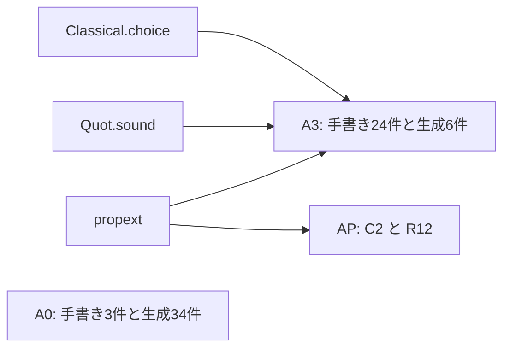
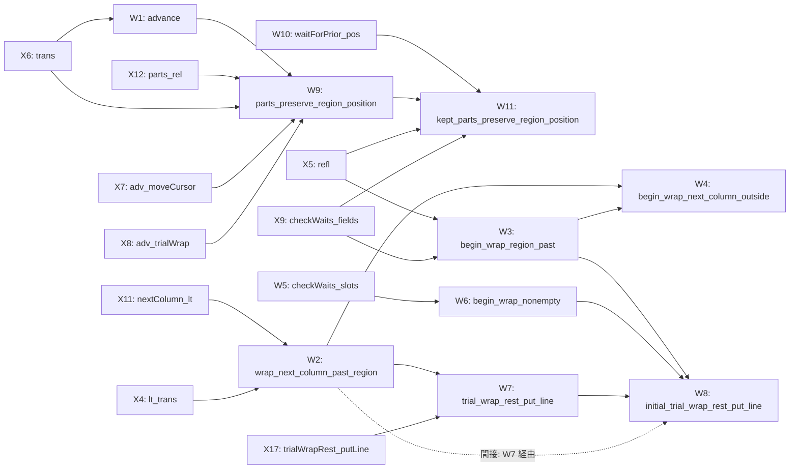
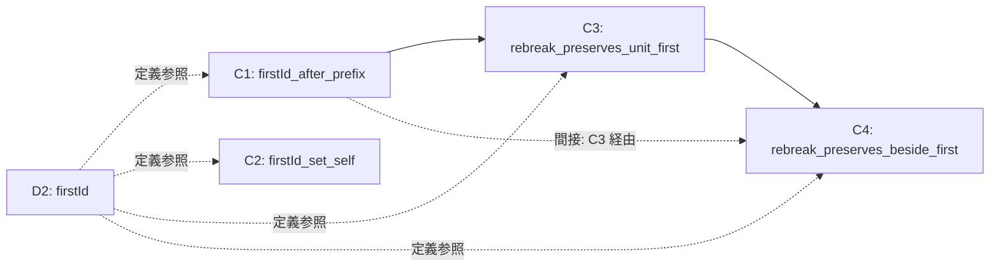
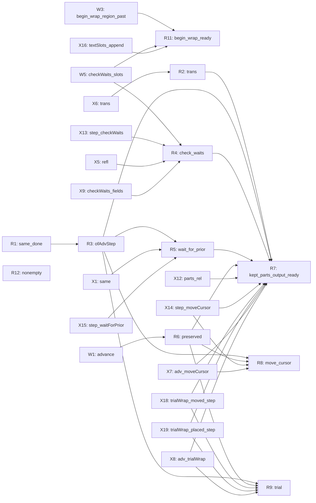
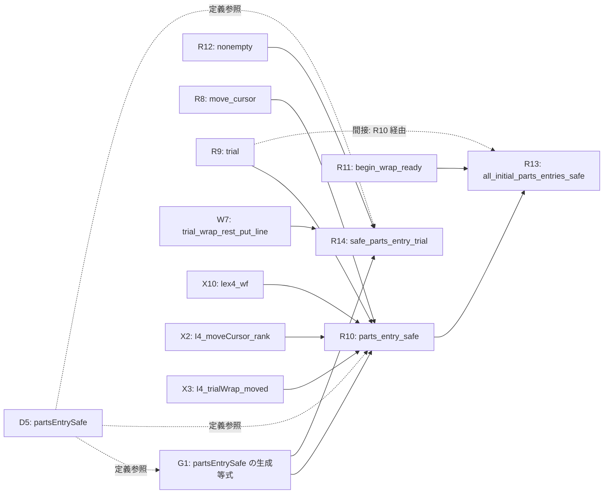

# [root ADR 0352](../adr/0352-prove-pagination-in-lean.md) の追加証明の前提と依存

## 範囲と確かめ方

この調査は、[root ADR 0352](../adr/0352-prove-pagination-in-lean.md) の追加証明が、どの前提と既存の定理に依存するかを記録する。
対象のソースはコミット `d28e46d222c6b7da13b99bfa458ae5f8f6a9c835` の `WrapPosition.lean`、`CausalFirstIds.lean`、`WrapCalls.lean` である。
Lean は 4.7.0（`aarch64-apple-darwin`、`6fce8f7d5cd1`）を使った。

対象自身の公理宣言は 0 件だった。
手書きの定理 29 件と生成された補助定理 40 件を環境で列挙し、69 件すべてについて `#print axioms` を実行した。
そのうち 30 件は、三つの標準公理へ推移的に依存する。
`propext` だけへの依存は 2 件で、残る 37 件には公理依存がなかった。
対象ソースに `sorry`、`admit`、`sorryAx` の使用はなく、69 件の公理依存にも `sorryAx` はなかった。

定理の直接依存は、型と elaboration 後の証明項から定数を取り出し、Lean の環境で `.thmInfo` に解決したものとした。
ソースに書かれたタクティクスの名前だけでは依存としなかった。
定義を介する参照も別に取り出し、図の辺に区別を付けた。
対象の証明が直接参照する既存モデルの 19 定理は、型、宣言位置、公理依存と証明項の参照を追加で調べた。
既存モデル全体の定理を一覧し直す調査はしていない。

| モジュール | 手書き定理 | 生成補助定理 | 手書き定義 | 生成定義 |
| --- | ---: | ---: | ---: | ---: |
| `WrapPosition` | 11 | 6 | 1 | 10 |
| `CausalFirstIds` | 4 | 6 | 1 | 10 |
| `WrapCalls` | 14 | 28 | 3 | 20 |

## 公理

次の三つは Lean 標準ライブラリの公理であり、今回のファイルで追加した公理ではない。
宣言の種類は `.axiomInfo` として確認した。
位置は、今回使った Lean 4.7.0 のソースにおける行である。

| 公理 | 宣言元 | 命題の概要 |
| --- | --- | --- |
| `Classical.choice` | `Init.Prelude:730` | `Nonempty α` から `α` の要素を選ぶ。 |
| `propext` | `Init.Core:1287` | `a ↔ b` から命題の等式 `a = b` を得る。 |
| `Quot.sound` | `Init.Core:1459` | 関係 `r a b` が成り立てば、対応する商の要素が等しい。 |

以下の表で A0 は公理依存なし、AP は `propext` だけ、A3 は三つすべてへの推移依存を表す。
公理依存は、型と証明が参照する定義や補助定理を経由した結果も含む。
表の主要な前提とは別のものであり、A0 であることが実装との一致を意味するわけではない。



この図の矢印は、`#print axioms` で確認した推移依存である。
A0 の手書き定理は C1、C3、C4 である。

## 定義と命題の読み方

位置はページを先に比較し、同じページでは段を比較する辞書式順序である。
`Adv` は既存の閉じた段の列を保ち、位置を戻さず、途中で閉じた段が開始位置と終了位置の間にあることを表す。
`Step a b t g` は、終了状態のテキストと図版の列が、それぞれ開始状態の列に `t` と `g` を足したものに等しいことを表す。
表で「二つの試行」というときは、`PhysicalPagination.trialWrapRest` と `PhysicalPagination.trialWrapRestLine` を指す。

| ID | 完全修飾名と位置 | 定義 |
| --- | --- | --- |
| D1 | `PhysicalPagination.RegionPast`、[WrapPosition.lean:10](../../experiments/pagination-proof/WrapPosition.lean#L10) | 領域がないか、領域の辞書式位置が現在位置以前にある。 |
| D2 | `CausalFirstIds.firstId`、[CausalFirstIds.lean:8](../../experiments/pagination-proof/CausalFirstIds.lean#L8) | 各単位の加算量を原稿順に走査し、指定した単位へ渡す先頭 id を求める。 |
| D3 | `PhysicalPagination.WrapReady`、[WrapCalls.lean:9](../../experiments/pagination-proof/WrapCalls.lean#L9) | D1 を満たし、領域が有効な段には局所テキストがある。図版のスロットも `textSlots` のテキストに含む。 |
| D4 | `PhysicalPagination.PreservesWrapCursor`、[WrapCalls.lean:31](../../experiments/pagination-proof/WrapCalls.lean#L31) | 位置を戻さず、位置が同じなら閉じたテキストの量を変えず、配置済みテキストを減らさない。 |
| D5 | `PhysicalPagination.partsEntrySafe`、[WrapCalls.lean:133](../../experiments/pagination-proof/WrapCalls.lean#L133) | `parts` と同じ分岐をたどり、各再帰入力の D3 を求める述語。エラーで終わる入力も検査する。 |

## 手書き定理

各行には、主要な前提と結論を併記した。
「直接参照」は、対象内の定理と、次節の既存モデルの定理に限って示す。
`Eq.symm`、`congrArg` や算術タクティクスが使う標準ライブラリの補題は、この欄と後の定理図では省略した。
それらを経由する公理依存は A0、AP、A3 に含めている。

### `WrapPosition`

| ID | 完全修飾名と位置 | 主要な前提と結論 | 公理 | 直接参照 |
| --- | --- | --- | --- | --- |
| W1 | `PhysicalPagination.RegionPast.advance`、[WrapPosition.lean:15](../../experiments/pagination-proof/WrapPosition.lean#L15) | 除外領域が現在位置以前なら、位置を戻さない遷移後も同じ性質を満たす。 | A3 | X6 |
| W2 | `PhysicalPagination.root_adr0352_i3_wrap_next_column_past_region`、[WrapPosition.lean:21](../../experiments/pagination-proof/WrapPosition.lean#L21) | 領域が現在位置以前なら、次段の除外領域の終端は 0 になる。 | A3 | X11, X4 |
| W3 | `PhysicalPagination.root_adr0352_i3_begin_wrap_region_past`、[WrapPosition.lean:35](../../experiments/pagination-proof/WrapPosition.lean#L35) | beginWrap が成功した状態では、領域は現在位置以前にある。 | A3 | X5, X9 |
| W4 | `PhysicalPagination.root_adr0352_i3_begin_wrap_next_column_outside`、[WrapPosition.lean:51](../../experiments/pagination-proof/WrapPosition.lean#L51) | beginWrap が成功した直後の次段は領域の外にある。 | A3 | W2, W3 |
| W5 | `PhysicalPagination.checkWaits_slots`、[WrapPosition.lean:58](../../experiments/pagination-proof/WrapPosition.lean#L58) | 待機中の保持を確かめても、現在の段のスロットは変わらない。 | A3 | 生成補題と標準補題だけ、または参照なし |
| W6 | `PhysicalPagination.root_adr0352_i3_begin_wrap_nonempty`、[WrapPosition.lean:72](../../experiments/pagination-proof/WrapPosition.lean#L72) | beginWrap が成功した直後の段は、図版のスロットにより空でない。 | A3 | W5 |
| W7 | `PhysicalPagination.root_adr0352_i3_trial_wrap_rest_put_line`、[WrapPosition.lean:85](../../experiments/pagination-proof/WrapPosition.lean#L85) | 行送りが正で、領域が現在位置以前にあり、領域内の段が空でなければ、二つの trialWrapRest が等しい。 | A3 | W2, X17 |
| W8 | `PhysicalPagination.root_adr0352_i3_initial_trial_wrap_rest_put_line`、[WrapPosition.lean:95](../../experiments/pagination-proof/WrapPosition.lean#L95) | 行送りが正で beginWrap が成功した直後なら、二つの trialWrapRest が等しい。 | A3 | W3, W6, W7 |
| W9 | `PhysicalPagination.root_adr0352_i4_parts_preserve_region_position`、[WrapPosition.lean:109](../../experiments/pagination-proof/WrapPosition.lean#L109) | 初期位置が領域以後で、最後の保持が位置を戻さなければ、成功した parts の結果も領域以後にある。 | A3 | W1, X12, X6, X7, X8 |
| W10 | `PhysicalPagination.waitForPrior_pos`、[WrapPosition.lean:126](../../experiments/pagination-proof/WrapPosition.lean#L126) | waitForPrior はページと段の位置を変えない。 | A3 | 生成補題と標準補題だけ、または参照なし |
| W11 | `PhysicalPagination.root_adr0352_i4_kept_parts_preserve_region_position`、[WrapPosition.lean:134](../../experiments/pagination-proof/WrapPosition.lean#L134) | 保持が waitForPrior の形なら、要求が状態に依存しても、成功した parts の結果は領域以後にある。 | A3 | W10, W9, X5, X9 |

### `CausalFirstIds`

| ID | 完全修飾名と位置 | 主要な前提と結論 | 公理 | 直接参照 |
| --- | --- | --- | --- | --- |
| C1 | `CausalFirstIds.root_adr0352_i5_firstId_after_prefix`、[CausalFirstIds.lean:15](../../experiments/pagination-proof/CausalFirstIds.lean#L15) | ある単位の先頭 id は、先行する加算量を原稿順に足した値になる。 | A0 | 生成補題と標準補題だけ、または参照なし |
| C2 | `CausalFirstIds.root_adr0352_i5_firstId_set_self`、[CausalFirstIds.lean:23](../../experiments/pagination-proof/CausalFirstIds.lean#L23) | 現在の添字の加算量だけを List.set で置き換えても、その単位の先頭 id は変わらない。 | AP | 生成補題と標準補題だけ、または参照なし |
| C3 | `CausalFirstIds.root_adr0352_i5_rebreak_preserves_unit_first`、[CausalFirstIds.lean:36](../../experiments/pagination-proof/CausalFirstIds.lean#L36) | 先行する加算量を保ち、現在の単位の行数だけを変えても、先頭 id は変わらない。 | A0 | C1 |
| C4 | `CausalFirstIds.root_adr0352_i5_rebreak_preserves_beside_first`、[CausalFirstIds.lean:45](../../experiments/pagination-proof/CausalFirstIds.lean#L45) | 開始 id が図版の id の次でも、現在の段落の行数だけを変えても先頭 id は変わらない。 | A0 | C3 |

### `WrapCalls`

| ID | 完全修飾名と位置 | 主要な前提と結論 | 公理 | 直接参照 |
| --- | --- | --- | --- | --- |
| R1 | `PhysicalPagination.Adv.same_done`、[WrapCalls.lean:12](../../experiments/pagination-proof/WrapCalls.lean#L12) | Adv を満たし、開始と終了の位置が同じなら、閉じた段の列は同じである。 | A3 | 生成補題と標準補題だけ、または参照なし |
| R2 | `PhysicalPagination.PreservesWrapCursor.trans`、[WrapCalls.lean:36](../../experiments/pagination-proof/WrapCalls.lean#L36) | PreservesWrapCursor は推移的である。 | A3 | X6 |
| R3 | `PhysicalPagination.PreservesWrapCursor.ofAdvStep`、[WrapCalls.lean:47](../../experiments/pagination-proof/WrapCalls.lean#L47) | Adv と Step を満たす遷移は PreservesWrapCursor を満たす。 | A3 | R1 |
| R4 | `PhysicalPagination.PreservesWrapCursor.check_waits`、[WrapCalls.lean:55](../../experiments/pagination-proof/WrapCalls.lean#L55) | checkWaits は PreservesWrapCursor を満たす。 | A3 | W5, X13, X5, X9 |
| R5 | `PhysicalPagination.PreservesWrapCursor.wait_for_prior`、[WrapCalls.lean:67](../../experiments/pagination-proof/WrapCalls.lean#L67) | waitForPrior は PreservesWrapCursor を満たす。 | A3 | R3, X1, X15 |
| R6 | `PhysicalPagination.WrapReady.preserved`、[WrapCalls.lean:73](../../experiments/pagination-proof/WrapCalls.lean#L73) | WrapReady と PreservesWrapCursor を満たす開始状態と遷移から、終了状態の WrapReady を得る。 | A3 | W1 |
| R7 | `PhysicalPagination.root_adr0352_i3_kept_parts_output_ready`、[WrapCalls.lean:101](../../experiments/pagination-proof/WrapCalls.lean#L101) | WrapReady から始め、保持が waitForPrior の形なら、成功した parts の結果も WrapReady を満たす。 | A3 | R2, R3, R4, R5, R6, X12, X14, X18, X19, X7, X8 |
| R8 | `PhysicalPagination.WrapReady.move_cursor`、[WrapCalls.lean:191](../../experiments/pagination-proof/WrapCalls.lean#L191) | WrapReady は moveCursor で保存される。 | A3 | R3, R6, X14, X7 |
| R9 | `PhysicalPagination.WrapReady.trial`、[WrapCalls.lean:195](../../experiments/pagination-proof/WrapCalls.lean#L195) | WrapReady は trialWrap が成功したときの結果で保存される。 | A3 | R3, R6, X18, X19, X8 |
| R10 | `PhysicalPagination.root_adr0352_i3_parts_entry_safe`、[WrapCalls.lean:203](../../experiments/pagination-proof/WrapCalls.lean#L203) | WrapReady の入力から、parts と同じ再帰の入口述語 partsEntrySafe が成り立つ。改行器と保持の関数は任意でよい。 | A3 | R8, R9, X10, X2, X3 |
| R11 | `PhysicalPagination.root_adr0352_i3_begin_wrap_ready`、[WrapCalls.lean:254](../../experiments/pagination-proof/WrapCalls.lean#L254) | beginWrap が成功した結果は WrapReady を満たす。 | A3 | W3, W5, X16 |
| R12 | `PhysicalPagination.WrapReady.nonempty`、[WrapCalls.lean:267](../../experiments/pagination-proof/WrapCalls.lean#L267) | WrapReady を満たし、領域が有効な段は空でない。 | AP | 生成補題と標準補題だけ、または参照なし |
| R13 | `PhysicalPagination.root_adr0352_i3_all_initial_parts_entries_safe`、[WrapCalls.lean:274](../../experiments/pagination-proof/WrapCalls.lean#L274) | beginWrap の成功結果から始めた parts について、すべての再帰入力の入口述語が成り立つ。 | A3 | R10, R11 |
| R14 | `PhysicalPagination.root_adr0352_i3_safe_parts_entry_trial`、[WrapCalls.lean:284](../../experiments/pagination-proof/WrapCalls.lean#L284) | 入口述語を満たし、行送りが正なら、その入力で二つの trialWrapRest が等しい。 | A3 | R12, W7 |

## 既存モデルの直接参照

以下は対象の型か証明項に現れ、`.thmInfo` として解決した既存モデルの定理である。
位置はいずれも `Physical.lean` のものである。
たとえば X17 の非空性と次段の条件は W7 では前提に残るが、W8 は `beginWrap` の結果から導く。
R13 は再帰入力の入口述語を導く一方、R14 自体は入口述語を前提に持つ。
R14 の証明項は R10 を直接参照していない。

| ID | 完全修飾名と位置 | 主要な性質 |
| --- | --- | --- |
| X1 | `PhysicalPagination.Adv.same`、[Physical.lean:6797](../../experiments/pagination-proof/Physical.lean#L6797) | ページ、段、閉じた段の列が同じなら Adv。 |
| X2 | `PhysicalPagination.I4_moveCursor_rank`、[Physical.lean:3223](../../experiments/pagination-proof/Physical.lean#L3223) | 空でない段か負の行調整では、moveCursor の尺度が減る。 |
| X3 | `PhysicalPagination.I4_trialWrap_moved`、[Physical.lean:3257](../../experiments/pagination-proof/Physical.lean#L3257) | trialWrap が移動を返すと、保持の尺度かカーソルの尺度が減る。 |
| X4 | `PhysicalPagination.PLe.lt_trans`、[Physical.lean:6786](../../experiments/pagination-proof/Physical.lean#L6786) | 位置の非減少と狭義増加を合成する。 |
| X5 | `PhysicalPagination.PLe.refl`、[Physical.lean:6781](../../experiments/pagination-proof/Physical.lean#L6781) | 位置の非減少の反射性。 |
| X6 | `PhysicalPagination.PLe.trans`、[Physical.lean:6782](../../experiments/pagination-proof/Physical.lean#L6782) | 位置の非減少の推移性。 |
| X7 | `PhysicalPagination.adv_moveCursor`、[Physical.lean:6891](../../experiments/pagination-proof/Physical.lean#L6891) | moveCursor は位置と閉じた段の Adv を満たす。 |
| X8 | `PhysicalPagination.adv_trialWrap`、[Physical.lean:6940](../../experiments/pagination-proof/Physical.lean#L6940) | trialWrap の成功結果は Adv を満たす。 |
| X9 | `PhysicalPagination.checkWaits_fields`、[Physical.lean:7642](../../experiments/pagination-proof/Physical.lean#L7642) | checkWaits 後の待機、ページ、段、閉じた段の位置の対応。 |
| X10 | `PhysicalPagination.lex4_wf`、[Physical.lean:5951](../../experiments/pagination-proof/Physical.lean#L5951) | 四つの自然数の辞書式順序は整礎である。 |
| X11 | `PhysicalPagination.nextColumn_lt`、[Physical.lean:7692](../../experiments/pagination-proof/Physical.lean#L7692) | nextColumn はページと段の辞書式位置を進める。 |
| X12 | `PhysicalPagination.parts_rel`、[Physical.lean:7383](../../experiments/pagination-proof/Physical.lean#L7383) | 遷移と保持が推移的な関係を保つなら、成功した parts 全体もその関係と最終状態の性質を保つ。 |
| X13 | `PhysicalPagination.step_checkWaits`、[Physical.lean:5261](../../experiments/pagination-proof/Physical.lean#L5261) | checkWaits は行と図版を増減しない。 |
| X14 | `PhysicalPagination.step_moveCursor`、[Physical.lean:5841](../../experiments/pagination-proof/Physical.lean#L5841) | moveCursor は行と図版を増減しない。 |
| X15 | `PhysicalPagination.step_waitForPrior`、[Physical.lean:5236](../../experiments/pagination-proof/Physical.lean#L5236) | waitForPrior は行と図版を増減しない。 |
| X16 | `PhysicalPagination.textSlots_append`、[Physical.lean:4733](../../experiments/pagination-proof/Physical.lean#L4733) | スロット列の連結とテキスト id 列の連結は対応する。 |
| X17 | `PhysicalPagination.trialWrapRest_putLine`、[Physical.lean:10946](../../experiments/pagination-proof/Physical.lean#L10946) | 行送りが正で、領域内の段が非空、次段が領域外なら、二つの試行が等しい。 |
| X18 | `PhysicalPagination.trialWrap_moved_step`、[Physical.lean:5881](../../experiments/pagination-proof/Physical.lean#L5881) | 移動を返した試行は行と図版を増減しない。 |
| X19 | `PhysicalPagination.trialWrap_placed_step`、[Physical.lean:5900](../../experiments/pagination-proof/Physical.lean#L5900) | 配置した試行は、選んだ行の接頭部だけを追加する。 |

## 定理間の依存

矢印は、依存先から利用する定理へ向ける。
実線は型または証明項の定理への直接参照である。
破線には、定義への参照と、途中の定理を経由する間接依存を区別してラベルを付ける。
ID は前の表の完全修飾名に対応する。
生成補助定理は G1 だけを図に載せ、標準ライブラリの多数の等式補題は省いた。
定義への辺は、D2 と D5 を介する関係の説明に必要なものだけを載せた。

### `WrapPosition` の定理



### `CausalFirstIds` の定理



### `WrapCalls` の状態の保存



### `WrapCalls` の再帰入力




G1 は `_private.experiments.«pagination-proof».WrapCalls.0.PhysicalPagination.partsEntrySafe._eq_1` である。
この生成等式の型と証明項が D5 を参照し、R10 と R14 の証明項がこの等式を直接参照することを確認した。

## 生成された補助宣言

手書きでない 40 補助定理も、環境の `.thmInfo` として列挙し、公理依存を調べた。
その名前は、定義の等式、パターン照合の等式、`partsEntrySafe` の整礎再帰の証明に対応する。
手書きの private 定理は、この三つのソースにはない。
生成宣言の位置は環境の範囲情報から取得できなかったため、生成名と対応する定義を記録する。

`WrapPosition` の生成定理は `List.foldl` と `List.isEmpty` の展開に対応する。
`CausalFirstIds` では `firstId` の定義とパターン照合の等式である。
`WrapCalls` では、D5 に加え、既存の `textSlots` と `linkBreaks` などの等式が現れた。
既存の定義の位置は [Physical.lean:4616](../../experiments/pagination-proof/Physical.lean#L4616) と [Physical.lean:1981](../../experiments/pagination-proof/Physical.lean#L1981) である。
環境上の所有モジュールと、定義をソースに書いたモジュールを混同しない。

### `WrapPosition` の生成補助定理

```text
A0 _private.experiments.«pagination-proof».WrapPosition.0.List.foldl._eq_1
A0 _private.experiments.«pagination-proof».WrapPosition.0.List.foldl._eq_2
A0 _private.experiments.«pagination-proof».WrapPosition.0.List.foldl.match_1.eq_1
A0 _private.experiments.«pagination-proof».WrapPosition.0.List.foldl.match_1.eq_2
A0 _private.experiments.«pagination-proof».WrapPosition.0.List.isEmpty.match_1.eq_1
A0 _private.experiments.«pagination-proof».WrapPosition.0.List.isEmpty.match_1.eq_2
```

### `CausalFirstIds` の生成補助定理

```text
A0 _private.experiments.«pagination-proof».CausalFirstIds.0.CausalFirstIds.firstId._eq_1
A0 _private.experiments.«pagination-proof».CausalFirstIds.0.CausalFirstIds.firstId._eq_2
A0 _private.experiments.«pagination-proof».CausalFirstIds.0.CausalFirstIds.firstId._eq_3
A0 _private.experiments.«pagination-proof».CausalFirstIds.0.CausalFirstIds.firstId.match_1.eq_1
A0 _private.experiments.«pagination-proof».CausalFirstIds.0.CausalFirstIds.firstId.match_1.eq_2
A0 _private.experiments.«pagination-proof».CausalFirstIds.0.CausalFirstIds.firstId.match_1.eq_3
```

### `WrapCalls` の生成補助定理

```text
A0 PhysicalPagination.partsEntrySafe._unary.proof_1
A3 PhysicalPagination.partsEntrySafe._unary.proof_2
A0 PhysicalPagination.partsEntrySafe._unary.proof_3
A3 PhysicalPagination.partsEntrySafe._unary.proof_4
A0 PhysicalPagination.partsEntrySafe._unary.proof_5
A3 PhysicalPagination.partsEntrySafe._unary.proof_6
A3 PhysicalPagination.partsEntrySafe._unary.proof_7
A3 PhysicalPagination.partsEntrySafe._unary.proof_8
A0 _private.experiments.«pagination-proof».WrapCalls.0.List.isEmpty.match_1.eq_1
A0 _private.experiments.«pagination-proof».WrapCalls.0.List.isEmpty.match_1.eq_2
A0 _private.experiments.«pagination-proof».WrapCalls.0.PhysicalPagination.linkBreaks.match_1.eq_1
A0 _private.experiments.«pagination-proof».WrapCalls.0.PhysicalPagination.linkBreaks.match_1.eq_2
A3 _private.experiments.«pagination-proof».WrapCalls.0.PhysicalPagination.partsEntrySafe._eq_1
A0 _private.experiments.«pagination-proof».WrapCalls.0.PhysicalPagination.partsEntrySafe.match_1.eq_1
A0 _private.experiments.«pagination-proof».WrapCalls.0.PhysicalPagination.partsEntrySafe.match_1.eq_2
A0 _private.experiments.«pagination-proof».WrapCalls.0.PhysicalPagination.partsEntrySafe.match_1.eq_3
A0 _private.experiments.«pagination-proof».WrapCalls.0.PhysicalPagination.textSlots._eq_1
A0 _private.experiments.«pagination-proof».WrapCalls.0.PhysicalPagination.textSlots._eq_2
A0 _private.experiments.«pagination-proof».WrapCalls.0.PhysicalPagination.textSlots._eq_3
A0 _private.experiments.«pagination-proof».WrapCalls.0.PhysicalPagination.textSlots._eq_4
A0 _private.experiments.«pagination-proof».WrapCalls.0.PhysicalPagination.textSlots._eq_5
A0 _private.experiments.«pagination-proof».WrapCalls.0.PhysicalPagination.textSlots._eq_6
A0 _private.experiments.«pagination-proof».WrapCalls.0.PhysicalPagination.textSlots.match_1.eq_1
A0 _private.experiments.«pagination-proof».WrapCalls.0.PhysicalPagination.textSlots.match_1.eq_2
A0 _private.experiments.«pagination-proof».WrapCalls.0.PhysicalPagination.textSlots.match_1.eq_3
A0 _private.experiments.«pagination-proof».WrapCalls.0.PhysicalPagination.textSlots.match_1.eq_4
A0 _private.experiments.«pagination-proof».WrapCalls.0.PhysicalPagination.textSlots.match_1.eq_5
A0 _private.experiments.«pagination-proof».WrapCalls.0.PhysicalPagination.textSlots.match_1.eq_6
```

生成定義 40 個も、直接参照と、定義を介する参照を区別するため環境で確認した。
これらは定理として数えていない。
次の一覧のほかに、前の表の手書き定義が 5 個ある。
`_unsafe_rec` は生成された定義の名前であり、今回のソースに `unsafe` 宣言を足したことを示すものではない。
対象 69 定理の型と証明項の直接参照には、この名前の定義は現れなかった。

```text
CausalFirstIds: CausalFirstIds.firstId._cstage1
CausalFirstIds: CausalFirstIds.firstId._cstage2
CausalFirstIds: CausalFirstIds.firstId._sunfold
CausalFirstIds: CausalFirstIds.firstId._unsafe_rec
CausalFirstIds: CausalFirstIds.firstId.match_1
CausalFirstIds: CausalFirstIds.firstId.match_1._cstage1
CausalFirstIds: _private.experiments.«pagination-proof».CausalFirstIds.0.CausalFirstIds.firstId.match_1.splitter
CausalFirstIds: _private.experiments.«pagination-proof».CausalFirstIds.0.CausalFirstIds.firstId.match_1.splitter._cstage1
CausalFirstIds: _private.experiments.«pagination-proof».CausalFirstIds.0.CausalFirstIds.firstId.match_1.splitter._cstage2
CausalFirstIds: _private.experiments.«pagination-proof».CausalFirstIds.0.CausalFirstIds.firstId.match_1.splitter._rarg._cstage2
WrapCalls: PhysicalPagination.partsEntrySafe._unary
WrapCalls: PhysicalPagination.partsEntrySafe._unsafe_rec
WrapCalls: PhysicalPagination.partsEntrySafe.match_1
WrapCalls: PhysicalPagination.partsEntrySafe.match_1._cstage1
WrapCalls: _private.experiments.«pagination-proof».WrapCalls.0.List.isEmpty.match_1.splitter
WrapCalls: _private.experiments.«pagination-proof».WrapCalls.0.List.isEmpty.match_1.splitter._cstage1
WrapCalls: _private.experiments.«pagination-proof».WrapCalls.0.List.isEmpty.match_1.splitter._cstage2
WrapCalls: _private.experiments.«pagination-proof».WrapCalls.0.List.isEmpty.match_1.splitter._rarg._cstage2
WrapCalls: _private.experiments.«pagination-proof».WrapCalls.0.PhysicalPagination.linkBreaks.match_1.splitter
WrapCalls: _private.experiments.«pagination-proof».WrapCalls.0.PhysicalPagination.linkBreaks.match_1.splitter._cstage1
WrapCalls: _private.experiments.«pagination-proof».WrapCalls.0.PhysicalPagination.linkBreaks.match_1.splitter._cstage2
WrapCalls: _private.experiments.«pagination-proof».WrapCalls.0.PhysicalPagination.linkBreaks.match_1.splitter._rarg._cstage2
WrapCalls: _private.experiments.«pagination-proof».WrapCalls.0.PhysicalPagination.partsEntrySafe.match_1.splitter
WrapCalls: _private.experiments.«pagination-proof».WrapCalls.0.PhysicalPagination.partsEntrySafe.match_1.splitter._cstage1
WrapCalls: _private.experiments.«pagination-proof».WrapCalls.0.PhysicalPagination.partsEntrySafe.match_1.splitter._cstage2
WrapCalls: _private.experiments.«pagination-proof».WrapCalls.0.PhysicalPagination.partsEntrySafe.match_1.splitter._rarg._cstage2
WrapCalls: _private.experiments.«pagination-proof».WrapCalls.0.PhysicalPagination.textSlots.match_1.splitter
WrapCalls: _private.experiments.«pagination-proof».WrapCalls.0.PhysicalPagination.textSlots.match_1.splitter._cstage1
WrapCalls: _private.experiments.«pagination-proof».WrapCalls.0.PhysicalPagination.textSlots.match_1.splitter._cstage2
WrapCalls: _private.experiments.«pagination-proof».WrapCalls.0.PhysicalPagination.textSlots.match_1.splitter._rarg._cstage2
WrapPosition: PhysicalPagination.RegionPast.match_1
WrapPosition: PhysicalPagination.RegionPast.match_1._cstage1
WrapPosition: _private.experiments.«pagination-proof».WrapPosition.0.List.foldl.match_1.splitter
WrapPosition: _private.experiments.«pagination-proof».WrapPosition.0.List.foldl.match_1.splitter._cstage1
WrapPosition: _private.experiments.«pagination-proof».WrapPosition.0.List.foldl.match_1.splitter._cstage2
WrapPosition: _private.experiments.«pagination-proof».WrapPosition.0.List.foldl.match_1.splitter._rarg._cstage2
WrapPosition: _private.experiments.«pagination-proof».WrapPosition.0.List.isEmpty.match_1.splitter
WrapPosition: _private.experiments.«pagination-proof».WrapPosition.0.List.isEmpty.match_1.splitter._cstage1
WrapPosition: _private.experiments.«pagination-proof».WrapPosition.0.List.isEmpty.match_1.splitter._cstage2
WrapPosition: _private.experiments.«pagination-proof».WrapPosition.0.List.isEmpty.match_1.splitter._rarg._cstage2
```

## `sorry` の位置と影響

対象三ファイルを Lean 4.7.0 で再検査し、`sorry` の診断はなかった。
ソース上の `sorry`、`admit`、`sorryAx` の候補も 0 件だった。
69 件すべての `#print axioms` に `sorryAx` はなく、対象の公理依存の閉包には証明の穴が現れなかった。
したがって、この範囲で列挙する `sorry` の位置と、穴へ依存する定理はない。

これは、リポジトリの Lean ファイルすべてに穴がないという調査結果ではない。
一時的な検証用のコピーや失敗ログも対象に含めていない。

## 残る接続と未確認の範囲

今回の定理だけでは、[root ADR 0352](../adr/0352-prove-pagination-in-lean.md) の実装を完了したとは扱わない。
C1〜C4 は、先行する加算量が保たれた数の列についての算術である。
実装の `numberComposedFlow` や `besideFirsts` と、その列の関係を示す一般的な接続はない。
このため `I5_parts_lines` の採番の前提を全面的に解消したとはいえない。

D5 と `parts` の分岐と減少尺度の一致は、`check-wrap-call-shape.sh` で正規化比較する。
R10 と R13 はこの入口述語を証明するが、Haskell の呼び出し列を Lean で直接評価した証明ではない。
`causalFreeFlow` のすべての呼び出し元から D3 を導く接続も残る。
`stanza` の fallback の前提や、改行器と `captionCompared` の一般的一致は、この調査では証明していない。

実装との境界入力の照合と、この公理依存の調査は別の確認である。
実フォントの照合が通ることから、任意の入力の一致や、フォントエンジン内部の正しさを結論しない。
既存 19 定理の型と参照は調べたが、既存モデルと標準ライブラリ全体の証明を改めて精読したわけではない。

## 再現

次の順に現在のソースをビルドし、同じ `LEAN_PATH` で環境を調べた。
`Physical.lean` のビルドは、最初の一回には時間がかかる。

```sh
work=$(mktemp -d)
lean -o "$work/Physical.olean" experiments/pagination-proof/Physical.lean
LEAN_PATH="$work" lean -o "$work/WrapPosition.olean" experiments/pagination-proof/WrapPosition.lean
lean -o "$work/CausalFirstIds.olean" experiments/pagination-proof/CausalFirstIds.lean
LEAN_PATH="$work" lean -o "$work/WrapCalls.olean" experiments/pagination-proof/WrapCalls.lean
```

環境の列挙は次の Lean コマンドを一時ファイルに置き、上の `LEAN_PATH` で実行した。
列挙した各定理について `#print axioms` を呼び、型と証明項の定数を環境の宣言種別と照合した。

```lean
import Lean
import WrapPosition
import CausalFirstIds
import WrapCalls
open Lean Elab Command
run_cmd do
  let env ← getEnv
  let modules := [`WrapPosition, `CausalFirstIds, `WrapCalls]
  for (name, info) in env.constants.toList do
    let some index := env.getModuleIdxFor? name | continue
    let owner := env.allImportedModuleNames[index.toNat]!
    unless modules.contains owner do continue
    match info with
    | .axiomInfo _ => logInfo m!"AXIOM {owner} {name}"
    | .thmInfo thm =>
      let used := info.type.getUsedConstants ++ thm.value.getUsedConstants
      let direct := used.toList.filter fun n =>
        match env.find? n with | some (.thmInfo _) => true | _ => false
      logInfo m!"THEOREM {owner} {name} {direct}"
      elabCommand (← `(#print axioms $(mkIdent name)))
    | _ => pure ()
```

定義を介する参照を調べるときは、`.defnInfo` の型と値も同様に取り出した。
宣言位置には `findDeclarationRanges?` を使い、生成宣言など位置のないものはソースと名前を突き合わせた。
公理の型は `#print Classical.choice`、`#print propext`、`#print Quot.sound` で確認した。
ソースの穴は次の検索でも確認した。

```sh
rg -n '\b(sorry|admit|sorryAx)\b' \
  experiments/pagination-proof/WrapPosition.lean \
  experiments/pagination-proof/CausalFirstIds.lean \
  experiments/pagination-proof/WrapCalls.lean
```

この検索の終了コードは 1 で、候補はなかった。
Lean のビルド、環境の列挙、各公理依存の検査は成功した。
