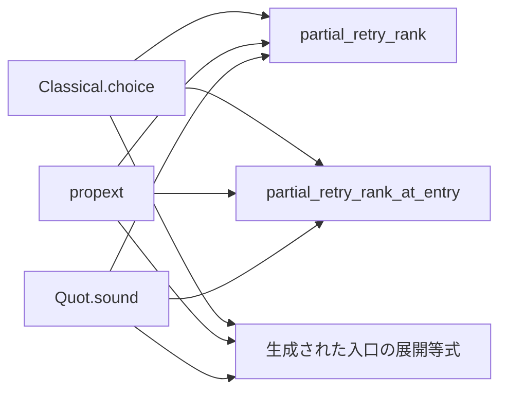
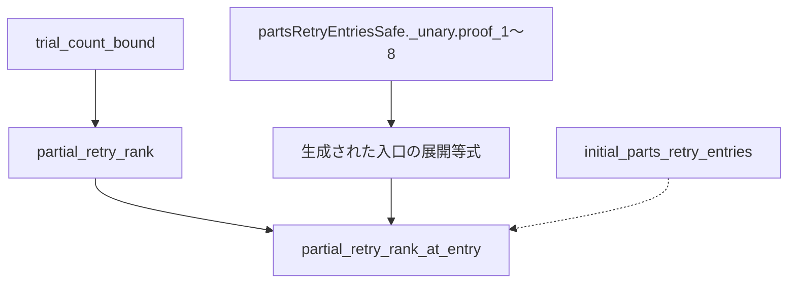

# root [ADR 0352](../adr/0352-prove-pagination-in-lean.md): 選ばれた部分採用の再試行で上限が減ること

[PartialRetryRank.lean](../../experiments/pagination-proof/PartialRetryRank.lean) 全体を Lean 4.7.0 で調べた。
基準は main `bead6802895091038fc1870e4d67ae098c847582` に局所証明群を統合した `ec13f15d1ce6631a5bdb1b58c852aea05728a53c` である。
製品コードはこの main と同一であり、[root ADR 0483](../adr/0483-finish-forced-paragraph-placement-without-repeating-the-retry.md) の強制配置を採用する規則を含む。
[root ADR 0352](../adr/0352-prove-pagination-in-lean.md) 全体の実装完了は記録しない。

## 対象と主張

本文の末尾を保持するため、配置した行数から一行引いた上限で再試行する分岐を対象にする。
本体は [Flow.hs](../../modules/golem-typeset/src/Golem/Typeset/Flow.hs#L5385) で、正の上限を超えた強制配置を再試行から除く。
その後、残りの行数が要求した末尾の行数未満であり、採用数が先頭の最低数を超える場合に `count - 1` を渡す。
モデルの `forcedPrefix` と `limitRank` は [Physical.lean](../../experiments/pagination-proof/Physical.lean#L3286)、対応する入口の述語は [RetryPrefix.lean](../../experiments/pagination-proof/RetryPrefix.lean#L188) にある。

今回の補題は、強制配置を除く実際の分岐条件から、この新しい上限が旧 rank 未満であることを導く。
採用数が元の行数以下であることは、試し置きの結果から既存の定理で導く。
正の上限という条件も、二本目の定理では入口の述語から取り出す。
結論の不等式を前提にはしていない。
最低先頭行数の条件は、この不等式には不要なので追加しない。
公開試し置き API の引数や成功結果を制限する変更ではない。

## 公理と宣言の一覧

対象モジュールの環境を列挙し、公開定理 2 件、生成定理 1 件、定義 0 件、公理宣言 0 件を確認した。
生成定理は、インポートした再帰的な入口の述語を二本目の証明で展開した際に生成された等式である。
各定理の型と証明項を取得し、`#print axioms` を実行した。
取得できなかった証明項はない。

定理名の共通接頭辞は `PhysicalPagination.` である。

| 定理 | 位置 | 前提と結論 |
| --- | --- | --- |
| `root_adr0352_i4_partial_retry_rank` | [6 行](../../experiments/pagination-proof/PartialRetryRank.lean#L6) | 上限は未指定または正、試し置きは配置成功、強制配置ではない場合に、採用数から一行引いた値が旧 rank 未満である。 |
| `root_adr0352_i4_partial_retry_rank_at_entry` | [29 行](../../experiments/pagination-proof/PartialRetryRank.lean#L29) | 既存の入口の述語と配置成功、強制配置ではなく末尾行数が足りない分岐が選ばれたことから、同じ不等式を導く。 |

生成定理の完全名は `_private.experiments.«pagination-proof».PartialRetryRank.0.PhysicalPagination.partsRetryEntriesSafe._eq_1` である。
宣言位置の情報はなく、[44 行](../../experiments/pagination-proof/PartialRetryRank.lean#L44) の展開が生成元である。
述語の値を、その入口と次の分岐の論理積へ展開する等式を主張する。

三定理とも、次の標準三公理に推移的に依存する。
独自の公理は加えていない。

| 公理 | Lean 4.7.0 の位置 | 内容 |
| --- | --- | --- |
| `Classical.choice` | `Init.Prelude:730` | `Nonempty α` から要素を選ぶ。 |
| `propext` | `Init.Core:1287` | 命題の同値から等式を導く。 |
| `Quot.sound` | `Init.Core:1459` | 関係を満たす二要素が同じ商の値を持つ。 |

公理の図は、補助定理と定義を経由する推移的依存を示す。



次の図の実線は証明項に現れた定理の直接参照、破線は既存の入口の定理からの接続を示す。
標準の算術、等式、Bool、リストの補題は省略した。
生成等式が直接参照する八つの `_unary.proof_1`〜`_unary.proof_8` は、既存の述語の再帰に使う減少の証明である。
これらの依存は [入口の調査](0352-retry-prefix-dependencies.md) に記録している。



破線は、既存の定理が初回の入口の述語を導くことを表す。
二本目の証明項が `initial_parts_retry_entries` を直接呼んだという意味ではない。
任意の本体の実行をこの入口の述語へ写す証明とは区別する。

対象ソースに `sorry`、`admit`、`sorryAx` はなく、三定理の公理依存にも証明の穴はなかった。
今回の範囲に、穴の影響を受ける定理はない。

## 回帰と実装との照合

[境界](../../experiments/pagination-proof/PartialRetryRankBoundary.lean) では、旧反例の採用数 3、上限 2 を保持する。
強制配置が真なので今回の再試行の分岐は選ばれず、旧 rank の不等式は偽のままである。
未指定の上限、正の最小上限 1、採用数 0、上限と同じ採用数、外部から渡す上限 0 も、九つの閉じた式で確認した。
二つの公開定理もインポート先から利用できることを確認した。

[実装の照合](../../experiments/pagination-proof/PartialRetryRankChecks.hs) は、既存の公開試し置きを 1,792 入力で呼ぶ。
段容量 1、2、3、6、行数 0〜6、上限の未指定と 0 と 1 と 3、保持四種類、先頭か途中か、既存の一行の有無を組み合わせた。
1,336 入力で配置し、456 入力で次の段へ送った。
配置成功ごとに残りの行数 0〜6 を組み合わせ、正の上限または未指定で、強制配置ではない再試行の分岐が選ばれれば rank が減ることを確認した。
本体の任意の行を改めて組んだときの残り行数を証明した検査ではない。

強制配置の除外を外した変異は、この実装の照合で rank が減らず失敗した。
除外のある実装では全入力が通る。
境界の分岐を真へ反転する変異は `decide` が偽と判定し、減少式を `count - 1` から `count` へ強める変異も Lean が拒否した。
既存の上限 0 と強制配置の反例は、照合入力に実在することも検査している。

実装の照合には GHC 9.10.3 と、同じ製品コードの既存 runtime DB を読み取り専用で利用する。
標準 Cabal 環境を新たに構築したという検証ではない。
次のコマンドでモジュールと境界を検査できる。
`MODEL_CACHE` は、先に `check.sh` で構築したモデルのディレクトリを指定する。

```sh
LEAN_PATH="$MODEL_CACHE" lean -o "$MODEL_CACHE/PartialRetryRank.olean" \
  experiments/pagination-proof/PartialRetryRank.lean
LEAN_PATH="$MODEL_CACHE" lean experiments/pagination-proof/PartialRetryRankBoundary.lean
RUNGHC=/private/tmp/golem-0352-tcy-main-tools-nov28/runghc-driver
"$RUNGHC" experiments/pagination-proof/PartialRetryRankChecks.hs
```

全制御、任意の `Built`、本文の全量と順序、一般のキャプションと実装の接続は残る。
今回の局所的な rank の証明だけで、実装全体の停止を証明したとはしない。
新しい証明専用 CI と予算の変更は加えない。

`check.sh` 全体も Lean 4.7.0 で終了コード 0 となった。
今回の 1,792 入力に加え、既存の配置 55,838 件と 156,520 件、回り込み 10,368 件、因果的配置 4,864 件、制御 216 件、改行 34,586 件、実フォントのキャプション 40 件と Alloy 42 件の対応を含む。
Alloy のソルバー自体の再実行ではない。
既存 runtime の Cabal plan と package cache の実行前後の SHA-256 は一致した。
