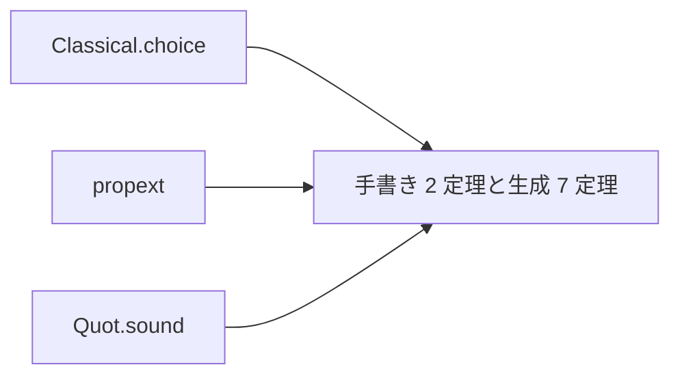
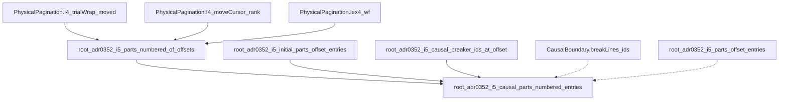

# [root ADR 0352](../adr/0352-prove-pagination-in-lean.md) の到達した段落分割入口の行 ID

## 範囲

この調査は、`parts` の対応モデルで実際に到達する各再帰入口の行 ID を扱う。
基準は `e7b70b6800c2e63559b864afe6a4cce109a2123d` の本体と既存モデルである。
追加した [PartsNumberedEntries.lean](../../experiments/pagination-proof/PartsNumberedEntries.lean) を Lean 4.7.0（`aarch64-apple-darwin`）で検査した。
本体と `Physical.lean` は変えていない。

[採用済み行数の調査](0352-parts-offset-dependencies.md) は、最初のテキスト数を `base`、段落で採用済みの行数を `before` として、再帰入口で `(text cursor).length = base + before` を導く。
ここでテキスト数とは、モデルの `text` が返す ID の列の長さを指す。
今回の証明は、その入口の条件と対応モデルの改行器の採番を接続する。
再試行、カーソルの移動、部分採用後の継続を含むすべての再帰入口で、改行器が返す行 ID の列は `base + before` から始まる連続した列になる。
全処理の成功は仮定せず、失敗する呼び出しも、その入口までは検査する。

これは `I5_parts_lines` の前提 `hb` を任意の状態で証明したものではない。
任意の状態はテキスト数と `before` の関係を持たず、その前提は一般には成り立たない。
到達した入口についての述語を別に作り、同じ再帰分岐に沿って証明した。
配置結果全体の内容の過不足と順序へ接続する証明は残る。

## 宣言と依存

Lean の環境で宣言の種類、型、elaboration 後の証明項を取得した。
手書き定義 1 件、生成定義 16 件、手書き定理 2 件、生成定理 18 件、公理宣言 0 件だった。
20 定理すべてで `#print axioms` を実行した。
9 件は `propext`、`Classical.choice`、`Quot.sound` に依存し、11 件は公理に依存しなかった。
以下では三つを「標準三公理」と略す。

| 完全修飾名 | 位置 | 前提と結論 | 公理への依存 |
| --- | --- | --- | --- |
| `PhysicalPagination.partsNumberedEntriesSafe` | [PartsNumberedEntries.lean:7](../../experiments/pagination-proof/PartsNumberedEntries.lean#L7) | `parts` と同じ再帰入口で、改行器の行 ID が `base + before` から連続することを表す述語。 | 定義 |
| `PhysicalPagination.root_adr0352_i5_parts_numbered_of_offsets` | [PartsNumberedEntries.lean:62](../../experiments/pagination-proof/PartsNumberedEntries.lean#L62) | テキスト数が `base + before` と一致する入口の採番だけを前提とし、全入口のテキスト数の条件から全入口の行 ID の条件を導く。 | 標準三公理 |
| `PhysicalPagination.root_adr0352_i5_causal_parts_numbered_entries` | [PartsNumberedEntries.lean:123](../../experiments/pagination-proof/PartsNumberedEntries.lean#L123) | 対応モデルの改行器では、最初のテキスト数を `base` とし `start = before = 0` から始めると、全再帰入口の行 ID の条件が成り立つ。改行器の採番についての仮定を呼出側に要求しない。 | 標準三公理 |

生成定理は、再帰の減少証明と、今回展開した定義の分岐の等式である。
private の宣言も含めた完全修飾名を次に示す。
生成位置を取得できなかったため、行番号は付けない。
生成定義には、引数の束ね方と分岐の補助宣言が含まれる。

| 生成定理 | 公理への依存 |
| --- | --- |
| `_private.experiments.«pagination-proof».PartsNumberedEntries.0.PhysicalPagination.partsNumberedEntriesSafe.match_1.eq_2` | なし |
| `_private.experiments.«pagination-proof».PartsNumberedEntries.0.PhysicalPagination.partsOffsetSafe.match_1.eq_3` | なし |
| `_private.experiments.«pagination-proof».PartsNumberedEntries.0.PhysicalPagination.linkBreaks.match_1.eq_1` | なし |
| `PhysicalPagination.partsNumberedEntriesSafe._unary.proof_4` | 標準三公理 |
| `_private.experiments.«pagination-proof».PartsNumberedEntries.0.PhysicalPagination.partsOffsetSafe.match_1.eq_2` | なし |
| `_private.experiments.«pagination-proof».PartsNumberedEntries.0.PhysicalPagination.partsOffsetSafe.match_1.eq_1` | なし |
| `_private.experiments.«pagination-proof».PartsNumberedEntries.0.PhysicalPagination.partsNumberedEntriesSafe.match_1.eq_1` | なし |
| `PhysicalPagination.partsNumberedEntriesSafe._unary.proof_3` | なし |
| `_private.experiments.«pagination-proof».PartsNumberedEntries.0.PhysicalPagination.partsNumberedEntriesSafe.match_1.eq_3` | なし |
| `PhysicalPagination.partsNumberedEntriesSafe._unary.proof_6` | 標準三公理 |
| `PhysicalPagination.partsNumberedEntriesSafe._unary.proof_7` | 標準三公理 |
| `_private.experiments.«pagination-proof».PartsNumberedEntries.0.PhysicalPagination.linkBreaks.match_1.eq_2` | なし |
| `_private.experiments.«pagination-proof».PartsNumberedEntries.0.PhysicalPagination.partsNumberedEntriesSafe._eq_1` | 標準三公理 |
| `PhysicalPagination.partsNumberedEntriesSafe._unary.proof_1` | なし |
| `PhysicalPagination.partsNumberedEntriesSafe._unary.proof_2` | 標準三公理 |
| `PhysicalPagination.partsNumberedEntriesSafe._unary.proof_5` | なし |
| `_private.experiments.«pagination-proof».PartsNumberedEntries.0.PhysicalPagination.partsOffsetSafe._eq_1` | 標準三公理 |
| `PhysicalPagination.partsNumberedEntriesSafe._unary.proof_8` | 標準三公理 |

標準公理の宣言元と内容は次のとおりである。
今回のモジュールは新しい公理を宣言していない。

| 公理 | Lean 4.7.0 の位置 | 内容 |
| --- | --- | --- |
| `Classical.choice` | `Init.Prelude:730` | `Nonempty α` から `α` の要素を選ぶ。 |
| `propext` | `Init.Core:1287` | `a ↔ b` から `a = b` を得る。 |
| `Quot.sound` | `Init.Core:1459` | 関係を満たす二要素が同じ商の値を持つ。 |

次の公理の図は、補助定理や定義を経由した推移的な依存を表す。

次の図の実線は、型または証明項に現れる定理への直接参照である。
破線は、既存の補題を経由する間接依存である。
標準の等式、論理、算術の補題と生成定理は省いた。
既存の補題の概要と依存は [採用済み行数の調査](0352-parts-offset-dependencies.md) にある。

対象のソースには `sorry`、`admit`、`sorryAx` の使用がない。
Lean の診断と 20 定理の公理依存にも、証明の穴はなかった。
従って今回の範囲に、穴の影響を受ける定理はない。

## 照合と残り

[check-parts-numbered-shape.sh](../../experiments/pagination-proof/check-parts-numbered-shape.sh) は、入口の行 ID の条件を除き、述語が `Physical.lean` の `parts` と同じ分岐、引数、減少尺度を持つことを比較する。
元のソースは検査を通った。
入口の条件の削除、部分採用後の `before` の加算の誤変更、再帰の `base` の誤変更は、三つとも検査で拒否された。
入口の行 ID を `base + before + 1` から始める誤変更も、Lean の証明で拒否された。

`check.sh` 全体もローカルで終了コード 0 だった。
55,838 件の格子の境界、156,520 件の自由配置の境界、10,368 件の折り返し図版の試行、4,864 件の原稿と 216 件の制御境界、34,586 件の改行、実フォントの 40 キャプションの照合を含む。
42 件の Alloy コマンドに対応する Lean の宣言も検査した。
これらの有限照合を、任意の原稿についての一般証明とは扱わない。

Haskell の実行には、GHC 9.10.3 でビルド済みの `0aa78f65ac691cdd8d1a3bd5fc4c8bffb1feabdb` の package DB を読み取り専用で使った。
基準の `e7b70b6800c2e63559b864afe6a4cce109a2123d` と、この実行に使った版の `modules/` は差分がない。
ローカルの実行ラッパーから package-id を明示し、Cabal のプランを更新せずに `check.sh` のプログラムを実行した。
プランと package DB のキャッシュのハッシュは、前後で変わらなかった。
標準の Cabal 環境の作成は、この実行では検査していない。

本体の [Flow.hs:5290](../../modules/golem-typeset/src/Golem/Typeset/Flow.hs#L5290) は、`parts` を `start = 0`、採用済み行列が空の状態から呼ぶ。
[Flow.hs:5295](../../modules/golem-typeset/src/Golem/Typeset/Flow.hs#L5295) は、採用済み行列の長さを `countBefore` として組み直し、`bUnitFirsts updated` の値に加えて改行結果を採番する。
今回のモデルはカーソルのテキスト数から採番する。
組み直した `Built` の採番表と、対応モデルの最初のテキスト数が一致することは、まだ証明していない。

この増分は、任意の本文について `breakParagraph` とモデルの改行器が一致することを証明しない。
全制御、`Built`、詩の配置全体、任意の内容の過不足と順序、実フォントによる任意のキャプションの一致も残る。
[root ADR 0352](../adr/0352-prove-pagination-in-lean.md) は採択済みで未実装の状態を保つ。

## [root ADR 0483](../adr/0483-finish-forced-paragraph-placement-without-repeating-the-retry.md) 後の呼び出し元との照合

元の観測は、上に記した旧版のものとして残す。
停止しない疑いの旧版の記録は、[上限と再試行の調査](0352-retry-prefix-dependencies.md) にある。
その後、main `365b43c4ab5e01c863916504f417b0e596a0b3c6` の本体と、[root ADR 0352](../adr/0352-prove-pagination-in-lean.md) の入口の増分 `1b96d661fb25e1a6f6d4805a46993b2f4d2473a1` へ未公開の証明増分を移した。
製品の `modules/` は、この main と同一である。
公開の試し置きの上限の契約は変わっていない。

採択済みの補足に合わせ、完全採用では正の上限を超えた強制配置を返し、部分採用では同じ強制配置を再試行しない条件を、対応する入口の述語にも反映した。
元の行数と引数の分岐照合ではこの二条件がない旧述語が失敗し、更新した述語で成功した。
入力に新たな前提を加えていない。
一般の本文の終了や全 `Built` の一致を、この更新だけで証明したとはしない。

`PartsNumberedEntries` とその依存を Lean 4.7.0 で検査し、全 20 定理の公理と直接参照を環境から再取得した。
定義は 17 件で、新たな公理宣言はなかった。
宣言名の集合は元の調査と一致し、全定理の公理依存も一致した。
9 件は標準三公理、11 件は公理に依存しなかった。
対象と公理依存に `sorryAx` はなく、取得できなかった証明項もなかった。

次の表の定理名の共通接頭辞は `PhysicalPagination.`、`coordinate_eval` の共通接頭辞は `Lean.Omega.LinearCombo.` である。

| 定理 | 加わった直接参照 | なくなった直接参照 |
| --- | --- | --- |
| `partsNumberedEntriesSafe._unary.proof_7` | `coordinate_eval_6`、`coordinate_eval_7` | `Int.ofNat_nonneg`、`coordinate_eval_8`、`coordinate_eval_9` |
| `partsNumberedEntriesSafe._unary.proof_8` | `coordinate_eval_5`、`coordinate_eval_6` | `Int.ofNat_nonneg`、`coordinate_eval_7`、`coordinate_eval_8` |

これらの `coordinate_eval` は、Lean 4.7.0 の `Init/Omega/LinearCombo.lean:59` 以降で定義される、列の指定した座標の評価を取り出す補題である。
直接参照の変更はこの標準算術の補題に限られ、上の図のプロジェクトの定理間の参照と、公理の図は変わらなかった。
新しい CI ワークフローと予算の変更は加えていない。
