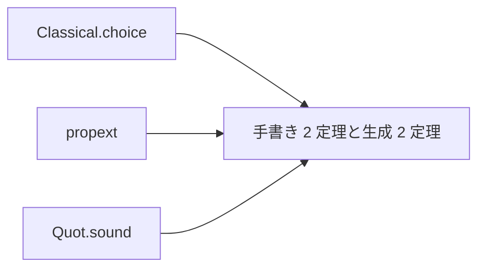
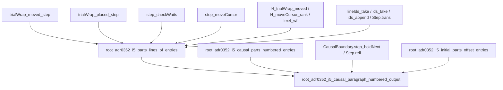

# [root ADR 0352](../adr/0352-prove-pagination-in-lean.md) の段落分割の成功結果と行 ID

## 範囲

基準は `997aef661f1faa7f8d56b4b4b82cf8ad273486b7` の本体と既存モデルである。
[PartsNumberedOutput.lean](../../experiments/pagination-proof/PartsNumberedOutput.lean) を Lean 4.7.0（`aarch64-apple-darwin`）で検査した。
本体と `Physical.lean` は変更していない。

[到達した入口の採番](0352-parts-numbered-entry-dependencies.md) を、`parts` の成功結果へ接続する。
成功時には、もとの `text` の ID 列をそのまま残し、`base + before` から連続する ID 列を加える。
図版の列 `figs` には何も加えず、何も落とさない。
ここで `text` と `figs` はモデルの射影であり、実装の任意の文字列についての全量の保存を主張するものではない。
もとの ID 列が連続していることも仮定せず、今回の呼び出しが加える区間を扱う。

汎用の定理は、到達入口の述語と、終端で呼ぶ `hold` が `text` と `figs` を変えないことを前提にする。
具体的な `CausalBoundary.paragraphAt` の定理は、到達入口の条件を前の証明から導き、`hold` の条件も `step_holdNext` と恒等関数から導く。
呼出側が与える条件は、そのモデルの呼び出しが成功したという事実である。
任意の到達不能状態も採番則を満たすという前提は置かない。

既存の `CausalBoundary.paragraphAt_counts` も、同じモデルについて `Counts` を導いている。
今回の定理は、`I5_parts_lines` にあった固定の `base + before` の採番を、到達する入口に限って使う導出経路を作る。
この別の導出ができただけで、実装との対応や、原稿全体の保存を新たに完成扱いしない。

## 宣言と依存

Lean の環境で、宣言の種類、型、elaboration 後の証明項を照合した。
手書き定理 2 件、生成定理 2 件、手書き定義 2 件、生成定義 12 件、公理宣言 0 件だった。
4 定理すべてで `#print axioms` を実行した。
4 件とも `propext`、`Classical.choice`、`Quot.sound` に依存する。
以下では、この三つを「標準三公理」と略す。

| 完全修飾名 | 位置 | 前提と結論 |
| --- | --- | --- |
| `PhysicalPagination.root_adr0352_i5_parts_lines_of_entries` | [PartsNumberedOutput.lean:6](../../experiments/pagination-proof/PartsNumberedOutput.lean#L6) | 到達入口の採番と `hold` の空の遷移から、成功結果が以前の ID 列と図版の列を残し、新たな連続 ID 列だけを加えることを導く。 |
| `PhysicalPagination.root_adr0352_i5_causal_paragraph_numbered_output` | [PartsNumberedOutput.lean:118](../../experiments/pagination-proof/PartsNumberedOutput.lean#L118) | `CausalBoundary.paragraphAt` の成功から、そのカーソルの `text` の長さを先頭とする新たな連続 ID 列を導く。到達採番と `hold` の条件は呼出側に要求しない。 |
| `PhysicalPagination.numberedOutputBoundary` | [PartsNumberedOutput.lean:135](../../experiments/pagination-proof/PartsNumberedOutput.lean#L135) | 小さいモデル入力で、成功時の ID 列と、収まらない行の既存の拒否を検査する関数。定理ではない。 |
| `PhysicalPagination.numberedOutputBoundaries` | [PartsNumberedOutput.lean:147](../../experiments/pagination-proof/PartsNumberedOutput.lean#L147) | 24 入力の実行検査。定理ではなく、`#eval` の結果を `check.sh` で `true` と比較する。 |

生成定理の完全修飾名は次のとおりである。
生成位置を取得できなかったため、行番号は付けない。
生成定義は、有限検査の関数の分岐とリスト操作などの補助宣言である。

| 生成定理 | 公理への依存 |
| --- | --- |
| `_private.experiments.«pagination-proof».PartsNumberedOutput.0.PhysicalPagination.parts._eq_1` | 標準三公理 |
| `_private.experiments.«pagination-proof».PartsNumberedOutput.0.PhysicalPagination.partsNumberedEntriesSafe._eq_1` | 標準三公理 |

今回のモジュールは新しい公理を宣言していない。
依存する標準公理の内容は次のとおりである。

| 公理 | Lean 4.7.0 の位置 | 内容 |
| --- | --- | --- |
| `Classical.choice` | `Init.Prelude:730` | `Nonempty α` から `α` の要素を選ぶ。 |
| `propext` | `Init.Core:1287` | `a ↔ b` から `a = b` を得る。 |
| `Quot.sound` | `Init.Core:1459` | 関係を満たす二要素が同じ商の値を持つ。 |

公理の図は、補助定理や定義を経由する推移的な依存を示す。

次の図の実線は、型か証明項に現れる直接参照である。
破線は、到達入口の定理を経由した間接依存である。
標準の等式や論理の補題と生成定理は省いた。

対象ソースには `sorry`、`admit`、`sorryAx` の使用がない。
Lean の diagnostic と 4 定理の公理依存にも証明の穴はなかった。
今回の範囲には、穴の影響を受ける定理はない。

## 境界と残り

有限検査は、`CausalBoundary.env` の引数 1 と 2、文字数 0、1、12、13、24、25、既存の一行の有無を組み合わせた 24 入力を使う。
14 入力は成功結果を検査し、10 入力は `lineTooTall` の ID を検査する。
`CausalBoundary.env 1` は容量が 10 pt で行送りが 15 pt なので、文字のある行は収まらない。
この場合を成功へ変えず、モデルと本体に既にある拒否を検査する。
これは、通常の CLI で一行の段を指定すると必ず失敗する、という主張ではない。
本体の該当する条件は [Physical.hs:486](../../modules/golem-layout/src/Golem/Layout/Paginate/Physical.hs#L486) の `pitch > physicalCapacity cfg` である。

開始 ID を一つずらす、追加する ID 列を逆順にする、図版を一つ加える三つの誤変更は、Lean の証明で拒否された。
有限検査で既存の失敗を隠す誤変更も、`true` との比較で拒否された。
有限検査の値を一般証明の根拠として仮定していない。

`check.sh` 全体も終了コード 0 で通った。
既存の 55,838 件と 156,520 件の配置、10,368 件の回り込み、4,864 件の因果的配置、34,586 件の改行、実フォントのキャプション 40 件、Alloy 42 件の対応検査を含む。
実装との照合では、`0aa78f65ac691cdd8d1a3bd5fc4c8bffb1feabdb` の既存 runtime DB を読み取り専用で使い、GHC 9.10.3 の登録済み package ID を明示した。
本体の `modules/` はこの基準の版と一致し、実行前後の Cabal plan と package cache の SHA-256 も一致した。
この手順は標準 Cabal 環境の新規構築を検証したものではない。

本体の [Flow.hs:5295](../../modules/golem-typeset/src/Golem/Typeset/Flow.hs#L5295) は、採用した行を `committed` に残し、その行数を次の `countBefore` として使う。
[Flow.hs:5339](../../modules/golem-typeset/src/Golem/Typeset/Flow.hs#L5339) で、一部を採用して移る際に行列と改行位置を延ばす。
これらの実際の `Built` と、モデルの ID 列の射影の一致は残る。
未消費の文字列の全量、全制御、詩の採用、一般のキャプションとの対応も、この増分では閉じない。
[root ADR 0352](../adr/0352-prove-pagination-in-lean.md) は採択済みで未実装の状態を保つ。
