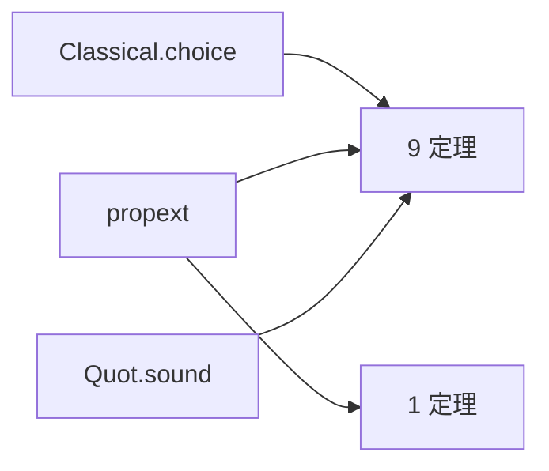
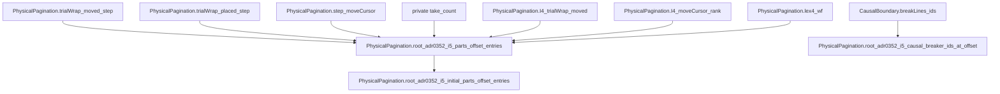

# [root ADR 0352](../adr/0352-prove-pagination-in-lean.md) の段落で採用した行数とカーソル

## 範囲

この調査は、対応モデルの `parts` が再帰するとき、カーソルのテキスト数と、同じ段落で採用済みの行数 `before` の関係を扱う。
基準は `db6b2259bbbae7241c1e6b6f5751ab233c10b350` の本体とモデルである。
[PartsOffsetEntries.lean](../../experiments/pagination-proof/PartsOffsetEntries.lean) を Lean 4.7.0（`aarch64-apple-darwin`）で検査した。
本体と既存のモデルは変えていない。

最初のテキスト数を `base` とすると、実際に到達する再帰入口では `(text cursor).length = base + before` が成り立つ。
移動と試行上限の変更は、採用済みのテキスト数と `before` を変えない。
一部の行を採用して続ける場合は、両方に採用した `count` を加える。
全処理の成功や、段落の行 ID に関する前提を使わず、この関係をすべての再帰入口で導く。

`I5_parts_lines` は、任意のカーソル、`before`、文字列の開始位置で `base + before` から行を採番する前提 `hb` を持つ。
対応モデルの改行器はカーソルのテキスト数から採番するので、任意の組み合わせでこの前提を満たすわけではない。
今回の証明は、到達する入口で必要な関係を別に導く。
既存の `I5_parts_lines` の前提を、そのまま全状態で解消したとは扱わない。

## 宣言と依存

Lean の環境から宣言の種類、型、elaboration 後の証明項を取得した。
手書き定義 1 件、生成定義 17 件、private の補題 1 件を含む手書き定理 4 件、生成定理 20 件、公理宣言 0 件だった。
24 定理すべてで `#print axioms` を実行した。

| 完全修飾名 | 位置 | 前提と結論 |
| --- | --- | --- |
| `PhysicalPagination.partsOffsetSafe` | [PartsOffsetEntries.lean:7](../../experiments/pagination-proof/PartsOffsetEntries.lean#L7) | `parts` の再帰の各入口で、テキスト数と `base + before` が等しいことを表す。 |
| `_private.experiments.«pagination-proof».PartsOffsetEntries.0.PhysicalPagination.take_count` | [PartsOffsetEntries.lean:62](../../experiments/pagination-proof/PartsOffsetEntries.lean#L62) | リストから先頭の `n` 件を取った長さは、`n` と元の長さの小さい方である。 |
| `PhysicalPagination.root_adr0352_i5_parts_offset_entries` | [PartsOffsetEntries.lean:67](../../experiments/pagination-proof/PartsOffsetEntries.lean#L67) | 最初のテキスト数と `base + before` の一致から、すべての再帰入口の一致を導く。改行器と保持の関数は任意である。 |
| `PhysicalPagination.root_adr0352_i5_causal_breaker_ids_at_offset` | [PartsOffsetEntries.lean:119](../../experiments/pagination-proof/PartsOffsetEntries.lean#L119) | 入口でテキスト数が `base + before` と一致すれば、対応モデルの改行器の行 ID はそこから連続する。 |
| `PhysicalPagination.root_adr0352_i5_initial_parts_offset_entries` | [PartsOffsetEntries.lean:126](../../experiments/pagination-proof/PartsOffsetEntries.lean#L126) | 採用済み行数が 0 の最初の入口から始めれば、別の初期条件なしに再帰入口の一致を導く。 |

生成定理は、述語の分岐と減少証明、リスト操作の分岐の等式である。
位置を取得できなかったため、完全修飾名を記録する。
表では `propext`、`Classical.choice`、`Quot.sound` を「標準三公理」と略す。

| 生成定理 | 公理への依存 |
| --- | --- |
| `_private.experiments.«pagination-proof».PartsOffsetEntries.0.List.take._eq_1` | なし |
| `_private.experiments.«pagination-proof».PartsOffsetEntries.0.List.drop.match_1.eq_3` | なし |
| `PhysicalPagination.partsOffsetSafe._unary.proof_8` | 標準三公理 |
| `PhysicalPagination.partsOffsetSafe._unary.proof_7` | 標準三公理 |
| `PhysicalPagination.partsOffsetSafe._unary.proof_4` | 標準三公理 |
| `_private.experiments.«pagination-proof».PartsOffsetEntries.0.PhysicalPagination.partsOffsetSafe.match_1.eq_1` | なし |
| `_private.experiments.«pagination-proof».PartsOffsetEntries.0.List.drop.match_1.eq_1` | なし |
| `_private.experiments.«pagination-proof».PartsOffsetEntries.0.PhysicalPagination.linkBreaks.match_1.eq_2` | なし |
| `_private.experiments.«pagination-proof».PartsOffsetEntries.0.List.take._eq_2` | なし |
| `_private.experiments.«pagination-proof».PartsOffsetEntries.0.List.drop.match_1.eq_2` | なし |
| `PhysicalPagination.partsOffsetSafe._unary.proof_1` | なし |
| `_private.experiments.«pagination-proof».PartsOffsetEntries.0.List.take._eq_3` | なし |
| `PhysicalPagination.partsOffsetSafe._unary.proof_2` | 標準三公理 |
| `_private.experiments.«pagination-proof».PartsOffsetEntries.0.PhysicalPagination.partsOffsetSafe._eq_1` | 標準三公理 |
| `_private.experiments.«pagination-proof».PartsOffsetEntries.0.PhysicalPagination.partsOffsetSafe.match_1.eq_2` | なし |
| `PhysicalPagination.partsOffsetSafe._unary.proof_6` | 標準三公理 |
| `PhysicalPagination.partsOffsetSafe._unary.proof_5` | なし |
| `_private.experiments.«pagination-proof».PartsOffsetEntries.0.PhysicalPagination.partsOffsetSafe.match_1.eq_3` | なし |
| `_private.experiments.«pagination-proof».PartsOffsetEntries.0.PhysicalPagination.linkBreaks.match_1.eq_1` | なし |
| `PhysicalPagination.partsOffsetSafe._unary.proof_3` | なし |

24 定理のうち 9 件は標準三公理、1 件は `propext` のみ、14 件は公理に依存しなかった。
生成定義には、引数の束ね方と分岐の補助宣言が含まれる。

| 公理 | Lean 4.7.0 の位置 | 内容 |
| --- | --- | --- |
| `Classical.choice` | `Init.Prelude:730` | `Nonempty α` から `α` の要素を選ぶ。 |
| `propext` | `Init.Core:1287` | `a ↔ b` から `a = b` を得る。 |
| `Quot.sound` | `Init.Core:1459` | 関係を満たす二要素が同じ商の値を持つ。 |

公理の図は、補助宣言を経由した推移的な依存を示す。

次の図は、型または証明項に現れた定理の直接参照を示す。
標準の等式と論理の補題、生成定理は省いた。
private の補題は、上の表の完全修飾名に対応する。

## 照合と残り

[check-parts-offset-shape.sh](../../experiments/pagination-proof/check-parts-offset-shape.sh) は、入口の等式を除いて、元の `parts` と同じ分岐、引数、減少尺度になっていることを比較する。
元のソースでは成功し、入口の等式の削除、部分採用後の `before` の加算の削除、再帰での `base` の変更は、それぞれ検査に失敗した。
等式の右辺に 1 を加える変更では Lean の証明も失敗した。
追加する定理がない段階の名前の検査でも失敗を確認した。

本体の `Flow.hs:5339` は、部分採用した行を `committed` に足して続ける。
対応モデルの `before + count` は、その行数の更新を表す。
一方、本体の `numberedLines` は組み直した `Built` の `bUnitFirsts` も使う。
今回のテキスト数の等式だけから、この採番表全体との一致を結論しない。

対象のソースに `sorry`、`admit`、`sorryAx` はなく、24 定理の公理依存にも `sorryAx` はなかった。
取得できなかった対象の証明項はなかった。
述語と証明は、元の `parts` と同じ四つの値の辞書式の減少で終了する。
新しい CI ワークフローは追加していない。

本体の全制御、組み直す状態全体、採番表の接続、内容の過不足と順序、一般的なキャプションの改行の一致は残る。
今回の再帰入口の等式と、既存の `Counts` による成功結果の性質は、保証する範囲が異なる。
[root ADR 0352](../adr/0352-prove-pagination-in-lean.md) は `accepted-pending` のままにする。
