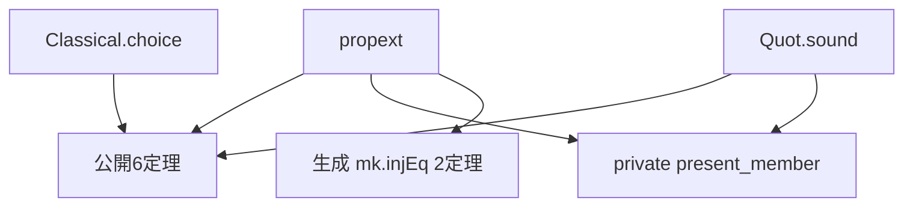
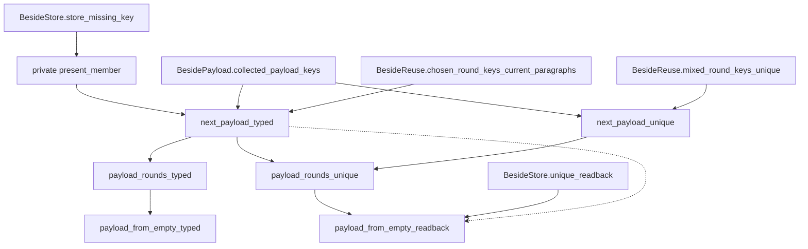

# [root ADR 0352](../adr/0352-prove-pagination-in-lean.md) の payload cache の帰納

## 範囲

基準は `6c108e73b` の本体と既存モデルである。
[PayloadRounds.lean](../../experiments/pagination-proof/PayloadRounds.lean) を Lean 4.7.0（`aarch64-apple-darwin`）で検査した。
本体と公開 API は変更していない。
この増分は、[生成した組のキーと値の対応](0352-produced-payload-keys-dependencies.md) に残った、前の表のキーが段落を指すという前提を、空の cache からの帰納で導く。

`PayloadCache` は、前の単位の種別、個数、生成した `(key, value)` の列を持つ。
次の round は、この列を `fromPairs` で表へ変換し、同じ表を再利用の判定と値の読み取りに渡す。
キーだけの別の cache を自由に渡す構成ではない。
`payloadTyped` は、この格納済みの表にあるキーが、その cache の単位の種別で段落を指すという条件である。
値そのものは任意の型を使い、整形の正しさは条件に含めない。

`nextPayloadCache` は、前の表か新しい callback から組を生成し、現在の単位の種別とともに保存する。
前の表の型を仮定すれば、生成した表の型が保たれる。
この結果を round の列で帰納し、空の cache から到達した表の型を導く。
この最終定理では、到達した表の型を前提に置いていない。

さらに、各 round の図版 job の所有者が昇順であり、その位置の現在の単位が図版であれば、生成したキーは重複しない。
この条件を満たす任意の round の列について、格納後に元のキー順で値を読むと、元の組の列と一致する。
この証明は同じ順での読み取りであり、任意の列の並べ替えを証明したものではない。

本体の [buildFlow](../../modules/golem-typeset/src/Golem/Typeset/Flow.hs#L4841) は、前の `Built` から表を読み、[reusedBeside](../../modules/golem-typeset/src/Golem/Typeset/Flow.hs#L4855) で同じ表の値を選ぶ。
[格納箇所](../../modules/golem-typeset/src/Golem/Typeset/Flow.hs#L4870) は、再利用か新規生成で得た組を連結し、`Map.fromList` へ渡す。
この増分は、この受け渡しをモデルへ接続する。
Haskell の `Map` の内部や、`Built` の全呼び出し元との一般的な対応を証明したとは扱わない。

## 定理と公理

Lean の環境から、宣言の種類、型、elaboration 後の証明項を取得した。
公開定理 6 件、手書きの private 定理 1 件、生成定理 6 件、定義 36 件、公理宣言 0 件だった。
定義は手書きの 7 件と、構造体の accessor などの生成定義を含む。
全 13 定理について、元の定理を参照する同じ型の別名を一時環境に作り、`#print axioms` を実行した。
別名も kernel が検査する。

次の公開名には、共通接頭辞 `BesidePayloadRounds.` を付ける。
標準三公理は `propext`、`Classical.choice`、`Quot.sound` を指す。

| 名前 | 位置 | 前提と結論 | 公理 |
| --- | --- | --- | --- |
| `root_adr0352_i5_next_payload_typed` | [40 行](../../experiments/pagination-proof/PayloadRounds.lean#L40) | 前の格納済みの表の型から、次の表のキーが現在の段落を指す。 | 標準三公理 |
| `root_adr0352_i5_next_payload_unique` | [60 行](../../experiments/pagination-proof/PayloadRounds.lean#L60) | 前の表の型と job の順序と図版の条件から、次の表のキーが重複しない。 | 標準三公理 |
| `root_adr0352_i5_payload_rounds_typed` | [81 行](../../experiments/pagination-proof/PayloadRounds.lean#L81) | 最初の表の型が正しければ、任意の round の列で型が保たれる。 | 標準三公理 |
| `root_adr0352_i5_payload_rounds_unique` | [92 行](../../experiments/pagination-proof/PayloadRounds.lean#L92) | 最初の表の型とキーの重複のなさ、各 job の合法性から、到達したキーが重複しない。 | 標準三公理 |
| `root_adr0352_i5_payload_from_empty_typed` | [110 行](../../experiments/pagination-proof/PayloadRounds.lean#L110) | 空の cache から到達した表のキーは、現在の単位で段落を指す。 | 標準三公理 |
| `root_adr0352_i5_payload_from_empty_readback` | [116 行](../../experiments/pagination-proof/PayloadRounds.lean#L116) | 各 job が合法なら、空の cache から到達した組の列を格納し、同じキー順で読み戻せる。 | 標準三公理 |

private 定理 `present_member` の完全修飾名は `_private.experiments.«pagination-proof».PayloadRounds.0.BesidePayloadRounds.present_member` である。
[32 行](../../experiments/pagination-proof/PayloadRounds.lean#L32) で、格納表にキーが存在すれば、元の組のキー列に含まれることを示す。
`propext` と `Quot.sound` に依存する。
private 定義 `noKind`、`emptyPayloadCache`、`currentKind` にも同じ private 接頭辞を付ける。
前の表がない場合の値と、現在の単位の種別を渡す関数であり、追加の前提ではない。

生成定理の共通接頭辞は `BesidePayloadRounds.` である。
生成位置は取得できなかったため、由来と完全名で区別する。

| 名前 | 由来 | 公理 |
| --- | --- | --- |
| `PayloadCache.mk.inj` | cache の構築子の単射性 | なし |
| `PayloadCache.mk.injEq` | cache の構築子の等式の分解 | `propext` |
| `PayloadCache.mk.sizeOf_spec` | cache の大きさの生成規則 | なし |
| `PayloadRound.mk.inj` | round の構築子の単射性 | なし |
| `PayloadRound.mk.injEq` | round の構築子の等式の分解 | `propext` |
| `PayloadRound.mk.sizeOf_spec` | round の大きさの生成規則 | なし |

使用した標準公理は、既存の証明の推移的な依存を含む。
`propext` は命題の同値からの等値（Lean の `Init/Core.lean:1287`）、`Classical.choice` は空でない型からの選択（`Init/Prelude.lean:730`）、`Quot.sound` は同値関係で結ばれた値の商での等値（`Init/Core.lean:1459`）である。
対象内に新しい公理宣言はない。
関数を持つ構造体を返す `nextPayloadCache` と `runPayloadRounds` は `noncomputable` とし、kernel の簡約で検査した。
これを実行コードの終了証明やコンパイラの正しさの保証とは扱わない。

公理の図の矢印は推移的な依存を示す。
生成定理のうち公理に依存しない 4 件は図から除いた。



定理の図では、実線は elaboration 後の型か証明項の直接参照、点線は示した補助定理を経由する依存を表す。
標準の論理定理は省略し、今回の公開 6 定理と private 定理、説明に必要な既存定理を載せた。



図の既存定理のラベルは、共通の接頭辞 `root_adr0352_i5_` を省略した。
今回の定理にも同じ接頭辞と `BesidePayloadRounds.` を付ける。

## 再現と境界

先に境界を追加し、正規の `LEAN_PATH` で実行したところ、未定義の namespace と API のため終了コード 1 になった。
モデルと証明を追加した後は、直接の境界 9 件が kernel で通った。
空の round 列、新規生成、値の callback だけを変えた再利用、幅の変化による新規生成、古い本文位置への図版の挿入、三つの round の合成、古いキーの除去、格納後の読み取りを含む。
callback だけを変えた境界では、再利用時に前の値が残ることを明示的に検査する。
この境界は cache の経路を検査するものであり、任意の callback の変更に対して古い値が正しいと主張するものではない。

[PayloadRounds.hs](../../experiments/pagination-proof/PayloadRounds.hs) は、実フォントを使い、六つの入力で本体の処理を実行した。
最初の原稿から、同じ原稿、段落の短縮、旧本文位置への図版、要素の削除、制御の挿入へ進む。
各変更では前の `Built` を渡す構築と、前の値を渡さない構築の行数と採番を比較した。
モデルには各変更で本体が持つ単位の種別、個数、幅の同一性、要素の同一性、ページ参照の有無、図版 job を渡す。
仮定された cut が空であることも検査する。
前の cache の body は自由に与えず、前のモデルの組から作る。
六つの到達結果で、キー、行数、offset の列が本体と一致した。
本体で観測した行数と offset は新規生成 callback の表として使うため、整形や offset の算出の一般的な正しさを独立に証明したとは扱わない。

検証は、コミット `0aa78f65ac691cdd8d1a3bd5fc4c8bffb1feabdb` の runtime と、既存の GHC 9.10.3 の package database を読み取り専用で利用した。
通常の Cabal 環境をこの tree から再構築した検証とは区別する。
読み取り前後の `plan.json` の SHA-256 は `981a01138b41bf0d6b1e8ea82155b2ed1227297b7339699bbc60005bc4c83957`、package database の `package.cache` は `dd7fdb3fca241d4a7039e18fccf8ff7065a265540225c2cf813e5b07cbe75fc8` で一致した。
この tree と検証した runtime の `modules/` の差分も空だった。

```sh
PAYLOAD_ROUNDS_LEAN=1 RUNGHC=/private/tmp/golem-0352-built-probe-nov28/runner \
  sh experiments/pagination-proof/check-built-first-ids.sh \
  "$PWD/experiments/pagination-proof/PayloadRounds.hs" > /private/tmp/golem-0352-payload-rounds-examples-nov28.lean
LEAN_PATH=/private/tmp/golem-0352-numbered-output-cache-nov28 \
  /Users/tett23/.elan/toolchains/leanprover--lean4---v4.7.0/bin/lean \
  /private/tmp/golem-0352-payload-rounds-examples-nov28.lean
```

本体の private 宣言の観測には既存の読み取り用 adapter を使った。
adapter は module の export だけを開き、残りの本体が同一であることを比較する。
本体や共用の cache は変更していない。

保存した cache の現在の種別をすべて不在へ変える変異は、`next_payload_typed` の証明で失敗した。
再利用の利用可能性を常に偽へ変える変異も、実際に渡す表と選択条件を使う証明の接続で失敗した。
いずれも一時コピーだけを使い、終了コード 1 だった。
これらの変異の拒否だけで、本体の全ての変更を検出できるとは扱わない。

既存のローカル `check.sh` に、このモデルと境界の検査を接続した。
全体の終了コードは 0 だった。
既存の grid 55,838 件、free 156,520 件、回り込みの試し置き 10,368 件、causal 4,864 件、改行の評価 34,586 件、実フォントの caption 40 件、Alloy の 42 コマンドの Lean への対応も保った。
Alloy の件数は既存の対応の検査であり、今回新しく solver を 42 回実行した意味ではない。
最終のシェルの変更は新しい検査の接続だけとし、全体検証時のスクリプトとの整形後の同一性と構文を再確認した。
新しい CI workflow は追加していない。

## 残件

対象の Lean の診断と全 13 定理の公理依存に、証明の穴はなかった。
`sorry`、`admit`、`sorryAx` の候補も対象ソースにはなかった。
ただし、本体の全 round がモデルの job の順序と図版の条件を満たすこと、実際の単位数と Nat の範囲、Haskell の Map の内部との一般的な対応は残る。

また、再利用する前の値が現在の整形結果と等しい条件、callback の IO と状態更新、実フォントの整形とモデルとの一般的な対応は未証明である。
この増分は生成後の組の受け渡しを扱い、原稿の全内容の生成の正しさを証明していない。
`Built`、`hb` の全呼び出し元、全制御、本文の全量と順序、`captionCompared` と改行器の一般的一致も残る。
[末尾保持の再試行の反例](0352-last-retry-counter-dependencies.md) も、この増分では変更していない。
root [ADR 0352](../adr/0352-prove-pagination-in-lean.md) の全範囲は未完了のままである。
