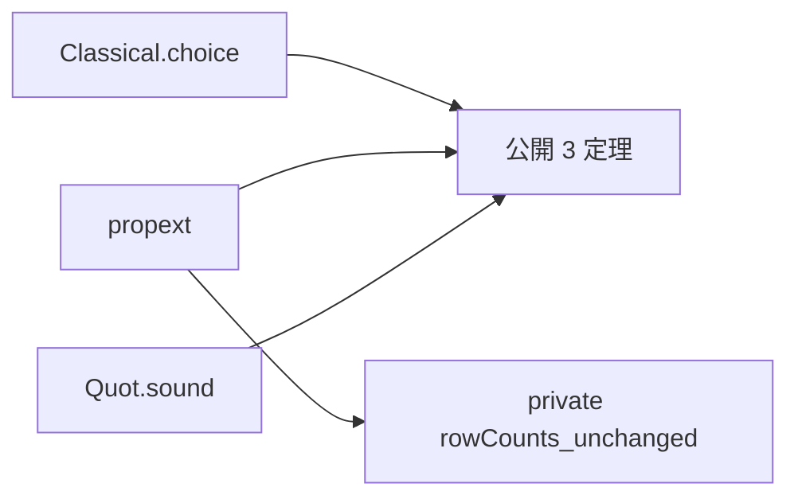
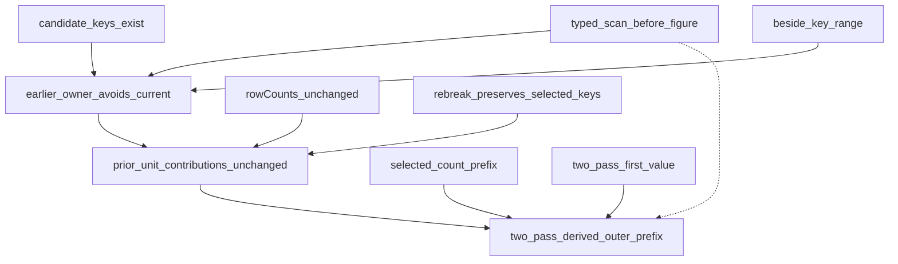

# [root ADR 0352](../adr/0352-prove-pagination-in-lean.md) の先行する単位の採番量

## 範囲

基準は `be93e5af7` の本体と既存モデルである。
[PriorUnitCounts.lean](../../experiments/pagination-proof/PriorUnitCounts.lean) を Lean 4.7.0（`aarch64-apple-darwin`）で検査した。
本体と公開 API は変更していない。
この増分は、[選択キーと先行する採番量](0352-selected-count-prefix-dependencies.md) に残していた外側の寄与を、単位ごとの寄与の射影から導く。
本体の全分岐と射影との一般的な対応までを終えたという意味ではない。

`unitContributions` は、先行する単位の寄与を表す列を読む。
列の一つの要素は、固定の採番量と、本文を所有する図版のキーの有無を持つ。
図版のキーがなければ固定の量を使う。
あれば、固定の量に、その図版が所有する本文の行数の合計を足す。
通常の本文などの固定の寄与も列へ含め、先行する図版だけを数えて済ませない。

本体の [numberFigure](../../modules/golem-typeset/src/Golem/Typeset/Flow.hs#L4570) は、回り込み図版とその本文をまとめて採番する。
この有効な経路では、図版の 1 ID に本文の行数を足して次の ID へ進む。
[numberOther](../../modules/golem-typeset/src/Golem/Typeset/Flow.hs#L4540) は、既に図版の本文として数える単位を飛ばす。
前の寄与を調べる範囲には、現在の本文を所有する図版そのものを含めない。
その図版の総寄与は、現在の本文の行数で変わるからである。

現在の所有者より前にある図版は、現在の本文のキーを選ばない。
この性質は、[図版を区切りとする順序の定理](0352-beside-reuse-order-dependencies.md) と、現在の本文のキーがその所有者より後にあることから導く。
本文の値を一つ更新してもキーの有無は変わらないので、前の図版が選ぶ列も変わらない。
その列は更新したキーを含まず、前の寄与の列全体が保たれる。

最後に、この外側の寄与の保存と、既存の内側の本文の採番量の保存を合わせる。
現在の本文の行数と、後にある単位の寄与が変わっても、二段階の採番で現在の本文の先頭 ID が保たれる。
外側の寄与の列が前後で等しいことを、そのまま前提には置かない。
ただし、各単位が固定の量か図版の寄与に正しく分類されることは、本体からまだ一般に導いていない。

## 定理と依存

Lean の環境で、宣言の種類、型、elaboration 後の証明項を調べた。
公開定理 3 件、手書きの private 定理 1 件、生成定理 12 件、定義 20 件、公理宣言 0 件だった。
定義は手書きの `unitContributions` と、再帰の分岐などの生成定義である。
16 定理のすべてについて、元の定理を参照する同じ型の別名を一時環境に作り、`#print axioms` を実行した。
別名も kernel が検査する。

次の公開名には、共通接頭辞 `BesideReuse.` を付ける。
公開 3 定理は、すべて `propext`、`Classical.choice`、`Quot.sound` に依存する。

| 名前 | 位置 | 前提と結論 |
| --- | --- | --- |
| `root_adr0352_i5_earlier_owner_avoids_current` | [18 行](../../experiments/pagination-proof/PriorUnitCounts.lean#L18) | 本文のキーが現在の段落を指し、現在の所有者が図版なら、前の所有者の選択キーは現在の本文のキーと異なる。 |
| `root_adr0352_i5_prior_unit_contributions_unchanged` | [39 行](../../experiments/pagination-proof/PriorUnitCounts.lean#L39) | 所有者を持つ先行する要素が現在の所有者より前なら、現在の本文の値の更新で寄与の列が変わらない。 |
| `root_adr0352_i5_two_pass_derived_outer_prefix` | [65 行](../../experiments/pagination-proof/PriorUnitCounts.lean#L65) | 外側の寄与の列と内側の先行する本文の保存から、二段階の採番による現在の先頭 ID が保たれる。 |

private 定理 `_private.experiments.«pagination-proof».PriorUnitCounts.0.BesideReuse.rowCounts_unchanged` は [7 行](../../experiments/pagination-proof/PriorUnitCounts.lean#L7) にある。
選択キーの列が更新したキーを含まなければ、値の更新で行数の列が変わらないことを示す。
この定理は `propext` にだけ依存する。

次の生成定理 12 件には、共通接頭辞 `_private.experiments.«pagination-proof».PriorUnitCounts.0.` を付ける。
生成位置は取得できなかった。
寄与の再帰と、インポートした採番量の列を簡約する分岐の等式に由来し、すべて公理に依存しない。

| 名前 |
| --- |
| `BesideOwnership.countsFor.match_1.eq_2` |
| `BesideReuse.unitContributions._eq_2` |
| `BesideOwnership.countsFor.match_1.eq_1` |
| `BesideOwnership.countsFor._eq_1` |
| `BesideReuse.unitContributions.match_1.eq_2` |
| `BesideReuse.unitContributions.match_1.eq_1` |
| `BesideReuse.unitContributions._eq_3` |
| `BesideOwnership.rowCount.match_1.eq_1` |
| `BesideOwnership.countsFor._eq_2` |
| `BesideReuse.unitContributions._eq_1` |
| `BesideReuse.unitContributions.match_1.eq_3` |
| `BesideOwnership.rowCount.match_1.eq_2` |

標準公理の宣言元と内容は次のとおりである。
対象内に、新しい公理を宣言していない。

| 公理 | Lean 4.7.0 の位置 | 内容 |
| --- | --- | --- |
| `Classical.choice` | `Init.Prelude:730` | `Nonempty α` から要素を選ぶ。 |
| `propext` | `Init.Core:1287` | 命題の同値から等式を導く。 |
| `Quot.sound` | `Init.Core:1459` | 関係を満たす二要素が同じ商の値を持つ。 |

公理の図は、定義や補助定理を経由する推移的な依存を示す。
公理に依存しない生成 12 定理には辺がない。



次の定理の図の実線は、型か証明項の定理の直接参照である。
破線は定義や補助定理を経由する間接依存を示す。
標準の等式と算術の補題と生成定理は省いた。



対象ソースに `sorry`、`admit`、`sorryAx` の使用はない。
Lean の diagnostic と 16 定理の公理依存にも証明の穴はなかった。
この範囲に、穴の影響を受ける定理はない。

## 境界と実装との照合

追加前には、未追加のモジュールと定理を読む検査が失敗することを確認した。
追加後は [PriorUnitCountsBoundary.lean](../../experiments/pagination-proof/PriorUnitCountsBoundary.lean) の 10 件の具体例を検査した。
固定の寄与と複数の先行する図版の寄与、現在の本文の行数 0、異なる現在の本文、空の寄与を含む。
前の本文を更新した場合には先頭 ID が変わる対照も含み、先行する採番量を常に無視する試験にはしていない。

[PriorUnitCounts.hs](../../experiments/pagination-proof/PriorUnitCounts.hs) は、実フォントで組んだ本文の行を使い、3 段落の行数をそれぞれ 0、1、3、7 に変えて再採番する。
これらは、組んだ行の列を直接変更する 12 件の観測である。
通常 CLI がそれぞれの行数の原稿を生成したという検証ではない。
`numberUnit` を順に実行し、現在の所有者より前にある全単位の採番量の列を調べた。
変更前後でその列が一致し、固定の要素と有効な回り込み図版の要素に分けた射影も、両方の列と一致した。

同じ観測から、本体の単位の種類、本文の行数、寄与の分類、選択したキーをモデルへ渡した。
前の単位の寄与と、二段階の採番による先頭 ID の 24 本の閉じた等式が、kernel の `decide` で一致した。
この有限の一致を、任意の本体の単位の分類や採番との一般的一致の証明とは扱わない。

前の寄与の範囲に現在の所有者を含める誤変更は、Lean の証明で拒否された。
観測の前の単位の範囲へ現在の所有者を加える変異も、寄与の保存の検査で拒否された。
本体は変更していない。
観測の export list を開いた前後で、本体の残りが元と同一であることを確認した。

本体の `modules/` は `0aa78f65ac691cdd8d1a3bd5fc4c8bffb1feabdb` と一致する。
GHC 9.10.3 と peg-hs の正規固定版 `4b4adc7046` の、既存の runtime DB を読み取り専用で使う。
標準 Cabal 環境を新規構築したという検証ではない。
この比較は内部の採番の表を対象とし、通常 CLI の PDF の視認を代用しない。

`check.sh` 全体も終了コード 0 で通った。
既存の 55,838 件と 156,520 件の配置、10,368 件の回り込み、4,864 件の因果的配置、216 件の制御、34,586 件の改行、実フォントのキャプション 40 件、Alloy 42 件の対応検査を含む。
Cabal plan と package cache の実行前後の SHA-256 は一致した。

## 再現と残り

`check.sh` は、依存する `SelectedCountPrefix.olean` と `BesideReuseOrder.olean` を作った後、このモデルと境界の具体例を検査する。
同じ環境での局所検査と、実装の観測は次のコマンドで行う。

```sh
LEAN_PATH="$work" lean -o "$work/PriorUnitCounts.olean" \
  experiments/pagination-proof/PriorUnitCounts.lean
LEAN_PATH="$work" lean experiments/pagination-proof/PriorUnitCountsBoundary.lean
PRIOR_COUNTS_LEAN=1 RUNGHC=/private/tmp/golem-0352-built-probe-nov28/runner \
  sh experiments/pagination-proof/check-built-first-ids.sh \
  "$PWD/experiments/pagination-proof/PriorUnitCounts.hs" > /tmp/PriorUnitCountsExamples.lean
LEAN_PATH="$work" lean /tmp/PriorUnitCountsExamples.lean
```

依存調査では `import Lean` と `import PriorUnitCounts` の環境から宣言を列挙した。
各 `.thmInfo` の型と証明項の `getUsedConstants` を環境の宣言種別と照合し、定理の直接参照を調べた。
生成定理を含むすべての定理の別名へ `#print axioms` を実行した。
ソースの穴は次の検索でも確認した。

```sh
rg -n '\b(sorry|admit|sorryAx)\b' experiments/pagination-proof/PriorUnitCounts.lean
```

固定の寄与と図版の寄与という分類と、本体の `numberUnit` の全分岐との一般の対応は残る。
その分類が値の更新前後で保たれることも、本体から一般には導いていない。
これには、表、コード、見出し、無効な図版、制御の各分岐の対応が必要である。
実際の Map と値全体の一致、Int と Nat の添字、`Built` の全呼び出しとの接続も未証明である。

本文の全量と順序、`hb` の全呼び出し元、全制御、`captionCompared` と改行器の一般的一致は残る。
[末尾の保持の再試行の反例](0352-last-retry-counter-dependencies.md) も、この増分では修正していない。
root [ADR 0352](../adr/0352-prove-pagination-in-lean.md) の全範囲は未完了のままである。
