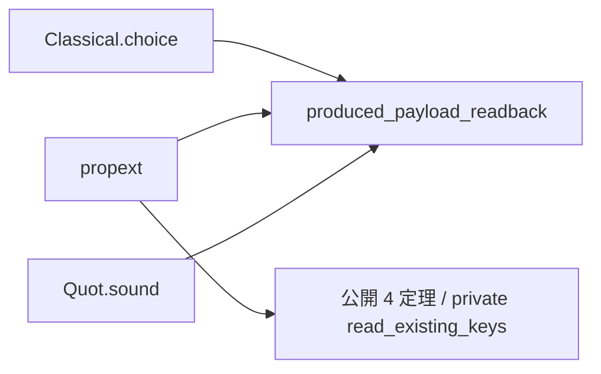
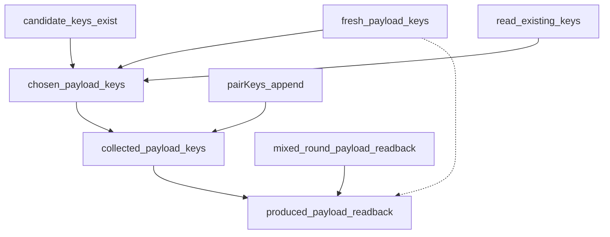

# [root ADR 0352](../adr/0352-prove-pagination-in-lean.md) の生成する値とキーの対応

## 範囲

基準は `726cd5643` の本体と既存モデルである。
[ProducedPayloadKeys.lean](../../experiments/pagination-proof/ProducedPayloadKeys.lean) を Lean 4.7.0（`aarch64-apple-darwin`）で検査した。
本体と公開 API は変更していない。
この増分は、[格納時の値の保存](0352-round-payload-store-dependencies.md) のキー列の前提を、値を持つ producer の再帰から導く。

`composePayloads` は、新しく組む本文のキーと値の組を返す。
打ち切り、許可、状態の更新の callback と、段落、制御、図版の分岐は、既存のキーだけの `composeKeys` と同じである。
値の callback は、選んだ段落のキーと、その時の状態を受け取る。
値を捨ててキーだけを読むと、既存の出力と一致することを、再帰から導く。

値の callback がどのキーと状態で呼ばれるかも検査した。
private の `tracePayload` は受け取った状態をそのまま返す。
この callback を値の callback として使い、モデルの出力に状態を記録する。
記録したキーと状態へ任意の値の callback を適用すると、元の値を持つ出力と一致する。
値の callback の計算自体が正しいという前提を加えず、値を渡す位置の対応を示す。
これはフォントの整形や改行の計算の一般的一致の証明ではない。

`choosePayloads` は、再利用する場合は前の表を選択キーで読み、新規生成する場合は `composePayloads` を使う。
再利用するキーが前の表に存在することは、既存の候補の走査から導く。
表にある値を読むことでキーが欠けないことを示し、両方の経路のキー列を `chooseKeys` へ接続する。
再利用した値が現在の新規生成の値と等しいかという条件は、この増分では証明していない。

`collectPayloads` は、各ジョブの組を連結する。
そのキー列が `chooseAll` のキー列と一致することから、既存の重複のなさと格納後の読み戻しへ接続する。
格納する組と選択キーの一致を、呼び出し側の自由な前提として残さない。
ただし、本体の producer 全体とこのモデルとの一般的な対応は残る。

本体の [composeBeside](../../modules/golem-typeset/src/Golem/Typeset/Flow.hs#L4073) は、現在のキーに組んだ値と offset を付け、残りへ進む。
[reusedBeside](../../modules/golem-typeset/src/Golem/Typeset/Flow.hs#L4855) は、選択したキーで前の表の値を読む。
[check-side-payload-shape.sh](../../experiments/pagination-proof/check-side-payload-shape.sh) は、両方の構築箇所の形を確認する。
このテキストの比較を、本体全体の意味論の証明とは扱わない。

## 定理と依存

Lean の環境で、宣言の種類、型、elaboration 後の証明項を調べた。
公開定理 5 件、手書きの private 定理 2 件、生成定理 28 件、定義 62 件、公理宣言 0 件だった。
定義は手書きの 5 件と生成定義を含む。
35 定理のすべてについて、元の定理を参照する同じ型の別名を一時環境に作り、`#print axioms` を実行した。
別名も kernel が検査する。

次の公開名には、共通接頭辞 `BesidePayload.` を付ける。
標準三公理は `propext`、`Classical.choice`、`Quot.sound` を指す。

| 名前 | 位置 | 前提と結論 | 公理 |
| --- | --- | --- | --- |
| `root_adr0352_i5_fresh_payload_keys` | [20 行](../../experiments/pagination-proof/ProducedPayloadKeys.lean#L20) | 新しい値とキーの組のキー列は、既存の新規生成のキー列と一致する。 | `propext` |
| `root_adr0352_i5_fresh_payload_values` | [50 行](../../experiments/pagination-proof/ProducedPayloadKeys.lean#L50) | 記録したキーと状態へ値の callback を適用すると、新規生成の値を持つ出力と一致する。 | `propext` |
| `root_adr0352_i5_chosen_payload_keys` | [95 行](../../experiments/pagination-proof/ProducedPayloadKeys.lean#L95) | 再利用と新規生成のどちらでも、組のキー列は既存の選択のキー列と一致する。 | `propext` |
| `root_adr0352_i5_collected_payload_keys` | [133 行](../../experiments/pagination-proof/ProducedPayloadKeys.lean#L133) | 連結した全組のキー列は、既存の全ジョブのキー列と一致する。 | `propext` |
| `root_adr0352_i5_produced_payload_readback` | [147 行](../../experiments/pagination-proof/ProducedPayloadKeys.lean#L147) | 前の表の型と所有者の順序と図版の条件から、生成した全組を格納し、同じ順に読み戻せる。 | 標準三公理 |

private 定理には、共通接頭辞 `_private.experiments.«pagination-proof».ProducedPayloadKeys.0.BesidePayload.` を付ける。

| 名前 | 位置 | 前提と結論 | 公理 |
| --- | --- | --- | --- |
| `read_existing_keys` | [74 行](../../experiments/pagination-proof/ProducedPayloadKeys.lean#L74) | 選択したキーがすべて表にあれば、読み取り後の組のキー列は元の選択キー列と等しい。 | `propext` |
| `pairKeys_append` | [115 行](../../experiments/pagination-proof/ProducedPayloadKeys.lean#L115) | 組の列の連結からキーを取り出すことと、キー列を連結することが等しい。 | なし |

private 定義 `tracePayload` は同じ接頭辞の [44 行](../../experiments/pagination-proof/ProducedPayloadKeys.lean#L44) にある。
型は `Nat → σ → σ` で、キーを検査せず状態を返す。
公開の値の対応の定理の型にも、この定義が現れる。

生成定理 28 件には、共通接頭辞 `_private.experiments.«pagination-proof».ProducedPayloadKeys.0.` を付ける。
キーと値の生成、読み取り、連結の再帰を簡約する分岐の等式に由来する。
すべて公理に依存せず、生成位置は取得できなかった。

| 名前 |
| --- |
| `BesidePayload.collectPayloads._eq_1` |
| `BesideStore.readPairs._eq_1` |
| `BesideStore.readPairs._eq_2` |
| `BesideReuse.chooseAll.match_1.eq_1` |
| `BesidePayload.applyPayloads.match_1.eq_2` |
| `BesideProducer.composeKeys.match_2.eq_2` |
| `BesidePayload.composePayloads.match_2.eq_1` |
| `BesideStore.pairKeys.match_1.eq_1` |
| `BesideStore.pairKeys._eq_1` |
| `BesideStore.pairKeys.match_1.eq_2` |
| `BesidePayload.collectPayloads.match_1.eq_1` |
| `BesidePayload.composePayloads._eq_1` |
| `BesidePayload.collectPayloads.match_1.eq_2` |
| `BesidePayload.applyPayloads._eq_1` |
| `BesidePayload.applyPayloads.match_1.eq_1` |
| `BesideProducer.composeKeys.match_2.eq_1` |
| `BesidePayload.applyPayloads._eq_2` |
| `BesideReuse.chooseAll._eq_1` |
| `BesidePayload.composePayloads.match_2.eq_2` |
| `BesideReuse.chooseAll.match_1.eq_2` |
| `BesideStore.pairKeys._eq_2` |
| `BesideReuse.chooseAll._eq_2` |
| `BesidePayload.collectPayloads._eq_2` |
| `BesideProducer.composeKeys._eq_1` |
| `BesideStore.readPairs.match_2.eq_1` |
| `BesidePayload.composePayloads._eq_2` |
| `BesideStore.readPairs.match_2.eq_2` |
| `BesideProducer.composeKeys._eq_2` |

標準公理の宣言元と内容は次のとおりである。
対象内に、新しい公理を宣言していない。

| 公理 | Lean 4.7.0 の位置 | 内容 |
| --- | --- | --- |
| `Classical.choice` | `Init.Prelude:730` | `Nonempty α` から要素を選ぶ。 |
| `propext` | `Init.Core:1287` | 命題の同値から等式を導く。 |
| `Quot.sound` | `Init.Core:1459` | 関係を満たす二要素が同じ商の値を持つ。 |

公理の図は、定義や補助定理を経由する推移的な依存を示す。
公理に依存しない private 1 件と生成 28 件には辺がない。



次の定理の図の実線は、型か証明項の定理の直接参照である。
破線は定義や補助定理を経由する間接依存を示す。
標準の等式と算術の補題と生成定理は省いた。



値の対応の定理は、生成の再帰へ直接帰納する。
掲載する他の新しい定理との直接参照はない。
対象ソースに `sorry`、`admit`、`sorryAx` の使用はない。
Lean の diagnostic と 35 定理の公理依存にも証明の穴はなかった。
この範囲に、穴の影響を受ける定理はない。

## 境界と実装との照合

追加前には、未追加のモジュールと定理を読む検査が失敗することを確認した。
追加後は [ProducedPayloadKeysBoundary.lean](../../experiments/pagination-proof/ProducedPayloadKeysBoundary.lean) の 12 件の具体例を検査した。
新規生成、制御を通る状態の更新、行グリッド側の制御での停止、打ち切り、再利用、新規生成との混在、空の fuel を含む。
再利用の例の値は、前の表から値を渡す経路を区別するためのものであり、前の値と現在の整形の値が等しいことの検証ではない。

[ProducedPayloadKeys.hs](../../experiments/pagination-proof/ProducedPayloadKeys.hs) は、既存の実フォント由来の単位と図版を使う 1,555 通りの表で、新規生成の 2,540 ジョブを観測する。
値には、実際の組んだ行数と offset を持つ組を使った。
各 offset が非負であることも確認した。
この観測値を不透明な値の callback としてモデルへ渡し、キーとの対応と値の受け渡しを比べる。
この手順から、任意のフォントの整形計算の一致までは結論しない。

新規生成 2,540 件、連結 1,555 件、格納後の読み戻し 1,555 件の合計 5,650 本の閉じた等式が、kernel の `decide` で一致した。
実装の選んだ段落キーは合計 532 個で、空のジョブも含む。
自由な配置と間隔 0 の制御、同じ項目に属する段落、規則や箱での打ち切りを使う。
異なる項目や実際の行グリッドの数値の打ち切りを、この実フォントの入力へ追加したわけではない。

値の callback に渡すキーを 1 ずらすモデルの変異は、値の対応の定理で拒否された。
再利用する表の読み取りキーを 1 ずらすモデルの変異は、選択キーの射影の定理で拒否された。
本体の検証用のコピーで生成するキーと再利用の読み取りキーをそれぞれずらした変更も、形の検査で拒否された。
本体は変更していない。

実装の観測は export list だけを開く一時ソースで行い、本体の残りが元と同一であることを確認した。
本体の `modules/` は `0aa78f65ac691cdd8d1a3bd5fc4c8bffb1feabdb` と一致する。
GHC 9.10.3 と peg-hs の正規固定版 `4b4adc7046` の、既存の runtime DB を読み取り専用で使う。
標準 Cabal 環境を新規構築したという検証ではない。
この内部の値の受け渡しの検査は、通常 CLI の PDF の視認を代用しない。

`check.sh` 全体も終了コード 0 で通った。
既存の 55,838 件と 156,520 件の配置、10,368 件の回り込み、4,864 件の因果的配置、216 件の制御、34,586 件の改行、実フォントのキャプション 40 件、Alloy 42 件の対応検査を含む。
Cabal plan と package cache の実行前後の SHA-256 は一致した。

## 再現と残り

`check.sh` は `RoundPayloadStore.olean` を作った後、このモデルと境界の具体例、および本体の値の構築箇所の形を検査する。
同じ環境での局所検査と、実装の照合は次のコマンドで行う。

```sh
LEAN_PATH="$work" lean -o "$work/ProducedPayloadKeys.olean" \
  experiments/pagination-proof/ProducedPayloadKeys.lean
LEAN_PATH="$work" lean experiments/pagination-proof/ProducedPayloadKeysBoundary.lean
sh experiments/pagination-proof/check-side-payload-shape.sh
RUNGHC=/private/tmp/golem-0352-built-probe-nov28/runner \
  sh experiments/pagination-proof/check-built-first-ids.sh \
  "$PWD/experiments/pagination-proof/ProducedPayloadKeys.hs" > /tmp/ProducedPayloadKeysExamples.lean
LEAN_PATH="$work" lean /tmp/ProducedPayloadKeysExamples.lean
```

依存調査では `import Lean` と `import ProducedPayloadKeys` の環境から宣言を列挙した。
各 `.thmInfo` の型と証明項の `getUsedConstants` を環境の宣言種別と照合し、定理の直接参照を調べた。
生成定理を含むすべての定理の別名へ `#print axioms` を実行した。
ソースの穴は次の検索でも確認した。

```sh
rg -n '\b(sorry|admit|sorryAx)\b' experiments/pagination-proof/ProducedPayloadKeys.lean
```

値を生成する callback と本体の IO、整形、状態の更新との一般の対応は残る。
前の表の値の妥当性や、再利用が新規生成と同じ値を返す条件も、本体から一般には導いていない。
この増分は生成済みの値を選び格納する段階の証明で、元の原稿の全内容を生成する段階の証明ではない。
Haskell の Map の内部、Int と Nat の添字、単位の採番量の分類、`Built` と `hb` の全呼び出し元、全制御も未証明である。

本文の全量と順序、`captionCompared` と改行器の一般的一致も残る。
[末尾の保持の再試行の反例](0352-last-retry-counter-dependencies.md) も、この増分では修正していない。
root [ADR 0352](../adr/0352-prove-pagination-in-lean.md) の全範囲は未完了のままである。
