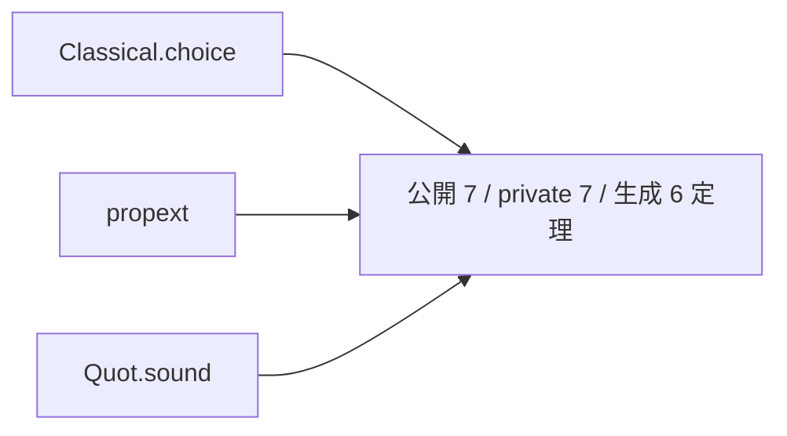
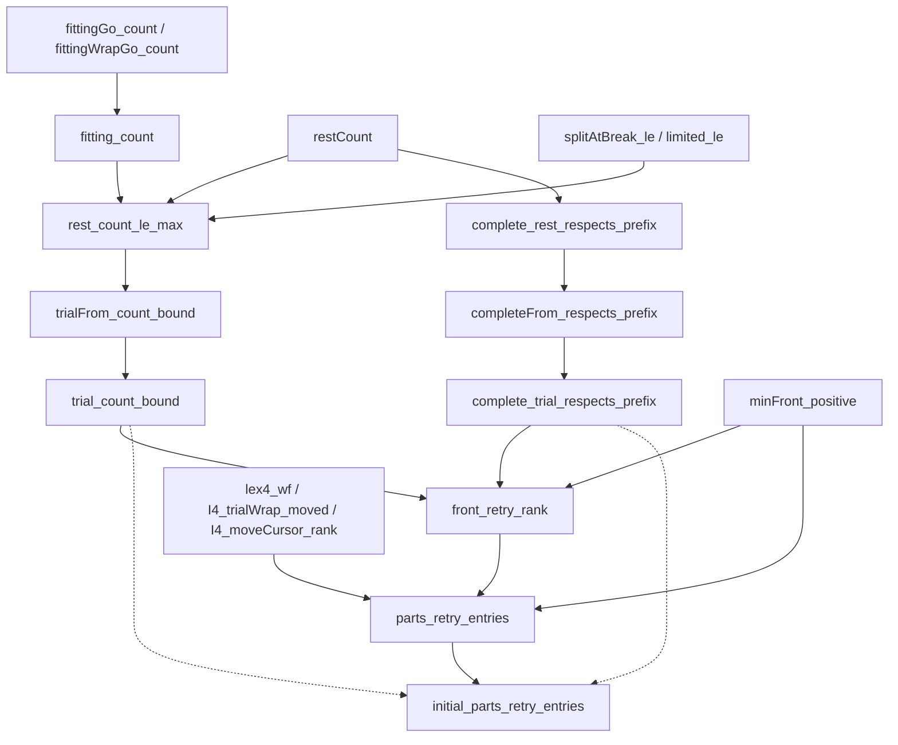

# [root ADR 0352](../adr/0352-prove-pagination-in-lean.md) の再試行する先頭行数

## 範囲

基準は `52c656e2f` の本体と既存モデルである。
[RetryPrefix.lean](../../experiments/pagination-proof/RetryPrefix.lean) を Lean 4.7.0（`aarch64-apple-darwin`）で検査した。
本体と `Physical.lean` は変更していない。
この増分は、全行を採用した後で末尾の行を減らして試し直す分岐の、行数上限の減少を扱う。

本体の [Flow.hs:5316](../../modules/golem-typeset/src/Golem/Typeset/Flow.hs#L5316) は、全行を採用しても次の段落が収まらなければ、末尾の保持行数を引いて試し直す。
モデルの `parts` は、この上限が以前の `limitRank` より小さいかを `h2` で検査する。
今回の証明は、配置結果が元の行数を超えないことと、正の上限を与えた全行の配置結果がその上限を超えないことから、この減少を導く。
上限の減少自体を前提にはしない。

さらに、モデルの各再帰入口で、上限は未指定か正数であることを導く。
初回の上限は未指定である。
次の段へ進めば未指定へ戻り、再試行で指定する二つの値も `minimumFront` の条件から正数になる。
`partsRetryEntriesSafe` は、この条件と、全行の配置後の再試行が `h2` を満たすという性質を各入口に置く。
初回については、正の上限を外から仮定しない。

これはモデルが到達する入口の証明である。
本体にはなくモデルにある、別の `noProgress` の分岐がすべて起きないことまでは示していない。
とくに、一部を採用してから末尾を減らす分岐の `h6`、ソースの位置と計測値の一般的な対応、全制御、内容の全量の保存は残る。
ソースの前進は [先行する増分](0352-chosen-source-progress-dependencies.md) と別に扱い、ここで全体の終了を完成扱いしない。

## 定理と依存

Lean の環境で、名前付き宣言の種類、型、elaboration 後の証明項を照合した。
手書きの公開定理 8 件、手書きの private 定理 7 件、生成定理 24 件、手書き定義 2 件、生成定義 24 件、公理宣言 0 件だった。
39 定理すべてを、元の定理を参照する同じ型の別名を一時環境に作って `#print axioms` で調べた。
別名自体も kernel が検査する。

39 件のうち 20 件は `propext`、`Classical.choice`、`Quot.sound` に依存し、19 件は公理に依存しない。
以下では、この三つを「標準三公理」と略す。

| 完全修飾名 | 位置 | 前提と結論 | 公理 |
| --- | --- | --- | --- |
| `PhysicalPagination.root_adr0352_i4_fitting_count` | [RetryPrefix.lean:24](../../experiments/pagination-proof/RetryPrefix.lean#L24) | 入ると数えた行数が、入力の行数を超えない。行送りや注の寸法の符号は仮定しない。 | 標準三公理 |
| `PhysicalPagination.root_adr0352_i4_trial_count_bound` | [RetryPrefix.lean:82](../../experiments/pagination-proof/RetryPrefix.lean#L82) | 試し置きが配置結果を返せば、その行数は入力の行数以下である。 | 標準三公理 |
| `PhysicalPagination.root_adr0352_i4_complete_rest_respects_prefix` | [RetryPrefix.lean:94](../../experiments/pagination-proof/RetryPrefix.lean#L94) | 正の上限を与えた試し置きの後半が全行を採用し、採用数が一行より多ければ、採用数は上限以下である。 | 標準三公理 |
| `PhysicalPagination.root_adr0352_i4_complete_trial_respects_prefix` | [RetryPrefix.lean:133](../../experiments/pagination-proof/RetryPrefix.lean#L133) | 同じ性質を試し置きの全分岐へ接続する。 | 標準三公理 |
| `PhysicalPagination.root_adr0352_i4_front_retry_rank` | [RetryPrefix.lean:150](../../experiments/pagination-proof/RetryPrefix.lean#L150) | 未指定か正の上限で、全行を採用し、減らした行数が `minimumFront` 以上なら、新しい上限は以前の `limitRank` より小さい。 | 標準三公理 |
| `PhysicalPagination.root_adr0352_i4_parts_retry_entries` | [RetryPrefix.lean:243](../../experiments/pagination-proof/RetryPrefix.lean#L243) | 未指定か正の上限から始めると、モデルの全再帰入口でも上限の条件と全行後の再試行の減少を保つ。 | 標準三公理 |
| `PhysicalPagination.root_adr0352_i4_initial_parts_retry_entries` | [RetryPrefix.lean:298](../../experiments/pagination-proof/RetryPrefix.lean#L298) | 初回の未指定の上限から、入口の条件を追加の仮定なしで導く。 | 標準三公理 |
| `PhysicalPagination.root_adr0352_i4_external_zero_cutoff` | [RetryPrefix.lean:306](../../experiments/pagination-proof/RetryPrefix.lean#L306) | 外部から上限 0 を渡した場合の既存の強制配置は、減少する上限の一般命題に含められないという閉じた算術の例。 | なし |

private 定理の共通接頭辞は `_private.experiments.«pagination-proof».RetryPrefix.0.PhysicalPagination.` である。
次の接尾辞を加えたものが、それぞれの完全修飾名になる。
7 件とも標準三公理に依存する。

| 接尾辞 | 位置 | 内容 |
| --- | --- | --- |
| `fittingGo_count` | 4 | 通常の行の走査の数が元の行数以下である。 |
| `fittingWrapGo_count` | 14 | 回り込み中の行の走査でも同じ上限を保つ。 |
| `restCount` | 31 | 配置結果の採用数を、選択数と既存の強制配置の式で表す。 |
| `rest_count_le_max` | 47 | 試し置きの後半の採用数が、1 と元の行数の最大値以下である。 |
| `trialFrom_count_bound` | 57 | 空の行列を含め、試し置きの本体の採用数を抑える。 |
| `completeFrom_respects_prefix` | 116 | 正の上限と複数行の全行採用の場合の、試し置きの本体の上限を導く。 |
| `minFront_positive` | 143 | `minimumFront` は常に正である。 |

手書き定義は `PhysicalPagination.retryEntryValid`（177 行）と `PhysicalPagination.partsRetryEntriesSafe`（188 行）である。
前者は上限の条件と全行後の再試行の減少を述べる。
後者は `parts` と同じ再帰をたどり、前者を各入口に置く。

生成定理の完全修飾名と公理は次のとおりである。
生成位置は取得できなかった。

| 完全修飾名 | 公理 |
| --- | --- |
| `_private.experiments.«pagination-proof».RetryPrefix.0.PhysicalPagination.fittingGo._eq_2` | なし |
| `PhysicalPagination.partsRetryEntriesSafe._unary.proof_2` | 標準三公理 |
| `PhysicalPagination.partsRetryEntriesSafe._unary.proof_7` | 標準三公理 |
| `PhysicalPagination.partsRetryEntriesSafe._unary.proof_1` | なし |
| `PhysicalPagination.partsRetryEntriesSafe._unary.proof_3` | なし |
| `_private.experiments.«pagination-proof».RetryPrefix.0.PhysicalPagination.putLines.match_2.eq_1` | なし |
| `_private.experiments.«pagination-proof».RetryPrefix.0.PhysicalPagination.fittingGo._eq_1` | なし |
| `PhysicalPagination.partsRetryEntriesSafe._unary.proof_4` | 標準三公理 |
| `_private.experiments.«pagination-proof».RetryPrefix.0.PhysicalPagination.fittingWrapGo._eq_1` | なし |
| `_private.experiments.«pagination-proof».RetryPrefix.0.PhysicalPagination.partsRetryEntriesSafe.match_1.eq_2` | なし |
| `_private.experiments.«pagination-proof».RetryPrefix.0.PhysicalPagination.linkBreaks.match_1.eq_2` | なし |
| `_private.experiments.«pagination-proof».RetryPrefix.0.PhysicalPagination.trial.match_1.eq_2` | なし |
| `_private.experiments.«pagination-proof».RetryPrefix.0.PhysicalPagination.trial.match_1.eq_1` | なし |
| `_private.experiments.«pagination-proof».RetryPrefix.0.PhysicalPagination.partsRetryEntriesSafe.match_1.eq_1` | なし |
| `PhysicalPagination.partsRetryEntriesSafe._unary.proof_8` | 標準三公理 |
| `_private.experiments.«pagination-proof».RetryPrefix.0.PhysicalPagination.fittingWrapGo._eq_2` | なし |
| `_private.experiments.«pagination-proof».RetryPrefix.0.PhysicalPagination.partsRetryEntriesSafe.match_1.eq_3` | なし |
| `_private.experiments.«pagination-proof».RetryPrefix.0.PhysicalPagination.linkBreaks.match_1.eq_1` | なし |
| `PhysicalPagination.partsRetryEntriesSafe._unary.proof_5` | なし |
| `_private.experiments.«pagination-proof».RetryPrefix.0.PhysicalPagination.putLines.match_1.eq_2` | なし |
| `PhysicalPagination.partsRetryEntriesSafe._unary.proof_6` | 標準三公理 |
| `_private.experiments.«pagination-proof».RetryPrefix.0.PhysicalPagination.partsRetryEntriesSafe._eq_1` | 標準三公理 |
| `_private.experiments.«pagination-proof».RetryPrefix.0.PhysicalPagination.putLines.match_2.eq_2` | なし |
| `_private.experiments.«pagination-proof».RetryPrefix.0.PhysicalPagination.putLines.match_1.eq_1` | なし |

生成定義は、再帰とパターン分岐、および証明でインポートした定義を使うための補助宣言である。
新しい公理は宣言していない。

| 標準公理 | Lean 4.7.0 の位置 | 内容 |
| --- | --- | --- |
| `Classical.choice` | `Init.Prelude:730` | `Nonempty α` から要素を選ぶ。 |
| `propext` | `Init.Core:1287` | 命題の同値から等式を導く。 |
| `Quot.sound` | `Init.Core:1459` | 関係を満たす二要素が同じ商の値を持つ。 |

公理の図は、補助定理や定義を経由する推移的依存を示す。
公理に依存しない 19 定理には辺がない。



次の図の実線は、型か証明項の定理の直接参照である。
破線は、補助定理を経由する間接依存である。
標準の等式と算術の補題と生成定理は省いた。



対象ソースに `sorry`、`admit`、`sorryAx` の使用はない。
Lean の diagnostic と 39 定理の公理依存にも証明の穴はなかった。
今回の範囲に、穴の影響を受ける定理はない。

## 境界と残り

[RetryPrefixChecks.hs](../../experiments/pagination-proof/RetryPrefixChecks.hs) は、公開の `trialParagraphPartLimit` を 1,344 入力で呼ぶ。
段容量 1、2、3、6 行、行数 0〜6、上限の未指定と 0 と 1 と 3、保持の三種類、先頭か途中か、既存の一行の有無を組み合わせる。
1,011 入力で配置し、333 入力で次の段へ送った。
すべての配置結果で採用数が元の行数以下であり、末尾の要求行数 0、1、3 で全行後の再試行の条件を満たす場合に上限が減ることを確認した。

上限 0 を直接渡すと、選択数 0 から既存の強制配置へ進み、上限より多い行を採る場合がある。
6 行の空の段へ四行を渡した具体例を保持し、正の上限という条件を単に取り除けないことを、実装と閉じた算術の例で示す。
初回の未指定の上限からモデルが到達する入口には、上限 0 は現れない。
この観測は外部からの直接の API 呼び出しを含み、通常の CLI に新しい制約や拒否を加えない。

[check-parts-retry-shape.sh](../../experiments/pagination-proof/check-parts-retry-shape.sh) は、入口の条件を除いた分岐と引数を `PhysicalPagination.parts` と照合する。
`noProgress` で止まるモデルの分岐もそのまま保持する。
したがって、残りの再試行の条件がすべて導けたという主張ではない。

減少の式に一つを足して条件を強める誤変更は、Lean の証明で拒否された。
再帰先の採用済み行数を変える誤変更と、比較を非厳密にする誤変更も、分岐と引数の照合で拒否された。
上限 0 を正の上限と同じように扱う誤変更は、ネイティブの検査で拒否された。

今回の範囲外の `h6` を調べる際には、通常の CLI でも処理が終了しない疑いを確認した。
10 pt のフォント、12 字、4 行、行送り 15 pt の free の段で、回り込み図版と 49 字の段落に `keep-first-lines = 2` を指定する。
同一の原稿で `keep-last-lines = 2` は PDF を生成し、4 にした場合は 15 秒の検証タイムアウトとなった。
この観測だけで無限の実行を証明したとは扱わない。
5 行、3 行の容量、保持 2 と 4 の独立した試し置きも、上限の未指定、2、1 のいずれでも 3 行を返した。
既存モデルの同じ行数の接尾部でも `noProgress` の実行例を確認した。
これらはこの増分で解消しておらず、全体の終了の保証には含めない。
再現ファイルとログは `/private/tmp/golem-0352-last-lines-loop-nov28` に保存した。

本体の `modules/` は `0aa78f65ac691cdd8d1a3bd5fc4c8bffb1feabdb` と一致する。
照合は GHC 9.10.3 と、この版の既存 runtime DB の登録済み package ID を読み取り専用で使う。
標準 Cabal 環境を新規構築したという検証ではない。
Cabal plan と package cache の実行前後の SHA-256 は一致した。

`check.sh` 全体も終了コード 0 で通った。
新しい 1,344 入力に加え、既存の 55,838 件と 156,520 件の配置、10,368 件の回り込み、4,864 件の因果的配置、216 件の制御、34,586 件の改行、実フォントのキャプション 40 件、Alloy 42 件の対応検査を含む。

```sh
RUNGHC=/private/tmp/golem-0352-numbered-tools-nov28/runghc-driver
"$RUNGHC" experiments/pagination-proof/RetryPrefixChecks.hs
```

モデルと本体の任意の計測と行列の対応、一部の行を採った後の再試行、全制御、内容の全量と順序、一般のキャプションの接続は残る。
[root ADR 0352](../adr/0352-prove-pagination-in-lean.md) 全体は採択済みで未実装のままである。
