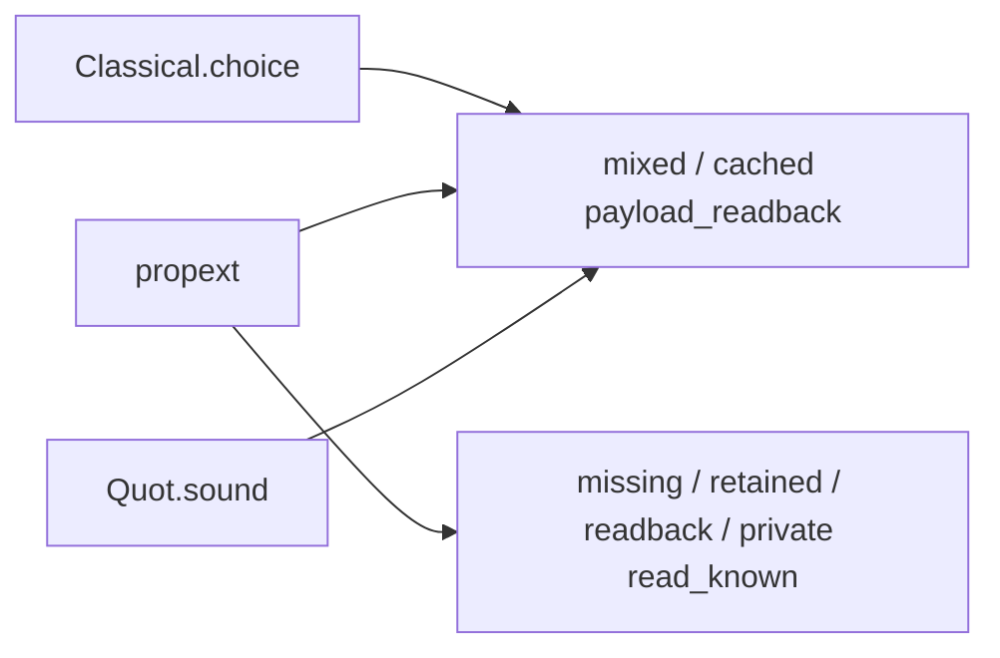
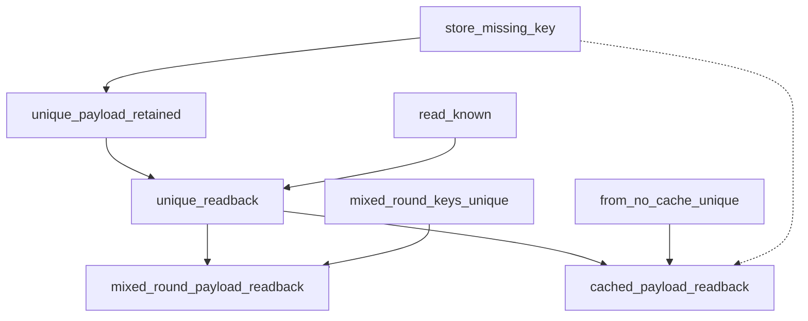

# [root ADR 0352](../adr/0352-prove-pagination-in-lean.md) の格納時の本文の値の保存

## 範囲

基準は `f5002c6d2` の本体と既存モデルである。
[RoundPayloadStore.lean](../../experiments/pagination-proof/RoundPayloadStore.lean) を Lean 4.7.0（`aarch64-apple-darwin`）で検査した。
本体と公開 API は変更していない。
この増分は、[全ジョブのキーの重複のなさ](0352-mixed-round-order-dependencies.md) を、生成済みのキーと値の組を格納して読み戻す段階へ接続する。
原稿の文字列から組んだ行の値を作る過程までを証明するものではない。

`fromPairs` は、キーと値の組の有限列を表へ格納する射影である。
同じキーが複数あれば最後の値を使う。
`readPairs` は、指定したキーの順序で表を読み、存在するキーと値の組を返す。
この読み取り関数そのものがキーを数値順へ並べ替えるわけではない。
一般の Haskell の Map の実装や、平衡木をこの関数へ翻訳した証明でもない。

キーが重複しなければ、格納前の各値が同じキーで見つかり、元のキー順で全組を読み戻せる。
値の型は任意の `α` であり、その内部の行数や文字列を検査したり変換したりしない。
値の保存をそのまま前提にせず、格納の定義とキーの重複のなさから導く。
入力にないキーは、重複の有無に関係なく表にも存在しない。

混在するジョブと複数ラウンドについては、既存のキーの重複のなさの定理を使う。
格納する組のキー列が、モデルの選択したキー列と一致すれば、全組を同じ順に読み戻せる。
この条件はキー列の対応であり、読み戻した値の一致という結論を前提に置いたものではない。
モデルの合法なジョブ列のキーは既に数値順だが、任意の未整列の入力と `Map.toAscList` の一致まで主張しない。

本体の [buildFlow](../../modules/golem-typeset/src/Golem/Typeset/Flow.hs#L4870) は、各ジョブの結果を連結して `Data.Map.Strict.fromList` へ渡す。
[check-side-store-shape.sh](../../experiments/pagination-proof/check-side-store-shape.sh) は、この呼び出しと import の形を確認する。
この検査は、実装の格納箇所とモデルの対象がずれた場合に停止するための検査である。
テキストの形の比較を、Haskell の意味論や Map の内部の一般的な証明とは扱わない。

## 定理と依存

Lean の環境で、宣言の種類、型、elaboration 後の証明項を調べた。
公開定理 5 件、手書きの private 定理 1 件、生成定理 12 件、定義 40 件、公理宣言 0 件だった。
定義は手書きの 3 件と、再帰の分岐などの生成定義を含む。
18 定理のすべてについて、元の定理を参照する同じ型の別名を一時環境に作り、`#print axioms` を実行した。
別名も kernel が検査する。

次の公開名には、共通接頭辞 `BesideStore.` を付ける。
標準三公理は `propext`、`Classical.choice`、`Quot.sound` を指す。

| 名前 | 位置 | 前提と結論 | 公理 |
| --- | --- | --- | --- |
| `root_adr0352_i5_store_missing_key` | [25 行](../../experiments/pagination-proof/RoundPayloadStore.lean#L25) | 入力の組にないキーは、格納後の表にもない。 | `propext` |
| `root_adr0352_i5_unique_payload_retained` | [36 行](../../experiments/pagination-proof/RoundPayloadStore.lean#L36) | キーが重複しなければ、各組の値を同じキーで読み出せる。 | `propext` |
| `root_adr0352_i5_unique_readback` | [59 行](../../experiments/pagination-proof/RoundPayloadStore.lean#L59) | キーが重複しなければ、元のキー順で全組を同じ順序で読み戻せる。 | `propext` |
| `root_adr0352_i5_mixed_round_payload_readback` | [65 行](../../experiments/pagination-proof/RoundPayloadStore.lean#L65) | 混在するジョブの条件と組のキー列の対応から、格納する全組の保存を導く。 | 標準三公理 |
| `root_adr0352_i5_cached_payload_readback` | [83 行](../../experiments/pagination-proof/RoundPayloadStore.lean#L83) | 前の結果がない状態からのラウンド列と、その結果に対応する組のキー列から、全組の保存を導く。 | 標準三公理 |

private 定理 `_private.experiments.«pagination-proof».RoundPayloadStore.0.BesideStore.read_known` は [49 行](../../experiments/pagination-proof/RoundPayloadStore.lean#L49) にある。
各組の値が対応するキーで見つかる表は、元のキー順でその組を読み戻すことを示す。
公開の読み戻しの定理は、この補題の前提を、格納する定義とキーの重複のなさから導く。
この補題は `propext` にだけ依存する。

次の生成定理 12 件には、共通接頭辞 `_private.experiments.«pagination-proof».RoundPayloadStore.0.BesideStore.` を付ける。
キー列、格納、読み取りの再帰を簡約する分岐の等式に由来する。
すべて公理に依存せず、生成位置は取得できなかった。

| 名前 |
| --- |
| `readPairs.match_2.eq_1` |
| `fromPairs.match_2.eq_2` |
| `pairKeys._eq_1` |
| `readPairs.match_2.eq_2` |
| `fromPairs.match_2.eq_1` |
| `readPairs._eq_1` |
| `fromPairs._eq_1` |
| `pairKeys._eq_2` |
| `fromPairs._eq_2` |
| `readPairs._eq_2` |
| `pairKeys.match_1.eq_1` |
| `pairKeys.match_1.eq_2` |

標準公理の宣言元と内容は次のとおりである。
対象内に、新しい公理を宣言していない。

| 公理 | Lean 4.7.0 の位置 | 内容 |
| --- | --- | --- |
| `Classical.choice` | `Init.Prelude:730` | `Nonempty α` から要素を選ぶ。 |
| `propext` | `Init.Core:1287` | 命題の同値から等式を導く。 |
| `Quot.sound` | `Init.Core:1459` | 関係を満たす二要素が同じ商の値を持つ。 |

公理の図は、定義や補助定理を経由する推移的な依存を示す。
公理に依存しない生成 12 定理には辺がない。



次の定理の図の実線は、型か証明項の定理の直接参照である。
破線は定義や補助定理を経由する間接依存を示す。
標準の等式と算術の補題と生成定理は省いた。



対象ソースに `sorry`、`admit`、`sorryAx` の使用はない。
Lean の diagnostic と 18 定理の公理依存にも証明の穴はなかった。
この範囲に、穴の影響を受ける定理はない。

## 境界と実装との照合

追加前には、未追加のモジュールと定理を読む検査が失敗することを確認した。
追加後は [RoundPayloadStoreBoundary.lean](../../experiments/pagination-proof/RoundPayloadStoreBoundary.lean) の 11 件の具体例を検査した。
空、キーの不在、文字列の値、同じキーの最後の値、値の 0、整列済みと未整列の入力を含む。
重複するキーと異なる値があると元の全組を読み戻せない対照も含む。

[RoundPayloadStore.hs](../../experiments/pagination-proof/RoundPayloadStore.hs) は、長さ 0〜4 の四種類のキーからなる 341 通りの列を、実際の `Data.Map.Strict.fromList` へ渡す。
各組の値には列の中の位置を使い、同じキーが重なった場合の優先値も区別した。
5 個のキーを読む 1,705 件の結果をモデルへ渡し、kernel の `decide` で一致した。
厳密に昇順の 16 入力では、実際の `Map.toAscList` が元の全組と一致した。
この 16 件のモデルでの読み戻しも kernel で一致した。
合計は 1,721 本の閉じた等式であり、この比較に実フォントの新しい入力は加えていない。

最後の値より先頭の値を優先するモデルの変異は、重複するキーの照合で拒否された。
実際の Map へ入れる列を逆順にして優先値を変えた変異も、kernel での比較で拒否された。
格納呼び出しの形を変えた一時ソースは、形の検査で拒否された。
これらは検証用のコピーだけの変更で、本体は変更していない。

本体の `modules/` は `0aa78f65ac691cdd8d1a3bd5fc4c8bffb1feabdb` と一致する。
比較は GHC 9.10.3 と既存の登録済み package 環境を読み取り専用で使った。
標準 Cabal 環境を新規構築したという検証ではない。
以前の実フォントの照合と、この有限の Map の照合は別の検査である。
内部の組の保存の検査を、通常 CLI の PDF の視認の代用にはしない。

`check.sh` 全体も終了コード 0 で通った。
既存の 55,838 件と 156,520 件の配置、10,368 件の回り込み、4,864 件の因果的配置、216 件の制御、34,586 件の改行、実フォントのキャプション 40 件、Alloy 42 件の対応検査を含む。
Cabal plan と package cache の実行前後の SHA-256 は一致した。

## 再現と残り

`check.sh` は `MixedRoundOrder.olean` を作った後、このモデルと境界の具体例、および本体の格納呼び出しの形を検査する。
同じ環境での局所検査と、実装の照合は次のコマンドで行う。

```sh
LEAN_PATH="$work" lean -o "$work/RoundPayloadStore.olean" \
  experiments/pagination-proof/RoundPayloadStore.lean
LEAN_PATH="$work" lean experiments/pagination-proof/RoundPayloadStoreBoundary.lean
sh experiments/pagination-proof/check-side-store-shape.sh
RUNGHC=/private/tmp/golem-0352-numbered-tools-nov28/runghc-driver
"$RUNGHC" -package=containers experiments/pagination-proof/RoundPayloadStore.hs \
  > /tmp/RoundPayloadStoreExamples.lean
LEAN_PATH="$work" lean /tmp/RoundPayloadStoreExamples.lean
```

照合では `runghc-driver` に、既存の compiler と package DB を明示するラッパーを使った。
生成した等式は値の型を `Nat` に固定し、空の入力も曖昧な型にならないようにした。
一般の値の保存を述べる五つの公開定理は、値の型を `Nat` へ限定していない。

依存調査では `import Lean` と `import RoundPayloadStore` の環境から宣言を列挙した。
各 `.thmInfo` の型と証明項の `getUsedConstants` を環境の宣言種別と照合し、定理の直接参照を調べた。
生成定理を含むすべての定理の別名へ `#print axioms` を実行した。
ソースの穴は次の検索でも確認した。

```sh
rg -n '\b(sorry|admit|sorryAx)\b' experiments/pagination-proof/RoundPayloadStore.lean
```

Haskell の Map の内部とこの表の関数との一般の対応は残る。
本体の各ジョブが返す全組のキーとモデルの選択キーの一致、および再利用した値の妥当性も、一般には証明していない。
格納前の値が原稿のすべての内容を正しく含むことを、この増分から結論しない。
Int と Nat の添字の対応、単位の採番量の分類、`Built` と `hb` の全呼び出し元、全制御も未証明である。

本文の全量と順序、`captionCompared` と改行器の一般的一致も残る。
[末尾の保持の再試行の反例](0352-last-retry-counter-dependencies.md) も、この増分では修正していない。
root [ADR 0352](../adr/0352-prove-pagination-in-lean.md) の全範囲は未完了のままである。
