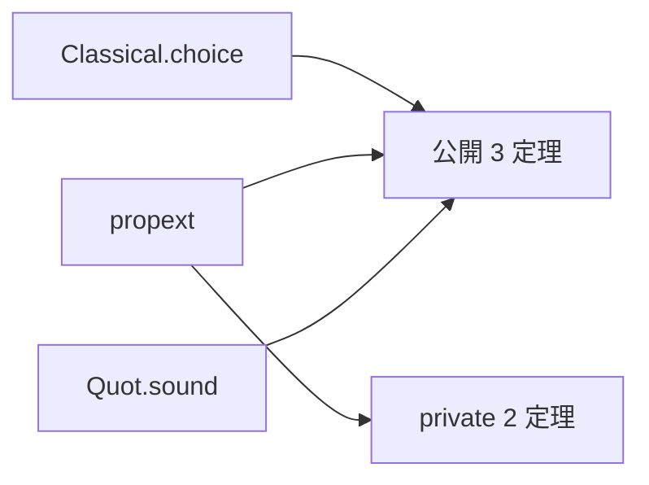
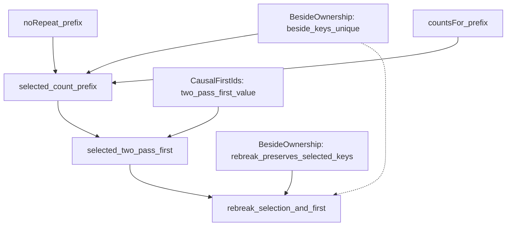

# [root ADR 0352](../adr/0352-prove-pagination-in-lean.md) の選択キーと先行する採番量

## 範囲

基準は `f79b0299f` の本体と既存モデルである。
[SelectedCountPrefix.lean](../../experiments/pagination-proof/SelectedCountPrefix.lean) を Lean 4.7.0（`aarch64-apple-darwin`）で検査した。
本体と既存モデルは変更していない。
この増分は、一つの本文の値を更新しても、同じ図版が所有する前の本文の行数が変わらないことを、選択したキーの性質から導く。

[先行する更新の証明](0352-beside-adjustment-dependencies.md) は、値の有無と選択キーを保存した。
今回の証明は、選択キーに重複がないことから、現在のキーがそれより前のキーの列にないことを導く。
更新は対象のキーだけに働くので、前のキーの列から得る行数の列が同じになる。
先行する本文の行数の列が更新前後で同じという結論自体は仮定しない。

その行数の列を、[二段階の採番](0352-built-first-id-dependencies.md) のモデルへ渡す。
外側の図版より前の単位の寄与が同じという範囲では、図版の総行数と現在の本文の行数が変わっても、現在の本文の先頭 ID は同じである。
この増分で導くのは、内側の先行する本文の行数が同じという条件である。
外側の全単位の寄与の保存を、任意の `Built` の生成経路から導いたわけではない。
キーはこれまでのモデルと同じ Nat であり、Int のオーバーフローも対象に含めない。

本体では [Map.adjust による更新](../../modules/golem-typeset/src/Golem/Typeset/Flow.hs#L5299) の後で、[besideFirsts](../../modules/golem-typeset/src/Golem/Typeset/Flow.hs#L4961) を作り直す。
この走査が、選択したキーを順に読み、各本文の `cLines` の長さだけ次の ID を進める部分に対応する。
現在のキー以外の本文の値を変更しないことから、前の本文の採番量を保つという接続を扱う。

## 定理と依存

Lean の環境で、名前付き宣言の種類、型、elaboration 後の証明項を調べた。
公開定理 3 件、private 定理 2 件、生成定理 10 件、手書き定義 2 件、生成定義 23 件、公理宣言 0 件だった。
15 定理すべてを、元の定理を参照する同じ型の別名を一時環境に作って `#print axioms` で調べた。
別名も kernel が検査する。

次の名前には、共通接頭辞 `BesideOwnership.` を付ける。
標準三公理は `propext`、`Classical.choice`、`Quot.sound` を指す。

| 名前 | 位置 | 前提と結論 | 公理 |
| --- | --- | --- | --- |
| `root_adr0352_i5_selected_count_prefix` | [38 行](../../experiments/pagination-proof/SelectedCountPrefix.lean#L38) | 走査の結果を現在のキーの前後に分けると、現在のキーの値の更新は、前のキーから得る行数の列を変えない。 | 標準三公理 |
| `root_adr0352_i5_selected_two_pass_first` | [47 行](../../experiments/pagination-proof/SelectedCountPrefix.lean#L47) | 同じ外側の単位の寄与を与えた二段階の採番で、現在の本文の先頭 ID を保つ。内側の先行する行数の列は前の定理から導く。 | 標準三公理 |
| `root_adr0352_i5_rebreak_selection_and_first` | [62 行](../../experiments/pagination-proof/SelectedCountPrefix.lean#L62) | 更新前に選択したキーの現在位置を与えると、更新後も選択キーを保ち、同じ外側の寄与の下で先頭 ID も保つ。 | 標準三公理 |

private 定理の共通接頭辞は `_private.experiments.«pagination-proof».SelectedCountPrefix.0.BesideOwnership.` である。
次の接尾辞を加えたものが、それぞれの完全修飾名になる。
どちらも `propext` のみに依存する。

| 接尾辞 | 位置 | 内容 |
| --- | --- | --- |
| `noRepeat_prefix` | 15 | 重複のない列を現在のキーの前後に分けると、現在のキーは前の列にない。 |
| `countsFor_prefix` | 27 | 対象のキーが前の列になければ、対象のキーの値の更新から得る行数は、前の列の行数を変えない。 |

手書き定義は `BesideOwnership.countsFor`（6 行）と `BesideOwnership.rowCount`（10 行）である。
`countsFor` は選択キーの順に行数の列を作り、`rowCount` は Option の値に与えたサイズ関数を適用する。
値がないキーの行数は 0 とする。
今回のサイズ関数は任意の Nat を返す全域関数であり、先行する行数が正であることは仮定しない。

生成定理の完全修飾名は次のとおりで、すべて公理に依存しない。
生成位置は取得できなかった。
今回の定義と、インポートした順序と重複の述語を使うための、再帰とパターン分岐の補助宣言である。

| 完全修飾名 |
| --- |
| `_private.experiments.«pagination-proof».SelectedCountPrefix.0.BesideOwnership.NoRepeat._eq_2` |
| `_private.experiments.«pagination-proof».SelectedCountPrefix.0.BesideOwnership.Increasing.match_1.eq_1` |
| `_private.experiments.«pagination-proof».SelectedCountPrefix.0.BesideOwnership.rowCount.match_1.eq_1` |
| `_private.experiments.«pagination-proof».SelectedCountPrefix.0.BesideOwnership.countsFor._eq_2` |
| `_private.experiments.«pagination-proof».SelectedCountPrefix.0.BesideOwnership.countsFor._eq_1` |
| `_private.experiments.«pagination-proof».SelectedCountPrefix.0.BesideOwnership.rowCount.match_1.eq_2` |
| `_private.experiments.«pagination-proof».SelectedCountPrefix.0.BesideOwnership.countsFor.match_1.eq_1` |
| `_private.experiments.«pagination-proof».SelectedCountPrefix.0.BesideOwnership.Increasing.match_1.eq_2` |
| `_private.experiments.«pagination-proof».SelectedCountPrefix.0.BesideOwnership.NoRepeat._eq_1` |
| `_private.experiments.«pagination-proof».SelectedCountPrefix.0.BesideOwnership.countsFor.match_1.eq_2` |

生成定義も、再帰とパターン分岐のコンパイラ補助宣言である。
15 定理のうち、公開 3 件が標準三公理、private 2 件が `propext` のみに依存し、生成 10 件は公理に依存しない。
対象内に新しい公理を宣言していない。

| 標準公理 | Lean 4.7.0 の位置 | 内容 |
| --- | --- | --- |
| `Classical.choice` | `Init.Prelude:730` | `Nonempty α` から要素を選ぶ。 |
| `propext` | `Init.Core:1287` | 命題の同値から等式を導く。 |
| `Quot.sound` | `Init.Core:1459` | 関係を満たす二要素が同じ商の値を持つ。 |

公理の図は、定義や補助定理を経由する推移的な依存を示す。
公理に依存しない十の生成定理には辺がない。



次の図の実線は、型か証明項の定理の直接参照である。
破線は補助定理を経由する間接依存を示す。
標準の等式の補題と生成定理は省いた。



対象ソースに `sorry`、`admit`、`sorryAx` の使用はない。
Lean の diagnostic と十五定理の公理依存にも証明の穴はなかった。
今回の範囲に、穴の影響を受ける定理はない。

## 実装との照合と残り

既存の [BuiltFirstIds.hs](../../experiments/pagination-proof/BuiltFirstIds.hs) を同じ本体で実行し直した。
二つの図版と三つの本文を実フォントから組み、各本文の行数を 0、1、3、7 に変えた十二の再採番を比較する。
所有図版と現在の本文の先頭 ID の保存、後続の ID の変化が期待どおりであること、現在の先頭 ID と同じ図版の先行する本文の行数の式が一致することを確認した。
観測の対象は元の本文の表から列挙するので、更新は存在するキーの置換である。
これは合成した行数での採番の観測であり、十二の異なる原稿の最終 PDF を保証するという意味ではない。

対象の一つ前のキーを更新する誤変更は、Lean の前方の行数の等式で拒否された。
ネイティブの再採番でも、更新対象を一つ前のキーにする誤変更を拒否した。

本体の `modules/` は `0aa78f65ac691cdd8d1a3bd5fc4c8bffb1feabdb` と一致する。
照合は GHC 9.10.3 と、この版の既存 runtime DB の登録済み package ID を読み取り専用で使う。
標準 Cabal 環境を新規構築したという検証ではない。
Cabal plan と package cache の実行前後の SHA-256 は一致した。

`check.sh` 全体も終了コード 0 で通った。
既存の 55,838 件と 156,520 件の配置、10,368 件の回り込み、4,864 件の因果的配置、216 件の制御、34,586 件の改行、実フォントのキャプション 40 件、Alloy 42 件の対応検査を含む。
実装の十二の再採番の観測は、次の別コマンドで実行した。

```sh
RUNGHC=/private/tmp/golem-0352-built-probe-nov28/runner \
  sh experiments/pagination-proof/check-built-first-ids.sh
```

外側の全単位の寄与と、Map のキーを組み立てる全経路の対応は残る。
この先頭 ID を、任意のソースの接尾部と実際の `parts` の入口へ接続する一般の証明も残る。
全原稿の内容の全量と順序、全制御、一般のキャプションへの接続、末尾の保持の再試行の是正は、この増分で完了していない。
[root ADR 0352](../adr/0352-prove-pagination-in-lean.md) 全体は採択済みで未実装のままである。
