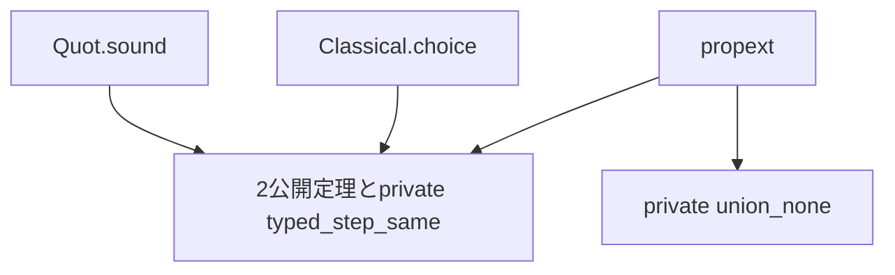
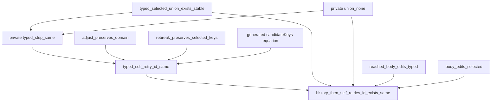

# [root ADR 0352](../adr/0352-prove-pagination-in-lean.md) の同じ段落の再試行列

## 範囲

基準は `8ca5501ea` の本体と既存モデルである。
[SelfRetries.lean](../../experiments/pagination-proof/SelfRetries.lean) を Lean 4.7.0（`aarch64-apple-darwin`）で検査した。
本体と公開 API は変更していない。
[履歴後の一回の再改行](0352-history-first-dependencies.md) を、同じ対象を更新する任意の有限列へ接続する。

本体の [paragraph](../../modules/golem-typeset/src/Golem/Typeset/Flow.hs#L5290) は `index` を外側から受け取り、内側の `parts` は同じキーの本文を更新する。
[Map.adjust](../../modules/golem-typeset/src/Golem/Typeset/Flow.hs#L5299) と [継続](../../modules/golem-typeset/src/Golem/Typeset/Flow.hs#L5339) の間で、本文の行数は変わるが対象のキーは変わらない。
この増分は、その固定したキーへの値の更新を関数の列で表す。

最初に型の合う本文、現在の図版 job と選択から、任意の有限な再試行列の前後で対象の先頭 ID が一致することを導く。
帰納の各段階へ、領域と選択の保存を渡す。
さらに、空から到達した初期 cache と任意の先行する更新履歴から、現在の本文の型と選択を導いて接続する。
履歴の後に新しい cache への到達を仮定しない。

結果の ID は、先行する更新履歴を反映した現在の段落を始める時点の値である。
本全体の初期の ID と等しいことは要求しない。
任意の有限列を扱う定理なので、実際の再試行が有限で終わるという証明にはならない。

## 定理と公理

Lean の環境から宣言の種類、型、証明項の直接参照を取得した。
公開定理 2 件、手書きの private 定理 2 件、生成定理 1 件、定義 8 件、公理宣言 0 件だった。
全 5 定理について、同じ型の別名を一時環境で作り、kernel の検査と `#print axioms` を行った。

公開名の共通接頭辞は `BesideSelfRetries.` である。
標準三公理は `propext`、`Classical.choice`、`Quot.sound` を指す。

| 名前 | 位置 | 前提と結論 | 公理 |
| --- | --- | --- | --- |
| `root_adr0352_i5_typed_self_retry_id_same` | [26 行](../../experiments/pagination-proof/SelfRetries.lean#L26) | 型の合う本文、現在の図版 job と選択から、同じ対象への任意の有限更新列の前後で、その対象の先頭 ID が一致する。 | 標準三公理 |
| `root_adr0352_i5_history_then_self_retries_id_exists_same` | [48 行](../../experiments/pagination-proof/SelfRetries.lean#L48) | 初期 cache の到達、先行更新履歴、初期の job と選択から、現在と同じ対象への有限更新列の後に同じ ID が合成後も存在する。右側の表は前後で任意に異なってよい。 | 標準三公理 |

private 定理の共通接頭辞は `_private.experiments.«pagination-proof».SelfRetries.0.BesideSelfRetries.` である。

| 名前 | 位置 | 概要 | 公理 |
| --- | --- | --- | --- |
| `union_none` | [9 行](../../experiments/pagination-proof/SelfRetries.lean#L9) | 右側が空の左優先合成を元の表へ戻す。 | `propext` |
| `typed_step_same` | [12 行](../../experiments/pagination-proof/SelfRetries.lean#L12) | 既存の一回の更新の存在定理から、所有段落の表での一致を導く。 | 標準三公理 |

生成定理は `_private.experiments.«pagination-proof».SelfRetries.0.BesideReuse.candidateKeys._eq_1` の 1 件である。
生成位置は取得できず、公理に依存しない。

手書きの定義は [selfEdits](../../experiments/pagination-proof/SelfRetries.lean#L5) の 1 件である。
共通接頭辞 `BesideSelfRetries.selfEdits` の生成定義は、`.match_1`、`._sunfold`、`.match_1._cstage1`、`._cstage2`、`._rarg._cstage2`、`._cstage1`、`._unsafe_rec` の 7 件である。
最後の名前は compiler が生成した実行用の補助定義であり、手書きの `unsafe` 宣言ではない。
kernel の論理上の定義と証明に、新しい公理や `sorry`、`admit` はない。

`propext` は命題の同値からの等値（Lean の `Init/Core.lean:1287`）、`Classical.choice` は空でない型からの選択（`Init/Prelude.lean:730`）、`Quot.sound` は同値関係で結ばれた値の商での等値（`Init/Core.lean:1459`）である。
次の公理の図は、既存の補助定理を経由する推移的な依存も表す。
公理に依存しない生成定理は省略した。

定理の図の実線は型か証明項の直接参照である。
標準の論理の定理は省略した。

既存の依存は [更新履歴](0352-body-edits-dependencies.md) と [履歴後の再改行](0352-history-first-dependencies.md) にまとめた。

## 境界と実装との照合

新しい API がない状態で試験が終了コード 1 を返し、追加後に [SelfRetriesBoundary.lean](../../experiments/pagination-proof/SelfRetriesBoundary.lean) の 12 式が通った。
先行する別の本文の更新で ID が 4 から 11 へ変わり、その後に対象の行数を 0、7、1 へ変えても 11 が残る例を含む。
空の列、存在しないキー、関数の適用順序、別の対象の ID が 4 から 8 へ変わる対照も残した。

[SelfRetriesFonts.hs](../../experiments/pagination-proof/SelfRetriesFonts.hs) は、実フォントで配置した表、コード、制御、二つの図版と三つの所有段落を使う。
七つの先行更新で得た八つの状態で、三つの対象へそれぞれ五つの行数の列を適用する。
空列、`[0]`、`[7]`、`[0,7,1]`、`[7,0,7]` の計 120 列である。
本文の行の列を手で置き換え、元の空でない行の列をテンプレートに使う。
改行器そのものがこれらの行数を生成したという検査ではない。

各列の途中でも採番を呼び直し、現在の段落を始める時点の対象の ID と一致することを調べる。
実際の `numberUnit` から再構成した右側の表と所有段落の表の合成を、本体の全 ID の表とも比較する。
対象の値に 999 と 888 を入れた右側の表に対し、左の所有段落の値が残ることも調べる。
現在と列の後の対象の ID、列の後の実際の行数、公開の存在定理を、各列で kernel の式として検査した。
初期 cache の 1 式と合わせて 481 式が通った。

本体の値は更新するが、モデルへ渡す更新列だけを落とす変異では、ID の不変性だけなら誤りを見逃しうる。
この変異も行数の比較で拒否し、Haskell の実行は終了コード 0、kernel の比較は false で終了コード 1 となった。
ID の一致を、本文の値の更新の一致と同じ保証にはしない。

本体のソースは `0aa78f65ac691cdd8d1a3bd5fc4c8bffb1feabdb` であり、この作業ツリーの `modules/` と一致する。
GHC 9.10.3 と既存の専用 package DB を read-only で使う。
共有の build や依存の版は変えず、通常の Cabal の再ビルドとは区別する。

## 全体の検査

`check.sh` にモデルと局所境界を加え、GHC 9.10.3 と Lean 4.7.0 の既存の全検査が終了コード 0 で通った。
grid 55,838 件、free 156,520 件、回り込みの試し置き 10,368 件、causal 4,864 件、制御 216 件、改行の評価 34,586 件、実フォントの caption 40 件を保った。
Alloy の 42 コマンドに対応する既存の Lean の検査も保ち、Alloy の新しい実行回数とは区別する。

plan の SHA-256 は `981a01138b41bf0d6b1e8ea82155b2ed1227297b7339699bbc60005bc4c83957`、package DB の cache は `dd7fdb3fca241d4a7039e18fccf8ff7065a265540225c2cf813e5b07cbe75fc8` で、検査の前後で変わらなかった。
新規の証明専用 CI や予算の変更は加えていない。

## 未証明の範囲

全 `Built` と全呼び出し元から、初期の到達、job と対象の選択を導く接続は残る。
このモデルは同じキーへの成功した値の更新を扱い、実際の再試行の終了を証明しない。
異なるキーを更新する途中でも全 ID の表が不変だという主張はしない。
図版の所有者自身の照会、固定の採番件数、Map の意味論、Int と Nat、図版の全フィールドや配置の callback、caption の計算との一般的一致も未証明である。

原稿の全データと行の順序、全制御の終了、`hb` の全呼び出し元、`captionCompared` と改行器の一般的一致は完成扱いしない。
root [ADR 0352](../adr/0352-prove-pagination-in-lean.md) は採択済み未実装のままとする。
