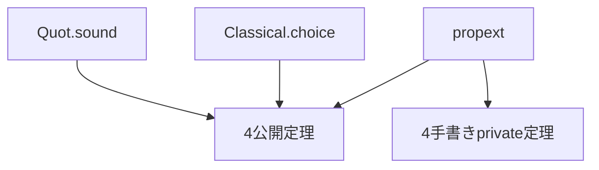
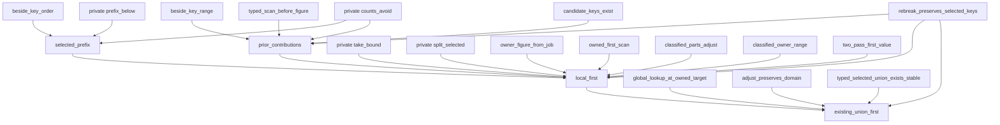

# [root ADR 0352](../adr/0352-prove-pagination-in-lean.md) の後続段落の更新と先行 ID

## 範囲

基準は `6ad352b12` の本体と既存モデルである。
[SuffixCountPrefix.lean](../../experiments/pagination-proof/SuffixCountPrefix.lean) を Lean 4.7.0（`aarch64-apple-darwin`）で検査した。
本体と公開 API は変更していない。
この増分は、同じキーの更新から、照会対象以上のキーへの一回の更新へ、先頭 ID の安定の保証を広げる。

本体の [tryVerses](../../modules/golem-typeset/src/Golem/Typeset/Flow.hs#L5230) は渡された列の各段落の本文を更新し、後ろの段落へ進む。
[stanza](../../modules/golem-typeset/src/Golem/Typeset/Flow.hs#L5248) は先頭の段落の ID も読む。
ここでは、後続のキーへの値の更新が、先行する選択対象の先頭 ID に影響しない条件をモデルで導く。
本体の全呼び出し元から、その対象の選択とキーの順序を導く接続は残る。

選択キーの列は、既存の走査の定理から厳密な昇順になる。
したがって、対象より前の選択キーは対象未満であり、対象以上のキーの更新では変わらない。
さらに、現在の所有者より前の図版が選ぶ本文は、現在の図版を越えて走査できない。
この二つの事実から、内側の採番の先行行数と、外側の先行単位の寄与の両方が変わらないことを導く。

本文の型、現在の図版 job と選択から、局所の先頭 ID の一致を全図版の表へ接続する。
対象に値が存在することを既存の存在定理から導き、右側が任意に変わる左優先の合成後にも同じ ID が残ることを示す。
結論の ID の一致や存在は、前提として渡していない。
対象より前のキーの更新では ID が変わりうるため、その場合は保証しない。

## 定理と公理

Lean の環境から宣言の種類、型、証明項と直接の定理参照を取得した。
公開定理 4 件、手書きの private 定理 4 件、生成定理 29 件、生成定義 24 件、公理宣言 0 件だった。
手書きの型や定義は加えていない。
全 37 定理へ同じ型の別名を一時環境で作り、kernel の検査と `#print axioms` を行った。

公開名は共通の `BesideSuffixCountPrefix.root_adr0352_i5_later_update_preserves_` に次の suffix を加えた名前である。
標準三公理は `propext`、`Classical.choice`、`Quot.sound` を指す。

| suffix | 位置 | 前提と結論 | 公理 |
| --- | --- | --- | --- |
| `selected_prefix` | [26 行](../../experiments/pagination-proof/SuffixCountPrefix.lean#L26) | 走査の対象より前の列と、更新キーが対象以上という条件から、その先行列の行数が変わらない。 | 標準三公理 |
| `prior_contributions` | [38 行](../../experiments/pagination-proof/SuffixCountPrefix.lean#L38) | 本文の型、現在の図版、選択と先行する所有者の範囲から、対象以上の更新でも先行単位の寄与は変わらない。 | 標準三公理 |
| `local_first` | [89 行](../../experiments/pagination-proof/SuffixCountPrefix.lean#L89) | 型、現在の図版 job と選択から、対象以上のキーの更新でも局所の先頭 ID は変わらない。先行する所有者の範囲も内部で導く。 | 標準三公理 |
| `existing_union_first` | [121 行](../../experiments/pagination-proof/SuffixCountPrefix.lean#L121) | 同じ条件から、左優先の合成後にも対象の同じ ID が存在する。右側の表の同一性は要らない。 | 標準三公理 |

private 定理の共通接頭辞は `_private.experiments.«pagination-proof».SuffixCountPrefix.0.BesideSuffixCountPrefix.` である。

| 名前 | 位置 | 概要 | 公理 |
| --- | --- | --- | --- |
| `prefix_below` | [5 行](../../experiments/pagination-proof/SuffixCountPrefix.lean#L5) | 昇順の列で対象より前にあるキーは対象未満である。 | `propext` |
| `counts_avoid` | [16 行](../../experiments/pagination-proof/SuffixCountPrefix.lean#L16) | 含まれないキーの更新は、列の行数に影響しない。 | `propext` |
| `take_bound` | [68 行](../../experiments/pagination-proof/SuffixCountPrefix.lean#L68) | 先頭から取った列の長さは指定数以下である。 | `propext` |
| `split_selected` | [76 行](../../experiments/pagination-proof/SuffixCountPrefix.lean#L76) | 所属する対象で列を前後に分ける。 | `propext` |

生成定理の共通接頭辞は `_private.experiments.«pagination-proof».SuffixCountPrefix.0.` である。
次の前半と suffix を組み合わせると全 29 件の名前になる。
いずれも生成位置は取得できず、公理への依存はない。

| 名前の前半 | suffix | 件数 |
| --- | --- | --- |
| `BesideOwnedFirst.beforeTarget` | `._eq_1`, `._eq_2`, `.match_1.eq_1`, `.match_1.eq_2` | 4 |
| `BesideOwnedFirst.afterTarget` | `._eq_1`, `._eq_2` | 2 |
| `BesideReuse.unitContributions` | `._eq_1`, `._eq_2`, `._eq_3`, `.match_1.eq_1`, `.match_1.eq_2`, `.match_1.eq_3` | 6 |
| `BesideOwnership.Increasing` | `._eq_1`, `._eq_2`, `.match_1.eq_1`, `.match_1.eq_2` | 4 |
| `BesideReuse.candidateKeys` | `._eq_1` | 1 |
| `List.drop.match_1` | `.eq_1`, `.eq_2`, `.eq_3` | 3 |
| `List.take` | `._eq_1`, `._eq_2`, `._eq_3` | 3 |
| `BesideOwnership.countsFor` | `._eq_1`, `._eq_2`, `.match_1.eq_1`, `.match_1.eq_2` | 4 |
| `BesideOwnership.rowCount.match_1` | `.eq_1`, `.eq_2` | 2 |

生成定義も同じ共通接頭辞の下にある。
`BesideOwnedFirst.beforeTarget.match_1.splitter`、`BesideOwnership.Increasing.match_1.splitter`、`List.drop.match_1.splitter`、`BesideOwnership.countsFor.match_1.splitter`、`BesideReuse.unitContributions.match_1.splitter`、`BesideOwnership.rowCount.match_1.splitter` が名前の前半である。
それぞれ suffix がない名前と、`._cstage1`、`._cstage2`、`._rarg._cstage2` の 4 件、計 24 件である。
分岐と実行コードの生成に由来し、定理としては数えていない。

`propext` は命題の同値からの等値（Lean の `Init/Core.lean:1287`）、`Classical.choice` は空でない型からの選択（`Init/Prelude.lean:730`）、`Quot.sound` は同値関係で結ばれた値の商での等値（`Init/Core.lean:1459`）である。
新しい公理、`sorry`、`admit` はない。
公理の図は既存の補助定理を経由する推移的な依存も表し、公理に依存しない生成定理は省略した。

定理の図の実線は型か証明項の直接参照である。
標準の論理と算術の定理、生成された等式定理は省略した。

既存の依存は [図版間の走査](0352-beside-reuse-order-dependencies.md)、[先行する寄与](0352-prior-unit-counts-dependencies.md)、[履歴後の再改行](0352-history-first-dependencies.md) にまとめた。

## 境界と実装との照合

新しい API がない状態で試験が終了コード 1 を返し、追加後に [SuffixCountPrefixBoundary.lean](../../experiments/pagination-proof/SuffixCountPrefixBoundary.lean) の 11 式が通った。
別の図版の後続本文の行数を変えても先行 ID は変わらない例、同じキー、存在しないキー、実際の変更後の行数を含む。
反対に、先行する本文を変えると後続 ID が 4 から 11 へ変わる具体例と不等式も残した。
更新キーの大小関係を逆にする変異は、証明の検査で終了コード 1 となった。

[SuffixCountPrefixFonts.hs](../../experiments/pagination-proof/SuffixCountPrefixFonts.hs) は、実フォントで組んだ表、コード、制御、二つの図版と三つの所有段落を使う。
七つの先行更新で得た八つの状態に対し、照会対象とその対象以上の更新キーの組が六つある。
各組で 0 行と 7 行への置換を試す計 96 例である。
元の空でない行の列をテンプレートとして本文を手で置き換え、改行器からその行数を生成したとは扱わない。

各例で本体の採番を呼び直し、対象の先頭 ID が現在と更新後で一致することを調べる。
本体の最初の採番から再構成した右側の表と所有段落の表を合成し、本体の全 ID の表とも比較する。
人工的な右側の対象 ID の 999 と 888 が採用されないことも調べる。
現在と更新後の ID、更新対象のキーの実際の行数、公開の存在定理を各例で検査し、初期 cache の 1 式を加えた 385 式が kernel で通った。

モデルへ渡す更新だけを落とす検証側の変異では、Haskell の実行は終了コード 0 だった。
変更対象の行数を比較する式のうち 76 件を kernel が false と判定し、Lean は終了コード 1 となった。
先行 ID の安定だけで更新した値の一致まで保証するとは扱わない。
formatter 適用後の観測も繰り返し、生成した 385 式が適用前と byte 単位で一致した。

本体のソースは `0aa78f65ac691cdd8d1a3bd5fc4c8bffb1feabdb` であり、この作業ツリーの `modules/` と一致する。
GHC 9.10.3 と既存の専用 package DB を read-only で使い、共有の build と依存の版は変えない。
通常の Cabal の再ビルドとは区別する。

## 全体の検査

`check.sh` にモデルと局所境界を加え、GHC 9.10.3 と Lean 4.7.0 の既存の全検査が終了コード 0 で通った。
grid 55,838 件、free 156,520 件、回り込みの試し置き 10,368 件、causal 4,864 件、制御 216 件、改行の評価 34,586 件、実フォントの caption 40 件を保った。
Alloy の 42 コマンドに対応する既存の Lean の検査も保ち、Alloy の新しい実行回数とは区別する。

plan の SHA-256 は `981a01138b41bf0d6b1e8ea82155b2ed1227297b7339699bbc60005bc4c83957`、package DB の cache は `dd7fdb3fca241d4a7039e18fccf8ff7065a265540225c2cf813e5b07cbe75fc8` で、検査の前後で変わらなかった。
新規の証明専用 CI や予算の変更は加えていない。

## 未証明の範囲

この増分は型、現在の job と選択、対象以上の更新キーから導く一回の更新の結果である。
全 `Built` と全呼び出し元からの到達、選択、更新キーの順序と本体の制御の一般的な接続は残る。
異なるキーを更新する任意の有限列への帰納と、実際の再試行が有限で終わることも、この増分では証明しない。
図版の所有者自身の照会、固定の採番件数、Map の意味論、Int と Nat、図版の全フィールドや配置の callback、caption の計算との一般的一致も未証明である。

原稿の全データと行の順序、全制御の終了、`hb` の全呼び出し元、`captionCompared` と改行器の一般的一致は完成扱いしない。
root [ADR 0352](../adr/0352-prove-pagination-in-lean.md) は採択済み未実装のままとする。
