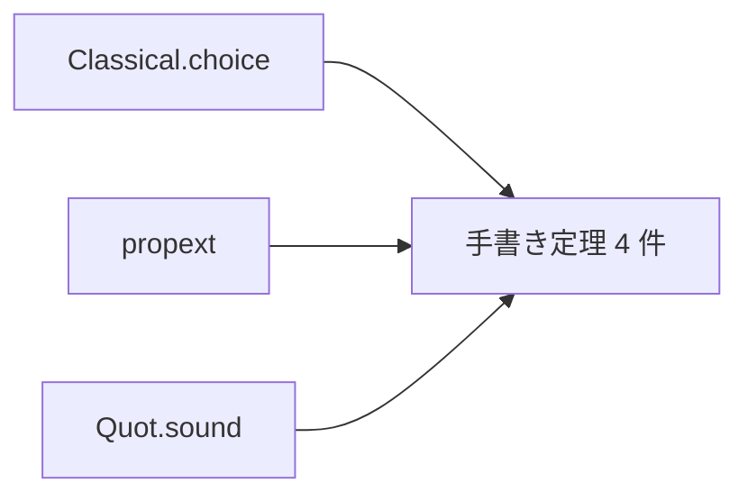
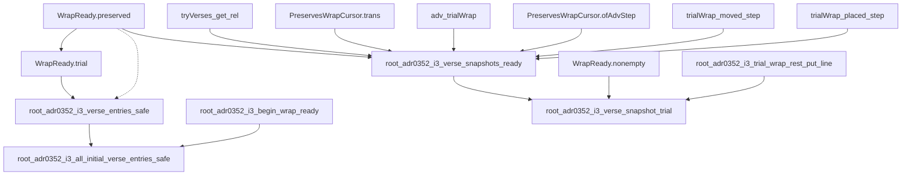

# [root ADR 0352](../adr/0352-prove-pagination-in-lean.md) の詩の試し置きの前提と依存

## 範囲

この調査は、[root ADR 0352](../adr/0352-prove-pagination-in-lean.md) の残件のうち、回り込み図版の横で詩の行を試す `tryVerses` の入力条件を扱う。
基準は main のコミット `393b869169701e1bb289ad78ed5dc622f1ac0a71` であり、追加した [WrapVerses.lean](../../experiments/pagination-proof/WrapVerses.lean) を調べた。
[root ADR 0476](../adr/0476-reject-drop-caps-that-cannot-fit-an-empty-column.md) の未マージの API は使っていない。
Lean は 4.7.0（`aarch64-apple-darwin`）を使った。

`WrapReady` は、除外領域が現在位置より後になく、その領域が有効なら現在の段に局所のテキストがある、という条件である。
ここでのテキストには、回り込み図版のスロットも含む。
`verseEntriesSafe` は、`tryVerses` と同じ分岐で進み、各再帰呼び出しの入力に `WrapReady` を要求する。
試し置きがエラーで終わるときの入力も対象に含む。

対象ファイルには、公理宣言は 0 件、手書きの定理は 4 件、生成された補助定理は 7 件あった。
11 件すべてについて Lean の環境から証明項を読み、型と証明項の定数参照を定理に解決し、`#print axioms` を実行した。
手書きの定理 4 件は三つの標準公理へ推移的に依存し、生成補助定理 7 件には公理依存がなかった。
手書きの定義は 1 件で、生成定義は 14 件だった。
既存モデル全体の定理を再調査したものではない。

## 定理と前提

表の名前はすべて `PhysicalPagination` 名前空間の完全修飾名である。

| 定理 | 位置 | 前提と結論 |
| --- | --- | --- |
| `PhysicalPagination.root_adr0352_i3_verse_entries_safe` | [WrapVerses.lean:24](../../experiments/pagination-proof/WrapVerses.lean#L24) | 最初のカーソルが `WrapReady` を満たせば、任意の有限な詩の行の列について、試し置きのすべての再帰入力が同条件を満たす。改行器や詩の長さには制限しない。 |
| `PhysicalPagination.root_adr0352_i3_all_initial_verse_entries_safe` | [WrapVerses.lean:42](../../experiments/pagination-proof/WrapVerses.lean#L42) | `beginWrap` が成功して返したカーソルから試す場合、最初の入力とすべての再帰入力が同条件を満たす。`WrapReady` を別の前提に置かない。 |
| `PhysicalPagination.root_adr0352_i3_verse_snapshots_ready` | [WrapVerses.lean:51](../../experiments/pagination-proof/WrapVerses.lean#L51) | 最初のカーソルが同条件を満たし、`tryVerses` が成功した場合、返された配置済みカーソルのすべてが同条件を満たす。 |
| `PhysicalPagination.root_adr0352_i3_verse_snapshot_trial` | [WrapVerses.lean:69](../../experiments/pagination-proof/WrapVerses.lean#L69) | 上の成功結果から選んだカーソルでは、正の行送りのもとで `trialWrapRest` と `trialWrapRestLine` が一致する。除外領域の位置と非空性を、新たな前提として渡す必要がない。 |

生成補助定理は、定義の二つの方程式と `match` の各分岐の簡約規則である。
完全修飾名は次のとおりであり、いずれも公理依存がない。

```text
_private.experiments.«pagination-proof».WrapVerses.0.PhysicalPagination.verseEntriesSafe._eq_1
_private.experiments.«pagination-proof».WrapVerses.0.PhysicalPagination.verseEntriesSafe._eq_2
_private.experiments.«pagination-proof».WrapVerses.0.PhysicalPagination.verseEntriesSafe.match_1.eq_1
_private.experiments.«pagination-proof».WrapVerses.0.PhysicalPagination.verseEntriesSafe.match_1.eq_2
_private.experiments.«pagination-proof».WrapVerses.0.PhysicalPagination.verseEntriesSafe.match_1.eq_3
_private.experiments.«pagination-proof».WrapVerses.0.PhysicalPagination.verseEntriesSafe.match_2.eq_1
_private.experiments.«pagination-proof».WrapVerses.0.PhysicalPagination.verseEntriesSafe.match_2.eq_2
```

## 公理と依存図

公理は Lean 標準ライブラリの次の三つであり、この変更で追加したものではない。

| 公理 | Lean 4.7.0 の位置 | 内容 |
| --- | --- | --- |
| `Classical.choice` | `Init.Prelude:730` | `Nonempty α` から `α` の要素を選ぶ。 |
| `propext` | `Init.Core:1287` | `a ↔ b` から `a = b` を得る。 |
| `Quot.sound` | `Init.Core:1459` | 関係を満たす二要素が同じ商の値を持つ。 |

次の図の矢印は、定義や補助定理を経由する推移的な公理依存を表す。
生成補助定理 7 件は、公理への依存がないため図に含めない。



次の図は、今回の四定理と、それが直接参照する既存の配置に関する定理を示す。
実線は elaboration 後の証明項に現れた定理への直接参照で、破線は既存の補助定理を経由する依存である。
標準ライブラリの等式、分岐、帰納法の補題と生成簡約規則は省いた。
各ノードの省略名は、同じ `PhysicalPagination` 名前空間の定理名に対応する。



`WrapReady.trial`、`WrapReady.preserved`、`WrapReady.nonempty` と `beginWrap` の定理の前提は、[先の依存調査](0352-pagination-proof-dependencies.md) に記録している。
今回の環境でも、上の実線を型と証明項の参照から確認した。

## 実装との照合

基準 main の `Golem.Typeset.Flow` の `tryVerses` は、実際のカーソルで詩の各行を組み、全行を同じ段に置けた場合だけ、そのカーソルで次の詩の行を試す。
`Physical.lean` の `tryVerses` は、この分岐を写している。
`check-wrap-verse-shape.sh` は、その写しの再帰分岐と `verseEntriesSafe` の再帰分岐を正規化して照合する。
これは Haskell の任意の入力についての意味論の一致の証明ではない。

ローカルでは、追加する定理がない状態の検査が一度失敗した。
再帰に渡す `placed` を `cursor` に替えた変更は、分岐の照合と Lean の証明検査の両方で失敗した。
入口の `WrapReady` を `True` に替えた変更も、分岐の照合で失敗した。
元のソースでは四定理と分岐の照合が成功した。

通常の実装との境界照合には、`CausalBoundary.hs` と `CausalBoundary.lean` の既存の 4864 原稿を使った。
基準 main と同じ実装を組んだ GHC 9.10.3 のライブラリを使い、13 個の in-place package ID を明示して実行した。
Haskell と Lean の出力はともに 18921 行で、差分はなかった。
これは有限の照合であり、四定理の一般性の根拠は Lean の証明である。

## 証明の穴と残り

対象ソースに `sorry`、`admit`、`sorryAx` はなく、11 定理の公理依存にも `sorryAx` はなかった。
今回調べた宣言で、取得できなかった証明項はなかった。

`beginWrap` の返り値を直接使う入力と、条件を満たす入力からの `tryVerses` の再帰、およびその成功結果については接続した。
`causalFreeFlow` のすべての呼び出し元が渡す初期状態を接続したわけではない。
`paragraphs` が実行する制御フロー、`stanza` の退避先と保持処理、`probeNext` の前処理を含む接続は残る。
`parts` の行 ID の前提 `hb`、行の過不足と順序の一般証明、キャプション改行器と実装の一般的な一致も、この変更では扱っていない。
[root ADR 0352](../adr/0352-prove-pagination-in-lean.md) は `accepted-pending` のままにする。
