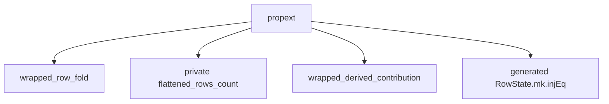
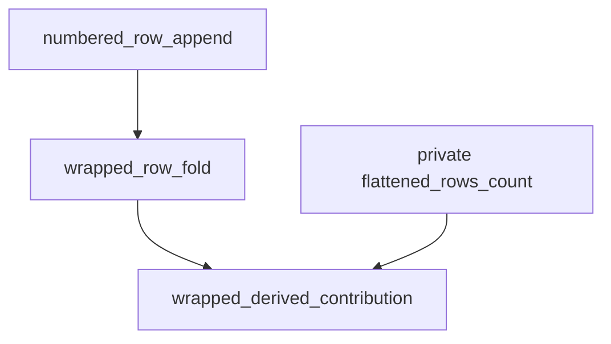

# [root ADR 0352](../adr/0352-prove-pagination-in-lean.md) の回り込む図版の行列の fold

## 範囲

基準は `9a27f2718` の本体と既存モデルである。
[WrappedRowFold.lean](../../experiments/pagination-proof/WrappedRowFold.lean) を Lean 4.7.0（`aarch64-apple-darwin`）で検査した。
本体と公開 API は変更していない。
本体の回り込む図版の採番のうち、次に使う ID と、既に組んだ行の列を蓄積する部分をモデルにする。

本体の [numberFigure の go](../../modules/golem-typeset/src/Golem/Typeset/Flow.hs#L4596) は、本文ごとに行を採番して連結し、その行数だけ次の ID を進める。
[foldl の開始](../../modules/golem-typeset/src/Golem/Typeset/Flow.hs#L4606) は、図版の内部 ID の次である。
そのため、図版一つと所有する本文の全行数が、次の単位への寄与になる。
ここで扱うのは、exclusion があり、最初の診断列が空で、この回り込みの分岐に入る場合である。
他の図版の分岐や診断の扱いをまとめて証明したものではない。

最初の定理は任意の初期 ID と以前の行の列について、左からの fold の結果を導く。
次の ID は初期値に全行数を加えた値になり、列は以前の列と全行をまとめて採番した列の連結になる。
行の値の型は任意であり、順序と重複を保つ。

次の定理はキーの列から本文の行列を取り出し、その長さを既存の `rowCount` と `ownedRows` へ接続する。
図版の ID を一つ確保した fold の結果から、既存の先行寄与のモデルで使う `1 + ownedRows` を導く。
寄与の値や行の列の一致を、前提として渡していない。
キーの重複を禁止しないが、キーを使う別の表の照会には、既存の一意性の結果が別に必要になる。

これは採番の fold の性質である。
原稿から行を作る過程、図版の幾何や行を回り込みと継続に分ける全過程、全 `Built` への接続は残る。

## 定理と公理

Lean の環境から宣言の種類、型、証明項と直接の定理参照を取得した。
公開定理 2 件、手書きの private 定理 1 件、生成定理 19 件、定義 32 件、公理宣言 0 件だった。
全 22 定理へ同じ型の別名を一時環境で作り、kernel の検査と `#print axioms` を行った。

手書きの型は [RowState](../../experiments/pagination-proof/WrappedRowFold.lean#L5) である。
次に使う `next` と、ID を付けた行の列 `rows` を持つ。
constructor `BesideWrappedRowFold.RowState.mk` と recursor `BesideWrappedRowFold.RowState.rec` も環境で確認した。

公開名の共通接頭辞は `BesideWrappedRowFold.` である。
両方とも `propext` だけに依存し、`Classical.choice` と `Quot.sound` への依存はない。

| 名前 | 位置 | 前提と結論 |
| --- | --- | --- |
| `root_adr0352_i5_wrapped_row_fold` | [16 行](../../experiments/pagination-proof/WrappedRowFold.lean#L16) | 任意の初期状態と行列の列から、fold 後の ID と行の列の値を導く。 |
| `root_adr0352_i5_wrapped_derived_contribution` | [42 行](../../experiments/pagination-proof/WrappedRowFold.lean#L42) | 任意の本文の表とキーの列から、図版の内部 ID 一つと全行数の寄与、および行の値の採番列を導く。 |

private 定理は `_private.experiments.«pagination-proof».WrappedRowFold.0.BesideWrappedRowFold.flattened_rows_count`、位置は [30 行](../../experiments/pagination-proof/WrappedRowFold.lean#L30) である。
本文から取った行列の連結の長さと、キーごとの `rowCount` の合計が一致することを導く。
`propext` に依存する。

生成定理の宣言位置はいずれも取得できなかった。
生成定理のうち、`BesideWrappedRowFold.RowState.mk.injEq` は `propext` に依存する。
`BesideWrappedRowFold.RowState.mk.inj` と `BesideWrappedRowFold.RowState.mk.sizeOf_spec` は公理に依存しない。
残る 16 件の共通接頭辞は `_private.experiments.«pagination-proof».WrappedRowFold.0.` である。
次の前半に、それぞれ `._eq_1`、`._eq_2`、`.match_1.eq_1`、`.match_1.eq_2` を加えると名前になる。
いずれも生成位置は取得できず、公理に依存しない。

- `BesideWrappedRowFold.flatten`
- `NumberedPayload.numberRows`
- `BesideOwnership.countsFor`
- `CausalFirstIds.ownedRows`

手書きの定義は、共通接頭辞 `BesideWrappedRowFold.` を持つ次の 5 件である。
証明だけに使う `noncomputable` な関数である。

| 名前 | 位置 | 内容 |
| --- | --- | --- |
| `addChunk` | [8 行](../../experiments/pagination-proof/WrappedRowFold.lean#L8) | 一つの本文の行を採番して連結し、その行数だけ ID を進める。 |
| `runChunks` | [10 行](../../experiments/pagination-proof/WrappedRowFold.lean#L10) | `addChunk` を左から fold する。 |
| `flatten` | [12 行](../../experiments/pagination-proof/WrappedRowFold.lean#L12) | 行列を順に連結する。 |
| `chunksFor` | [28 行](../../experiments/pagination-proof/WrappedRowFold.lean#L28) | キー順に本文の行列を取る。 |
| `wrappedRows` | [39 行](../../experiments/pagination-proof/WrappedRowFold.lean#L39) | 図版の内部 ID を一つ確保して fold を始める。 |

`chunksFor` は値のないキーを空列で全域化する。
これを本体の `Map.!` の失敗時の仕様とは扱わない。
実装側の検査では、選ぶ全キーの値が表に存在する。

型に由来する定義は `BesideWrappedRowFold.RowState.` を接頭辞とする `next`、`rows`、`_sizeOf_1`、`_sizeOf_inst`、`noConfusionType`、`noConfusion`、`casesOn`、`recOn` の 8 件である。
他の生成定義は、`BesideWrappedRowFold.flatten.` を接頭辞とする `_sunfold`、`match_1`、`match_1._cstage1` の 3 件と、次の splitter ごとの 4 件である。

splitter の共通接頭辞は `_private.experiments.«pagination-proof».WrappedRowFold.0.` である。
`BesideWrappedRowFold.flatten.match_1.splitter`、`NumberedPayload.numberRows.match_1.splitter`、`BesideOwnership.countsFor.match_1.splitter`、`CausalFirstIds.ownedRows.match_1.splitter` が名前の前半である。
それぞれ suffix がない名前と、`._cstage1`、`._cstage2`、`._rarg._cstage2` の 4 件、計 16 件である。

`propext` は命題の同値からの等値であり、Lean の `Init/Core.lean:1287` で定義される。
新しい公理、`sorry`、`admit` はない。
公理の図は既存の補助定理を経由する依存も表す。

定理の図の実線は型か証明項の直接参照である。
標準の論理と算術、生成された等式定理は省略した。

既存の依存は [既存の行の値の保存](0352-numbered-row-payload-dependencies.md) と [先行する寄与](0352-prior-unit-counts-dependencies.md) にまとめた。

## 境界と変異

新しい API がない状態で試験が終了コード 1 を返し、追加後に [WrappedRowFoldBoundary.lean](../../experiments/pagination-proof/WrappedRowFoldBoundary.lean) の 13 式が通った。
空列、空の本文、以前の行の保持、重複する値とキー、存在しないキーを含む。
キーを逆にした場合に、次の ID は同じでも行の値の列が異なる対照も調べた。

行を落として ID だけ進める変異と、図版の内部 ID の確保を落とす変異は、それぞれ証明の検査で終了コード 1 となった。
行を落とす別の具体例では、次の ID だけは正しい fold と一致するが、行の列は以前のままである 3 式を kernel で確認した。
件数の一致だけを、値と順序の保存の証明とは扱わない。

## 実装との照合

[WrappedRowFoldFonts.hs](../../experiments/pagination-proof/WrappedRowFoldFonts.hs) は、実フォントで組んだ表、コード、制御、キャプション付きの二つの回り込む図版と三つの所有段落を使う。
本文は 20 字幅、図版は 5 zw 幅である。
七つの値の更新で得た八つの状態を使い、対象の本文の行列を手で置き換える。
改行器からその行数を生成したとは扱わない。

図版ごとに本体の `numberFigure` を呼ぶ計 64 例である。
48 例は内部 ID の初期値を 0、3、17 とした独立の状態であり、16 例は本体の `numberUnit` を前から適用して得た実際の先行状態である。
後者では `Built` に記録した図版の先頭 ID とも一致を調べた。
選ぶ本文の行列と、本体の `besideRows` が渡す行列の順序も比較した。

実装側では追加する図版の内部 ID の記録とその source span、追加する行の ID 列、既存の行と追加する全行の `Line` の値を比較した。
キーの重なりがないことも検査したが、Map 全体の一般的な意味論を証明したものではない。
Lean へは順序と重複を試す `Nat` の列を渡し、Haskell の全 `Line` の構造を符号化したとは扱わない。

次の ID、新しい行の列、以前の行も含む列、公開の寄与の定理を各例で検査した 256 式が kernel で通った。
追加する図版の記録と source span の保存も実装側で追加して検査し、生成した 256 式がその追加の前後で byte 単位で同一であることを確認した。

本体のソースは `0aa78f65ac691cdd8d1a3bd5fc4c8bffb1feabdb` であり、この作業ツリーの `modules/` と一致する。
GHC 9.10.3 と既存の専用 package DB を read-only で使い、共有の build と依存の版は変えない。
通常の Cabal の再ビルドとは区別する。

## 全体の検査

`check.sh` にモデルと局所境界を加え、GHC 9.10.3 と Lean 4.7.0 の既存の全検査が終了コード 0 で通った。
grid 55,838 件、free 156,520 件、回り込みの試し置き 10,368 件、causal 4,864 件、制御 216 件、改行の評価 34,586 件、実フォントの caption 40 件を保った。
Alloy の 42 コマンドに対応する既存の Lean の検査も保ち、Alloy の新しい実行回数とは区別する。

plan の SHA-256 は `981a01138b41bf0d6b1e8ea82155b2ed1227297b7339699bbc60005bc4c83957`、package DB の cache は `dd7fdb3fca241d4a7039e18fccf8ff7065a265540225c2cf813e5b07cbe75fc8` で、検査の前後で変わらなかった。
新規の証明専用 CI や予算の変更は加えていない。

## 未証明の範囲

本体の有効な回り込みの分岐のうち、fold の ID と行の列の投影を扱った増分である。
全 `Built` と全呼び出し元からの条件、図版の幾何、行を回り込みと継続へ分ける全過程、Map の合成、Int と Nat の一般的一致は残る。
行を作る callback、本体の注と印の計算、caption の計算との一般的一致も未証明である。

成功した有限の照合を本体の全入力の成功や再試行の終了の証明とは扱わない。
root [ADR 0352](../adr/0352-prove-pagination-in-lean.md) は採択済み未実装のままとする。
