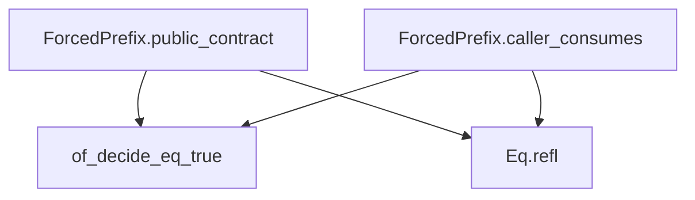
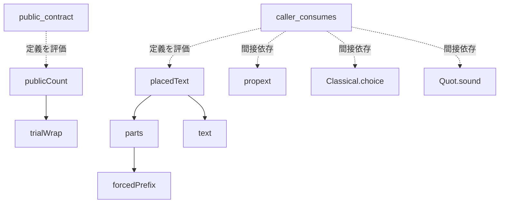

# 強制配置の採用と再試行の進捗

## 対象と実装

基準は [root ADR 0483](../adr/0483-finish-forced-paragraph-placement-without-repeating-the-retry.md) を採択した `9e451393a9478d99febcfe80117cbca2d8be4ed4` である。
この版の製品コードは、反例を取得した `0aa78f65ac691cdd8d1a3bd5fc4c8bffb1feabdb` と同一だった。
`Flow.hs` の `paragraph.parts` で、正の試行上限より多い採用数が返った場合に強制配置を採用する。
全行を採用した枝では配置を返し、部分を採用した枝では既存の `continue` へ進む。
試し置き API、`ShortPart` の記録、元ソースの改行位置から次の位置を求める処理は変更していない。

## 修正前の反例

実フォントの通常 CLI で「あ」49 文字と回り込み図版を組んだ。
先頭 2 行保持、自由な配置、10 pt、12 字、4 行、15 pt の行送りを使った。
末尾 2 行保持は終了コード 0、0.202 秒で完了した。
末尾 4 行保持は 15 秒以内に終了せず、検証側で起動した子プロセスを終了した。
この結果だけで無限実行を証明したとは扱わない。
通常のコマンドは `golem build --target pdf --profile dev --format json` である。
証跡は `/private/tmp/golem-0483-cli-red-nov28` の二つのプロジェクトと `result.json` に保存した。

自動回帰は `ParagraphWrapPitchSpec.hs` の [root ADR 0483](../adr/0483-finish-forced-paragraph-placement-without-repeating-the-retry.md) の試験である。
修正前の読み取り専用 package DB を使う回帰は、5.01 秒で終了条件の assertion が失敗した。
最初の実行では作業ディレクトリが違い画像の読み取りで失敗したため、これは回帰の失敗根拠には含めない。
正しい作業ディレクトリは `modules/golem-driver` である。

## 実装後の出力と境界試験

独立した `/private/tmp/golem-0483-dist-nov28` に通常の CLI とページ付け試験をビルドした。
依存する peg-hs は固定済みの `4b4adc7046a14d18c8eec711f18dbcaa9b059cca` を取得し、以前の package DB を書き換えていない。
修正後の末尾 4 行保持の CLI は終了コード 0、0.109 秒で PDF を生成した。
末尾 2 行保持は 2 ページ、末尾 4 行保持は 3 ページで、どちらにも「あ」が 49 文字あった。
末尾 4 行保持の `G07113` は、要求 4 行に対して末尾が 2 行という notice を一度出した。
生成した 5 ページを 150 dpi の画像で見て、文字や図の重なりと欠けがないことを確認した。
末尾 2 行保持の 2 ページは、修正前後の 72 dpi の PPM が一致した。

文字順と捨てられる空白を含む 3 種類の本文を、末尾 2 行と 4 行保持で確かめる 6 試験が通った。
元ソースの改行位置の後を消費する既存の規則と合わせ、配置行の ID の重複と欠落も検査する。
最終の `golem-driver-page-test` は 979 試験、`PhysicalPaginateSpec` は 179 試験が通った。
後者には、空の段と見出しだけの段それぞれで上限なし、2、1 の採用数と `ShortPart` の保存を調べる 6 条件を含む。
この確認で、公開 API の強制配置を上限内に切り詰めてはいない。

通常の視覚検証の 24 冊を生成し、説明を追加した開発マニュアル以外の 23 冊は参照画像と一致した。
開発マニュアルは前後とも 239 ページで、目次の 11–14 ページと本文の 107–110 ページだけが変わった。
8 ページ対の 150 dpi の画像を見て、追加した説明による改行と節番号の変化を確認し、重なりと欠けはなかった。
その 8 ページの参照だけを更新した後、24 冊のハッシュ比較が通った。

## Lean の具体例と依存

Lean は 4.7.0 を使った。
`Physical.lean` の `parts` に同じ採用条件を反映し、ファイル全体の型検査が成功した。
`ForcedPrefix.lean` は、以前の [root ADR 0352](../adr/0352-prove-pagination-in-lean.md) の h6 の反例を同じ入力の正常な消費を確かめる回帰へ変えた。
旧反例は 5 行、先頭 2 行と末尾 4 行保持、`CausalBoundary.env 4`、入力位置から残りを返す改行関数だった。
旧 `parts` は再試行の減少が成り立たず `.noProgress 0` を返し、実装は同じ上限で再び試していた。
旧モデルを保存した読み取り専用 cache では、新しい消費の定理が偽として拒否された。

| 宣言 | 主張 | 公理 |
| --- | --- | --- |
| [`ForcedPrefix.public_contract`](../../experiments/pagination-proof/ForcedPrefix.lean#L27) | 上限なし、2、1 の公開試し置きがそれぞれ 3 行を返す | なし |
| [`ForcedPrefix.caller_consumes`](../../experiments/pagination-proof/ForcedPrefix.lean#L32) | 同じ三つの上限で呼出し元が行 ID 0 から 4を各一度、順に配置する | `propext`、`Classical.choice`、`Quot.sound` |

二つの定理はいずれも kernel の `decide` で具体例を検査する。
環境の宣言を調べ、新しいモジュールの定理 2 件、明示定義 3 件、公理 0 件を確認した。
`rows` などは `noncomputable` とし、コンパイラが生成する `List.mapTR` の特殊化の公理も残していない。
`sorry` と `admit` はない。
二つの証明項が直接参照する定理は `of_decide_eq_true` と `Eq.refl` であり、互いを参照しない。





全体の `experiments/pagination-proof/check.sh` も終了コード 0 で完了した。
配置 156,520 入力、回り込み試行 10,368 件、回り込み原稿 4,864 件、Knuth-Plass 34,586 入力と実フォントの caption 40 例でモデルと実装が一致した。
42 件の Alloy コマンドには Lean の対応と転記上の対応があり、この実行で Alloy solver を再実行したという意味ではない。
`WrapCalls.lean` の `partsEntrySafe` にも同じ二つの条件を反映し、呼出し元との構造照合を通した。
最初の全体実行ではこの構造照合が旧条件を検出して止まり、同期した後に全体を再実行した。

この照合では、専用ビルドの package DB を読む `runghc-driver` と、計画や cache を書き換えず渡されたコマンドを実行する `cabal exec` 用のラッパーを使った。
通常の Cabal 環境を暗黙に選んだ結果とは区別する。
実行条件は次のとおりである。

```sh
PATH=/private/tmp/golem-0483-tools-nov28:$PATH \
CABAL_PLAN=/private/tmp/golem-0483-dist-nov28/cache/plan.json \
RUNGHC=/private/tmp/golem-0483-tools-nov28/runghc-driver \
LEAN=/Users/tett23/.elan/toolchains/leanprover--lean4---v4.7.0/bin/lean \
sh experiments/pagination-proof/check.sh
```

これらは有限の具体例であり、任意の本文や実装の全呼出し元に対する終了証明ではない。
[root ADR 0352](../adr/0352-prove-pagination-in-lean.md) の `Built`、全制御、一般の caption と改行関数の実装との対応は未完了のままである。
