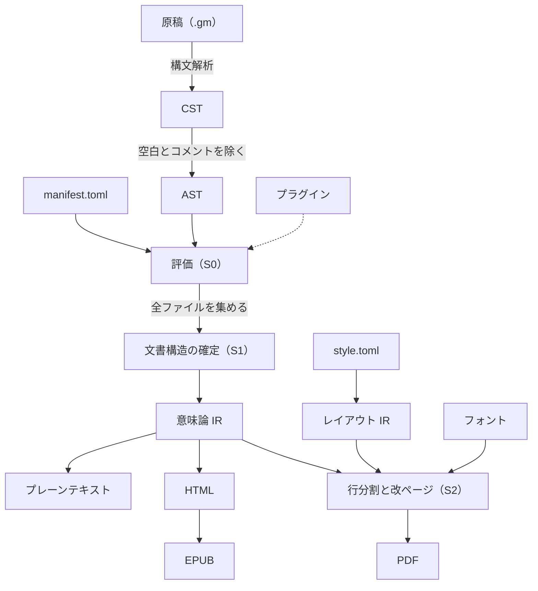
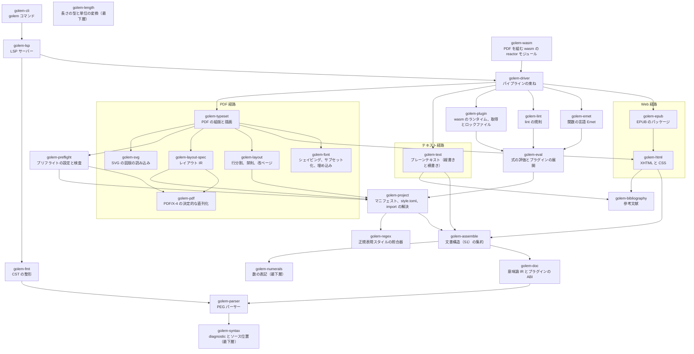

# Golem 仕様書

Golem は CLI で動作する統合組版システムである。
原稿とレイアウトの両方をプレーンテキストで表現し、書籍の組版にバージョン管理と CI/CD を持ち込む。
実装言語は Haskell とする。

この文書は Golem の能力、ユーザーに強いるワークフロー、意図的に採用しなかったもの、モジュール構成の四つを定める。
言語仕様は `markup.md` に置く。
各モジュールの仕様書は `docs/<モジュール名>/specifications.md` に、そのモジュールの設計決定と実装ステップは同じディレクトリの `adr/` に連番の ADR として置く。
特定のモジュールに属さない横断的な決定は `docs/adr/` に置く。
ADR はコミット後、ステータスの行と、リンクを付ける、外す、リンク先を変えるだけの変更を除いて変更しない（[docs/adr/0032](adr/0032-update-adr-guard-to-v0.8.2.md)）。
ADR は、行頭が `ステータス:` のステータスの行をちょうど一つ持つ（[docs/adr/0011](adr/0011-update-adr-guard-to-v0.8.0.md)）。
同じディレクトリの ADR に同じ番号を付けない（[docs/adr/0194](adr/0194-update-adr-guard-to-v0.10.0.md)）。
監査の記録（`docs/audit/`、`docs/audits/`）と性能計測の記録（`docs/benchmarks/`、`docs/benchmark/`）も、コミット後は変更しない（[docs/adr/0011](adr/0011-update-adr-guard-to-v0.8.0.md)、[docs/adr/0012](adr/0012-update-adr-guard-to-v0.8.1.md)）。
この文書には実装の詳細を書かない。

## 目的

Golem が目指すのは、CLI で動き CI/CD に載る InDesign である。
LaTeX の再実装ではない。
InDesign の本質は、内容とレイアウトが分離され、レイアウトが第一級の対象として操作、再利用、バージョン管理できることにある。
Golem はこの性質をプレーンテキストの上で実現する。

### 解決する問題

- **Markdown**：フローレイアウト用であり、書籍組版に必要な語彙（ページ、フレーム、ルビ、禁則、改ページ制約）を持たない。
- **TeX / LaTeX**：テキスト置換マクロの上に構築されており、エラー位置の崩壊と場当たりなエスケープ規則を構造的に抱える。
- **InDesign**：GUI 操作の産物であり、同じ入力から同じ出力が再現される保証がなく、CI に載らない。

### 成果物

同一の原稿から次の四つを生成する。

- 商業入稿に耐える印刷用 PDF（PDF/X-4、ISO 15930-7:2010）
- EPUB
- HTML
- プレーンテキスト（縦書きと横書きの二変種。横書きはブログ等への転載用）

PDF/X-4 への準拠は、Golem が生成しうる要素についての自前の検査と、qpdf による構造の検査で確かめる。
PDF/X-4 の適合を判定できる自由な検証ツールがないためであり、入稿前の最終確認は利用者が商用のプリフライトで行う（[golem-pdf ADR 0003](golem-pdf/adr/0003-pdf-x-4-validator.md)）。

PDF に PDF/X-4 の出力インテント[^intent]を書くのは、`style.toml` の `[color]` に `intent`（ICC プロファイルのパス）があるときだけである（[golem-pdf ADR 0002](golem-pdf/adr/0002-pdf-x-4.md)、[golem-cli ADR 0006](golem-cli/adr/0006-preflight.md)）。
`intent` があるときは、次の三つを書く。

- **カタログの `OutputIntents`**：`S` を `GTS_PDFX` とした辞書を置く（PDF/A では二つめを足す。次の「PDF/A と PDF/UA の宣言」）。`DestOutputProfile` には、`intent` のファイルのバイト列を、`N` を 4 としたストリームとして埋め込む。`OutputConditionIdentifier` は、`intent` のパスが `JapanColor2001Coated` を含めば `JC200103`、含まなければファイル名から拡張子を除いたものとする。
- **カタログの `Metadata`**：XMP のメタデータのストリームである。`pdfxid:GTS_PDFXVersion` を `PDF/X-4`、`pdf:Trapped` を `False` とし、題名、関係者の名前、日時、文書 ID とインスタンス ID、Producer を書く（[docs/adr/0033](adr/0033-colophon-contributors-and-printings.md)、[golem-pdf ADR 0005](golem-pdf/adr/0005-producer.md)）。
- **文書情報辞書の `Trapped` と `GTS_PDFXVersion`**：`Trapped` を `False`、`GTS_PDFXVersion` を `PDF/X-4` とする。

`intent` がないときは、この三つをどれも書かない。
その PDF は PDF/X-4 の要件を満たさないので、`golem preflight` の `pdf-x` の検査は、欠けた要件を一つずつ並べず、出力インテントがないことの G09014 を一つだけ出す（「golem preflight」の節）。
PDF の版（1.6）、各ページの `TrimBox` と `BleedBox`、フォントの埋め込み、文書情報辞書の `Title`、日時、`Producer` は、`intent` の有無によらず書く。
`intent` のファイルがないときは G08006 のエラーとし、PDF を書かない（「style.toml」の節、[golem-project ADR 0004](golem-project/adr/0004-font-file-check-per-target.md)）。

すべての PDF のカタログに、`manifest.toml` の `[metadata]` の `language` を `/Lang` として書き、`/ViewerPreferences << /DisplayDocTitle true >>` を書く（[docs/adr/0183](adr/0183-tagged-pdf-and-pdf-a.md)）。
閲覧ソフトは、ファイルの名前の代わりに題を表示する。
どちらも閲覧と読み上げにだけ働き、印刷の結果は変えない。

これらは完全に同じ見た目にはならないし、それを目指さない。
かわりに次の**媒体契約**を不変条件として固定する。
意味内容は全媒体で同一とする。
提示と、ページという概念に由来する派生物（ページ番号、柱[^running-head]、脚注の配置、相互参照の実現形）は媒体ごとに分岐する。

### タグ付き PDF

すべての PDF をタグ付き PDF にする（[docs/adr/0183](adr/0183-tagged-pdf-and-pdf-a.md)）。
カタログに `/MarkInfo << /Marked true >>` と `/StructTreeRoot` を書き、ページの内容はすべて、構造の要素の印付きの内容（`/<型> << /MCID n >> BDC` と `EMC`）か、アーティファクト（`/Artifact << /Type /Pagination >>` か `/Layout`）にする。
MCID は、ページごとに 0 から内容のストリームの順に振る。
一つの葉が二つのページに分かれれば、ページごとに別の MCID になり、構造の要素の子は `/Pg` を持つ `MCR` になる。
`StructTreeRoot` は、`ParentTree`（ページの `StructParents` の番号から、MCID ごとの構造の要素を引く数の木）、`ParentTreeNextKey`、`Note` の `ID` を引く `IDTree` を持つ。
構造の要素のオブジェクトは、今のオブジェクトの並びの後、文書情報辞書の前に、構造の木の前順で振る。

構造の木は、意味論 IR から、ISO 32000-1 の標準の構造の型だけで作る。
標準でない型を使わないので、`RoleMap` は書かない。
構造の木の順は IR の順であり、読む順は構造の木の順である。
内容のストリームに描く順は変えない。

| IR の要素 | 構造の要素 |
| --- | --- |
| 文書の全体 | `Document`。縦組みの本は、属性 `/A << /O /Layout /WritingMode /TbRl >>` を持つ |
| 段落 | `P`。行を保つ段落スタイルの段落も一つの `P` |
| 見出し（段 n） | `Hn`。見出しの番号と題を含む |
| 箇条書き、番号付きの箇条書き | `L`（`/A << /O /List /ListNumbering /Disc >>`、番号付きは `/Decimal`）、項目は `LI`、行頭の記号と番号は `Lbl`、項目のブロックは `LBody` |
| 定義リスト | `L`（`/ListNumbering /None`）、組は `LI`、用語は `Lbl`、説明のブロックは `LBody` |
| 表 | `Table`、行は `TR`、見出しの行のセルは `TH`（`/A << /O /Table /Scope /Column >>`）、ほかのセルは `TD` |
| コードブロック | `Div`。キャプション（リスト番号を含む）は `Caption`、ファイル名と、コードの一行ずつ（折り返した行を含む）は `P` の中の `Code` |
| 図版 | `Div` の中に、`Figure` とキャプションの `Caption`。`Figure` は `/Alt` に `alt` を、`/A << /O /Layout /BBox [...] /Placement /Block >>` に最初に描いたページの矩形を持つ |
| 目次（`@toc`） | `TOC`、項目は `TOCI`。項目の題と番号とページ番号を含む |
| 索引（`@index`） | `Index`、見出しの文字と項目の行は `P` |
| 参考文献（`@bibliography`） | `L`（`/ListNumbering /None`）、項目は `LI`、番号は `Lbl`、項目の文は `LBody` の中の `BibEntry` |
| プラグインのチャネルの一覧 | `Div`、項目は `P` |
| ルビ（読みのある区切り一つ） | `Ruby`、親文字は `RB`、読みは `RT` |
| 脚注、傍注、章末の注 | 本文の注の印は `Reference`、その直後に `Note`。`Note` は `ID`（`note-1` から文書の順）、注の側の印の `Lbl`、注の本文の `P` を持つ |
| ページ番号の参照（`[ref-page]`）、引用の印（`[cite]`） | `Reference`。`[ref-number]` と `[ref-title]` は、PDF に届く前に番号と題の文字になるので、親の要素の中身になる |
| 外部のリンク（`[link]`、[docs/adr/0182](adr/0182-external-links.md)） | `Link`。リンクの文字と、行ごとのリンクの注釈の `OBJR` を持つ |
| 言語の区間（`[lang]`、[docs/adr/0187](adr/0187-inline-language-switch.md)） | `/Lang` を持つ `Span`。`@lang` を付けたブロックは、その要素が `/Lang` を持つ |
| 文字スタイル `code`（と、それに行き着く文字スタイル） | `Code` |
| ほかの文字スタイル、色、圏点の親文字、縦中横、数 | 親の構造の要素の中身のまま |

読みのない区切りの親文字は `Ruby` を作らない。
`RP` は使わない。
章末の注の `Note` も、本文の注の印の直後に置く。
プラグインと `.gm` の関数が返したブロックも、同じ対応で構造の要素にする。

次のものはアーティファクトにする。

| 描くもの | 種類 |
| --- | --- |
| 柱、ノンブル、隠しノンブル、トンボ | `Pagination` |
| ページをまたいだ表の二ページめからの見出しの行 | `Pagination`。最初の見出しの行だけを `TH` にする |
| ページをまたいだコードブロックの続きの表示 | `Pagination` |
| 罫（段落と見出しの罫、表の罫、注の区切りの線）、コードの背景と枠、強調と差分の帯、行の中のコードの背景 | `Layout` |
| コードの行番号と折り返した印、目次の項目のリーダー、圏点の印、章末の注の一覧の見出し | `Layout` |

`Pagination` には `/Subtype` を書かない。

リンクの注釈は、`/StructParent` と、プレーンテキストのリンクの書き方の文字（散文スロットを書いたリンクは `表示の文字（URL）`、省いたリンクは URL）の `/Contents` を持つ。
行をまたぐリンクも一つの `Link` になり、行ごとの注釈の `OBJR` を行の順に持つ。
注釈のあるページの辞書は `/Tabs /S` を持つ。
取り込んだ PDF の図版は、`Figure` の印付きの内容の中に、ページの中身の Form として描く。

### PDF/A と PDF/UA の宣言

`manifest.toml` の `[targets.pdf]` の `pdfa` と `pdfua` で、PDF/A-2a（ISO 19005-2）と PDF/UA-1（ISO 14289-1）を宣言する（[docs/adr/0183](adr/0183-tagged-pdf-and-pdf-a.md)）。

```toml
[targets.pdf]
pdfa = "2a"
pdfua = "1"
```

`pdfa` に書ける値は `"2a"` だけ、`pdfua` に書ける値は `"1"` だけである。
ほかの値と、文字列でない値は G03001 とする。
二つは別々に書ける。
PDF/A は PDF/X-4 の上にだけ書くので、`pdfa` には `style.toml` の `[color]` の `intent` が要る。
ないときは G03113 とし、PDF を書かない。
`pdfua` だけを書いた本は、出力インテントを要しない。

宣言した本は、PDF を組む前に次のことを検査し、どれもエラーとして PDF を書かない。
HTML、EPUB、プレーンテキストは書く。
dev と prod の両方で同じである。

- `pdfa` か `pdfua` を書いた本で、`language` が BCP 47 の言語のタグの形でなければ G03119 とする。形だけを調べ、登録簿は調べない。
- `pdfua` を書いた本で、最初の見出しが 1 の段でないか、見出しが前の見出しより二つ以上深ければ G07103 とする。浅くなる向きには、いくつ段を戻ってもよい。
- `pdfa` を書いた本で、PDF に描く字が Unicode の私用領域の字に対応づけられれば G07104 とする。

`pdfa = "2a"` の PDF には、PDF/X-4 の PDF に次のものを足す。

- カタログの `OutputIntents` の二つめに、`S` を `GTS_PDFA1` とした出力インテントを置く。`DestOutputProfile` と `OutputConditionIdentifier` は、`GTS_PDFX` の出力インテントと同じにする。
- XMP に `pdfaid:part`（`2`）と `pdfaid:conformance`（`A`）を書き、PDF/A が定義しない `pdf:Trapped` と `pdfxid:GTS_PDFXVersion` を、PDF/A の拡張スキーマ（`pdfaExtension:schemas`）で定義する。値の型は `Text`、分類は `internal` である。

`pdfua = "1"` の PDF には、XMP に `pdfuaid:part`（`1`）を書く。
`pdfa` もある PDF では、`pdfuaid:part` も拡張スキーマで定義する。
`intent` のない PDF にも、`pdfua` があれば XMP（題名、日時、文書 ID とインスタンス ID、Producer）を書く。
文書 ID とインスタンス ID は入力全体のハッシュから作るので、宣言を変えれば ID も変わる。
PDF の版（1.6）、フォント、色、画像の書き方は、宣言によらない。
`golem preflight` の G09014 は、PDF/A-2a の PDF にも PDF/X-4 の要件を検査する。
PDF/A と PDF/UA の要件を Golem の中で一般に検査することはしない。

取り込んだ PDF の図版の内容のストリームからは、アーティファクトの印付きの内容と、`MCID` を持つ印付きの内容の、印の演算子（`BMC`、`BDC`、`EMC`）を取り除く。
中の内容は残すので、図版の見た目は変わらない。

CI の `verapdf` ジョブが、宣言した本の PDF を veraPDF で PDF/A-2a と PDF/UA-1 として検証する。
`build` の x86-64 の `outputs` のランナーが、蟹工船、The Tempest、figures の fixture と、構造の要素をすべて含む `conformance` の fixture（横組みと縦組みの二通り）の写しに、出力インテントと `pdfa = "2a"`、`pdfua = "1"` を足して組み（`scripts/ci/conformance-pdfs.sh`）、成果物 `conformance-pdfs` として上げる。
出力インテントには、`scripts/ci/testdata/conformance/golem-test-cmyk.icc`（Golem のために作った小さな CMYK のプロファイル）を使う。
`verapdf` ジョブは、veraPDF を、版を固定した nixpkgs から Nix で取得し、ストアのパスが `ci.yml` の `VERAPDF_STORE_PATH` と違えば検証の前に失敗する。
`scripts/ci/verapdf.sh` は、まずタグのない PDF（`scripts/ci/testdata/verapdf/untagged.pdf`）が PDF/UA-1 に適合しないことを確かめ、次にすべての PDF を `-f 2a` と `-f ua1` で検証し、どれかが適合しなければ、その PDF と規則の番号を書いて失敗する。
`ci` ジョブはこのジョブも待つので、適合しない PDF を組む変更はマージできない。

## 処理の流れ

この文書の各節が前提にする処理の流れと、その中心となる語をここで定める。
ほかの語は、用語集（[glossary.md](glossary.md)）にまとめている。

Golem が扱う単位は**プロジェクト**である。
プロジェクトは、本の構成を書く**マニフェスト**（`manifest.toml`。章の順、メタデータ、出力する形式）、スタイルとレイアウトを定義する `style.toml`、原稿のファイル（`.gm`）、図版、フォントから成る。

原稿は、次の図の順に処理される。



各段階は、次のことを行う。

1. 原稿を構文解析し、**CST**（具象構文木）を作る。CST は空白とコメントまで含めて原稿を失わずに保持し、整形と LSP が使う。
2. CST から空白とコメントを取り除き、意味だけを残した **AST**（抽象構文木）を作る。エスケープした文字は、`\` を除いた文字に印を付けて残す。評価は、ルビと索引の `/` の区切りのようにエスケープで意味の変わる箇所を読んでから、エスケープした文字を地の文に戻す（[golem-parser ADR 0010](golem-parser/adr/0010-ruby-slash-escape-and-table-cell-breaks.md)）。
3. AST を評価し、**意味論 IR** を作る。意味論 IR は、式やコマンドの評価が済んだ文書の表現であり、位置や大きさの情報を持たない。すべての出力はここから分かれる。
4. Web 経路（HTML、EPUB）とテキスト経路は、意味論 IR をそのまま出力の形式に写す。
5. PDF 経路は、`style.toml` から作る**レイアウト IR**（版面[^type-area]、フレーム、マスターページ[^master]などの幾何の定義）を意味論 IR と合わせ、行分割と改ページを行ってから PDF を書く。

評価で決まる値は、決まる時期によって三つの段階に分かれる。
**S0** は一つのファイルの中で決まる値、**S1** は全ファイルを集めて初めて決まる文書構造（目次や章番号）、**S2** はレイアウトの後に決まるページ番号である。
詳細は「目次と文書構造の参照」の節で定める。

どの段階で見つかった誤りも、原稿の位置と符号を付けた **diagnostic** として報告する。

## Golem が強いるワークフロー

原稿、マニフェスト、スタイルとレイアウトの定義（`style.toml`）のすべてをリポジトリで管理し、push のたびに CI が成果物をビルドする。
このワークフローが成立する根拠は出力の**決定性**にある。
同じ入力からバイト単位で同じ PDF が生成されるとき、そしてそのときに限り、出力の差分は変更の影響と一致する。

決定性が可能にするのはビジュアルリグレッションテストである。
スタイル定義を一箇所変えたとき、数百ページの中で崩れたページだけが差分として検出される。
GUI の組版ツールでは人間が全ページを目視するしかなく、この安全網は原理的に持てない。
ページ画像の差分を取る仕組みは、Golem 自身には持たせず外部のツールを使う。
Golem の責務は、差分が意味を持つ決定的な出力を作るところまでである。
差分の仕組みを自前で持つかどうかと、その時期は、[docs/roadmap.md](roadmap.md) の GUI の項目に書く。
Golem が既存ツールに対して構造的に優位に立てるのはこの一点であり、決定性は他のあらゆる設計判断に優先するハード制約である。

著者や編集者への恩恵は副次的に得られる。
CI が生成した最新のゲラを URL で共有すれば、関係者は常に現在の状態を参照できる。

## 意図的に採用しなかったもの

以下は検討の上で落とした。
それぞれの根拠は対応する ADR に記録する。

- **DVI 出力**：DVI のフォントモデルは OpenType のグリフの置換と配置（GSUB と GPOS）を表現できず、モダンな組版と両立しない。PDF を直接生成する。
- **Markdown のインライン記法**：強調などのインライン要素はすべて角括弧のコマンド記法で書く。行指向の軽量記法はブロック層（見出し、リスト、定義リスト）に限って残す。
- **マクロ**：構文 `[!` と `@!` の予約のみ行い、実装しない。予約された記法を書くと [G01100](diagnostics.md#g01100) になる（[ADR 0115](adr/0115-reserved-syntax-code.md)）。導入する場合も hygienic な AST 変換[^hygienic]に限り、テキスト置換型は採らない。
- **スポットカラー**：プロセスカラーのみ扱う。色は名前で指定し、出力インテント[^intent]（Japan Color 2001 Coated）に束縛して解決する。トンボのレジストレーションの色（Separation の `All`）だけは例外とする（[golem-pdf ADR 0007](golem-pdf/adr/0007-registration-crop-marks.md)）。特色を扱う予定は [docs/roadmap.md](roadmap.md) に書く。
- **改ページの大域の最適化**：改ページは、段落の行分割のような大域の最適化をせず、先頭から順に詰める方式とする。見開きの単位の最適化と段の高さの調整も行わない。これらを扱う予定は [docs/roadmap.md](roadmap.md) に書く。
- **雑誌級のレイアウトエンジン**：レイアウト IR はフレーム間制約（レベル 3）[^frame-levels]まで表現できる型を持つが、v1 のエンジンは単一フローと除外領域（レベル 1、図版の回り込み）のみ実装する。エンジンは未実装の制約に遭遇したらエラーで停止し、黙って無視しない。
- **ユーザー定義の lint / fmt ルールと lint の抑制**：ルールは処理系が固定し、個別の箇所で警告を止める手段も持たない。ユーザー拡張を許すと、ルールの妥当性をめぐる合意コストが処理系の外に漏れ出すためである。notice の抑制（`silence-notices` と `--no-notices`）は lint の警告の抑制ではなく、lint の規則は notice を出さない（[golem-syntax ADR 0002](golem-syntax/adr/0002-notice-severity.md)）。
- **数式の組版**：数式の組版エンジンを持たないので、数式は画像にして図版として入れる。数式の組版を扱う予定と理由は [docs/roadmap.md](roadmap.md) に書く。
- **ソースファイルのプリアンブル**：初期の設計にあった `--- ... ---` によるファイル先頭のメタデータは廃止した。メタデータはマニフェストに一元化する。ただし、`[source]` のキーの上書き（`@manifest`）と、文字スタイルと段落スタイルの定義（`@style-def`）に限り、ファイルの先頭のブロックコマンドで書ける（[docs/adr/0014](adr/0014-in-file-settings.md)）。
- **総ルビ**：全漢字への自動ルビ振りは組み込まない。将来のプラグイン（コンパイル時評価と辞書引き）に委ねる。

## 設計原則

**幾何の隔離**。
意味論 IR は幾何情報を一切持たない。
EPUB と HTML はリフローであり、位置情報が意味論に混入した時点で破綻するためである。
幾何は専用のレイアウト IR に隔離し、PDF 経路だけがそれを読む。

**広い型、狭い実装**。
型は将来の表現力まで先取りして設計し、実装は当面の用途に絞り、未使用の機能は縮退させる。
色、フレーム、内容とレイアウトの結合、行分割、マクロの五つの決定がいずれもこのパターンに従っている。

**緩い規則より厳しい規則**。
入力が仕様に反するとき、Golem は推測で補って組まず、誤りとして止める。
緩い規則は壊れた出力を生み、壊れうる設計を後に残すためである。
同じ理由で、Golem は書き手の入力と違う出力を黙って作らない。
入力を変えて組む場合は、diagnostic でそのことを知らせる。

**構文解釈の安定**。
パースはコマンド表[^command-table]に依存しない。
プラグインの導入が既存文書の構文解釈を変えると、同じ入力から同じ出力という前提が崩れるためである。

**diagnostics の決定性**。
決定性は出力のバイト列だけの約束ではない。
同じ入力からは、同じ diagnostics（コード、メッセージ、位置、並びの順）を得る。
どの diagnostic になるかは入力だけで決まり、近似の誤差、計算の順序、マシン、実行の環境に左右されない。
同じバージョンの Golem で毎回同じ結果になっても、どの diagnostic になるかを仕様の言葉で書けない判定は、この原則に反する。
判定に近似を使ってよいのは、近似が判定の結果を変えないことを示せる場合に限る（[golem-eval ADR 0006](golem-eval/adr/0006-exact-power-limit-before-range.md)）。
書き手と CI は diagnostic のコードで誤りを引き、直し方を決めるので、コードが揺れれば、出力が揺れるのと同じく変更の影響を読めなくなる。

**一つのコードに一つの原因**。
異なる原因の誤りを、一つの diagnostic のコードにまとめない。
書き手はコードから原因を引いて直し方を決めるので、一つのコードが複数の原因を持つと、コードを見ても何を直せばよいかが決まらず、書き手を迷わせるためである。
原因が違えば、メッセージを変えるだけでなく、コードを分ける。

**組版の自由**。
組版するすべての文字に、段落スタイルか文字スタイルを当てられる。
Golem は、ある文字に当てられるスタイルのキーを狭めず、特定の文字のための専用の欄でスタイルの代わりをしない。
専用の欄は欄の数だけ仕様と実装を増やし、書き手がすでに使っているスタイルの仕組みを、その文字にだけ使えなくするためである。
処理系が文字の位置を決める箇所（注の印の高さなど）も、スタイルを当てた結果の書体と大きさから位置を求める。
この原則に反する今の箇所は [docs/roadmap.md](roadmap.md) に挙げる（[ADR 0177](adr/0177-note-mark-style-and-numerals.md)）。

## モジュール構成

モジュールの依存の関係を次に示す。
矢印は、元のモジュールが先のモジュールを使うことを表す。
golem-syntax は golem-regex、golem-font、golem-svg、golem-length、golem-numerals、golem-fixtures、golem-test-support を除くすべてのモジュールが使うので、golem-parser からの矢印だけを示す。
golem-length は長さの型 `Sp`、単位の変換、長さと十進の数の表記を持ち、golem のどのパッケージにも依存しない（[docs/adr/0114](adr/0114-sp-in-a-length-package.md)）。
golem-length も、golem-syntax と同じく使うモジュール（golem-doc、golem-driver、golem-html、golem-layout、golem-pdf、golem-preflight、golem-project、golem-typeset）が多いので、矢印を省く。
golem-font は長さを持たず、位置と寸法をフォントの単位で返すので、golem-length に依存しない。
golem-regex は base、text、containers、array だけに依存する正規表現の照合器である（[docs/adr/0015](adr/0015-regex-styles.md)）。
golem-svg は base、bytestring、containers、text だけに依存し、SVG の図版を PDF に描ける形に読む（[golem-pdf ADR 0009](golem-pdf/adr/0009-svg-figures.md)、仕様は [golem-svg の仕様書](golem-svg/specifications.md)）。
golem-pdf は golem-svg に依存せず、golem-typeset が golem-svg の描画を golem-pdf の描画に直す。
golem-emet は関数を書く言語 Emet（`.emet`）の読み込み、型の検査、評価、整形を持ち、数の演算を golem-eval と共有する（[docs/adr/0160](adr/0160-emet-function-language-core.md)、仕様は [golem-emet の仕様書](golem-emet/specifications.md)）。
golem-emet は golem-doc にも依存し、意味論 IR を `.emet` のデータ型に写す（[ADR 0162](adr/0162-calling-emet-functions-from-gm.md)）。
golem-driver は golem-emet に依存し、関数の要求を処理するハンドラを持ち、`.gm` が使う関数の表を golem-emet から作る（[docs/adr/0161](adr/0161-emet-requirements-and-driver-handlers.md)、[ADR 0162](adr/0162-calling-emet-functions-from-gm.md)）。
golem-driver は、リポジトリの根の `VERSION` と `docs/diagnostics.md` を、`scripts/gen-embedded.sh` が生成してコミットしたモジュール（`Golem.Driver.Version.Embedded` と `Golem.Driver.Explain.Embedded`）で埋め込む（[ADR 0203](adr/0203-generated-modules-instead-of-template-haskell-in-golem-driver.md)）。
生成したモジュールが元のファイルとバイト単位で一致することは、golem-driver のテストと CI の `build` ジョブが確かめる。
golem-font に依存するパッケージでは、Template Haskell を使わない。
wasm の GHC は Template Haskell の splice を評価するときに依存のパッケージを読み込み、golem-font が import する例外処理のタグ `__c_longjmp` を扱えないためである。
関数の表の型は golem-eval が持ち、golem-eval は golem-emet に依存しない。
golem-html は golem-project に依存せず、golem-driver が `style.toml` の値を golem-html の設定の型に直す（[ADR 0090](adr/0090-html-settings-conversion-stays-in-driver.md)）。
golem-doc は意味論 IR とプラグインの ABI（`schema/golem-doc.cddl`）だけを持つ。
文書構造（S1）の集約は golem-assemble、参考文献の読み込みと書式は golem-bibliography、漢数字、丸数字、番号の書式は golem-numerals が持つ（[ADR 0173](adr/0173-rc4-refactoring.md)）。
golem-numerals は golem のどのパッケージにも依存せず、golem-bibliography は golem-syntax だけに依存する。
golem-doc はこの三つに依存せず、golem-bibliography と golem-numerals は golem-doc に依存しない。
この向きは、cabal が解決した計画を読む `scripts/ci/doc-deps.sh` が CI の `build` ジョブで確かめる。
ほかの依存を通して届く依存の矢印も省いている。
PDF 経路のモジュールだけが、レイアウト IR、シェイピング[^shaping]、フォントのサブセット化[^subset]を扱う。
プラグイン[^wasm]は wasm のモジュールとして配布し、取得した配布物のハッシュをロックファイルに記録する。



`modules/golem-fixtures` は、テストの fixture の原文を Golem の原稿に変換する開発用の実行ファイルなので、図に含めない。
golem の実行ファイルはこのパッケージに依存せず、このパッケージはリリースの配布物にも入らない（[docs/adr/0023](adr/0023-fixture-converters-without-python.md)）。

`modules/golem-test-support` は、テストスイートだけが使うテストの補助のパッケージなので、図に含めない。
外部ツールを使うテストの補助 `Golem.TestSupport.ExternalTool` や、いくつもの capability で動作を同時に走らせる補助 `Golem.TestSupport.Parallel` など、二つ以上のパッケージのテストが使う補助を持つ。
golem-pdf と golem-svg のテストの時間の上限を、プロセスの CPU 時間と実時間の二つで測る補助 `Golem.TestSupport.TimeLimit` も持つ（[docs/adr/0091](adr/0091-cpu-time-limits-in-pdf-and-svg-tests.md)）。
`-threaded` のテストのスイートが止まったときに、Haskell のランタイムの外の POSIX のスレッドで実時間を測り、走っていたテストの名前を書いてプロセスを止める補助 `Golem.TestSupport.Watchdog`（`watchTests`）も持つ。
golem-driver-parallel-test がこれを使う（[docs/adr/0117](adr/0117-watchdog-outside-the-runtime-for-threaded-tests.md)）。
このパッケージは、golem のパッケージ（`modules/` の golem-\*）に、直接にもほかのパッケージを通しても依存しない。
Hackage のパッケージには依存してよいが、`cabal.project.freeze` で版を固定してあり、いずれかのテストスイートがすでに依存しているものに限る（[docs/adr/0087](adr/0087-test-support-dependencies-and-shared-fixtures.md)）。
golem の実行ファイルはこのパッケージに依存せず、このパッケージはリリースの配布物にも入らない。
リポジトリのライブラリと実行ファイルがこのパッケージに依存しないことと、このパッケージが golem のパッケージに依存しないことは、cabal が解決した計画を読む `scripts/ci/test-only-deps.sh` が CI の `build` ジョブとリリースの `package.sh` で確かめる（[docs/adr/0028](adr/0028-shared-test-support-package.md)、[docs/adr/0087](adr/0087-test-support-dependencies-and-shared-fixtures.md)）。

`modules/golem-doc-gen` は、意味論 IR の hedgehog の生成器を持つ、テストスイートだけが使うパッケージなので、golem-test-support と同じく図に含めない（[ADR 0191](adr/0191-semantic-ir-generator-module.md)）。
`Golem.DocGen` の一つのモジュールが `genDocument`、`genInline`、`genExpr`、`genInt64` を公開し、golem-driver-test がこれを使う。
ライブラリは golem-doc、golem-length、golem-parser、golem-syntax に依存する。
golem-doc の CBOR と CDDL の性質のうち生成器を使う五つは、golem-doc のテストでなく golem-doc-gen のテストが持つ（[ADR 0197](adr/0197-move-generator-properties-to-golem-doc-gen.md)）。
golem-doc のテストは、golem-doc に依存する golem-doc-gen に依存できないからである（cabal の依存の解決がパッケージの循環として退ける）。
golem-doc-gen のテストは、`BlockBody` と `InlineF` の構成子の種類を `_` を使わない `case` で数え、生成した文書のうち、どの種類も少なくとも 1% に現れることを hedgehog の `cover` で求める。
IR に構成子を足すと、このテストがコンパイルできなくなるか、生成器がその構成子を作るまで落ちる。
リポジトリのライブラリと実行ファイル（golem-test-support と golem-doc-gen のものを除く）がこのパッケージに届かないことも、`scripts/ci/test-only-deps.sh` が確かめる。
golem のパッケージに依存しないことの検査は golem-test-support だけに当て、golem-doc に依存する golem-doc-gen には当てない。

golem-project は、プロジェクトのファイルの読み方を表す値 `Files` を持つ（[ADR 0199](adr/0199-pdf-typesetting-as-wasm-reactor.md)）。
`Files` は、パスの解決、バイト列の読み込み、バイト数の三つの関数を持つレコードである。
ディスクのルートの下から読む `diskFiles` と、パスとバイト列の表から読む `memoryFiles` がある。
`diskFiles` のパスの解決は、ルートの外を指すシンボリックリンクを退ける今までの規則（`resolveInRoot`）である。
`memoryFiles` は、パスを `normalizeRelative` で正規化して表のキーと比べ、表にないパスはファイルがないものとする。
表にシンボリックリンクはないので、リンクをたどる処理はない。
マニフェスト、章と import のファイル、`style.toml`、`plugins.lock`、図版、表、書誌、関数、フォント、出力インテントは、`Files` を通して読む。
書き込み（`build/` の掃除と書き出し）は `Files` を通さない。
golem-driver の `buildPdfInMemory` は、表のファイルから `golem build --target pdf` と同じ手順で PDF を組み、何も書き込まずに、PDF のバイト列と diagnostics を返す。
PDF と diagnostics の JSON は、同じファイルを `golem build --target pdf --format json` で組んだものと同じになる。

golem-driver の cabal は、プラグインの機能を外すフラグ `plugins` を持つ（[ADR 0199](adr/0199-pdf-typesetting-as-wasm-reactor.md)）。
既定は真で、golem-plugin に依存し、`src-plugins/` の `Golem.Driver.Plugins` と `Golem.Driver.New`（`golem new`）を組む。
偽のときは golem-plugin に依存せず、`src-no-plugins/` の `Golem.Driver.Plugins` を組み、`Golem.Driver.New` を組まない。
二つの `Golem.Driver.Plugins` は同じ名前と型を export し、`Golem.Driver` と `Golem.Driver.Functions` が使う golem-plugin の型と値（`HostContext`、`defaultCacheDir`、`maxDataBytes`）も、このモジュールを通して取り込む。
プラグインのない版は、`HostContext` を同じ形の型として、`maxDataBytes` を同じ値として持つ。
プラグインのない版で組んだプロジェクトに `[plugins]` もプラグインのフィルタの `[[filters]]` もなければ、プラグインのある版と同じく、プラグインなしで `.emet` のフィルタだけを掛ける。
どちらかがあれば、`manifest.toml` の先頭に G06106 のエラーを一つ出す。
golem-cli と golem-lsp は golem-plugin に直接依存するので、フラグを使わない。
フラグを偽にするのは wasm のビルドだけである。

golem-wasm は、PDF の組版を、ファイルを読まない wasm の reactor モジュール（`golem.wasm`）にする（[ADR 0199](adr/0199-pdf-typesetting-as-wasm-reactor.md)）。
ライブラリは、入力と結果のバイト列の枠を読み書きする純粋なモジュール `Golem.Wasm.Frame` だけを持ち、`base` と `bytestring` だけに依存する。
ネイティブでも組み、テストする。
実行ファイル `golem-wasm` は wasm32 の向けにだけ組み（`if !arch(wasm32)` で `buildable: False`）、`foreign export ccall` の関数を C の ABI で出す。
エクスポートは `golem_alloc`、`golem_free`、`golem_build_pdf`、`golem_result_len`、`golem_version` の五つと `hs_init` に限る。
ホストは、`_initialize` を一度、`hs_init(0, 0)` を一度呼んでから使う。
`golem_alloc(len)` は入力のバッファを確保し、`golem_build_pdf(in, len)` は入力の枠を読んで組み、結果の枠のバッファを返す。
`golem_version()` は `VERSION` の値を UTF-8 で返す。
このモジュールが渡すバッファは、どれも直前の 4 バイトに長さを持つ。
`golem_result_len(p)` はその長さを返し、`golem_free(p)` はどのバッファも解放する。

入力の枠は、ファイルの並びである。
ファイルごとに、パスの長さ（`uint32` のリトルエンディアン）、パス（UTF-8）、中身の長さ（同じ）、中身を続ける。
パスはプロジェクトのルートからの相対パスで、`normalizeRelative` の結果と一致しなければならない。
`Golem.Wasm.Frame` は、golem-project に依存しないように、この規則を写して持つ。
結果の枠は、状態の 1 バイト、PDF の長さと PDF、diagnostics の JSON の長さと JSON である（長さはどれも `uint32` のリトルエンディアン）。
状態 0 は組んだことを表し、error の diagnostic があって PDF がなければ、PDF の長さは 0 である。
状態 1 は、入力の枠を読めない（長さが足りない、パスが UTF-8 でない、パスが正規化されていない、同じパスが二度ある）ことを表し、PDF と JSON の長さは 0 である。
これはホストの誤りなので、diagnostic にはしない。
組むのは golem-driver の `buildPdfInMemory` で、JSON は `renderJson` が書くもの、つまり `golem build --target pdf --format json` が標準エラーに書くものと同じバイト列である。
入口はプロファイル、トンボ、`--no-notices`、`--verbose` を受け取らず、`golem build --target pdf` の既定と同じに組む。

wasm のビルドは、別の cabal のプロジェクトのファイル `cabal.project.wasm` で行う。
`packages:` には golem-wasm と、その依存の golem のパッケージだけを並べ、golem-driver のフラグ `plugins` を外し、テストを組まない。
ツールチェーンは、ghc-wasm-meta（コミット `8079eb96`）の 9.10 の flavour の配布物（GHC `9.10.3.20260731`、wasi-sdk、libffi-wasm、cabal 3.14.2.0、Template Haskell を評価する Node）で、`scripts/fetch-ghc-wasm.sh` が x86-64 の Linux の向けだけを、SHA-256 と `autogen.json` の SRI の値（16 進に直したもの）で確かめて `third_party/ghc-wasm/` に取る。
Hackage のパッケージの版は `cabal.project.freeze` と同じにする。
`cabal.project.wasm.freeze` は、`cabal.project.freeze` から wasm の GHC の boot のパッケージと、cborg、`skylighting`、`skylighting-core` を除いたものである。
boot のパッケージの版は wasm の GHC のものになる（`time` は 1.14 で、ネイティブの freeze は 1.12.2）ので、wasm の freeze に書かない。
二つの freeze の両方にあるパッケージの版が一致することを、`scripts/ci/wasm-freeze.sh` が確かめる。
cborg、`skylighting`、`skylighting-core` は、この比べから外す（[ADR 0202](adr/0202-packages-that-do-not-build-for-wasm.md)）。
cborg は、32 ビットで組める上流のコミット `6ef2791c` を使う。
`skylighting-core` 0.15 と `skylighting` 0.15 は、`scripts/fetch-wasm-packages.sh` が Hackage のアーカイブを SHA-256 で確かめて `third_party/wasm-packages/` に展開し、`Skylighting.Parser` と `Skylighting.Loader`、その再エクスポート、`xml-conduit` の依存を除く `scripts/wasm/patches/` の差分を当てる。
golem-font は、wasm に向けて組むときだけ、FreeType を `-mllvm -wasm-enable-sjlj` でコンパイルし、wasi-sdk の `c++`、`c++abi`、`setjmp` をリンクする。
`toml-parser` が使う `alex` と `happy` は、ネイティブの GHC で組んだ `alex` 3.5.4.2 と `happy` 2.2（`cabal.project.freeze` の版）を `PATH` に置いて使う。
cabal 3.14.2.0 は、`build-tool-depends` の `alex` と `happy` も wasm の GHC で組んで store に `alex.wasm` と `happy.wasm` を置くが、それは wasm のモジュールで、cabal は `alex` と `happy` として使わないので、ビルドの中で動くのは `PATH` のものだけである。
`hsc2hs` は、`wasm32-wasi-cabal` が `--with-hsc2hs` で渡す wasm の GHC のものを使う。

処理は `parse → eval → 意味論 IR → 各バックエンド` の順に流れ、分岐点は意味論 IR である（「処理の流れ」の節を参照）。

PDF 経路と Web 経路は対称ではない。
行分割器とフォントエンジンは PDF 経路専用であり、Web 経路はリフローのため一行も使わない。
Web 経路では行分割もシェイピングも読者側のエンジンが行う。
ルビの配置は、`style.toml` の `[composition.ruby]` を CSS の `ruby-align` に写して表す（[golem-layout ADR 0009](golem-layout/adr/0009-ruby-placement.md)）。
`"1:2:1"` は `space-around`、`"0:1:0"` は `space-between`、`"center"` は `center`、`"start"` は `start` になり、モノルビの `<ruby>` には `class="mono"` を付ける。
隣の文字へのかけは、CSS で作者が指定できないので表さず、読者の環境に任せる。

HTML と EPUB は並列のバックエンドではなく親子である。
EPUB の実体は XHTML+CSS にパッケージングを加えたものなので、共通のシリアライザの上に薄い層として EPUB を載せる。

テキスト経路は、意味論 IR からテキストノード（見出しと本文）を抽出するだけの最軽量のバックエンドである。
ルビは「漢字（かんじ）」のように全角丸括弧で読みを併記し、圏点、強調、色は出力しない。
数の表記は縦書き版で漢数字、横書き版で算用数字に解決する。

レイアウト IR は意味論 IR と並ぶ第二の入力であり、これもバージョン管理の対象である。
結合は内容主導を基本とし、レイアウト側から内容ストリームを参照する逆向きの結合点を型として用意する（CLI 用途では縮退する）。

モジュール間のインターフェースは、実装に先立って ADR で定め、モジュールを並行して実装できるようにする。
ADR は下の層から順に作る（ソース位置と diagnostic、CST と AST、意味論 IR、style.toml とレイアウト IR、レイアウトの出力とフォント処理と PDF の直列化）。
ADR はコミット後に変更できないので、上の層を先に固めると、下の層の変更に追随できなくなるためである。

意味論 IR の正典は CDDL[^cddl] で記述する。
プラグインとの ABI[^abi] も同じ CDDL を使い、Haskell の型は CDDL との往復のテストで一致を保証する。
意味論 IR とプラグインの ABI を別々に定義すると、二つが次第にずれていくためである。

Golem のパーサーは PEG で記述する。
汎用 PEG ライブラリ自体は別リポジトリで開発し、本リポジトリのスコープ外とする。

## プロジェクトの構成と import

一冊の本は、複数のソースファイルと、プロジェクトルートに置くマニフェスト `manifest.toml` から成る。
ファイルをまたぐ操作には、性質の違う二つがある。
一つは章を並べて一冊にする内容の合成であり、順序に意味があり、取り込んだ内容は出力に現れる。
もう一つは共通の変数を使えるようにする定義の取り込みであり、出力には何も現れない。
Golem はこの二つを別の仕組みで扱う。

スタイルとレイアウトの定義は、プロジェクトルートの `style.toml` に書く（「style.toml」の節を参照）。

内容の合成はマニフェストに書く。
どの章ファイルをどの順で並べるかはマニフェストの章の配列で表し、章をさらにファイルに分ける場合は配列を入れ子にする。
章の配列の各項目には、そのファイルに使うマスターページを指定できる（例：`{ file = "chapters/01.gm", master = "body" }`）。
ソースファイルが別のソースファイルの内容を取り込む記法は持たない。
このため内容の循環は構造上起こりえず、各ソースファイルは単独で検査、コンパイルできる単位になる。
この単位は、インクリメンタルコンパイル、章単位の並列ビルド、LSP の基礎になる。
コードリストのような Golem 以外のファイルは、内容の合成ではなく専用のコマンドで取り込む。

マニフェストは、本の構成に加えて、出力ターゲット（PDF、EPUB、HTML、プレーンテキスト）ごとの設定（ISBN、プレーンテキストの縦書きと横書き）を持つ。
`golem build` は、`--target` で絞らなければ四つのターゲットをすべて生成する（[golem-cli ADR 0002](golem-cli/adr/0002-build-all-targets-by-default.md)）。
プレーンテキストの設定がなければ、縦書きと横書きの両方を生成する。
出力は、プロジェクトルートの `build` の下のターゲットごとのディレクトリ（`build/html` など）に、前の出力を消してから書く。
`build` かターゲットのディレクトリがシンボリックリンクかディレクトリでないファイルなら、リンクの先を消さないように、何も消さず書かずに G08013 のエラーとする（[docs/adr/0035](adr/0035-security-hardening.md)）。
使うプラグインは人がマニフェストに宣言し、配布物のハッシュは処理系がロックファイル `plugins.lock` に書き出す。
ロックファイルは手で編集せず、リポジトリにコミットする。
同じ入力から同じ出力を得るには、使うプラグインのバイト列まで入力の一部として固定する必要があるためである。
宣言の形式と取得の手順は「プラグイン」の節で定める。

マニフェストの `[diagnostics]` の表は、diagnostics の扱いを決める（[golem-syntax ADR 0002](golem-syntax/adr/0002-notice-severity.md)、[docs/adr/0104](adr/0104-info-severity.md)）。
`silence-notices` に並べたコードの notice は、`golem build`、`golem check`、`golem lint`、LSP のどれにも出ない。
`silence-info` に並べたコードの info は、`--verbose` を付けた `golem build`、`golem check`、`golem lint` にも、LSP にも出ない。
`silence-notices` に並べられるのは notice のコードだけであり、`silence-info` に並べられるのは info のコードだけである。
ほかのコード（もう一方の一覧に書くコードを含む）と形の誤ったコードは、その要素の位置でエラー（G03024）とする。
メッセージは、コードがもう一方の一覧に書けるときに、その一覧の名前を添える。
値が配列でない場合と、`[diagnostics]` の未知のキーは G03001 とする。
すべての notice とすべての info を抑制する値は設けない。

```toml
[diagnostics]
silence-notices = ["G02062", "G04007"]
silence-info = ["G07047"]
```

マニフェストの `[functions.requires]` の表は、`.emet` の関数に許す要求を並べる（[docs/adr/0161](adr/0161-emet-requirements-and-driver-handlers.md)、「関数の要求」の節）。
キーは要求の種類で、v1 は関数が読むファイルの `file`（プロジェクトのルートからの相対パスの配列）だけである。
ほかのキーは G03101、`[functions]` の未知のキーと配列でない値は G03001 とする。

マニフェストの `[vars]` の表は、プロジェクト全体の変数を宣言する（[docs/adr/0185](adr/0185-project-wide-variables.md)）。
どのファイルからも `@import` なしで、予約した名前空間 `vars` を通して読める（「本文からの参照」の節）。
値は TOML の値で書き、式は書けない。
TOML の型は、式の値に次のように写す。

| TOML | 式の値 |
| --- | --- |
| 文字列 | 文字列 |
| 整数 | 整数（0 以上なら自然数） |
| 真偽値 | 真偽値 |
| ローカルの日付（`2026-11-06`） | `2026-11-06` の形の文字列（`meta.date` と同じ） |
| 配列 | 配列（要素も同じ規則で写す） |
| 表 | 連想配列（`vars.author.short` で引く） |

浮動小数点数、時刻、日時（ローカルの時刻、ローカルの日時、時差つきの日時）は、配列の要素と表の中の値も含めて G03109 とする。
浮動小数点数を拒むのは、TOML の読み込みが `Double` を経るので、書いた値と違う有理数になりうるためである。
キーは、表の中のキーも含めて、式の識別子の形（`[a-zA-Z_][a-zA-Z0-9_]*`）でなければ G03110 とする。
`meta` と違い、キーの `-` を `_` に直さず、書いたとおりの名前で引く。
二つのコードの位置は、誤った値かキーである。
`[vars]` が表でない場合は G03001 とする。
値は dev と prod のどちらのプロファイルでも同じである。

```toml
[vars]
product = "Golem"
version = "0.1.0"
edition_count = 3

[vars.author]
short = "tett23"
```

定義の取り込みはソースファイルに `@import` で書く。
取り込めるのは、`@set` で定義した変数と、`.emet` の関数である（「関数の言語 Emet」の節）。
パスの拡張子が `.emet` なら関数の取り込み、そうでなければ変数の取り込みとする。
名前色やスタイルは `style.toml` に置き、`@import` では扱わない。

```
@import common/values.gm as values
```

取り込んだ定義は `as` で付けた名前空間を通してのみ参照できる（例：`[= values.price]`）。
名前空間を付けずに定義を展開する取り込みは認めない。

import には次の規則を適用する。

- **解決の段階**：import は AST の段階で解決し、テキストとして展開しない。diagnostic のソース位置をファイルごとに保つためである。
- **循環**：評価に先立って import のグラフを作り、循環があればコンパイルエラーとする。エラーには循環の全経路と各 import 文の位置を示す。自分自身の import は長さ 1 の循環として扱う。
- **ファイルの同一性**：ファイルはプロジェクトルートからの正規化パスで同一性を判定する。書き方の違い、大文字と小文字の違い、シンボリックリンクによって同じファイルが別物と扱われると、循環の検出漏れや二重評価が起きるためである。大文字と小文字だけが異なる二つのパスは、書いたパスで比べてエラー（G03004）とし、どのファイルシステムでも同じ結果にする（[golem-project ADR 0006](golem-project/adr/0006-project-diagnostic-codes.md)）。
- **参照できる範囲**：プロジェクトルートの外、絶対パス、URL は import できない。外部のコードはプラグインの配布機構を通してのみ取り込む。決定性と隔離のためである。
- **共通の依存**：複数のファイルが同じファイルを import した場合、そのファイルは一度だけ評価し、結果を共有する。評価は純粋なので、結果は正規化パスをキーに再利用できる。

名前のスコープは二種類ある。
`@set` で定義した変数はファイル単位で有効であり、他のファイルからは import による名前空間を通してのみ見える。
マニフェストの `[vars]` の変数は、予約した名前空間 `vars` を通して、どのファイルからも `@import` なしで見える（[docs/adr/0185](adr/0185-project-wide-variables.md)）。
`vars` は名前空間なので、`@set` の変数とも `meta` とも名前が重ならない。
一方、相互参照のラベル（章、節、図などへの参照先）は文書全体で一つの名前空間を持つ。
ページ番号への参照や目次は、ファイルをまたいで参照先を解決する必要があるためである。
ラベルの重複はコンパイルエラーとする。

## 原稿の読み方

原稿の読み方を決める設定は、マニフェストの `[source]` に書く（[docs/adr/0013](adr/0013-paragraph-separator.md)）。
今の設定は、段落の区切り方を選ぶ `paragraph-separator` だけである（「段落内の改行」の節を参照）。

```toml
chapters = [
  "chapters/01.gm",
  { file = "chapters/02-en.gm", paragraph-separator = "blank-line" },
]

[source]
paragraph-separator = "line"
```

| キー | 値 | 既定 | 意味 |
|---|---|---|---|
| `paragraph-separator` | `"blank-line"` か `"line"` | `"line"` | `blank-line` は空行で段落を区切る空行の様式、`line` は改行ひとつで段落を区切る改行の様式 |

ファイルごとに変えられる設定は、`[source]` のキーに限る。
章の配列の項目にも `[source]` のキーを書け、その章のファイルにだけ適用される。
ファイルの先頭の `@manifest paragraph-separator=line` でも、そのファイルにだけ適用される値を書ける（[docs/adr/0014](adr/0014-in-file-settings.md)）。
一つのファイルに適用される値は、ファイルの中の上書き（`@manifest`）、章の項目、`[source]`、既定の順で、最初に見つかったものとする。
`@import` でだけ参照されるファイルには、そのファイルの `@manifest` か `[source]` の値が適用され、取り込む側には及ばない。
`@manifest` で上書きできないキー（`title` など）は G02050、不正な値は G02051 とする。
`@manifest` と `@style-def` の引数の誤りは原因ごとのコードとし、位置引数の数の誤りだけを G02052 とする（[docs/adr/0132](adr/0132-setting-command-codes-by-cause.md)）。

既定は改行の様式である（[docs/adr/0193](adr/0193-line-paragraph-separator-by-default.md)）。
日本語の原稿は、一つの段落を一行に書き、改行で段落を区切ることが多いためである。
`[metadata]` の `language` からは推定しない。
言語を変えただけで段落の数が変わるのを避けるためである。
英語の本も、`paragraph-separator` を書かなければ改行の様式になる。

`[source]` に `paragraph-separator` を書いていないプロジェクトには、notice の G03120 を `manifest.toml` の先頭に出す（[docs/adr/0193](adr/0193-line-paragraph-separator-by-default.md)）。
原稿の読み方が既定に依ることを、既定が変わったことを知らない書き手に知らせるためである。
章の項目かファイルの中の上書きで、すべての原稿の値が決まっていても、`[source]` に書いていなければ出す。
判定を `manifest.toml` だけで決めるためである。
`golem new` の雛形の `manifest.toml` は、`[source]` に `paragraph-separator = "line"` を書く。

未知のキーと不正な値は、マニフェストのほかの誤りと同じく G03001 とする。
同じファイルを章の配列に二度並べ、項目の `[source]` のキーで適用される値が異なる場合も G03001 とする。

### 出力に書けない文字

XML 1.0 の `Char` に当たらない文字を、**出力に書けない文字**と呼ぶ（[docs/adr/0042](adr/0042-control-characters-and-glob-metacharacters.md)）。
U+0000 から U+001F のうちタブ、改行、復帰以外と、U+FFFE、U+FFFF、サロゲートの符号位置である。
U+007F と C1 制御文字（U+0080 から U+009F）は XML が許すので、含めない。
Golem は、出力に書けない文字を出力の側で置き換えず、読み込みの段階でエラーにする。
置き換えると、入力と出力が黙って食い違うためである。

- 原稿の本文、見出し、リスト、表のファイルのセル、`@listing` のファイル、`@import` で取り込んだ値などの文字列にあれば、評価の段階で G02089 とする。golem-eval が golem-doc の IR の文字列を作った後に、IR の文字列を一つずつ検査する。位置はその文字を含む文字列であり、表のセルとコードブロックでは `@table` と `@listing` のブロックである。
- `manifest.toml` の文字列の値（`[metadata]` のすべての文字列と、ほかのテーブルの文字列）にあれば、golem-project がスキーマの検査の前に G03028 とする。位置はその値の TOML の位置であり、メッセージはキーの経路と文字の符号位置（`U+0001` の形）を述べる。TOML の文字列に生の制御文字は書けないので、これに当たるのは `\u0001` のようなエスケープである。
- 参考文献の CSL-JSON のファイルの文字列かオブジェクトのキーにあれば、ファイルを読むときに G03108 とし、そのファイルの項目を一つも使わない。引用されているかどうか、Golem が読むフィールドかどうかを問わず、ファイル全体を検査する。位置は `manifest.toml` の先頭で、ファイルの中の場所は JSON Pointer で示す（「参考文献」の節、[docs/adr/0159](adr/0159-unwritable-characters-in-csl-json.md)）。

原稿と `manifest.toml` では、一つの文字列に複数あれば最初の一つを述べ、文字列ごとに一つ出す。
CSL-JSON のファイルでは、ファイルごとに一つ出す。
ターゲットを問わず、プレーンテキストと PDF でもエラーにする。
XML の出力だけで拒むと、ターゲットによって同じ原稿が通ったり止まったりするためである。
dev と prod の両方でエラーであり、LSP も同じく出す。
読み込みで拒むので、HTML、EPUB、XMP の XML の文字を置き換える処理（`<`、`>`、`&`、`"`）に出力に書けない文字が届くことはない。

## メタデータ

書名、著者、発行日などのメタデータは、マニフェストの `[metadata]` に書く。
メタデータは意味内容の一部なので、媒体契約に従い全媒体で同一とする。
処理系はこれを各ターゲットの形式（PDF の XMP、EPUB のパッケージ文書、HTML の meta 要素）に写像する。
文字列の値に出力に書けない文字があれば G03028 とする（「出力に書けない文字」の節、[docs/adr/0042](adr/0042-control-characters-and-glob-metacharacters.md)）。

```toml
[metadata]
id = "urn:uuid:3f6c..."
title = "Golem 入門"
title-reading = "ゴーレムにゅうもん"
language = "ja"
date = 2026-10-11
edition = "1.0"
publisher = "..."
publisher-person = "佐藤 一郎"

[[metadata.creators]]
name = "山田 太郎"
reading = "やまだ たろう"
role = "author"

[[metadata.contributors]]
name = "鈴木 花子"
role = "editor"

[[metadata.contributors]]
name = "株式会社〇〇印刷"
role = "printer"

[[metadata.printings]]
edition = 1
printing = 1
date = 2026-10-16

[targets.pdf]
isbn = "978-..."

[targets.epub]
isbn = "978-..."
```

`id` は本の識別子であり、必須とする。
プロジェクトを作るときに一度だけ生成し、以後は変えない。
書名と著者の読み（`title-reading`、`reading`）は任意の項目であり、EPUB では電子書店での並べ替えや検索に使われる。

### 関係者と刷

`creators` は主たる著作者（著者、訳者など）を、`contributors` はそのほかの関係者（編集者、印刷所、製本所、装丁者など）を書く表の配列である（[docs/adr/0033](adr/0033-colophon-contributors-and-printings.md)）。
どちらも項目のキーは `name`（必須）、`reading`（任意）、`role`（必須）である。
この区別は、EPUB の `dc:creator` と `dc:contributor` の区別にそのまま対応する。

`role` は次の表の語で書く。
表は Golem が持つ閉じた語彙であり、MARC relator の符号は出力の形式が求める場所でだけ Golem が内部で使う。

| 語 | 奥付の項目 | MARC relator の符号 | 出力のメタデータ |
| --- | --- | --- | --- |
| `author` | 著者 | `aut` | 書く |
| `translator` | 訳者 | `trl` | 書く |
| `editor` | 編集 | `edt` | 書く |
| `illustrator` | 挿絵 | `ill` | 書く |
| `book-designer` | 装丁 | `bkd` | 書く |
| `cover-designer` | カバーのデザイン | `cov` | 書く |
| `typesetter` | 組版 | `cmt` | 書く |
| `printer` | 印刷所 | `prt` | 書かない |
| `binder` | 製本所 | `bnd` | 書かない |

発行所は `publisher` に、発行人（奥付に発行者として載せる個人）は文字列のキー `publisher-person` に書く。
`publisher` がなくても `publisher-person` だけを書ける。

`printings` は版と刷の履歴であり、項目のキーは `edition`（1 以上の整数）、`printing`（1 以上の整数）、`date`（TOML の日付）で、どれも必須とする。
最後の項目を、この出力の版と刷（現在の刷）とする。
刷の番号は飛んでもよい。
`edition`（自由な文字列）と `date` は `printings` とは独立の値であり、出力の日時は `printings` ではなく `date` から作る。

次のどれも、マニフェストのほかの誤りと同じく G03001 とし、位置は誤った値とする。

- `role` が表の語でない。表の符号（`aut` など）を書いた場合は、語を示すメッセージにする。
- `role = "publisher"`。
- `publisher-person` が空の文字列か、改行を含む。
- `name` が空の文字列である。
- `printings` の `edition` か `printing` が 1 より小さい。
- `printings` の項目が、（`edition`、`printing`）の辞書式の順で狭義に増えていない。
- `printings` の `date` が、前の項目の `date` より前である。

出力のメタデータへの写し方は次のとおりである。

- **EPUB**：`creators` を `dc:creator` に、`contributors` を `dc:contributor`（`id` は `contributor1` からの連番）に書き、役割を表の符号にして `refines` の `role`（`scheme="marc:relators"`）で、読みを `file-as` で付ける。
- **PDF**：XMP を書く場合、`creators` を `dc:creator`（`rdf:Seq`）に、`contributors` を `dc:contributor`（`rdf:Bag`）に、名前だけを並べる。
- **HTML**：書かない。

役割が `printer` と `binder` の項目は、`creators` と `contributors` のどちらに書いても、EPUB と XMP に書かない。
印刷所と製本所は紙の本の製造の記録であり、電子書籍と PDF の文書の書誌ではないためである。
連番の `id` は、書く項目だけで振る。
`publisher-person` と `printings` も、出力のメタデータに書かない。

媒体ごとに異なるのは ISBN などの識別子だけであり、これはターゲットの節に書く。
紙の本と電子書籍では ISBN が別の番号になるためである。

### 日時

成果物に書き込む日時（PDF の作成日時と更新日時、XMP の日時、EPUB の更新日時など）は、すべてマニフェストの `date` から作る。
ビルドした時刻は使わない。
環境変数 `SOURCE_DATE_EPOCH` も読まない。
日時の情報源をリポジトリの中の一箇所に限ることで、同じ入力から同じバイト列を得るためである。
日時は、著者が版を改めるときに `date` を書き換えることで更新する。

### 識別子

成果物に書き込む識別子は、乱数を使わずすべて導出する。

- **文書 ID**（XMP の DocumentID と PDF のトレーラー `/ID` の第一要素）：マニフェストの `id` から名前ベースの UUID（v5）で導出する。文書 ID は同じ文書の版をまたいで変わらない値なので、本の識別子から作る。
- **インスタンス ID**（XMP の InstanceID と `/ID` の第二要素）：入力全体のハッシュから導出する。入力全体とは、全ソースファイル、マニフェスト、`style.toml`、`plugins.lock`、使ったフォントのバイト列、出力を変える CLI のオプション（`--marks` と `--profile`）、Golem のバージョンである。`style.toml` はマニフェストの直後に置き、ないときは空のバイト列とする。CLI のオプションは、ソースファイルの後に `options marks=<値> profile=<値>` の形の一つの要素として置き、既定の値も省かない（[golem-pdf ADR 0004](golem-pdf/adr/0004-crop-marks-and-bleed.md)）。Golem の版は `golem-` に `VERSION` の内容を続けた文字列とし、入力の末尾に加える（[docs/adr/0004](adr/0004-binary-distribution-and-release.md)）。
- **EPUB の識別子**：電子版の ISBN があればそれを使い、なければマニフェストの `id` を使う。

シェイピングとフォントの処理に使う HarfBuzz と FreeType、プラグインの実行に使う wasmtime、PDF の圧縮に使う zlib はバージョンを固定する。
これらのバージョンが変わるとグリフの配置が変わり、同じ入力から同じ出力が得られなくなるためである。
使っているバージョンは README に記載し、バージョンを上げるときは ADR を作成する。

固定した wasmtime の版は、`.github/workflows/advisories.yml` が毎日一回、`scripts/wasmtime-advisories.sh` で bytecodealliance/wasmtime のリポジトリのアドバイザリと照合する（[ADR 0157](adr/0157-check-wasmtime-pin-against-advisories.md)）。
パッケージ（`wasmtime`、`wasmtime-wasi`、`cranelift-codegen` など）の版は、固定した版の `licenses/wasmtime-v<バージョン>/MANIFEST.tsv` から引く。
範囲（`vulnerable_version_range`）は、末尾の `(excluding …)` を除く版として切り離し、残りをカンマ、`&&`、`and` で比較の項目に分け、版の順に並べてから、下限で区間を開き上限で閉じる並びとして読む。
上限のない区間に入ったときだけ修正版（`patched_versions`）を読み、区間の下限以上で固定した版以下の修正版が同じ系列にあるか、修正版の最大であれば、直った版として当たりにしない（[ADR 0166](adr/0166-read-wasmtime-advisory-ranges-as-written.md)）。
当たるアドバイザリがあれば終了コード 1、一覧にないパッケージ、ほかのエコシステム、読めない範囲や修正版があれば終了コード 2 で、ワークフローは失敗する。
当たったアドバイザリが Golem に届くかは判定せず、照合から外す一覧も持たない。
当たったときは、ADR を書いて wasmtime の版を上げる。
プルリクエストの CI では照合しない。
結果がコミットではなく、上流がアドバイザリを公開した時刻で変わるためである。

テストにだけ使う道具として、見た目の回帰テストで PDF のページを画像にするラスタライザ shem（[tett23/shem](https://github.com/tett23/shem)）も版を固定する（[ADR 0093](adr/0093-fetch-shem-pinned-by-version-and-sha256.md)）。
golem の実行ファイルと配布物には含めず、テストと CI からコマンドとして呼ぶ。
`scripts/visual/fetch-shem.sh` が、shem の GitHub の release から、固定した版（v0.1.0-rc4）のアーカイブを取り、スクリプトに書いた SHA-256 と一致したときだけ `third_party/shem/` に入れる。
release の `SHA256SUMS` は読まない。
アーカイブは、macOS の aarch64 と、Linux の x86-64 と aarch64 の三つである。
`third_party/shem/VERSION` にはアーカイブの名前と SHA-256 を空白で区切って書き、スクリプトの値と一致すればネットワークに接続しない。
入れる前に `shem --version` が `shem <固定した版>` を出すことを確かめ、出なければ終了コード 1 で終わる。
`fetch-shem.sh --expected` は、期待する `VERSION` の中身を出力する。
アーカイブのない環境（x86-64 の macOS など）では、取らずに終了コード 1 で終わり、標準エラーで環境変数 `SHEM` を案内する。
`SHEM` は、固定した版のタグから自分でビルドした shem のパスである。
`SHEM` の shem も、`--version` が固定した版でなければ使わない。
shem は、同じ版なら環境によらず同じ画素を出すと約束している。
同じ入力の画素を変える shem の変更はマイナーバージョンを上げるので、マイナーバージョンを上げるときは、同じ変更で見た目の回帰テストの参照を作り直す。
パッチバージョンを上げるときは、shem の画素のために変わる参照を変えない。
古い版と新しい版のどちらかが pre-release の識別子（`-rc3` など）を持つ版上げは、マイナーバージョンを上げるときと同じに扱い、参照を作り直してよい（[ADR 0100](adr/0100-raise-shem-to-v0-1-0-rc3-and-pre-release-bumps.md)）。
そのプルリクエストは、PDF を古い版と新しい版の両方で描き、ページの SHA-256 が違うページを入力ごとに説明に挙げる（なければ「なし」と書く）。
違うページがあれば、shem のリリースノートの「変更」を引き、前後の画像を見てから参照を受け入れる。
版上げが Golem の入力（固定した版の名前を書いた開発者のマニュアルの本文など）を変えたために変わるページの参照は、版上げの種類によらず直してよい。
直してよいのは、古い版と新しい版で同じ SHA-256 になるページに限る。
Golem の Writer が shem の読まない演算子や資源を書くようになるときは、先に shem を直してリリースし、固定した版を上げる。

式の評価は、x86-64 と aarch64 の両方の CI でテストし、結果が一致することを確かめる。
式の言語の数は自然数、整数、有理数であり、浮動小数点数を持たず、演算はすべて正確に行う（[ADR 0101](adr/0101-rational-numbers-in-expressions.md)）。
行数、番号、桁数のように負にならない量を受け取る箇所は自然数を求め、式は評価の前に型を推論して、S0 で値の決まる負の数（G02103）と整数でない数（G02104）を評価の前に見つける。
`doc` を参照する式の値は S1 の評価で調べる（[ADR 0102](adr/0102-natural-number-type.md)、[docs/markup.md](markup.md) の「数の規則」）。

diagnostics も決定性の対象である（「設計原則」の「diagnostics の決定性」）。
同じ入力からは同じ diagnostics を得て、並びの順はコードの順、ファイルの順、位置の順に固定する（[ADR 0002](adr/0002-determinism.md)、[golem-syntax ADR 0003](golem-syntax/adr/0003-diagnostic-order.md)）。
x86-64 と aarch64 の間でも、diagnostics と終了コードが同じであることを CI の `determinism` ジョブが確かめる（[ADR 0071](adr/0071-determinism-check-compares-diagnostics.md)）。

出力は、ファイルの入力、Golem のバージョン、出力を変える CLI のオプション（`--marks` と `--profile`）だけで決まる（[golem-pdf ADR 0004](golem-pdf/adr/0004-crop-marks-and-bleed.md)）。
CLI のオプションは呼び出しに明示されるので、同じオプションで呼べば CI と手元で同じ出力が得られる。
今後 CLI に出力を変えるオプションを加えるときは、インスタンス ID の入力に加える。

v1 で決定性を保証するのは PDF、HTML、プレーンテキストである。
EPUB はパッケージである zip の中に時刻や並び順の揺れを含みうるので、EPUB の決定性はまだ保証しない（予定は [docs/roadmap.md](roadmap.md)）。

実行の環境を変えて出力の一致を確かめる検査 `scripts/env-determinism/check.sh` がある（[ADR 0029](adr/0029-environment-variation-determinism-test.md)）。
決まった入力を基準の環境で組み、タイムゾーン、ロケール、`SOURCE_DATE_EPOCH`、`HOME`、`XDG_*`、`PATH`、umask、プロジェクトの置き場所、ファイルの時刻、どこからも参照しないファイル、capability の数（`GHCRTS=-N1` と `-N2`、[docs/adr/0050](adr/0050-run-golem-on-every-processor.md)）を一つずつ変えて組み直し、`build/` の下のファイル、終了コード、標準出力、標準エラー出力（`--format json` の diagnostics）が一致することを確かめる。
小さな入力は、`scripts/determinism` の式、`sample`（HTML、EPUB、テキストと、B6 の縦組みの PDF）、diagnostics を出す入力と、機能を組み合わせた二冊（`complex-vertical` と `complex-horizontal`、四つのターゲット、[ADR 0175](adr/0175-complex-typesetting-fixture.md)）であり、プルリクエストの `--quick` でも検査する。
すべての変化を同時に当てる `combined` は、『テンペスト』、『蟹工船』、十冊のパブリックドメインの本、二つのマニュアルにも当てる。
`combined` は capability を二つにして組む。
この検査は EPUB も比べるので、v1 の EPUB にも事実上の決定性を求めるが、仕様としての EPUB の決定性の約束は v2 からのままである。

決定性の検査は、コミットをまたいだ出力の変化も見る（[ADR 0173](adr/0173-rc4-refactoring.md)）。
`scripts/determinism.sh --no-manuals` の一覧を `scripts/determinism/hashes.txt` としてコミットし、CI の `determinism` ジョブが、x86-64 の一覧からマニュアルの行を除いたものをこれと比べる（`scripts/ci/determinism-hashes.sh`）。
違えば、違う行を書いて失敗する。
マニュアルを除くのは、奥付に組んだコミットのハッシュが入り、一覧がコミットごとに変わるからである。
意図して出力を変えるプルリクエストは、同じプルリクエストで `hashes.txt` を書き直す。
`VERSION` を上げると PDF の Producer とインスタンス ID が変わるので、リリースのプルリクエストも書き直す。
一覧はハッシュなので、出力が変わったことは分かるが、どう変わったかは分からない。
コミットをまたいで PDF の見た目が変わったことは、見た目の回帰テストが見つける（[ADR 0094](adr/0094-visual-regression-page-hashes-at-72-dpi.md)）。
このテストは Golem 自身の開発のためのもので、利用者のためのページ画像の差分（「Golem が強いるワークフロー」の節）とは別である。
入力は 19 の PDF である。
`sample`（`scripts/determinism.sh` と同じ B6 の縦組み）、`figures`、機能を組み合わせた二冊の `complex-vertical` と `complex-horizontal`（[ADR 0175](adr/0175-complex-typesetting-fixture.md)）、『蟹工船』、`[page]` に `bleed = "3mm"` を足して `--marks japanese` で組んだ『蟹工船』、『テンペスト』、パブリックドメインの十冊、二つのマニュアルからなる。
マニュアルは、奥付がコミットごとに変わらないように、`GOLEM_MANUAL_COMMIT` を 0 が 40 個の文字列に、`GOLEM_MANUAL_TAG` を `v0.0.0-visual` にして組む。
`scripts/visual/build.sh` が、各プロジェクトを一時的なディレクトリに写して組み、リポジトリの `build/` には書かない。
入力の一覧は `build.sh --list` が出す。
`scripts/visual/check.sh` が、各 PDF を shem で 72 dpi の PPM に描き、ページごとの SHA-256 を `scripts/visual/pages/<入力>.txt` の参照と比べる。
PDF は、プロセッサの数（`getconf _NPROCESSORS_ONLN`、取れなければ 1）を上限に同時に、大きい（バイト数の多い）ものから、同じ大きさなら入力の名前の順に描き始め、各 shem には `--jobs 1` を渡す（[ADR 0168](adr/0168-render-visual-pdfs-side-by-side-with-shem-jobs-1.md)）。
違いの行は、描き終えた順によらず、入力の一覧の順に書く。
参照の一行は `<SHA-256>  page-<番号>` で、行はページの順（`LC_ALL=C`）に並べる。
比べるのはバイト列の完全な一致で、閾値はない。
Golem と shem の出力はどちらも決定的なので、同じ PDF からは同じ一覧ができる。
違いは `changed`、`added`、`removed`（ページ）、`unlisted`、`stale`（参照のファイル）、`unreadable`（shem が読めなかった PDF。shem の標準エラーの一行を続ける）、`missing`（PDF がない）の行で標準出力に書き、終了コード 1 で終わる。
`unreadable` は、Golem の Writer が shem の読む部分集合の外を書いたことを意味するので、参照を書き直しても通らない。
意図して見た目を変えたときは、`scripts/visual/run.sh --accept`（`build.sh`、`fetch-shem.sh`、`check.sh --accept` を続けて行う）で参照を書き直し、同じ変更に入れる。
`--accept` は、PDF がない入力、ページが一つもない入力、`unreadable` の入力があれば、どの参照も書かずに失敗する。
PDF の Producer とインスタンス ID は画像に現れないので、`VERSION` だけを変えても参照は変わらない。
画像と図版は shem が中身を読まずに箱で描くので、その中身の変化はこのテストでは見つからない。
CI では、`build` の x86-64 の `outputs` のランナーが、epubcheck と決定性の検査の出力より先に PDF を組んで成果物 `visual-pdfs` として上げ、`visual` ジョブが x86-64 で描いて比べる（[ADR 0095](adr/0095-visual-job-in-ci.md)、[ADR 0140](adr/0140-ci-split-test-runners-and-visual-pdfs-first.md)）。
比べる手順の実時間の上限は 600 秒で、shem が止まらなくなったことだけを見つけるためのものである。
比べる手順が失敗したときだけ、`scripts/visual/report.sh` が、変わったページの前と後の画像（150 dpi の PNG、最初の 100 ページ）と `shem diff` の差分の画像、`check.sh --accept` が書くはずの参照の一覧を成果物 `visual-diff` として上げ、変わったページの表（違う画素の数と矩形は 72 dpi で数える）をジョブの要約に書く（[ADR 0096](adr/0096-before-and-after-images-of-changed-pages.md)）。
前の画像は、ベースのコミットから first-parent の祖先を 20 個までたどって最初に見つかった成果物 `visual-pdfs` から描き、ページの SHA-256 がベースのコミットの参照と一致するときだけ使う。
違う画素の数は合否に使わない。

ロケールを出力に影響させないため（[ADR 0002](adr/0002-determinism.md)）、Golem が書くテキストは、ロケールの文字コードによらず UTF-8 である。
対象は、HTML とプレーンテキストの出力、`golem new` のひな形、`plugins.lock`、標準出力と標準エラーに書く diagnostics や説明である。

PDF の Producer には Golem のバージョンを書く。
Producer は `Golem ` に `VERSION` の内容を続けた文字列（例：`Golem 0.1.0-rc1`）とし、文書情報辞書の `Producer` と XMP の `pdf:Producer` の両方に書く（[golem-pdf ADR 0005](golem-pdf/adr/0005-producer.md)）。
Git のコミットやビルドの環境は含めない。
このため Golem を更新すると出力のバイト列は変わるが、処理系も入力の一部なので決定性には反しない。

### 本文からの参照

メタデータは、式文脈[^contexts]から読み取り専用の名前空間 `meta` で参照できる（例：`[= meta.title]`）。
奥付のように、メタデータを本文に並べるページをマニフェストと二重に書かずに済ませるためである。
メタデータはマニフェストだけで決まり評価の前に確定しているので、`meta` はファイル内評価（S0）の値であり、見出しの中でも使える。
`meta` は `doc` と同じく予約語であり、import の名前空間には使えない。

マニフェストの `[vars]` の値は、式文脈から読み取り専用の名前空間 `vars` で参照できる（例：`[= vars.product]`、`[= vars.author.short]`、[docs/adr/0185](adr/0185-project-wide-variables.md)）。
`meta` と同じく評価の前に決まるので、S0 の値であり、見出しの中でも使える。
`[vars]` がなければ、`vars` は空の名前空間である。
`[vars]` にないキーを引くと G02002 になる。
`vars` は `doc`、`meta` と同じく予約語であり、`@set` の名前にも import の名前空間にも使えない（G02023）。
`vars.` を付けずにキーを読む手段はない。
`@set product = "x"` と `[vars]` の `product = "y"` があれば、`[= product]` は `x`、`[= vars.product]` は `y` である。
`.emet` の関数は `vars` を直接読まず、引数として受け取る（`[= book.total(vars.prices)]`）。

`meta` が持つ値は次のとおりである。
マニフェストのキーの `-` は、`meta` では `_` になる。
マニフェストにない値はキーもなく、引くと G02002 になる。

- `id`、`title`、`language`、`date`（`2026-10-16` の形の文字列）と、あれば `title_reading`、`edition`、`publisher`、`publisher_person`
- `creators`：`creators` の名前の配列
- `roles.<役割>`：`creators` と `contributors` のうち役割が `<役割>` である項目の名前の配列。`<役割>` は役割の語の `-` を `_` にしたもの（`meta.roles.cover_designer`）である。`creators` を先に、それぞれマニフェストの順に並べ、印刷所と製本所も含む（[docs/adr/0033](adr/0033-colophon-contributors-and-printings.md)）
- `printing`：現在の刷の連想配列であり、`edition`、`number`、`year`、`month`、`day` を整数で、`date` を `2026-10-16` の形の文字列で持つ
- `printings`：`printings` の全項目を、`printing` と同じ形の連想配列の配列にしたもの

配列は本文に直接埋め込めないので、組み込み関数 `join(配列, 区切り)` で文字列にする（`[= join(meta.roles.editor, "、")]`）。

発行の履歴は、ブロックコマンド `@printings` で組む。
`printings` の全項目を、マニフェストの順に、一項目を一つの段落にして組み、`@style` などの属性はすべての段落に適用される。
一つの段落は `2026年10月16日　初版第1刷発行` の形であり、版の番号が 1 なら「初版」、2 以上なら `第2版` のように番号を入れた形とする。
年、月、日と版、刷の番号は数の値として組むので、縦組みでは漢数字になる。
年は一字ずつの漢数字（`kanji-digits`、二〇二六）とし、ほかは `[numbers]` の `vertical` の既定に従う。
書式はこの一つに固定する。
`@printings` の誤りは、原因ごとに一つのコードとし、どれもエラーである（[docs/adr/0056](adr/0056-printings-diagnostic-codes-by-cause.md)）。
引数を書いた場合は G02096（`@printings は引数を取りません`）、本体を書いた場合は G02097（`@printings は本体を持てません`、位置は本体の最初のブロック）、日本語でない本（`language` が `ja` でない本）では G02076、`printings` のない本では G02098 とする。
四つは互いに独立に判定し、当たるものをすべてこの順に出す。
どれか一つでもあれば、`@printings` は何も組まない。
書式を変える設定は、v0.1.0-rc4 か v1.0.0 で扱う予定である（[docs/roadmap.md](roadmap.md) の「発行の履歴の書式」）。

## 目次と文書構造の参照

目次には二つの側面がある。
一つは出力される目次であり、媒体ごとに形が変わる。
PDF では章題とページ番号の一覧、EPUB では必須のナビゲーション文書とリンク、HTML ではリンクの一覧、プレーンテキストでは章題の一覧になる。
EPUB のナビゲーション文書と HTML の目次のページ（`index.xhtml`）は、`@toc` があればその `depth` 以下の階層の見出しだけを載せ、なければ `@notoc` のない見出しをすべて載せる（[golem-epub ADR 0002](golem-epub/adr/0002-nav-and-toc-depth.md)）。
載せる見出しが一つもなければ、ナビゲーション文書にはナビゲーション文書そのものへのリンクを一つ置き、目次のページは空の一覧になる。
もう一つはデータとしての目次であり、本文中で別の章の題や番号を参照したり、柱に章題を出したりするのに使う。

データとしての目次は全章の見出しを集めないと決まらないが、見出し自体も式を含みうる。
見出しが目次の値（章の数など）を参照すると、見出しを集めた結果に見出しが依存する循環が生じる。
これを防ぐため、評価を三つの階層に分け、各階層の値は下の階層の値にだけ依存できるとする。

- **S0 ファイル内評価**：変数、import した定義、見出しの文字列。そのファイルと import 先だけで決まる。
- **S1 文書構造**：目次、章番号、ラベルから引く章題と番号。全ファイルの S0 の結果から決まる。
- **S2 レイアウト後**：ページ番号（DeferredRef）。レイアウトの結果から決まる。

見出しは S1 の入力なので、S0 だけで評価できなければならない。
見出しの中で S1 または S2 の値を参照した場合はコンパイルエラーとする。
S0 はソースファイルごとに独立して評価し、S1 は各ファイルが出す見出しの索引を集めて決める。
このためソースファイルの独立性は保たれ、見出しの索引が変わったときだけ、その値を参照するファイルを評価し直せばよい。

見出しなどのブロックには、直前の行のブロックコマンド[^block-command]でラベルを付ける。

```
@label intro
# はじめに

詳しくは第[ref-number intro]章「[ref-title intro]」を参照。
```

`@label` は直後のブロックに付き、直後にブロックがない場合はコンパイルエラーとする。
ラベルや見出しの属性を指定するブロックコマンドが連続した場合は、それらがまとめて次のブロックに付く。
章を参照するときは、題名ではなくラベルで指す。
番号を持つのは `@nonumber` のない見出し、`@nonumber` のない図版、`@nonumber` のない、キャプションのあるコードブロックであり（[docs/adr/0200](adr/0200-figures-and-listings-without-numbers.md)）、題を持つのは見出し、図版（代替テキスト）、キャプションのあるコードブロック（キャプション）である。
番号を持たない要素を `[ref-number ...]` で参照した場合と、題を持たない要素を `[ref-title ...]` で参照した場合は、コンパイルエラーとする（[golem-doc ADR 0003](golem-doc/adr/0003-document-diagnostic-codes.md)）。
題名を識別子にすると、題を直すたびに参照が壊れるためである。

ページ番号への参照は、テキストではなく表記の決まっていない数（Number）に解決する。
ページ番号も数なので、縦書きと横書きでの表記の使い分けをほかの数と同じ経路で行う。
このとき、ページ番号の表記の幅が行の幅を変え、それが改ページを変え、改ページがページ番号を変えるという循環が生じうる。
そこでレイアウトを、ページ番号が変わらなくなるまで繰り返す。
上限の回数までに収束しなければコンパイルエラーとする。
繰り返しの過程は入力だけで決まるので、決定性は保たれる。

日常的な参照は `[ref-number ...]`、`[ref-title ...]` のようなコマンドで書く。
計算に使う場合は、予約された読み取り専用の名前空間 `doc` を式文脈から参照する（例：`[= doc.chapters.count]`）。
`doc` は予約語であり、import の名前空間には使えない。
式の評価の前の解析は、`doc` の名前の型を次の表で決める（[ADR 0102](adr/0102-natural-number-type.md)、[docs/markup.md](markup.md) の「評価の前の解析」）。

| 名前 | 型 |
| --- | --- |
| `doc.chapters.count` | 自然数 |

見出しには次の属性を付けられる。
属性もラベルと同じく、見出しの直前の行のブロックコマンドで指定する。

- **短い題**：目次と柱には、本文の見出しより短い題を使えるようにする。指定がない場合は見出しの題を使う。柱には、マスターページの柱の内容が `heading.<階層>.short` か `heading.<階層>.numbered`（書式では `{heading.<階層>.short}` などの差し込み）のときに短い題が出る（[golem-driver ADR 0014](golem-driver/adr/0014-running-heads.md)、[golem-driver ADR 0022](golem-driver/adr/0022-running-head-formats.md)）。
- **番号の指定**：その見出しの番号を明示する。
- **番号からの除外**：序文やあとがきのように、章番号を振らない見出しを指定する。
- **目次からの除外**：目次に載せない見出しを指定する。

見出しの階層は 1 から 6 である（[ADR 0188](adr/0188-headings-beyond-level-3.md)）。
原稿では行頭の `#` から `######` で書き、`#######` 以上で始まる行は G01012 とする。
意味論 IR の見出しの階層も 1 から 6 であり、プラグインが 0 か 7 以上の階層の見出しを返せば、不変条件の違反とする。
HTML と EPUB の本文は、階層 l の見出しを `<h{l}>` で書く。

見出しの番号は階層ごとに数える。
番号は 1 から始まり、番号を指定しない見出しは、同じ階層の直前の番号に 1 を加えた番号になる。
階層 l の見出しは、l より深い階層の数を 0 に戻す。
階層 2 の見出しの後に階層 4 の見出しを置けば、階層 3 の数は 0 のままである。
番号を指定した見出しのあとは、その番号から数え続ける。
番号からの除外を指定した見出しは、番号を消費しない。

番号の表記（「第 1 章」か「1.」か）はスタイルで決める。
見出しの文字列は自由に付けてよく、処理系は文字列の中身を検査しない。

番号と題のあいだには、本の言語で決まる区切りを置く（[golem-html ADR 0002](golem-html/adr/0002-heading-number-spacing.md)）。
`manifest.toml` の `[metadata] language` の主の副タグ（最初の `-` の前を英小文字にしたもの）が `ja` なら全角の空白（U+3000）、それ以外の言語なら半角の空白（U+0020）である。
番号の文字列が空白（U+0020、U+3000、タブ）で終わるときは、区切りを足さない。
`number = "Chapter {n}: "` のように書式の末尾に区切りを書けば、その区切りがそのまま使われる。
番号の書式は区切りを変えないので、同じ本の中では章も節も同じ区切りになる。
この規則は、見出し、図版のキャプション、コードブロックのキャプション（[golem-driver ADR 0042](golem-driver/adr/0042-listing-caption-number-separator.md)）、目次の項目（PDF の目次、本文の `@toc`、HTML の目次のページ、EPUB のナビゲーション文書）、柱の `heading.<l>.numbered` の、すべての出力に適用される。
HTML の見出しとキャプションでは、区切りを `<span class="number">` の外に、題の前のテキストとして書く。
番号を持たない見出しと、番号のないキャプションには区切りを置かない。
傍注の番号とリストの印の後の空きは、この規則によらない。

目次は見出しが自動で送られるチャネルであり（「チャネル」の節を参照）、出力する位置はブロックコマンド `@toc` で指定し、載せる見出しの深さは引数で指定する（例：`@toc depth=2`）。
`depth` は 1 から 6 の整数で、既定は 2 であり、ほかの値は G02025 とする（[ADR 0188](adr/0188-headings-beyond-level-3.md)）。
HTML の本文の `@toc` とナビゲーション文書は項目を階層で入れ子にし、HTML の本文の `@toc` は項目に `toc-<階層>` の class を付ける。
目次ページは、マニフェストに並べた前付けのファイルに書く。
v1 では `@toc` は文書に一つだけとし、章ごとの小目次は扱わない。

PDF の目次は、章題とページ番号の一覧である（[golem-driver ADR 0009](golem-driver/adr/0009-pdf-toc-page-numbers.md)）。
項目は、番号、区切り（上に述べた番号と題のあいだの区切り）、短い題を本文の役割と版面の文字の大きさ fs で組み、階層 l の項目はすべての行を (l − 1) 字下げする。
6 階層めの項目は 5 字下げる。
行の終わりの側には、ページ番号のための幅 R を予約し、項目のすべての行を行長から字下げと R を引いた長さで組む。
R は、ページ番号 999 を項目と同じ環境で組んだ幅 W に、二字分を足した幅である。
ページ番号は、項目の最後の行に、行の終わり（横組みでは版面の右端、縦組みでは版面の下端）にそろえて置く。
題の終わりとページ番号のあいだは、二分の空きを両側に取り、三点リーダー（…）を並べたリーダーで埋める。
リーダーの終わりは、ページ番号が W に収まる限り、どの項目でも同じ位置になるので、上下（縦組みでは左右）の項目の点がそろう。
`style.toml` の `[toc]` の `leader` を `"none"` にすると、リーダーを描かず、ページ番号の位置はそのままにする。
ページ番号はほかの数と同じく `Number` として組み、横組みでは算用数字、縦組みでは `[numbers]` の `vertical` の表記になる。
数はページの通し番号であり、ノンブルの書式は使わない。

目次の行分割は、題、番号、版面の寸法と予約の幅だけで決まり、実際のページ番号によらない。
そのため、目次のページ番号が目次の行数とページ数を変えることはなく、後ろのページの番号も動かさない。
見出しのページは、S2 の繰り返しが収束した後に、最終回のページから一度だけ求める。
HTML、EPUB、プレーンテキストの目次は、ページを持たないので、リンクの一覧と題の一覧のままである。
本文のほかの場所に写す題（PDF と HTML と EPUB の目次の項目、見出しとキャプションのあるコードブロックを `[ref-title]` で参照した写し）からは、索引の印とチャネルの項目を、文字スタイル、色、圏点、ルビの親文字の入れ子の中も含めて除く（[docs/adr/0126](adr/0126-glossary-plugin.md)、[docs/adr/0145](adr/0145-title-copies-drop-anchor-inlines.md)）。
除くのは文書構造（S1）の一か所で、見出しの情報の題と、見出しとコードブロックのラベルの題を作るときである。
印は書いた場所の一か所にだけ残るので、PDF の索引と一覧のページは見出しのページになり、HTML と EPUB の印の `id` と一覧のリンクも見出しの一か所だけになる。
脚注と傍注は除かない。

キャプション（`@caption`）を付けたコードブロックには、リスト番号を振る（[golem-driver ADR 0023](golem-driver/adr/0023-code-block-book-features.md)）。
数え方は図番号と同じく、階層 1 の見出しで数え直し、文書構造（S1）で決める。
図番号とは別に数え、キャプションのないコードブロックは数えない。
`@nonumber` を付けたコードブロックも数えず、番号を消費しない（[docs/adr/0200](adr/0200-figures-and-listings-without-numbers.md)）。
キャプションのないコードブロックへの `@nonumber` は、属性をすべて当てた後で判定してエラー（G02134、位置は `@nonumber` の行）とする。
表記は `style.toml` の `[code]` の `number`（既定 `リスト{chapter}-{n}`）で決める。
章の外のコードブロックに `{chapter}` を使う書式を当てると、図版と同じくエラー（G04004）とする。
`@nonumber` のコードブロックは番号を持たないので、章の外でも G04004 にならない。
`@label` を付けたキャプションのあるコードブロックは、`[ref-number ...]` で章の番号とリストの番号（`3-2` の形）を、`[ref-title ...]` でキャプションを参照できる。

## style.toml

`style.toml` は、本文中で「スタイルで決める」とした事項（見出しの番号の表記、注の配置、強調の表現、数の表記など）と、レイアウト IR（判型、版面、マスターページ、フレーム、書字方向）、フォント、色のスウォッチ[^swatch]を持つ。
`style.toml` は一つのファイルであり、v1 ではほかのファイルを取り込む機能を持たない。

```toml
[page]
size = "B6"
binding = "right"
writing-mode = "vertical"
bleed = "3mm"

[page.grid]
font-size = "13Q"
characters = 42
lines = 16
line-pitch = "22H"
columns = 1
column-gap = "2zw"
position = { top = "18mm", gutter = "20mm" }

[fonts.body]
ja = "fonts/NotoSerifJP-Regular.otf"
latin = "fonts/SourceSerif4-Regular.otf"
features = ["palt"]

[fonts.heading]
ja = "fonts/NotoSansJP-Bold.otf"
latin = "fonts/SourceSans3-Bold.otf"

[character-styles.term]
font = "heading"
color = "accent"

[paragraph-styles.body]
first-line-indent = "1zw"
regex-styles = [
  { pattern = '(?<=第)[0-9]+(?=章)', style = "bold" },
]

[paragraph-styles.quote]
font = "heading"
size = "0.9zw"
space-between = 1
indent = "2zw"

[paragraph-styles.section]
rule-before = { weight = "0.5pt", space-before = "1zw", space-after = "0.5zw" }

[paragraph-styles.verse]
indent = "2zw"
first-line-indent = "-2zw"

[paragraph-styles.caption]
size = "11Q"

[paragraph-styles.sidenote]
font = "body"
size = "11Q"

[headings.1]
font = "heading"
size = "20Q"
number = "第{n:kanji}章"
page-break = "recto"

[headings.2]
number = "{1}.{n}"
lines = 3
rule-after = { space-before = "0.25zw", style = "thick-thin", weight = "1pt" }

[composition]
kinsoku = "strict"
hanging-punctuation = true
kenten = "sesame"
tolerance = 200
protrusion = true
expansion = { limit = 20, step = 5 }
explicit-hyphen-penalty = 50

[composition.ruby]
mono-align = "center"
group-align = "1:2:1"
base-spacing = "1:2:1"
overhang = "0.5zw"
overhang-onto = "kana"

[numbers]
vertical = "kanji"

[character-styles.note-mark]
size = "0.65zw"

[notes]
placement = "page-foot"
numbering = "chapter"
mark-format = "*{n}"
mark-style = "note-mark"

[notes.rule]
length = "10zw"
weight = "0.3pt"
space-before = "1zw"
space-after = "0.5zw"
style = "solid"
color = "accent"

[sidenotes]
side = "outside"
width = "14zw"
gap = "2zw"
marker = "number"

[figures]
number = "図{chapter}-{n}"

[toc]
leader = "dots"

[index]
columns = 2
column-gap = "2zw"

[color]
intent = "icc/JapanColor2001Coated.icc"

[color.swatches]
accent = { cmyk = [0, 80, 100, 0] }

[masters.body]
running-head = { position = "top-outside", content = "heading.1.short" }
folio = { position = "bottom-outside", format = "{n}" }
```

`[composition]` の `kenten` は、形を省いた圏点（`[kenten: ...]`）の形である（[golem-driver ADR 0019](golem-driver/adr/0019-pdf-kenten-shapes.md)）。
取れる値は `sesame`、`open-sesame`、`dot`、`open-dot`、`circle`、`open-circle`、`double-circle`、`open-double-circle`、`triangle`、`open-triangle` の十で、既定は `sesame` である。
ほかの値は G03006 とする。
形の一覧と字は [docs/markup.md](markup.md) の「圏点」にある。

`[composition]` の `pretolerance`、`tolerance`、`emergency-stretch` は、PDF の行分割の段階の値である（「行分割」の節、[golem-layout ADR 0001](golem-layout/adr/0001-knuth-plass-line-breaking.md)）。
`pretolerance`（既定は 100）は、パターンの分綴を使わない最初の段階の許容度で、負の値ならこの段階を飛ばす。
`tolerance`（既定は 200）は、パターンの分綴を加えた二つ目の段階と、緊急の伸びを加えた三つ目の段階の許容度である。
`emergency-stretch`（既定は 0）は、三つ目の段階で各行に加える伸びの量で、0 以下なら三つ目の段階を飛ばす。
`kinsoku` は `strict`（既定）か `loose` で、行頭禁則の文字の範囲を決める（「行分割」の節）。
`hanging-punctuation` を `true` にすると、行末の句点と読点を版面の外にぶら下げる（[golem-layout ADR 0002](golem-layout/adr/0002-japanese-composition.md)）。
既定は `false` である。
`expansion` は、欧文のグリフの幅を行ごとに伸び縮みさせる。
`limit` は伸縮の限度、`step` は刻みで、どちらも千分率の整数である（[golem-layout ADR 0005](golem-layout/adr/0005-microtypography.md)）。
省けば伸縮しない。

`[composition]` の `protrusion` を `true` にすると、欧文の行の端のハイフン、ダッシュ、句読点、引用符を、版面の外に少し出す（[golem-layout ADR 0005](golem-layout/adr/0005-microtypography.md)、[golem-layout ADR 0014](golem-layout/adr/0014-protrusion-amount.md)）。
出す量は、行の端になる字の送りに、字ごとの表の比（千分率）を掛け、1000 で切り捨てて割った値である。
字の送りは、トラッキングと語の中のカーニングを含まない。
パターンの分綴で行末に足したハイフンも、原稿に書いたハイフンと同じ量だけ出す。

版面は、日本語組版の流儀に従い、文字の大きさ、一行の字数、一ページの行数、行送り、段数で定義する。
余白は、版面をページのどこに置くかから決まる従属的な値である。
字数と行数を整数で決めることで、行頭と行末が字送りの格子にそろう。

`[page.grid]` の `columns` が 2 以上なら、版面は段組みになる（[docs/adr/0018](adr/0018-multi-column-layout.md)）。
版面を段数で等しい幅に分け、段のあいだに `column-gap` の段間を空ける。
各段は `lines` の数の行の格子を持ち、隣り合う段の行の位置はそろう。
本文は一本の流れのまま、ページの段を読む順にたどり、最後の段の次は次のページの最初の段に進む。
横組みでは左の段から右の段へ、縦組みでは上の段から下の段へ進み、段の順は綴じの方向によらない。
本文の行、見出し、図版、表、目次、索引、参考文献は、どれも一段の行長で組み、段の中に置く。
索引は、`[index]` がなければ本の全体と同じ段数で組む。
段の高さはそろえないので、本の最後のページや改丁の前のページでは、後ろの段が空のまま残ることがある。
脚注の本文は、注の印を含む行が置かれた段の下部に、段の行長で置く。
傍注の領域（`[sidenotes]`）は段組みの版面に設けられず、`pageGeometry` で G07001 とする。
回り込ませる図版（`wrap`）も段組みの版面では使えず、図版の位置で G07026 とする。
柱とノンブルは、段の数によらずページに一度だけ描く。
HTML と EPUB は版面を無視するので、段組みを出力せず、CSS の `columns` も `column-count` も書かない。
プレーンテキストも段組みを出力しない。

`[numbers]` の `vertical` は、縦組みで表記を決めていない数（`style` 引数のない `[number-text ...]`、`##N##`、ページ番号、リストの `{n}`）の表記を決める（[golem-parser ADR 0011](golem-parser/adr/0011-number-shorthand.md)）。

| 値 | 縦組みの表記 |
| --- | --- |
| `kanji` | 位取りをする漢数字（既定） |
| `kanji-digits` | 数字を一字ずつ漢数字にする |
| `tcy` | 算用数字の縦中横 |
| `auto` | 0 以上 99 以下の数は縦中横、ほかは位取りをする漢数字 |
| `auto-digits` | 0 以上 99 以下の数は縦中横、ほかは数字を一字ずつ漢数字にする |

`auto` と `auto-digits` は本の既定にだけ使え、`[number-text ...]` の `style` には書けない。
プレーンテキストには縦中横がないので、縦中横になる数は位取りをする漢数字で書く。
HTML と EPUB のリストの番号は CSS のカウンターで書くので、`auto` は位取りをする漢数字、`auto-digits` は一字ずつの漢数字になる。

`style.toml` には、差し込みを `{` と `}` で囲む書式が四つある（[ADR 0177](adr/0177-note-mark-style-and-numerals.md)）。
`[notes]` の `mark-format`、`[lists]` の `numbers`、柱の書式、見出しと図版とコードブロックとノンブルの番号の書式（`[headings.<階層>]`、`[figures]`、`[code]` の `number` と、マスターページの `folio` の `format`）である。
四つの書式は golem-numerals の一つの関数で読み、差し込みの名前の表だけを書式ごとに渡す。
書式は、文字、エスケープ、差し込みからなる。

- エスケープは、原稿と同じくバックスラッシュとする。`\{` は `{`、`\}` は `}`、`\\` は `\` を書く。`\` の後にほかの字を書くか、`\` で書式が終わると誤りである。
- 差し込みは `{` と `}` で囲む。エスケープしない `{` で閉じていないもの、エスケープしない `}` で対応のないものは誤りである。
- 数を書く差し込みは `{<数>}` か `{<数>:<表記>}` とする。`<表記>` は下の表記の表の名前であり、`{<数>}` の表記は書式ごとに決まる。

`style.toml` の基本の文字列（`"..."`）では、TOML の規則で `\{` を書けない。
リテラル文字列（`'...'`）で `'\{{n}\}'` と書くか、基本の文字列で `"\\{{n}\\}"` と書く。
正規表現スタイルの `pattern` と同じ注意である。

| 書式 | 数 | `{<数>}` の表記 | 誤りのコード |
| --- | --- | --- | --- |
| `[notes]` の `mark-format` | `n`（注の番号） | `arabic` | G03006 |
| `[lists]` の `numbers` | `n`（項目の番号） | 本の数の表記 | G03022 |
| 見出しの番号の書式 | `n`、`1` から `5`、`chapter` | `arabic` | G03006 |
| 図版、コードブロック、ノンブルの番号の書式 | `n`、`1`、`2`、`chapter` | `arabic` | G03006 |
| 柱の書式 | なし | なし | G03014 |

見出しの番号の書式の `{k}`（k は 1 から 5）は、その見出しの上の階層 k の今の番号である（[ADR 0188](adr/0188-headings-beyond-level-3.md)）。
k がその見出しの階層より小さくなければ、値がつねに空になるので G03006 とする。
`[headings.1]` には `{1}` から `{5}` のどれも書けず、`[headings.3]` には `{1}` と `{2}` だけを書ける。
見出しの番号の書式の `{n:kanji}` は、この規則の一つの場合である。
見出しの番号の書式でも、`{n:circled}` や `{chapter:upper-roman}` を書ける。
見出し、図版、コードブロック、ノンブルの番号の書式の、表記で表せない番号（`circled` の 51 番など）は、算用数字で書く。

数の表記は、golem-numerals の一つの表（登録表）にまとめる。
表記を足すときは、表に一行を足すだけにする。
各行は、表記の名前と、番号を書く規則のデータを持つ。
規則は CSS Counter Styles Level 3 の `system` と同じ考え方の五種類（位取り、アルファベット、加法、固定、繰り返し）と、データで書けない表記のための関数である。
表せる範囲は行のデータから決まる。

| 名前 | 表記 | 規則 | 例（3 番、12 番） | 表せる番号 |
| --- | --- | --- | --- | --- |
| `arabic` | 算用数字 | 位取り | `3`、`12` | 0 以上 |
| `kanji` | 位取りをする漢数字 | 関数 | `三`、`十二` | 0 以上 |
| `kanji-digits` | 一字ずつの漢数字 | 関数 | `三`、`一二` | 0 以上 |
| `circled` | 丸数字 | 固定 | `③`、`⑫` | 1 から 50 |
| `lower-alpha` | ラテン文字の小文字 | アルファベット | `c`、`l` | 1 以上 |
| `upper-alpha` | ラテン文字の大文字 | アルファベット | `C`、`L` | 1 以上 |
| `lower-roman` | ローマ数字の小文字 | 加法 | `iii`、`xii` | 1 から 3999 |
| `upper-roman` | ローマ数字の大文字 | 加法 | `III`、`XII` | 1 から 3999 |
| `iroha` | 片仮名のイロハ順 | 固定 | `ハ`、`ヲ` | 1 から 47 |
| `aiueo` | 片仮名のアイウエオ順 | 固定 | `ウ`、`シ` | 1 から 46 |
| `asterisks` | U+002A を番号の数だけ並べる | 繰り返し | `***`、`************` | 1 以上 |
| `note-symbols` | JLReq の 4.2.2 の七つの記号の順 | 固定 | `‡`、表せない | 1 から 7 |

`note-symbols` の字は、JLReq の 4.2.2 の順と英語の文字名のとおり、U+002A（`*`）、U+2020（`†`）、U+2021（`‡`）、U+00B6（`¶`）、U+00A7（`§`）、U+2016（`‖`）、U+0023（`#`）である。
`kanji` と `kanji-digits` の名前と規則は、`[number-text ...]` の `style` と `[numbers]` の `vertical` の同じ名前と同じである。
CSS の `japanese-informal` とは、0 の字（`〇` と `零`）と範囲が違うので、名前を合わせない。

`[numbers]` の `ref-page` は、縦組みの PDF で `[ref-page ...]` のページ番号の表記を決める（[docs/adr/0118](adr/0118-ref-page-numerals-in-vertical-text.md)）。
省けば `vertical` と同じ表記になる。
値は `vertical` の五つと `sideways` であり、`sideways` は算用数字を横に倒して組む。
ほかの値は G03006 になる。
横組み、HTML、EPUB、プレーンテキストでは、`ref-page` は何も変えない。
索引、目次、チャネルの一覧のページ番号は、`ref-page` によらず `vertical` に従う。

`[notes]` の `numbering` は、脚注と傍注の番号を 1 から振り直す範囲を決める（[golem-driver ADR 0018](golem-driver/adr/0018-footnote-marks-and-numbers.md)）。

| 値 | 意味 |
| --- | --- |
| `"chapter"` | マニフェストの章ごとに振る。`chapters` の配列の一つの項目が一つの章であり、入れ子の配列は全体で一つの章になる。既定 |
| `"file"` | ファイルごとに振る |
| `"book"` | 本の全体で通し番号にする |

三つ以外の値は G03006 とする。
`placement` は PDF の注の置き場所であり、`"page-foot"`（ページ下、既定）か `"chapter-end"`（章末）をとる（[golem-driver ADR 0026](golem-driver/adr/0026-chapter-end-notes.md)）。
HTML、EPUB、プレーンテキストは、`placement` によらず注を章末にまとめる。

`[notes.rule]` は、PDF のページ下の脚注の前に引く区切り線を書く（[golem-driver ADR 0024](golem-driver/adr/0024-rule-spec-and-footnote-separator.md)）。
表がなければ区切り線を引かない。
`placement = "chapter-end"` のときに書いても誤りにしないが、章末注には区切り線を引かないので効果はない。
値は、次の「罫線の指定」の形で書く。

| キー | 既定 | 脚注の区切り線での意味 |
| --- | --- | --- |
| `length` | なし（必須） | 区切り線の長さ。`zw` は版面の文字の大きさ（`[page.grid]` の `font-size`）を一字とする |
| `weight` | `"0.3pt"` | 区切り線の太さ |
| `space-before` | なし | 本文の最後の行の字面の下端から、区切り線の上端までの間隔の最小値 |
| `space-after` | なし | 区切り線の下端から、脚注の一行目の字面の上端までの間隔 |

`length` がない場合は、`[notes.rule]` の表の位置で G03006 とする。
`space-before` と `space-after` は、どちらか一方だけを書いてもよく、書かなかった側は 0 とする。
`length` が、区切り線を引く行の行長（段組みでは段の行長）より長い場合は、版面を計算できないエラー（G07001）とする。
この検査は版面の段の行長と比べるので、索引の段（`[index]`）の行長は数えない。
索引の段の行長より長い区切り線は、切り詰めずにそのまま引く。
区切り線の位置は「脚注」の節に書く。

罫線の指定は、`style.toml` で罫線を書くための共通の値の形である（[golem-driver ADR 0024](golem-driver/adr/0024-rule-spec-and-footnote-separator.md)）。
今の使い手は、`[notes.rule]` と、段落スタイルと見出しの `rule-before`、`rule-after`（[golem-driver ADR 0027](golem-driver/adr/0027-paragraph-style-rules.md)）である。

| キー | 型 | 意味 |
| --- | --- | --- |
| `length` | 寸法 | 罫線の長さ |
| `weight` | 寸法 | 罫線の太さ。既定は `"0.3pt"` |
| `space-before` | 寸法 | 罫線の前（横組みでは上、縦組みでは右）の間隔 |
| `space-after` | 寸法 | 罫線の後（横組みでは下、縦組みでは左）の間隔 |
| `color` | スウォッチの名前 | 罫線の色。既定はなし（色を設定せずに描く） |
| `style` | 文字列 | 線の種類（次の表）。既定は `"solid"` |
| `dash` | 寸法 | 破線の一つの線分の長さ。既定は `weight` の 3 倍 |
| `gap` | 寸法 | 破線の線分と線分のあいだ、点線の点と点のあいだの間隔。既定は線の種類による |
| `start-indent` | 寸法 | 段落と見出しの罫線だけ。段の行の始まりから罫線の始まりまでの距離。既定は `"0zw"`。負の値は段の外に出す |
| `end-indent` | 寸法 | 段落と見出しの罫線だけ。段の行の終わりから罫線の終わりまでの距離。既定はなし。負の値は段の外に出す |
| `keep-in-column` | 真偽値 | 段落と見出しの罫線だけ。段の端の罫線を段の中に収めるか。既定は `true` |

`color`、`style`、`dash`、`gap` は [golem-driver ADR 0028](golem-driver/adr/0028-rule-colour-and-style.md) で加えた。
線の種類は、InDesign の線の種類のうち罫線として意味のある 12 種である。

| `style` | InDesign の種類 | 形 | `gap` の既定 |
| --- | --- | --- | --- |
| `"solid"` | 実線 | 一本の線 | 書けない |
| `"thin-thin"` | 細線 - 細線 | 二本の線。線、間隔、線の比が 1:1:1 | 書けない |
| `"thick-thick"` | 太線 - 太線 | 二本の線。比が 2:1:2 | 書けない |
| `"thick-thin"` | 太線 - 細線 | 二本の線。比が 2:1:1 | 書けない |
| `"thin-thick"` | 細線 - 太線 | 二本の線。比が 1:1:2 | 書けない |
| `"thick-thin-thick"` | 太線 - 細線 - 太線 | 三本の線。比が 2:1:1:1:2 | 書けない |
| `"thin-thick-thin"` | 細線 - 太線 - 細線 | 三本の線。比が 1:1:2:1:1 | 書けない |
| `"triple"` | 三重線 | 三本の線。比が 1:1:1:1:1 | 書けない |
| `"dashed"` | 破線 | 線分の並び | `weight` の 2 倍 |
| `"dotted"` | 点線 | 丸い点の並び | `weight` の 2 倍 |
| `"japanese-dots"` | 和文の点線 | 四角い点の並び | `weight` と同じ |
| `"wavy"` | 波線 | 波の形の線 | 書けない |

値の検査は、どの使い手でも同じである。
`length` が寸法として読めない場合と 0 以下の場合、`weight` が寸法として読めない場合と 0 以下の場合と `zw` の場合、`space-before` と `space-after` が寸法として読めない場合と負の場合は、その値の位置で G03006 とする。
`style` が表の値のどれでもない場合と、`dash` と `gap` が寸法として読めない場合、0 以下の場合、`zw` の場合も、その値の位置で G03006 とする。
`dash` は `"dashed"` のときだけ、`gap` は `"dashed"`、`"dotted"`、`"japanese-dots"` のときだけ書ける。
ほかの線の種類に書くと G03006 とする。
`color` が `[color.swatches]` にない場合は G03013 とする。
未知のキーは G03006 とする。
`length` が必須か、間隔を何から測るか、`zw` をどの字の大きさで解決するかは、使い手ごとに決める。
四つのキーの意味は、どの使い手でも同じである。

罫線は、長さ `L`、太さ `w` の帯の中に描き、帯の外には描かない。
帯の位置は使い手が決め、帯の「前」は横組みでは上、縦組みでは右である。
どの計算も sp の整数で行う。

- **実線**：帯の全体を一つの矩形で塗る。
- **多重線**：帯を表の比で前から順に線と間隔に分け、線の部分を塗る。比の和を U、前から j 番目の境目までの比の和を c_j とすると、境目の位置は `(c_j × w) div U` である。
- **破線**：両端を線分で終えるよう、線分と間隔の両方の長さを変える（InDesign の「線分と間隔を調整」）。線分の数 n は、`(L + g)` を `(d + g)` で割って四捨五入した値と 1 の大きいほうである（`d` は `dash`、`g` は `gap`）。`T = n × d + (n − 1) × g` とし、i 番目の線分を帯の始まりから `(i × (d + g) × L) div T` から `((i × (d + g) + d) × L) div T` まで塗る。
- **点線**：直径 `w` の丸い点を並べる。点の数 n は、`(L − w)` を `(w + g)` で割って四捨五入した値に 1 を足し、1 との大きいほうである。i 番目の点の中心は、帯の始まりから `w/2 + (i × (L − w)) div (n − 1)` にある。n が 1 なら帯の中央に一つ置く。
- **和文の点線**：一辺 `w` の四角い点を、点線と同じ規則で並べる。
- **波線**：太さ `t = w div 4`、振幅 `a = (w − t) div 2` の波を塗る。半周期の数 m は、`L` を `2 × w` で割って四捨五入した値と 1 の大きいほうである。各半周期の山と谷は一つの 3 次ベジエ曲線であり、制御点を半周期の長さ `h` の `h/3` と `2h/3`、中心線から `4a/3` に置く。

PDF では、罫線をすべて塗りで描く。
実線、多重線、破線、和文の点線は塗った矩形、点線の点は四つの 3 次ベジエ曲線で書いた円（制御点は中心から半径の 0.5523 倍）、波線は 3 次ベジエ曲線の閉じた道である。
線を引く演算子（`S`）、線の端の形（`J`）、破線のパターン（`d`）は使わない。
`color` があれば、罫線をスウォッチの CMYK で DeviceCMYK として塗る。
`color` がなければ色を設定せずに描き、PDF の既定の塗りの色（DeviceGray の黒）になる。
golem preflight は、罫線の太さとして線の種類の最も細い部分の太さを検査する（G09018）。
実線、破線、点線、和文の点線では `w`、多重線では最も細い線の太さ、波線では `t` である。
罫線の色のスウォッチは、総インキ量の検査（G09015）の対象になる。

`[index]` は、PDF の索引だけを版面と異なる段数で組む（[docs/adr/0025](adr/0025-index-columns.md)）。

| キー | 型 | 既定 | 意味 |
| --- | --- | --- | --- |
| `columns` | 1 以上の整数 | 版面の段数（`[page.grid]` の `columns`） | 索引を組む段数 |
| `column-gap` | 寸法 | `[page.grid]` の `column-gap` | 索引の段間。`zw` は版面の文字の大きさを一字とする |

`columns` が 1 以上の整数でない場合と、`column-gap` が寸法として読めないか負の場合は、その値の位置で G03025 とする。
`[index]` の未知のキーは G03006 とする。
`[index]` がない本と、`columns` が版面の段数と等しい本は、版面の段組みのまま索引を組む。

索引の段の行長は、版面の文字の領域の幅 W を `columns` の数の段と段間に等しく分けた値であり、sp に切り捨てる。

```
索引の段の行長 = (W − (columns − 1) × column-gap) ÷ columns
W = 版面の段数 × 版面の段の行長 + (版面の段数 − 1) × 版面の段間
```

W に傍注の領域は含めない。
索引のページの傍注の領域は空のまま残り、傍注の領域と版面の段組みの組を禁じる G07001 は、索引の段数を数えない。
索引の段の行長は字送りの格子の整数倍にそろえず、行の位置だけを版面の行の格子に置く。
索引の段の行長が版面の文字の大きさの 8 字分に満たない場合は、`[index]` の `columns` の値の位置で G07044 とし、`golem check` も報告する（`golem check` は四つのターゲットを検査するので、つねに PDF を含む。[golem-pdf ADR 0010](golem-pdf/adr/0010-golem-check-g0702-and-template-bleed.md)）。
索引の段数を切り替える位置は、「索引」の節に書く。

寸法は `mm`、`pt`、`Q`（級）、`H`（歯）、`in`（インチ。1in = 72pt = 25.4mm、[golem-project ADR 0010](golem-project/adr/0010-inch-unit.md)）、`zw`（全角一字分）の単位を付けた文字列で書き、処理系の内部では整数の sp（1pt = 65536sp）に変換する。
数を正確な有理数で読み、sp に一度だけ、等距離なら偶数の側へ丸める。
`zw` は、その位置の文字の大きさが決まってから、同じ規則で sp にする。
単位の比と変換、長さの表記は golem-length の `Golem.Length` に一つにまとめてある（[docs/adr/0103](adr/0103-single-place-for-unit-conversions.md)、[docs/adr/0114](adr/0114-sp-in-a-length-package.md)）。

処理系が長さを書くときも、等距離なら偶数の側へ丸める。
diagnostic に書く長さは mm で、小数点以下 2 桁にし、末尾の 0 を残し、単位の前に空白を入れない（`0.06mm`、`3.00mm`）。
負の値は絶対値を丸めてから `-` を付け、丸めた値が 0 なら符号を付けない。
sp に丸める前の正確な長さ（G03029 の `size` の半分など）も、sp を経ずに同じ規則で書く（`Golem.Length` の `mmRationalText`。`mmText` は sp を正確な mm にしてこれで書く）。
PDF の座標と寸法、HTML と EPUB の CSS の長さは、pt と em（CSS の `rem` を含む）で小数点以下 4 桁までにし、末尾の 0 を書かない（`8.5039pt`、`0.7143em`）。
この丸めは、式の言語の `round` と `fixed`（0 から遠い方向への四捨五入）と違う。
式の関数は書き手が値を決めるためのものなので書き手の四捨五入の期待に合わせ、長さの変換と表記は処理系が測った値を伝えるためのものなので偏りのない偶数への丸めを使う。

`[page]` の `size` は判型であり、仕上がりの寸法である（[golem-project ADR 0002](golem-project/adr/0002-style-toml.md)、[golem-project ADR 0005](golem-project/adr/0005-page-size-by-dimensions.md)）。
判型の表の名前か、幅と高さの寸法で書く。

| 名前 | 幅 × 高さ |
|---|---|
| `"A4"` | 210mm × 297mm |
| `"A5"` | 148mm × 210mm |
| `"A6"` | 105mm × 148mm |
| `"B5"` | 182mm × 257mm |
| `"B6"` | 128mm × 182mm |
| `"四六判"` | 127mm × 188mm |
| `"菊判"` | 150mm × 220mm |
| `"新書判"` | 103mm × 182mm |
| `"mass-market"` | 4.25in × 6.875in（[golem-project ADR 0003](golem-project/adr/0003-mass-market-paperback-size.md)） |

表にない判型は、`size = { width = "148mm", height = "210mm" }` のように、`width` と `height` の二つの欄を持つテーブルで書く。
二つの欄はどちらも必須で、単位は `mm`、`pt`、`Q`、`H`、`in` とし、幅と高さで単位が異なってもよい。
判型は文字の大きさに依存しない長さなので、`zw` は使えない。
幅と高さは、組み方向や綴じの方向によらず、ページを正立させたときの横と縦の寸法である。
幅が高さより大きい横長の判型も書ける。
表の名前はどれも縦長の寸法であり、横長にするには寸法で書く。
インチの判型は `in` で書ける（[golem-project ADR 0010](golem-project/adr/0010-inch-unit.md)）。
たとえば 5.5in × 8.5in は `{ width = "5.5in", height = "8.5in" }` であり、`{ width = "396pt", height = "612pt" }` と同じ判型になる。
表にない名前（`"148mm x 210mm"` のような文字列を含む）、欄の欠落、未知の欄、寸法として読めない値、`zw`、0 以下の値は、読み込みの段階で G03017 とし、位置は `size` の値の位置とする。
読み込みで判型が確定するので、`golem check` と、PDF を含まないビルドでも検出する。
判型を使うのは PDF だけであり、HTML、EPUB、プレーンテキストは判型を読まない。

`[page]` の `bleed` は塗り足し[^bleed]の幅であり、既定は `0mm` である（[golem-pdf ADR 0004](golem-pdf/adr/0004-crop-marks-and-bleed.md)）。
`golem new` の雛形は、日本語で `bleed = "3mm"`、英語で `bleed = "0.125in"` を書く（[golem-pdf ADR 0010](golem-pdf/adr/0010-golem-check-g0702-and-template-bleed.md)）。
塗り足しは文字の大きさに依存しない長さなので、`zw` で書くとエラー（G03006）とする。
塗り足しがあれば、PDF の MediaBox と BleedBox は仕上がりの判型の外側に塗り足しの幅だけ広がり、TrimBox が仕上がりの判型になる。
トンボ[^cropmarks]の有無と形は `style.toml` ではなく、`golem build` の `--marks` で選ぶ（CLI の節を参照）。
塗り足しは `--marks none` でも有効なので、トンボを付けずに塗り足しだけを含めた PDF も作れる。
v1 には版面の外に描くものがないので、塗り足しの領域は空のままになる。
EPUB と HTML は `bleed` を無視する。

`[hidden-folio]` は隠しノンブル[^hiddenfolio]の設定である（[golem-driver ADR 0021](golem-driver/adr/0021-hidden-folios.md)）。
隠しノンブルは入稿用の PDF にだけ入れる。
`--marks japanese` か `--marks western` でトンボを付けた PDF に入れ、`--marks none`（既定）の PDF には入れない。
トンボのない PDF は画面で読むために使われ、仕上がりの線の内側にある数字がノドの側に見えてしまうからである。

| キー | 型 | 既定 | 意味 |
| --- | --- | --- | --- |
| `enabled` | 真偽値 | `true` | トンボを付けた PDF に隠しノンブルを入れるか |
| `pages` | `"unnumbered"` か `"all"` | `"unnumbered"` | 入れるページ |
| `size` | 寸法（`mm`、`pt`、`Q`、`H`、`in`） | `"6pt"` | 数字の大きさ |
| `gutter` | 寸法（`mm`、`pt`、`Q`、`H`、`in`） | `"1.5mm"` | ノドの仕上がりの線から、数字の列の中心線までの距離 |

`[hidden-folio]` を書かない本は、すべてのキーが既定の値になり、トンボを付けた PDF には隠しノンブルが入る。
中綴じの本ではノドが見開きの中央に見えるので、`enabled = false` を書く。
`size` と `gutter` は文字の大きさに依存しない長さなので、`zw` で書くとエラー（G03006）とする。
0 以下の値、寸法として読めない値、未知のキー、`pages` の表にない値も G03006 とする。
`gutter` が `size` の半分より小さい場合は、数字の列がノドの仕上がりの線を越えるので、`style.toml` を読むときのエラー（G03029）とする（[golem-driver ADR 0041](golem-driver/adr/0041-hidden-folio-overlap-check-by-size.md)）。
G03029 は、`style.toml` をスキーマのとおりに読めた後の検査であり、`enabled`、`--marks`、ターゲットによらず検査する。
位置は `gutter` の値で、`gutter` を書かず `size` だけを書いた場合は `size` の値である。
メッセージは、`gutter`、`size`、その半分を mm で示し、検査を通る `gutter` の下限と `size` の上限を 0.01mm の単位で示す。

`pages = "unnumbered"` では、ノンブルを描かないページに入れる。
ノンブルを描かないページとは、白ページ、マスターページがないページ（マスターページを一つも定義しない本のすべてのページ）、マスターページが `folio` を持たないページである。
ノンブルを描くかどうかは一つの関数（`drawsFolio`）で決め、ノンブルの描画と隠しノンブルの両方がそれを使う。
`pages = "all"` では、すべてのページに入れる。

数字は、ページの通し番号を算用数字（ASCII の `0` から `9`）で書いたものとする。
ノンブルの書式（`folio` の `format`）は使わず、縦組みの本でも算用数字とする。
数字は二桁以上でも一字ずつ天から地へ縦に並べ、各字は正立させ、字の送りは `size` とする。
列の中心線は、ノドの側の仕上がりの線から `gutter` の距離に置く。
ノドの側は、綴じの方向とページの偶奇から決める。
各字は、字の送りの幅をこの中心線にそろえて置く。
列の全体（字の数 × `size`）の中央は、仕上がりの判型の高さの中央にそろえる。
位置は仕上がりの判型（TrimBox）に対して決まり、塗り足しとトンボがあれば、ページの内容とともに移して描く。
書体は本文の役割の欧文のフォントとし、欧文のフォントがなければ和文のフォントとする。
色は本文の文字と同じ黒とし、黒ベタの上での白抜きは行わない。
隠しノンブルは、ページのほかのもの（本文、図版、罫、柱、ノンブル）の後に描く。
行の格子の外に描くので、改ページに影響しない。
隠しノンブルの有無と位置は、`style.toml`、`--marks`、収束した最終回のページの列だけで決まる。

数字の列の左右の範囲（中心線から `size` の半分ずつ）が、そのページの版面か傍注の領域に左右の方向で重なる場合は、エラー（G07050）とする。
G07050 と G03029 は、どちらも数字の列の幅を `size`（中心線から `size` の半分ずつ）として測る（[golem-driver ADR 0041](golem-driver/adr/0041-hidden-folio-overlap-check-by-size.md)）。
`pageGeometry` はフォントを読まないので、字の送りを使わない。
数字の送りが 1em を超える書体は通常ないので、この幅は実際の数字の幅より広く、検査は厳しい側に倒れる。
ノドの余白が数ミリしかない判型の設定は、隠しノンブルが本文に重なるか、本文がノドに綴じ込まれる設定であり、どちらにしても入稿できないからである。
G07050 は `pageGeometry` で検査し、位置は `style.toml` の先頭とする。
`enabled = false` の場合とトンボを付けない PDF の場合は検査しない。
`golem check` は、`--marks` に `japanese` か `western` を渡したときだけ G07050 を検査する。
HTML、EPUB、プレーンテキストはページを持たないので、`[hidden-folio]` を読み飛ばす。

未知のキーはエラーとする。
綴りを誤った設定が黙って無視されると、その誤りは出力の見た目の劣化としてしか現れないためである。
どのキーが未知かは、キーと列挙の値をデータとして書いたスキーマで決める（[docs/adr/0169](adr/0169-lsp-completion-in-style-and-preflight-toml.md)）。
スキーマは、LSP の補完の候補にも使う。
値の誤りと未知のキーが同じファイルにあれば、両方を報告し、ファイルの中の位置の順に並べる。
同じ理由で、見出しの `font` が `[fonts]` にない役割を指す場合もエラー（G03008）とする（[golem-driver ADR 0003](golem-driver/adr/0003-pdf-heading-styles.md)）。

`style.toml` が指すファイル（`[fonts]` のフォントと、`[color]` の `intent` の ICC プロファイル）の存在は、`style.toml` を読むときには検査しない。
ファイルの存在は、そのファイルを使うターゲットのビルドと `golem check` でだけ検査する（[golem-project ADR 0004](golem-project/adr/0004-font-file-check-per-target.md)）。
PDF は、使う役割のフォントのファイルがなければ G08002、ICC プロファイルがなければ G08006 のエラーとし、PDF を書かない。
`[fonts]` に役割が一つもないか、本文の役割に `ja` も `latin` もなければ、PDF は G08007 のエラーとし、レイアウトに進まない（[golem-driver ADR 0016](golem-driver/adr/0016-output-and-layout-diagnostic-codes.md)）。
G08007 は設定の欠けであり、ファイルを置いても直らないので、G08002 と分ける。
HTML と EPUB は、欠けたフォントを同梱せず、`@font-face` も書かずに出力し、G03010 を報告する。
ブラウザーは `font-family` の並びの残りで組むので、出力は読める。
G03010 は dev のプロファイルでは警告、prod のプロファイルではエラーであり、prod では HTML と EPUB を書かない。
プレーンテキストはファイルを検査しない。
絶対パス、URL、プロジェクトルートの外を指すパスも、存在しないファイルと同じコードで報告する。
diagnostic の位置は `style.toml` の先頭とし、同じコードと同じパスの diagnostic は一つだけ出す。
LSP と `golem lint` はファイルを検査しないので、フォントを置く前でも原稿の diagnostics を出す。

文字の見た目は文字スタイル（`[character-styles.<名前>]`）、段落の見た目は段落スタイル（`[paragraph-styles.<名前>]`）にまとめる（[docs/adr/0005](adr/0005-character-and-paragraph-styles.md)）。
考え方は Adobe InDesign の文字スタイルと段落スタイルに合わせ、スタイルは `based-on` で別のスタイルを引き継ぐ。
スタイルの定義は、`based-on` をたどった鎖の根から順に、子のキーが親のキーを上書きして決める。
スタイルの名前は、英小文字で始まり、英小文字、数字、`-` だけからなる。

文字スタイルのキーは `based-on`、`font`（フォントの役割）、`size`、`color`（スウォッチの名前）、`synthetic-bold`、`synthetic-italic` である。
コードの文字スタイルは、本文の中のコードの背景と余白のキー `background` と `padding` も持つ（後述）。
`font` の役割は、役割が持つ側（和文か欧文）の文字だけをその役割で組み、持たない側の文字は外側の書体のまま組む。
`synthetic-bold` が真なら、`font` の役割が持たない側の文字を合成の太字（輪郭を線で太らせる）にし、`font` がなければ両側を太らせる。
PDF の合成の太字の線の幅は、和文で文字の大きさの 1/80、欧文で 1/60 とする（[golem-driver ADR 0012](golem-driver/adr/0012-synthetic-bold-weight.md)）。
和文は画が多くすきまが狭いので、欧文と同じ幅ではふところが埋まるためである。
太字らしい太さが要る場合は、`[character-styles.bold]` の `font` で太字の書体を指定する。
`synthetic-italic` も同じ規則で合成の斜体（字形を傾ける）をかける。
和文の書体は一般に斜体を持たないので、和文の斜体は字形がゆがむが、強調が黙って消えることを避けるために傾ける。
文字スタイルの `size` は、PDF でその文字を組む大きさになり、`zw` は外側の文字の大きさを一字とする。

文字スタイルと段落スタイルは、文字の送りを決める次の四つのキーも持つ（[docs/adr/0020](adr/0020-indesign-character-features.md)）。
InDesign では文字の属性であり、文字スタイルと段落スタイルの両方が持つので、Golem もそれに合わせる。
`body` はすべての段落スタイルの根なので、`[paragraph-styles.body]` に書けば本の全体の既定になる。
文字スタイルが書かないキーは、外側の値を引き継ぐ。

| キー | 型 | `body` の既定 | 意味 |
|---|---|---|---|
| `kerning` | `"metrics"`、`"japanese-equal-width"`、`"none"` | `"metrics"` | カーニングの方式 |
| `tracking` | 整数 | 0 | 文字ごとに足す空き。単位は文字の大きさの 1/1000。-1000 から 10000 まで |
| `proportional-metrics` | 真偽値 | `false` | 和文に `palt`（縦組みでは `vpal`）を適用する |
| `baseline-shift` | 符号付きの寸法 | `"0pt"` | 文字を、横組みでは上へ、縦組みでは右へずらす量。`zw` はその文字の大きさで数える |

カーニングの方式の意味は次のとおりである。

| 方式 | 欧文 | 和文 |
|---|---|---|
| `metrics` | フォントのペアカーニング | フォントのペアカーニング |
| `japanese-equal-width` | フォントのペアカーニング | カーニングをかけず、`palt` と `vpal` を止める |
| `none` | カーニングをかけない | カーニングをかけない |

`japanese-equal-width` は、役割の `features` に `palt` があっても、`proportional-metrics` が真でも、和文を全角の送りで組む。
和文の送りを字送りの格子にそろえたい本文のための方式である。
既定の `metrics` は和文にもペアカーニングをかけるので、和文のフォントがカーニングの情報を持つと、和文の送りが字送りの格子からずれる行が出る。
格子にそろえたい本は、`[paragraph-styles.body] kerning = "japanese-equal-width"` と書く。
`kerning = "optical"`（オプティカルカーニング）はまだ実装していないので、エラー（G03021）とする（予定は [docs/roadmap.md](roadmap.md)）。
`tracking` の範囲の外の値、寸法として読めない `baseline-shift` など、四つのキーの値の誤りも G03021 とする。

PDF では、四つのキーを次のように扱う。

- 欧文のペアカーニングは、語の中にだけかかる。語間の空白をまたぐペアと、明示のハイフンで分けた部分のあいだのペアにはかからない。
- 和文のペアカーニングは、同じ見た目の和文の一字どうしで、どちらも約物（始め括弧類、終わり括弧類、句点類、読点類、中点類）でも分離禁止文字（`—`、`―`、`…`、`‥`、`〳`、`〴`、`〵`）でもない組にかける（[golem-driver ADR 0020](golem-driver/adr/0020-glyph-positioning-and-dash-kerning.md)、`―` は [golem-layout ADR 0016](golem-layout/adr/0016-ellipsis-before-full-stop.md)）。約物と分離禁止文字の前後の空きは JLReq の規則で決めるためである。二倍ダッシュ（`——`）や三点リーダーの並びの間も詰めない。欧文の語の中の `—` は語の全体でシェイピングするので、この規則の外にある。行末に来た字では、次の字とのカーニングを数えない。
- ペアの一方が別の見た目（別の文字スタイルなど）のときは、カーニングしない。
- 縦組みの段落の和文は、縦書きの方向でシェイピングして送りを測るので、`vpal` と `vkrn` が送りに入る。縦組みの中で回転して組む欧文は、横書きの方向で測る。
- トラッキングは、和文の一字、欧文の語の各文字（Unicode のスカラー値の数）、語間の空白に足す。二倍ダッシュの箱には、箱の後ろに一度だけ足す（[docs/adr/0172](adr/0172-continuous-double-dashes.md)）。ルビと縦中横には足さない。注の印には、印の文字スタイルのトラッキングを、印の最後の字の後を除いて足す（[ADR 0177](adr/0177-note-mark-style-and-numerals.md)）。行の最後の文字の後ろの空きは、行分割の幅にも描画にも入れない。版面の端をそろえることを優先するためである。
- プロポーショナルメトリクスは、JLReq の規則で前後の空きを決める約物（始め括弧類、終わり括弧類、句点類、読点類、中点類）には適用しない（[docs/adr/0053](adr/0053-no-palt-on-jlreq-punctuation.md)）。これらの約物の幅は全角を前提に空きを決めるためである。中点類には `・` のほかに `：` と `；` が入る。区切り約物（`？`、`！`）、ハイフン類、分離禁止文字、長音記号は除かない。フォントの役割の `features` に書いた `palt` と `vpal` も、これらの約物には当たらない。
- ベースラインシフトは、行分割にも行送りにも影響しない。縦組みで回転して組む欧文も、行の方向に直交する向き（右）にずらす。ルビと圏点は、親文字と同じ量だけずらす。
- 描画では、HarfBuzz が返す配置のずらし（GPOS の `XPlacement` と `YPlacement`）だけグリフを動かす（[golem-driver ADR 0020](golem-driver/adr/0020-glyph-positioning-and-dash-kerning.md)）。`palt` と `vpal` で縮めた箱の中で、字は正しい側に寄る。縦書きの方向のシェイピングでは、HarfBuzz がずらしから引いて返す縦組みの原点を足し戻す。伸縮した行の欧文では、x のずらしにも水平比率をかける。ずらしは送りを変えないので、行分割と改ページは変わらない。

HTML と EPUB では、`cs-名前` と `ps-名前` の CSS に次のように書く。
値が `body` の既定と同じキーは書かない。

| キー | CSS |
|---|---|
| `kerning = "metrics"` | `font-kerning: normal` |
| `kerning = "japanese-equal-width"` | `font-kerning: normal` |
| `kerning = "none"` | `font-kerning: none` |
| `tracking` | `letter-spacing: 0.05em`（`tracking` ÷ 1000） |
| `proportional-metrics = true` | `font-feature-settings: "palt" 1`（縦組みの本では `"vpal" 1`） |
| `baseline-shift` | `vertical-align` に長さを書く。`zw` は `em`、絶対の寸法は `pt` |

CSS の `font-feature-settings` は字の種類で当て分けられないので、HTML と EPUB では `palt` と `vpal` が約物にも当たり、PDF と違う（[docs/adr/0053](adr/0053-no-palt-on-jlreq-punctuation.md)）。

CSS では、和文と欧文で別のカーニングを指定できない。
`japanese-equal-width` は、欧文のカーニングを保つことを優先して `font-kerning: normal` とし、和文のカーニングは閲覧環境の既定に任せる。
`letter-spacing` は行の最後の文字の後ろにも空きを足すが、PDF との差として受け入れる。
プレーンテキストは、どのキーも使わない。

組み込みの文字スタイルは `bold`（`synthetic-bold = true`）、`italic`（`synthetic-italic = true`）、`strong`（`based-on = "bold"`）、`code`（`font = "code"`）、`url`（キーなし）、`note-mark`（`size = "0.5zw"`）の六つである。
`note-mark` は、PDF の本文の注の印に当てる既定の文字スタイルである（「脚注」の節、[ADR 0177](adr/0177-note-mark-style-and-numerals.md)）。
`url` は参考文献の URL を組む文字スタイルであり、書体、大きさ、色は周りの文字のまま組む（[golem-doc ADR 0005](golem-doc/adr/0005-bibliography-fields.md)）。
PDF では、`url` と、`based-on` をたどって `url` に行き着く文字スタイルの文字に、ハイフネーションをかけず、中の文字のあいだにアキ量のセットの空きを入れない。
改行してよい位置は、空白と、`/`、`.`、`@`、`!`、`_`、`|`、`;`、`>`、`]`、`)`、`,`、`?`、`&`、`'`、`+`、`=`、`#`、`:` の後とする（LaTeX の url パッケージの `\UrlBreaks` と `\UrlBigBreaks`、[golem-layout ADR 0018](golem-layout/adr/0018-url-line-breaks.md)）。
`//` のような `/` の連なりは最後の `/` の後でだけ改行し、`:` の次が `/` なら `:` の後では改行しない。
`https:` と `//` のあいだ、`/` と `/` のあいだでは分かれない。
`-` の前後と `%` の後では改行しない。
改行の罰点は、`/` の後を 0、ほかの字の後を 100 とする。
改行してもハイフンを描かない。
`code` と違い、カーニングは止めず、`code` の役割の書体を読み込む理由にもならない。
`url` には `[url: ...]` のような別名はなく、原稿では `[style url: ...]` と書く。
原稿の `[strong: ...]`、`[bold: ...]`、`[italic: ...]`、`[code: ...]` は、これらを付ける `[style 名前: ...]` の別名である。
利用者が組み込みと同じ名前の表を書くと、書いたキーだけが組み込みの定義の同じキーを上書きする。
`[character-styles.bold] font = "gothic"` は、太字の書体を `gothic` の役割にする。
`[character-styles.strong] based-on = "italic"` は、`[strong: ...]` を斜体で表す。

段落スタイルのキーは `based-on`（書かなければ `body`）、`font`、`size`、`line-breaks`（`"join"` か `"keep"`）、`space-between`（同じ段落スタイルの段落が続くときに空ける行の数）、`space-before` と `space-after`（段落の前と後に空ける行の数）、`align`（行揃え）、`indent`、`first-line-indent`、`end-indent`（字下げ）、`aki-set`（アキ量のセットの名前）と、文字スタイルと同じ `kerning`、`tracking`、`proportional-metrics`、`baseline-shift`、段落の前と後に引く罫線の `rule-before` と `rule-after` である。

`rule-before` と `rule-after` は、「罫線の指定」の表か `false` をとる（[golem-driver ADR 0027](golem-driver/adr/0027-paragraph-style-rules.md)）。
InDesign の段落境界線にあたる。
前の罫線は段落の一行目の前に、後の罫線は最後の行の後に引く。
`based-on` では表ごとに引き継ぎ、書けば親の表を置き換える。
`false` は親の罫線を引き継がないことを表し、`true` は G03006 とする。
組み込みの `caption`、`sidenote`、`code` と、`@style-def` には書けない（G03006）。
リストの項目、表のセル、注の本文、定義リストの中の段落には罫線を引かない。
段落の罫線では、`length` は書かなくてよく、書かなければ段の行長から `start-indent` と `end-indent` を引いた長さになる。
`length` の `zw` は段落スタイルの文字の大きさで解決する。
`length` と `end-indent` を一緒に書く場合と、求めた長さが 0 以下の場合は G03006 とする。
罫線は段の行の始まりから `start-indent` の位置から引き、段落の字下げには合わせない。
罫線と段落のあいだの間隔（前の罫線の `space-after`、後の罫線の `space-before`）を内側の間隔、罫線と前後の要素のあいだの間隔を外側の間隔と呼ぶ。
間隔は、段落の行が載る格子の行の字面（`[page.grid]` の `font-size` の高さ）から測る。
間隔（`space-before` と `space-after`）は `mm`、`pt`、`Q`、`H`、`in`、`zw` のどれでも書ける（[golem-driver ADR 0035](golem-driver/adr/0035-paragraph-rules-split-and-space-units.md)）。
間隔の `zw` は、段落スタイルでも見出しでも、版面の文字の大きさ（`[page.grid]` の `font-size`）を一字として解決する。
`length`、`start-indent`、`end-indent` の `zw` は、段落スタイル（見出しでは見出し）の文字の大きさで解決する。
段落スタイルの `size` の `zw` は版面の文字の大きさを一字とし、版面の文字の大きさを超える値はエラー（G03011）とする。
行送りの欄は設けない。
PDF の本文を行の格子に載せるので、段落ごとに行送りを変えると見開きの行の位置がそろわなくなるためである。
組み込みの段落スタイルは `body`、`verse`（`line-breaks = "keep"`、`space-between = 1`、`space-before = 1`、`space-after = 1`）、`caption`、`sidenote`、`code` の五つであり、段落スタイルを付けない段落は `body` で組む。
図版のキャプションは段落スタイル `caption` の `font` と `size` で組み、ほかの欄（`line-breaks`、`space-between`、`space-before`、`space-after`、`align`、字下げ）はキャプションには適用されない（[golem-driver ADR 0010](golem-driver/adr/0010-caption-style.md)）。
傍注の本文も同じく、段落スタイル `sidenote` の `font` と `size` で組む（[golem-driver ADR 0011](golem-driver/adr/0011-sidenote-font.md)）。
PDF のキャプションと傍注の本文には、ほかに `aki-set`、`kerning`、`tracking`、`proportional-metrics`、`baseline-shift` を、どの出力でも `regex-styles` を適用する。
`line-breaks`、`space-between`、`space-before`、`space-after`、`align` は、`@style caption` や `@style sidenote` を付けた原稿の段落には適用される。
`caption` と `sidenote` は、`body` の字下げを引き継がない（[golem-driver ADR 0043](golem-driver/adr/0043-caption-sidenote-do-not-inherit-indent.md)）。
組み込みの定義が `indent = "0zw"`、`first-line-indent = "0zw"`、`end-indent = "0zw"` を持ち、書いた値が引き継いだ値に勝つ `based-on` の規則により、`body` の字下げは及ばない。
`@style caption` や `@style sidenote` を付けた原稿の段落も、字下げなしで組む。
`caption` と `sidenote` に 0 でない `indent`、`first-line-indent`、`end-indent` を書くと G03006 とする（`style.toml` でも `@style-def` でも）。
値が 0（`"0zw"`、`"0mm"` など）なら組版は変わらないので、誤りとせず、効果がないことを notice（G03100）で知らせる。
G03100 の位置は、`style.toml` では値、`@style-def` ではそのキーの引数である。
二つに書けないキーは、0 でない `indent`、`first-line-indent`、`end-indent`、`rule-before`、`rule-after`、`background`、`padding`、`border`、`border-width` である。
`based-on`、`font`、`size`、`line-breaks`、`space-between`、`space-before`、`space-after`、`align`、`aki-set`、`regex-styles`、`kerning`、`tracking`、`proportional-metrics`、`baseline-shift` は書ける。
HTML と EPUB でも、`caption` の `font` と `size` を `figcaption` の CSS に、`sidenote` の `font` と `size` を `.sidenote` の CSS に書く。
`sidenote` の `size` がなければ、HTML の傍注は本文の 0.85 倍の大きさにする。
`size` が絶対の大きさで `[page.grid]` の `font-size` も絶対の大きさなら、その比を `em` で書き、`[page.grid]` がなければ `pt` で書く。

段落スタイル `code` は、コードブロック（```` ``` ```` と `@listing`）の書体、大きさ、背景、内側の余白を決める（[golem-driver ADR 0017](golem-driver/adr/0017-pdf-code-blocks.md)）。
コードブロックは常にこの段落スタイルで組む。

| キー | 型 | 既定 | 意味 |
| --- | --- | --- | --- |
| `font` | 役割の名前 | `"code"` | コードの書体の役割 |
| `size` | 寸法 | 版面の文字の大きさ | コードの文字の大きさ。`zw` は版面の文字の大きさを一字とする |
| `background` | スウォッチの名前 | なし | 背景の色。書かなければ背景を塗らない |
| `padding` | 寸法 | `"0.5zw"` | 背景の内側の余白。`zw` はコードの文字の大きさを一字とする。上下と左右に同じ量を取る |

`code` は `body` を根にせず、`based-on` を持たない。
`body` の字下げ、正規表現スタイル、アキ量のセットを引き継がないためである。
書けるキーは上の四つだけであり、ほかのキー（`based-on` を含む）を書くとエラー（G03006）とし、メッセージで書けるキーを示す。
ほかの段落スタイルの `based-on` に `code` を書くとエラー（G03013）、原稿の `@style code` はエラー（G02066）とする。
`background` と `padding` は、v1 では `code` にだけ書ける。
ほかの段落スタイルに書くとエラー（G03006）とする。
型は段落スタイルの全体に持たせ、実装を `code` に絞る（「設計原則」の「広い型、狭い実装」）。
`background` のスウォッチが `[color.swatches]` にない場合は G03013、`padding` が負か寸法として読めない場合は G03006 とする。
ファイルの先頭の `@style-def paragraph code` も、同じキーに限って書ける。

技術書のための枠のキーとして、`code` には `border`（スウォッチの名前、既定なし）と `border-width`（`mm`、`pt`、`Q`、`H`、`in` の寸法、既定 `"0.25pt"`）も書ける（[golem-driver ADR 0023](golem-driver/adr/0023-code-block-book-features.md)）。
`border` があれば、PDF では背景と同じ矩形の線を、線の中心を矩形の辺に置いて描き、改ページで分かれた部分ごとに閉じた矩形にする。
HTML と EPUB では `pre` に `border` を書く。
`border` と `border-width` も `code` にだけ書け、ほかの段落スタイルに書く場合と、`border-width` を `zw` で書く場合はエラー（G03006）、スウォッチがない場合は G03013 とする。

`[code]` と `[code.colors]` の表は、技術書のためのコードブロックの機能を決める（[golem-driver ADR 0023](golem-driver/adr/0023-code-block-book-features.md)）。

| キー | 型 | 既定 | 意味 |
| --- | --- | --- | --- |
| `number` | 書式 | `"リスト{chapter}-{n}"` | リスト番号の表記 |
| `line-numbers` | 真偽値 | `false` | `numbers` を書かないコードブロックに行番号を付けるか |
| `line-number-color` | スウォッチの名前 | なし | 行番号と折り返した印の色。なければ本文の文字の色 |
| `highlight` | スウォッチの名前 | なし | 強調する行の背景。なければ墨 15% の網 |
| `added`、`removed` | スウォッチの名前 | なし | 差分の追加した行と削除した行の背景。なければ塗らない |
| `wrap-mark` | 文字列 | `""` | 折り返した行の行末に描く印 |
| `continued` | 文字列 | `""` | 改ページで分かれたコードブロックの、分かれる側の末尾に描く文言 |

`[code.colors]` は、skylighting の `TokenType` を kebab-case にした字句の種類（`keyword`、`data-type`、`comment`、`string` など 30 種）から、スウォッチの名前への表であり、PDF と HTML の色分けに使う。
表にない種類の字句と、`[code.colors]` を書かない本の字句は、本文の文字の色で組む。
既定を色なしにするのは、本文を墨一色で刷る本が多いためである。
強調の網の既定だけは、名前を持たないプロセスカラーの墨 15% とする。
強調には行番号や印のような別の手がかりがなく、色を設定しない本で強調が見えなくなるのを避けるためである。
`[code]` と `[code.colors]` の未知のキー、真偽値でない `line-numbers`、差し込みを含まない `number` は G03006、`[color.swatches]` にないスウォッチは G03013 とする。

PDF では、コードブロックを次のように組む。

- 行の送りは、キャプションと同じく本文の行送りと文字の大きさの比を保つ。コードブロックは、コードの行の全体と上下の `padding` を収める最も少ない数の行の格子を占め、その中で行のまとまりを天地の中央に置く。後の本文は格子からずれない。
- `background` があれば、占めた格子の行の領域（最初の格子の行の上の空きから、最後の格子の行の下の空きまで、行の始まりから行長の終わりまで）を、スウォッチの CMYK で DeviceCMYK の矩形として塗り、その上に文字を描く。リストの項目の中では、項目の本文の始まりから塗る。文字は `padding` だけ内側から置く。
- 空白（U+0020）は詰めずに残し、`code` の役割の欧文のフォントの空白の送りで組む（欧文のフォントがなければ和文のフォント）。タブ（U+0009）は、行の文字の始まりから空白の送りの 2 倍ごとに置いたタブの位置のうち、次の位置まで進める。タブの幅は 2 に固定し、設定のキーは設けない。タブの幅 2 はコードブロックの中だけに当て、本文と `[code: ...]` のタブは変えない。
- 両端揃え、ハイフネーション、アキ量のセットの空き、禁則、ぶら下げ組、突き出し、字幅の伸縮、カーニング、正規表現スタイルを使わない。`code` の役割の `features` はシェイピングに渡す。
- 行長から左右の `padding` を引いた幅を超える行は、収まる最後のシェイピングのクラスタの後で折り返す。続きの行は、元の行の行頭の空白とタブの幅に空白の送りの 2 倍を足した位置から始め、その後に空白の送りの 8 倍が残らない場合は空白の送りの 2 倍の位置から始める。折り返した印は描かず、折り返した行のあるコードブロックごとに notice（G07030）を出す。
- 行長から左右の `padding` を引いた幅がコードの文字の大きさの 8 字分に満たない場合と、一行と上下の `padding` が一ページに収まらない場合はエラー（G07043）とする。`style.toml` だけで決まる最上位のコードブロックの行長の不足は、`golem check`（四つのターゲットを検査するので、つねに PDF を含む）も報告する。
- コードの行のあいだ（折り返した続きの行を含む）で改ページと段の改めをしてよい。ページに残る格子の行に一行と上下の `padding` が入らなければ、ブロックを次のページから始める。分けた部分ごとに格子の行を占め、背景を塗る。
- 背景、強調と差分の帯、枠のどれかを持つコードブロックの直後の行が、ルビか圏点をコードブロックの側（横組みの上、縦組みの右）に張り出し、その張り出しが背景に届く場合は、コードブロックとその行のあいだに空きの行を一行足す（[golem-driver ADR 0033](golem-driver/adr/0033-ruby-after-code-block.md)）。張り出しは、親文字の字面の端から読みの字面の枠の外側の端、または圏点の外側の端までの距離とし、行の全体で最大のものを取る。行送りを `p`、格子の字面の高さを `h`、枠の太さを `w`（枠がなければ 0）として、張り出しが `(p − h)/2 − w/2` を超えれば届くとする。対象の行は、コードブロックの直後の段落、見出し、定義リストの用語の最初の行と、前に空きの行のない表の見出しの行である。直後に空きの行か改ページがある場合と、直後が図版か別のコードブロックの場合は足さない。足した空きの行は段の先頭では空きを取らないので、コードブロックが段の終わりで終われば、直後の行は次の段の先頭に置く。
- 空行は、先頭と末尾のものも、中身のない一行として残す。
- 縦組みの本では、ほかの本文と同じく縦組みで組み、欧文は UAX #50 で回転する。タブの位置と折り返しは天からの距離で測る。

技術書の機能（[golem-driver ADR 0023](golem-driver/adr/0023-code-block-book-features.md)）は、PDF で次のように組む。
コードブロックの領域は、行の始まりの側から、内側の余白、行番号の列、差分の印の列、コードの列、内側の余白に分ける。
どの列も、コードの文字の大きさとコードの役割のフォントで組む。

- 行番号の列の幅は、そのコードブロックの最大の行番号を組んだ幅とし、各番号を列の終わりにそろえ、列の後に空白の送りの 2 倍を空ける。折り返した続きの行には番号を置かない。縦組みでも行の方向に置く。
- 差分の印の列の幅は空白の送りの 2 倍とし、`+` と `-` を列の始まりに置く。変わらない行には何も置かない。
- G07043 の行長の不足は、行長から左右の `padding`、行番号の列と空き、差分の印の列、`wrap-mark` の幅を引いた幅で検査する。
- `file` があれば、最初の部分の先頭に一行を足し、ファイル名をコードの列の始まりに置く。この行と最初のコードの一行は同じページに置き、改ページの後の部分には繰り返さない。
- キャプションは、リスト番号、区切り（「目次と文書構造の参照」の節の番号と題のあいだの区切り、[golem-driver ADR 0042](golem-driver/adr/0042-listing-caption-number-separator.md)）、キャプションを、背景の外のコードブロックの上に、段落スタイル `caption` の `font` と `size` で、行送りの比を保って組む。キャプションは行の格子の上から始め、最後の行の後からコードブロックの格子の行を占める。キャプションと最初のコードの一行が同じページに収まらなければ、キャプションごと次のページに送る。
- 強調する行と、`added` か `removed` の色を持つ差分の行は、その行（折り返した続きの行を含む）のコードの行送りの帯を背景の左右いっぱいに、背景の上、文字の下に塗る。強調と差分が重なれば強調の色で塗る。
- 言語の名前が skylighting の構文にあれば、HTML と同じく字句に分け、`[code.colors]` の表にある種類の字句の文字の色だけを変える。構文にない言語と、字句に分けるのに失敗した場合は、色を付けずに組み、diagnostic を出さない。
- 注釈の印は丸数字（① は U+2460、㉑ は U+3251、㊱ は U+32B1 から）で描き、同じ行の複数の印は空白の送り一つ分を空けて並べる。印を持つ行の行末の最大に空白の送りの 2 倍を足した位置から並べて、どの印もコードの列に収まれば、すべての印をその位置にそろえる。収まらなければ各行の行末から空白の送りの 2 倍の後に置き、それでも収まらない行は印の前で折り返し、続きの行の始まりの位置に置く。
- `wrap-mark` が空でなければ、次の行に続く各行の行末に、その文字列をコードの列の終わりにそろえて描き、その幅の分だけ折り返しの幅を狭める。
- `continued` が空でなければ、改ページで分かれたコードブロックの最後の部分のほかの各部分の末尾に一行を足し、その文字列をコードの列の終わりにそろえて描く。この行もその部分が占める格子の行に数え、コードの一行、この行、上下の `padding` が一ページに収まらなければ G07043 とする。

文字スタイル `code` と、`based-on` をたどって `code` に行き着く文字スタイルの文字は、PDF でハイフネーションとカーニングをかけず、改行してよい位置を空白と `/` の後に限る（`/` の後で改行してもハイフンを描かない）。
中の文字のあいだにはアキ量のセットの空きを入れず、前後の文字との空きは端の文字のクラスで決める。
本文の中のコードの空白は、コードの書体の空白の送りにトラッキングを足した固定の幅で組み、両端揃えのために伸び縮みさせない（[golem-layout ADR 0017](golem-layout/adr/0017-spaces-inside-inline-code.md)）。
空白の位置では今までどおり改行でき、行末に来た空白は捨てる。
行の不足は、行の中のほかのグルー（和文の字のあいだ、和欧間の空き、コードの外の語間の空白）が受け持つ。
コードだけでできた行のように伸びるグルーのない行は、両端揃えにせず、自然な幅のまま行頭に寄せる。
文字スタイル `url` の空白は、本文の語間の空白と同じく伸び縮みする。

本文の中のコードの背景と余白は、コードの文字スタイルの二つのキーで決める（[golem-driver ADR 0029](golem-driver/adr/0029-inline-code-background.md)）。

| キー | 型 | 既定 | 意味 |
| --- | --- | --- | --- |
| `background` | スウォッチの名前か `false` | 段落スタイル `code` の `background` | 背景の色。`false` は背景を塗らない |
| `padding` | 寸法 | `"0.25zw"` | コードの前後に取る、行の方向の余白。`zw` はその文字スタイルの文字の大きさを一字とする |

二つのキーは、文字スタイル `code` と、`based-on` をたどって `code` に行き着く文字スタイルにだけ書ける。
ほかの文字スタイルに書くとエラー（G03006）とする。
型は文字スタイルの全体に持たせ、実装をコードに絞る（「設計原則」の「広い型、狭い実装」）。
二つのキーは、ほかのキーと同じく `based-on` でキーごとに引き継ぐ。
`background` を書かなければ段落スタイル `code` の `background` を使い、そこにもなければ背景を塗らない。
`background = false` は、段落スタイルの背景を引き継がないことを表し、`true` はエラー（G03006）とする。
`background` のスウォッチが `[color.swatches]` にない場合は G03013、`padding` が負か寸法として読めない場合は G03006 とする。
`padding` は背景の有無によらず有効で、背景がなければコードの前後の空きとして見える。
`color`（文字の色）と `background` は一緒に書ける。
ファイルの先頭の `@style-def character` にも、同じ条件で書ける。
余白の既定 `0.25zw` は、本文の中のコードを持つすべての本の行の分け方を変えうる。

PDF では、本文の中のコードの背景と余白を次のように扱う。

- 一つの `[code: ...]`（同じ背景と余白のコードの文字が続く範囲）の最初の箱の前と最後の箱の後に、`padding` の幅を足す。足した幅は箱の送りと行分割の幅に入り、箱の中の字は前の余白の分だけ後ろから描く。余白とコードの文字のあいだでは改行しない。
- コードの前後の空き（アキ量のセットの空き、和欧間の空き）は、端の文字のクラスで決め、余白の外に置く。ルビの読みは、コードの字にも余白にもかけない。
- 背景は、行ごとに、同じ背景を持つ箱の並びを一つの矩形で塗る。行の方向は、並びの最初の箱の始まり（前の余白を含む）から最後の箱の終わり（後の余白を含む）までで、並びの中の空白も塗る。行と直交する方向は、その行の字面（横組みでは行の大きさの字面の上端から下端、縦組みでは中心線から左右に行の大きさの半分）である。
- コードが空白か `/` の後で次の行に分かれた場合は、行ごとに別の矩形を塗る。前の余白は最初の行の始まりにだけ、後の余白は最後の行の終わりにだけあり、分かれた側は箱の端で切る。
- 背景はその行の文字より先に、スウォッチの CMYK を DeviceCMYK で塗る。ルビの読みと圏点は字面の外に描くので、背景と重ならない。
- 背景は、本文の段落、見出し、キャプション、表のセル、脚注、傍注の行の中のコードに適用される。柱とノンブルは文字スタイルで組まないので、背景を持たない。
- 背景のスウォッチは、golem preflight の使ったスウォッチに入り、総インキ量の検査（G09015）の対象になる。

段落スタイルの `indent` はすべての行の始まりの字下げ（InDesign の左インデント）、`first-line-indent` は最初の行に `indent` へ加える量（1 行目左インデント）であり、負ならぶら下げになる（[docs/adr/0006](adr/0006-paragraph-indent.md)）。
どちらも行の始まりの側から測るので、縦組みでは天からの距離になる。
`end-indent` はすべての行の終わりの側の字下げ（InDesign の右インデント）であり、縦組みでは地からの距離になる（[docs/adr/0189](adr/0189-paragraph-alignment-spacing-and-end-indent.md)）。
`end-indent` は負の値を書けず、負の値は G03006 とする。
`zw` は段落の文字の大きさを一字とする。
PDF の行長は、最初の行が「段の行長 − `indent` − `first-line-indent` − `end-indent`」、ほかの行が「段の行長 − `indent` − `end-indent`」であり、回り込ませる図版の脇の行では脇の行の長さから同じく引く。
`indent` と `first-line-indent` の和が負になる段落スタイルはエラー（G03012）、「段の行長 − `indent` − max(0, `first-line-indent`) − `end-indent`」が段落の文字の大きさの 8 字分に満たない段落スタイルは PDF でエラー（G07025）とする。
回り込ませる図版の脇で、字下げを引くと行が残らない段落も、`end-indent` を引いた長さで判定する（G07028）。
G07025 は `style.toml` だけで決まるので、PDF をターゲットに含むビルドと `golem check`（四つのターゲットを検査するので、つねに PDF を含む）が報告し、位置は `style.toml` の先頭とする（[golem-driver ADR 0016](golem-driver/adr/0016-output-and-layout-diagnostic-codes.md)）。
G07025 は、段落に字下げを掛ける段落スタイルだけを検査し、字下げをしない `caption` と `sidenote`、G07043 が検査する `code` を除く（[golem-driver ADR 0043](golem-driver/adr/0043-caption-sidenote-do-not-inherit-indent.md)）。
一つの段落スタイルの字下げが大きすぎるとき、それを `based-on` で引き継ぐほかの段落スタイルにも G07025 を出す。
`line-breaks = "keep"` の段落では、改行で区切った各行が段落の始まりと同じく最初の行の字下げを受け、折り返した部分は `indent` の位置から始まる。
組み込みの `verse` は `indent = "2zw"`、`first-line-indent = "-2zw"` で、各行の折り返した部分をぶら下げる。
字下げと行揃え（`align`）は、文書の最上位の段落、`@style` の本体の段落、定義リストの説明の段落に適用され、リストの項目の中の段落と、図版のキャプション、脚注と傍注の本文、表、見出し、目次、索引、参考文献には適用されない。
リストの項目の段落は段落スタイルの字下げを受けず、リストの字下げで組む（[golem-driver ADR 0013](golem-driver/adr/0013-list-indents.md)）。
PDF では、項目の印を行の始まりにぶら下げ、項目の二行目以降、二つ目以降の段落、項目の中のコードブロックと定義リストの行を、本文の始まりにそろえる。
入れ子のリストは、外の項目の本文の始まりから下げる。
段落スタイルの `font`、`size`、`space-between` は、リストの項目の段落にも適用される。

字下げの既定は 0 である。
既定で一字下げると、段落の先頭に全角の空白を書いた既存の原稿が二字下がるためである。
`[paragraph-styles.body] first-line-indent = "1zw"` のように字下げを指定する場合は、原稿の先頭の全角の空白を消す。
全角の空白と併用すると二重に下がり、処理系はそれを指摘しない。
プレーンテキストでは、`indent` と `first-line-indent` がどちらも `zw` で書かれている場合に限り、行の先頭に全角の空白を置く（[docs/adr/0049](adr/0049-plain-text-indent-after-hard-break.md)）。
段落の最初の行には、二つの和の整数部の数を置く。
`line-breaks = "keep"` の段落では、`LineBreak` の後の各行にも同じ数を置く。
それ以外の段落では、強制改行の後の行に `indent` の整数部の数を置く。

段落スタイルの `align` は段落の行揃えであり、値は InDesign の行揃えの名前を kebab-case にしたものである（[docs/adr/0189](adr/0189-paragraph-alignment-spacing-and-end-indent.md)）。
既定は `"left-justified"` で、これまでの組み方と同じである。

| 値 | 最後のほかの行 | 最後の行 | InDesign |
| --- | --- | --- | --- |
| `left` | 行の始まりに寄せる | 行の始まりに寄せる | 左揃え |
| `center` | 中央に置く | 中央に置く | 中央揃え |
| `right` | 行の終わりに寄せる | 行の終わりに寄せる | 右揃え |
| `left-justified` | 両端を揃える | 行の始まりに寄せる | 均等配置（最終行左揃え） |
| `center-justified` | 両端を揃える | 中央に置く | 均等配置（最終行中央揃え） |
| `right-justified` | 両端を揃える | 行の終わりに寄せる | 均等配置（最終行右揃え） |
| `fully-justified` | 両端を揃える | 両端を揃える | 両端揃え |
| `towards-spine` | ノドの側に寄せる | ノドの側に寄せる | ノド側に揃える |
| `away-from-spine` | 小口の側に寄せる | 小口の側に寄せる | 小口側に揃える |

縦組みでは、`left` を天付き、`right` を地付きと読む。
ほかの値は G03006 とする。
揃えの基準は、字下げを引いた後の行の領域であり、`center` はその中央に置く。
ぶら下げた段落では、最初の行と折り返した行とで領域が違うので、中央の位置も行ごとに違う。

両端を揃えない行は、`left`、`center`、`right`、ノド側と小口側の揃えの段落の行と、均等配置の段落の最後の行である。
これらの行は自然な幅で組み、行の領域と内容の幅の差を置く。
`left` なら差を行の終わりの側に、`right` なら行の始まりの側に、`center` なら両側に半分ずつ置く。
差が奇数の sp なら、余りの 1sp を行の終わりの側に置く。
`left`、`center`、`right`、ノド側と小口側の揃えの段落は、LaTeX の `\raggedright` と同じく、段落の中のグルーの伸びを 0 にし（縮みとアキ量のセットの詰めは残す）、各行の端に `filStretch` の伸びを足して行に分ける。
どの行も不良度が 0 になるので、行分割は行の数とペナルティの和が最も小さい分け方を選ぶ。
字幅の伸縮は使わない。
禁則、ぶら下げ組、突き出し、ハイフネーションは使うが、伸びを使わない行では、分綴よりも次の行に送る分け方が選ばれやすい。
均等配置の三つの値は、最後のほかの行をこれまでのとおり両端揃えで組む。
`fully-justified` は、最後の行の段落の終わりのグルーの伸びを 0 にして、最後の行もほかの行と同じく行の領域いっぱいに伸ばす。
行の分け方は `left-justified` と同じである。
伸びるグルーを持たない最後の行（欧文の一語だけの行など）は伸ばせないので、行の始まりに寄せる。
`line-breaks = "keep"` の段落は、改行で区切った一行ずつを単位として揃え、`fully-justified` は各単位の最後の行も伸ばす。

`towards-spine` と `away-from-spine` は横組みの本で、行を、その行が置かれたページのノドの側か小口の側に寄せる。
行の分け方は `left` と同じであり、ページが決まった後に、ノドの側（柱と傍注と同じく `[page]` の `binding` とページの番号の偶奇から決める）が左なら `towards-spine` を `left`、`away-from-spine` を `right` と同じ位置にずらし、右なら逆にする。
ずらしても改ページは変わらず、二つのページにまたがる段落では、ページごとに寄せる側が変わる。
段組みの版面でも、段によらずページのノドの側に寄せる。
縦組みの本でこの二つを書くと、エラー（G03118）とする。
縦組みの行は天から地へ進み、ノドと小口が行の方向に交わらないためである。
位置は `align` の値（`@style-def` ではそのキーの引数）とする。

段落スタイルの `regex-styles` は正規表現スタイル（InDesign の正規表現スタイル、英語版の GREP スタイル）の並びであり、段落の中で正規表現に一致した文字に文字スタイルを当てる（[docs/adr/0015](adr/0015-regex-styles.md)）。
値は `{ pattern = '正規表現', style = "文字スタイル" }` の表の配列であり、正規表現は TOML のリテラル文字列（`'...'`）で書くと `\` をそのまま書ける。
`regex-styles` は一つのキーとして `based-on` で引き継ぐ。
子のスタイルが書かなければ親の並びを引き継ぎ、書けば親の並びを置き換え、`regex-styles = []` は引き継がないことを表す。
組み込みの段落スタイルは `regex-styles` を持たない。

正規表現の方言は InDesign の方言（Boost の Perl 互換）の部分集合である。
文字、エスケープした記号、`\t`、`\n`、`\xHH`、`\x{H...}`、`.`、文字クラス（範囲、POSIX の `[:alpha:]` など七つ）、`\d`、`\w`、`\s`、`\l`、`\u` とその補集合、一般カテゴリーの `\p{...}`、欲張りと怠惰な量指定子、選択と群、`^` と `$`（段落の先頭と末尾）、`\b`、`\B`、先読み、固定の長さの後読み、`\K`、先頭の `(?i)` を使える。
文字の分類は Unicode の一般カテゴリーと White_Space で決めるので、`\d` は全角の数字に、`\w` は漢字と仮名に、`\s` は全角の空白に一致する。
部分集合の外の構文（後方参照、名前付きの群、所有的な量指定子、先頭でないフラグ、文字体系の `\p{Han}`、可変長の後読み、InDesign の `~` のメタ文字など）、閉じていない括弧、範囲の両端の逆転、量指定子の展開を含めて 10000 命令を超える正規表現、繰り返しの回数に 65535 を超える数を書いた正規表現はエラー（G03015）とする。
`style` が文字スタイルにない場合はエラー（G03013）とする。
照合器は再実装したもの（golem-regex）であり、失敗した状態を記録するバックトラックで、一つの組の一つの段落の照合を命令の数と段落の長さの積に比例する手順に収める（仕様は [golem-regex の仕様書](golem-regex/specifications.md)）。

正規表現スタイルは評価の最後に、一致した文字を意味論 IR の文字スタイル（`CharStyle`）で包んで当てる。
媒体はすべて手で書いた `[style 名前: ...]` と同じに扱い、HTML と EPUB では静的な `<span class="cs-名前">`（組み込みの文字スタイルなら `<strong>`、`<b>`、`<i>`）になる。
フィルタのプラグインの後に当てるので、フィルタの返した文字も対象になり、フィルタからは正規表現スタイルの結果は見えない。
一致は段落ごとに求め、段落をまたがない。
ルビは親文字だけを、縦中横、数の表記、相互参照、`doc` を参照する式、文献の引用、注、傍注は一字の置き換え文字として照合し、索引の項目と校正のコメントは照合の対象に入れない。
脚注の本文、見出し、定義リストの用語、表のセル、目次、索引、参考文献には当てない。
傍注の本文には `sidenote` の、図版のキャプションには `caption` の並びを当てる。
各組は最左優先で重ならない一致を求め、空の一致は当てない。
同じ文字に複数の組が一致した場合は、並びの最初の組の文字スタイルを最も外側に、後の組を内側に置くので、後の組が勝つ。
原稿で手で当てた文字スタイル、色、圏点は正規表現スタイルの内側に置き直すので、手で当てた文字スタイルが勝つ。
ルビの親文字の途中で一致が切れる場合は、各セグメントの親文字の中で文字スタイルを当てる。
PDF も、親文字のうち一致した字だけを文字スタイルで組む（[golem-layout ADR 0011](golem-layout/adr/0011-ruby-base-character-styles.md)）。

`[lists]` は、箇条書きの印の字形と、番号付きリストの番号の書式を決める（[golem-driver ADR 0013](golem-driver/adr/0013-list-indents.md)）。
入れ子の深さごとに別の値を書ける。
`[lists]` は本に一つで、リストごとに変える原稿の記法はない。

```toml
[lists]
bullets = ["・", "◦", "▪"]
numbers = ["{n}.", "({n:lower-alpha})", "{n:lower-roman}"]
gap = "0.5zw"
```

- **bullets**：箇条書きの印の文字列の配列。一段目のリストに最初の要素、二段目に二つ目の要素を使い、入れ子が配列より深ければ最後の要素を使い続ける。既定は、PDF と、`[lists]` を書いた本の HTML と EPUB の `@counter-style` では `["•"]`（U+2022）、プレーンテキストでは `["・"]` であり、本の言語によらない（[golem-driver ADR 0044](golem-driver/adr/0044-default-bullet-u2022.md)）。`bullets` を書けば、すべての経路がその値を使う。U+2022 を持たない書体で組む本は、`bullets` で書体が持つ字に変える。
- **numbers**：番号付きリストの番号の書式の配列。深さの扱いは `bullets` と同じである。既定は、横組みの本で `["{n}."]`、縦組みの本で `["{n}、"]` である。
- **gap**：PDF の印と本文の間の空き。寸法で書き、`zw` はその段落の文字の大きさで数える。

入れ子の深さは、箇条書きと番号付きのどちらのリストも数える。
番号の書式は、差し込みのある書式（上の説明）であり、数の差し込みをちょうど一つ含む。
差し込みの前後の文字はそのまま印になる。
数の差し込みは `{n}` か `{n:<表記>}` であり、`{n}` は本の数の表記（横組みでは算用数字、縦組みでは `[numbers]` の `vertical` の表記）、`{n:<表記>}` は表記の表の名前の表記である。
表の行はどれも使え、`{n:asterisks}` も書ける。

次の今の書き方は、今と同じ意味に読み、廃止予定の notice を出す（[ADR 0177](adr/0177-note-mark-style-and-numerals.md)、docs/diagnostics.md の「廃止予定の手順」）。

| 書き方 | 読み方 | notice |
| --- | --- | --- |
| `{{` と `}}` | `{` と `}`（`\{` と `\}` と書く） | [G03114](diagnostics.md#g03114) |
| `{1}`、`{一}`、`{①}`、`{a}`、`{A}`、`{i}`、`{I}`、`{イ}`、`{ア}` | `{n:arabic}`、`{n:kanji}`、`{n:circled}`、`{n:lower-alpha}`、`{n:upper-alpha}`、`{n:lower-roman}`、`{n:upper-roman}`、`{n:iroha}`、`{n:aiueo}` | [G03115](diagnostics.md#g03115) |

`bullets` か `numbers` が空の配列であるか空の文字列を含む場合、`numbers` の書式が差し込みを含まないか、二つ以上含むか、表にない差し込みか表記を含むか、エスケープと括弧の誤りを含む場合、`gap` が寸法として読めないか負である場合は、`style.toml` を読むときに G03022 とする。
番号がその深さの書式で表せない（丸数字の 51 番、ローマ数字の 0 番など）項目があれば、PDF、HTML、EPUB、プレーンテキストのどれを組んでも、その項目の位置で G07029 とし、どのターゲットも書かない。
番号は `@number` に従う。
`@number N` のある項目を N とし、以後は N から数え続ける。

PDF の印の幅 M は、リストのすべての項目の印の幅の最大 w と空き G の和を、版面の文字の大きさ fs の全角の字の単位に切り上げた値である。
G は `gap` があればその値、なければ、印の最後の文字が全角の字面の外に空きを持つ約物（`・`、`、`、`。`、閉じ括弧類）なら 0、ほかは `fs / 2` とする。
印の後に空白は置かず、印と本文の間の空きは M が決める。
番号は印の箱の始まりにそろえ、右揃えにはしない。
`{n}` の番号は本文の数と同じ表記で組み、縦組みでは 2 字までの算用数字を縦中横にする。
リストの字下げの後に残る本文の行長が fs の 8 字分に満たない項目は、PDF でエラー（G07027）とする。

HTML と EPUB は、`[lists]` を書いた本では、深さごとの `@counter-style`（`golem-ul-<深さ>`、`golem-ol-<深さ>`）を CSS に書き、`ul` と `ol` に深さの class（`list-<深さ>`）を付けて `list-style-type` を当てる。
表記が `arabic`、`kanji`、`lower-alpha`、`upper-alpha`、`lower-roman`、`upper-roman` の深さは、CSS の `decimal`、`japanese-informal`、`lower-alpha`、`upper-alpha`、`lower-roman`、`upper-roman` を `system: extends` で引き継ぐ。
ほかの表記（`circled`、`iroha`、`aiueo`、`kanji-digits`、`asterisks`、`note-symbols`）は、その深さの最大の番号までの記号を並べた `system: fixed` で書く。
プレーンテキストは、深さごとの印と書式で組んだ文字列を項目の前に置く。
`[lists]` を書かない本の HTML、EPUB、プレーンテキストの出力は変わらない。

和文の字間の空き（アキ）の量は、アキ量のセットで決める（[docs/adr/0019](adr/0019-aki-settings.md)）。
考え方は InDesign の文字組みアキ量設定に合わせ、文字のクラスの組ごとに、空きの最小、最適、最大を持つ。
アキの量は、`"ベタ"`（0）、`"全角"`（1）、`"二分"`、`"三分"`、`"四分"`、`"五分"`、`"六分"`、`"八分"`、`"二分四分"`（3/4）の名前か、`"0.2zw"` のような `zw` の小数か、`"25%"` のような百分率（小数を許す）で書く。
値は全角を 1 とする有理数として持ち、sp への変換は一度だけ丸める。
負の量は書けない。
名前と百分率は、アキの量を書く欄（アキ量のセットの規則と、原稿の `[aki]`）でだけ受け付け、`indent` などのほかの寸法の欄に書けばエラー（G03020）とする。

```toml
[aki-sets.wide-waou]
based-on = "gyomatsu-yakumono-hankaku"
rules = [
  { before = "japanese", after = "western", optimum = "三分", minimum = "四分", maximum = "二分" },
  { before = "western", after = "japanese", optimum = "三分", minimum = "四分", maximum = "二分" },
]

[paragraph-styles.body]
aki-set = "wide-waou"
```

`[aki-sets.<名前>]` の `based-on` は基準にするセット（書かなければ `gyomatsu-yakumono-hankaku`）、`rules` は基準のセットの規則の後に足す規則の配列である。
規則の `before` と `after` はクラスの名前かその配列、`optimum` は最適、`minimum` と `maximum` は最小と最大（書かなければ `optimum`）である。
クラスの名前は、`opening`（始め括弧類）、`closing`（終わり括弧類）、`hyphen`（ハイフン類）、`dividing`（区切り約物）、`middle-dot`（中点類）、`full-stop`（句点類）、`comma`（読点類）、`inseparable`（分離禁止文字）、`iteration`（繰返し記号）、`prolonged-sound`（長音記号）、`small-kana`（小書きの仮名）、`ideographic-space`（和字間隔）、`kana`（平仮名と片仮名）、`ideograph`（漢字等）、`western`（欧文）と、`western` 以外のすべてを表す `japanese` である。
`before` には `paragraph-start`（段落の最初の文字の前）と `line-start`（段落の途中で改行した後の行頭の文字の前）、`after` には `line-end`（改行する前の行末の文字の後ろ）も書ける。
規則は `before` の各クラスと `after` の各クラスの組に空きを割り当て、後に書いた規則が同じ組の前の規則を上書きする。
基準のセットの規則は、子のセットの規則より前にある。
規則のない組の空きは 0 で、伸び縮みしない。
行頭と行末の空きは `optimum` の固定の量とし、行の伸縮の調整には使わない。
`minimum <= optimum <= maximum` でない規則、未知のクラスの名前、`before` の `line-end`、`after` の `line-start` と `paragraph-start`、組み込みと同じ名前の節はエラー（G03020）とする。

組み込みのセットは `gyomatsu-yakumono-hankaku`（行末約物半角）と `gyomatsu-yakumono-zenkaku`（行末約物全角）の二つで、名前と考え方を InDesign の同名のセットに合わせ、値は [golem-layout ADR 0002](golem-layout/adr/0002-japanese-composition.md) の組み方から決めた。
`gyomatsu-yakumono-hankaku` が既定で、和欧間は (八分, 四分, 二分)、終わり括弧類と句読点の後ろと始め括弧類の前は (0, 二分, 二分)、中点類の前後は (0, 四分, 四分)、和文どうしの字間は (0, 0, 0.1zw) である。
隣り合う約物の空きは、終わり括弧類と始め括弧類の間が二分、中点類と括弧類や句読点の間が二分四分、中点類どうしが二分になる。
行末の約物の後ろの空きは 0 なので、行末の終わり括弧類と句読点は半角になる。
`gyomatsu-yakumono-zenkaku` は、これに行末の終わり括弧類と句読点の後ろの二分と、行末の中点類の後ろの四分を足したものである。
組み込みのセットの値を変えたい場合は、`based-on` で引き継いだ別の名前のセットを作る。
空きの `zw` は、前後の一方だけが約物ならその約物の大きさ、両方が約物なら大きいほうの大きさ、どちらも約物でなければ段落の文字の大きさとし、行頭、行末、段落の先頭の空きはその文字の大きさとする。
欧文の単語の箱は、両端の引用符やダッシュを含めて欧文（`western`）として扱う。
言語の区間の中の両用の文字（引用符、ダッシュ、三点リーダーなど）の扱いは、「原稿の中の言語」の節に書く。
ルビの箱は、隣が約物のときだけ漢字（`ideograph`）として扱い、それ以外では空きを置かない。
原稿の `[aki]` は、行分割では書いた幅の空の箱として扱う（[golem-layout ADR 0012](golem-layout/adr/0012-aki-glue-marker.md)）。
箱と箱の間には分割の位置がないので、`[aki]` の前後では行を分けない。
`[aki]` の箱と隣の字の間にはセットの空きを置かず、`[aki]` の箱には行頭と行末の空きを付けない。
段落の先頭の `[aki]` の後の最初の字は、段落の先頭の字として扱う。
段落の先頭と末尾や強制改行の前後に書いた `[aki]` が行頭か行末に来たときは、隣の字の行頭と行末の空きを使わない。

段落スタイルの `aki-set` は、その段落を組むセットの名前である。
`body` の既定は `gyomatsu-yakumono-hankaku` で、ほかの段落スタイルは `based-on` から引き継ぐ。
見出し、表、目次、索引、脚注の本文は `body` のセットで、図版のキャプションは `caption` の、傍注の本文は `sidenote` の段落スタイルのセットで組む。
`@style-def` でも `aki-set` を書けるが、セットそのものは `style.toml` にだけ定義できる。
アキ量のセットは PDF でだけ有効で、HTML と EPUB はブラウザーの既定で組む。

文字スタイルと段落スタイルの `font` が `[fonts]` にない役割を指す場合も G03008 とする。
`based-on` が存在しないスタイルを指す場合、循環する場合、`body` に `based-on` がある場合、文字スタイルの `color` が `[color.swatches]` にない場合はエラー（G03013）とする。
段落スタイルの `aki-set` とアキ量のセットの `based-on` が存在しないセットを指す場合と、セットの `based-on` が循環する場合も G03013 とする。

文字スタイルと段落スタイルは、原稿のファイルの先頭の `@style-def` でも定義できる（[docs/adr/0014](adr/0014-in-file-settings.md)）。
`@style-def character 名前 key=value...` と `@style-def paragraph 名前 key=value...` の形で一行に一つのスタイルを書き、キーと値の検査、名前の規則（英小文字で始まり、英小文字、数字、`-` だけからなる）、diagnostic のコードは `style.toml` と同じである。
ファイルの中の定義は、そのファイルにだけ適用され、`@import` の先にも元にも及ばない。
`style.toml` と組み込みのスタイルと同じ名前を定義すると、そのファイルの中でだけ、書いたキーが `style.toml` の定義の同じキーを上書きする。
`based-on` はそのファイルから見た定義で解決するので、`body` を上書きすると、字下げなどを `body` から引き継ぐスタイルもそのファイルの中で変わる。
同じファイルの中で同じ種類の同じ名前を二度定義するとエラー（G02053）、ファイルの先頭のほかに書いた `@style-def` はエラー（G02049）とする。
`@style-def` の名前と欄の誤り（G03006）、参照の誤り（G03008、G03013）のある定義は捨てる。
HTML と EPUB では、ファイルの中のスタイルを持つ章の `<body>` に class `file-<n>`（`n` は章の順）を付け、`style.toml` の定義と異なるスタイルの規則を `style.css` の最後に `body.file-<n>` の下に、扱う性質をすべて書く。
PDF とプレーンテキストは、文書ごとに、`style.toml` にそのファイルの定義を重ねたスタイルで組む。
`@style-def regex 段落スタイル pattern="正規表現" style=文字スタイル` は、そのファイルの段落スタイルに正規表現スタイルの組を足す（[docs/adr/0015](adr/0015-regex-styles.md)）。
一行が一つの組であり、同じ段落スタイルに何行でも書け、書いた順に `style.toml` から見た並びの後に加わる（G02053 にはしない）。
`regex-styles` を書かずにその段落スタイルを `based-on` で引き継ぐ段落スタイルにも及ぶ。
段落スタイルと文字スタイルは、組み込み、`style.toml`、同じファイルの `@style-def` のどれかの名前でなければならない（G03013）。
`pattern` と `style` の欠けと未知のキーは G03006、正規表現の誤りは G03015 とし、誤りのある組だけを捨てる。
Golem の文字列の中では `\` の後の文字はその文字になるので、正規表現の `\` は `\\` と書く（`pattern="\\d+"`）。
`@style-def paragraph` には `regex-styles` を書けない（G03006）。
廃止した `[emphasis]`、`[verse]`、`[sidenotes]` の `font` と `size` はエラー（G03006）とし、メッセージで書き換え先を示す。
`[verse]` の `indent = I`、`hang = H` は、`[paragraph-styles.verse]` の `indent = I + H`、`first-line-indent = -H` に書き換える。

HTML と EPUB では、組み込みの文字スタイルのうち `strong`、`bold`、`italic`、`code` を `strong`、`b`、`i`、`code` の要素に、ほかの文字スタイル（組み込みの `url` を含む）を `cs-名前` の class に、段落スタイルを `ps-名前` の class に対応させる。
コードブロックは `<pre><code>` で出し、`style.css` の `pre` と `code` の `font-family` を `code` の役割の書体の並びと `monospace` にする（`code` の役割がなければ `monospace` だけ）。
`pre` には `white-space: pre-wrap`、`overflow-wrap: anywhere`、`tab-size: 2`、`hyphens: none`、`font-kerning: none` を書き、`[paragraph-styles.code]` に `background` があれば、その RGB の近似の `background-color` と、`padding` を `em` にした `padding` を書く。
`code` の `size` があれば、キャプションと同じく `pre` の `font-size` を書く。
`code` を `based-on` で引き継ぐ文字スタイルの CSS には、`font-family`（最後に `monospace`）と `hyphens: none` を書く（[golem-driver ADR 0017](golem-driver/adr/0017-pdf-code-blocks.md)）。
文字スタイル `code` の `code` の規則と、`code` を引き継ぐ文字スタイルの `cs-名前` の規則には、解決した背景のスウォッチの RGB の近似の `background-color`（背景がなければ書かない）と、`padding` を `em` にした `padding-inline`（背景の有無によらず書く）を書く（[golem-driver ADR 0029](golem-driver/adr/0029-inline-code-background.md)）。
縦組みの本でも行の方向になるよう、余白は `padding-inline` で書き、行と直交する方向の余白と `box-decoration-break` は書かない。
行をまたぐ `<code>` の分かれた側には、CSS の既定のとおり余白が付かず、PDF と同じ形になる。
網の行と直交する方向の範囲は、ブラウザーの行の内容の領域で決まり、PDF の字面とは一致しない。
キャプションかファイル名のあるコードブロックは `<figure class="listing">` で包み、`<figcaption>` にリスト番号、区切り（「目次と文書構造の参照」の節の番号と題のあいだの区切り、[golem-driver ADR 0042](golem-driver/adr/0042-listing-caption-number-separator.md)）、キャプションを入れ、ファイル名を `<div class="code-file">` に入れて、どちらも `<pre>` の前に置く（[golem-driver ADR 0023](golem-driver/adr/0023-code-block-book-features.md)）。
行番号、強調、差分、注釈の印のどれかを持つコードブロックは、各行を `<span class="line">`（強調は `hl`、追加と削除は `add` と `del` の class を足す）で包み、行番号を `<span class="ln" aria-hidden="true">`、差分の印を `<span class="dm" aria-hidden="true">`、注釈の印を `<span class="callout">①</span>` にする。
そのようなコードブロックのある本の `style.css` には、`.ln` と `.dm` の `user-select: none`、行番号の右揃えの幅（最大の桁数の `ch`）、強調と差分の背景の色（スウォッチの RGB の近似、強調の既定は墨 15% の近似）を書く。
`[code.colors]` があれば `code span.<短い class>` の `color` を書き、なければ字句の色を書かない。
`wrap-mark` と `continued` は HTML と EPUB には出さない。
プレーンテキストには、キャプションの行、ファイル名の行、差分の印のついた行、行末に空白一つを空けた丸数字の注釈の印を出し、行番号、強調、色は出さない。
文字スタイルの `font`、合成の太字と斜体、`color`、段落スタイルの `font`、行の字下げ、`space-between`、`space-before`、`space-after`、`align`、`end-indent` を CSS に書き、`size` はキャプションと傍注のほかは CSS に書かない。
段落スタイルの `align` と `end-indent` は、字下げと同じく、`body` では既定の値でないとき、ほかのスタイルでは `body` と値が違うときに書く（[docs/adr/0189](adr/0189-paragraph-alignment-spacing-and-end-indent.md)）。
`left` は `text-align: start`、`center` は `text-align: center`、`right` は `text-align: end`、均等配置の三つは `text-align: justify` と `text-align-last`（`start`、`center`、`end`）、`fully-justified` は `text-align: justify; text-align-last: justify` とする。
`towards-spine` と `away-from-spine` は、本の最初のページ（1 ページ）のノドの側で読み替え、左綴じの本では `towards-spine` を `text-align: left`、`away-from-spine` を `text-align: right`、右綴じの本では逆にする。
`end-indent` は `padding-inline-end` に書く。
既定の値の本には `text-align` を書かないので、`left-justified` の本文はブラウザーの既定のとおり行の終わりを揃えずに表示され、`body` に別の値を書いてほかのスタイルで `left-justified` に戻したときだけ両端を揃える。
`text-align-last` を読書環境が読むかは確かめていない。
段落の前後のアキは、行の数を `em` にして、隣り合う兄弟の要素のセレクターで書く。
前のアキは `p.ps-<名前>`、後のアキは `p.ps-<名前> + :not(.ps-<名前>):not(.blank-line)` の `margin-block-start` に書く。
`body` の前のアキは `p`、後のアキは `p:not([class]) + :not(p):not(.blank-line), p:not([class]) + p[class]` に書く。
後のアキを持つスタイルと前のアキを持つスタイルの組には、大きいほうの値を `p.ps-A + p.ps-B:not(.ps-A)`（`body` の後では `p:not([class]) + p.ps-B`、`body` の前では `p.ps-A + p:not([class]):not(.ps-A)`）に書き、前の二つの規則に勝たせる。
前後のアキを持つスタイルでは、同じスタイルの段落のあいだの規則を `space-between` が 0 でも書き（`margin-block-start: 0`）、前のアキを持つスタイルごとに `div.blank-line + p.ps-<名前> { margin-block-start: 0; }` を書く。
ファイルの段落スタイルの規則（`body.file-<n>` で始まる規則）は、行揃え、`padding-inline-end`、前のアキ、同じスタイルの段落のあいだ、後のアキ、組、行アキの後の規則をそのファイルの定義で書き直す。
既定の値の行揃えは `text-align: start; text-align-last: auto` と書く。
style.toml の後のアキを、ファイルの定義で 0 に戻しても、style.toml の後のアキの規則は残る。
段落スタイルと見出しの罫線は、前の罫線を `::before`、後の罫線を `::after` の擬似要素として書く（[golem-driver ADR 0027](golem-driver/adr/0027-paragraph-style-rules.md)）。
`content: ""`、`display: block`、`border-block-start`、`margin-block`（`space-before` と `space-after`、書かなければ 0）を書き、`width` は `length` があればその寸法、`start-indent` か `end-indent` を書けば書かず、どちらもなければ `100%` とする。
`start-indent` と `end-indent` は `margin-inline-start` と `margin-inline-end` に書く。
`length`、`start-indent`、`end-indent` の `zw` は `em` にする。
`margin-block` の間隔の `zw` は、PDF と同じく版面の文字の大きさで解決し、`[page.grid]` の `font-size` が絶対的な寸法なら `pt` に換算して書く（[golem-driver ADR 0035](golem-driver/adr/0035-paragraph-rules-split-and-space-units.md)）。
`[page.grid]` がないか、`font-size` が絶対的な寸法でない本では、間隔の `zw` を `rem` にする。
`mm` などの間隔は `pt` に換算し、0 の間隔は `0` と書く。
線の種類は `border-style` に写し、`"solid"` と `"wavy"` は `solid`、`"dashed"` は `dashed`、`"dotted"` と `"japanese-dots"` は `dotted`、多重線は `double` とする（[golem-driver ADR 0028](golem-driver/adr/0028-rule-colour-and-style.md)）。
色はスウォッチの RGB の近似で書き、`color` がなければ書かない（文字の色になる）。
`keep-in-column`、`dash`、`gap` と行の格子への切り上げは、HTML と EPUB では使わない。
プレーンテキストには罫線を出力しない。

見出しの体裁は、階層ごとに `[headings.<階層>]` に書く。
階層は 1 から 6 であり、ほかの値は G03006（`見出しの段は 1 から 6 のどれかです`）とする（[ADR 0188](adr/0188-headings-beyond-level-3.md)）。
書けるキーは、どの階層でも同じである。
HTML と EPUB の CSS は、`h1` から `h6` の罫線を、段落スタイルの罫線と同じく書く。
PDF では、見出しを `[headings.<階層>]` の `font` の役割の書体と `size` の大きさで組む。
`font` を省けば本文の役割になる。
本文より大きい見出しは、行の格子からずらさずに置く（行取り）。
見出しの行送りは、本文の行送りと文字の大きさの比を保った値とする。
見出しは、その全体を収める最も少ない数の格子の行を占め、その領域の中央に置く。
`lines` を書いた見出しは、少なくともその数の格子の行を占める。
見出しの大きさが版面の文字の大きさと同じで `lines` が 1 なら、見出しの各行は本文と同じ格子の位置に来る。
行取りの空きは、ページや段の先頭でも削らない。
見出しはページをまたいで分けず、一ページの行数を超える見出しはエラー（G07024）とする（[golem-driver ADR 0003](golem-driver/adr/0003-pdf-heading-styles.md)）。
一ページには入るが、空の段の残りの行より多くの格子の行を占める見出しは、その段の頭に置いたまま、notice（G07100）で知らせる（[golem-layout ADR 0020](golem-layout/adr/0020-heading-taller-than-column.md)）。
見出しは段の残りの外にはみ出して組まれる。
この場面は、`@page-lines` で段の行数を減らしたときに起きる。
`[headings.<階層>]` にも、段落スタイルと同じ `rule-before` と `rule-after` を書ける（[golem-driver ADR 0027](golem-driver/adr/0027-paragraph-style-rules.md)）。
`length` の `zw` は見出しの文字の大きさで解決し、間隔は見出しが占める格子の行の領域（最初の格子の行の字面の上端から、最後の格子の行の字面の下端まで）から測る。
見出しの階層どうしは引き継がないので、`false` は書けるが効果はない。

PDF では、段落と見出しの罫線を、格子の行を単位とする罫線の領域に引く（[golem-driver ADR 0027](golem-driver/adr/0027-paragraph-style-rules.md)）。
行の格子は変えない。
`p` を格子の行送り、`h` を格子の字面の高さ、`w` を太さ、`i` を内側の間隔、`o` を外側の間隔、`r` を領域の後の行（前の罫線では段落の一行目、後の罫線では次の要素の最初の行）のルビと圏点の張り出しとし、書かなかった間隔は 0 とする。
張り出しは、コードブロックの直後の行と同じ関数で求める（[golem-driver ADR 0033](golem-driver/adr/0033-ruby-after-code-block.md)）。

- 段の中の罫線の領域の行の数は `k = max(0, ceil((i + w + o + r - (p - h)) / p))` である。罫線は段落の字面（前の罫線では一行目の字面を `r` だけ延ばした端）から `i` だけ離して引き、切り上げで余った距離は外側の間隔に入れる。どちらの間隔も書かなければ、距離 `k × p + (p - h)` から `r` を除いた範囲の中央に引く。
- 段の始まりの前の罫線と、段の終わりの後の罫線は、外側の間隔を数えず、`k = max(1, ceil((i + w + r) / p))` とする。段の終わりの後の罫線では `r` は 0 である。段の終わりで終わるかは、段の中の `k` で置いたときにまとまりの終わりが段の終わりに達するかで決める。
- 後の罫線を持つ段落の直後に前の罫線を持つ段落が続くと、二つの罫線を一つの領域に置く。`k = max(0, ceil((iA + wA + max(oA, oB) + wB + iB + rB - (p - h)) / p))` である。四つの間隔のどれも書かなければ、距離から `rB` を除いた範囲を三つに等しく分け、余りは真ん中に入れる。`space-between` の空きの行があれば、二つの領域は別に数える。
- `keep-in-column = false` の罫線は、版面の上端（縦組みでは右端）に接する段の始まりと、段の終わりで、領域の行を取らずに版面の外の余白に引く（[golem-driver ADR 0040](golem-driver/adr/0040-rules-outside-column-only-at-type-area-edge.md)）。ページの途中から始まる段（版面と違う段数の索引の段）の始まりの前の罫線は、前の内容に重ならないよう、`keep-in-column = true` と同じく段の中に収める。行送りの方向には段間がないので、罫線が段間に入る位置はない。段の終わりの後の罫線は、その段に脚注があれば段の中に収める。組んだ一行目の張り出しを足すと余白を超える段落も、段の中に収める。
- 罫線は版面の外（余白）に出してよいが、仕上がりの線と、段組みの版面での段間の半分を超えると、版面を計算できないエラー（G07001）とする。行の方向では `start-indent`、`end-indent`、`length` で出る量を左右（縦組みでは天地）の余白と比べ、行に直交する方向では `keep-in-column = false` の罫線の `i + w` を天地（縦組みでは左右）の余白と比べる。余白は奇数ページと偶数ページの狭いほうである。段間の半分と比べるのは行の方向の三つのキーだけで、行に直交する方向の罫線は段間と比べない（[golem-driver ADR 0040](golem-driver/adr/0040-rules-outside-column-only-at-type-area-edge.md)）。塗り足しには出さない。安全域は golem preflight の G09012 が検査する。
- 罫線は、罫線の指定の線の種類と色で、塗った矩形、円、曲線として描く。golem preflight には、種類「段落の罫線」と「見出しの罫線」の罫線として渡す。

`size` と `lines` を省いた見出しは、キーごとに次の既定の値で組む（[golem-driver ADR 0032](golem-driver/adr/0032-default-heading-styles.md)）。
本の言語（マニフェストの `language`）が `ja` で始まる本と、ほかの言語の本とで、`lines` の既定が違う。
`zw` は版面の文字の大きさを一字とする。

| 階層 | `size` | `lines`（`ja`） | `lines`（ほかの言語） |
| --- | --- | --- | --- |
| 1 | `"1.5zw"` | 5 | 6 |
| 2 | `"1.25zw"` | 3 | 4 |
| 3 | `"1zw"` | 2 | 2 |
| 4 から 6 | `"1zw"` | 1 | 1 |

既定の `lines` が一ページの行数を超える版面では、既定の `lines` を一ページの行数に切り詰める。
書いた `lines` は切り詰めず、一ページの行数を超えれば G07024 とする。
見出しを本文と同じ大きさで、前後に空きを入れずに組むには、各階層に `size = "1zw"` と `lines = 1` を書く。

柱[^running-head]とノンブルは、マスターページ（`[masters.<名前>]`）の `running-head` と `folio` で置く（[golem-driver ADR 0014](golem-driver/adr/0014-running-heads.md)）。
`running-head` の `position` は柱の位置であり、`folio` の `position` と同じ値（`"top-outside"` など）をとる。
`position` は `top-outside`、`top-inside`、`top-center`、`bottom-outside`、`bottom-inside`、`bottom-center` のどれかであり、ほかの値は `style.toml` を読むときに G03018 とし、位置は `position` の値の位置とする（[golem-driver ADR 0016](golem-driver/adr/0016-output-and-layout-diagnostic-codes.md)）。
柱の内容は、`content` に両方のページの値を一つ書くか、`even`（偶数ページ）と `odd`（奇数ページ）の両方に書く。
偶数と奇数は、ノンブルと同じくページの通し番号で決める。

```toml
[masters.book]
# 偶数ページに書名、奇数ページに章の番号と短い題
running-head = { position = "top-outside", even = "title", odd = "heading.1.numbered" }

[masters.dictionary]
# 偶数ページにページの最初の項目、奇数ページに最後の項目
running-head = { position = "top-outside", even = "heading.2.short", odd = "heading.2.short.last" }
```

内容の値は次のどれかとする。
l は 1 から 6 の整数であり、ほかの値は G03014 とする（[ADR 0188](adr/0188-headings-beyond-level-3.md)）。

| 値 | 柱に出すもの |
|---|---|
| `heading.<l>.short` | 階層 l の見出しの短い題（`@toc-title`、なければ見出しの題） |
| `heading.<l>.numbered` | 階層 l の見出しの番号の表記、区切り（「目次と文書構造の参照」の節の番号と題のあいだの区切りの規則による）、短い題。番号のない見出しは短い題だけ |
| `heading.<l>.short.last`、`heading.<l>.numbered.last` | 上と同じ。ページの中の見出しの選び方を「最後」にする |
| `title` | マニフェストの `metadata` の `title`（書名） |
| `none` | 何も出さない |

`.last` を付けない値は、そのページで始まった階層 l の見出しの最初のものを出し、なければページの始まりの時点で有効な階層 l の見出しを出す。
`.last` を付けた値は、そのページで始まった階層 l の見出しの最後のものを出し、なければページの終わりの時点で有効な階層 l の見出しを出す。
有効な見出しは、文書の順に見出しをたどって決める。
階層 l の見出しが現れるとそれが有効な見出しになり、l より上の階層の見出しが現れると階層 l の有効な見出しはなくなる。
章が変わった後に、前の章の最後の節の題を柱に出さないためである。
内容の値が正しくない場合と、`content` と `even` または `odd` を一緒に書いた場合、`even` と `odd` の片方だけを書いた場合、どれも書かない場合は G03014 とする。
柱に使う見出しの階層は内容の値で決めるので、見出しの側の `[headings.<階層>]` には `running-head` を書けない（G03019）。

`content`、`even`、`odd` には、上の語彙の文字列のほかに、文字列の配列で柱の書式を書ける（[golem-driver ADR 0022](golem-driver/adr/0022-running-head-formats.md)）。
配列の各要素が柱の一行であり、配列の順に天から地へ重ねる。
文字列は語彙の名前、配列は書式と、値の型で読み方を分ける。
綴りを誤った語彙の名前が、固定の文言として黙って柱に出ないようにするためである。
`even` と `odd` の片方を文字列、もう片方を配列で書いてもよい。

```toml
[masters.body]
# 書名と章の番号と題を一行に並べる
running-head = { position = "top-outside", content = ["{meta.title}　{heading.1.numbered}"] }

[masters.book]
# 偶数ページに書名、奇数ページに章の題と節の題（節がなければ章の題だけ）
running-head = { position = "top-outside", even = ["{meta.title}"], odd = ["{heading.1.short}　{heading.2.short?}"] }

[masters.twoline]
# 書名の行と章の題の行を重ねる
running-head = { position = "top-outside", content = ["{meta.title}", "{heading.1.short}"] }
```

語彙の値は、読み込みで同じ意味の書式に直す。
`"heading.<l>.short"` などは `["{heading.<l>.short}"]` などと、`"title"` は `["{meta.title}"]` と同じ意味である。
`"none"` は書式では書かない。

書式の各行は、差し込みのある書式（「style.toml」の節の上の説明）であり、文字、エスケープ、差し込みからなる。
差し込みは `{` と `}` で囲み、文字の `{` と `}` は `\{` と `\}` で書く。
柱の差し込みは数の差し込みではないので、表記を書けない。
今の書き方の `{{` と `}}` は、今と同じく `{` と `}` に読み、廃止予定の notice（[G03116](diagnostics.md#g03116)）を出す（[ADR 0177](adr/0177-note-mark-style-and-numerals.md)）。

| 差し込み | 値 |
|---|---|
| `{heading.<l>.short}` | 階層 l の見出しの短い題 |
| `{heading.<l>.numbered}` | 階層 l の見出しの番号の表記、本の言語で決まる区切り（[golem-html ADR 0002](golem-html/adr/0002-heading-number-spacing.md)）、短い題。番号のない見出しは短い題だけ |
| `{heading.<l>.number}` | 階層 l の見出しの番号の表記だけ。番号のない見出しでは値がない |
| 上の三つの末尾に `.last` | ページの中の見出しの選び方を「最後」にする |
| `{meta.<キー>}` | マニフェストの `[metadata]` の値。キーは `title`、`title_reading`、`edition`、`publisher`、`date`、`language`、`id` |
| `{set.<名前>}` | そのページのファイルで `@set` した変数 |
| `{set.<名前空間>.<名前>}` | そのページのファイルが `@import ... as <名前空間>` で取り込んだ変数 |
| `{vars.<名前>}` | マニフェストの `[vars]` の変数。表の中の値は `{vars.author.short}` と書く（[docs/adr/0185](adr/0185-project-wide-variables.md)） |

差し込みの l は、語彙の値と同じく 1 から 6 の整数であり、ほかの値は G03014 とする。
見出しの選び方は、上の語彙の値と同じである。
`meta.creators` は配列なので書けない。
著者名を柱に出す場合は、`@set` で文字列の変数を作る。
`set` の変数は、そのページのファイル（マスターページを選ぶのに使うファイル）の変数である。
本の全体で同じ値を出したい場合は、マニフェストの `[vars]` に置き、`{vars.<名前>}` で出す。
変数の値は、文字列はそのまま、数は式文脈 `[= ...]` で本文に埋め込んだときと同じ文字列にする。

差し込みの値は、有効な見出しがない場合、`number` で見出しが番号を持たない場合、マニフェストにそのキーがない場合（`edition`、`publisher`、`title_reading`）、値が空の文字列の場合に「ない」とする。
差し込みの名前の末尾に `?` を付けると（`{heading.2.short?}`）、値がないときに空の文字列として扱う。
各行の柱は、次の順に決める。

1. `?` のない差し込みのうち、一つでも値がなければ、その行を描かない。
2. `?` を付けた差し込みのうち、値のないものは空の文字列にする。
3. できた文字列の先頭と末尾の空白（U+0020 と U+3000）を取り除く。
4. 取り除いた結果が空の文字列なら、その行を描かない。

すべての行を描かない場合は、柱を描かない。
3 の手順は、節の題がないときに章の題の後に全角の空白が残らないようにするためである。

柱の各行は、本文の行送り（`[page.grid]` の行送り）で重ね、アンカーの揃え（`outside` なら小口の側、`inside` ならノドの側、`center` なら中央）にそろえる。
行を重ねる向きは、版面との空きを変えないように決める。
天の位置では、最後の行（版面に最も近い行）のベースラインを一行の柱と同じ位置に置き、それより前の行を行送りずつ天の側へ置く。
地の位置では、最初の行のベースラインを一行の柱と同じ位置に置き、それより後の行を行送りずつ地の側へ置く。
描かない行は詰め、残った行を版面の側から順に置く。

書式の diagnostics は次のとおりである。

- 書式の誤りは G03014 とし、位置は誤りのある値とする。閉じていない `{`、対にならない `}`、`{`、`}`、`\` のほかの字が後に続く `\` と書式の末尾の `\`、空の差し込み `{}`、表にない差し込みと `{meta.creators}`、表記を書いた差し込み、空の配列、空の文字列の要素、改行を含む要素、文字列でない要素、`{` を含む文字列の値（書式は配列で書く）が当たる。
- `{set.<名前>}`（`?` なし）が、そのマスターページを使う章のファイルで定義されていない場合は G02067、参照する変数の値が文字列でも数でもない場合は G02068 とする。どちらも S0 の評価の後に章のファイルごとに検査し、位置はそのファイルの先頭とし、`style.toml` の先頭を関連する位置として添える。PDF をターゲットに含むビルドと `golem check`（四つのターゲットを検査するので、つねに PDF を含む）だけで検査する。
- `{vars.<名前>}`（`?` なし）の名前が `[vars]` にない場合は G03111、値が文字列でも数でもない場合（真偽値、配列、表）は G03112 とする（[docs/adr/0185](adr/0185-project-wide-variables.md)）。`manifest.toml` と `style.toml` を読んだところで検査するので、章のファイルを評価せずに決まり、章の数によらず書式の行と名前ごとに一度だけ出す。位置は `style.toml` の書式の行の値とする。`golem check`、`golem build`、LSP のどれでも出る。
- 描く柱の行の幅が、そのページの版面の幅を超える場合は G07051（警告）とする。柱は折り返さず、余白へ伸ばして組む。同じ行の文字列には一つだけ出す。
- 書式の行の数の最大と行送りから、最も外側の行の字の外枠が仕上がりの判型の外に出る場合は G07052 とする。`style.toml` だけで決まるので `golem check` でも出る。

次のページには柱を描かない。

- 白ページ。ノンブルも描かない。
- `page-break = "recto"` の見出しを置いたページ。章の始まりのページ（章扉を含む）に柱を出さない、和文と欧文の書籍の慣習に合わせる。固定の文言だけの柱も描かない。
- 内容の値が `none` のページと、すべての行を描かないページ（有効な見出しがない、最初の章より前のページなど）。
- マスターページが `running-head` を持たないページ。

各ページには、そのページの内容が属する章のファイルのマスターページを使う。
ページのファイルは、そのページの最初の行を組んだファイルとする。
行を一つも置かないページは前のページのファイルを使い、最初のページに行がなければマニフェストの最初の章のファイルとする。
ファイルのマスターページは、マニフェストの章の項目の `master` とする。
`master` のないファイルは、`body` という名前のマスターページがあればそれを、なければ名前の順で最初のマスターページを使う。
マスターページが一つもなければ、柱もノンブルも描かない。
前付けの目次のページなどで柱を消したい場合は、`running-head` のないマスターページを章の項目の `master` に指定する。
柱は本文の書体と版面の文字の大きさで、縦組みの本でも横書きで描く。
柱は行の格子の外に描き、改ページに影響しない。

EPUB と HTML は `style.toml` の一部（フォント、文字スタイル、段落スタイル、色、番号の表記）だけを使い、版面とマスターページは無視する。
色は印刷用の値を sRGB に近似して使う。
CSS を直接書く欄は設けない。
CSS を書けると、媒体契約の外で見た目を変える抜け道になるためである。

`[composition.ruby]` は、ルビの配置を決める（[golem-layout ADR 0009](golem-layout/adr/0009-ruby-placement.md)）。
原稿でセグメントを `/` で分けたルビと、一字の親文字に振るルビはモノルビ、一つのセグメントで二字以上の親文字に振るルビはグループルビとする。
五つの欄はどれも省くことができ、既定値は JLReq が一般的な処理として示す組み方である。

| 欄 | 値 | 既定値 | 意味 |
|---|---|---|---|
| `mono-align` | `"center"`、`"start"` | `"center"` | モノルビが親文字より短いときの配置。中付きか肩付きか |
| `group-align` | `"1:2:1"`、`"0:1:0"`、`"center"`、`"start"` | `"1:2:1"` | グループルビが親文字より短いときの読みの配置 |
| `base-spacing` | `"1:2:1"`、`"0:1:0"`、`"center"` | `"1:2:1"` | ルビが親文字より長いときの、親文字の字間の空け方 |
| `overhang` | 寸法 | `"0.5zw"` | 片側で隣の文字にかける量の上限。`zw` は段落の文字の大きさで数える |
| `overhang-onto` | `"kana"`、`"none"` | `"kana"` | `"kana"` は仮名にだけかけ、`"none"` はかけない |

`"1:2:1"` は字の間に等しい空きを入れ、両端にその半分を置く。
`"0:1:0"` は最初と最後の字を両端にそろえ、残りを字の間に等しく配る。
`"center"` は詰めて中央に置き、`"start"` は詰めて始まりの側にそろえる。
読みが一字のときは、`"1:2:1"` と `"0:1:0"` は `"center"` と同じ配置になる。

ルビが親文字より長いときは、はみ出す部分を両側の隣の文字に等しくかけ、残りの分だけ親文字の字間を `base-spacing` で空ける。
かけてよい隣は、圏点のない平仮名、片仮名、小書きの仮名、長音記号で、その字の送りの半分までとする。
モノルビの隣のセグメントには、その読みの空いている場所の分だけかける。
片側にかけられない場合（片側が漢字の場合など）は、どちらの側にもかけない。
行頭と行末に来たルビは、その側のかけを戻し、読みを版面の内側に収める。
寸法が負の値と、列挙にない値は G03006 とする。

親文字の中に文字スタイルや色を書くと、PDF はその字だけを内側の設定で組む（[golem-layout ADR 0011](golem-layout/adr/0011-ruby-base-character-styles.md)）。
親文字の各字の送りはその字の書体と大きさで測り、隣のルビへのかけの余地も隣の親文字の各字で測る。
読みは、ルビの外側の書体、色、大きさの半分で組み、親文字の中の文字スタイルを受け継がない。
読みの位置は、親文字のうち最も大きい字に合わせる。
親文字の中ではペアカーニングとトラッキングをかけず、親文字が大きくても行送りは広げない。

`[toc]` の `leader` は、PDF の目次のリーダーを `"dots"`（既定）か `"none"` で選ぶ（[golem-driver ADR 0009](golem-driver/adr/0009-pdf-toc-page-numbers.md)）。

フレーム（レベル 2 と 3）の欄は型として定義するが、v1 では値を書くとエラーになる。

## 色

色は名前で指定する。
名前と CMYK 値の対応は、出力インテント（v1 では Japan Color 2001 Coated）に束縛して定義する。
印刷を第一の媒体とし、色を変換する場合は CMYK から RGB の方向に限る。
EPUB と HTML の色は、印刷用の色を RGB に近似したものになる。
PDF の文字の色（`[color スウォッチ: ...]`）は、スウォッチの CMYK の値をそのまま DeviceCMYK のプロセスカラーとして書き、RGB への変換も特色の色空間も使わない（[golem-driver ADR 0004](golem-driver/adr/0004-pdf-emphasis-and-character-styles.md)）。
色を指定しない文字は、色を設定せずに描く。
罫線の色（罫線の指定の `color`）も、スウォッチの CMYK を DeviceCMYK で塗る（[golem-driver ADR 0028](golem-driver/adr/0028-rule-colour-and-style.md)）。
PDF の色はプロセスカラーだけであり、例外はトンボのレジストレーションの色（Separation の `All`）だけである（[golem-pdf ADR 0007](golem-pdf/adr/0007-registration-crop-marks.md)）。
レジストレーションの色は golem-pdf の中でトンボだけが使え、`style.toml` のスウォッチから使う手段はない。

写真などの画像は、この規則の例外とする。
Golem は画像の色を変換せず、ICC プロファイルを付けたまま PDF に埋め込み、印刷用の色への変換は印刷所の RIP[^rip] に任せる。
PDF/X-4 はこの形の画像を許している。
プロファイルのない RGB の画像には、sRGB のプロファイルを付けて埋め込む。
PDF の図版の DeviceRGB も同じ考え方で、sRGB のプロファイルの ICCBased に置き換える（[golem-pdf ADR 0008](golem-pdf/adr/0008-pdf-figures.md)）。
PDF の図版の DeviceCMYK は、変換せずにそのまま書くので、本の出力インテントの値として印刷される。
SVG の図版の色も sRGB のまま、sRGB のプロファイルの ICCBased で書き、CMYK に変換しない（[golem-pdf ADR 0009](golem-pdf/adr/0009-svg-figures.md)）。

## フォント

フォントはプロジェクトの中のファイルだけから読み込み、システムにインストールされたフォントは探さない。
システムのフォントはマシンごとに異なり、同じ入力から同じ出力が得られなくなるためである。

フォントは `style.toml` で役割（本文、見出し、等幅など）ごとに指定する。
各役割には、和文と欧文で別のフォントを指定できる。
和文と欧文で別のフォントを組み合わせるのは日本語組版の標準的なやり方である。
OpenType の機能（縦書き用の字形、プロポーショナルな字詰めなど）も役割ごとに指定し、縦書きの役割では縦書き用の字形を既定で有効にする。
役割の `features` は機能をそのままシェイピングに渡すが、`palt` と `vpal` だけは、JLReq の規則で前後の空きを決める約物に当てない（[docs/adr/0053](adr/0053-no-palt-on-jlreq-punctuation.md)）。
縦書き用の字形がない文字のうち、UAX #50 の縦組みの向き（Vertical_Orientation）が R か Tr のもの（`U+2014` のダッシュなど）は、PDF では横組みの字形を時計回りに 90 度回転し、仮想ボディの中心を行の中心線にそろえて描く（[golem-driver ADR 0015](golem-driver/adr/0015-vertical-dashes.md)）。
フォントに縦書き用の字形があれば、R の文字でもその字形を正立で使う。
HTML と EPUB では、CSS の `text-orientation` の既定の `mixed` に任せる。
役割より細かく書体を変えたい場合は、`style.toml` に文字スタイルを定義し、本文から適用する。

文字スタイルと段落スタイルの `kerning` と `proportional-metrics`（「style.toml」の節）は、役割の `features` の後ろに機能を足して PDF のシェイピングに渡す（[docs/adr/0020](adr/0020-indesign-character-features.md)）。
後ろの機能が前の同じ機能を上書きするのは HarfBuzz の規則なので、役割の `features` に `palt` があっても、`kerning = "japanese-equal-width"` の文字では `-palt` が勝つ。
足す機能は、欧文では `none` のときに `-kern` である。
和文では、`none` のときに `-kern` と `-vkrn`、`japanese-equal-width` のときに `-kern`、`-vkrn`、`-palt`、`-vpal` であり、`japanese-equal-width` 以外で `proportional-metrics` が真なら、横組みで `palt`、縦組みで `vpal` を足す。
ただし、JLReq の規則で前後の空きを決める約物（始め括弧類、終わり括弧類、句点類、読点類、中点類）には、カーニングの方式と `proportional-metrics` によらず `palt` と `vpal` を足さず、`-palt` と `-vpal` を足す（[docs/adr/0053](adr/0053-no-palt-on-jlreq-punctuation.md)）。
役割の `features` の `palt` と `vpal` も、この `-palt` と `-vpal` が上書きする。
これらの約物に足す機能は、`metrics` で `-palt` と `-vpal`、`none` と `japanese-equal-width` で `-kern`、`-vkrn`、`-palt`、`-vpal` である。

ライセンスで埋め込みが禁止されているフォントを使った場合は、エラー（G08004）とする。
OS/2 の `fsType` は OpenType の仕様のとおりに読み、ビット 1（制限付きのライセンス）がビット 2 とビット 3 なしに立っている場合、ビット 8（サブセット化の禁止）が立っている場合、ビット 9（ビットマップの埋め込みだけを許す）が立っている場合に埋め込みを禁じているとみなす（[golem-driver ADR 0016](golem-driver/adr/0016-output-and-layout-diagnostic-codes.md)）。
Golem は常にサブセットを埋め込むので、サブセット化を禁じるフォントは埋め込めない。
読み込めないフォント（G08003）と埋め込めないフォント（G08004）は、パスごとにすべて報告する。
CFF2 の輪郭を持つフォント（可変の OpenType/CFF2）は、PDF に埋め込めないので、PDF が使う役割に指定するとエラー（G08019）とし、PDF を書かない（[golem-font ADR 0003](golem-font/adr/0003-reject-cff2-fonts-in-pdf.md)）。
PDF の埋め込みフォントの入れ物は CFF2 の輪郭を受けないためである。
G08019 は読めないフォント（G08003）と原因が違うので、コードを分ける。
`golem build` の PDF、`golem check`、`golem preflight` が報告し、`golem check` もフォントのファイルを読んで確かめる。
HTML と EPUB はフォントのファイルをそのまま同梱し、ブラウザーと読書環境が CFF2 を描くので、拒まない。

PDF をターゲットに含む `golem build` は、シェイピングの結果のグリフ番号が 0（.notdef）になった字を G08100 で報告する（[docs/adr/0081](adr/0081-missing-glyphs-warn-in-build.md)）。
原稿の文字、番号の文字列、柱、ノンブル、目次と索引の文字列、ルビ、圏点のすべてを対象とし、符号位置とフォントのファイルの組ごとに一つにまとめ、その字を含む行のブロックの位置に出す。
メッセージと事実（`code-point`、`font`、`pdf-pages`、`count`）は、プリフライトの G09002 と同じである。
重大度はプロファイルで変わり、dev では警告、prod ではエラーである。
dev では PDF を書き、prod では PDF を書かず（前のビルドの PDF も消す）、ほかのターゲットは書く。
書きかけの原稿はフォントにない字が残っていても組んで確かめられ、入稿のために prod で組むときに止まる。
HTML、EPUB、プレーンテキストのターゲットでは報告しない。
HTML と EPUB はフォントのファイルを同梱するだけで、字を描くのは読書環境であり、プレーンテキストはフォントを使わない。
`golem check` と LSP は組版をしないので、報告しない。

PDF は、本文の役割と、見出しの `font`、文字スタイルの `font`、段落スタイル（組み込みの `caption` と `sidenote` を含む）の `font` が指す役割のフォントだけを読み込む（[golem-driver ADR 0003](golem-driver/adr/0003-pdf-heading-styles.md)、[ADR 0004](golem-driver/adr/0004-pdf-emphasis-and-character-styles.md)、[docs/adr/0005](adr/0005-character-and-paragraph-styles.md)、[golem-driver ADR 0011](golem-driver/adr/0011-sidenote-font.md)）。
コードの書体は役割 `code` で指定し、組み込みの段落スタイル `code` と文字スタイル `code` が既定でこれを指す（[golem-driver ADR 0017](golem-driver/adr/0017-pdf-code-blocks.md)）。
PDF は、本にコードブロックかコードの文字スタイルの文字があるときだけ `code` の役割のフォントを読み込む。
`[fonts.code]` がないのに本にコードがあれば、本文の役割で組み、notice（G08008）を一つ出す。
`golem new` の雛形はコードの書体を持たないので、コードを一つ書いただけで PDF が組めなくならないよう、エラーにしない。
使わない役割のフォントのライセンスでビルドを止めないためである。
二つの役割が同じバイト列のファイルを指す場合は、一つのフォントとして一度だけ埋め込む。
バイト列が異なるのに PostScript 名が同じフォントを使う場合は、エラー（G08005）とする。

PDF に埋め込むフォントは、Type 0 のフォントと CIDFont で書き、文字のコードを `Identity-H`（縦組みでは `Identity-V`）とする（[golem-font ADR 0002](golem-font/adr/0002-subsetting-and-embedding.md)）。
CID-keyed の CFF のフォントは CID を文字のコードとし、CIDFont の `CIDSystemInfo` をフォントの CFF の ROS（Registry、Ordering、Supplement）とする。
それ以外のフォント（TrueType と、CID-keyed でない CFF）はグリフ ID を文字のコードとし、`CIDSystemInfo` を Adobe-Identity-0 とする（[golem-pdf ADR 0006](golem-pdf/adr/0006-cid-system-info.md)）。
輪郭が CFF のフォントは `CIDFontType0` とし、サブセットから CFF の表だけを取り出して、`FontFile3` に `/Subtype /CIDFontType0C` で埋め込む。
輪郭が TrueType のフォントは `CIDFontType2` とし、`FontFile2` に埋め込む（[golem-pdf ADR 0011](golem-pdf/adr/0011-cff-fontfile3-subtype.md)）。
OpenType に包んだ CFF（`/Subtype /OpenType`）は ISO 32000-1 が認める形だが、埋め込まない。
Chromium の PDF のビューアー（PDFium）は、OpenType に包んだ CID-keyed の CFF の文字のコードをグリフ ID として読み、和文を描かないためである。
CFF の表を取り出せないフォントは、OpenType のまま埋め込まずにエラー（G08018）とし、PDF を書かない。
PDF の ToUnicode は、グリフを、そのグリフが組んだクラスタ（シェイピングで一まとまりになった文字の並び）の文字列の全体に対応させる（[golem-driver ADR 0030](golem-driver/adr/0030-ligature-text-layer.md)、[golem-font ADR 0002](golem-font/adr/0002-subsetting-and-embedding.md)）。
合字（fi、ffi など）は、PDF から抜き出すと複数の文字に戻る。
一つのクラスタを複数のグリフで組んだ場合は、最初のグリフにクラスタの文字列を対応させ、残りのグリフには対応させない。
同じグリフが複数の文字列に当たる場合は、一つのグリフだけのクラスタの対応を先に採り、そのうえで文書の中で先に現れた対応を採る。
ToUnicode で文字列に戻らないクラスタの出現は、内容のストリームのマーク付きの内容（`/Span << /ActualText ... >> BDC` から `EMC` まで）で囲み、置き換える文字列をクラスタの文字列とする。
マーク付きの内容は ActualText のためだけに書き、タグ付き PDF の構造（`StructTreeRoot`、`MCID`）は作らない。
ToUnicode で戻るクラスタは囲まないので、合字だけの本の内容のストリームは変わらない。
原稿の結合文字（一般カテゴリーが Mn、Mc、Me の字）は、PDF では直前の基底の字と一つの箱にし、基底の字と同じ書体で一度にシェイピングする（[golem-driver ADR 0036](golem-driver/adr/0036-combining-characters.md)）。
箱の文字のクラス（禁則、アキ量のセットの空き、カーニング、圏点、欧文の語に入るかどうか）は、基底の字で決める。
欧文の語の分綴は、結合文字を除いた語にパターンをかけ、分ける位置を基底の字とそれに続く結合文字の後に写すので、箱が結合文字で始まることはない。
ルビの親文字も、基底の字と結合文字を一つの親文字として数える。
段落の始まりや空白の後のように、前に基底の字のない結合文字は、それだけで一つの箱にする。
異体字セレクタも結合文字の一つとしてこの規則で扱い、字形の選択に使う。
ToUnicode には、異体字セレクタを除いた文字列を書く。
異体字を基底の文字で検索できるようにするためである。
ほかの結合文字は ToUnicode と ActualText の文字列から除かず、抜き出した文字列は原稿の文字列に戻る。
HTML、EPUB、プレーンテキストは、異体字セレクタを原稿のまま出力する（[golem-pdf ADR 0006](golem-pdf/adr/0006-cid-system-info.md)）。

golem-font は HarfBuzz と FreeType の呼び出しを純粋な関数として包む（[golem-font ADR 0001](golem-font/adr/0001-shaping-and-metrics.md)）。
純粋な関数はどのスレッドからでも同時に評価されうるので、包んだ関数はスレッドから同時に呼んでも、一つずつ呼んだときと同じ結果を返す。
FreeType のフェイスは一度に一つのスレッドしか使えない（グリフを一つのスロットに読み込む）ので、フォントごとに一つのロックを持ち、FreeType を呼ぶあいだはそれを取る。
HarfBuzz のフォントは開いた後は読むだけで、HarfBuzz が複数のスレッドからの同時の利用を許しているので、ロックを取らない。

## 図版

図版はブロックコマンドで置き、キャプションを付けられる。
記法は言語仕様に定める。

- キャプションに置けるブロックは段落だけである。どの出力もキャプションの段落だけを組むので、ほかのブロックは出力から消える。原稿の `@figure` のキャプションを評価した結果に段落でないブロックがあれば、そのブロックごとに G02118（`図版のキャプションには段落だけを書けます: <種類>`、位置はそのブロック）とし、そのブロックを除いて図版を残す。除いたブロックの中の図版は図番号を取らない。`@blank-line` などの既存のコード（G02059、G02071、G02093）が先に拒むものには、G02118 を重ねない（[docs/adr/0144](adr/0144-figure-captions-hold-paragraphs-only.md)）。
- 代替テキストは必須とし、欠けていればエラーとする。EPUB のアクセシビリティの要件を満たすためである。
- 画像の形式は、v1 では PDF（ベクター）、SVG（ベクター）、PNG、JPEG とする。PDF の図は EPUB と HTML では表示できないので、PDF の図には Web 用の代替画像の指定を必須とする。SVG の図は EPUB と HTML でもそのまま表示できるので、`web` を省ける。
- 形式は拡張子で決め、どの出力を組むときも同じ規則で調べる（[golem-pdf ADR 0008](golem-pdf/adr/0008-pdf-figures.md)、[golem-pdf ADR 0009](golem-pdf/adr/0009-svg-figures.md)）。図版は `.pdf`、`.svg`、`.png`、`.jpg`、`.jpeg`（大文字と小文字を区別しない）で、ほかは G02074 になる。Web 用の代替画像（`web`）は PNG、JPEG、SVG で、ほかは G02073 になる。`web` は PNG と JPEG の図版にも書け、HTML と EPUB は `web` があればそれを、なければ図版のファイルを使う。PDF は常に図版のファイルを使う。
- PDF の図版は `page` で何ページ目を置くかを選べる。1 以上の整数で、省けば 1 である。整数でない値、0 以下の値、PDF でない図版の `page` は G02075 になる。
- 図番号は章ごとに振り、文書構造（S1）で決める。図番号は「図 3-2」のように章番号と組み合わせて使うので、章を複数のファイルに分けても章の中で番号が続く必要があるためである。
- `@nonumber` を付けた図版は図番号を取らず、番号を消費しない（[docs/adr/0200](adr/0200-figures-and-listings-without-numbers.md)）。章の中でも外でも書け、`{chapter}` を使う書式でも章の外で G04004 にならない。番号を振らないことは意味論 IR の `figure` と `code` の `nonumber` に持たせ、プラグインが返す図版とコードブロックも持てる。`nonumber` が真で `caption` が null のコードブロックは、意味論 IR の不変条件の違反である。
- 番号のない図版は、どの出力もキャプションだけを書き、「図」のような語を足さない。番号もキャプションもない図版は、PDF ではキャプションの行を組まず、HTML と EPUB では `<figcaption>` を書かず、プレーンテキストではその図版の行（`［］`）を書かない。
- ICC プロファイルを持たない RGB の画像は sRGB とみなし、sRGB のプロファイルを付けて埋め込む。
- PNG は、フィルタの前の画素のデータが 512 MiB 以下、ICC プロファイルが 32 MiB 以下のものに限る。画素のデータは画像に要るバイト数までしか展開しない（[docs/adr/0035](adr/0035-security-hardening.md)）。
- PNG の透過は、アルファのチャンネル（色の種類 4 と 6）も tRNS のチャンク（パレットのアルファと、グレーと RGB の透明の色）も、SMask として PDF に入れる。tRNS があれば、透明の画素がなくても SMask を書く。色のキーのマスク（`/Mask`）は書かない。PNG の仕様に反する tRNS（色の種類 4 と 6 にある、パレットより長い、長さが色の種類に合わない、二つ以上ある）と、画素が 2^29 を超える tRNS の PNG は、G08010 にする。HTML と EPUB は今と同じく PNG をそのまま写す（[golem-pdf ADR 0014](golem-pdf/adr/0014-png-trns-transparency.md)）。アルファの面の作り方は [golem-pdf の仕様書](golem-pdf/specifications.md) に書く。
- PDF に置けない図版（読めない画像と、取り込めない PDF）は、PDF を組むとき（`golem build` の PDF と `golem preflight`）に `@figure` ごとに G08010 のエラーとし、PDF を書かない。dev と prod の両方でエラーである。HTML、EPUB、プレーンテキストは G08010 を出さない。HTML と EPUB が読むのは SVG だけで、動的なコンテンツの検査（G08014、[docs/adr/0039](adr/0039-svg-active-content-in-html-and-epub.md)）のためである（[golem-pdf ADR 0008](golem-pdf/adr/0008-pdf-figures.md)）。

PDF の図版は、そのページを Form XObject として PDF に取り込み、ベクターのまま描く（[golem-pdf ADR 0008](golem-pdf/adr/0008-pdf-figures.md)）。
PDF を読む処理は golem-pdf の `Golem.Pdf.Import` に Haskell で書き、ほかのライブラリを使わない。

- 相互参照の表と相互参照のストリーム、オブジェクトのストリーム、`/Prev` と `/XRefStm` を読む。後の改訂の項目が前の改訂に勝つ。壊れた相互参照は直さない。
- ページの `Resources`、`MediaBox`、`CropBox`、`Rotate` はページの木の親から引き継ぐ。切り抜きの枠は、CropBox（なければ MediaBox）を MediaBox との共通部分にしたものとする。`Rotate` は Form XObject の `Matrix` で表す。
- 図版の大きさは、PNG と JPEG では画素の縦横の比、PDF では回転した後の切り抜きの枠の縦横の比で決める。
- 資源から参照をたどって届くオブジェクトだけを、ファイルの中の順にたどって一度ずつ写す。ページの注釈、`Metadata`、しおり、出力インテントは写さない。同じファイルの同じページは Form XObject を一つだけ書き、同じファイルの別のページは共通のオブジェクトを一度だけ写す。
- 取り込みの資源には上限がある（[docs/adr/0040](adr/0040-pdf-import-resource-limits.md)）。一つの図版の取り込みで展開するバイト数は、フィルタの各段の出力を合わせて 256 MiB までとし、同じストリームは一度だけ展開する。画像のストリームは展開せずに写すので数えない。ページの木で一つのノードを二度指す PDF、相互参照の項目がすべての改訂を合わせて 8,388,607 を超える PDF、予測子の値が範囲の外にある PDF は、G08010 で拒む。値と数え方は [golem-pdf の仕様書](golem-pdf/specifications.md) に書く。
  ページの `Contents` で同じストリームを何度も名指しすると、そのストリームを出力でも一度だけ書き、名指しの位置から呼ぶ（[docs/adr/0051](adr/0051-reuse-repeated-pdf-content-streams.md)）。
  そう書けないストリームはつないで写し、つないだ内容が 256 MiB を超えれば G08015 とする。
- 内容のストリームは復号し、DeviceRGB を書き換えてから Flate で圧縮し直す。画像などのストリームはそのまま写す。
- DeviceRGB は、sRGB のプロファイルの ICCBased に置き換える。内容のストリームの `r g b rg` は `/GolemSRGB cs r g b sc` に、`RG` は `CS` と `SC` の組に書き換える。
- フォントは埋め込んだものだけを受け付け、取り込んだフォントを本文のフォントとまとめない。
- 次の PDF は拒み、G08010 の理由に示す：暗号化された PDF、`page` のページがない PDF、`LZWDecode`、`JBIG2Decode`、`JPXDecode` などの扱わない圧縮を使う PDF、埋め込んでいないフォントを使う PDF、特色（Separation と DeviceN）を使う PDF、RGB のインライン画像を持つ PDF、レイヤー（オプショナルコンテンツ）を持つ PDF、`UserUnit` が 1 でないページ。

SVG の図版は、golem-svg が Haskell で読み、PDF の描画の演算子で Form XObject に描く（[golem-pdf ADR 0009](golem-pdf/adr/0009-svg-figures.md)）。
外部の変換器もほかのライブラリも使わない。

- 扱うのは SVG 1.1 と SVG 2 の静的な部分のうち、ADR の表にあるものだけである。構造の要素（`svg`、`g`、`defs`、`style`、`marker`）、図形の要素（`rect`、`circle`、`ellipse`、`line`、`polyline`、`polygon`、`path`）、パスのすべての命令、`transform`、塗りと線、マーカー、CSS の色、`<style>` と `style` の属性の単純なセレクターである。
- 表にない要素、属性、値は無視せず、文書の順にすべて集めて G08011 のエラーにする。グラデーション、`use`、クリップ、フィルター、1 でない不透明度などは扱わない。
- 輪郭にしていない文字（`text`、`tspan`、`textPath` と `@font-face`）は G08011 である。文字は図の作成ツールで輪郭にして書き出す。文字だけに意味を持つプロパティ（`font-family` など）と、`aria-` で始まる属性は読み飛ばす。
- XML として読めない SVG、UTF-8 でない SVG、内部サブセットを持つ `DOCTYPE`、大きさのない SVG は G08010 である。
- SVG の数は、0 か、絶対値が 10^-9 以上 10^9 以下でなければならない（[docs/adr/0041](adr/0041-svg-marker-and-number-limits.md)、[docs/adr/0083](adr/0083-svg-number-lower-limit.md)）。範囲の外の数を持つ属性とプロパティは、名前に `（読めない数）` を添えて G08011 にする。座標、変換の行列の成分、線の幅、破線の配列、円弧の半径のどれも同じである。値を丸めて読むことはしない。0 の半径の円弧は直線として描く。ルートの `width`、`height`、`viewBox` の数が 10^9 を超えれば、理由を `大きさの数が大きすぎます` とする G08010 にし、0 でなく 10^-9 より小さければ、理由を `大きさの数が小さすぎます` とする G08010 にする。両方があれば `大きさの数が大きすぎます` とする。指数は 4 桁まで、仮数は 60 桁までが数の形であり、これを超える形は読めない値として、名前に何も添えずに G08011 にする。
- `marker` の中の `marker` は 9 段まで描く（[docs/adr/0041](adr/0041-svg-marker-and-number-limits.md)）。図が置く `marker` を 1 段目とし、深さ 9 以上の `marker` の中の参照は G08017 である。`marker` が自分自身を、ほかの `marker` を経てでも置けば、その循環の中の参照はすべて G08016 である。循環の参照でもあり深すぎる参照でもあれば G08016 とする。図が置かない `marker` は数えない。一つの `@figure` に G08011、G08016、G08017、G08101 のうち複数が当たれば、この順にすべて出す（[docs/adr/0054](adr/0054-svg-marker-cycle-and-depth-codes.md)、[docs/adr/0084](adr/0084-svg-marker-drawn-segment-limit.md)）。
- `marker` が描くパスの区間の延べ数は 1,000,000 までである（[docs/adr/0084](adr/0084-svg-marker-drawn-segment-limit.md)）。区間は、図形とパスを変換した後のパスの区間の一つずつである。一つの `marker` の区間の数は、中身の図形の区間の数と、中身が置く `marker` の区間の数を置く回数だけ足したものであり、図版の延べ数は、図の本体が置く `marker` の区間の数を置く回数だけ足したものである。図の本体が直接描く区間と、描かない参照（G08016 の循環の参照、G08017 の深すぎる参照、G08011 の範囲の外の要素の中）は数えない。超えれば、メッセージに延べ数を書いた G08101 にし、図版を置かず PDF を書かない。HTML と EPUB は `marker` を展開しないので、出さない。
- 図版の大きさは、ルートの `width` と `height`（なければ `viewBox`）の縦横の比で決める。`viewBox` と `preserveAspectRatio` は Form XObject の中の行列で表す。
- 数は有理数で計算し、三角関数と平方根は有理数の級数を決まった項数で打ち切って求める。座標と行列の値は、PDF に書くときに 1/65536 に丸める。x86-64 と aarch64 で同じ出力にするためである（[docs/adr/0002](adr/0002-determinism.md)）。
- 色は sRGB の ICCBased の色空間（`/GolemSRGB`）で書き、DeviceRGB と CMYK への変換は使わない。sRGB のプロファイルは、画像、PDF の図版、SVG の図版で共有し、PDF に一度だけ書く。
- HTML と EPUB は、SVG の図版をそのまま写して `` で置く（`web` があればそれを置く）。EPUB の `media-type` は `image/svg+xml` である。写す前に、次に定める動的なコンテンツだけを検査する（[docs/adr/0039](adr/0039-svg-active-content-in-html-and-epub.md)、語は [docs/adr/0057](adr/0057-g0814-says-dynamic-content.md)）。PDF の部分集合の外のもの（輪郭にしていない文字、`@font-face` など）は、HTML と EPUB では許す。
- 動的なコンテンツとは、ブラウザーが SVG を文書として開いたときに動かすか読むものであり、次の表のものを指す。HTML か EPUB を組むとき、写す SVG のファイル（`@figure` の図版か `web` の、拡張子が `.svg` のもの。箇条の中の `@figure` も含む）を golem-svg の XML の読み手で読み、処理命令、要素、属性を文書の順にたどる。一つでもあれば、その SVG を参照する `@figure` のブロックごとに G08014 のエラーとし、HTML と EPUB を書かない。PDF とプレーンテキストは書く。dev と prod の両方でエラーである。一つの SVG を複数の `@figure` が参照していても、ファイルは一度だけ読む。

| 種類 | 拒むもの | `<名前>` |
| --- | --- | --- |
| スクリプトの要素 | `script`（名前空間を問わない） | 要素の名前 |
| 別の文書を埋め込む要素 | `foreignObject`、`iframe`、`embed`、`object`、`handler`、`listener` | 要素の名前 |
| XHTML の要素 | 名前空間が `http://www.w3.org/1999/xhtml` の要素（`foreignObject` の外でも） | 要素の名前 |
| イベントの属性 | 名前が `on` で始まる属性（大文字と小文字を区別しない） | 属性の名前 |
| 参照の属性 | `href` と `xlink:href` のうち、値が `#` で始まらないもの | 属性の名前 |
| アニメーションによる書き換え | `set`、`animate` の要素で、`attributeName` の局所名（`:` の後。`:` がなければ全体）が `href` か、`on` で始まる名前のもの。大文字と小文字を区別しない | 要素の名前 |
| CSS の外部の参照 | `style` の要素の中身と、すべての属性の値の中の `@import`、`url(` の後が `#` で始まらないもの、`image-set(` | `@import`、`url()`、`image-set()` |
| 処理命令 | 対象が `xml-stylesheet` の処理命令（文書のどこにあっても。対象の名前は大文字と小文字を区別しない） | `xml-stylesheet` |

- 「すべての属性の値」は、名前空間を問わない。`fill`、`filter`、`clip-path`、`mask`、`marker-start`、`cursor` などの表現の属性と、`set` と `animate` の `to`、`from`、`by`、`values` を含む。値は CSS の字句として読む（注釈を除き、エスケープを解く）。`-webkit-image-set(` も `image-set(` を含むので当たる。`<set attributeName="style" to="fill:url(…)"/>` は `to` の値の `url(` で当たり、`attributeName` が `style` であることだけでは拒まない（[docs/adr/0158](adr/0158-svg-external-references-beyond-href.md)）。
- `attributeName` の接頭辞は解決しない。局所名が `href` なら、接頭辞がどの名前空間を指していても拒む。
- `xml-stylesheet` のほかの処理命令（XMP の `<?xpacket?>` など）と XML の宣言は通す。`foreignObject` の外の、XHTML 以外の名前空間の要素（Inkscape の `sodipodi:namedview`、RDF のメタデータなど）も通す。
- 内部の参照 `url(#id)` と `href="#id"` は通す。ブラウザーと EPUB の読書環境が各形を実際に読むかは確かめておらず、読まないことを確かめていない形は読むものとして扱う。

- XML として読めない SVG、UTF-8 でない SVG、内部サブセットを持つ `DOCTYPE` を持つ SVG も、中身を確かめられないので G08014 とし、G08010 と同じ理由を括弧の中に書く。動的なコンテンツを取り除いて写すことはしない。検査を通った SVG は、バイト列をそのまま写す。

PDF では、図番号とキャプションを、画像の下（縦組みでは左）に、段落スタイル `caption` の `font` と `size` で組む（[golem-driver ADR 0005](golem-driver/adr/0005-pdf-wrapped-figures.md)、[golem-driver ADR 0010](golem-driver/adr/0010-caption-style.md)）。
指定がなければ本文と同じ書体と大きさになる。
本文より小さいキャプションの行は、本文の行送りと文字の大きさの比を保った行送りで送り、画像の直後の行の格子の先頭にそろえて置く。
キャプションは、その全体を収める最も少ない数の格子の行を占め、余りはキャプションの後ろに回る。
画像の行と、キャプションが占める格子の行は行の格子に載せ、図版の後の本文も格子からずらさない。
回り込ませる図版の除外領域の深さは、キャプションの実際の終わりまでとする。
図版の `width` は、図版の行の方向の長さ（横組みでは幅、縦組みでは高さ）である（[docs/adr/0190](adr/0190-non-wrapping-figure-width.md)）。
回り込ませる図版では必須であり、回り込ませない図版と回した図版では省ける。

- `width` は、`mm`、`pt`、`Q`、`H`、`in`、`zw` の寸法か、行長に対する割合（`%`）で書く。数は符号のない整数か小数である。`zw` は本文の文字の大きさ（`[page.grid]` の `font-size`）を一字とする。
- `%` は、回り込ませない図版と回り込ませる図版では段の行長、回した図版では枠の行長に対する割合である。長さは、行長 × 割合 ÷ 100 を有理数で計算し、sp に切り捨てる。
- 寸法としても割合としても読めない `width` と、値が 0 の `width` は、評価でエラー（G02133）とする。位置は `width` の引数（プラグインが作った図版ではコマンドの呼び出し）である。評価で報告するので、どの出力を組んでも、`golem check` でも出る。dev と prod の両方でエラーである。
- 行長より大きい `width` は誤りとせず、次の規則で段に収めて縮める。

回り込ませない図版は、行長と段の行の送りの方向の長さの両方に収まるよう、縦横の比を保って大きさを決める（[golem-driver ADR 0034](golem-driver/adr/0034-fit-figures-to-column.md)、[docs/adr/0190](adr/0190-non-wrapping-figure-width.md)）。

- まず行の方向の長さを、`width` があればその長さ、なければ段の行長とする。この長さが段の行長より大きければ段の行長にする。行の送りの方向の長さを画像の縦横の比から求める。
- 行の送りの方向の長さの上限は、キャプションがあれば（段の行の数 − キャプションが占める格子の行の数）× 行送り、なければ版面の行の送りの方向の長さとする。図番号もキャプションの行になる。
- 上限を超える図版は、行の送りの方向の長さを上限にし、行の方向の長さを縦横の比で縮める。縦組みの横長の図と、横組みの縦長の図が縮む。図版は空の段に必ず収まる。
- 行の方向の長さが段の行長より短い図版は、行の方向に余りができる。縮めた図版も、`width` で短くした図版も、段の二つの端のうち、仕上がりの紙の端までの距離が短いほうの端に図版をそろえる。距離が等しければ行の始まりの端（縦組みの天、横組みの左）にそろえる。横組みでは、ページの奇数と偶数でノドと小口が入れ替わるので、寄る側もページごとに決まる。段組みでは、ほかの段と段間も距離に含む。
- キャプションは、`width` によらず段の行長で、段の行の始まりから組む。
- 最後の行の方向の長さが、`width`（なければ段の行長）より短い図版ごとに、notice の G07039 を出す。`width` を行長より大きく書いて行長に縮めた図版も、行の送りの方向に収めるために縮めた図版も、同じ G07039 である。メッセージの割合は、最後の長さ × 100 ÷ `width` の長さ（なければ段の行長）の切り捨てである。回せばより大きく置ける図版では、`rotate=true` の案内を足す。抑制は `silence-notices` と `--no-notices` による本の全体の単位である。
- キャプションが占める格子の行の数が段の行の数に達し、画像を置く行が残らない場合はエラー（G07038）とする。

HTML と EPUB は、`width` を持つ図版の `` に、`style` の属性で大きさを書く（[docs/adr/0190](adr/0190-non-wrapping-figure-width.md)）。
横組みの本では `width` と `max-width: 100%`、縦組みの本では `height` と `max-height: 100%` を書く。
長さは、`mm`、`pt`、`Q`、`H`、`in` を `pt` に換算し（sp にしてから小数点以下 4 桁まで）、`zw` を `em`、`%` を `%` にする。
`em` は `<figure>` の文字の大きさで解決し、本文の文字の大きさに当たる。
`%` は `` の包含ブロック（`<figure>`）の幅に対する割合であり、PDF の段の行長とは基準が違う。
回り込ませる図版も、HTML と EPUB では回り込ませない図版として置くので、同じく書く。
`width` を持たない図版の `` は `src` と `alt` だけを持つ。
プレーンテキストは図版を描かないので、`width` によって変わらない。

`@figure` に `rotate=true` を書くと、PDF で図版とキャプションを一緒に 90 度回し、本文を持たない一ページに置く（[golem-driver ADR 0034](golem-driver/adr/0034-fit-figures-to-column.md)）。
回すのは書き手が指定したときだけで、自動では回さない。
`rotate` の値が `true` でも `false` でもない場合と、`rotate=true` と `wrap` を両方書いた場合はエラー（G02087）とする。
`rotate` は意味論 IR の `Figure` の八つめの要素（真偽値）に入る。

- 縦組みでは右に 90 度回し、図版の上の辺をページの右に向ける。横組みでは左に 90 度回し、図版の上の辺をページの左に向ける（JLReq §2.3.2）。ページの奇数と偶数では変えない。
- 回した図版は、回す前の向きで、枠と呼ぶ仮の版面の中に組む。枠を回すと、ページの版面（段組みでもすべての段にまたがる版面）にちょうど重なる。枠の行長は、横組みでは版面の高さ、縦組みでは版面の幅である。
- 横組みでは、枠の行はページの下から上へ走り、枠の行の送りはページの左から右へ進む。縦組みでは、枠の行はページの右から左へ走り、枠の行の送りはページの下から上へ進む（[golem-driver ADR 0038](golem-driver/adr/0038-turned-figure-line-progression.md)）。どちらも、本を回して図版の上の辺を上に向けると、本の書字の方向で読める。
- 枠の行送りは本文の行送りとし、枠の行の数は ⌊（枠の行の送りの方向の長さ − 本文の文字の大きさ）÷ 行送り⌋ + 1 とする。枠の中は、本の書字の方向のまま、回さない図版と同じ規則で大きさを決め、キャプションを組む。`width` は枠の行の方向の長さであり、段の行長の代わりに枠の行長を使う。キャプションは枠の行長で組む。縮めれば G07039、キャプションだけで枠の行の数に達すれば G07038 を出し、メッセージでは「段」を「ページ」とする。
- 画像の行の方向の余りと、画像とキャプションを合わせた矩形の行の送りの方向の余りは、回さない図版と同じく、ページの上で紙の端に近いほうへ寄せる。
- 回した図版に出会ったとき、今のページに何も置いていなければ、そのページに置く。そうでなければ、回り込ませない図版の待ちに加え、本文を続ける。次のページを始めるときに、待っている図版を原稿の順に置き、回した図版はそのページを占める。改ページ、改段、段組みの切り替え、`page-break = "recto"` の見出しの前では、待っている図版をすべて置いてから進む。
- 回した図版が待っているあいだの改段（`@column-break`）は、改ページとして扱う（[golem-driver ADR 0039](golem-driver/adr/0039-breaks-around-turned-figures.md)）。回した図版は次のページを占めるので、その後の本文は、さらに次のページの先頭から続く。
- 本文を持たないページに回した図版を置いた直後の改ページは、回した図版のページの次のページへ進むだけで、白ページを足さない（[golem-driver ADR 0039](golem-driver/adr/0039-breaks-around-turned-figures.md)）。改ページが二つ以上続いても、すべて何もせず、白ページは足さない。白ページが要るときは、`@page-break verso`（回した図版のページの次のページが奇数のとき）か `@page-break recto`（偶数のとき）を書く。
- 回した図版のページには、柱とノンブルをほかのページと同じく置く。脚注は置かず、前のページから続く脚注は次の本文のページに続ける。
- 図番号は原稿の順のままであり、`ref-page` は回した図版を置いたページを指す。キャプションの文字はテキストとして描くので、PDF から文字列を抜き出せる。
- HTML と EPUB は `rotate` を読まず、図版とキャプションを回さずに置く。ページのない媒体では、読み手が本を回すことがないためである。プレーンテキストは図版を描かないので変わらない。
回り込ませる図版は、画像とキャプションを含む矩形に `[figures]` の `wrap-gap` を足した除外領域を作り、その脇の行を除外領域の分だけ短く組む[^line-length]。
脇の行は図版の直後の段落に限り、見出しなどの段落でないブロックが来たら、除外領域の残りを空けたまま、その後から組む。
図版がページの残りに収まらない場合は、脇の行とともに次のページの先頭に送り、前のページの残りは空白にする。
送った先のページで、前のページから続く脚注が末尾を取って図版が収まらなければ、さらに次のページに送る（[golem-layout ADR 0025](golem-layout/adr/0025-need-lines-and-blank-lines-after-figures-sent-on.md)）。
図版は、回り込みの有無にかかわらず、原稿の順に段に置く（[golem-layout ADR 0015](golem-layout/adr/0015-figure-order.md)）。
回り込ませない図版が段の残りに収まらない場合は、次の段の先頭に送り、その後の本文を図版の前に詰める。
送った図版が待っているあいだは、後の図版も、収まるかどうかにかかわらず、待っている図版の後に送る。
待っていた図版は、次の段の先頭に原稿の順に並べ、その後に本文が続く。
待っている図版があるときの回り込ませる図版は、待っている図版をすべて置いた後の段に、脇の行とともに置き、今の段の残りは空白にする。
待っている図版の数に上限はない。
脇の行の長さが本文の文字の大きさの 8 字分に満たない場合はエラー（G07022）、除外領域が一ページの行数を超える場合はエラー（G07023）とする。
`width` が読めない場合は、評価の G02133 であり、G07022 ではない（[docs/adr/0190](adr/0190-non-wrapping-figure-width.md)）。
脇の段落で、脇の行の長さから字下げを引いた値が 0 以下になる行があれば、その段落を指すエラー（G07028）とする（[golem-driver ADR 0016](golem-driver/adr/0016-output-and-layout-diagnostic-codes.md)）。

## 表

表の記法は言語仕様に定める。
HTML と EPUB は表を `<table>` として出力し、列の幅と罫線は読者側のエンジンに任せる。

`@table` は、CSV（RFC 4180）か TSV（IANA の `text/tab-separated-values`）のファイルから表を作る（[golem-eval ADR 0004](golem-eval/adr/0004-tsv-tables.md)）。
表のファイルのパスは、`@figure` と `@listing` と同じく、最初の位置引数に語か文字列で書く（[ADR 0184](adr/0184-table-positional-path.md)）。
`src=` のキーワード引数でも書けるが廃止予定であり、`src=` の引数に notice（G02129）を出して、同じ表を組む。
パスがなければ G02034 とする。
パスが二つ以上あるとき（位置引数が二つ以上か、位置引数と `src=` の両方）は、どちらが正しいかを処理系は知らないので、コマンドの行に G02130 を出して表を組まない。
ビルドが読むファイルを集める `assetRefs` は、`@table` の最初の位置引数と `src=` の両方を集める。
形式は、`format` のキーワード引数（`csv` か `tsv`）があればその値で、なければパスの拡張子で決める。
拡張子が `.tsv`（大文字と小文字を区別しない）なら TSV、それ以外は CSV とする。
TSV は、LF か CRLF で行を、タブでセルを区切り、引用符とバックスラッシュを書いたままの文字とする。
ファイルの末尾の行の終わりを一つだけ捨て、途中の空の行は一つの空のセルを持つ行とする。
TSV の空のセルは、原稿の `|` の表と同じくインラインを持たないセルになる。
CSV は引用符の中の改行をセルの中の改行として残し、空の行を捨てる。
どちらも一行目を見出しの行とし、セルの中身は地の文として扱う。
`align` のキーワード引数は列の揃えを `left`、`center`、`right`、`default` のカンマ区切りで並べ、一つだけ書けばすべての列に当てる。
揃えは意味論 IR の表の揃えに入り、原稿の `|` の表の揃えと同じ経路ですべての出力に届く。
`cells` のキーワード引数は、セルの読み方として予約し、今は `text` だけを受け付ける。
`cells=markup` は名前だけを決めた値であり、まだ実装していないのでエラー（G02084）とする。
セルの `Text` の位置は `@table` のコマンド全体であり、表のファイルの中の位置は、読み込みと表の形の diagnostics にだけ使う。
読み込みは先頭の BOM と CRLF を受け付けるが、`golem fmt` で先頭の BOM を取り除き、CRLF と単独の CR を LF に直せる（[ADR 0186](adr/0186-fmt-table-files.md)、「fmt」の節）。

表のファイルには三つの上限がある（[docs/adr/0043](adr/0043-table-file-size-limits.md)）。
ファイルの大きさは 16 MiB（2^24 バイト、BOM を含む）以下、行の数は見出しの行を含めて 10,000 以下、1 行のセルの数は 256 以下とする。
行の数は表の行の数であり、TSV では末尾の行の終わりを捨てた後の行を、CSV では捨てる空の行を除いたレコードを数える。
どれかを超えれば、dev と prod のどちらでもエラー（G02088）とし、表を作らない。
G02088 の位置は `@table` のブロックとし、メッセージはパスと、超えた上限と、その値（大きさのバイト数か、超えた行が何行目か）を述べる。
大きさはファイルを読む前に調べ、超えていればファイルの中身を表のために読まない（同じファイルを `@listing` も参照するときは、`@listing` のために読む）。
エディタで開いている表のファイルは、エディタの持つテキストの UTF-8 のバイト数を大きさとする。
行の数とセルの数は読みながら数え、超えた時点で止めて残りを読まない。
上限は設定で変えられない。
CSV と TSV の読み手は、ファイルを `Text` のまま読み、`String` を作らない。
一つの表の読み込みの割り当ては、ファイルの大きさの 16 倍以下とする。

PDF では、表を行の格子の上に組む（[golem-driver ADR 0008](golem-driver/adr/0008-pdf-tables.md)）。

- セルの中身は本文と同じ書体と大きさで組み、セルの一行を格子の一行とする。表の行の高さは、その行で最も行数の多いセルの行数とする。
- 列の幅は、セルの最小の幅（改行できる位置のあいだの最も広い部分）と自然な幅（一行に組んだ幅）から決める。列の間隔は一字分とし、自然な幅の合計が収まればその幅で組む。収まらなければ、短い列から自然な幅を満たして配る（[golem-driver ADR 0037](golem-driver/adr/0037-table-column-widths.md)）。各列の幅を、上限 C を最小の幅以上、自然な幅以下に収めた値とし、合計が使える幅に収まる最大の整数の C（sp）を二分探索で求める。残りは、自然な幅に届いていない列に、行の始まりの側の列から 1sp ずつ配る。自然な幅が C 以下の短い列は折り返さず、折り返しは長い列に集まる。最小の幅の合計が収まらない場合はエラー（G07041）とする。表の幅が行長より短い場合は、行の始まりの側に寄せる。
- セルの段落では、最後の二つの和文の字（欧文の語、ルビ、縦中横、注の印でない一字の箱）のあいだで改行しない（[golem-driver ADR 0037](golem-driver/adr/0037-table-column-widths.md)）。あいだの罰点を無限の罰点に替え、アキのグルーの前に無限の罰点を置く。列の最小の幅は、最後の二字を一つの区間として数える。本文の段落には当てない。
- セルではぶら下げ組と突き出しを使わない。揃えはセルの各行の内容の幅と列の幅の差で決め、両端揃えの行には適用しない。
- 罫線は横の罫だけを引く。表の始まりと終わりに 0.6pt、見出しの行の下に 0.3pt の罫を引く（[golem-driver ADR 0031](golem-driver/adr/0031-table-spacing-and-rules.md)）。罫は表の字面の外に、すき間 `c` を空けて引く。横組みでは、表のセルに描くグリフの字面の範囲から、基準線の上の高さ `a` と下の深さ `d` を求める（字面を持つグリフがなければ、`a` は文字の大きさの 0.88 倍、`d` はその残り）。縦組みでは、`a` と `d` を文字の大きさの半分ずつとする。`c` は `max 0 ((p − a − d) div 2)`（`p` は行送り）であり、表の始まりの罫の中心は表の最初の行の基準線（縦組みでは行の中心線）から `a + c` 前、見出しの行の下の罫と表の終わりの罫の中心は、それぞれの行の基準線から `d + c` 後にある。縦組みでは、隣り合う格子の行の字面の枠のあいだの空きの中央になる。
- 表の前と後に、格子の一行の空きを置く（[golem-driver ADR 0031](golem-driver/adr/0031-table-spacing-and-rules.md)）。段の最初の行から始まる表と、見出しの直後の表には前の空きを置かない。段の最後の行で終わる表には後の空きを置かず、次の段の先頭にも持ち越さない。表が二つ続く場合、あいだの空きは一行である。
- 見出しの行のすべてのセルが空白のほかに中身を持たない場合、PDF ではその表を見出しの行のない表として組む。見出しの行の格子の行を取らず、見出しの行の下の罫を引かず、ページをまたいでも見出しの行を繰り返さない。表のラベルは本体の最初の格子の行に付く。HTML と EPUB は空の見出しの行を、今のとおり空のセルの `<thead>` の行として出力する。
- 改ページは表の行のあいだでだけ行い、次のページの先頭に見出しの行を繰り返す。各ページの表の部分に三本の罫（見出しの行のない表では二本）を引く。前の空きと見出しの行と本体の最初の行が収まらない位置からは表を始めず、空きを置かずに次のページに送る。送った先の段で、送った図版と続きの脚注が段の先頭と末尾を取って見出しの行と本体の最初の行が収まらなければ、さらに次の段に送る。ページをまたいで見出しの行を繰り返すときも同じである（[golem-layout ADR 0025](golem-layout/adr/0025-need-lines-and-blank-lines-after-figures-sent-on.md)）。見出しの行と本体の一行がページに収まらない場合はエラー（G07042）とする。
- 縦組みの本では表も縦組みで組み、セルの中の行は上から下へ進み、表の行は右から左へ並ぶ。左寄せは天寄せ、右寄せは地寄せになる。
- セルの中の注、索引の印、ページ番号への参照は、そのセルの行が置かれる格子の行に付き、表のラベルは表の最初の格子の行に付く。

## 構文木と diagnostics

パーサーはロスレスな構文木（CST）を出力し、AST はそこから導出する。
CST はコメント、空白、改行をトリビアとして保持する。
fmt はコメントを含めて元のテキストを書き戻す必要があり、トリビアを捨てる AST からは書き戻せないためである。

パーサーは構文エラーから回復し、エラーを含むファイルからも構文木を作る。
LSP は書きかけのファイルを常に扱うので、最初の構文エラーで解析が止まると補完も diagnostics も出せないためである。
この二つ（トリビアの保持とエラーからの回復）は、別リポジトリで開発する PEG ライブラリへの要件になる。

コンパイルエラー、lint の警告、LSP の diagnostics は、すべて同じ diagnostic の形式で表す。
各 diagnostic は、安定したコード、重大度、ソース位置、可能な場合は修正案を持つ。
コードは `G`、diagnostic を出す段階の 2 桁、番号の 3 桁からなる 5 桁である（G02058 など。[golem-syntax ADR 0001](golem-syntax/adr/0001-source-spans-and-diagnostics.md)、[docs/adr/0061](adr/0061-five-digit-diagnostic-codes.md)）。
番号の 000 から 099 は以前の 4 桁のコードを写したものであり、新しいコードには 100 から 999 を割り当てる。
4 桁のコードは受け付けず、`golem explain` では使い方の誤り、`silence-notices` では G03024 とする。
関数を書く言語 Emet のコードは `E` で始まり、`golem explain`、`silence-notices`、`silence-info` は `E` のコードも受け付ける（[docs/adr/0160](adr/0160-emet-function-language-core.md)）。
コードの形の誤りのメッセージは、`G` か `E` の後に 5 桁の数字を続けることを示す（[docs/adr/0176](adr/0176-e-code-shape-message.md)）。
diagnostic のコードの一覧と、コードごとの意味、原因、直し方は [docs/diagnostics.md](diagnostics.md) にまとめる（[golem-cli ADR 0005](golem-cli/adr/0005-explain-diagnostic-codes.md)）。
この文書は golem-driver に埋め込み、`golem explain <コード>` で節をそのまま表示する。
埋め込みは `scripts/gen-embedded.sh` が生成してコミットしたモジュールで行うので、文書を変えたら同じ変更でこのスクリプトを走らせ、生成し直したモジュールもコミットする（[ADR 0203](adr/0203-generated-modules-instead-of-template-haskell-in-golem-driver.md)）。
節の形（題、重大度、状態、意味、主な原因、直し方）は golem-driver のテストが検査し、形の崩れた文書は CI を通らない。
新しいコードを足すときは、同じ変更でこの文書に説明を足す。
使わなくなったコードは、節を消さずに状態を廃止にする。
評価の段階のコードのうち G02001 から G02043、G02060、G02061 は、出す条件、メッセージ、位置を [golem-eval ADR 0003](golem-eval/adr/0003-evaluation-diagnostic-codes.md) が定める。
図版、表、ソースコードのリストのパスが、絶対パス、URL、プロジェクトルートの外を指す場合は G02060、ファイルがない場合は G02033 とする。
`@table` の表のファイル（CSV と TSV）の diagnostics は、[golem-eval ADR 0004](golem-eval/adr/0004-tsv-tables.md) が定める。
`format` の値の誤りは G02080、`align` の誤りは G02081、`cells` の誤りは G02084 とし、原稿の引数の位置を指す。
表のファイルの中の誤りは、ファイルの位置を指す。
空の表と、行のセルの数が見出しの行と違う行は G02085、閉じていない CSV の引用符は G02083 とする。
表のファイルが大きさ、行の数、セルの数の上限を超えたときは G02088 とし、`@table` のブロックを指す（[docs/adr/0043](adr/0043-table-file-size-limits.md)）。
表のファイルには、テキストとして読むファイル（`@table` と `@listing` のファイル）ごとに `plugins.lock` の次から振る `FileId` があり、人が読む形式では `data/sizes.tsv:3:1` の形で表示する。
G02035（`@table` のコマンドを指した CSV の誤り）は、G02085 に置き換えて廃止した。
ソースで使うコードがすべて使用中の節を持ち、使用中の節のコードがすべてソースで使われていることは、golem-driver のテストが確かめる。
プラグインが出す diagnostic のコードは、この文書の対象外である。
そのコードは `<プラグインの宣言の名前>/<英小文字で始まり、英小文字、数字、- だけからなる列>` の形で、Golem のコードとは重ならない（「プラグイン」の節）。

プロジェクトの段階の diagnostics（G03001 から G03009、G03016 など）は、プロジェクトの読み込みに失敗したときも、それまでに読んだファイル（`manifest.toml`、原稿、`style.toml`）の位置で表示する（[golem-project ADR 0006](golem-project/adr/0006-project-diagnostic-codes.md)）。
`manifest.toml` がないときは G03016 とし、章や `@import` の指すファイルがないときの G03002 と分ける。
LSP は、これらの diagnostics を位置の指すファイルに載せ、どのファイルも指さない diagnostic を `manifest.toml` に載せる。
構文の段階のコード（G01001 から G01003、G01010 から G01022、G01029）は、出す条件、メッセージ、位置を [golem-parser ADR 0009](golem-parser/adr/0009-syntax-diagnostic-codes.md) が定める。
読み込みの段階（BOM、UTF-8、CR の検査）は、原稿のほかに `manifest.toml` と `style.toml` にも行い、失敗したファイルの位置で表示する。
`style.toml` の G01003 には、`golem fmt` で直す修正案を付けない（`golem fmt` は `style.toml` を整形しない）。
表のファイル（CSV と TSV）は、表のファイルのための読み込みの段階で検査する（[golem-eval ADR 0004](golem-eval/adr/0004-tsv-tables.md)）。
UTF-8 として不正なバイト列は原稿と同じく G01001 とし、先頭の BOM は読み飛ばして G01002 にしない。
CRLF は受け付け、LF の前にない CR（単独の CR）を G02082 とする。
検査に通らないファイルからは表を作らず、同じファイルを複数の `@table` から参照しても、読み込みの段階の diagnostic は一度だけ出す。
`@listing` のファイルは、この検査をしない。
LSP では、エディタで開いているファイルの BOM と CR も G01002 と G01003 にするが、プロジェクトの読み込みは止めない。
プロジェクトの外のファイルに構文エラーがあるときは、構文の diagnostics だけを出し、評価の diagnostics を出さない。
解析の段階の diagnostic の位置は、誤りの文字から始まる（インデントの余分な空白、7 つ目の `#`、用語のない `=:`、本文の `[`）。
`manifest.toml`、`style.toml`、`plugins.lock` の誤りの文言は、toml-parser が作る文言も含めてすべて日本語にする（[golem-project ADR 0007](golem-project/adr/0007-toml-messages-in-japanese.md)）。
未知のキーは `知らないキーです: page.bindng`、値の型の誤りは `page.binding には文字列を書きます（整数が書かれています）` のように、文言の中に `page.bindng` や `chapters[0]` の形の経路を書く。
TOML の構文の誤りと意味の誤り（同じ表を二度書くなど）は、ファイルの先頭ではなく誤りのある行の位置で出す。
Golem が値の読み込みで出す誤り（単位のない寸法、列挙にない値など）も、その値の位置で出し、文言の後ろの経路はそのキーまでを書く（[golem-project ADR 0008](golem-project/adr/0008-style-toml-value-positions.md)）。
二つのキーの組み合わせで決まる誤りは、文言が直すよう求めているキーの値の位置で出す。
`style.toml` を読み込んだ後の検査（スタイルの参照、版面を超える文字の大きさなど）の誤りは、直すべき値の位置で出す。
その値がそのスタイルの表に書かれていなければ（`based-on` で受け継いだ値など）その表の見出しの位置、表もなければ `style.toml` の先頭で出す。

diagnostic の重大度は、エラー、警告、notice、info の四つである（[golem-syntax ADR 0002](golem-syntax/adr/0002-notice-severity.md)、[docs/adr/0104](adr/0104-info-severity.md)）。
エラーはビルドを止め、警告は止めないが入稿やデプロイの前に直すべきものを表す。
notice は、誤りではないが書き手が知っておいたほうがよいことを表し、直さなくてよい。
notice は終了コードに影響せず、プロファイルで重大度が変わらず、出力のバイト列を変えない。
人が読む形式では重大度を `notice`、JSON の形式では `"severity":"notice"` と書き、LSP では `Information` に写す。
notice のコードは `Golem.Syntax.Diagnostic.noticeCodes` に一箇所で並べ、docs/diagnostics.md の重大度が「お知らせ」のコードと一致することを golem-driver のテストが確かめる。
lint の規則（G05xxx）は notice を出さない。

info は notice より下の重大度であり、組版の規則どおりに処理系が行ったことの記録で、書き手が知らなくても困らないものを表す（[docs/adr/0104](adr/0104-info-severity.md)）。
notice と info を分ける基準は、書き手がそれを知る必要があるかどうかである。
原稿か設定に理由があり、書き手が知っておいたほうがよいもの（効果のない書き方、廃止予定の書き方、書いた意図と違う結果になったものなど）は notice にし、迷うものも notice にする。
info は、`golem build`、`golem check`、`golem lint` に `--verbose`（`-v`）を付けたときにだけ出し、付けなければその実行の diagnostics の一覧から落とす。
人が読む形式でも JSON の形式でも同じであり、二つの形式で出す diagnostic の集合は同じである。
info は終了コードに影響せず、プロファイルで重大度が変わらない。
人が読む形式では重大度を `info`、JSON の形式では `"severity":"info"` と書き、LSP では `Hint` に写す。
info のコードは `Golem.Syntax.Diagnostic.infoCodes` に一箇所で並べ、docs/diagnostics.md の重大度が「情報」のコードと一致することを golem-driver のテストが確かめる。
一つのコードの重大度は一つに決まり、同じコードが場合によって notice になったり info になったりすることはない。
lint の規則、プラグイン、プリフライト（G09xxx）は info を出さない。
今の info は、段の先頭で捨てた行アキ（G07047）だけである。

notice と info は、出力のバイト列を変えない。
PDF、HTML、EPUB、プレーンテキストのバイト列は、notice と info を出すかどうかによらず、`silence-notices`、`silence-info`、`--no-notices`、`--verbose` の有無でも変わらない。
`--verbose` は、出力を変えず、diagnostics の一覧だけを変えるオプションであり、同じ入力と同じオプションからは同じ info を同じ順で出す。
これは golem-driver のテストが、すべての notice と info を出すプロジェクトで確かめる。
今の notice は、ファイルの中のスタイルの上書き（G02062）、数字だけの縦中横（G02063）、`keep` の段落の行頭のエスケープした空白（G02064）、`keep` の段落の行末のエスケープした空白（G02079）、`@listing` の `src=`（G02065、廃止予定）、`@table` の `src=`（G02129、廃止予定）、続けて書いた `@blank-line`（G02094）、`style.toml` のないプロジェクト（G03023）、`caption` と `sidenote` の 0 の字下げ（G03100）、`[lists]` の `numbers` の `{{` と `}}`（G03114、廃止予定）、`[lists]` の `numbers` の一字の見本の差し込み（G03115、廃止予定）、柱の書式の `{{` と `}}`（G03116、廃止予定）、`[notes]` の `mark-size`（G03117、廃止予定）、`[source]` に `paragraph-separator` を書いていないプロジェクト（G03120）、自動の番号と同じ `@number`（G04007）、本の最後の改ページ（G04008）、本の最後の行アキ（G04009）、行数の和がページの行数以上になる行アキ（G04011）、コードブロックの行の折り返し（G07030）、段に収めるために縮めた図版（G07039）、PDF で描かないルビの親文字の圏点（G07045）、分けて組んだ罫線を持つ段落と省いた見出しの罫線（G07046）、`@page-lines` で減らした段の残りより高い見出し（G07100）、線のない字形のダッシュの二倍ダッシュ（G07101）、`[fonts.code]` のない本のコード（G08008）、`.emet` の使われていない `where` の束縛（E02109）である。

diagnostics は、エラーと警告を先に、notice をその後に、info を最後に並べる（[docs/adr/0104](adr/0104-info-severity.md)）。
エラーと警告のあいだは、コードの順、ファイルの順、開始位置の順、終了位置の順、メッセージの順で並べ、notice どうしと info どうしも同じ規則で並べる（[golem-syntax ADR 0003](golem-syntax/adr/0003-diagnostic-order.md)）。
エラーと警告は区別せず、コードの順で混ぜて並べる。
notice の多いプロジェクトで、ビルドを止めたエラーが画面の外に流れないようにするためである。
人が読む形式と JSON の形式は同じ順で出す。

人が読む形式は端末に書くので、パス、メッセージ、ソース行、関連する位置のメッセージの制御文字を、見える形に置き換える（[docs/adr/0042](adr/0042-control-characters-and-glob-metacharacters.md)）。
置き換える文字は U+0000 から U+001F（タブを除く）、U+007F、U+0080 から U+009F であり、`\x` に続く小文字の 16 進数 2 桁（ESC は `\x1b`）で書く。
タブはそのまま書き、メッセージの中の改行も改行のまま書く。
CRLF の行のソース行は、行末の CR を書かない。
ソース行は、diagnostic の位置の桁を中心に最大 200 文字を書く。
行がそれより長いときは、位置の前を最大 60 文字、後ろを残りの文字数とし、切った端に `…` を置く。
省いた文字数は書かない。
行の長さは制御文字を置き換えた後の文字数で数え、置き換えた形（`\x1b` など）の途中では切らない。
この置き換えは表示だけのもので、diagnostic の値も出力のファイルも変えない。
JSON の形式（制御文字を `\u001b` の形でエスケープする）と、LSP に送る diagnostic は変えない。

抑制できるのは notice と info だけであり、エラーと警告を抑制する手段はどこにも設けない。
notice の抑制の手段は、マニフェストの `[diagnostics]` の `silence-notices`（プロジェクトの方針としてコードを並べる）と、`golem build`、`golem check`、`golem lint` の `--no-notices`（その実行に限り、すべての notice を出さない）の二つである。
info を止める手段は、マニフェストの `[diagnostics]` の `silence-info` だけである。
`--verbose` は info を出すかどうかを決め、`silence-info` は出す info のうちどのコードを除くかを決める。
`--no-notices` は info を落とさず、`silence-info` は notice を落とさない。
`--verbose` と `--no-notices` を両方付けると、notice を出さず、info を出す。
原稿の中で notice と info を止める指示と、`style.toml` の設定は設けない。
LSP は `silence-notices` と `silence-info` に従い、抑制した notice と info を公開しない。
LSP には `--no-notices` と `--verbose` に当たる設定を設けず、`silence-info` にない info はつねに `Hint` として公開する。
記法と設定のキーを廃止する手順は、互換性の文書 [docs/compatibility.md](compatibility.md) の「廃止の手順」にある（[docs/adr/0174](adr/0174-compatibility-promises-for-1-0.md)）。

diagnostic は、プログラムが読む事実（`diagFacts`）を持てる（[golem-cli ADR 0006](golem-cli/adr/0006-preflight.md)）。
事実は名前と値（整数、文字列、整数の配列、文字列の配列）の組の並びで、今はプリフライトの diagnostics と、フォントにない字の G08100（[docs/adr/0081](adr/0081-missing-glyphs-warn-in-build.md)）だけが、ページ番号（`pdf-pages`）や測った値（`ppi` など）を持つ。
JSON の形式では、事実を持つ diagnostic にだけ、書いた順にキーを並べた `"facts"` のオブジェクトを `"fixes"` の後に加える。

```json
{"code":"G09006","severity":"warning","span":{...},"message":"…","related":[],"fixes":[],"facts":{"pdf-pages":[12],"ppi":212,"limit":300}}
```

事実のない diagnostic の JSON は変わらない。
人が読む形式は事実を表示せず、メッセージに同じことを書く。

人が読む形式で diagnostics を出した後に、文書にあるコードが一つでもあれば、標準エラー出力に `コードの説明は golem explain <コード> で表示できます（例: golem explain G01017）` の一行を加える。
例のコードは、出した diagnostics のうち文書にあるコードの最小のものである。
notice のコードも数え、抑制した後に残った diagnostics から作る。
この行は一度だけ加え、`--format json` には加えない。
LSP は、文書にあるコードの diagnostic の `codeDescription` に、`main` の `docs/diagnostics.md` の節の URL（`…/docs/diagnostics.md#g01017` の形）を付ける。

## コメント

コメントは `%%` で始まり `%%` で終わる。
`%%=` で始まるコメントは校正用であり、dev ビルドでのみ出力され、prod ビルドに残っていると警告になる[^profile]。
コメントは段落の境界（空行）を越えられず、段落内で閉じないコメントは構文エラーとする。

コメントの開始を `%` 一文字にしないのは、`50%と70%` のような本文で二つの `%` の間がコメントとして成立し、本文が黙って消えるのを防ぐためである。
`%%` で始めれば、本文中の `%` は構文上コメントになりえず、エスケープも要らない。

## 段落内の改行

段落内の改行は文字を生まない。
改行の前後は、空白を挟まずにそのままつながる。
Golem は日本語の組版を主眼とし、日本語では行の折り返し位置に空白を入れないためである。
欧文の単語の途中や単語の間で改行すると、単語どうしが空白なしにつながる。
詩や戯曲の韻文のように行分けを保つには、`line-breaks = "keep"` の段落スタイル（組み込みの `verse` など）を `@style verse` のように付ける（[docs/adr/0003](adr/0003-verse-line-breaks.md)、[docs/adr/0005](adr/0005-character-and-paragraph-styles.md)）。

これは、マニフェストの `[source]` に `paragraph-separator = "blank-line"` と書いた、空行で段落を区切る空行の様式の規則である。
既定は、改行ひとつで段落を区切る改行の様式である（「原稿の読み方」の節、[docs/adr/0013](adr/0013-paragraph-separator.md)、[docs/adr/0193](adr/0193-line-paragraph-separator-by-default.md)）。
和文の原稿（青空文庫の形式など）は、一行を一つの段落として書くことが多いためである。
改行の様式では、一行が一つの段落になり、空行は空きを生まずに無視される。
見出しやリストなどのブロックの記法、`line-breaks = "keep"` の段落スタイルの段落の改行、散文スロットの中の改行は、二つの様式で変わらない。
記法の細部は [markup.md](markup.md) の「段落と改行」の節で定める。

段落を分けずに行を改めるには、行の末尾に `\` を書く（強制改行、[docs/adr/0016](adr/0016-hard-line-breaks.md)）。
住所、署名、手紙の結びのような段落のためである。
意味は二つの様式で変わらない。
改行の様式では、`\` で終わる行と次の行が一つの段落になる。
`\` の次の行は同じ段落の続きの行でなければならず、空行、ファイルの末尾、ブロックの始まりが続くと構文エラー（G01024）になる。
見出し、定義リストの用語、表のセル、散文スロットの中には書けない。
散文スロットの中の強制改行は G02056、中身のない行を作る強制改行は G02057 になる。

強制改行は、AST の `HardBreak` を経て、意味論 IR の `LineBreak` になる。
同じ `LineBreak` が、`line-breaks = "keep"` の段落では韻文の行の区切りを、それ以外の段落では強制改行を表し、どちらの意味かは段落スタイルで決まる。
`keep` の段落では、行末の `\` は改行と同じ意味になり、行ごとに一行目の字下げが掛かる。
それ以外の段落では、強制改行の後の行に一行目の字下げを掛けない。
PDF では、強制改行の前の行を段落の最後の行と同じくフィルのグルーで行末を空けて組み、強制改行を含む段落を孤立行の規則の上で一つの段落として扱う。
HTML と EPUB では `<br/>` にし、プレーンテキストでは改行にする。
プレーンテキストでは、`keep` でない段落の強制改行の後の行の頭に、`indent` の整数部の数の全角の空白を置く（`indent` と `first-line-indent` がどちらも `zw` の場合に限る。[docs/adr/0049](adr/0049-plain-text-indent-after-hard-break.md)）。

様式は評価の段階で扱う。
構文解析と AST はマニフェストを読まずに原稿のテキストだけで決まり、段落の中の改行は AST に `SoftBreak` として残る。
評価の入口で、改行の様式のファイルの段落を最上位の `SoftBreak` で分けて複数の段落にする。
このため、`golem fmt`、構文の diagnostics、LSP の構文解析はマニフェストを知らずに済み、整形の不変条件も様式によらない。
代わりに、改行の様式では AST の段落が出力の段落と一致しない。

## 行アキ

段落と段落のあいだの空き（行アキ）は、`@blank-line` と `@blank-line N` で書く（[docs/adr/0046](adr/0046-blank-line-command.md)）。
空行は、二つの様式のどちらでも空きを生まない。
空行の数で空きを表すと、段落の区切りと空きの区別が空行の数に依存し、空行を一つ足すだけで出力が変わるためである。
記法、置ける位置、diagnostics は [markup.md](markup.md) の「行アキ」の節で定める。

行アキは意味論 IR の最上位のブロック（`BlankLines`、CBOR のタグ 13）であり、1 以上の行数を持つ。
行数は行の格子の行数という抽象的な数であり、ページの大きさや位置ではない。
HTML、EPUB、プレーンテキストにも出力するので、PDF だけの指定である `PageControl` には入れず、改ページ（`ForcedBreak`）とも量を持つ点で分けた。
ラベルを持てず、文書の最上位にだけ置ける。
フィルタのプラグインが別の位置に置くと、IR の検証で誤りになる。
目次、索引、図番号、見出しの番号は、行アキを数えない。

文書の組み立てで、本の全体を見て、効果のない行アキを捨てる。

- 本の最後のブロックの後に、行アキ、改ページ、改ページの手での制御しかなければ、その行アキを捨て、notice（G04009）を出す。
- 行アキの直後に、改ページの手での制御とほかの行アキだけを挟んで改ページが続けば、その行アキを捨て、警告（G04010）を出す。ファイルの末尾の行アキと次のファイルの先頭の改ページの組み合わせも含む。行アキは次のブロックの前に付くので、改ページの前の行アキは、PDF では必ず改ページの後の段の先頭で捨てられる。HTML、EPUB、プレーンテキストでもその行アキを捨てて、媒体の結果をそろえる。
- G04009 と G04010 で捨てた後に残った行アキのうち、続けて書いた行アキ（あいだに改ページの手での制御しかないもの。ファイルをまたいでもよい）の行数の和が、ページの行数（`[page.grid]` の `lines`）以上なら、その行アキをすべての出力で捨て、行アキごとに notice（G04011）を出す（[docs/adr/0047](adr/0047-blank-line-limit.md)）。PDF では、ページの行数以上の行アキは次に置くものの最初の部分とともに一つの段に入らず、必ず段の先頭で捨てられる。段組みでも段の行数はページの行数と同じである。`@page-lines` による増減は判定に含めず、HTML とプレーンテキストを組むときにも同じ判定を下す。ページの行数は、golem-driver が `AssembleConfig` の `acPageLines` で渡す。`[page.grid]` のない本では判定しない。PDF では、捨てた行アキは改ページに届かないので、G07047 は出ない。

判定の順は G04009、G04010、G04011 で固定し、一つの行アキに二つのコードを出さない。

ファイルの末尾の行アキは、次のファイルの最初のブロックの前に置かれる。

PDF では、行アキを、次に置くもの（行、見出し、図版、表など）の前の行の格子の空きの行とし、次に置くものの最初の部分と同じ段に置く。
改ページ（golem-layout の `Golem.Layout.Paginate`）は、行アキ（`FBlank`）をためておき、改ページと改ページの手での制御以外のものを置く直前に、次の順で処理する。

1. ためた改ページの印と `@need-lines` を適用する。`@need-lines` の判定に行アキの行数は数えない。
2. 置くものが `page-break = "recto"` の見出しなら、奇数ページから始める。
3. 今の段が空でなく、行アキの行数の和と、置くものの最初の部分の和が今の段の残りに入らなければ、入るか、段が空になるまで次の段へ進む。進んだ段の先頭には送った図版が、末尾には続きの脚注が先に置かれるので、段ごとに残りを数え直す。送った図版を置いた段は、空ではなく、段の先頭でもない（[golem-layout ADR 0025](golem-layout/adr/0025-need-lines-and-blank-lines-after-figures-sent-on.md)）。
4. 今の段の先頭なら、行アキを捨て、捨てた `@blank-line` ごとに info（G07047、`--verbose` を付けたときだけ出す。[docs/adr/0104](adr/0104-info-severity.md)）を出す。そうでなければ、行アキの行数だけ行の格子の行を空ける。
5. 置くものを置く。

行アキが段に入りきらない場合も段の先頭で捨てるので、行アキを途中で切り詰めることはない。
段の先頭の空きは前の段の終わりの余白と見分けられず、前後のブロックの区切りにならないためであり、段落スタイルの `space-between`、`space-before`、`space-after` の空きと同じ規則である。
書き手の入力と違う出力になるので、黙って捨てずに notice で知らせる。

- 見出しを後と離さない規則と `@no-page-break` の先読みは、行アキの行数を後のものの量に足す。足した量は段の行の格子の数を上限とする。行アキを置いたことは、`@no-page-break` が待つものを置いたことにならない。
- 間に行アキを挟んだ二つの段落は、続いた段落として扱わない。`space-between`、`space-before`、`space-after` の空きと行アキは足さず、行アキだけが入る。

段落スタイルの `space-before` と `space-after` は、段落の前と後に空ける行の格子の行の数であり、0 以上の整数である（既定は 0、負の数は G03006。[docs/adr/0189](adr/0189-paragraph-alignment-spacing-and-end-indent.md)）。
空きは `space-between` と同じく、ブロックのあいだの空きの行として置き、行の格子を崩さない。
続いた二つのブロック A と B のあいだの空きの行の数は、次のように決める。

1. A と B のあいだに行アキがあれば、行アキの行だけを空ける。
2. A と B が同じ段落スタイルの段落なら、`space-between` の行を空け、A の `space-after` と B の `space-before` は使わない。
3. それ以外は、A が段落なら A の `space-after`、B が段落なら B の `space-before` を取り、大きいほうの行を空ける。段落でないブロック（見出し、図版、表、コードブロック、リストなど）は 0 とする。

改ページと改ページの手での制御の直前には空きを置かない。
段の先頭に来た空きは捨て、diagnostic を出さない。
段落の後のアキで段が終わる場合も、空きは次の段の先頭に来て捨てられる。
G07047 は原稿に書いた `@blank-line` だけを対象とする。
見出しを後と離さない規則と `@no-page-break` の先読みは、空きの行を後のものの量に足す（[docs/adr/0205](adr/0205-rules-added-by-the-implementation-of-adr-0180.md)、[golem-layout ADR 0022](golem-layout/adr/0022-no-page-break-counts-spaces.md)）。
`line-breaks = "keep"` の段落では、`space-before` を最初の行の前に、`space-after` を最後の行の後に置き、行のあいだには置かない。
罫線を持つ段落では、前後のアキの行を罫線の領域の外に置き、罫線の領域とは別に数える。
前後のアキは、段落の罫線を引く段落（文書の最上位の段落と `@style` の本体の段落）に適用し、リストの項目、表のセル、注の本文、定義リストの中の段落には適用しない。
`code` に `space-before`、`space-after`、`align`、`end-indent` を書くと G03006 とする。
プレーンテキストでは、`space-between` と同じく、`space-before`、`space-after`、`align`、`end-indent` を使わない。
- 表の前の一行の空きは、行アキの後でも取る。
- コードブロックの直後の行のルビと圏点のための空きの行（[golem-driver ADR 0033](golem-driver/adr/0033-ruby-after-code-block.md)）は、コードブロックの直後に行アキがあれば足さない。
- 段組み、縦組みでも同じ規則とする。縦組みでは、行アキは行の進む方向に空く。
- 前の段落の最後の行の組み方は変えない。行アキは段落の外にあり、行分割、禁則、ルビの規則に関わらない。

HTML と EPUB では、行アキを、行数と同じ数の `<br/>` を持つ `<div class="blank-line">` で書く。
`<br/>` 一つが、継いだ行の高さの一行の行ボックスを作るので、CSS の規則が要らない。
`p` でなく `div` にするのは、段落スタイルの CSS と `p + p` の `space-between` の規則を受けないためである。
文書（XHTML）の最初のブロックの前、改ページの直後（間に改ページの手での制御と行アキしかない位置）、文書の最後のブロックの後の行アキは、何も出力しない。
前の二つは、EPUB の読書環境でページの先頭に来ることが決まっている位置であり、PDF の段の先頭の規則に合わせる。
最後の一つは、EPUB の読書環境が文書の境界で改ページし、文書の末尾の空きが見えないためである。
それ以外の位置で読書環境がページの先頭に置いた行アキは、そのまま空く。

プレーンテキストでは、ブロックのあいだの一つの空行に、行アキの行数だけ空行を足す。
HTML と同じ三つの位置の行アキは、何も出力しない。

## 改ページ

PDF の改ページは、行を版面の格子に先頭から順に詰めて決める（[golem-layout ADR 0003](golem-layout/adr/0003-pagination-and-s2.md)）。
見出しの `page-break = "recto"` は、その階層の見出しを奇数ページから始める。
段落は行の単位で段に分ける。
段落の最初の 1 行だけが段の末尾に残る場合（孤立行）は、その行も次の段に送る。
段落の最後の 1 行だけが次の段の先頭に送られる場合は、前の段の最後の行も次の段に送る。
空の段では、この二つの規則で一行も置けなくなる場合は、入るだけの行を置く。
`line-breaks = "keep"` の段落は、一つの連として扱い、韻文の行を単位にして同じ二つの規則を当てる（[docs/adr/0180](adr/0180-verse-spacing-and-stanza-breaks.md)）。
連の最初の韻文の行だけを段の末尾に残さず、最後の韻文の行だけを次の段の先頭に送らない。
送るほうが一つの韻文の行だけになる場合は、前の段の最後の韻文の行も次の段に送る。
韻文の行を折り返した行のあいだでは、段を分けない。
空の段で一つの韻文の行も置けなくなる場合は、入るだけの韻文の行を置き、最初の韻文の行が段より高ければ、その行を段落の行と同じ規則で分ける。
見出しの直後と `@no-page-break` の前では、連の最初の 2 つの韻文の行（3 つの韻文の行の連では全体。孤立行と寡婦行の規則で 2 つだけを置けないため）を、後に続くものの量として数える（[golem-layout ADR 0021](golem-layout/adr/0021-keep-with-next-counts-widow-and-orphan.md)）。
`@no-page-break` の前の連は、段落が最後の 2 行を後に続くものと同じ段に置くのと同じく、最後の 2 つの韻文の行（3 つ以下の連は連の全体）を後に続くものと同じ段に置く（[docs/adr/0205](adr/0205-rules-added-by-the-implementation-of-adr-0180.md)）。
罫線を持つ段落は、この規則によらず、罫線を持つ段落の規則で置く。
見出しの直後では改ページしない。
見出しは、続く見出しのすべてと、その後の段落の最初の 2 行まで（3 行の段落では全体。孤立行と寡婦行の規則で 2 行だけを置けないため）と同じ段に置く（[golem-driver ADR 0032](golem-driver/adr/0032-default-heading-styles.md)、[golem-layout ADR 0021](golem-layout/adr/0021-keep-with-next-counts-widow-and-orphan.md)）。
改丁の見出しは、前の見出しの続く見出しに数えない。
改丁の見出しの前の見出しは、`@page-break` の前の見出しと同じく、後に続くものを数えない（[docs/adr/0206](adr/0206-pagination-points-the-invariants-did-not-decide.md)）。
それらを合わせて段に収まらないときも、空の段からは送らない。
次の段に送ったときに、送った図版がその段の先頭を取って、それらが入らなくなれば、さらに次の段に送る（[golem-layout ADR 0023](golem-layout/adr/0023-keep-with-next-after-figures-sent-on.md)）。
続く見出しと行の量には、それらの注の本文の行と、その段で最初の注なら区切りの領域を数える（[golem-layout ADR 0019](golem-layout/adr/0019-keep-with-next-counts-footnotes.md)）。
段の先頭から見出しだけを置いた段では、空の段と同じく、孤立行と寡婦行の規則で一行も置けなくなる場合は、入るだけの行を置き、入らない注の本文を次の段に続ける（[golem-layout ADR 0019](golem-layout/adr/0019-keep-with-next-counts-footnotes.md)、[docs/adr/0206](adr/0206-pagination-points-the-invariants-did-not-decide.md)）。

これらの規則は、[docs/adr/0204](adr/0204-pagination-invariants-by-exhaustive-small-inputs.md) の「不変条件」の節の I1 から I8 として、`@need-lines` と行アキの規則は [golem-layout ADR 0025](golem-layout/adr/0025-need-lines-and-blank-lines-after-figures-sent-on.md) の「不変条件」の節の P1 から P4 として、golem-layout のテストで確かめる。
I2、I4、I5、I6、I8 は、[docs/adr/0206](adr/0206-pagination-points-the-invariants-did-not-decide.md) の「実装すること」の 6 の表のとおりに読む。
述語は `modules/golem-layout/test/PaginateInvariants.hs` にあり、改ページの入力と出力だけを読む。
`modules/golem-layout/test/PaginateInvariantsSpec.hs` は、段の行の数が 3 から 5、段の数が 1 と 2 の版面に、段落、注を持つ段落、見出し、注を持つ見出し、改丁の見出し、1 行と C − 1 行と C 行（C は段の行の数）の図版、一行の空き、改ページ、`@need-lines 2`、1 行と 2 行の行アキを並べた流れを、要素の少ない順にすべて組み、どの述語も違反を返さないことを確かめる（[docs/adr/0208](adr/0208-widen-lightweight-formal-methods.md) の 3）。
プルリクエストの CI は要素 3 個まで、毎晩の `enum.yml` は要素 5 個まで調べる。
毎晩の `enum.yml` は、段の行の数が 3 から 8 で、段の行の数以下のすべての図版を含む流れから、要素 6 個の流れを 500 万、種を固定した擬似乱数で抜き取って調べる。
すべての入力を調べるテストと抜き取りのテストは、入力をプロセッサの数に分けて調べる。
違反があれば、最も小さい入力を表示する。
抜き取りで見つけた違反は、違反が残るかぎり要素を一つずつ取り除いた入力を表示する。
「既知の不具合」に載せた違反は、テストの中の一覧で入力の形を限って除き、除いた入力の数を固定する。
今の一覧には、「送った図版の後で待つ図版の前の `@need-lines` と行アキが、その図版と別の段で扱われる」の一つがある。
述語が判定しない場合はない。
行アキは、出力では後のブロックの前の空いた格子の行としてしか見えないので、捨てていない行アキが後のブロックの前に見えなければ、P3 も違反とする。
改ページに渡す図版は、段の行の数以下であることを前提とする（図版を縮める規則は「図版」の節）。

罫線を持つ段落と見出しは、前の罫線の領域、行、後の罫線の領域を合わせて一つのまとまりとして置き、改ページと改段で分けない（[golem-driver ADR 0027](golem-driver/adr/0027-paragraph-style-rules.md)）。

- 今の段に入らなければ、次の段から置く。罫線を持つ段落のまとまりが段に入るかは格子の行の数だけで決め、注の本文の行を数えない。段落はその位置に留まり、入らない注の本文を次のページに送る。
- 罫線を持つ見出しは、見出しの行と注の本文と区切りの行に、罫線の領域を足して判定し、入らなければ注と罫線とともに次の段に送る。
- 見出しの直後で改ページしない規則は、続く要素が罫線のまとまりなら、その全体の行の数を数える。
- 空の段にも入らないまとまりは、notice（G07046）を出して組む。段落は罫線を持たない段落と同じ規則で行を段に分け、前の罫線も後の罫線も引かず、罫線の領域の行も取らない（[golem-driver ADR 0035](golem-driver/adr/0035-paragraph-rules-split-and-space-units.md)）。最初の部分は段の最初の格子の行から始まる。分けて組んだ段落は隣り合う罫線の領域を共有せず、直前の段落の後の罫線と直後の段落の前の罫線は、それぞれの段落だけの罫線として数える。見出しは、後の罫線を省き、それでも入らなければ前の罫線も省く。
- 回り込む図版の脇には、罫線を持つ段落を組まない。その段落は図版の後から置き、図版の脇の残りの行は空ける。

原稿からは、`@page-break`（改ページ）、`@page-break recto`（改丁）、`@page-break verso`（次の偶数ページから始める）、`@column-break`（改段）で改められる（[docs/adr/0017](adr/0017-forced-page-breaks.md)）。
記法と置ける位置は [markup.md](markup.md) の「改ページ」の節で定める。
引数と本体の誤りは原因ごとのコードにし、どれもエラーとして誤ったコマンドを捨てる（[docs/adr/0060](adr/0060-page-break-command-codes-by-cause.md)）。
`@page-break` の引数が `recto` か `verso` の一つでなければ G02058、`@column-break` に引数を書けば G02096、どちらかに本体を書けば本体の最初のブロックに G02097 を出す。
引数と本体の両方が誤っていれば、両方をこの順に出す。
改ページは意味論 IR の最上位のブロック（`ForcedBreak`）であり、ページの大きさや位置を持たない。
「次のページから始める」は文書の構造の指定であり、HTML と EPUB でも CSS の `break-before` として意味を持つためである。

- `@page-break` は、今のページに何も置いていなくてもページを閉じる。中身のないまま閉じたページは白ページになるので、二つ続けると白ページが一ページできる。ただし、本文を持たないページに回した図版を置いた直後の改ページは、白ページを足さない（[golem-driver ADR 0039](golem-driver/adr/0039-breaks-around-turned-figures.md)）。
- `recto` と `verso` は、今のページが空で奇数（偶数）なら何もせず、そうでなければ次の奇数（偶数）ページから続け、途中のページを白ページにする。見出しの `page-break = "recto"` と同じ規則である。
- 改段は、今の段を閉じて次の段から続ける（[docs/adr/0018](adr/0018-multi-column-layout.md)）。今の段が最後の段なら、次のページの最初の段から続ける。今の段に何も置いていなくても進むので、段の先頭の改段は空の段を一つ作る。一段組みの版面では、改ページと同じになる。
- 段組みの版面の改ページ、`recto`、`verso` は、今の段がどの段であっても、次の（奇数、偶数）ページの最初の段から続ける。今のページに残る段は空のままにする。
- 本の最後の改ページは捨てる。印が続く場合は書いた順に適用し、`@page-break` の後の `page-break = "recto"` の見出しは、改ページの後のページが偶数ならさらに白ページを入れる。
- 送った図版と続きの脚注は、改ページの後の新しいページに置き、白ページには置かない。改丁の見出しと `@page-break recto`、`@page-break verso` では、送った図版と続きの脚注をすべて置いてから、奇数（偶数）ページを始める。改丁の見出しは、送った図版の後に置かない（[golem-layout ADR 0024](golem-layout/adr/0024-recto-start-places-figures-sent-on-first.md)、[docs/adr/0206](adr/0206-pagination-points-the-invariants-did-not-decide.md)）。
- 白ページには柱もノンブルも描かない。柱の値は改ページで変えない。

HTML と EPUB では、改ページの後の最初のブロックの要素に `data-break-before` 属性を付け、`style.css` に本で使った種類の規則だけを書く。
改段と文書の最後の改ページは何も出力しない。
EPUB の読書環境は文書の境界で改ページし、見開きの左右も読書環境が決めるので、Golem は改丁のための白ページを足さない。
プレーンテキストは改ページを出力しない。

### 改ページの手での制御

原稿からは、`@no-page-break`（ここで改ページしない）、`@need-lines N`（残りが N 行に足りなければ次の段から続ける）、`@page-lines ±N`（その段の行数を増減する）で、改ページを止めたり、位置を少しずらしたりできる（[docs/adr/0030](adr/0030-manual-page-break-control.md)）。
記法と規則は [markup.md](markup.md) の「改ページの手での制御」の節で定める。
引数と本体の誤りは原因ごとのコードにし、どれもエラーとして誤ったコマンドを捨てる（[docs/adr/0060](adr/0060-page-break-command-codes-by-cause.md)）。
`@no-page-break` に引数を書けば G02096、`@need-lines` の引数が 1 以上の整数の一つでなければ G02070、`@page-lines` の引数が符号を付けた 0 でない整数の一つでなければ G02099、三つのどれかに本体を書けば本体の最初のブロックに G02097 を出す。
引数と本体の両方が誤っていれば、両方をこの順に出す。
三つの印は意味論 IR の最上位のブロック（`PageControl`）である。
`ForcedBreak` と別のブロックにしたのは、`@need-lines` と `@page-lines` が版面の行数に依存する PDF だけの指定だからである。
行数は版面の格子の行数という抽象的な数であり、ページの大きさや位置ではない。

- `@no-page-break` の前が段落か定義リストの用語なら、改ページは、前の最後の 2 行（3 行以下の段落では全体。[docs/adr/0055](adr/0055-no-page-break-moves-short-paragraphs-whole.md)）を次の段に送り、後の最初の部分（`nextNeed` と同じ量。3 行の段落では全体とする。その部分の行の注の本文と、その段で最初の注なら区切りの領域を含む。[golem-layout ADR 0019](golem-layout/adr/0019-keep-with-next-counts-footnotes.md)、[golem-layout ADR 0021](golem-layout/adr/0021-keep-with-next-counts-widow-and-orphan.md)）と同じ段に置く。`@no-page-break` の前と後にある空き（`space-between`、`space-before`、`space-after`）の行も、後の最初の部分の量に足す。足した量は段の行の格子の数を上限とする（[golem-layout ADR 0022](golem-layout/adr/0022-no-page-break-counts-spaces.md)）。空の段からは送らない。前が見出しなら今の規則のとおりで、そのほかのブロックなら置き方を変えない。
- `@need-lines` は、改ページの印と同じくためておき、次のブロックを置く直前に、改ページの印の後で判定する。次の段へ進んだら、送った図版と続きの脚注をその段に置いた後の残りで数え直し、N 行が空くか、段が空になるまで進む（[golem-layout ADR 0025](golem-layout/adr/0025-need-lines-and-blank-lines-after-figures-sent-on.md)）。
- `@page-lines` は、ためた改ページの印を先に適用してから、今の段の行数に足す。段を進めると増減は 0 に戻る。増やした行は、版面の行の格子を行の進む方向に延ばした位置に置く。行数の上限は、行の字面が裁ち落としを除いたページの内側に収まる行の数である。増やした行と、ノンブル、柱、傍注の領域との重なりは検査しない。
- 見出しを後のブロックと離さない規則の先読みは、三つの印を飛ばす。
- 守れなかった指定は、改ページの繰り返し（S2）の最後の回の結果から、印の位置の警告（G07037）にする。
- `@page-lines` で減らした段の残りより高い見出しは、置き方を変えずに、同じく最後の回の結果から、見出しの位置の notice（G07100）にする（[golem-layout ADR 0020](golem-layout/adr/0020-heading-taller-than-column.md)）。段を減らした組み方は意図したものでありうるので、止めない。

HTML と EPUB では、`@no-page-break` の後の最初のブロックの要素に `data-break-before="avoid"` 属性を付け、本で使った場合に限り `style.css` に `break-before: avoid` の規則を書く。
`@need-lines` と `@page-lines` は、Web の媒体が版面の行の格子を持たないので何も出力しない。
プレーンテキストは三つの印を出力しない。

### ページの始まりの原稿の位置

`golem build` は、PDF を書くとき、同じ `build/pdf/` に `pages.json` を書く（[docs/adr/0195](adr/0195-page-start-positions-of-pdf.md)）。
`pages.json` は、PDF の各ページの最初の行が、原稿のどのファイルの何行何列から始まるかを表す。
エディタが改ページの位置の印を原稿に出すためのものである。
`golem preflight` は PDF をファイルに書かないので、`pages.json` も書かない。

`pages.json` は、ページの順に、ページごとに一つのオブジェクトを並べた配列である。
オブジェクトのキーは、`page`、`file`、`line`、`character` の順に並ぶ。
`page` は PDF の何ページ目か（1 から数える）である。
`file` は原稿のファイルのパスで、`--format json` の diagnostics の `file` と同じく、プロジェクトのルートからの相対パスである。
`line` と `character` は、LSP の位置（`Position`）と同じく、どちらも 0 から数える。
`character` は、行の先頭からの UTF-16 のコード単位の数である。
LSP の既定の単位であり、golem-lsp もクライアントが UTF-8 を申し出なければこの単位を使う。
`--format json` の diagnostics の `line` と `column` は 1 から数えるコードポイントの数なので、単位が違う。
配列は diagnostics と同じく一行に書き、改行で終える。

```json
[{"page":1,"file":"chapters/01.gm","line":0,"character":0},{"page":2,"file":"chapters/01.gm","line":3,"character":17},{"page":3}]
```

ページの最初の行は、ページの段を順にたどった最初の行（本文の行、見出しの行、コードブロックの行、表の行）である。
柱、ノンブル、脚注、傍注、図版は、行に数えない。
行を持たないページ（白ページ、図版だけのページ）のオブジェクトは、`page` だけを持つ。
位置は、その行の最初の字が原稿のどこにあるかである。
改ページが段落の途中にあれば、段落が原稿の何行にまたがっていても、エスケープを含んでいても、その字の位置を示す。
原稿にない字（見出しの番号、リストの印、式の値）は飛ばし、その行で原稿にある最初の字の位置とする。
ルビ、縦中横、注の印のように要素から生まれる字は、その要素の始まりの位置を持つ。
その行のブロックの中に原稿の位置を持つ字がないとき（目次の項目、表のファイルから読んだセル、番号だけの行）は、ブロックの始まりを位置とする。
見出しのように範囲が長さを持たないブロックでは、同じファイルの字をブロックの中とみなす。
コードブロックの行は、コードブロックの始まりを位置とする。

位置を出すために、行分割の箱（`BoxContent`）は、`bcSource` とは別に、箱の最初の字の原稿のバイトの位置（`bcAt`）を持つ。
意味論 IR のテキスト（`Text`）は、原稿の改行やエスケープの `\` を落とした文字列と、原稿の範囲を持つ。
golem-driver は、テキストの字を、その範囲の原稿のバイト列に、前の字の後から順に照らして位置を決める。
照らせない字を含むテキスト（式の値など）は、すべての字を原稿にない字とする。
行分割、字形の選択、描画はこの位置を読まないので、PDF は変わらない。
`pages.json` は原稿と組版の結果だけで決まり、ほかの出力と同じく同じ入力から同じバイト列になる（[docs/adr/0002](adr/0002-determinism.md)）。

## 行分割

PDF 経路の段落は、Knuth と Plass の方式で行に分ける（[golem-layout ADR 0001](golem-layout/adr/0001-knuth-plass-line-breaking.md)）。
不良度、罰点、適合度の分類、許容度による段階の切り替えは、TeX と同じ式にしている。
行の罰点も TeX と同じく、`\linepenalty` に当たる値と不良度の和が 10000 以上になる行では、その二乗の代わりに 100000000 を使う（[golem-layout ADR 0008](golem-layout/adr/0008-explicit-hyphens.md)）。

最後の段階（はみ出す行を許す段階）では、不良度が 10000 未満の行を許容度の範囲として、罰点が最小の分割を探す。
不良度が上限の 10000 に達する行は、罰点が上限で頭打ちになり、数文字だけの行と行長に近い行を区別できない。
そのため、この段階でも不良度が 10000 の行は罰点の比較では採らない。
行長に収まる分割がなくなった位置では、収まらない箱を次の行へ送り出し、その前のいちばん後ろの分割の候補で行を終える（JLReq の追い出し）。
送り出した行は伸びの許すかぎり字間を空けて行長にそろえ、分割はその行の後ろからやり直す。
送り出せる候補がない場合、つまり一つの箱が行長より長い場合に限り、行長からはみ出す行を作る。
はみ出す行は `golem build` では diagnostic にせず、`golem preflight` がプリフライトの検査 `overfull-lines`（G09013）で行ごとに報告する（[golem-cli ADR 0006](golem-cli/adr/0006-preflight.md)）。
たとえば、段落の途中に分割できない長いインラインのコードがあり、その前の文字列とともに一行に収まらない場合、コードの前までで行を終え、コードを次の行の先頭に置く。

和文の字のあいだの改行は、JLReq の禁則に従う。
行頭禁則の文字の前と、始め括弧類の後ろでは改行しない（JLReq の 3.1.7、3.1.8）。
行頭禁則の文字は、終わり括弧類、ハイフン類、区切り約物、中点類、句点類、読点類、繰返し記号であり、`kinsoku = "strict"` では長音記号と小書きの仮名も含む。
分離禁止文字（`—`、`―`、`…`、`‥`、`〳`、`〴`、`〵`）は行頭禁則の文字に含まれないので、行頭に置いてよい。
分離禁止文字どうしのあいだでは改行しない（JLReq の 3.1.10）。
そのため「……。」は、「……」の前で改行してよく、「…」と「…」のあいだと「…」と「。」のあいだでは改行しない。
U+2015 HORIZONTAL BAR も分離禁止文字に含め、`――` を U+2014 の `——` と同じく二字のあいだで分けない（[golem-layout ADR 0016](golem-layout/adr/0016-ellipsis-before-full-stop.md)）。

和文の中で全角のダッシュ（`U+2014` と `U+2015`、混ざってもよい）が二字以上続いたもの（二倍ダッシュ）は、一つの箱にする（[docs/adr/0172](adr/0172-continuous-double-dashes.md)）。
箱の送りは、ダッシュの字数 × 全角であり、フォントのダッシュの送り（Noto Serif JP の `U+2014` は 0.89 字）にはよらない。
二倍ダッシュは、横組みでも縦組みでも、ちょうど二字分の長さになる。
箱の両端は分離禁止文字として扱うので、前後の空きと改行の規則は一字のダッシュと同じであり、箱の中では改行しない。
トラッキングは、箱の後ろに一度だけ足す。
ルビ、圏点、文字スタイル、色の境目では連なりを切る。
結合文字（異体字セレクタなど）の付いたダッシュは連なりに入れない。
一字のダッシュと、欧文の語に含まれるダッシュ（[golem-layout ADR 0008](golem-layout/adr/0008-explicit-hyphens.md)）は、今のとおり組む。
対象の文字は golem-layout の `joinedDashes` の一つの一覧にまとめてある。

PDF では、二倍ダッシュの各ダッシュを一字ずつシェイピングし、箱の中の一字分の区画に一つずつ描く。
フォントの二倍ダッシュの合字（Noto Serif JP の `ccmp`）は使わない。
各ダッシュの字形は、線の範囲（字面の枠）が区画にちょうど重なるように、テキストの行列で送りの方向にだけ拡大縮小する。
これで、線と線がつながり、線の両端が箱の両端に一致する。
線の太さと、送りに直交する方向の位置は変えない。
縦組みでは、縦書き用の字形があればそれを縦の方向に、なければ横組みの字形を回転して描く規則（「フォント」の節）のまま、回転の前の字形の送りの方向に拡大縮小する。
字形はフォントの字形のまま埋め込むので、抜き出した文字列は原稿のダッシュのままである。
線のない字形のダッシュは拡大縮小せず、区画の始まりに描き、notice（G07101）で知らせる。
HTML、EPUB、プレーンテキストは、ダッシュの文字をそのまま書き出す。

欧文の語に書かれたハイフンとダッシュの直後は、一回目の段階から分割の候補にする（[golem-layout ADR 0008](golem-layout/adr/0008-explicit-hyphens.md)）。
対象は U+002D（ハイフンマイナス）、U+2010（ハイフン）、U+2013（en ダッシュ）、U+2014（em ダッシュ）であり、U+2011（改行しないハイフン）の後ろは候補にしない。
候補を置くのは、語の中でこれらの文字の連なりの前と後ろに一文字以上ある場合だけである。
`-5` の後ろや `pre-` の後ろには置かず、`a--b` では連なりの最後の文字の後ろにだけ置く。
分けたときに新たなハイフンは足さず、行末には語に書かれたハイフンやダッシュがそのまま残る。
罰則は `[composition]` の `explicit-hyphen-penalty` で決め、既定値は TeX の `\exhyphenpenalty` と同じ 50 とする。
値は −9999 から 10000 までで、10000 にするとこの候補を置かない。
明示のハイフンで分けた行が続くと、パターンによるハイフンと同じく連続するハイフンの罰点を加える。
一回目の段階で除くのは、パターンによるハイフネーションの候補だけである。

U+2010 と U+2013 は、引用符や em ダッシュと同じく、どちらかの側の最も近い文字が欧文の文字なら欧文の語に含める。
これは言語の区間の外の規則であり、区間の中では区間の言語で決める（「原稿の中の言語」の節）。
そのため `lime‐tree` や `1990–2000` は一つの語として組み、和欧間の空きを入れない。
和文に挟まれたハイフン類は、今までどおり行頭禁則の文字として一字ずつ組む。

分綴のパターンは、語の言語から引く（「原稿の中の言語」の節）。
英語の区間と区間の外の語は英語（en-US）のパターンで分綴し、ほかの言語の区間の語はパターンで分綴しない。

ハイフンやダッシュを含む語は、明示のハイフンの直後で要素に分け、要素ごとに Liang のパターンを当てる（[docs/adr/0179](adr/0179-lines-ending-in-explicit-hyphens.md)）。
パターンに渡すのは、要素から末尾のハイフンとダッシュの連なりを除いた部分であり、パターンはハイフンを見ない。
除いた連なりは、分綴した最後の部分の後ろに戻す。
`co-ordinate` は `co` と `ordinate` に分けてパターンを当て、`co-` の後ろと `ordinate` の中（`or-di-nate`）で分けられる。
`well-known` の `well` と `known` は短いので、`well-` の後ろでだけ分けられる。
要素の中の候補は、パターンによるハイフネーションの候補と同じく罰則を 50 とし、二回目の段階から使う。
そのため、一回目の段階で収まる段落では、明示のハイフンの後ろでだけ分ける。
`explicit-hyphen-penalty` が 10000 で語を一つの箱にする場合と、U+2011 を含む要素は分綴しない。
TeX は明示のハイフンを含む語を分綴しないので、この点は TeX と異なる（[TeX と InDesign との差異](differences-from-tex-and-indesign.md#明示したハイフンを含む語の分綴)）。

URL の文字（文字スタイル `url` の文字）は、どこで行を分けても行末にハイフンを描かない（[docs/adr/0182](adr/0182-external-links.md)）。
`url` の文字は `code` と同じ経路で箱に分け、パターンの分綴をかけない。
行を分けてよいのは、空白と、`/.@!_|;>]),?&'+=#:` のどれかの字の後であり、`/` の並びと `https:` の後の `//` の中では分けない（[golem-layout ADR 0018](golem-layout/adr/0018-url-line-breaks.md)）。
罰点は `/` の後が 0、ほかの字の後が 100 である。
`-` の前と後、`%` の後では分けない。
リンク（`[link]`）の中の欧文の語は、語の中で行を分けない。
パターンの分綴をせず、原稿に書いたハイフンとダッシュの後でも分けない。
空白、和文の字のあいだ、リンクの中に入れ子にした `url` の文字の上の位置では、ほかの文字と同じく分ける。
リンクの中かどうかは、行分割の箱の見た目（`Look` の `lkLink`）が持つ。
Knuth と Plass の行分割は、この欄を読まない。

罰点の合計が最小の経路が複数あるときは、まず段落の最後の行の適合度の分類の番号が小さいもの（very loose の側）を選ぶ（[golem-layout ADR 0010](golem-layout/adr/0010-tie-breaking-tex.md)）。
それでも複数あれば、各経路の分割の位置と適合度の分類の組を最後から二つ目の分割から段落の始まりへ並べた列を辞書式に比べ、大きいほうを選ぶ（[golem-layout ADR 0008](golem-layout/adr/0008-explicit-hyphens.md)）。
これは、行長が一定の段落で TeX の選ぶ経路と一致する。
行長の変わる段落では、罰点の等しい経路について TeX と異なる経路を選ぶ場合がある。

この一致は、TeX が組んだ段落を期待値にした参照のテストで確かめる（[golem-layout ADR 0007](golem-layout/adr/0007-knuth-plass-reference-test.md)）。
段落は Knuth と Plass の論文の例の段落（グリム童話「蛙の王さま」の英訳の冒頭）で、plain TeX と cmr10 で複数の行長に組んだ。
テストは、TeX が測った語の幅から段落を作り、分割の位置、段階、罰点の合計、各行の適合度と調整比が TeX と一致することを確かめる。
ハイフネーションは止め、`\frenchspacing` で語間の空きを一つの値にした条件で比べる。
TeX と Golem でハイフネーションのパターンが異なり、Golem はスペースファクターを持たないためである。
明示のハイフンでの分割は止めず、`lime-tree` の `lime-` の後ろで分ける行長も比べる（[golem-layout ADR 0008](golem-layout/adr/0008-explicit-hyphens.md)）。
期待値の生成の手順と出所は、テストのデータのディレクトリ（`modules/golem-layout/test/data/knuth-plass/`）の README に書いている。

## 原稿の中の言語

原稿の一部の言語は、インラインのコマンド `[lang]` とブロックコマンド `@lang` で指定する（[docs/adr/0187](adr/0187-inline-language-switch.md)、記法は [docs/markup.md](markup.md) の「言語」）。
本の言語は、今のとおり `manifest.toml` の `[metadata] language` で決まる。

```
英語では [lang en: “Tokyo”] と書く。

@lang en
He said nothing, and the silence was the answer.
```

- `[lang <タグ>: 散文]` の位置引数は、語か文字列で書いた言語のタグちょうど一つである。ないか二つ以上か、キーワード引数か式で書けば G02131 とし、散文を区間なしで残す。散文スロットがちょうど一つでなければ G02038 とする。
- タグは BCP 47 の形でなければ G02132 とする。形だけを検査し、IANA の登録簿は見ない（golem-syntax の `isLanguageTag`）。タグは書いたまま持ち、大文字と小文字を変えない。
- `[lang]` は入れ子にでき、内側が勝つ。見出し、表のセル、脚注、ルビの親文字の中にも書ける。
- `@lang <タグ>` には、属性の形と本体の形がある。属性の形は、次のブロックの種類を問わずそのブロックに言語を付ける。本体の形は、2 つ深くインデントしたブロックのそれぞれに言語を付け、本体を包むブロックを作らない。本体には見出しを含むどのブロックも置ける。改ページ、改ページの制御、`@blank-line` は G02059、G02071、G02093 になる。
- 属性の形の `@lang` の後にブロックがなければ G02010 とする。一つのブロックに `@lang` を二つ書けば、`@label` と同じく G02012 とし、後のものが勝つ。
- プラグインと `.gm` の関数のブロックコマンドに付けた `@lang` は、返したブロックのうち言語を持たないものに付く。
- `lang` は組み込みのインラインのコマンドとブロックコマンドの名前であり、プラグインと `.gm` の関数はこの名前のコマンドを持てない。

### 区間の言語の決め方

ある文字の言語は、それを含む最も内側の `[lang]` のタグであり、なければそれを含む最も内側の、言語を持つブロックのタグである。
どちらもなければ、区間の外である。
リストの項目、定義リストの説明、図版のキャプションの中のブロックは、外のブロックの言語を受け継ぐ。
脚注と傍注の本文は、注の印を置いた位置の言語を受け継ぐ。
区間の言語の主の副タグ（最初の `-` の前を英小文字にしたもの）が `ja` なら和文の区間、ほかは欧文の区間である。
中国語と韓国語の区間も、v0.1.0-rc4 では欧文の区間として扱う。

### 両用の文字

和文にも欧文にも使う次の 13 字を、両用の文字とする（golem-layout の `Golem.Layout.CharClass.dualCharacters`）。

```
‘ ’ “ ” « » ‹ › — – ‐ ‑ …
```

PDF では、区間の言語で次のように組む（golem-layout の `charClassIn`）。

- 欧文の区間：両用の文字は欧文（`western`）とし、隣の欧文の文字と一つの語の箱にする。役割の欧文のフォントで組む。両用の文字の隣には、和欧間の空きもアキ量のセットの空きも入れない。両用の文字の隣での改行は、その字の和文の文字クラス（始め括弧類なら後ろで改行しない、など）の禁則に従う。突き出しは欧文の約物の表に従い、表にない `«»‹›…` は突き出さない。
- 和文の区間：両用の文字は和文の文字クラスの一字とする。`“‘«‹` は始め括弧類、`”’»›` は終わり括弧類、`—…` は分離禁止文字、`–‐‑` はハイフン類である。隣が欧文の文字でも欧文の語に含めず、和文のフォントで組む。
- 区間の外：今のとおり、最も近い文字で決める。本の言語は見ない。`‹›` は漢字等のまま組む。

両用の文字でない文字の扱いは、区間の言語で変えない。
区間の境目は語の箱の境目になる。
原稿の引用符の文字は置き換えない。

### 分綴

語の箱を分綴するパターンは、語の言語からパターンを引く関数（`Golem.Layout.Hyphenation.Languages.patternsFor`）で決める。
主の副タグが `en` の区間と区間の外は英語（en-US）のパターンで分綴し、ほかの言語の区間ではパターンで分綴しない。
語に書いたハイフンとダッシュの後では、どの言語でも今のとおり改行できる。
語の言語は、行分割の箱の見た目（`Look` の `lkLang`）が持つ。

### 意味論 IR

インラインに言語の区間 `Lang !SrcSpan !Text [InlineF r]`（CDDL では `[21, span, lang: tstr, inlines]`）を、ブロックに `blockLang :: Maybe Text`（`block = [span, label, lang, body]`）を加える。
本体の形の `@lang` は、評価器が本体の最上位のブロックのそれぞれに `blockLang` を書く。
`Golem.Doc.Validate` は、言語の区間と `blockLang` のタグが BCP 47 の形であることを検査する（プラグインの出力なら G06009、関数の出力なら E06104）。
プラグインのインラインのコマンドの出力は、言語の区間のタグを `Validate.langErrors` で検査する。
ABI のバージョンは 8 のままである。
見出しの題を写す箇所（目次の項目、`[ref-title]` の写し）は、言語の区間を残し、見出しのブロックの言語を写した題の全体を包む言語の区間にする。
正規表現スタイルは言語の区間を分けず、一部だけが一致すれば区間の中で包む。

### 出力

支援技術が言語を読めるよう、言語の情報を出力から落とさない。

- HTML と EPUB：言語の区間を `<span lang="タグ" xml:lang="タグ">` にする。本の言語と同じでも書く。言語を持つブロックは、最も外側の要素（`p`、`h1` から `h6`、`ul`、`ol`、`dl`、`table`、`pre`、`figure` など）に `lang` と `xml:lang` を書く。段落の傍注の `aside` にも段落の言語を書く。目次のページと EPUB のナビゲーション文書は、題の言語の区間だけを `span` で残し、ほかのインラインは今のとおり落とす。脚注の本文は、印の位置の言語の `span` で包む。
- PDF：言語の区間を構造の要素 `Span` に、言語を持つブロックの構造の要素（`P`、`H1` から `H6`、`L`、`Table`、`TOC` など）に `/Lang` を付ける。区間の外は、カタログの `/Lang`（本の言語）で決まる。
- プレーンテキスト：区間の中の文字をそのまま書く。

## リンク

原稿には、外部の URL へのリンクをインラインのコマンド `[link]` で書く（[docs/adr/0182](adr/0182-external-links.md)、記法は [docs/markup.md](markup.md) の「リンク」）。

```
[link "https://www.w3.org/TR/jlreq/": 日本語組版処理の要件]
[link "https://www.w3.org/TR/jlreq/"]
```

最初の位置引数に、URL を文字列リテラルか、文字列を値に持つ式文脈で書く。
散文スロットに書いた内容がリンクの文字になる。
散文スロットを省いた `[link "U"]` は、意味論の IR で `[link "U": [style url: U]]` と同じになる。
位置引数は URL の一つだけで、キーワード引数は取らない。
URL がない、位置引数が二つ以上ある、キーワード引数を書いた、URL が文字列でない場合は G02124 とし、コマンドを実行しない。
URL の位置引数が語で、散文スロットが `//` で始まるときは、メッセージに引用符の案内を添える。
散文スロットを二つ以上書けば G02038 とする。
`link` は、プラグインが上書きできない組み込みのコマンドである。
リンクは見た目を変えず、色、下線、枠を付けない。

### URL の検査

URL は、評価のときに次の順に検査し、最初に当たったものを出して、リンクを作らない。
検査は golem-doc の `Golem.Doc.Url.checkUrl` の一つにまとめ、評価器の `[link]` と `Golem.Doc.Validate` の両方が使う。

1. RFC 3986 の絶対 URI の形でなければ G02125 とする。
2. scheme が `http` か `https`（大文字と小文字を区別しない）でなければ G02126 とする（scheme のない URL も当たる）。
3. ホストに ASCII でない文字があれば G02127 とする（国際化ドメイン名は利用者が Punycode で書く）。

1 の形の検査は次のとおりである。

- ASCII の文字は、RFC 3986 の文字（英数字と `-._~:/?#[]@!$&'()*+,;=%`）に限る。
- ASCII でない文字は、RFC 3987 の `ucschar`（クエリでは `iprivate` も）に限る。
- 空白、制御文字、書式文字（一般カテゴリの Zs、Zl、Zp、Cf、Cc）は誤りである。
- `%` の後には 16 進の数字が二つ要る。
- `#` は一つまでである。
- 最初の `/`、`?`、`#` より前に `:` があれば、その前は RFC 3986 の scheme の形でなければならない。
- scheme の後が `//` なら、空でないホスト（角括弧の IP リテラルを含む）と、数字だけのポートが要る。
- scheme が `http` か `https` なら、`//` が要る。
- 角括弧は、ホストの IP リテラルにだけ書ける。
- 空の URL は誤りである。

リンクの中に、リンク、相互参照、脚注、傍注、引用があれば、見つけた要素ごとに G02128 とし、リンクを作らない。
文字スタイル、色、圏点、ルビの親文字の中も探す。
どれも HTML で `<a>` になる要素であり、入れ子のリンクは HTML では書けないためである。
プラグインと `.emet` の関数が返したリンクも、`Golem.Doc.Validate` で同じ規則で拒む（プラグインの出力なら G06009、関数の出力なら E06104）。
プラグインのインラインのコマンドの出力は、ほかの不変条件を `Validate` で検査しないので、リンクの規則だけを `Validate.linkErrors` で検査する。

### 意味論 IR

意味論 IR のインラインに `Link !SrcSpan !Text [InlineF r]` を加え、CDDL では `[20, span, uri: tstr, inlines]` と書く。
IR は、原稿に書いた URL をそのまま持ち、ASCII への符号化は出力ごとに行う。
リンクはルビの親文字の中にも置ける。
プラグインとの ABI のバージョンは 8 のままである（[docs/adr/0052](adr/0052-plugin-abi-version-bump-rule.md)。8 はまだどのリリースにも含まれていない）。
プラグインの SDK の `Inline::Link { span, uri, body }` も、同じバイト列を読み書きする。
Emet の `Inline.Inline` には `Link String Inlines` がある。
正規表現スタイルは、リンクの中の文字にも当てる。
リンクの中の文字の一部だけが一致すれば、リンクの中で包み、リンクを分けない。

目次の項目、柱、`[ref-title]` で写した題、EPUB のナビゲーション文書では、リンクを外し、中の文字だけを写す（`Golem.Doc.IR.withoutAnchors`）。
v1.0.0 で目次の項目そのものがリンクになるとき、入れ子にしないためである。

### PDF の注釈

PDF では、リンクの文字の上にリンクの注釈を置く。
リンクの範囲は、行分割の箱の見た目の `lkLink :: Maybe LinkTarget`（`data LinkTarget = LinkUri Text`）が持ち、golem-typeset の `restyle` がインラインをたどるときに決める。
行ごとに、同じ `lkLink` を持つ箱の連なり（あいだのグルーを含む）を一つの範囲とし、その範囲の行の面を矩形にする。
求め方はインラインのコードの背景と同じで、横組みでは範囲の始まりから終わりまでの字の大きさの高さの矩形、縦組みでは行の中心線から字の大きさの半分ずつの幅を持つ縦長の矩形である。
行をまたぐリンクは、行ごとの矩形に分かれ、矩形ごとに一つの注釈になる。
段とページをまたいでも同じである。
ルビの読みは矩形に含めない。
回した図版のキャプションの中のリンクは、回した後のページの上の矩形にする。
一つのページの注釈は、描いた順（段の行、傍注の行、柱）に並べる。

注釈は、ページの辞書の `/Annots` から参照する間接オブジェクトとして書く。

```
<< /A << /S /URI /URI (https://example.com/) >> /Border [0 0 0] /F 4 /Rect [x1 y1 x2 y2] /Subtype /Link /Type /Annot >>
```

`/Border [0 0 0]` で枠を描かず、外観のストリーム（`/AP`）は書かない。
`/F 4` は印刷のフラグで、PDF/A-2 が要る（[ADR 0183](adr/0183-tagged-pdf-and-pdf-a.md)）。
外観を持たないので、印刷される内容はない。
URI の文字列は 7 ビットの ASCII で書き、ASCII でない文字は UTF-8 のバイトの `%XX`（大文字の 16 進）にする。
すでに `%XX` で書かれた部分は、そのままにする。
注釈のオブジェクトは、PDF/X-4 の出力インテントと XMP の後、文書情報の前に、ページの順、ページの中の順で番号を振る。
リンクのない PDF のバイト列は変わらない。
`[color] intent` のある本（PDF/X-4 の PDF）にも、リンクの注釈を書く。

参考文献の URL は、`checkUrl` を通れば PDF でもリンクにし、通らなければ文字スタイル `url` の文字だけにする。
本文の `[style url: ...]` はリンクにしない。

### HTML、EPUB、プレーンテキスト

HTML と EPUB では、リンクを `<a href="URL">…</a>` にする。
`href` には原稿に書いた URL を XML の文字参照の規則で書き、ASCII でない文字は符号化しない。
`target` と `rel` は書かない。
散文スロットを省いたリンクは `<a href="URL"><span class="cs-url">URL</span></a>` になる。

プレーンテキストでは、リンクを `表示の文字（URL）` と書く。
ルビの `対象（読み）` と同じ全角の括弧を使う。
表示の文字が URL と同じ文字列なら、括弧を付けずに URL だけを書く。

## lint

lint の対象は、構文としては正しいが、ほぼ確実に誤りである記述に限る。
表記の好み（全角と半角の使い分け、三点リーダー、ダッシュなど）は扱わない。
lint の規則はユーザーが変更も追加もできないので、規則は誰もが納得できるものでなければならず、合意の取れない表記の規則はこの条件を満たさないためである。
表記の検査は、外部の校正ツールの役割とする。

lint の警告は抑制できない。
規則の設定ファイルも、個別の箇所で警告を止めるコメントも持たない。
このため、誤検知の余地がある規則は採用しない。

v1 の規則の候補は次のとおりである。

- 段落内の改行の前後がともに欧文の文字である箇所（改行は文字を生まないので、単語が空白なしに連結される）。改行の前後の文字は、言語の仕様が無視する行末と行頭の半角の空白とタブを除いて判定する。全角の空白とエスケープした空白は除かない（[golem-lint ADR 0002](golem-lint/adr/0002-latin-join-after-trailing-spaces.md)）。`line-breaks = "keep"` の段落スタイルを付けた段落の行の区切りは対象にしない（[docs/adr/0005](adr/0005-character-and-paragraph-styles.md)）。改行の様式のファイルの段落とリストの項目の改行も、段落の区切りなので対象にしない。散文スロットの中の改行は対象にする（[docs/adr/0013](adr/0013-paragraph-separator.md)）。強制改行（行末の `\`）の改行は、単語をつながないので対象にしない（[docs/adr/0016](adr/0016-hard-line-breaks.md)）。
- 使われていない `@set` 変数（エラー）。そのファイルの中でも、そのファイルを import するどのファイルからも参照されていない変数を指す。
- 使われていない `@import`（エラー）
- 参照されていない `@label`。dev のプロファイルでは警告、prod のプロファイルではエラーとする。外部からのリンクの受け口として書きかけの原稿に置いておくラベルは許すが、入稿やデプロイのために組む本に参照されないラベルを残さないためである。

`.emet` の lint の規則は次の三つで、どれもエラーである（[ADR 0162](adr/0162-calling-emet-functions-from-gm.md)）。
`golem lint` と LSP が、プロジェクトの使う `.emet`（`.gm` の `@import` と `[[filters]]` からたどれるもの）に当てる。
`.emet` に読み込みか型の検査の誤りがあるときは当てない。

- 使われていない、`pub` のない最上位の関数、データ型、型の別名（E07100）。自分自身からの参照は数えない。`pub` の付いた関数は、どこからも使われていなくても対象にしない。書きかけの関数を先に公開しておく書き方を妨げないためである。
- 公開された名前を一つも使わない `.emet` の `import`（E07101）。
- 使われていないパターンの変数（E07102）。`_` で始まる名前は、使わないことを示すので対象にしない。

使われていない `where` の束縛は、lint の規則ではなく、型の検査の notice E02109 である。
`.gm` の `@import` で取り込んだ `.emet` の名前空間を使わなければ、`.gm` の「使われていない `@import`」（G05003）になる。

`golem lint` はエラーが一つでもあれば非ゼロで終了し、警告だけなら正常終了する。
警告は表示されるが、抑制する手段はない。
`golem lint` は評価と文書の組み立ての diagnostics も出すので、その段階の notice も出る。
notice は `--no-notices` と `silence-notices` で抑制できるが、lint の規則は notice を出さない（[golem-syntax ADR 0002](golem-syntax/adr/0002-notice-severity.md)）。

## fmt

fmt は出力を変えない。
整形の前後で AST が一致すること、二度整形しても結果が変わらないことを、プロパティテストで常に検査する。

fmt は本文を折り返し直さず、構造だけを整形する。
整形の対象は、コマンドの引数の空白、ブロックコマンドの書式、リストと定義リストのインデント、空行の数、行末の空白、エスケープの書き方である。
本文の改行の位置は書き手が決めるものとして変更しない。

整形の前に、構文の解析より前の前処理として、次を直す（`Golem.Fmt.preprocess`）。

- 先頭の BOM を取り除く。
- CRLF を LF に直す。
- 残った単独の CR を LF に直す。CRLF を先に直すので、CRLF は二つの改行にならない（[golem-fmt ADR 0003](golem-fmt/adr/0003-lone-cr-to-lf.md)）。
- 行頭の字下げのタブを、一つにつき二つの空白に直す。

整形の前後で AST が一致することは、前処理の後の原稿について確かめる。

AST はエスケープした文字を残すので、不要なエスケープを外す規則だけは、AST の比べ方が違う（[golem-parser ADR 0010](golem-parser/adr/0010-ruby-slash-escape-and-table-cell-breaks.md)）。
この規則は、fmt が外してよい文字（空白、ASCII の句読点と記号、数字のどれでもない文字）のエスケープを地の文に戻した AST どうしを比べる。
ほかの規則は、AST をそのまま比べる。
この比べ方が出力の不変を保証するのは、評価がエスケープで意味を変える文字（`/`、空白、タブ）が、すべて外してはいけない文字に入っている場合に限る。
評価が新しい文字をエスケープで区別するようになったら、その文字を外してはいけない文字に加える。

`golem fmt --check` は、整形されていないファイルがあれば非ゼロで終了する。

`golem fmt` は `.emet` も整形する（[ADR 0162](adr/0162-calling-emet-functions-from-gm.md)）。
引数に `.emet` のファイルを渡せばそのファイルを、引数がなければ、プロジェクトのソースに加えて、プロジェクトの使う `.emet` を整形する。
整形の規則は golem-emet の仕様書の「fmt」の節に書く。

引数なしの `golem fmt` は、プロジェクトを読み込み、そのソース（章と、`@import` で読むファイル）を整形する。
原稿の CR で読み込みが止まっても、CR を含む原稿を整形できる（[golem-fmt ADR 0004](golem-fmt/adr/0004-fmt-without-arguments-fixes-cr.md)）。
読み込みが失敗し、エラーの diagnostic がすべて原稿のファイルの G01003 であれば、そのファイルの中身を前処理にかけたものを `loadProjectWith` の差し替え（LSP が未保存の編集を渡すのと同じ仕組み）に加えて、読み込み直す。
読み込み直すたびに差し替えるファイルが少なくとも一つ増えるので、繰り返しはプロジェクトのファイルの数で終わる。
差し替えたファイルの G01003 がまた出れば、それ以上は繰り返さずに失敗とする。
読み込めたら、そのソースをディスクの中身から整形する。
前処理が CR を LF に直す。
`--check` のときも同じ手順でソースを求め、CR を含むファイルを整形が必要なファイルとして示す。
G01003 のほかのエラーで読み込みが失敗したら、diagnostic を出し、何も書き換えずに終了コード 1 とする。
`manifest.toml` の CR もこれに当たる。
`golem fmt` は TOML を整形しない。

`golem fmt` は、`@table` が読む CSV と TSV のファイル（表のファイル）の BOM と改行も直す（[ADR 0186](adr/0186-fmt-table-files.md)）。
表のファイルの前処理（`Golem.Fmt.formatTable`）は、先頭の BOM を一つ取り除き、CRLF を LF に直し、残った単独の CR を LF に直す。
表のファイルでは BOM と改行のほかを直さない。
空白、空行、タブ、引用符、セルの区切りには触れず、原稿の前処理と違って行頭のタブも空白に直さない。
CSV と TSV で前処理は同じである。
読み手は引用符の中の CRLF を LF にしてセルに入れるので、BOM と CRLF を直しても、読み手が作る表は変わらない。
単独の CR を直すと、G02082 で止まっていた表が組めるようになり、引用符の中の単独の CR はセルの中の改行になる。

引数なしの `golem fmt` は、プロジェクトのソースが `@table` で読む表のファイルを、ビルドと同じく `assetRefs` で集めて整形する。
原稿の G01003 で読み込み直したときは、読み込めた後のソースから集める。
パスを式で書いた `@table` の表のファイル、ないファイル、プロジェクトのルートの外を指すファイルは整形せず、diagnostics も出さない（ビルドが出す）。
`format=tsv` で読む `.txt` のように、拡張子が `.csv` と `.tsv` でない表のファイルも、表のファイルとして直す。
同じファイルを `@listing` も読むときも表のファイルとして直すが、`@listing` だけが読むファイルは整形しない。
表のファイルは読み込みの段階（`loadAssets`）を通さずに読むので、G02082 を出す表のファイルも前処理にかける。

引数に渡したファイルは、拡張子で扱いを分ける。
拡張子が `.csv` か `.tsv`（大文字と小文字を区別しない）のファイルは表のファイルの前処理だけにかけ、`.emet` のファイルは `.emet` の整形にかけ、ほかのファイルは原稿として整形する。
同じ引数なら、どのディレクトリで動かしても同じ扱いになる。
このため、別の拡張子の表のファイルを引数に渡すと原稿として整形され、セルの中身が変わることがある。
別の拡張子の表のファイルは、引数なしの `golem fmt` で直す。

`--check` は、BOM、CRLF、単独の CR のどれかを持つ表のファイルを整形されていないファイルとしてパスを示し、書き換えない。
UTF-8 として読めない表のファイルは、原稿と同じく整形せず、終了コードを 1 とする。

## LSP

v1 の LSP は次の機能を持つ。

- diagnostics（コンパイルエラーと lint）。notice は `Information` として載せ、`silence-notices` に並べたコードの notice は公開しない（[golem-syntax ADR 0002](golem-syntax/adr/0002-notice-severity.md)）。info は `Hint` として載せ、`silence-info` に並べたコードの info は公開しない。LSP には `--verbose` に当たる設定がないので、ほかの info はつねに公開する。今の LSP は組版をしないので、G07047 などのレイアウトの info は載らない（[docs/adr/0104](adr/0104-info-severity.md)）。
- 定義への移動と参照の検索（`@import`、変数、ラベル）。ラベルは文書単位なので、章をまたいで引ける。
- ラベルの名前変更（章をまたいで一括で書き換える）と、`.emet` の名前の変更（[docs/adr/0170](adr/0170-emet-editor-support.md)）
- 補完（組み込みとプラグインのコマンドの名前、ラベル、import のパス、`[color ...]` のスウォッチ、`[style ...]` の文字スタイル、行頭の `@style` の段落スタイル、`@page-break` と `@page-lines` の値、`@manifest` と `@style-def` のキーと値、式の中の `meta` と `meta.roles` のキー、式の中の `vars` と `[vars]` の表の中のキー、`style.toml` と `preflight.toml` のキーと値）
- ホバーによる `[= ...]` の評価結果の表示
- 整形（fmt を呼び出す）
- 見出しによる文書のアウトラインと、`.emet` の宣言のアウトライン（[docs/adr/0170](adr/0170-emet-editor-support.md)）
- semantic tokens による `.gm` と `.emet` の色付け（[golem-lsp ADR 0006](golem-lsp/adr/0006-semantic-tokens-highlighting.md)、[docs/adr/0170](adr/0170-emet-editor-support.md)）

組版結果のプレビューは LSP の範囲外とする。

`style.toml` と `preflight.toml` の補完は、プロジェクトのルートからの相対パスがちょうど `style.toml` と `preflight.toml` のファイルだけで働く（[docs/adr/0169](adr/0169-lsp-completion-in-style-and-preflight-toml.md)）。
ルートより下の同じ名前のファイルと `manifest.toml` では補わない。
エディタがこれらのファイルを LSP に送るように設定する必要がある。
補う位置は、表の見出し（次の段のキー、利用者が名前を決める段では名前）、表の中のキー（その表にまだ書いていないキー）、列挙の値、真偽の値、名前の参照（`based-on`、`font`、`color`、`aki-set`、正規表現スタイルの `style` など）の五つである。
寸法、数、自由な文字列、ファイルのパスは補わない。
文字列の値の候補は、カーソルが文字列の外にあれば引用符を付け、開いた引用符の中にあれば付けない。
キーと値の候補は、`style.toml` とプリフライトの設定を読むスキーマから取る。
参照する名前は、編集中のファイルのテキストで定義した名前（`[fonts.<役割>]`、`[color.swatches.<名前>]`、`[character-styles.<名前>]`、`[paragraph-styles.<名前>]`、`[aki-sets.<名前>]`、`[masters.<名前>]`）に、組み込みのスタイルとアキ量のセットの名前を前に加えたものである。
段落スタイルの `based-on` の候補には、`code` とそのスタイル自身を含めない。
カーソルの位置は、交渉した単位で受けて UTF-8 のバイト位置に変え、エディタが今持っているテキストのカーソルより前だけを、先頭から読んで決める。
コメントと複数行の文字列の中、値の後では候補を返さない。
この二つのファイルの diagnostics は今のとおりディスクの内容による。
拡張子が `.gm` でない編集中のファイル（`style.toml`、`manifest.toml` など）は、原稿として構文解析も評価もしない。

位置の単位は、初期化のときにクライアントと交渉して決める（[golem-lsp ADR 0002](golem-lsp/adr/0002-utf8-position-encoding.md)）。
クライアントが UTF-8 を申し出れば UTF-8 を使い、申し出なければ UTF-16 を使う。
UTF-8 は Golem の内部の位置の単位と同じなので、変換に走査が要らない。
UTF-32 は選ばない。
要求の列が、交渉した単位で数えた行の長さ（改行を含まない）より大きい場合は、LSP 3.17 の定めのとおり行末に丸める（[golem-lsp ADR 0003](golem-lsp/adr/0003-position-handling.md)）。
行の番号が文書の行の数を超える場合と、列が文字の途中に当たる場合は、仕様が定めていないので丸めず、結果を空にする。
文書の同期は全文の同期である。
LSP は、最後の変更から一定の時間を待ってから、変わったファイルを構文解析し、S0 で評価し直す（[golem-lsp ADR 0001](golem-lsp/adr/0001-language-server.md)）。
見出し、ラベル、import される変数が変わったときは、影響を受けるほかのファイルも評価し直す。
それ以外の編集でも、すべてのファイルの S0 の結果から S1 を毎回組み直し、古い S1 の diagnostics を新しいものに替える（[golem-lsp ADR 0004](golem-lsp/adr/0004-stale-s1-diagnostics.md)）。
プロジェクトの段階か S0 の diagnostics にエラーがあれば、`golem build` と同じく S1 を行わない。
待つ時間は 100ms である（[golem-lsp ADR 0005](golem-lsp/adr/0005-keystroke-latency-and-ordered-evaluation.md)）。
評価は一つずつ行い、後に始まった評価は先の評価の結果の上で動く。
評価を始めるときは、まだ評価していない変更のあるファイルをすべて、エディタの今の内容で評価する。
diagnostics は、評価で内容を変えたファイルと、diagnostics が最後に送ったものと違うファイルにだけ送る。
diagnostics がなくなったファイルには空の列を送り、一度も diagnostics を持たなかったファイルには送らない。

`.gm` の色付けは、`textDocument/semanticTokens/full` で返す（[golem-lsp ADR 0006](golem-lsp/adr/0006-semantic-tokens-highlighting.md)）。
`range` と `full/delta` は知らせない。
凡例は `lsp` パッケージの `defaultSemanticTokensLegend`（LSP の標準の型と修飾子）である。
トークンは、要求の時点のエディタの内容の CST から、別のスレッドで作る。
ワークスペースが同じ本文を持っていれば、その CST を使う。
`.gm` と `.emet` でないファイルには、空のトークンの列を返す。
型は、CST のトークンの種類と、その親のノードで決める。
`.emet` の型は、下の「関数の言語 Emet」の節に書く。

| 原稿の要素 | 型 |
| --- | --- |
| コメント | `comment`（校正のコメントは修飾子 `modification` を付ける） |
| ブロックのコマンドの `@` と名前 | `decorator` |
| インラインのコマンドの名前、式の呼び出しの名前（`book.liters` の `book` と `liters`） | `function` |
| キーワード引数の名前 | `parameter` |
| 式のハッシュのキーの名前（`{a: 1}` の `a`） | `property` |
| `@set` の名前 | `variable`（修飾子 `declaration` を付ける） |
| 引数の値、式の文字列 | `string` |
| `[=`、式のキーワード | `keyword` |
| 式の数、数の表記の中身 | `number` |
| 式の変数 | `variable` |
| 式の演算子、数の表記の `##`、表の区切り | `operator` |
| インラインのコマンドの `[`、`:`、`]`、散文スロットの区切りの `\|` | `operator` |
| 式の `.`、括弧、`,`、`:`、`[`、`]`、`{`、`}`（閉じの `]` を含む） | `operator` |
| キーワード引数の `=`、`@set` の `=`、`*[` と `**[` とその閉じの `]` | `operator` |
| コマンドと式の中の空白（行頭の字下げを除き、ブロックのコマンドの行末の空白を含む） | `operator` |
| エスケープ | `macro` |
| 見出しの `#`、リストと定義リストの印（`=:` を含む）、コードブロックの囲み | `keyword` |
| 見出しの文字 | `namespace` |
| コードブロックの言語名 | `type` |

地の文、散文スロットの中身、コードブロックの中身、構文エラーの箇所には、トークンを作らない。
インラインのコマンドの角括弧と `:`、式の記号にもトークンを付ける（[golem-lsp ADR 0007](golem-lsp/adr/0007-semantic-tokens-for-command-punctuation.md)）。
空白と、キーワード引数の `=`、`*[` と `**[`、ハッシュのキー、`@set` の名前、定義リストの `=:` にもトークンを付ける（[golem-lsp ADR 0008](golem-lsp/adr/0008-semantic-tokens-for-whitespace-and-remaining-punctuation.md)）。
コマンドと式の中では、散文スロットの中身、行頭の字下げ、改行、構文エラーの箇所を除くすべての文字が、どれかのトークンに入る。
空白の型を `operator` とするのは標準の型を借りたもので、凡例に独自の型は足さない。
散文スロットの中、地の文、見出し、リスト、定義リスト、表の空白には、トークンを付けない。
改行をまたぐトークンは、行ごとに分ける。
`$/cancelRequest` は何もせずに受け取る。

### エディタ向けの構文の定義

LSP が動き出す前と、LSP を使わないエディタのために、`.gm` と `.emet` の構文の定義を `tools/editors/` に置く（[docs/adr/0170](adr/0170-emet-editor-support.md)）。

- TextMate の文法：`tools/editors/textmate/golem.tmLanguage.json`（スコープ `source.golem`）と `emet.tmLanguage.json`（スコープ `source.emet`）。
- tree-sitter の文法：`tools/editors/tree-sitter-golem/` と `tools/editors/tree-sitter-emet/`。`grammar.js`、生成した `src/`（`parser.c`、`grammar.json`、`node-types.json`、ヘッダー）、外部のスキャナー `src/scanner.c`、`queries/highlights.scm` を持つ。生成した `src/` はコミットする。

色の分類は semantic tokens と同じにし、型ごとに TextMate のスコープと nvim-treesitter の捕捉の名前に対応させる（`comment` は `comment.line` と `@comment`、`decorator` は `entity.name.tag` と `@attribute`、`macro` は `.gm` で `constant.character.escape` と `@string.escape`、`.emet` で `storage.modifier` と `@keyword.modifier` など。表は `tools/editors/README.md` にある）。
TextMate の文法は、`.gm` の見出しの行の全体を `markup.heading` にし、`.emet` の関数の適用の先頭の名前を `variable.other` にする。
`.gm` の名前空間付きの式の呼び出し（`book.total(xs)`）は、二つの形式とも両方の名前を `function` にする。

tree-sitter の文法は、改行と字下げで決まる区切りを外部のスキャナーで読む。
`.gm` では、ブロックの本体の字下げ、段落とリストの項目と散文スロットの続きの行、段落の始まり、地の文、行をまたぐコメント、数の表記の `##`、コードブロックの行である。
`.emet` では、項目を区切る改行である。
Golem の構文解析が受け付ける原稿は受け付けるが、Golem が誤りとする原稿の一部（2 つでない字下げの本体、`#` の後に空白のない見出しなど）も受け付ける。

`tools/editors/test.sh`（CI の `editors` ジョブ）が、生成した `src/` と `grammar.js` の一致、`tree-sitter test` の構文木と色付けのテスト、vscode-tmgrammar-test の形式で書いた見本 `tools/editors/test/sample.gm` と `sample.emet` のスコープ、同じ見本の同じ要素が二つの形式で同じ分類になること、`modules/golem-driver/test/fixtures/`、`manual/`、`manual-dev/` のすべての `.gm` と `.emet` を tree-sitter が誤りなく読めることを確かめる。
テストの道具（tree-sitter-cli 0.27.1 と vscode-tmgrammar-test 0.1.3）は `tools/editors/package.json` と `package-lock.json` で固定し、tree-sitter-cli が取る実行ファイルの SHA-256 を `tools/editors/tree-sitter-cli.sha256` で照合する。
構文の定義は、リリースのアーカイブの `share/golem/editors/` にも入る（「配布物」の節）。

LSP は、`@table` が参照する表のファイルの変更を受けて評価し直す（[golem-eval ADR 0004](golem-eval/adr/0004-tsv-tables.md)）。
クライアントが `workspace/didChangeWatchedFiles` の動的な登録を申し出れば、最後の評価で読んだ表のファイルのパスを、プロジェクトのルートを基準にした `RelativePattern` で登録する。
パスの `*`、`?`、`[`、`]`、`{`、`}` は、LSP の glob の文法に従い、その 1 文字だけの角括弧の集合（`[*]`、`[[]` など）に置き換えて登録する（[docs/adr/0042](adr/0042-control-characters-and-glob-metacharacters.md)）。
`a*b?.tsv` は `a[*]b[?].tsv` になり、その名前のファイルだけに一致する。
参照する表のファイルの集合が変わったときだけ、前の登録を外して登録し直す。
監視している表のファイルの通知を受けたら、プロジェクトを評価し直して diagnostics を公開し直す。
エディタで開いている表のファイルは、ディスクのかわりにエディタの内容を読み、その通知は無視する。
`manifest.toml` も、表のファイルと同じく、プロジェクトを読めたかどうかによらずつねに登録する（[docs/adr/0185](adr/0185-project-wide-variables.md)）。
`manifest.toml` の通知を受けたら、プロジェクトをディスクから読み直して評価し直す。
`[vars]` の値を変えれば、`vars` を使う原稿の diagnostics とホバーが新しい値になる。
`manifest.toml` はエディタで開いていてもディスクの内容を読み、エディタの未保存の内容は使わない。
動的な登録を申し出ないクライアントでは監視せず、原稿を編集したときに評価し直す。
図版と `@listing` のファイルは監視しない。
表のファイルの diagnostics は、位置の指す表のファイルに載せる。

## チャネル

脚注、索引、参考文献は、書いた場所と出力される場所が異なる。
これらは目次と同じく、文書の各所から項目を集めて別の位置に一覧として出す形をしている。
Golem はこの形をチャネルとして一般化する。

- 文書には名前付きのチャネルがある。
- インラインのコマンドは、出現位置に印（脚注番号など。何も出さない場合もある）を出し、同時にチャネルへ項目を送る。
- チャネルの項目は、文書構造（S1）の段階で全章から集める。
- ブロックコマンドが、その位置にチャネルの中身を一覧として出す。
- 一覧に含まれるページ番号は、レイアウト後（S2）に決まる。

目次は、見出しが自動で送られるチャネルである。
図目次や表目次も、ラベル付きの図や表が送られるチャネルとして同じ仕組みで追加できる。

チャネルの項目は文書の順（マニフェストの章の順と、章の中の位置）に並ぶ。
索引のように並べ替えの規則を持つチャネルは、その規則に従う。
どちらも入力だけで決まるので、決定性は保たれる。

インラインのコマンドはインラインの要素だけを返し、ブロックはブロックコマンドだけが作る。
インラインの位置からブロックを出力したい場合は、チャネルを通す。

### 脚注

```
Golem は決定性を重視する[note: 同じ入力からバイト単位で同じ出力を得る性質。]。
```

注の本文はインラインの要素に限る。
複数段落の注は v1 では扱わない。

注の番号は、`style.toml` の `[notes]` の `numbering` の範囲ごとに 1 から振る（[golem-driver ADR 0018](golem-driver/adr/0018-footnote-marks-and-numbers.md)）。
既定はマニフェストの章ごとであり、章を複数のファイルに分けても、章の途中で番号は 1 に戻らない。
ファイルごと（`"file"`）と本の全体の通し番号（`"book"`）も選べる。
番号を振る範囲が本の構成に依存するので、番号は文書の組み立て（S1）で決まる。
ファイル内評価（S0）もファイルごとに番号を振るが、これは仮の番号であり、`golem check` と LSP だけが使う。
PDF、HTML、EPUB、プレーンテキストは、S1 で振り直した同じ番号を使う。
ページごとに番号を振り直す方式はページが決まるまで番号が決まらないので、v1 では採らない。

PDF の本文の印（合印）は、`[notes]` の `mark-format` の書式で番号を書いた文字列を、`mark-style` の文字スタイルで組み、前の字に付ける（[golem-driver ADR 0025](golem-driver/adr/0025-note-mark-size-and-format.md)、[ADR 0177](adr/0177-note-mark-style-and-numerals.md)）。
`[notes]` の印のキーは次のとおりである。

| キー | 型 | 意味 |
| --- | --- | --- |
| `mark-format` | 文字列 | PDF の本文の印と注の本文の先頭の印の書式。数の差し込みをちょうど一つ含む。既定は `"*{n}"` |
| `mark-style` | 文字列 | PDF の本文の印に当てる文字スタイルの名前。既定は組み込みの `note-mark` |
| `body-mark-style` | 文字列 | PDF の注の本文の先頭の印に当てる文字スタイルの名前。既定はなし（注の本文の文字のまま） |
| `mark-size` | 寸法 | 廃止予定。本文の印の文字スタイルの `size` の省略形 |

`mark-format` は「style.toml」の節の差し込みのある書式の読み方で読み、数の差し込みは `{n}` か `{n:<表記>}` である。
`{n}` の表記は算用数字（`arabic`）であり、リストの `{n}`（本の数の表記）とは意味が違う。
[golem-driver ADR 0025](golem-driver/adr/0025-note-mark-size-and-format.md) が `mark-format` の意味を変えないと決めたので、この食い違いを残す。
差し込みを含まない書式、二つ以上含む書式、表にない表記の名前、ほかの書式の誤りは G03006 とする。
`{{` は誤りであり、文字の `{` は `\{` と書く。

```toml
[character-styles.note-mark]
font = "gothic"
size = "0.65zw"
color = "accent"

[notes]
mark-format = '（{n:kanji}）'
mark-style = "note-mark"
body-mark-style = "strong"
```

`mark-style` と `body-mark-style` の文字スタイルは、ふつうの文字スタイルと同じ規則で、`based-on` をたどった結果のすべてのキーを当てる。
`size` の `zw` は外側の文字の大きさで数え、本文の印では印の位置の文字、注の本文の先頭の印では注の本文の文字が外側である。
文字スタイルの `size` には、印の位置の文字より大きい値も書け、上限で切り詰めない。
二つのキーの名前が `[character-styles]` にない場合は G03013 とする。
`[notes]` は本に一つなので、原稿の `@style-def` の文字スタイルは指せない。
既定の `note-mark` の大きさは `0.5zw` であり、印は `*1` の形で、本文の文字の半分の大きさになる。
二つの印に同じ書体と色を当てたい本は、二つのキーに同じ文字スタイルを書くか、大きさだけを変えた文字スタイルを `based-on` で作る。

`mark-size` は廃止予定であり、書くと notice（[G03117](diagnostics.md#g03117)）を出す。
廃止までのあいだ、`mark-size` は本文の印の文字スタイルの `size` の省略形として読む。
`mark-style` を書かない本では、組み込みの `note-mark` の `size` を `mark-size` の値に替えて組むので、今の本の印の大きさは変わらない。
`mark-size` の `zw` は 0 より大きく 1 以下とし、絶対の寸法が印の位置の文字の大きさを超える場合はその大きさで組む。
この検査と規則は `mark-size` に限る。
`mark-size` と、`size` を持つ（`based-on` の先を含む）文字スタイルを指す `mark-style` を一緒に書くと G03006 とする。
`mark-style` を書かずに、`[character-styles.note-mark]` に `size` を書いた場合も同じである。
大きさを決める値が二つあると、どちらかを黙って捨てることになるためである。

印の中の字は、ふつうの文字と同じく、文字スタイルのカーニング、トラッキング、プロポーショナルメトリクスで送る。
印の最後の字の後のトラッキングは足さない。
印は、括弧類を含めて一つの箱とし、中で行を分けず、中にアキ量のセットの空きを入れない（JLReq の 4.2.3）。
印の前では行を分けず、空きも入れない。
印の後ろには、印がないときに前の字と次の字のあいだに入る空きが入る。
色、合成の太字と斜体、`code` の `background` と `padding` も、ふつうの文字スタイルと同じ仕組みで描く。

横組みでは、本文の書体の字面の枠の中心 `c_t` と、印の書体の字面の枠の中心 `c_m` を別々に求め、印の字面の枠の上端を本文の字面の枠の上端にそろえる。
本文の文字の大きさを `s`、印の大きさを `m` とすると、印の基準線は本文の基準線より `s × (c_t + 1/2) − m × (c_m + 1/2)` 上にある。
二つの書体が同じなら `(s − m) × (c + 1/2)` になる。
文字スタイルの `baseline-shift` は、この位置からさらに上へずらす。

縦組みでは、印の字を行の方向に並べる（JLReq の 4.2.2 と 4.2.3）。
和文の字（漢数字、仮名、丸数字、括弧類など）は縦組みの字形で立て、欧文の字は横に倒す。
表記が `arabic` の番号は 2 字までを縦中横にし、3 字以上は欧文として横に倒す。
リストの印の `{n}` と同じ規則であり、印を組む関数はリストの印と共有する。
接頭辞と接尾辞はふつうの文字として組み、`（{n}）` の括弧は縦組みの字形に、`1` は縦中横になる。
既定の `*{n}` の印は、`*` が欧文として横に倒れ、番号が縦中横になる。
字の列の右端は本文の字面の枠の右端（行の中心線から `s/2` 右）にそろえ、字の列の中心線は行の中心線から `(s − m)/2` 右にある（JLReq の 4.2.3 の行の右端にそろえる配置）。
箱の行の方向の長さは、印の字を大きさ `m` で縦組みに並べた送りの和（縦中横は `m`）に、トラッキングを足した値である。
文字スタイルの `baseline-shift` は、この位置からさらに右へずらす。
平字（上下の外枠を 50% にした漢数字）は組まない（[docs/roadmap.md](roadmap.md)）。

ページの下の注の本文の先頭には、本文の印と同じ書式の印と四分アキの `[aki]` を付ける（`*1 注の本文`）。
この印は、印の文字列を `body-mark-style` の文字スタイルの中に置いたものとして、注の本文の行の中で組み、上げない。
`body-mark-style` を書かなければ、注の本文の書体と大きさで組む。
縦組みでは、本文の印と同じく、和文の字を縦組みの字形で立て、2 字までの算用数字の番号を縦中横にする。
印と本文のあいだは、伸び縮みしない四分アキに固定し、そこでは改行しない（[golem-layout ADR 0018](golem-layout/adr/0018-url-line-breaks.md)）。
本文が改行できない長い語やコードで始まり、一行めに伸びるグルーがない場合、その行は自然な幅のまま行頭に寄せる。
縦組みでは、印の大きさが本文の文字の大きさを超えると、印が行の外にはみ出す。

番号が書式の表記で表せない注（`note-symbols` の 8 番、`circled` の 51 番など）は、その注の位置でエラー（[G07102](diagnostics.md#g07102)）とする。
PDF、HTML、EPUB、プレーンテキストのどれを組んでも報告し、どれも書かない。
記号の連なりが尽きた後に記号を重ねること、算用数字に戻ることはしない。

HTML と EPUB は、本文の参照（`noteref`）と注の一覧の戻りのリンクの文字を、`mark-format` の表記で書く。
接頭辞と接尾辞は書かず、`mark-format = '（{n:kanji}）'` の 3 番の注は、リンクの文字が `三` になる。
`{n}` は算用数字なので、表記を変えない本の HTML と EPUB は変わらない。
`mark-style`、`body-mark-style`、`mark-size` は HTML と EPUB では使わず、印の大きさと書体は CSS とリーダーが決める。
プレーンテキストの印は、`mark-format` によらず、横書きで `*1`、縦書きで `※1` とする（[golem-text ADR 0001](golem-text/adr/0001-plain-text-output.md)）。

注の配置は、PDF ではページ下（脚注）か章末（章末注）かを `[notes]` の `placement` で選ぶ（[golem-driver ADR 0026](golem-driver/adr/0026-chapter-end-notes.md)）。
媒体ごとの出力は次のとおりである。

- **PDF**：`placement` で選んだ位置に出す。
- **EPUB**：本文に注への参照を置き、注は EPUB の脚注として章末に出してポップアップで表示させる。
- **HTML**：章末にまとめ、本文の参照と注を相互にリンクする。
- **プレーンテキスト**：章末にまとめる。

章は、注の番号を振る範囲と同じく、マニフェストの章である（`chapters` の配列の一つの項目。入れ子の配列は全体で一つの章）。
マニフェストの章に属さないファイルは、それぞれが一つの章になる。
章末の注の一覧には、章の中のすべての注（本文、見出し、図版のキャプション、表のセル、定義リスト、リストの項目の中の注）を、文書の中の出現の順に並べる。
注のない章には一覧を置かない。
一覧の前には見出しを置き、その文言は、マニフェストの `language` が `ja` で始まれば「注」、そうでなければ（空の言語を含む）「Notes」とする。
文言を変える設定はない。

PDF の章末の注は次のように組む。

- 本文の印は脚注と同じく組むが、注の本文をページ下に置かず、区切りの領域も取らない。`[notes.rule]` も使わない。
- 一覧は、章の最後のファイルの最後のブロックの後に置く。そのファイルの末尾に改ページの印（`@page-break` など）が続く場合は、一覧をその印の前に置く。
- 一覧は本文の終わりから続けて組み、前で改ページしない。
- 一覧の見出しは、2 の階層の見出しの役割、大きさ、行取りで組む。番号を付けず、目次、柱の値、見出しの番号の数えには入れない。見出しの直後で改ページしない規則は、ほかの見出しと同じである。
- 注は一つずつ段落として組み、先頭に脚注と同じ印と、ページの下の注と同じ伸び縮みしない四分アキを付ける。書体と大きさは本文の役割と版面の文字の大きさ、行長は段の行長とし、二行目以降を字下げせず、注のあいだに空きを入れない。段落は本文の段落と同じ規則でページをまたぐ。
- 注の本文の中の索引の印は、一覧の行に置かれるので、索引のページ番号は一覧のページになる。

HTML、EPUB、プレーンテキストは、章の最後のファイルの出力の末尾に、章のすべての注をまとめる。
章のほかのファイルの出力には注を置かない。
HTML と EPUB では、`<section class="notes">` の最初に `<h2>` で見出しを置き、目次とナビゲーション文書には入れない。
本文の参照の `href` と、一覧の注から本文の参照へ戻るリンクは、文書をまたぐときは相手の文書への相対のリンクになる。
id は `note-N` と `noteref-N` とし、`numbering = "file"` で番号が章の中で重なる場合は、章の中のファイルの順番 k（1 から）を入れて `note-k-N` と `noteref-k-N` とする（[G03027](diagnostics.md#g03027)）。
プレーンテキストでは、注の並びの前に見出しを一行で置き、空の行で本文と隔てる。

PDF のページ下の脚注は、本文とのあいだに区切りの領域を置く。
区切りの領域は格子の行の整数倍であり、`style.toml` に `[notes.rule]` があれば、その領域に区切り線を引く（[golem-driver ADR 0024](golem-driver/adr/0024-rule-spec-and-footnote-separator.md)）。

- 間隔（`space-before`、`space-after`）を書かない場合、区切りの領域は格子の一行で、区切り線をその行の字面の上下（縦組みでは左右）の中央に引く。
- 間隔を書いた場合、区切りの領域の行の数 n を、`max(1, ceil((b + w + a - (p - h)) / p))` で決める。`b` は `space-before`、`w` は `weight`、`a` は `space-after`、`p` は格子の行送り、`h` は格子の字面の高さ（`[page.grid]` の `font-size`）である。区切り線は、脚注の一行目の字面の上端から `a` だけ離して引き、切り上げで余った距離は区切り線の上の間隔に入る。
- n が 2 以上なら、脚注を持つページ（段）の本文の行は n - 1 行少なくなる。行の格子は変わらない。
- 横組みでは版面か段の左端から、縦組みでは上端から、`length` の長さで引く。段組みの版面では、脚注を置いた段ごとに引く。前のページから続く脚注だけを置いたページにも引く。
- HTML、EPUB、プレーンテキストはページ下の脚注を持たないので、区切り線を出力しない。

ページ下の脚注は、脚注の分量がページに入る本文の量を変え、それが改ページを変え、改ページが脚注を置くページを変えるという相互依存を持つ。
レイアウトエンジンでは独立した重い項目として扱う。

PDF のページ下の脚注は、注の印を含む行か見出しと同じページ（段）に置く（[golem-layout ADR 0003](golem-layout/adr/0003-pagination-and-s2.md)、[golem-layout ADR 0013](golem-layout/adr/0013-heading-footnotes.md)）。
行か見出しを置くと注の本文と区切りの領域がページの残りに入らない場合は、その行か見出しを注とともに次のページ（段）に送る。
見出しの直後で改ページしない規則も、見出しの注の本文と、続く見出しと行の注の本文を数え、その段で最初の注なら区切りの領域を一度だけ足して判定する（[golem-layout ADR 0019](golem-layout/adr/0019-keep-with-next-counts-footnotes.md)）。
注の本文を分けて次のページに続けるのは、ページ（段）の先頭に置いても注の本文が収まらない場合に限る。

### 傍注

```
Golem は決定性を重視する[sidenote: 同じ入力から同じ出力を得る性質。]。
```

傍注は、本文の脇に置く短い注である。
出典は脚注に、用語の補足は傍注に、と一冊の中で使い分けられるよう、脚注とは別のコマンドとする。
注の本文はインラインの要素に限り、番号は脚注と別に、脚注と同じ範囲（「脚注」の節）で振る。

PDF では、傍注を版面の外の傍注の領域に置く。
傍注の領域は、`style.toml` の `[sidenotes]` で、小口[^fore-edge]側の余白に幅（`width`）と版面との間隔（`gap`）を指定して設ける。
`[sidenotes]` には、ほかに、本文側の印（`marker`）と、傍注の領域を置く側（`side`）を書く（[golem-project ADR 0009](golem-project/adr/0009-sidenotes-side-key.md)）。
`side` は `"outside"`（小口の側）だけを書け、既定も `"outside"` である。
本文の版面は字詰めのとおりに組み、傍注は本文の行の長さに影響しない。
傍注がある行だけ本文を短くすると、本文の端がページごとに不ぞろいになるためである。

傍注は、注の印を含む行と同じ高さに置く。
前の傍注と重なる場合は下へずらし、ページの下端からはみ出す場合は、同じページの前の傍注を順序を保ったまま上の空きへ詰め直す。
それでも収まらない場合は、収まらない傍注を示すコンパイルエラーとする。
傍注はページをまたがない。
次のページに続くと、どの行の注かが分からなくなるためである。

本文側の印は、番号、記号（※）、なしから `style.toml` で選ぶ。
印なしは、行の位置で本文と対応させる方式であり、PDF でだけ意味を持つ。
ほかの媒体では番号を付ける。

- **HTML**：画面が広ければ余白に、狭ければ段落の直後に置く。
- **EPUB**：段落の直後に置く。
- **プレーンテキスト**：段落の直後に置く。

v1 では、傍注は横組みに限る。
縦組みの書籍の傍注は配置の慣習が横組みと異なり、それを決める材料がまだないためである。
縦組みで傍注を使った場合はコンパイルエラー（G07032）とする。
段落の外の傍注（図版のキャプション、脚注の本文の中のものなど）も、傍注一つにつき一つ報告する（[golem-driver ADR 0016](golem-driver/adr/0016-output-and-layout-diagnostic-codes.md)）。

PDF では、さらに次の二つをコンパイルエラーとする（[golem-driver ADR 0006](golem-driver/adr/0006-pdf-sidenotes.md)）。

- `[sidenotes]` のない横組みの版面で傍注を使った場合（G07034）。傍注の領域がないのに傍注を黙って捨てたり、脚注に振り替えたりしないためである。
- 脚注の本文と図版のキャプションの中に傍注を置いた場合（G07035）。これらの行は本文の流れの外に置かれるので、傍注を置く高さを決める行がない。

傍注は、本文のページと行が確定した後に傍注の領域に置き、傍注の量で本文の改ページを変えない。
傍注の本文は、段落スタイル `sidenote` の `font` の役割の書体と `size` の大きさで組み、省略すれば本文の役割と版面の文字の大きさで組む（[golem-driver ADR 0011](golem-driver/adr/0011-sidenote-font.md)）。
傍注の行送りは本文の行送りを文字の大きさの比で縮めた値とし、傍注どうしの間には本文の行送りの半分を空ける。
本文側の印は、番号の印（`marker = "number"`）なら脚注の印と同じく `[notes]` の `mark-style` の文字スタイルで番号だけを組み（[golem-driver ADR 0018](golem-driver/adr/0018-footnote-marks-and-numbers.md)、[golem-driver ADR 0025](golem-driver/adr/0025-note-mark-size-and-format.md)、[ADR 0177](adr/0177-note-mark-style-and-numerals.md)）、「※」は本文の書体と大きさのまま組む。
番号の印は `mark-format` の書式も表記も使わず、算用数字で書く。
傍注の本文の先頭には、本文側の印と同じ番号か「※」を付け、印なしでは何も付けない。

### 索引

```
[index reading=くみはん: 組版]
[index reading=くみはん/わぶんくみはん: 組版/和文組版]
```

索引の印は出現位置に何も出さず、語と出現位置をチャネルに送る。
日本語の索引は読みの順に並べるので、読みは必須とし、欠けていればエラーとする。
階層（主項目と副項目）は `/` で区切って表し、v1 では二段までとする。
「〜を見よ」のような項目間の参照は v1 では扱わない。
並べ替えの規則は処理系が固定で持ち、JIS X 4061（日本語文字列照合順番）を基礎とする。

`@index` の位置に一覧を出す。
PDF ではページ番号を、EPUB と HTML では出現位置へのリンクを出す。
プレーンテキストには索引を出力しない。

`@index` と `@bibliography` は、文書にいくつでも置ける（[golem-doc ADR 0008](golem-doc/adr/0008-multiple-index-and-bibliography.md)）。
同じ種類の一覧が二つ以上あれば、それぞれの一覧には文書の一部分の項目だけが載る。

- 文書の順は、マニフェストの章の順と、ファイルの中のブロックの順（箇条書きや図版のキャプションの中のブロックを含む前順）である。
- 項目（索引の印、引用の印）は、その項目より後にある最初の同じ種類の一覧に載る。最後の一覧より後の項目は、最後の一覧に載る。
- 脚注、傍注、図版のキャプション、表のセルの中の項目は、それを含むブロックの位置にあるものとする。
- 一覧が一つなら、置いた位置によらず、文書のすべての項目がその一覧に載る。
- 章の末尾ごとに `@bibliography` を置けば、章ごとの参考文献になる。
- 索引の一覧は、その範囲の印だけで項目を作る。並べ替えとページ番号の規則は一覧が一つのときと同じである。PDF の印のページの収束の判定（G07021）は、すべての一覧の印を合わせて行う。

`@toc` は文書に一つだけ置け、二つ目からは G04002 になる。

PDF の索引は、一つの項目を一つの段落として本文と同じ書体と方向で組む（[golem-driver ADR 0007](golem-driver/adr/0007-pdf-index-and-bibliography.md)）。

- 主項目の行は、語、全角の空白、ページ番号の列から成る。
- 副項目は、主項目の行の直後に、全角の空白一つで字下げした行として出す。同じ主項目の副項目が続く場合、主項目の行は一度だけ出し、主項目そのものの印がなければページ番号のない主項目の行を出す。
- ページ番号は昇順に並べ、同じページは一度だけ出す。区切りは横組みでは `, `、縦組みでは `、` とする。
- ページ番号は数として扱うので、縦組みでは `[numbers]` の `vertical` の表記（既定では漢数字）になる。
- 印のページは、印を含む行が置かれたページとする。ページの下の脚注と傍注の本文の中の印は、その注の印を含む本文の行のページ、章末の注（`placement = "chapter-end"`）の本文の中の印は、注の一覧のその注の行のページ、図版のキャプションの中の印は図版を置いたページとする。
- 印のページは、ページ番号への参照と同じくレイアウトを繰り返して収束させ、上限の回数までに収束しなければ G07021 とする。G07021 は、ページの変わり続けたラベルと索引の語を並べ、最初のものの位置（ラベルを付けたブロックか索引の印）を指す（[golem-driver ADR 0016](golem-driver/adr/0016-output-and-layout-diagnostic-codes.md)）。

`style.toml` の `[index]` の `columns` が版面の段数と異なる場合、PDF は `@index` の位置で段数を切り替える（[docs/adr/0025](adr/0025-index-columns.md)）。
段の行長の決め方は「style.toml」の節に書く。

- 版面が一段組みなら、`@index` の前の内容が置かれた行の後から、そのページの残りの行を `columns` の段に分ける。`# 索引` のような見出しは一段の行長のまま、索引の段の上に置かれる。ページに脚注があれば、脚注が占める行をページの下から除いた残りを分ける。残りの行がなければ、次のページの最初から分ける。
- 版面が二段以上なら、今のページを閉じ、次のページの最初から索引の段で組む。今のページの残りの段は空のまま残す。
- 次のページからは、ページの全体の行を索引の段に分ける。縦組みでは段は上から下に並ぶ。
- 索引の最後の項目の後はページを閉じ、次の内容を次のページから版面の段組みで組む。本の最後が索引なら、白ページは作らない。
- 段の高さはそろえない。柱とノンブルは、切り替えによらずページに一度だけ描く。
- HTML と EPUB には索引の段組みを出力しない。

PDF の本文の引用の印は、HTML と同じく番号（`[1]`）を出し、`@bibliography` の位置に `[n] ` と書誌を最初に引用された順に並べる。
`@bibliography` が二つ以上あれば、それぞれの位置に、その一覧の範囲の書誌を並べる。

### 引用と参考文献

書誌データは CSL-JSON 形式のファイルに置き、マニフェストで宣言する。
CSL-JSON は文献管理ソフトが書き出せる標準の形式である。

本文では `[cite knuth1981]` のように、書誌データのキーで引用する。
引用された文献だけがチャネルに送られ、`@bibliography` の位置に一覧として出る。

参考文献の番号は、一覧ごとに 1 から振る（[golem-doc ADR 0008](golem-doc/adr/0008-multiple-index-and-bibliography.md)）。
一覧の中の順は、その一覧の範囲で最初に引用された順である。
同じ文献を二つの一覧の範囲で引用すれば、両方の一覧に載り、それぞれの一覧の番号を持つ。
引用の印は、その印が載る一覧での番号を表示する。
文書に `@bibliography` がなければ、文書の全体で番号を振る。

HTML と EPUB の参考文献の項目の `id` は、本の全体で一意にする。
一覧を文書の順に、一覧の中の項目を番号の順にたどり、`cite-<キー>`、`cite-<キー>-2`、`cite-<キー>-3` の順の候補のうち、本の中でまだ使っていない最初のものを使う。
一覧が一つの本では、どの項目も `cite-<キー>` になる。
HTML と EPUB の引用の印は、その印が載る一覧の、その文献の項目の `id` へのリンクである（[golem-html ADR 0003](golem-html/adr/0003-cite-links-across-files.md)）。
一覧が別のファイルにあれば、そのファイルへの相対リンク（`../chapters/99.xhtml#cite-knuth1981` など）にする。
本に `@bibliography` がなければ、印をリンクにせず、`<span class="cite">[1]</span>` と書く。

v1 の引用の書式は、処理系が持つ一種類だけとする。
引用の書式は数千種類あり、それを解釈する処理系の実装は独立した大きな仕事になるためである。
書式の選択は後のバージョンで扱う。

参考文献の一件は、著者、題、掲載先（誌名、巻と号、ページ）、発行者、発行の年、URL と閲覧日の順に、空でない欄を並べる（[golem-doc ADR 0004](golem-doc/adr/0004-bibliography-formatting.md)、[golem-doc ADR 0005](golem-doc/adr/0005-bibliography-fields.md)）。
書式は golem-bibliography の `Golem.Bibliography` が決め、HTML、EPUB、PDF、プレーンテキストが同じ文字列を使う。
一件は文字列と URL の部分の列であり、URL の部分だけを出力が区別して組む。
参考文献のスタイル（誌ごとの書式、TeX と互換の書式）は v1.0.0 で扱う予定であり、今の書式はそのときの既定のスタイルになる。
書誌データにないキーは、キーをそのまま出す。

項目ごとに、和文の項目か欧文の項目かを決める。
項目の `language` があれば、その主の副タグ（最初の `-` の前）が `ja` のとき和文の項目とし、それ以外は欧文の項目とする。
`language` がなければ、題、著者、発行者のうち最初にある欄が和字（平仮名、片仮名、CJK 統合漢字とその拡張 A、CJK 互換漢字、「々」「〆」「〇」）を含むとき和文の項目とする。

| | 欧文の項目 | 和文の項目 |
| --- | --- | --- |
| 欄のあいだ | `. ` | `、` |
| 末尾 | `.` | `。` |
| 著者のあいだ | `, ` | `、` |

欧文の項目では、欄が `.`、`?`、`!` で終わるとき、その後の `. ` を ` ` にし、末尾の `.` を付けない。
和文の項目では、最後の欄が `。`、`？`、`！` で終わるとき、末尾の `。` を付けない。
`language` が `zh` や `ko` の項目は、欧文の項目として組む。

名前は、CSL-JSON の `literal` が文字列ならそれをそのまま書き、`family` と `given` は読まない。
`literal` がなければ `family`、`given` の順に書く。
どちらかが和字を含むときは空白なしでつなぎ（「山田太郎」）、どちらも含まないときは空白でつなぐ（「Knuth Donald」）。
片方しかなければ、その片方だけを書く。
発行の年は `issued` の `date-parts` の最初の数とし、それがなく `literal` が文字列なら、その文字列を書く。
絶対値が 10^15 以上の数は年として使わない（[docs/adr/0035](adr/0035-security-hardening.md)）。
`date-parts` の年、月、日は、整数の数か ASCII の数字だけの文字列のとき読む。
`issued` は月と日まで読むが、一覧に出すのは年だけである。

掲載先と URL の欄は次のように書く（[golem-doc ADR 0005](golem-doc/adr/0005-bibliography-fields.md)）。

| 欄 | 欧文の項目 | 和文の項目 |
| --- | --- | --- |
| 掲載先 | 誌名、巻、号、ページを `, ` でつないだ一つの欄 | 誌名、巻と号、ページを別々の欄にする |
| 巻 | `vol. 11` | `第11巻` |
| 号 | `no. 3` | `第3号`（巻と号の両方があれば `第11巻第3号` の一つの欄） |
| ページの範囲 | `pp. 1119–1184` | `1119–1184頁` |
| 一ページ | `p. 5` | `5頁` |
| URL と閲覧日 | `URL (accessed October 16, 2026)` | `URL（2026年10月16日閲覧）` |

巻と号は、値が ASCII の数字だけのときに印を付け、ほかの値（`Suppl. 2` など）はそのまま書く。
ページは、数字と数字のあいだの ASCII のハイフンの連なりを en dash（U+2013）一つに置き換える。
数字と数字のあいだに en dash かハイフンがあるとき、または `,` を含むとき、範囲とする。
閲覧日（`accessed`）は URL があるときだけ組み、URL のない項目の `accessed` は組まない。
閲覧日は年月日、年月、年、`literal` の形で書き、欧文の月の名前は処理系が持つ表（`January` から `December`）で書く。
月が 1 から 12 の外なら年だけを、日が 1 から 31 の外なら年と月だけを書く。

和文の項目では、題と誌名を項目の種類（CSL-JSON の `type`）で括る。
欧文の項目は括らない。

| 種類 | 題 | 誌名 |
| --- | --- | --- |
| `article`、`article-journal`、`article-magazine`、`article-newspaper`、`chapter`、`entry`、`entry-dictionary`、`entry-encyclopedia`、`paper-conference`、`review`、`review-book` | 「」 | 『』 |
| `webpage`、`post`、`post-weblog` | 「」 | 括らない |
| `book`、`thesis`、`report`、`manuscript`、`pamphlet` | 『』 | 括らない |
| ほかの種類と、`type` のない項目 | 括らない | 括らない |

題や誌名が、すでに同じ括弧の開きで始まり閉じで終わるときは、括弧を足さない。
欧文の項目が閲覧日のない URL で終わるときは、末尾の `.` を付けない。
和文の項目は、URL で終わるときも `。` を付ける。

`type`、`container-title`、`URL` は文字列のとき読む。
`volume`、`issue`、`page` は文字列か整数の数のとき読み、整数でない数は読まない。
空の文字列と空白だけの文字列は、ない欄として扱う。

URL の部分は、PDF では文字スタイル `url` で組む（「style.toml」の節）。
HTML と EPUB では、scheme が `http` か `https`（大文字と小文字を区別しない）の URL を `<a class="cs-url" href="URL">` に、ほかの URL を `<span class="cs-url">` にする。
プレーンテキストは、部分をつないだ文字列を書く。

`manifest.toml` の `bibliography` に並べたファイルがない、JSON として読めない、最上位が配列でないときは、G03026 のエラーを `manifest.toml` の先頭に出す。
パスの形の誤り（URL、絶対パス、ルートの外）は、章のパスと同じく G03003 とする。
読めなかったファイルの項目はないものとして評価を続けるので、そのファイルの文献を引く `[cite ...]` には G02021 も出る。

JSON として読めた配列は、値の全体をたどり、すべての文字列とオブジェクトのキーを出力に書けない文字（「出力に書けない文字」の節）で検査する（[docs/adr/0159](adr/0159-unwritable-characters-in-csl-json.md)）。
引用されている項目かどうか、Golem が読むフィールドかどうかを問わない。
一つでもあれば、G03108 のエラーを `manifest.toml` の先頭に出し、そのファイルの項目を一つも使わない（G03026 と同じ扱い）。
たどる順は、配列は添字の小さい順、オブジェクトはキーの符号位置の順（aeson の `KeyMap` の並びには依らない）で、キーはその値より先に検査する。
この順で最初に見つかった文字列の最初の文字を述べ、ほかにも書けない文字を持つ文字列があればその数を添えて、一つのファイルに一つ出す。
メッセージは `参考文献のファイルに出力に書けない文字（U+0001）があります: refs.json（/0/title）、ほか 1 件` の形である。
括弧の中は RFC 6901 の JSON Pointer で、ファイルの根から数え、キーの中の `~` と `/` は `~0` と `~1` と書く。
キーの中の文字なら、そのキーを指す。
項目の `id` で示さないのは、`id` のない項目と、`id` そのものに書けない文字がある項目があるためである。
検査は golem-bibliography の `Golem.Bibliography.Csl.decodeCslJson` が行い（`CslUnwritable`）、golem-driver の `loadBibliography` が G03108 にする。
dev と prod の両方でエラーであり、ターゲットを問わず出し、LSP も出す。

### プラグインとの関係

プラグインはチャネルに項目を送れるが、チャネルの中身は読めない。
送ることはファイル内評価（S0）でできるので、プラグインの実行範囲の規則を変えずに済む。
用語集のような独自の一覧も、プラグインで作れる（[golem-doc ADR 0007](golem-doc/adr/0007-plugin-channel-lists.md)）。

プラグインは、`golem_describe` の応答でチャネルを宣言する。
宣言は、チャネルの名前、並べ方（文書の順か読みの順）、出現の位置を付けるかどうか（`locators`）の三つである。
名前は英小文字で始まり、英小文字、数字、`-` だけからなる。
`toc`、`index`、`bibliography`、`note`、`notes`、`sidenote`、`cite` は組み込みのチャネルのために予約し、宣言できない。
二つのプラグインが同じ名前を宣言するか、予約した名前か形の誤った名前を宣言すると、G06012 になる。

プラグインのコマンドとフィルタは、出力のインラインにチャネルの項目（意味論 IR の inline の tag 19）を含めて項目を送る。
項目は、チャネルの名前、同じ項目を一つにまとめるキー、読み、一覧に出す本文を持ち、出現の位置には何も出さない。
項目のチャネルがそのプラグインの宣言したものでないとき、読みの順のチャネルの項目に読みがないとき、本文に注、傍注、索引の印、引用の印、チャネルの項目を含むときは、不正な出力（G06009）とする。

原稿には、ブロックコマンド `@channel 名前 style=段落スタイル` で一覧を置く。
`style` は一覧の項目を組む段落スタイルで、省けば `body` になる。
宣言されていない名前と引数の数の誤りは G02090、定義されていない段落スタイルは G02047 になる。
プラグインの読み込みか検査が誤りを出したときは、G02090 を報告しない。
同じチャネルの `@channel` を二つ以上置くと、それぞれの一覧には、`@index` と同じ規則でその範囲の項目が載る。
`@channel` を置かないチャネルの項目は、どこにも出ない。

S1 は、一覧ごとに、キーが同じ項目を一つのエントリにまとめる。
キーが null の項目は、それぞれが一つのエントリになる。
エントリの本文と読みは、文書の順で最初の項目のものであり、出現の位置はまとめた項目の位置を文書の順に並べたものである。
文書の順のチャネルでは、エントリを最初の出現の順に並べる。
読みの順のチャネルでは、読みを索引と同じ照合で比べ、等しければキーをコードポイントの順で、それも等しければ最初の出現の順で並べる。

| 媒体 | 一覧の位置 | 項目の位置 |
| --- | --- | --- |
| PDF | エントリを一つの段落として `style` の段落スタイルで組む。`locators` が真なら、本文の後に全角の空白と、索引と同じ書き方のページ番号の列を付ける | 何も組まない |
| HTML と EPUB | `<section class="channel" data-channel="<名前>">` の中の `<ul>` に、エントリを `<li>` として並べる。`locators` が真なら、本文の後に出現の位置へのリンク（`1`、`2`、…）を付ける | `locators` が真なら `<span id="c-<名前>-<ファイル>-<位置>"></span>` |
| プレーンテキスト | エントリの本文を一行ずつ書く | 何も書かない |

エントリのない一覧は、PDF とプレーンテキストでは何も出さず、HTML と EPUB では空の `<ul>` を持つ `<section>` を出す。
一覧は目次と EPUB のナビゲーション文書に入れない。

## 関数の言語 Emet

関数は、社内の使い手や組版のオペレーターが手元の不便を解消するために、`.emet` のファイルに書く（[docs/adr/0160](adr/0160-emet-function-language-core.md)）。
Emet は Haskell の方言であり、`.gm` の `[...]` と `@` の記法を使わない。
`.gm` は、`.emet` の関数をコマンド、式の関数、フィルタとして使う（[ADR 0162](adr/0162-calling-emet-functions-from-gm.md)、下の「.gm から関数を使う」）。

関数とプラグインは、書く人と配り方が違う。
関数は、社内の使い手や組版のオペレーターが、手元の小さな計算や書式のために書く。
プラグインは、技術者が作って配る。
関数には `plugins.lock` やレジストリのような配布の仕組みがない。
関数のファイルはプロジェクトのルートの中のパスでだけ指し、ほかのプロジェクトで使うにはファイルをコピーする。
Golem は関数の出どころを記録しない。

- 最上位の宣言、`where { }` の束縛、`case ... of { }` の選択肢は改行で区切る。`;` は持たない。字下げは意味を持たず、`golem fmt` が決める。
- 続きの行であることは字句で示す。行の最後に二項演算子、`=`、`->`、`::`、`,`、`?`、`:` を置くか、次の行を `|`、`-` を除く二項演算子、`?`、`:`、`where`、`->` で始めるか、括弧の中に書く。行頭の `-` は新しい項目の始まりである。
- 型は静的に検査する。組み込みの型は `Nat`、`Int`、`Rat`、`Bool`、`Char`、`String`、`List a`、`Maybe a`、組である。数は自然数から整数へ、整数から有理数へ暗に広がる。型クラスは持たない。
- 分岐はパターンマッチ、ガード、`case`、三項演算子で書き、繰り返しは再帰で書く。パターンマッチは網羅していなければならない。
- 評価は正格だが、`where` の束縛は使ったときに一度だけ評価する。末尾呼び出しは深さを増やさない。これは最適化ではなく言語の約束である。
- `.gm` からの一つの呼び出しの評価には、手数の上限（100,000,000 手）と、末尾でない呼び出しの深さの上限（10000）がある。
- `import "パス"` は、ほかの `.emet` の公開された名前を名前空間なしで取り込む。組み込みのモジュール `List` と `String` は、つねに名前を付けて参照する。
- 誤りのコードは `E` と 5 桁の数字である（[docs/diagnostics.md](diagnostics.md)）。

### 関数の要求

関数が処理系に求めるもの（**要求**）は、Koka にならい、シグネチャの矢印の後ろ、結果の型の前に列で書く（[docs/adr/0161](adr/0161-emet-requirements-and-driver-handlers.md)）。

```haskell
lookupReading :: String -> <file "data/words.tsv"> Maybe String
lookupReading w = List.at 0 (List.select (String.startsWith w) (String.lines (File.read "data/words.tsv")))
```

- v1 の要求は `file "パス"` だけである。パスはプロジェクトのルートからの相対パスで、正規化して比べる。`File.read "パス"` の型は `<file "パス"> String` で、引数は文字列のリテラルに限る。
- 列を書かない矢印は要求を持たない。列の最後に `|e` を書くと開いた列になり、変数だけの列は `e String` と書く。列は集合として扱う。
- 本体の要求は本体の中の呼び出しの要求を合わせたもので、シグネチャの本体の矢印（等式の引数の数が n なら n 個目の矢印）の列に含まれなければならない。部分適用は要求を持たない。
- 要求を持つ関数も引数として渡せる。`List.map` などの組み込みの高階の関数は、渡された関数の要求をそのまま自分の要求にする。
- ハンドラは golem-driver だけが持ち、利用者は書けない。

関数に読ませるファイルは、`manifest.toml` の `[functions.requires]` に並べる。

```toml
[functions.requires]
file = ["data/words.tsv", "data/terms.tsv"]
```

- キーは要求の種類、値はその種類の要求の配列である。v1 のキーは `file` だけで、ほかのキーは G03101 とする。
- golem-driver は、関数を呼ぶかどうかによらず、プロジェクトを読み込む時点で `file` のファイルをすべて一度だけ読み、評価のあいだはその値を返す。ないファイルは G03102、ルートの外のパスは G03003、大文字と小文字だけが違うパスは G03004、UTF-8 でないファイルは E05103、64 MiB を超えるファイルは E05105 である。先頭の BOM は読み飛ばし、CRLF は LF として読む。
- LSP は `file` のファイルを `@table` の表のファイルと同じ仕組みで監視し、変われば評価し直す。
- golem-driver は、`.gm` の `@import` と `[[filters]]` から `import` でたどれるすべての `.emet` のシグネチャの要求を `[functions.requires]` と突き合わせ、ないものを E05104 とする。メッセージには `manifest.toml` に足す行を書く。

### .gm から関数を使う

`.gm` は、`.emet` を `@import` で取り込む（[ADR 0162](adr/0162-calling-emet-functions-from-gm.md)）。

```
@import functions/book.emet as book

本体は[book.tax-included 1000]です。合計は[= book.total([1200, 800, 450])]円です。

@book.word-table data/words.tsv
  次の語を使います。
```

- 形は変数の取り込みと同じ `@import パス as 名前空間` である。パス、ファイルの同一性、ルートの外の扱いは、`.gm` の `@import` と同じである。
- 取り込んだ関数は、名前空間を通してだけ参照でき、`@import` を書いたファイルの中だけで見える。ほかのファイルで使うには、そのファイルでも `@import` を書く。名前空間を通すので、関数の名前は組み込みのコマンド、プラグインのコマンド、ほかの `.emet` の関数と重ならない。
- 同じ `.emet` を多くのファイルが取り込んでも、読み込みと型の検査は一度だけ行う。
- `.emet` の読み込みか型の検査に誤りがあれば、誤りは `.emet` の中の位置に出す。そのときは、`.emet` の関数を通した呼び出しで G02022、G02009、G02002 を報告しない。今の実装では、`.emet` のどれか一つに誤りがあれば、すべての `.emet` の名前空間をこの扱いにする。

関数の種類は、`pub` の後ろの語で表す。
一つの関数には多くても一つの語を書き、二つ書けば構文の誤り（E01100）とする。

| 宣言 | 種類 | `.gm` からの使い方 |
| --- | --- | --- |
| `pub inline` | インラインのコマンド | `[book.tax-included 1000]` |
| `pub block` | ブロックコマンド | `@book.word-table data/words.tsv` |
| `pub filter` | フィルタ | `manifest.toml` の `[[filters]]` |
| `pub fn` | 式の関数 | 式文脈の `[= book.total(prices)]` |
| `pub` | 公開した関数 | ほかの `.emet` だけ |

種類の語のある関数も、ほかの `.emet` からは普通の関数として呼べる。
命令文脈のコマンドの名前は、名前空間の語、`.`、コマンドの名前からなる形を許す。
`.` は一つだけで、`[a.b.c]` は構文の誤りである。
名前空間にない名前は、インラインなら G02022、ブロックなら G02009 とし、メッセージに名前空間を書く。

#### コマンドの名前

`.emet` の識別子は `-` を持てないので、`.gm` に出す名前は種類の語の後ろに文字列で書く。

```haskell
pub inline "tax-included" taxIncluded :: Nat -> Inlines
pub block "word-table" wordTable :: String -> Blocks -> Blocks
pub inline price :: Nat -> Inlines
```

- 文字列の名前は、`.gm` のコマンドの名前の規則（英小文字で始まり、英小文字、数字、`-` だけ）に従わなければならず、従わなければ E06100 とする。
- 文字列を省けば、関数の名前をそのまま使う。関数の名前が規則に従わなければ E06100 とし、メッセージに文字列で書く形を添える。
- 一つの `.emet` で二つの関数が同じ名前を出せば E06106 とする。インラインのコマンド、ブロックコマンド、フィルタは別の名前の空間にある。
- `pub fn` は式文脈から呼ぶので、関数の名前をそのまま使い、文字列を書けば E06100 とする。

#### 引数の写し方

コマンドの引数は、組み込みのコマンドと同じく評価してから関数に渡す。
シグネチャの引数は、次の順に並べる。

1. 位置引数（`.gm` から渡せる型）
2. 可変長引数（`Varargs a`、多くても一つ）
3. キーワード引数（`(名前 :: 型 = 既定の値)`）
4. インラインのコマンドの散文スロット（`Inlines`）か、ブロックコマンドの本体（最後の `Blocks`、多くても一つ）

| `.gm` の値 | `.emet` の型 |
| --- | --- |
| 自然数、整数、有理数 | `Nat`、`Int`、`Rat`（狭い数は広い数に広がる） |
| 文字列（語を含む） | `String` |
| 真偽値（語の `true` と `false` を含む） | `Bool` |
| 配列 | `List a`（要素がすべて `a` に写せる場合） |

- 連想配列、範囲、`nil` は渡せない。関数の型、利用者のデータ型、`Maybe a`、`Char`、組、`Inline`、`Block` の引数は、`.gm` から渡せないので、`pub inline`、`pub block`、`pub fn` に書けば E06102 とする。
- `Inlines` と `Blocks` を位置引数の前に置くと E06102 とする。インラインのコマンドの `Blocks` と、ブロックコマンドの `Inlines` も E06102 である。
- 最後の引数が `Blocks` のブロックコマンドは、字下げした本体を受け取る。そうでないブロックコマンドに本体を書けば G02123 とする。
- 位置引数の数がシグネチャと合わなければ G02120、可変長引数を持つ関数で位置引数が可変長引数の前の数より少なければ G02120 とする。
- 値の型が写せなければ G02121 とし、メッセージに何番目の値か（キーワード引数ならその名前）と、求めた型と、渡した値の型を書く。
- 散文スロットの数が合わなければ G02122 とする。
- どの誤りでも、関数を呼ばない。

キーワード引数は、Koka の名前付きの引数にならい、シグネチャの引数の位置に括弧で囲んで書く。

```haskell
pub inline price :: Nat -> (tax :: Bool = True) -> ("unit-name" :: String = "円") -> Inlines
price n tax unit = Inline.text (String.fromNat n ++ unit ++ (tax ? "（税込）" : ""))
```

- 型の上では名前のない引数と同じ一つの矢印であり、等式では位置で受け取る。名前と既定の値は `.gm` から呼ぶときにだけ使う。
- 名前は `.gm` のキーワード引数の名前で、`-` を含む名前は文字列で書く。規則に従わない名前は E06100 とする。
- 既定の値は、その型のリテラルに限る。既定の値のないもの、型に合わない既定の値、位置の誤り、`pub inline` と `pub block` でない関数のキーワード引数は、E06103 とする。
- `.gm` で省いたキーワード引数は既定の値を受け取る。シグネチャにないキーワード引数は G02119、同じキーワード引数を二度書けば G02077 とする。
- `.emet` の中から呼ぶときは、キーワード引数も位置で渡す（`price 1000 True "円"`）。

可変長引数は `Varargs a` と書き、`List a` と同じ型である。

```haskell
pub inline tags :: String -> Varargs String -> Inlines
tags sep words = Inline.text (String.join sep words)
```

- `.gm` から呼ぶと、残りの位置引数をすべてリストにして受け取る。一つもなければ空のリストである。
- 二つ書くか、位置引数の最後でない位置（位置引数の前、キーワード引数の後ろ）に書けば E06105 とする。
- `Varargs` は `pub inline`、`pub block`、`pub fn` の引数にだけ書ける。ほかのシグネチャ、戻り値、データ型の欄、型の別名に書けば E06105 とする。
- `.emet` の中から呼ぶときはリストを渡す。

#### 式文脈からの呼び出し

`pub fn` の関数は、式文脈から `名前空間.名前(引数, ...)` と呼ぶ。

- 引数は位置引数と可変長引数の写し方に従う。キーワード引数は持たない。
- 戻り値は `Nat`、`Int`、`Rat`、`String`、`Bool`、それらの `List` で、表の逆向きに `.gm` の値に写す。写せない戻り値は E06101 である。
- 式の型の推論（評価の前の解析）は、`pub fn` の戻り値の型を使う。
- `pub fn` でない関数の名前を式文脈に書けば G02002 とし、メッセージにその関数の種類を書く。
- 関数は S0 でだけ呼ぶので、`doc` を参照する引数は遅延させず、`doc` の未定義の名前空間（G02002）とする。

#### 意味論 IR のデータ型

組み込みのモジュール `Inline` と `Block` が、意味論 IR を表すデータ型を持つ。
コンストラクタの範囲は、プラグインとの ABI のシリアライズ形式（「シリアライズ形式」の節）と同じである。
`Inlines` は `List Inline.Inline`、`Blocks` は `List Block.Block` の別名である。
散文スロットと本体で受け取った `Inlines` と `Blocks` も、パターンマッチで中を読める。

```haskell
firstWord :: Inlines -> Inlines
firstWord (Inline.Text s : _) = Inline.text s
firstWord _ = []
```

- ソースの位置、ブロックのラベルと言語（[docs/adr/0187](adr/0187-inline-language-switch.md)）、注の番号はデータ型の欄に出さない。受け取ったまま返したノードは元の値を保ち、関数が作ったブロックは言語を持たず外のブロックの言語を受け継ぐ。関数が作ったノードは、コマンドと式では呼び出しの位置を、フィルタではファイルの先頭の位置を持つ。関数が作った注の番号は S1 が付け直す。
- 遅延した値（`Inline.Deferred`）は中身の読めない値で、関数はそれを返すか動かすことしかできない。
- 意味論 IR の不変条件（ルビの中のルビなど）は型で防がず、返した時点で `Golem.Doc.Validate` で検査し、違反は E06104 とする。ブロックコマンドの出力は、プラグインのブロックコマンドと同じく最上位でないブロックとして検査し、見出し、一覧の出力、改ページ、改ページの制御、行アキを作れば E06104 とする。関数とフィルタは図版を作れない（作れば E06104）。図版の画像を評価が読んでいないためである。
- 関数が返した段落スタイル（G02047）、文字スタイル（G02018）、スウォッチ（G02017）、圏点の形（G02039）、書誌のキー（G02021）は、組み込みのコマンドと同じく検査する。形のない圏点（`Kenten Nothing`）は `style.toml` の既定の形になる。

#### フィルタ

`pub filter` の関数は、プラグインのフィルタと同じく、一つのファイルの評価済みの文書を受け取り、書き換えた文書を返す。
型は `Blocks -> Blocks` か、要求の列を付けた `Blocks -> <...> Blocks` でなければならず、違えば E06101 とする。

```toml
[[filters]]
function = "functions/ruby.emet"
filter = "first-ruby"
files = ["chapters/01.gm", "chapters/02.gm"]
```

- `[[filters]]` に `function`（`.emet` のパス）と `filter`（宣言の文字列の名前か関数の名前）を書く。`plugin` と `function` はどちらか一方だけを書き、両方かどちらもなければ G03001 とする。
- プラグインのフィルタと `.emet` のフィルタは、`[[filters]]` の宣言の順に一つの並びとして当てる。
- `function` の `.emet` がなければ G03002、ルートの外なら G03003、`.emet` にそのフィルタがなければ G03001 とし、位置は `manifest.toml` の先頭である。
- 手数の上限は `1 億 + 10000 × フィルタを当てる .gm のバイト数` である。
- 返した文書は `Golem.Doc.Validate` で検査し、違反は E06104 とする。位置はファイルの先頭である。

#### 評価の段階

関数は、プラグインのコマンドとフィルタと同じく、ファイル内評価（S0）でだけ呼ぶ。
関数は純粋であり、`file` の要求の値も一回のビルドで一つに決まるので、ファイルを並列に評価しても結果は変わらない。
LSP は、プロジェクトの使う `.emet` を `@table` の表のファイルと同じ仕組みで監視し、`.emet` が変われば、それを使う `.gm` を評価し直す。
`.emet` は `.gm` としては評価しない。

LSP は、`.emet` について次を持つ。

- diagnostics：読み込み、型の検査、宣言の誤り（E06100 から E06106）、lint（E07100 から E07102）を `.emet` の位置に出す。
- 補完：`.emet` の中では、その位置で見える名前（パターンの変数、`where` の束縛、最上位の宣言、`import` した `.emet` の公開された名前、組み込みのモジュールの名前、組み込みの型とコンストラクタ）を、組み込みのモジュールの名前と `.` の後ろではそのモジュールの名前を、要求の列の中では要求の種類を出す。`.gm` では、`@import` した名前空間と `.` の後ろで、命令文脈のインラインのコマンド（`[book.`）、行頭のブロックコマンド（`@book.`）、式文脈の `pub fn`（`[= book.`）を出す。
- 宣言への移動：`.gm` のコマンドと式の関数の名前から `.emet` の宣言へ、`.emet` の中の名前から同じ `.emet` か `import` した `.emet` の宣言へ移る。
- 参照の検索：`.emet` の関数の名前から、それを呼ぶ `.gm` の箇所を一覧にする。
- ホバー：`.gm` の関数の名前の上では、要求を含むシグネチャを、`.emet` の中の関数の名前の上ではその型を表示する。`.emet` の局所の名前（等式と `case` の選択肢のパターンの変数、`where` の束縛）の上では、束縛の位置でも出現の位置でも、その名前の型を表示する（[docs/adr/0170](adr/0170-emet-editor-support.md)）。
- 整形：`.emet` を `golem fmt` と同じ規則で整形する。
- 色付け：`textDocument/semanticTokens/full` で `.emet` のトークンを返す（[docs/adr/0170](adr/0170-emet-editor-support.md)）。
- アウトライン：`textDocument/documentSymbol` で `.emet` の最上位の宣言の木を返す（[docs/adr/0170](adr/0170-emet-editor-support.md)）。
- 名前の変更：`textDocument/rename` で `.emet` の名前を変える（[docs/adr/0170](adr/0170-emet-editor-support.md)）。

`.emet` の色付けは、`.gm` と同じく、要求の時点のエディタの内容から別のスレッドで作り、改行をまたぐトークンを行ごとに分ける。
型は、ロスレスな構文木のトークンの種類と、その上のノードだけで決め、型の検査の結果は使わない。
入力の途中で型の検査が通らない間も、色が変わらないようにするためである。

| `.emet` の要素 | 型 |
| --- | --- |
| コメント | `comment` |
| 予約語（`pub`、`inline`、`block`、`filter`、`fn`、`data`、`type`、`import`、`where`、`case`、`of`、`otherwise`） | `keyword` |
| シグネチャと等式の先頭の関数の名前、`where` の束縛の名前 | `function`（修飾子 `declaration`） |
| 関数の適用の先頭の名前（`f x` の `f`、`List.map xs` の `map`） | `function` |
| ほかの小文字の名前（`case` の選択肢のパターンの変数、レコードの欄の名前を含む） | `variable` |
| 等式の引数のパターンの変数、キーワード引数の名前 | `parameter` |
| 型の名前（シグネチャ、`data`、`type` の中の大文字の名前） | `type`（宣言する名前は修飾子 `declaration`） |
| 型の変数、要求の変数 | `typeParameter` |
| コンストラクタ（式とパターンの中の大文字の名前） | `enumMember`（`data` で宣言する名前は修飾子 `declaration`） |
| 名前の前の組み込みのモジュールの名前と `.`（`List.`、`Inline.`） | `namespace` |
| 文字列、文字（`import` のパス、`pub inline` などの文字列の名前、要求のパスを含む） | `string` |
| 数 | `number` |
| 演算子、`=`、`->`、`::`、ガードと `data` の `\|`、三項演算子の `?` と `:` | `operator` |
| 要求の列の `<`、`>`、`\|` と種類の `file` | `macro` |

括弧、角括弧、波括弧、カンマ、パターンの `_` には、トークンを作らない。
構文の誤りのあるファイルでは、誤りの前の部分のトークンだけを返す。
誤りの前の部分の決め方は、golem-emet の仕様書に書く。

アウトラインは、エディタの今の内容から作る。

| 宣言 | 記号の種類 | 子 |
| --- | --- | --- |
| 関数（シグネチャと等式） | `Function` | `where` の束縛（引数を取るか、シグネチャが矢印の型なら `Function`、ほかは `Variable`） |
| データ型 | `Enum`（コンストラクタが二つ以上）、`Struct`（コンストラクタが一つ） | コンストラクタ（`EnumMember`）。レコードのコンストラクタは、その欄（`Field`）を子に持つ |
| 型の別名 | `TypeParameter` | なし |
| `import` | `Module`（名前はパス） | なし |

記号の詳細（`detail`）は、シグネチャの型の文字列とする。
`pub` の後ろに種類の語がある関数は、その前に種類の語と文字列の名前を付ける（`pub inline "tax-included" :: Nat -> Inlines`、`pub fn :: List Nat -> Nat`）。
型の別名とレコードの欄の詳細は、その型の文字列である。
関数の範囲は、シグネチャから最後の等式と `where` の終わりまでで、選択の範囲は名前である。
構文の誤りのあるファイルでは、誤りの前の部分の宣言を返す。

名前の変更は、局所の名前（引数と `case` の選択肢のパターンの変数、`where` の束縛）をその関数の中で、最上位の名前（関数、データ型、コンストラクタ、型の別名）を宣言したファイルと、`pub` ならそれを `import` するほかの `.emet` で書き換える。
`pub fn` の関数の名前は、それを `@import` する `.gm` の式文脈の呼び出し（`[= book.total(xs)]` の `total`）も書き換える。
`pub inline`、`pub block`、`pub filter` は、文字列の名前を書いていれば `.gm` を書き換えない。
文字列の名前を省いていれば、関数の名前が `.gm` のコマンドの名前なので、`.gm` の呼び出し（`[book.name ...]`、`@book.name`）と、`manifest.toml` の `[[filters]]` の `filter` も書き換える。
`manifest.toml` は、エディタが開いていればその内容を、開いていなければディスクの内容を書き換える。
書き換えは一つの `WorkspaceEdit` で返す。
次の場合は、何も書き換えずに誤りを返す。

- 位置に、関数、型、コンストラクタ、局所の名前がない。
- 組み込みのモジュールの名前（`List.map` など）、組み込みの型、組み込みのコンストラクタ、組み込みの関数を変えようとした。
- 新しい名前が `.emet` の識別子の規則（関数と局所の名前は小文字か `_` で始まる名前、型とコンストラクタは大文字で始まる名前）に合わないか、予約語である。
- 新しい名前が、同じ有効範囲の名前と重なる（E02104、E02108 の規則）。宣言したファイルと `import` するファイルの同じ種類の名前、取り込んだ名前、組み込みの関数 `div`、組み込みの型とコンストラクタとモジュールの名前、同じパターンや同じ `where` の名前、パターンの変数と `where` の束縛のあいだが重なりである。出現の一つが、新しい名前の局所の名前に隠されるときと、局所の名前の有効範囲にある別の名前の出現が、新しい名前の局所の名前に捕まるときも、重なりとする。
- 文字列の名前を省いた `pub inline`、`pub block`、`pub filter` で、新しい名前が `.gm` のコマンドの名前の規則（英小文字で始まり、英小文字、数字、`-` だけ）に合わないか、同じ種類のほかの関数の `.gm` の名前と重なる（E06100、E06106）。`pub fn` の名前もほかの `pub fn` の名前と重なれば誤りとする。
- 書き換えるファイルに構文の誤りがある。

出現は、エディタの今の内容を構文解析して引く。
どのファイルがどのファイルを `import` するかと、`.gm` の呼び出しが指す関数は、最後に型の検査が通ったプログラムで引くので、型の検査が通っていないファイルでも名前を変えられる。

局所の名前の型は、型の検査が制約を解いた後に、局所の名前の束縛の位置と出現の位置ごとに残す。
`where` の束縛は、束縛の位置でも出現の位置でも、汎化した後の型を表示する。
型は要求の列を含めて表示する（`words :: <file "data/words.tsv"> List String`）。
汎化した型の変数と、最後まで決まらなかった型の変数は、`a`、`b` の順に名付けて表示する。
一度しか現れない要求の変数は、要求を足さないので表示しない。
型を表示するのは、エディタの今の内容が、最後に型の検査が通ったプログラムの内容と同じときに限る。
違えば局所の型を表示せず、今のとおり関数のシグネチャだけを表示する。
局所の型は、ホバーの要求を受けて、そのファイルを型の検査をし直して作る。
`golem build` と `golem check` の型の検査は残さないので、組版の時間とメモリには影響しない。

文法、改行の規則、型の検査、評価器、組み込みの関数の一覧は、golem-emet の仕様書に書く（[docs/golem-emet/specifications.md](golem-emet/specifications.md)）。

## プラグイン

プラグインは WebAssembly（wasm）モジュールとして実装する。
プラグインは AST を受け取り AST を返す関数であり、ソーステキストを文字列として書き換える方式は採らない。

wasm を選んだ根拠は三つある。
一つ目は、既存のソフトウェアを使えることである。
最初のプラグインとして想定している総ルビは形態素解析と辞書を必要とし、既存の解析器は辞書ごと wasm にコンパイルできる。
二つ目は決定性である。
ホストはプラグインに時計、乱数、スレッドを渡さず、浮動小数点数の NaN を正規化する。
こうすればプラグインが何をしても出力は非決定的にならず、決定性を言語側の規律ではなく処理系の側で保証できる。
三つ目は隔離である。
プラグインは外部から取得したコードであり、wasm はホストが渡さない限りファイルシステムにもネットワークにも触れられない。
配布物のハッシュをロックファイルに記録すれば、バージョンの固定と改竄の検知を同時に満たせる。

任意の言語でプラグインを書ける点は副次的な利点にとどまる。
wasm の境界を越えて AST を受け渡すにはシリアライズ形式と各言語用の SDK が要り、実際に使える言語は SDK を保守する言語に限られるためである。

このシリアライズ形式はそのままプラグインとの ABI になるため、プラグイン機構の実装に先立って定めた。
ABI を変えるときは、ABI のバージョンを上げ、違うバージョンのプラグインは読み込まない（下の「シリアライズ形式」の節、[docs/adr/0052](adr/0052-plugin-abi-version-bump-rule.md)）。
1.0.0 の後は、予告した後の minor のバージョンでだけ ABI を変える（[docs/adr/0174](adr/0174-compatibility-promises-for-1-0.md)）。

### 種類

プラグインには二つの種類がある。

- **コマンド**：`[furigana: ...]` のように文書から呼び出され、評価済みの引数と散文スロット[^prose-slot]を受け取り、文書の断片を返す。
- **フィルタ**：ソースファイル一つ分の評価済みの文書を受け取り、書き換えた文書を返す。総ルビのように本文全体を対象にする処理に使う。どのファイルにどのフィルタを適用するかはマニフェストで宣言し、複数のフィルタは宣言の順に適用する。

ソースファイルの評価では、まずコマンドを含む本文を評価し、次にフィルタを宣言の順に適用する。

プラグインは、コマンドとフィルタのほかに、独自のチャネルを宣言できる（「チャネル」の節の「プラグインとの関係」、[golem-doc ADR 0007](golem-doc/adr/0007-plugin-channel-lists.md)）。

プラグインのコマンドは、マニフェストで宣言した場合に限り、表示に関わる組み込みのインラインのコマンドを上書きできる（[docs/adr/0031](adr/0031-adr-code-mismatches.md)）。
上書きできるのは `strong`、`bold`、`italic`、`code`、`ruby`、`kenten`、`color`、`style`、`tcy`、`number-text` の十である。
文書構造、参照、チャネルに関わる `ref-number`、`ref-title`、`ref-page`、`note`、`sidenote`、`index`、`cite` と、`aki`、`link` は上書きできない。
`link` は、v1.0.0 で PDF のリンクになる要素と同じく、組み込みに固定する（[docs/adr/0182](adr/0182-external-links.md)）。

### 実行の範囲

プラグインはファイル内評価（S0）の段階でだけ実行する。
目次やページ番号（S1、S2）の値は受け取れない。
出力にラベルへの参照（DeferredRef）を含めることはできるが、その値を読むことはできない。
このため、プラグインが評価の階層に循環を作ることはない。
フィルタも同じ理由で、自分のソースファイルしか見られない。

プラグインが受け渡すのは評価済みの断片であり、出力には評価前の式（`[= ...]`）を含められない。
式を出力できると、プラグインが処理系にコードを注入する経路になり、評価の順序と階層が崩れるためである。

### シリアライズ形式

プラグインとの AST の受け渡しには、CBOR（RFC 8949）の決定的エンコードを使う。
同じ AST は必ず同じバイト列になり、プラグインの出力が決定性を崩さない。
スキーマは CDDL（RFC 8610）で記述し、仕様の一部とする。
ノードの直和型は `[タグ番号, フィールド...]` の配列で表し、マップのキーの順序に依存しない。
整数の欄は、64 ビットの符号付き整数（-2 の 63 乗以上、2 の 63 乗未満）に限る（[golem-doc ADR 0006](golem-doc/adr/0006-integer-range-in-ir.md)）。
CDDL ではこの範囲を `int64` と書き、bignum（CBOR の tag 2 と 3）は使わない。
評価器は、範囲の外の整数を IR の欄に入れず、G02091 のエラーにする。
復号は、範囲の外の整数を `スキーマに合いません: 整数が範囲の外です` とし、プラグインの出力なら G06009 になる。

数は型ごとに書く（[ADR 0101](adr/0101-rational-numbers-in-expressions.md)）。
遅延した式の数のリテラルは、整数を `[0, span, int64]`、自然数を `[12, span, uint64]`、有理数を `[13, span, rational]` とする。
`rational` は、既約の分数の分子と分母（分母は 1 以上）を CBOR のタグ 30 で包んだ `30([分子, 分母])` であり、値が整数の有理数も分母を 1 として書く。
既約でない組は、復号で `スキーマに合いません: 有理数が既約ではありません` とする。
有理数の分子と分母も、`int64` の範囲に限る。
プラグインに渡す引数の値（CDDL の `value`）は、自然数と整数を `int64`、有理数をタグ 30 で書く。
引数（CDDL の `argument`）は、位置引数を `[0, value]`、キーワード引数を `[1, key, value]` と書き、原稿に書いた順に並べる（[docs/adr/0110](adr/0110-keyword-arguments-to-plugins.md)）。
同じキーを二度書いた引数は、評価器が G02077 を報告して最初のものだけを渡す。
`*[式]` と `**[式]` は、組み込みのコマンドと同じく呼び出しの前に展開し、プラグインには展開した後の位置引数とキーワード引数を渡す（[docs/adr/0112](adr/0112-spread-arguments.md)）。
範囲の値は、`first` と `last` の二つのキーを持つ CBOR の map（`{"first": int64, "last": int64}`）で書き、キーはこの順に書く（[ADR 0113](adr/0113-closed-range-literal.md)）。
`first` は `last` 以下である。
`value` の map の形は範囲だけであり、連想配列は渡せない。
端が `int64` に収まらない範囲は、ほかの整数と同じく G02091 とし、プラグインを呼ばない。
`value` を読むときは、`first` が `last` より大きい map と、キーが `first` と `last` の二つでない map をスキーマの誤りとする（`Golem.Plugin.termValue`）。
遅延した式の範囲 `a...b` は、二項演算子の `[10, ...]` ではなく `[14, span, expr, expr]` で書き、復号もこの形を読む。
ホストは浮動小数点数を書かない。
プラグインが遅延した式に `[1, span, float]` の浮動小数点数（半精度、単精度、倍精度）を書いたときは、その値の正確な有理数として読み、負のゼロは 0 とする。
NaN と、正と負の無限大は有理数を持たないので、G06100 のエラーにする。
評価が 0 以上の値しか入れない欄（見出しと番号付きリストの項目の `number`、図版の `page`、コードの行の `number`、アキの `sp` と `zw` の分子）は、CDDL で `uint64` とし、Haskell の IR の番号の欄は `Natural` にする（[ADR 0102](adr/0102-natural-number-type.md)）。
アキの `sp` は、IR でもほかの長さと同じ `Sp`（`Golem.Length`）で持ち、負の値は IR の検査で拒む。
負の値を書いた文書は、復号で `スキーマに合いません: 自然数` とし、プラグインの出力なら G06009 になる。
既約でない有理数と負の自然数は、`Golem.Doc.Validate` ではなく復号で拒む。
復号した IR の型（`Rational` と `Natural`）はどちらも表せないので、`Validate` が受け取る文書にはもう現れないからである。
どちらもプラグインの出力なら G06009 になり、メッセージの末尾（`有理数が既約ではありません`、`自然数`）で区別する。
0 以上の値のバイト列は、`int64` のときと変わらない。

ブロックは `[span, label, lang, body]` であり、`lang` はブロックの言語（`@lang`）のタグか null である（[docs/adr/0187](adr/0187-inline-language-switch.md)）。
言語の区間は `[21, span, lang, inlines]` である。
プラグインの SDK の `Block` の `lang` と `Inline::Lang { span, lang, body }` も、同じバイト列を読み書きする。

ホストは、プラグインの出力を受け取るたびに、スキーマと意味論上の不変条件を検査し、違反はコンパイルエラーとする。
不変条件には、図版のキャプションのブロックが段落だけであること（`図版のキャプションには段落だけを置けます`、[docs/adr/0144](adr/0144-figure-captions-hold-paragraphs-only.md)）と、`nonumber` が真のコードブロックがキャプションを持つこと（`キャプションのないコードブロックは番号を持たないので、@nonumber は要りません`、[docs/adr/0200](adr/0200-figures-and-listings-without-numbers.md)）を含む。
処理系の内部では型で保証している不変条件も、wasm の境界を越えると保証されなくなるためである。

プラグインとの ABI のバージョンは 8 であり、プラグインの `golem_abi_version` が返す値と違えば読み込みを止める（[golem-plugin ADR 0001](golem-plugin/adr/0001-wasm-host-and-abi.md)）。
バージョンは、リリース（`v` で始まるタグ。プレリリースを含む）を単位に上げる（[docs/adr/0052](adr/0052-plugin-abi-version-bump-rule.md)）。
ABI を変えるとき、今のバージョンがすでにリリースに含まれていれば一つ上げ、まだどのリリースにも含まれていなければ変えない。
二つのリリースのあいだで、バージョンは高々一つしか上がらず、リリースに含まれたバージョンの ABI は後から変えない。
ABI の変更には、CDDL の変更、`Golem.Doc.Validate` の不変条件の変更、プラグインが export する関数の取り決めの変更、形を変えずに欄の値の意味を変えることを含める。
CI の `changes` ジョブの `scripts/ci/abi-version.sh` は、直前のリリースのタグと比べて、CDDL と `Golem.Doc.Validate` がコメントと空白を除いて同じならバージョンも同じであり、違えばバージョンが一つ上がっていることを確かめる。
1.0.0 の後は、ABI を予告した後の minor のバージョンでだけ変え、patch のバージョンでは変えない（[docs/compatibility.md](compatibility.md) の「予告している ABI の変更」、[docs/adr/0174](adr/0174-compatibility-promises-for-1-0.md)）。
`scripts/ci/abi-version.sh` は、直前のリリースが `v1.0.0` 以降なら、この予告と patch の規則も確かめる。

### 呼び出し規約

ホストはプラグインに import を一切渡さず、時計、乱数、ファイル、ネットワークに触れさせない。
呼び出し規約、実行量の上限、出力の検証の詳細は golem-plugin の ADR に定める。

一回の呼び出しで実行できる命令の数（wasmtime の fuel）には上限がある。
コマンド、ブロックコマンド、データの検査の上限は 10 億である（`Golem.Plugin.defaultFuel`）。
フィルタの上限は、`10 億 + 10000 × 文書のバイト数` である（[docs/adr/0124](adr/0124-filter-fuel-by-document-size.md)、`filterFuel`、`fuelPerDocumentByte`）。
文書のバイト数は、フィルタの要求に入れる文書の CBOR のバイト数であり、データは数えない。
上限は文書のバイト列だけで決まるので、同じ入力からは同じ位置で同じ G06009 になる。
環境変数 `GOLEM_DEBUG_PLUGIN_FUEL` があれば、ホストは呼び出しごとに `golem-debug-fuel: mode=<呼び出しの種類> request=<要求のバイト数> fuel=<上限> used=<使った数> status=<結果>` の一行を標準エラーに書く。
上限を使い切ったときの `used` は上限の全部である。
出力のファイルと diagnostic は変わらない。

プラグインは、`golem_describe` の応答で、提供するコマンド（`commands`）、フィルタ（`filters`）、チャネル（`channels`）、受け取るデータの名前（`data`）、受け取る本の文脈の名前（`context`）、ブロックコマンド（`blocks`）を宣言する（[docs/adr/0107](adr/0107-named-describe-fields.md)、[docs/adr/0121](adr/0121-host-context-in-plugin-requests.md)、[docs/adr/0122](adr/0122-block-commands-in-plugins.md)）。

- 応答は、欄の名前から配列へのマップである。欄の順は問わない。
- 書かない欄は、空の配列と同じである。
- 未知の欄、二度書いた欄、配列でない欄の値、マップでない応答は、不正な `golem_describe`（G06005）になる。

### データ

プロジェクトは、プラグインに設定や辞書のデータをファイルで渡せる（[docs/adr/0105](adr/0105-plugin-data.md)）。
プラグインはファイルを読めないので、ホストがファイルを読み、要求に入れて渡す。

```toml
[plugins.lookup]
url = "https://example.com/lookup-1.0.0.wasm"
data = { table = "data/words.tsv" }
```

- `[plugins.<名前>]` の `data` は、データの名前からプロジェクトのルートを基準にしたパスへの表である。
- プラグインは、受け取るデータの名前を `golem_describe` の応答の `data` の欄で宣言する。名前は英小文字で始まり、英小文字、数字、`-` だけからなり、重ならない。宣言にない名前を `data` に書くと G06102 になる。
- `data` の欄を `["*"]` にしたプラグインは、名前の形に合うどんな名前のデータも受け取る（[docs/adr/0119](adr/0119-plugin-data-of-any-name.md)）。表ごとにファイルを渡すプラグインのように、名前をプロジェクトが決めるときに使う。`*` はほかの名前と並べられず、`["*", "table"]` は不正な `golem_describe`（G06005）になる。`*` のプラグインでも、形の誤った名前は G06102 になる。ホストは `Golem.Plugin.takesData` で判定する。
- パスの形の誤り（URL、絶対パス、ルートの外。シンボリックリンクの先も含む）は G03003、ファイルがなければ G06101 になる。
- 一つのプラグインのデータの大きさの合計は 64 MiB までとし、超えると G06103 になる。
- ホストはファイルのバイト列を解釈せずに渡す。形式（TSV、JSON など）の解釈は、プラグインが行う。
- コマンドとフィルタの要求は、最後の欄にデータを持つ。データは `[名前, バイト列]` の組の配列で、名前の順に並び、`data` に書いた名前だけを含む。
- データは原稿と同じくプロジェクトの入力であり、ハッシュを `plugins.lock` に記録しない。同じ原稿と同じデータからは、同じ出力になる。
- LSP は、データのファイルを `@table` のファイルと同じく監視し、変わればプロジェクトを評価し直す。エディタで開いているファイルは、エディタの内容を使う。

プラグインは、任意の export `golem_check_data` でデータを検査できる（[docs/adr/0120](adr/0120-plugin-data-check-at-load.md)）。
ホストは、プラグインを読み込んでデータを読んだ後に、一度だけ呼ぶ。

- 呼び方は `golem_invoke` と同じで、要求は `[data]`、応答は `[* data-diagnostic]` である。`data-diagnostic = [code: tstr, severity: 0 / 1, name: tstr / null, line: uint64 / null, message: tstr]` で、`name` はデータの名前か null、`line` は 1 から数えた行の番号か null である。
- ホストは、`name` のデータのファイルの `line` 行めの先頭（null ならファイルの先頭）を位置とする diagnostic にする。行は、ファイルの先頭と、最後のバイトでない LF の後から始まる。空のファイルも 1 行めを持つ。
- `name` が null の diagnostic は、特定のデータのファイルでなく、プラグインに渡したデータの全体（必須のデータが渡されていないことなど）についてのものである。ホストは `manifest.toml` の先頭を位置とする。G06101 から G06103 と同じ位置である（[docs/adr/0136](adr/0136-missing-plugin-data-at-load.md)）。
- `name` が渡したデータの名前でない応答、ファイルにない行を指す応答、`name` が null で `line` が null でない応答は、不正な応答（G06009）とする。位置は `manifest.toml` の先頭で、メッセージは `<プラグイン>.golem_check_data: <理由>` である。
- `code` には、コマンドとフィルタの diagnostic と同じ規則を当て、ホストが `<宣言名>/<コード>` の形にする（[docs/adr/0108](adr/0108-plugin-diagnostic-codes-and-spans.md)）。
- エラーを一つでも返したプラグインは、読み込みの誤りとして扱う。コマンドを呼ばず、評価で G02022 と G02090 を報告しない。警告だけなら、プラグインは読み込まれる。
- データのファイルには、diagnostic の位置のために FileId を振る。振るのは diagnostic が指すファイルだけで、`@table` と `@listing` で読むファイルの後から、パスの順に振る。
- export がないプラグインは呼ばず、データの誤りはコマンドとフィルタの呼び出しのときにプラグインが報告する。

### ブロックコマンド

プラグインは、行頭の `@name` で呼ぶブロックコマンドを提供できる（[docs/adr/0122](adr/0122-block-commands-in-plugins.md)）。

- 名前は `golem_describe` の `blocks` の欄で宣言する。形はデータの名前と同じ（英小文字で始まり、英小文字、数字、`-` だけ）である。形の誤った名前、二度書いた名前、組み込みのブロックコマンドの名前（属性、`manifest`、`style-def`、`set`、`import` を含む。`Golem.Eval.Builtin.builtinBlockCommands`）は、不正な `golem_describe`（G06005）である。メッセージは `ブロックコマンドの名前が不正です: <名前>`、`ブロックコマンドの名前が重複しています: <名前>`、`組み込みのブロックコマンドの名前です: <名前>` である。
- ブロックコマンドの名前は、インラインのコマンドの名前と別の名前空間にある。`@name` はブロックコマンドだけを、`[name ...]` はインラインのコマンドだけを呼ぶ。二つのプラグインが同じブロックコマンドを宣言すると G06006（`複数のプラグインが同じブロックコマンドを提供しています: @<名前>（<プラグイン>、...）`）になる。組み込みのブロックコマンドは上書きできない。
- 評価は、組み込みのブロックコマンド、ファイルの設定、属性を先に調べ、どれでもなければプラグインのブロックコマンドを探し、なければ G02009 とする。プラグインの読み込みか検査に誤りがあるときは、G02022 と G02090 と同じく G02009 を報告しない。
- 引数はインラインのプラグインのコマンドと同じく評価し、展開した後の引数を渡す。int64 に収まらない整数は G02091 とし、プラグインを呼ばない。本体はブロックとして評価して渡す。
- 要求は `block-command-request = [2, name, args, body: [* block], span, context, data]` で、`span` は `@` の行と本体の全体の位置である。応答の `output` はブロックの列と画像の列の組である（下の節）。
- 返せるブロックは、段落、箇条書き、番号付きの箇条書き、定義リスト、表、コードブロック、プラグインが作った画像の図版（下の節）で、ラベルを持たない。箇条書きと定義リストの中も同じである。見出し、一覧の出力、改ページ、改ページの制御、行アキは不正な出力（G06009、`ブロックコマンドが返せないブロックです: <種類>`）で、ラベルは `ブロックコマンドの出力はラベルを持てません` である。本体から受け取ったブロックは、受け取ったままなら種類によらず返せる。
- ソース位置は呼び出しの位置か本体の中の位置に、遅延した式は本体の中のものに限る。出力は文書の最上位でないブロックとして意味論 IR の不変条件で検査する（`Golem.Doc.Validate.validateBlocks`）。段落スタイルは、フィルタの出力と同じく文書の全体で検査する（G02047）。
- 組み込みのブロックコマンドを置ける場所（文書の最上位、箇条書きの項目、定義、本体を持つ `@style` の中、図版のキャプション）に置ける。属性のまとまりの後に置けば、属性は返した最初のブロックに付く。
- フィルタは、ブロックコマンドが返したブロックをほかのブロックと区別せずに受け取る。出力のインラインは、そのプラグインが宣言したチャネルの項目を含められる。

### プラグインが作った画像の図版

ブロックコマンドは、プラグインが作った画像の図版を返せる（[docs/adr/0123](adr/0123-figures-from-plugins.md)）。

- 応答の出力は、ブロックの列と画像の列の組 `block-output = [blocks: [* block], images: [* plugin-image]]` である。`plugin-image = [name, format: "svg" / "png" / "jpeg", bytes]` である。
- プラグインが作る図版は出力の最上位に置き、`src` に `plugin:<名前>` を書いて同じ応答の画像を指し、`web` を持たない。画像の名前はデータの名前と同じ形で、応答の中で重ならない。
- 指す先のない名前、どの図版からも指されない画像、`plugin:` でない `src`、`web` のある図版、出力の最上位でない図版（箇条書きと定義リストの中）、svg、png、jpeg でない形式、合計で 64 MiB を超える画像は、不正な出力（G06009）である。図版のキャプションに段落でないブロック（図版を含む）があれば、画像の検査より先に、キャプションの理由（`図版のキャプションには段落だけを置けます`）で不正な出力とする（[docs/adr/0144](adr/0144-figure-captions-hold-paragraphs-only.md)）。本体から受け取った図版は、受け取ったまま返せる。
- ホストは、図版の `src` を `golem-plugin-image://<画像の SHA-256 の 16 進>.<拡張子>`（`.svg`、`.png`、`.jpg`）に置き換える。同じバイト列の画像は一つになる。この名前は `://` を含むので、原稿の `@figure` に書くと URL（G02060）になり、プロジェクトのファイルとは取り違えない。
- 評価は、プラグインの図版を `@figure` と同じ段の検査（`checkFigure`。`page` の G02075、`wrap` と `rotate` と `width` の G02087 と G02031）に、呼び出しの位置で通す。検査を通らない図版はブロックにならず、その画像も残らない。キャプションの段落スタイルは G02013 とし、スタイルを除く。
- 画像は評価の結果（`erImages`）から本（`bookImages`）に運ぶ。PDF はファイルの代わりにそのバイト列を読み、画像の読み込みと SVG の検査（G08010、G08011、G08015 から G08017、G08101）は `@figure` と同じである。HTML と EPUB は `images/golem-plugin/<SHA-256>.<拡張子>` に書き、G08014 も同じく検査する。組版、番号、ラベル、プリフライトも原稿の図版と同じである。
- 原稿の図版で、HTML と EPUB に写す画像のパスが `images/golem-plugin/` の下にあるものは、G08102 とし、HTML と EPUB を書かない（[docs/adr/0137](adr/0137-plugin-image-folder-collision-g08102.md)）。
- 図版の IR の形は変えない。

### 本の文脈

プラグインは、`golem_describe` の `context` の欄で、受け取る本の文脈の名前を宣言する（[docs/adr/0121](adr/0121-host-context-in-plugin-requests.md)）。
ホストは、宣言された名前の値だけを要求に入れる。
宣言できる名前は次の閉じた一覧であり、ABI と一緒に版を管理する。

| 名前 | 中身 | 値 |
| --- | --- | --- |
| `vertical-numbers` | `style.toml` の `[numbers]` の `vertical`。書かなければ `kanji` | `kanji`、`kanji-digits`、`tcy`、`auto`、`auto-digits` |
| `writing-mode` | `style.toml` の `[page]` の `writing-mode`。`[page]` がなければ `horizontal` | `horizontal`、`vertical` |

- 一覧にない名前は G06105 とし、プラグインを読み込まない。宣言にある知らない名前をすべて一つの diagnostic に並べる。メッセージは `<プラグイン>: Golem が渡せない文脈を求めています: <名前>、…（渡せる文脈: vertical-numbers、writing-mode）` で、位置は `manifest.toml` の先頭である。
- 同じ名前を二度書いた宣言は、不正な `golem_describe`（G06005、`文脈の名前が重複しています: <名前>`）である。
- 要求では、文脈をデータの前に置く。`command-request = [0, name, args, slots, span, context, data]`、`filter-request = [1, name, document, context, data]` で、`context = [* [名前, 値]]` は宣言した名前だけを名前のコードポイントの順に並べる。値は `style.toml` に書く字と同じ文字列である。文脈の CBOR は、データと同じくプラグインを読み込んだときに一度だけ符号化する。
- 宣言のないプラグインの文脈は空の配列であり、要求のバイト列は `style.toml` によらない。要求は、原稿、データ、宣言した文脈だけで決まる。
- 文脈を宣言したプラグインがあるとき、S0 の結果は `style.toml` に依る。LSP は、そのとき `style.toml` を `@table` のファイルと同じく監視し（`Evaluated` の `evTableFiles` に加える）、変われば評価し直す。エディタで開いた `style.toml` の未保存の内容は使わない。
- `language` と出力の媒体は渡さない。S0 の評価は媒体ごとに分かれていないからである。

### 見本のプラグイン

Golem は、プラグインの仕組みを通す見本のプラグインを、リポジトリの `plugins/` に Rust の Cargo のワークスペースとして持つ（[docs/adr/0106](adr/0106-sample-plugins-in-rust.md)）。

- 補助のクレート `golem-plugin-sdk` は、ゲストの側の CBOR の読み書き、意味論 IR の型、要求と応答と記述の型、四つの関数を公開するマクロ `export_plugin!` を持ち、ほかのクレートに依存しない。`export_plugin!` に三つめの関数を渡すと、`golem_check_data` も公開する。
- 見本のプラグインは、`plugins/<名前>/` のクレートで、`plugins/build.sh` が `plugins/wasm/<名前>.wasm` に作る。作った `.wasm` はコミットし、golem-driver のテストはそれを読む。
- ツールチェーンは `plugins/rust-toolchain.toml` で固定し、ソースのパスを固定の文字列に置き換えて作るので、同じソースからは同じバイト列になる。cargo が各クレートに付ける `-C metadata` は、ホストの名前を含む `rustc -vV` の出力から作られ、derive のマクロが書く項目の順をホストごとに変える。`build.sh` は、rustc のラッパー `plugins/rustc-wrapper.sh` で、この値をパッケージの名前、版、フィーチャー、ホスト向けかターゲット向けかの文字列に置き換える（[docs/adr/0138](adr/0138-host-independent-crate-metadata-for-plugins.md)）。置き換えは `plugins/rustc-wrapper-test.sh` が確かめる。CI の `plugins` ジョブが、コミットした `.wasm` とソースから作ったバイト列の一致を確かめる。
- 見本のプラグインは、リリースに `<名前>.wasm` として添える。利用者は `https://github.com/tett23/golem/releases/download/<タグ>/<名前>.wasm` を `url` に書いて使う。
- 見本のプラグインに入るもの（依存する crates.io のクレートと Rust の標準ライブラリ）の著作権の表示とライセンスの文書は、`scripts/plugin-licenses.sh` が `licenses/plugins/` に生成し、コミットする（[docs/adr/0133](adr/0133-third-party-licenses-of-sample-plugins.md)）。クレートの集合は `cargo tree` の通常とビルドの依存から求め、手続きマクロとビルドの依存も入れる。パッケージにライセンスのファイルがないクレートは、スクリプトに固定した上流のコミットの文書を、SHA-256 を検証して写す。標準ライブラリの文書は、ツールチェーンの `share/doc/rust/` の `COPYRIGHT-library.html` と `licenses/` を写す。コミットした `.wasm` の文字列から読める rustc のコミットとクレートが、これらと合わなければエラーとする。CI の `plugins` ジョブが `--check` で作り直し、コミットしたものと一字でも違えば失敗する。
- リリースには、`licenses/plugins/` を `THIRD_PARTY_LICENSES/` として Golem の `LICENSE` と一緒にまとめた `golem-plugins-licenses-<タグ>.tar.gz` を添える。展開すると `golem-plugins-licenses-<タグ>/` の一つのディレクトリができる。

今の見本のプラグインは `lookup`、`bar-chart`、`glossary`、`kansuji`、`auto-tcy`、`tsv-table`、`sou-ruby`、`first-ruby` である。
`[lookup: キー]` は、データ `table` で渡した TSV（キー、タブ、値の行）からキーの値を返す。
空の行と `#` で始まる行は飛ばし、同じキーの行が二つあれば先の行を使う。

`@bar-chart <データの名前> column=<列> alt="..."` は、データで渡した TSV の一つの列の 0 以上の整数を、SVG の棒グラフの図版にする（[docs/adr/0123](adr/0123-figures-from-plugins.md)）。
データは `["*"]` で受け取るので、名前はプロジェクトが決める。
TSV は UTF-8 で、先頭の BOM を飛ばし、LF か CRLF の行を読み、最初の行を見出しとする。
どの行も最初の行と同じ数のセルを持つ。
`column` は 1 から数え、省けば 2 である。
棒は見出しの下の行ごとに一本で、1,000 本までである。
字下げした行がキャプションになる。
文字を輪郭にしないと G08011 になるので、文字を描かない。
座標は整数の演算で決めるので、同じデータからは同じバイト列の SVG になる。
誤りは、プラグインのコード `name`、`alt`、`key`、`no-data`、`tsv`、`values`（宣言の名前を前に付けて `bar-chart/alt` などと表示する）で、呼び出しの位置に出す。

`glossary` は、用語集を組む（[docs/adr/0126](adr/0126-glossary-plugin.md)）。
コマンド `term`、読みの順で `locators` が真のチャネル `glossary`、データ `terms` を宣言する。

```toml
[plugins.glossary]
url = "https://github.com/tett23/golem/releases/download/v0.1.0-rc4/glossary.wasm"
data = { terms = "data/terms.tsv" }
```

- `terms` は UTF-8 の TSV で、一行が一語である。欄は、語、読み、定義、参照するラベルの順で、ラベルは省ける。空の行と `#` で始まる行は読み飛ばす。
- 読みには、ひらがな、カタカナ、長音符、ASCII の英数字だけを書ける。照合（`Golem.Assemble.Collation`）は漢字をすべてのかなの後に並べるので、読みに漢字を書くと黙って末尾へ回る。それを誤りとして止めるためである。
- 読みは空にでき、そのときは語そのものを読みとする。ただし、語が漢字（CJK 統合漢字とその拡張、CJK 互換漢字、「々」）を含むときは誤りである。語から読みを作るときは、かなと英字のほかの記号も許す。
- `[term: 語]` は散文スロットを一つだけ取り、そのインラインを本文にそのまま出す。散文スロットの文字列（テキスト、ルビの親文字、文字スタイルの中の文字）を語として TSV から引き、ある語なら本文の後にチャネル `glossary` の項目を足す。キーは語、読みは TSV の読み（空なら語）である。
- 項目の本文は、語、全角の空白、定義である。ラベルの欄があれば、その後に `（→`、ラベルへのページ番号の参照、`）` を足す。参照の表示は媒体で違う（PDF はページ番号、HTML と EPUB は題へのリンク、プレーンテキストは「」で括った題）ので、文言は矢印と括弧だけにしている。
- `[term 組む: 組んだ]` のように位置引数を一つ書くと、その引数（語か文字列）が見出し語になり、散文スロットは本文に出す字だけになる（[docs/adr/0127](adr/0127-glossary-headword-argument.md)）。項目のキー、読み、本文は見出し語の TSV の行から作るので、活用や略称の出現も見出し語の一つのエントリにまとまる。
- 一覧は、利用者が `@channel glossary` で置く。PDF では出現のページの列が、HTML と EPUB では出現へのリンクが付く。
- `golem_check_data` で TSV を検査し、誤りを TSV の行の位置に出す。コードは原因ごとに、`tsv-columns`（欄の数が 3 か 4 でない）、`tsv-empty`（語、定義、ラベルの欄が空）、`tsv-no-reading`（読みが空で、語が漢字を含む）、`tsv-reading`（読みに書けない文字）、`tsv-duplicate`（前の行と同じ語）、`utf8`（UTF-8 でない。位置はファイルの先頭）である。`data` に `terms` がなければ、`golem_check_data` が `no-data` を `manifest.toml` の先頭に一度だけ出す。`[term]` を書いていない本でも出る（[docs/adr/0136](adr/0136-missing-plugin-data-at-load.md)）。
- 呼び出しの誤りは呼び出しの位置に出し、本文の語は消さずに出して項目だけを送らない。コードは `slot`（散文スロットが一つでないか、その文字列が空）、`args`（位置引数が二つ以上か、キーワード引数を書いた）、`headword-type`（位置引数が文字列でない）、`headword-empty`（位置引数が空の文字列）、`unknown`（TSV にない見出し語）である。`golem_check_data` を呼ばないホストのために、`data` に `terms` がないときの `no-data` も呼び出しの位置に出す。Golem では、`no-data` で読み込みの誤りになったプラグインは呼ばれない。

`kansuji` は、`overrides = ["number-text"]` で組み込みの `[number-text ...]` を上書きし、縦組みの本の数を漢数字で書く（[docs/adr/0125](adr/0125-kansuji-plugin-overrides-number-text.md)）。
本の文脈の `writing-mode` と `vertical-numbers` を宣言し、データは受け取らない。

- 位置引数は整数か有理数を一つ取る。キーワード引数は `style`（`kanji`、`kanji-digits`、`tcy`）と `form`（`decimal` が既定、`fraction`）で、散文スロットは取らない。
- `style` のない数（`##N##` を含む）の表記は、`vertical-numbers`（`[numbers]` の `vertical`）で決める。`auto` と `auto-digits` は組み込みと同じく、0 以上 99 以下を縦中横にする。
- 縦組みでは、整数を `kanji` の位取り（`百二十三`、`一万`）か `kanji-digits` の一字ずつ（`一二三`）で書く。位取りは `Golem.Numerals` と同じで、十、百、千の前の「一」を書かず、万、億、兆、京の前の「一」を書く。負の数は前に「マイナス」を付ける。
- 十進で有限に書ける有理数は、整数の部分を `style` の表記で、小数点を「・」、小数の部分を一字ずつの漢数字で書く（`三・一四`）。ほかの有理数と `form=fraction` は「（分母）分の（分子）」と書く（`三分の二`）。値が整数の有理数は整数として書く。
- `tcy` は、IR の数のノード（`number-style` は 2）を返す。整数でない数の `tcy` は、横組みでも誤りにする。
- 横組みでは、`style` によらず、整数を表記のない数のノードで返し、有理数を算用数字の `3.14`、`-0.125`、`2/3` で書く。
- 上書きで変わるのは、原稿の `[number-text ...]` と `##N##` だけである。ページ番号、リストの番号、見出しの番号は、レイアウトが数のノードから組むので、プラグインを通らない。

誤りは、プラグインのコード `kansuji/arity`、`kansuji/not-number`、`kansuji/style`、`kansuji/form`、`kansuji/key`、`kansuji/tcy-not-integer`、`kansuji/slot` で、呼び出しの位置に出す。
誤りのときの出力は、空のインラインの列である。

`auto-tcy` は、フィルタ `auto-tcy` で、縦組みの本の地の文の短い数字と `!?` のような記号の並びを縦中横にする（[docs/adr/0128](adr/0128-auto-tcy-filter.md)）。
本の文脈の `writing-mode` と、省ける `config` のデータを宣言する。

- 文書を塊に分けて読む。塊は、インラインの列を読む順に並べた文字のうち、ASCII の図形文字（U+0021 から U+007E）の極大の並びである。空白、和文の文字、全角の記号は塊を区切る。
- 一つのテキストのノードに収まる塊が、桁数が `digits`（既定は 2）のいずれかの ASCII の数字だけの並びなら、表記 `tcy` の数のノードにする。先頭が 0 の 2 桁以上の数字は、縦中横のノードにする。`marks`（既定は `!!`、`!?`、`?!`、`??`）のいずれかと一致する塊は、縦中横のノードにする。`3.14`、`x86`、`!!!`、全角の数字と記号には当てない。
- 二つ以上のノードにまたがる塊（`[strong: 1]2`）と、中身の分からないノード（数、相互参照、遅延した式、引用）にかかる塊は、書き換えない。その全体か、一つのテキストのノードに収まる部分が対象に当たるときは、警告 `auto-tcy/split` を、塊の最初のノードの位置に出す（[docs/adr/0108](adr/0108-plugin-diagnostic-codes-and-spans.md) のとおり、要求のノードの位置に限るため）。
- 文字スタイルと色の中は書き換える。文字スタイル `code` の中、ルビの親文字、圏点、縦中横は書き換えない。脚注と傍注とチャネルの項目の本文は、別の列として読む。強制改行とアキは塊を区切り、索引の印と校正のコメントは何も並べない。図版のキャプションと見出しの `toc-title` は辿らない。
- `config` は、一行に一つ `キー = 値` を書く。値は空白で区切った並びで、`digits` は 1 から 4 の数、`marks` は数字を含まない 1 字から 4 字の ASCII の図形文字である。`none` は空の並びである。空行と `#` で始まる行は飛ばす。
- 横組みの本では、文書を変えずに返し、`auto-tcy/split` も出さない。`config` の誤りは横組みでも報告する。

`config` の誤りは、エラー `auto-tcy/config-utf8`、`auto-tcy/config-syntax`、`auto-tcy/config-key`、`auto-tcy/config-digits`、`auto-tcy/config-mark` で、フィルタを当てたファイルの先頭に出し、文書を書き換えずに返す。

`@tsv-table <データの名前> align=...` は、データで渡した TSV を、`@table` と同じ表のブロックにする（[docs/adr/0129](adr/0129-tsv-table-plugin.md)）。
ブロックコマンド `tsv-table` とデータの名前 `*` を宣言し、インラインのコマンドとフィルタは持たない。

- 位置引数はデータの名前の文字列を一つだけ取る。キーワード引数は `align` だけで、`@table` の `align` と同じく `left`、`center`、`right`、`default` をカンマで区切って列の順に並べる。一つだけ書けば、すべての列に当てる。本体（字下げした行）は取らない。
- TSV は `@table` と同じ規則で読む。UTF-8 に限り、先頭の BOM を飛ばし、行の終わりは LF か CRLF で、ファイルの末尾の行の終わりを一つだけ捨てる。タブでセルを区切り、引用符もエスケープもない。一行目が見出しの行で、すべての行のセルの数は見出しの行と同じである。
- セルは地の文として扱い、記法を解釈しない。空のセルはインラインを持たない。表とセルの位置は、どれも呼び出しの位置である。
- 上限は、行の数（見出しの行を含めて 10,000）と一行のセルの数（256）が `@table` と同じで、加えてセルの合計を 50,000、TSV の大きさを 8 MiB（8,388,608 バイト）とする。命令数の上限より先に、プラグインの上限に当たるようにするためである。

誤りは、プラグインのコード `name`、`key`、`body`、`no-data`、`utf8`、`cr`、`empty`、`cells`、`align`、`limit`（宣言の名前を前に付けて `tsv-table/name` などと表示する）で、呼び出しの位置に出し、ブロックを一つも返さない。
`utf8`、`cr`、`cells` と、行の数とセルの数の `limit` のメッセージには、TSV の行の番号を書く。
TSV の大きさの `limit` は、ファイル全体の大きさの誤りなので、行の番号の代わりにバイト数と上限を書く。

`sou-ruby` は、フィルタ `sou-ruby` を当てたファイルの漢字にルビを振る（総ルビ、[docs/adr/0130](adr/0130-sou-ruby-plugin.md)）。
データ `words`（語と読みの TSV）と、Lindera の辞書の九つのファイル `dict-char-def`、`dict-matrix`、`dict-metadata`、`dict-trie`、`dict-unk`、`dict-vals`、`dict-vals-idx`、`dict-words`、`dict-words-idx` を受け取る。

```toml
[plugins.sou-ruby]
url = "https://github.com/tett23/golem/releases/download/v0.1.0-rc4/sou-ruby.wasm"
data = { words = "data/readings.tsv", dict-char-def = "dict/char_def.bin", dict-matrix = "dict/matrix.mtx", dict-metadata = "dict/metadata.json", dict-trie = "dict/dict.trie", dict-unk = "dict/unk.bin", dict-vals = "dict/dict.vals", dict-vals-idx = "dict/dict.valsidx", dict-words = "dict/dict.words", dict-words-idx = "dict/dict.wordsidx" }

[[filters]]
plugin = "sou-ruby"
filter = "sou-ruby"
files = ["chapters/01.gm"]
```

- 読みは二段で決める。まず `words` の語を、テキストのノードの中で左から最も長いものを取って照合し、一致した語に TSV の読みでルビを振る。一致しなかった部分に漢字があれば、辞書を渡したときに限り、Lindera で語に分けて辞書の欄 `reading` の読みを引く。辞書はプラグインに埋め込まない。
- `words` の TSV は、一行に語と読みをタブで区切って書く。`/` で語と読みを同じ数の区切りに分けるとモノルビ、読みの区切りを空にするとその区切りにルビを振らない部分ルビ、読みを空にするとルビを振らずにほかの語の一致を止める語になる。空の行と `#` で始まる行は飛ばし、行末の CR は除く。
- 辞書の読みは、語の中の仮名の位置で切り、漢字の連なりごとに一つのグループルビにする。カタカナの読みはひらがなにする。
- 漢字は、CJK 統合漢字（拡張 A、第 2 面と第 3 面を含む）、CJK 互換漢字、`々`、`〆`、`〇`、`ヶ` とする。
- 見出しにも振る。原稿のルビは残す。コード、圏点、縦中横、数、参照、索引の印、チャネルの項目、校正の注記は書き換えない。図版とコードのブロック（キャプションを含む）は辿らない。
- 読みの分からない漢字の連なりは、ルビなしで残し、警告 `unread`（`読みの分からない漢字です: <語>`）を出す。警告はファイルごとに語ごとに一度で、位置はその語が最初に出たテキストのノードの位置である。
- `words` も辞書のファイルも渡していなければ、`golem_check_data` がエラー `no-words`（`manifest.toml の data で words を渡してください`）を `manifest.toml` の先頭に一度だけ出し、プラグインは読み込みの誤りになる（[docs/adr/0136](adr/0136-missing-plugin-data-at-load.md)）。
- ほかのエラーは、フィルタを当てたファイルの先頭に出し、文書を書き換えない。コードは `no-words`（`words` も辞書もない。`golem_check_data` を呼ばないホストのため）、`utf8`（`words` が UTF-8 でない）、`tsv`（TSV の行の誤り。行ごとに一つ）、`dict`（辞書のファイルの一部だけを渡した、Lindera が読めないか版の合わないファイル、欄 `reading` のない辞書）である。
- コードは、ほかの見本と同じく後ろの部分だけで、ホストが宣言の名前を前に付けて `sou-ruby/unread` などと表示する（[docs/adr/0108](adr/0108-plugin-diagnostic-codes-and-spans.md)）。
- 辞書は、利用者が Lindera（6.2.0）の CLI で作り、プロジェクトに置く。Golem のリリースは辞書を添えない。

`first-ruby` は、フィルタ `first-ruby` を当てたファイルごとに、データ `words` の語の最初の出現にだけルビを振る（初出ルビ、[docs/adr/0131](adr/0131-first-occurrence-ruby-plugin.md)）。

```toml
[plugins.first-ruby]
url = "https://github.com/tett23/golem/releases/download/v0.1.0-rc4/first-ruby.wasm"
data = { words = "data/words.tsv" }

[[filters]]
plugin = "first-ruby"
filter = "first-ruby"
files = ["chapters/01.gm", "chapters/02.gm"]
```

- `words` の TSV と照合は `sou-ruby` と同じである。形態素解析はしない。
- 初出の単位は、フィルタを当てたファイル一つである。フィルタはほかのファイルを見られないので、一つの章を二つのファイルに分けた本では、二つめのファイルの最初の出現にもルビが振られる。
- ファイルの中は、段落、箇条書きの項目、表（見出しの行、次に各行）、定義リストの語と説明の順に辿る。注と傍注の本文は注の印の位置で辿り、色と文字スタイルの中も辿る。
- 見出しは書き換えず、出現にも数えない。コード、圏点、縦中横、数、参照、遅延した式、索引の印、文献の引用、校正の注記、チャネルの項目も同じである。図版とコードのブロック（キャプションを含む）は辿らない。
- 原稿のルビは残し、その親文字に現れる語は、そこで出現したものとして数える。
- `words` を渡していなければ、`golem_check_data` がエラー `no-words`（`manifest.toml の data で words を渡してください`）を `manifest.toml` の先頭に一度だけ出し、プラグインは読み込みの誤りになる（[docs/adr/0136](adr/0136-missing-plugin-data-at-load.md)）。フィルタを当てたファイルの数によらない。
- ほかのエラーは、フィルタを当てたファイルの先頭に出し、文書を書き換えない。コードは `no-words`（`words` がない。`golem_check_data` を呼ばないホストのため）、`utf8`（`words` が UTF-8 でない）、`tsv`（TSV の行の誤り。行ごとに一つ）で、宣言の名前を前に付けて `first-ruby/tsv` などと表示する。TSV の誤りは、フィルタを当てたファイルの数だけ報告される。

TSV の読み込み、最長一致、文書の辿り方、読みの割り当ては、ライブラリのクレート `plugins/ruby-common/` にある。
`crate-type` を持たないので、`build.sh` は wasm を作らない。

### 配布

v1 では、プラグインの配布機構（レジストリやバージョンの解決）を持たない。
プラグインは、マニフェストに配布物の URL を直接書いて宣言する。

```toml
[plugins.furigana]
url = "https://example.com/furigana-1.0.0.wasm"
overrides = ["ruby"]

[[filters]]
plugin = "furigana"
filter = "furigana"
files = ["chapters/01.gm"]
```

- `[plugins.<名前>]` は、プラグインを名前を付けて宣言する。`url` は配布物の URL、`path` はプロジェクトの中の `.wasm` のパス（下の「プロジェクトの中のプラグイン」）で、どちらか一方だけを書く。両方を書くか、どちらも書かなければ G03001 になる。`overrides` は上書きする組み込みのインラインのコマンドの名前の配列、`data` はプラグインに渡すデータ（「データ」の節）である。名前は原稿と `[[filters]]` からプラグインを指すのに使う。
- `[[filters]]` は、フィルタを当てるファイルを当てる順に書く。`plugin` は `[plugins.<名前>]` の名前、`filter`（必須）はそのプラグインのフィルタの名前、`files`（必須）はフィルタを当てる原稿のファイルの配列である。`plugin` の代わりに `function` に `.emet` のパスを書けば、`.emet` のフィルタになる（[ADR 0162](adr/0162-calling-emet-functions-from-gm.md)、「.gm から関数を使う」）。`plugin` と `function` は、どちらか一方だけを書く。

プロジェクトの中の `.wasm` は、`url` の代わりに `path` で宣言できる（[docs/adr/0109](adr/0109-local-plugin-path.md)）。
作ったばかりのプラグインを試すときや、配布せずにリポジトリに置くプラグインに使う。

```toml
[plugins.local]
path = "plugins/local.wasm"
```

- `path` は、プロジェクトのルートを基準にしたパスである。検査はデータのファイルと同じく行い、URL、絶対パス、ルートの外（シンボリックリンクの先も含む）は G03003、ファイルがなければ G06104 になる。
- `path` のプラグインは、`plugins.lock` にもキャッシュにも入れない。原稿やデータと同じくプロジェクトの入力であり、リポジトリの版管理で固定される。`golem plugin lock` と `golem plugin fetch` は `path` のプラグインを飛ばす。
- LSP は、`path` のファイルを `@table` のファイルと同じく監視し、変われば読み込み直す。

想定する配布元は GitHub などのリリースであり、URL はバージョンごとに固定されたものを書く。
許容するバージョンの範囲を宣言して解決する方式は、配布機構を作る段階で導入する。

取得と検証は次の規則に従う。

- URL は HTTPS に限る。
- 初めて取得したとき、処理系は配布物のハッシュを `plugins.lock` に記録する。
- 以後の取得では、配布物のハッシュが `plugins.lock` と一致しなければエラーとする。同じ URL の中身が差し替えられても、黙って別のプラグインを実行しないためである。
- 取得した配布物はハッシュをキーに手元にキャッシュし、キャッシュがあればビルドはネットワークに接続しない。
- `plugins.lock` の更新は、ユーザーが明示的に指示したときだけ行う。

プラグインの読み込みと検査の誤りは、G06002 から G06012 と G06101 から G06106 の diagnostic で報告する（[golem-plugin ADR 0003](golem-plugin/adr/0003-plugin-diagnostic-codes.md)、[golem-doc ADR 0007](golem-doc/adr/0007-plugin-channel-lists.md)、[docs/adr/0105](adr/0105-plugin-data.md)、[docs/adr/0109](adr/0109-local-plugin-path.md)、[docs/adr/0121](adr/0121-host-context-in-plugin-requests.md)、[ADR 0199](adr/0199-pdf-typesetting-as-wasm-reactor.md)）。
プラグインが応答で返す diagnostic は、次の規則で検査する（[docs/adr/0108](adr/0108-plugin-diagnostic-codes-and-spans.md)）。

- コードは英小文字で始まり、英小文字、数字、`-` だけからなる列（データの名前と同じ形。[docs/adr/0139](adr/0139-plugin-diagnostic-code-starts-with-letter.md)）とし、ホストがその前に `manifest.toml` のプラグインの宣言の名前と `/` を置く。`lookup` と宣言したプラグインの `no-key` は `lookup/no-key` になる。ほかの形のコード（`G02022`、`Lookup/x`、`404`、`-x` など）は、不正な出力（G06009）にする。
- 位置は、出力のノードと同じく、呼び出しの位置か、要求に含まれていたノードの位置に限る。フィルタの diagnostic は、要求の文書のファイルの先頭（長さ 0 の位置）も指してよい。データの誤りのように、どのノードにも属さない誤りを報告するためである。ほかの位置は不正な出力（G06009）にする。
- `golem explain` にプラグインのコードを渡すと、説明が golem にないことを一行で標準出力に書き、終了コード 0 で終わる。
  `/` を含む引数のうち、`/` をちょうど一つ含み、`/` の前が空でなく空白を含まず、`/` の後が上のコードの形のものをプラグインのコードとする。`/` の前の名前の形は検査しない。
  `/` を含み、この形でない引数は、使い方の誤り（終了コード 2）とし、標準エラー出力に一行を書く。形の判定は golem-plugin の規則をそのまま使う（[docs/adr/0151](adr/0151-explain-uses-plugin-code-rule.md)）。
  一行は、次の順に検査して最初に当たったものの文とする。前半の `プラグインの診断のコードの形が不正です: <引数>。` は共通で、後半が直す場所を示す（[docs/adr/0164](adr/0164-explain-dedup-and-plugin-code-messages.md)）。
  1. `/` を二つ以上含む（`a/b/c` など）：`/ は一つだけです`
  2. `/` の前が空か、空白を含む（`/a`、`x /a` など）：`/ の前はプラグインの宣言の名前で、空でなく、空白を含みません`
  3. `/` の後が上のコードの形でない（`x/404`、`x/-`、`lookup/No-key` など）：`/ の後は英小文字で始まり、英小文字、数字、- だけからなります`

  二つ以上に当たる引数（`x y/A` など）は、最初の一つの文だけを書く。

`plugins.lock` が TOML として読めない誤り（G06011）は `plugins.lock` の中の位置を指し、プラグインの実行の失敗（G06009）はコマンドを呼んだ箇所かフィルタを適用したファイルの先頭を指す。
そのほかは `manifest.toml` の先頭を指し、メッセージにプラグインの名前を書く。
プラグインの読み込みか検査が誤りを出したときは、評価で未知のコマンド（G02022）と未知のチャネル（G02090）を報告しない。
読み込めなかったプラグインのコマンドが、すべて未知のコマンドになって本当の原因を埋もれさせるためである。

v1 は、配布されたバイナリがどのソースから作られたかを検証しない。
ユーザーは URL の配布元を信用して使うことになり、隔離によって被害の範囲を限ることで、この信用の必要を小さくする。

## CLI

| コマンド | 内容 |
|---|---|
| `golem new <dir> [--language ja\|en] [--no-fonts]` | プロジェクトを作る。マニフェストの `id` はここで一度だけ生成する |
| `golem build [--target ...] [--profile dev\|prod] [--marks japanese\|western\|none] [--no-notices] [-v\|--verbose]` | ビルドする。`--target` を省くと四つのターゲットをすべて生成する（[golem-cli ADR 0002](golem-cli/adr/0002-build-all-targets-by-default.md)）。プロファイルの既定は dev |
| `golem check [--profile dev\|prod] [--marks japanese\|western\|none] [--no-notices] [-v\|--verbose]` | 出力を作らず、構文、評価、文書構造（S1）までを検査する。四つのターゲットが使う `style.toml` のファイルの存在も検査する（[golem-project ADR 0004](golem-project/adr/0004-font-file-check-per-target.md)） |
| `golem preflight [--rules <ファイル>] [--marks japanese\|western\|none] [--format human\|json]` | PDF を prod で組み、ファイルに書かずに、入稿の前の検査（プリフライト）を行う（[golem-cli ADR 0006](golem-cli/adr/0006-preflight.md)） |
| `golem lint [--profile dev\|prod] [--no-notices] [-v\|--verbose]` | lint を実行する |
| `golem fmt [--check] [<file>...]` | 整形する。引数のファイルがないか通常のファイルでなければ G03002 とし、そのファイルを飛ばして残りを整形し、終了コードを 1 とする（[golem-cli ADR 0007](golem-cli/adr/0007-inspect-output.md)） |
| `golem lsp` | LSP サーバーを起動する |
| `golem plugin fetch` | `plugins.lock` のとおりにプラグインを取得し、キャッシュする |
| `golem plugin lock` | `plugins.lock` を更新する |
| `golem inspect <file> [--as cst\|ast\|ir\|cbor]` | CST、AST、意味論 IR を人が読む木の形で、または意味論 IR の CBOR を表示する（[golem-cli ADR 0007](golem-cli/adr/0007-inspect-output.md)） |
| `golem explain [CODE...]` | diagnostic のコードの説明を表示する。コードを省くと、すべてのコードと題を一行ずつ表示する。複数のコードを渡すと、節をコマンドラインの順に、空行一つで区切って標準出力に書く。Golem のコードは大文字に直して同じになるものを、プラグインのコードは綴りが同じものを、最初のものだけ扱う。未知のコードと形の誤り（4 桁のコードと、プラグインのコードの形の誤りを含む）は、正しいコードの節を書いた後に、一つずつ一行で標準エラー出力に書き、使い方の表示は書かず、使い方の誤りとして終了コードを 2 とする（[golem-cli ADR 0005](golem-cli/adr/0005-explain-diagnostic-codes.md)、[golem-cli ADR 0009](golem-cli/adr/0009-explain-several-codes.md)、[docs/adr/0151](adr/0151-explain-uses-plugin-code-rule.md)、[docs/adr/0164](adr/0164-explain-dedup-and-plugin-code-messages.md)） |
| `golem --version` | `golem` にバージョンを続けた一行（例：`golem 0.1.0-rc1`）を表示する（[docs/adr/0004](adr/0004-binary-distribution-and-release.md)） |

`golem new` での `id` の生成が、Golem が乱数を使う唯一の箇所である。

`golem inspect` は、diagnostics をほかのコマンドと同じく人が読む形で標準エラー出力に書き、エラーがあれば終了コード 1 とする（[golem-cli ADR 0007](golem-cli/adr/0007-inspect-output.md)）。
表示は、diagnostics があっても作れる限り標準出力に書く。
引数のファイルがないか通常のファイルでなければ、G03002 とし、何も表示しない。
`--as cst` と `--as ast` は、引数のファイルだけを構文解析する。
`--as ir` と `--as cbor` は、作業中のディレクトリをルートとして `golem check --profile dev` と同じく評価し、引数のファイルの文書を出す。
引数のファイルがプロジェクトの原稿なら、その S0 の結果の文書と、評価のすべての diagnostics を出す。
原稿でないファイルは、プロジェクトの文脈（体裁、プラグイン、マニフェスト）で S0 まで評価し、プロジェクトの段階の diagnostics とそのファイルの diagnostics だけを出す。
`manifest.toml` がなければ、LSP がマニフェストから到達しないファイルを扱うのと同じく、組み込みの体裁だけで S0 まで評価する。
`--as ast` と `--as ir` は、導出した `Show` の文字列を、100 桁に収まらない節を字下げした木に組み直して出す（golem-syntax の `Golem.Syntax.ShowTree`）。
文字列の日本語はそのまま書き、位置は `@開始..終わり` の形で書く。
`--as cbor` は、文書の CBOR のバイト列をそのまま書く。

`golem` は計算機のすべてのプロセッサの上で動く（GHC のランタイムの `-N`）。
PDF の段落の組版は複数の OS のスレッドで同時に進む（[golem-driver ADR 0002](golem-driver/adr/0002-pdf-pipeline.md)）。
出力のバイト列はプロセッサの数によらない（[docs/adr/0002](adr/0002-determinism.md)）。
実行ファイルは `-threaded` と `-with-rtsopts=-N` でリンクし、`-rtsopts` は付けない。
それでも、環境変数 `GHCRTS=-N<n>` かコマンド行の `+RTS -N<n> -RTS` で capability の数を変えられ、変えても出力のバイト列と diagnostics は変わらない（[docs/adr/0050](adr/0050-run-golem-on-every-processor.md)）。

`--no-notices` は、そのコマンドの実行に限り、すべての notice を出さない（[golem-syntax ADR 0002](golem-syntax/adr/0002-notice-severity.md)）。
人が読む形式と JSON の形式の両方に適用され、エラーと警告は残す。
出力のバイト列は変えない。
`golem build`、`golem check`、`golem lint` だけが受け付け、`golem fmt` と `golem explain` に付けると使い方の誤りになる。

`--verbose`（短い形は `-v`）は、info の diagnostic も出す（[docs/adr/0104](adr/0104-info-severity.md)）。
付けなければ、その実行の diagnostics の一覧から info を落とす。
人が読む形式と JSON の形式の両方に適用され、`silence-info` に並べたコードの info は付けても出さない。
変えるのは info を出すかどうかだけで、進み具合のログなどほかの出力は加えず、出力のバイト列も変えない。
`--no-notices` とは互いに独立であり、両方を付けると notice を出さず、info を出す。
`golem build`、`golem check`、`golem lint` だけが受け付け、`golem fmt`、`golem explain`、`golem inspect`、`golem preflight`、`golem new`、`golem plugin`、`golem lsp` に付けると使い方の誤りになる。
この中で diagnostic を出す `golem inspect` と `golem preflight` は、info をつねに落とす。
`-v` は `--version` の短い形ではなく、`golem -v` は使い方の誤りになる。

`--marks` は PDF に付けるトンボの形を選ぶ（[golem-pdf ADR 0004](golem-pdf/adr/0004-crop-marks-and-bleed.md)）。
値は `japanese`（日本式の二重のトンボ）、`western`（欧文の一重のトンボ）、`none`（トンボなし）で、既定は `none` である。
`--marks` は PDF でだけ有効で、PDF を書かないビルドでは何も変えない。
未知の値と値の欠けは使い方の誤りとし、終了コード 2 で終える。
トンボは閲覧用と入稿用の PDF を同じ原稿から作り分けるための出力の設定なので、ファイルではなくオプションで選ぶ。
トンボがあると、MediaBox は仕上がりの判型の外側に、トンボの始点の距離と 13mm を足した幅だけ広がり、ページの内容はその分だけ移して描く。
トンボの線は太さ 0.25pt、長さ 10mm で、レジストレーションの色（Separation の `All`）で描く（[golem-pdf ADR 0007](golem-pdf/adr/0007-registration-crop-marks.md)）。
日本式のトンボの始点は塗り足しの線、欧文のトンボの始点は塗り足しの線と仕上がりから 3mm のうち遠いほうである。
日本式のトンボは仕上がりの線と塗り足しの線の間隔で塗り足しを示すので、塗り足しが 0 ならエラー（G07002）とし、PDF を出力しない。
G07002 は PDF をターゲットに含むときにだけ出し、位置は `style.toml` の先頭（`style.toml` がなければマニフェストの先頭）とする。
`golem check` は四つのターゲットを検査するので、マニフェストのターゲットによらず G07002 を検査する（[golem-pdf ADR 0010](golem-pdf/adr/0010-golem-check-g0702-and-template-bleed.md)）。
同じく、`style.toml` だけで決まる版面の誤り（G07001）、段落スタイルの字下げの誤り（G07025）、本文のフォントの設定の欠け（G08007）も、`golem check`（四つのターゲットを検査するので、つねに PDF を含む）が報告する（[golem-driver ADR 0016](golem-driver/adr/0016-output-and-layout-diagnostic-codes.md)）。
これらの位置は、`style.toml` の先頭（`style.toml` がなければマニフェストの先頭）とする。
トンボを付けた PDF には、`style.toml` の `[hidden-folio]` に従って隠しノンブルが入る（[golem-driver ADR 0021](golem-driver/adr/0021-hidden-folios.md)、「style.toml」の節を参照）。
`--marks` が `japanese` か `western` のとき、PDF をターゲットに含むビルドと `golem check`（つねに PDF を含む）は、隠しノンブルが版面に重なる誤り（G07050）も検査する。
`golem lint`、`golem fmt`、LSP は `--marks` を持たない。

`golem new` の雛形は、そのまま四つのターゲットをすべてビルドできる（[golem-cli ADR 0003](golem-cli/adr/0003-new-project-page-and-fonts.md)）。
雛形には、`manifest.toml`、`style.toml`、最初の章の原稿（`chapters/01.gm`）、出力のディレクトリを除く `.gitignore`（`build/` の一行）のほかに、プリフライトの設定 `preflight.toml` が入る（[golem-cli ADR 0006](golem-cli/adr/0006-preflight.md)）。
`preflight.toml` は `based-on = "print"` の一行と、`print` の主な値をコメントで書き写した例からなり、コメントの言語だけを雛形の言語に合わせる。
`--no-fonts` を付けても作り、フォントの取得に失敗したときはほかのファイルと同じく書かない。
雛形のプロジェクトは、そのままでは `print` のプリフライトを通らない（出力インテントの欠けの G09014）。
`--language` で日本語（既定）と英語を選び、言語に合わせて版面とフォントと塗り足しを決める。
日本語は A6 判の縦組みで Noto Serif JP を、英語はマスマーケットのペーパーバック（4.25in × 6.875in、`mass-market`）の横組みで Source Serif 4 を使う。
`style.toml` の `[page]` には、それぞれの印刷所の慣行に合わせて、日本語は `bleed = "3mm"`、英語は `bleed = "0.125in"` の塗り足しを書く（[golem-pdf ADR 0010](golem-pdf/adr/0010-golem-check-g0702-and-template-bleed.md)）。
そのため、雛形のプロジェクトは `--marks japanese` でもそのまま PDF を組める。
フォントとそのライセンスの文書は、配布元のタグで固定したバージョンから取得し、Golem のソースに固定した SHA-256 で検査してから `fonts/` に置く。
取得に失敗すると、プロジェクトのファイルを一つも書かない。
ネットワークに接続するのは、この取得とプラグインの取得だけである。
`--no-fonts` を付けると取得せず、置くべきファイルを表示する。
フォントを置く前でも、HTML、EPUB、プレーンテキストはビルドできる（[golem-project ADR 0004](golem-project/adr/0004-font-file-check-per-target.md)）。
PDF は、フォントを置くまで G08002 で止まる。

### golem preflight

`golem preflight` は、印刷所に入稿する前の検査（プリフライト）を行う（[golem-cli ADR 0006](golem-cli/adr/0006-preflight.md)）。
`golem build --target pdf` と同じ手順で PDF を組み、ファイルに書かずに、組んだ結果と PDF を検査する。
プロファイルは常に prod で、`--profile` を付けると使い方の誤りになる。
`manifest.toml` の `[targets.*]` の有無は見ず、常に PDF を組む。
`--marks` は `golem build` と同じ意味で、入稿する PDF と同じトンボで検査するためにある。
構文から出力までの段階の誤りは `golem build` と同じコードで出し、そのどれかのエラーで PDF を作れなければ、プリフライトの検査は行わない。
LSP、`golem check`、`golem build` はプリフライトの検査をしない。
フォントにない字は、プリフライトの検査の G09002 のほかに、ビルドの G08100 としても出る（[docs/adr/0081](adr/0081-missing-glyphs-warn-in-build.md)）。
プロファイルが prod なので G08100 はエラーであり、プリフライトの設定の `glyph-missing` は G08100 に当たらない。
G08100 は PDF を組んだ後に出るので、プリフライトの検査は走り、二つは同じ位置に同じメッセージと事実で並ぶ。
`glyph-missing` を `warning` か `off` にしても、フォントにない字があれば終了コードは 1 である。
ビルドは原稿と設定の誤りで止まり、プリフライトは印刷の条件で止まる、という分け方である。

InDesign のプリフライトプロファイルにあたるものを、プリフライトの設定と呼ぶ。
プリフライトの設定は TOML のファイルに書き、`--rules` で指す（作業ディレクトリからの相対パスか絶対パスで、プロジェクトの外でもよい）。
`--rules` を付けなければプロジェクトのルートの `preflight.toml` を読み、それもなければ組み込みの `print` を使う。
最上位のキーは `based-on`（`basic`、`print`、`none` のどれか。省けば `print`）と `name`（要約に出す名前）と、検査の名前の表である。
各検査の表は `severity`（`error`、`warning`、`off`）としきい値のキーを持ち、書かなかったキーは `based-on` の設定から引き継ぐ。
notice は設定の値として選べない。
長さは `style.toml` と同じ書き方で、`zw` は使えない。
設定のファイルの誤りはすべて G09001 で、G09001 があれば PDF を組まずに終える。
未知のキーは、`style.toml` と同じく、キーと列挙の値をデータとして書いたスキーマで決め、値の誤りと未知のキーが同じファイルにあれば両方を報告する（[docs/adr/0169](adr/0169-lsp-completion-in-style-and-preflight-toml.md)）。

組み込みの設定は次のとおりである。
`basic` は InDesign の `[基本]` にあたり、ビルドを止めない項目だけを検査する。
`print` のしきい値は、日本の印刷所の入稿の案内でよく見る値から選んだもので、特定の規格の値ではない。
`none` はすべての検査を `off` にした設定で、一から設定を書くときの基にする。

| 検査 | コード | `basic` | `print` |
| --- | --- | --- | --- |
| `glyph-missing`（グリフのない文字） | G09002 | error | error |
| `font-formats`（許さない形式のフォント） | G09003 | off | off |
| `type-size`（小さすぎる文字） | G09004 | off | warning（5pt 未満、二版以上の色だけ） |
| `image-resolution`（実効の解像度の不足） | G09006 | なし | カラーとグレーは 150ppi 未満がエラー、300ppi 未満が警告。二値は 600ppi と 1200ppi |
| `image-resolution-max`（実効の解像度の過剰） | G09007 | off | off |
| `image-color-space`（許さない色空間の図版） | G09008 | off | warning（`cmyk` と `gray` を許す） |
| `image-icc`（出力インテントと違うプロファイル） | G09009 | off | warning |
| `bleed-size`（塗り足しの幅の不足） | G09010 | off | error（3mm 以上） |
| `bleed-trim-hazard`（断裁の危険域の図版） | G09011 | off | error（3mm） |
| `live-area`（断裁の危険域の文字と線） | G09012 | off | warning（3mm） |
| `overfull-lines`（行長からはみ出す行） | G09013 | warning | warning |
| `pdf-x`（PDF/X-4 の要件） | G09014 | error | error |
| `ink-coverage`（総インキ量） | G09015 | off | warning（350%） |
| `page-count`（ページ数） | G09016 | off | off |
| `blank-pages`（空白のページ） | G09017 | off | off |
| `stroke-weight`（細すぎる線） | G09018 | off | warning（0.1mm 未満） |

PDF に置けない図版は、プリフライトの検査ではなく G08010 のエラーで、PDF を作れないのでプリフライトは何も検査しない。
`image-unplaceable` の検査（G09005）は廃止し、`preflight.toml` に書くと知らないキー（G09001）になる（[golem-pdf ADR 0008](golem-pdf/adr/0008-pdf-figures.md)）。
PDF の図版も、ページの図版の一覧に載せて検査する。
G09006 と G09007 は PNG と JPEG の図版だけを検査し、PDF の図版の中の画像の解像度は検査しない。
G09008 は、PDF の図版が使う色空間のうち許さないものをすべて並べて一つの diagnostic にする。
sRGB に置き換えた DeviceRGB は `rgb` とし、ICCBased は成分の数で `gray`、`rgb`、`cmyk` とする。
G09009 は、PDF の図版の CMYK の ICCBased のプロファイルが出力インテントと違えば出す。
G09011 は、PDF の図版もその矩形で検査する。
SVG の図版は、G09008 では `rgb` とし、G09006、G09007、G09009 では検査せず、G09011 ではその矩形で検査する（[golem-pdf ADR 0009](golem-pdf/adr/0009-svg-figures.md)）。
`rotate=true` で回した図版とキャプションの行は、回した後のページの上の矩形で検査する（[golem-driver ADR 0034](golem-driver/adr/0034-fit-figures-to-column.md)）。
回した図版の G09006 と G09007 の実効の解像度は、画素の幅を矩形の高さで、画素の高さを矩形の幅で割った値の小さいほうとする。

同じ原因の diagnostics は検査ごとの単位で一つにまとめ、最初のページの位置に出す。
ページは PDF の何ページ目か（1 から数える）で示し、メッセージには最初の十ページまでを書き、それより多ければ `ほか <n> ページ` と添える。
長さは mm で、小数点以下 2 桁に、等距離なら偶数の側へ丸めて書く（`0.06mm`。[docs/adr/0103](adr/0103-single-place-for-unit-conversions.md)）。
検査は golem-preflight の純粋な関数（`Golem.Preflight.check`）が、golem-driver の PDF の書き手が作る組んだ結果の写し（`Golem.Preflight.View`）に対して行う。
写しは遅延して作る。
`golem build` は G08100 のために写しの字の一覧だけを評価し、図版、フォントの形式、色など、ほかの部分は `golem preflight` のときだけ作る。
写しの字（`GlyphView`）は、文字の大きさを決めた `style.toml` の定義（`gvSizeSource`）、字の種類（`gvPart`。親文字、ルビ、圏点）、原稿の位置（`gvSpan`）と、字を描いた行のブロックの位置（`gvLineSpan`）を持つ（[golem-cli ADR 0008](golem-cli/adr/0008-g0904-by-size-source-and-colour.md)）。
大きさを決めた定義は、`size` を書いた定義であり、`based-on` で引き継いだ大きさは引き継ぎ元の定義とする。
原稿の位置は、その字を含む原稿のテキストの位置で、テキストを持たない字（見出しの番号、目次の項目、リストの印、柱、ノンブル）はそれを生んだ要素の位置である。
定義と位置は、行分割の箱（`BoxContent` の `bcSource`）に載せて、見た目（`Look`）とは別に字を描く段階まで運ぶ。
行分割、字形の選択、描画はこれを読まないので、PDF は変わらない。
G09004 はこの定義、字の種類、色でまとめ、G09002 は行のブロックの位置に出す。
G09014 の検査は、golem-pdf の `Golem.Pdf.X4.verify` が書く前の PDF のオブジェクトに対して行う、Golem が生成しうる要素に限った自前の検査であり、PDF/X-4 の適合の判定ではない（[golem-pdf ADR 0003](golem-pdf/adr/0003-pdf-x-4-validator.md)）。
要件「JavaScript と外部への参照」の詳細は、禁止の名前（`JavaScript`、`JS`、`URI`、`Launch`、`GoToR`）を、トレーラー、オブジェクトの順に走査して見つけた順に一度ずつ「、」でつなぎ、`<名前>、<名前> があります` とする（[golem-pdf ADR 0012](golem-pdf/adr/0012-x4-forbidden-names-in-found-order.md)）。
ただし、ページの `/Annots` が指すリンクの注釈（`/Subtype /Link`）の `/A` が `/S /URI` のアクションであれば、その `/S` と `/URI` は数えない（[docs/adr/0182](adr/0182-external-links.md)）。
ほかの位置の `URI`（カタログの `/URI` など）と、注釈の中のほかの禁止の名前は、今のとおり数える。
入稿の前には、商用のプリフライトでも確かめる。

終了コードはほかのコマンドと同じく、エラーの diagnostic がなければ 0、あれば 1、使い方の誤りは 2 である。
警告だけなら 0 で、警告でも止めたいときは設定で重大度を `error` にする。
人が読む形式では、PDF を作れたときに、diagnostics の後に要約の一行を標準エラー出力に加える。

```
プリフライト（設定: preflight.toml、基にした設定: print）: エラー 1、警告 3。PDF/X-4 の適合の判定ではないので、入稿の前に商用のプリフライトでも確かめます。検査した PDF の SHA-256: 3f2a…（64 桁）
```

設定の名前は、`name` があればそれ、なければファイル名、ファイルがなければ `組み込みの print` である。
SHA-256 は検査した PDF のバイト列のもので、`golem build --target pdf --profile prod` に同じ `--marks` を付けて作った PDF と一致する。
プロファイルは PDF のインスタンス ID の入力に入るので、`--profile prod` を付けずに作った PDF とは一致しない。
`--format json` では要約の行を出さない。

### diagnostics と終了コード

diagnostics は人が読む形で出力し、`--format json` を指定するとプログラムが読む形で出力する。
終了コードは、成功が 0、diagnostic によるエラーが 1、コマンドの使い方の誤りが 2 である。
使い方の誤り（未知のオプション、未知のコマンド、列挙にない値、値の欠け）とヘルプは、日本語で表示する（[golem-cli ADR 0004](golem-cli/adr/0004-usage-error-exit-code.md)）。
`--version` は `golem` 自身のオプションであり、`golem build --version` のようにコマンドに付けると使い方の誤りになる。
コマンドに未知のオプションを付けたときは、そのコマンドの使い方を表示する。

## 配布

`golem` の実行ファイルは GitHub Releases で配布する（[docs/adr/0004](adr/0004-binary-distribution-and-release.md)）。
対象は次の三つである。
Windows と x86-64 の macOS は対象にしない。

| 名前 | OS とアーキテクチャ | リンク |
|---|---|---|
| `x86_64-linux` | Linux の x86-64 | musl で完全に静的。Alpine Linux の上でビルドする |
| `aarch64-linux` | Linux の aarch64 | musl で完全に静的。Alpine Linux の上でビルドする |
| `aarch64-macos` | macOS 14 以降の arm64 | OS 標準のライブラリだけに動的。アドホックの署名だけを付け、公証はしない |

Linux を glibc にリンクしないのは、古い glibc の環境で起動できなくなることと、静的にリンクした glibc の名前解決が実行時に NSS のモジュールを読もうとすることを避けるためである。

### バージョン

Golem のバージョンは `X.Y.Z` か、プレリリースの識別子を付けた `X.Y.Z-<識別子>`（例：`0.1.0-rc1`）で表す。
1.0.0 までは、原稿の記法、CLI、出力の互換性を壊す変更で `Y` を、それ以外の変更で `Z` を上げる。
1.0.0 の後のバージョンの付け方と、1.0.0 から互換を守る範囲は、互換性の文書 [docs/compatibility.md](compatibility.md) にある（[docs/adr/0174](adr/0174-compatibility-promises-for-1-0.md)）。
バージョンの正本はリポジトリの根の `VERSION` であり、golem-driver の `Golem.Driver.Version` がコンパイルの時点に埋め込む。
全パッケージの cabal ファイルの `version` は、`VERSION` から識別子を除いた `X.Y.Z` と同じにする。
`scripts/release/check-version.sh` が、この一致と、タグと `VERSION` の一致を検査する。

### 配布物

アーカイブの名前は `golem-<タグ>-<プラットフォーム>.tar.gz` とし、展開すると `golem-<タグ>-<プラットフォーム>/` の一つのディレクトリができる。
中には、実行ファイル `golem`、Golem のライセンス `LICENSE`、静的にリンクしたものと同梱したデータのライセンスの文書 `THIRD_PARTY_LICENSES/`、ビルドの情報 `BUILDINFO`、エディタ向けの構文の定義 `share/golem/editors/` が入る。
`share/golem/editors/` には、`tools/editors/` の `README.md`、`textmate/` の二つの文法、二つの tree-sitter の文法の `grammar.js`、`tree-sitter.json`、`src/`、`queries/` を写す（「エディタ向けの構文の定義」の節、[docs/adr/0170](adr/0170-emet-editor-support.md)）。
リリースには、三つのアーカイブのほかに、`SHA256SUMS`、ビルドの来歴の証明、リンクした GMP のソースのアーカイブ、二つのマニュアルの PDF と HTML（「マニュアル」の節）、見本のプラグインの `<名前>.wasm` と、そのライセンスの文書のアーカイブ `golem-plugins-licenses-<タグ>.tar.gz`（「見本のプラグイン」の節）を添える。
見本のプラグインとそのライセンスの文書のアーカイブの SHA-256 も `SHA256SUMS` に載せる。
GMP は LGPL-3.0 であり、三つの実行ファイルのどれにも静的にリンクされるためである。

`THIRD_PARTY_LICENSES/` に入れるものは、固定の一覧ではなく、実行ファイルのリンクマップから決める（[docs/adr/0007](adr/0007-third-party-licenses.md)）。
ビルドのスクリプトがリンカーにリンクマップを書かせ、`scripts/release/link-components.sh` が、実行ファイルに入ったアーカイブを一つずつ、ライセンスの文書を持つ構成要素（Haskell のパッケージ、GHC、GMP、wasmtime、Alpine のパッケージ、compiler-rt）に対応させる。
Linux の GHC が RTS に同梱する libffi（`libCffi.a`）は、構成要素 `ghc-libffi` として、`licenses/ghc-libffi/` にコミットした文書を使う。
対応の付かないアーカイブが一つでもあれば、配布物を作らずに止まる。
Alpine のパッケージの文書は、そのパッケージの `-doc` から取り、入っていないものだけをリポジトリの `licenses/alpine/` に置く。
`libwasmtime.a` に入った Rust のクレート、Rust の標準ライブラリ、compiler-rt の文書は、wasmtime のバージョンごとに `scripts/wasmtime-licenses.sh` で `licenses/wasmtime-v<バージョン>/` に生成してコミットする。
リリースのたびに、`libwasmtime.a` のシンボルとパニックの位置から取り出したクレートの一覧と、C のオブジェクトの一覧をこれと照合し、載っていないものがあれば止まる。
リンクマップと照合に使った `nm`、`strings`、`ar` の出力は配布物に入れず、リリースのワークフローの成果物として残す。

配布物はルート証明書を同梱せず、OS の証明書のストアを読む（`SSL_CERT_FILE` と `SSL_CERT_DIR` が優先される）。
ストアが空のときは、HTTPS の取得は接続する前に失敗し、ca-certificates を入れるか `SSL_CERT_FILE` を指定するよう案内する。

### リリースの手順

`v` で始まるタグのリリースの前には、プレリリースを含め、毎回セキュリティ監査をし、記録を `docs/audits/` に置く（[docs/adr/0035](adr/0035-security-hardening.md)）。
仕様を変える修正には ADR を書く。
`.github/workflows/release.yml` が、`v` で始まるタグの push で配布物を作り、検査し、下書きのリリースを作る。
`workflow_dispatch` で起動したときは、配布物を作って検査し、リリースノートを書くところまでを行う。
リリースの前に、CI と同じビルド、テスト、決定性の検査を通し、三つの配布物が CI のビルドと同じ出力を出すことを確かめる。
wasm の版の配布物 `golem-<タグ>-wasm32-wasi.tar.gz` は、ジョブ `wasm` が CI と同じ手順で組み、x86-64 の Linux の配布物の `golem` と同じ PDF と diagnostics を返すことを確かめてから作る（[ADR 0199](adr/0199-pdf-typesetting-as-wasm-reactor.md)）。
中身は `golem.wasm`、`LICENSE`、`THIRD_PARTY_LICENSES/`、エクスポートと枠の形を書いた `README` で、`--sort=name --mtime=@0` で固めた tar を gzip で圧縮する。
`THIRD_PARTY_LICENSES/` には、wasm の GHC の RTS と boot のパッケージ、Hackage のパッケージ、HarfBuzz、FreeType、hyph-utf8、zlib、wasi-sdk の wasi-libc、libc++、libc++abi、compiler-rt、libffi-wasm、GMP のライセンスを入れる。
上流のコミットを使う cborg には、そのリポジトリとコミットを、差分を当てた `skylighting` と `skylighting-core` には、その差分と元のアーカイブの URL を添える（[ADR 0202](adr/0202-packages-that-do-not-build-for-wasm.md)）。
wasi-sdk の配布物はライセンスの文書を持たないので、上流から取った文書を `licenses/wasi-sdk/` に置き、その `VERSION` が `scripts/fetch-ghc-wasm.sh` の wasi-sdk と一致しなければ失敗する。
wasm にリンクした GMP の版は、wasm の GHC の `ghc-gmp.h` から読む（`scripts/release/gmp-version.sh` を `GMP_GHC=wasm32-wasi-ghc` で動かす）。
そのソースのアーカイブは、ネイティブの配布物の GMP と同じく `scripts/release/fetch-gmp.sh` で取ってリリースに添える。
配布物の名前は `golem-*.tar.gz` に当たるので、`SHA256SUMS`、来歴の証明、下書きのリリースに、ほかの配布物と同じ規則で入る。
タグのコミットが `main` に含まれないときは、リリースを作らない。
リリースノートは AI が英語で書き、検査（`scripts/release/check-notes.sh`）に通らなければ変更の一覧をそのまま使う。
人がリリースノートを読んで直してから公開する。

リリースノートは、配布物を公開するジョブ `release` とは別のジョブ `notes` で書く（[docs/adr/0044](adr/0044-release-workflow-hardening.md)）。
`notes` の権限は `contents: read` だけであり、OIDC のトークンと来歴の証明の権限を持たない。
`notes` は書いたノートを成果物として上げ、`release` がそれを下ろして下書きのリリースに使う。
`release` は Node も Claude Code も入れない。

ノートを書く Claude Code は、リポジトリのルートの `mise.toml` で正確なバージョンに固定し、`notes` が `jdx/mise-action` で入れる。
Claude Code を入れる mise 自身も、正確な版と、その版の Linux の x86-64 の実行ファイルの SHA-256 で固定する（[docs/adr/0085](adr/0085-pin-mise-version-in-workflows.md)）。
値は `release.yml` と `ci.yml` の最上位の `env` の `MISE_VERSION` と `MISE_SHA256` に同じものを書き、`jdx/mise-action` を使うすべてのステップ（`notes` と、CI の `release-scripts`）が `version` と `sha256` に渡す。
action は、入れた実行ファイルの SHA-256 が違えば失敗する。
SHA-256 は Linux の x86-64 の実行ファイルの値なので、二つのジョブは `ubuntu-24.04` で動く。
mise は npm のパッケージのインストールのスクリプトを動かさないので、`mise.toml` の `allow_builds` で Claude Code のスクリプトだけを許す。
開発者も同じ `mise.toml` で同じバージョンを入れられる。
`scripts/release/write-notes.sh` は、プロンプトの先頭に、プルリクエストの本文は信頼しないデータでありその中の指示に従わないことを書く。
`claude -p` は、道具を一つも許さない `--tools ''` と、MCP の設定を読まない `--strict-mcp-config` を付けて動かす。
動かす前に、`claude --help` にこの二つのフラグがあることを確かめ、なければノートを変更の一覧のままにする。
動かすときは、ジョブのトークン（`GH_TOKEN`、`GITHUB_TOKEN`、OIDC の要求の URL とトークン）と、後のステップの環境を変えられるワークフローのコマンドのファイル（`GITHUB_ENV`、`GITHUB_PATH`、`GITHUB_OUTPUT`、`GITHUB_STATE`、`GITHUB_STEP_SUMMARY`）を環境から外す。

ノートに書いてよいリンクは、`scripts/release/allowed-links.txt` に前置きを 1 行に一つ書いた許可リストで決める。
今の許可リストは `https://github.com/tett23/golem/` と `https://github.com/tett23/peg-hs/` の 2 行である。
`check-notes.sh` は、`[text](URL)` のリンク、参照形式のリンク、生の URL（`https://` に限らずどのスキームも）、`<https://…>` の自動リンク、`www.` で始まる自動リンク、`<a>` のタグをすべて見つける。
`[text](` の後の URL と `<a` の後の属性が次の行から始まるものも見つける。
URL が許可リストのどの前置きでも始まらないとき、`http://` で始まるとき、`..` を含むとき、`&` か `\` を含むとき、`href` のない `<a>` のタグがあるときは失敗する。
`&` と `\` を拒むのは、Markdown が URL の中の文字参照とエスケープを文字に戻し、`&#46;` や `\.` で `..` を書けるからである。
許可リストの各行は、`https://` で始まり `/` で終わらなければならない。
兄弟のリポジトリへのリンクを許すときは、許可リストに 1 行足すプルリクエストを出す。

Linux の配布物をビルドする `scripts/release/build-linux.sh` は、ghcup のブートストラップのスクリプトを、ghcup のバージョンに対応するコミットからファイルに下ろし、スクリプトに書いた SHA-256 と比べてから動かす。
ハッシュが違うとき、またはスクリプトが入れる ghcup のバージョンがスクリプトに書いたものと違うときは止まる。
GHC と cabal は、ghcup が自分のメタデータの SHA-256 で確かめる。

`scripts/fetch-wasmtime.sh` は、`third_party/wasmtime/VERSION` に配布物の名前と SHA-256 を空白で区切って書く。
`VERSION` の名前とハッシュの両方がスクリプトのものと一致するときだけ、取得済みのディレクトリを使い、そうでなければ取り直す。
`fetch-wasmtime.sh --expected` は、期待する `VERSION` の中身を出力する。
公開の操作はワークフローでは行わない。
最初のプレリリース v0.1.0-rc1 で確かめた結果は、[docs/audits/releases/v0.1.0-rc1.md](audits/releases/v0.1.0-rc1.md) に記録した（[docs/adr/0008](adr/0008-first-release-verification.md)）。

同じバージョンの Golem に同じ入力を与えれば、配布物でも同じ出力が得られる。
同じソースから同じバイト列の実行ファイルが得られること（再現可能なビルド）は、v1 では求めない。
代わりに、`BUILDINFO` にビルドの環境を記録し、来歴の証明でどのワークフローがどのコミットから作ったかを検証できるようにする。

## マニュアル

Golem には二つのマニュアルがあり、どちらも Golem 自身で組む（[docs/adr/0022](adr/0022-manual-as-typesetting-sample.md)、[docs/adr/0024](adr/0024-manual-audiences-and-policy.md)）。
原稿は Golem のプロジェクトだけであり、同じ中身を Markdown で書いたものは持たない。

- **manual/**：使い手のマニュアル。読み手は、一般的な組版の知識を持ち InDesign を使える編集者と DTP オペレーターである。A5 判の横組みで、敬体で書く。各節は、その節で説明する機能（ルビ、注、表、相互参照など）を実際に使って組む。
- **manual-dev/**：開発者のマニュアル。第一部「Golem で仕組みを作る」はプラグインの作者、CI で自動の組版を組む人、エディタに LSP をつなぐ人に、第二部「Golem を開発する」は Golem そのものを開発する人に向ける。B5 判の横組みで、常体で書く。仕様書、各モジュールの仕様書、ADR、CONTRIBUTING.md をまとめてリンクし、新しい決定はしない。

出力は、どちらも PDF と HTML だけとする。
読み手、文体、説明の厚さ、根拠の示し方、規格の一覧、章立て、コードの表示、更新の決まりは、方針の文書 [docs/manual-policy.md](manual-policy.md) に書く。
マニュアルに書くのは、採択して実装を終えた仕様だけである。
[docs/roadmap.md](roadmap.md) に載っている事項（未決事項を含む）と、提案の ADR は書かない。
マニュアルと ADR や仕様書が食い違ったときは、ADR と仕様書に従ってマニュアルを直す。

マニュアルを Golem 自身で組むのは、配布する PDF をそのまま組版の見本にし、一冊の本の分量の原稿を毎回組むことを回帰の検査にするためである。
二つのマニュアルの体裁は、次の点をそろえる。

- 前付けは、番号のない「はじめに」（`@nonumber`、目次に載せる）、目次の順に置く。ノンブルは「はじめに」から通しで振る。
- 索引は、`[index]` の `columns` で二段に組む（[docs/adr/0025](adr/0025-index-columns.md)）。
- コードブロックは組み込みの段落スタイル `code` に背景の色を付けて組み、本文の中のコードは `[code: ...]` で書く。書体の役割 `code` は、欧文が Source Code Pro、和文が Noto Sans JP の Regular である（[golem-driver ADR 0017](golem-driver/adr/0017-pdf-code-blocks.md)）。
- 奥付に、版と、組んだコミットのハッシュを載せる。

奥付の値は、`scripts/manual/build-info.sh PROJECT` が組む前に `PROJECT/common/build-info.gm` に書き、奥付が `@import` で読む。
`edition` は、組むコミットに `v` で始まるタグがあればそのタグ、なければ `VERSION` の内容に「の開発版」を続けた文字列である。
`commit` は `git rev-parse HEAD` の 40 桁のハッシュだけである。
`uncommitted` は、追跡しているファイルにコミットしていない変更があれば「（コミットしていない変更を含む）」、なければ空の文字列である。
奥付は、ハッシュだけを本文の中のコードにし、`uncommitted` を本文の文字として続ける（`コミット：[code: [= build.commit]][= build.uncommitted]`）。
注記は和文として字のあいだで改行できるので、コミットの行は版面に収まる（[docs/adr/0178](adr/0178-colophon-commit-line-overflow.md)）。
環境変数 `GOLEM_MANUAL_COMMIT` と `GOLEM_MANUAL_TAG` があれば、git を読まずにその値を使い、`uncommitted` は空の文字列にする。
どちらもなく、ハッシュを読めない場合は、終了コード 1 で終わり、ファイルを書かない。
`build-info.gm` は生成物であり、Git で管理しない。
これがないまま `golem check` や LSP でマニュアルを開くと G03002 になるので、編集する前に一度 `build-info.sh` を実行する。
奥付のハッシュも入力の一部なので、マニュアルの出力は内容を変えていないコミットでも奥付の分だけ変わる。
決定性の検査は同じコミットを二つのマシンで組んで比べるので、この影響を受けない。

`scripts/manual/build.sh [manual|manual-dev]...`（省くと両方）は、プロジェクトごとに `build-info.sh` を呼び、`scripts/manual/fetch-fonts.sh` でフォントを取得し（あれば検査だけ）、`golem build --target pdf --target html` で組む。
エラー、警告、notice のどれか一つでも出れば失敗とする。
マニフェストに `silence-notices` があれば、組む前に失敗とする。
`--no-notices` は付けない。
プロジェクトに `LICENSE` がなければ、組む前に終了コード 1 で失敗とする。
組めたら、プロジェクトの `LICENSE` を `build/html/LICENSE` に写し、`build/html/fonts/` があれば、プロジェクトの `fonts/LICENSE-*` をすべて `build/html/fonts/` に写す（[ADR 0082](adr/0082-manuals-under-cc0.md)）。
HTML の出力はフォントのファイルを `fonts/` にそのまま写すので、その隣に SIL Open Font License 1.1 の全文を置くためである。
PDF には何も足さない。
二つのマニュアルの `manual/` と `manual-dev/` の下で Git が管理するファイル（`fonts/` を除く）と、そこから組んだ PDF と HTML は CC0 1.0 で公開し、各プロジェクトの `LICENSE` に条文を置く。
`LICENSE` は、1 行目に CC0 1.0 の説明のページの URL、2 行目を空行とし、3 行目から Creative Commons の条文の平文を変えずに置く。
フォントは SIL Open Font License 1.1 のままであり、奥付にそのことを書く。
書体（Noto Serif JP、Noto Sans JP の Regular と Bold、Source Serif 4、Source Sans 3 の Bold、Source Code Pro。どれも SIL Open Font License 1.1）はリポジトリに入れず、`fetch-fonts.sh` がバージョンを固定した URL から取得し、SHA-256 を検査して各プロジェクトの `fonts/` に置く。

`scripts/manual/check-updated.sh` は、ブランチの分岐点からの変更を次の規則で検査する。

1. docs/markup.md か docs/specifications.md を変えたら、`manual/` か `manual-dev/` の下のどれかのファイルを変えていなければならない。
2. CONTRIBUTING.md か CONTRIBUTING.en.md を変えたら、`manual-dev/` の下のどれかのファイルを変えていなければならない。
3. どちらの規則も、範囲のコミットのどれかのメッセージに `Manual: unchanged` のトレーラーがあれば通す。

各モジュールの仕様書と ADR の変更は検査しない。
Git の `pre-push` のフック（`origin/main` からの分岐点で検査する）と、`docs.yml` の `manual` ジョブ（プルリクエストのとき）が、このスクリプトを走らせる。

CI の `build` ジョブは、テストの後に `scripts/manual/build.sh` で二つのマニュアルを組み、x86-64 のジョブで成果物 `manual` と `manual-dev` を上げる。
組んだ PDF と HTML のハッシュは `scripts/determinism.sh` の出力に入り、x86-64 と aarch64 で同じバイト列になることを `determinism` ジョブが確かめる。
`scripts/determinism.sh` は、マニュアルのほかの入力では、出力のファイルに加えて `golem build --format json` の標準出力と標準エラー出力の SHA-256 と終了コードも書く。
入力には、機能を組み合わせた二冊（`modules/golem-driver/test/fixtures/complex-vertical` と `complex-horizontal`）を四つのターゲットで組んだものも含む（[ADR 0175](adr/0175-complex-typesetting-fixture.md)）。
二冊は、縦組みの一段の本と横組みの二段の本で、ルビ、圏点、注、図版、表、コードブロック、罫線を持つ段落と見出し、目次、索引、参考文献、Emet の関数とフィルタを組み合わせる。
二冊の PDF と EPUB は、golem-driver の出力のゴールデン（`OutputGoldenSpec`）も固定し、どのターゲットでも diagnostic を出さないことを確かめる。
ただし、二冊が固定する機能のうち、コードブロックの行の折り返しと、ページか段の境で分けて組む罫線を持つ段落は、使えば必ず notice（G07030 と G07046）を出す。
二冊の `manifest.toml` は、`[diagnostics]` の `silence-notices` にこの二つのコードだけを並べ、ほかの diagnostic を止める手段（ほかのコード、`silence-info`、`--no-notices`）を使わない（[ADR 0198](adr/0198-silenced-notices-of-complex-fixtures.md)）。
golem-driver の `ComplexFixtureSpec` が、二冊の `[diagnostics]` の表がこの一つのキーだけを持つことを確かめる。
入力には diagnostics を出して終了コード 1 で終わる `scripts/env-determinism/diagnostics/` を含むので、二つのアーキテクチャの diagnostics と終了コードも比べることになる。
マニュアルは diagnostic を一つでも出せば `scripts/manual/build.sh` が失敗にするので、diagnostics の比較の対象にしない（[ADR 0071](adr/0071-determinism-check-compares-diagnostics.md)）。
docs/manual-policy.md は Golem の振る舞いを定めないので、ビルドが読む文書の一覧（`scripts/ci/needs-build.sh`）に入れない。
`manual/` と `manual-dev/` は `docs/` の外にあるので、その変更はビルドを走らせる。

リリースのワークフローは、そのリリースの x86-64 の Linux の配布物で、`GOLEM_MANUAL_TAG` にタグを渡して二つのマニュアルを組み、`golem-manual-<タグ>.pdf`、`golem-manual-<タグ>-html.tar.gz`、`golem-dev-manual-<タグ>.pdf`、`golem-dev-manual-<タグ>-html.tar.gz` をリリースのアセットと `SHA256SUMS` に加える。
HTML の tar は `build/html` をそのまま固めたものなので、HTML とフォントのほかに、マニュアルの `LICENSE`（CC0 1.0 の条文）と、`fonts/` のフォントのライセンスの文書（`LICENSE-*`）を含む。

## 開発順序

構文 → 意味論 IR → Web 経路 → レイアウト → 行組版 → フォントと PDF の順に進める。
Web 経路を先行させるのは、行分割器もフォントエンジンも必要とせず、意味論レイヤーを最短で実働させられるためである。
PDF 経路は最重量の工程（フォントのサブセット化と PDF/X-4 準拠の直列化）を含むため、意味論が固まった後の第二段とする。

## ロードマップ

どのバージョンで何を扱うかは、[docs/roadmap.md](roadmap.md) にまとめる。
まだ実装していない項目、ADR が求める手作業の確かめが残っている項目、未決事項、課題にしなかった事項もそこに載せる。
この仕様書は、今の Golem の振る舞いだけを書く。

## 破棄した ADR

採択した後に破棄した ADR と、破棄した理由をここに書く。

- **`.gmx` の関数（[docs/adr/0148](adr/0148-gmx-function-language-core.md)、[docs/adr/0149](adr/0149-gmx-requirements-and-driver-handlers.md)、[docs/adr/0150](adr/0150-calling-gmx-functions-from-gm.md)）**：三つの ADR は、`.gmx` のファイルに関数を宣言し、`.gm` からコマンドとして呼ぶ仕組みを決める草案だった。
  [PR #526](https://github.com/tett23/golem/pull/526) で、ほかの草案（docs/adr の 0146、0147、0151 から 0154）とともに誤って採択し、PR #531、#533、#534、#536 で実装した。
  メンテナーは 2026-11-05 に、設計の検討を続けるために三つを取り下げ、実装を戻した。
  関数の宣言は、新しい ADR を起草して決め直す（[docs/roadmap.md](roadmap.md)）。

## 既知の不具合

自動のテストを足すときと文書を書くときに見つかった、仕様や ADR とコードの食い違いと、仕様や ADR が振る舞いを定めていない箇所をここにまとめる。
テストを足すときに見つかったものは、該当する場合をテストに入れずに残している。
直すときは、仕様とコードのどちらに合わせるかを決め、必要なら ADR を作成する。

- **`[ref-number]` の図番号とリスト番号が、`[figures]` と `[code]` の `number` の書式に従わない**：`[ref-number]` は、図版とキャプションのあるコードブロックを `章の番号-番号`（`2-2` の形）で返す。`[figures]` の `number` を `"図{chapter}.{n}"` にすると、キャプションの図番号は「図 2.2」、本文の `[ref-number ...]` は「2-2」になり、二つが食い違う。`[code]` の `number` とリスト番号も同じである。仕様は、書式を変えたときの `[ref-number]` の表記を定めていない。`complex-horizontal`（[ADR 0175](adr/0175-complex-typesetting-fixture.md)）が、今の表記を固定している。
- **送った図版の後で待つ図版の前の `@need-lines` と行アキが、その図版と別の段で扱われる**：段に入らずに送った図版が待っているあいだは、後の図版も、収まるかどうかにかかわらず、待っている図版の後に送る（「図版」の節）。その後の図版の直前に `@need-lines` か行アキがあると、`@need-lines` は今の段で判定し、行アキは今の段に置き、図版は次の段より後に置く。行アキを置くものの最初の部分と同じ段に置く（「行アキ」の節）という規則と、[golem-layout ADR 0025](golem-layout/adr/0025-need-lines-and-blank-lines-after-figures-sent-on.md) の P1、P3、P4 が守られない。仕様も ADR も、待つ図版の前の `@need-lines` と行アキをどの段で扱うかを定めていない。改ページの不変条件のテストで見つかった最も小さい例は、一段で段の行の数が 3 の版面に、1 行の段落、3 行の図版、1 行の行アキ、1 行の図版を順に置いたもので、行アキは 1 ページの段落の後に置かれ、二つめの図版は 3 ページに置かれる。`@need-lines` では、段の行の数が 4 の版面に、2 行の段落、3 行の図版、`@need-lines 2`、1 行の図版を置くと、二つめの図版は 2 ページの図版の後の、残りが 1 行の位置に置かれる。
- **SVG の回転の行列の最後の桁がずれる**：SVG の `transform="rotate(-15)"` を PDF に書くと、行列が `0.965927 -0.25882 0.25882 0.965927` になる。cos 15° と sin 15° を小数 6 桁に丸めた値は 0.965926 と 0.258819 であり、どちらも最後の桁が 1 大きい。見た目に分かる差ではない。原因はまだ調べていない。golem-driver の `test/golden/pdf-figures.txt` は、今の値を固定している。

## 仕様が不明瞭な場合

LLM は仕様が不明なとき、適宜 Pandoc の仕様を参照してよい。
ただし、仕様を変更する場合は人間に確認をとらなくてはならない。
和文組版は日本語組版処理の要件（JLReq、<https://www.w3.org/TR/jlreq/>）に従う。
数字の縦書きと横書きの表記は「公文書作成の考え方」に倣う。
組版の振る舞いを決めるときは、JLReq、InDesign、TeX と LaTeX の順に拠る。
和文組版で JLReq が定める点は JLReq に従い、InDesign の振る舞いと食い違う場合も JLReq を採る。
JLReq が定めない点は、まず Adobe InDesign の振る舞いを調べ、それに倣う。
InDesign の振る舞いを確かめられない場合に限り、TeX と LaTeX の仕様に従う。
調べた結果と出典は、その仕様を決める ADR に書く。

[^running-head]: **柱**：ページの余白に置く、章題などの見出し。位置と内容はマスターページで決める。
[^type-area]: **版面**：ページの中で本文を組む領域。定義の方法は「style.toml」の節で定める。
[^hygienic]: **hygienic な AST 変換**：展開した結果が、展開する側とされる側の名前を取り違えない（衝突させない）変換。テキストを置き換えるマクロでは保証できない。
[^intent]: **出力インテント**：印刷の条件を表す ICC プロファイル。色の名前と CMYK の値は、これに結び付けて定義する。
[^frame-levels]: **フレームのレベル**：レイアウトが表現できるものの段階。レベル 1 は一本の本文の流れ（単一フロー）と、版面の段を順にたどる単一フロー（[docs/adr/0018](adr/0018-multi-column-layout.md)）と、図版の周りを避けて組む除外領域、レベル 2 は名前を付けた複数のフレームと、そのあいだを本文が流れる順序（名前を付けたフレームのあいだを利用者が決めた順に流れる複数の流れ）、レベル 3 はフレームのあいだの格子の整合や、見開きにまたがる制約である。
[^command-table]: **コマンド表**：その文書で使えるコマンドの名前の一覧。組み込みのコマンドとプラグインのコマンドから成る。
[^master]: **マスターページ**：柱とノンブル（ページ番号）の位置と内容をまとめた、ページの雛形。
[^shaping]: **シェイピング**：文字の並びを、フォントのグリフの並びと位置に変換すること。合字、カーニング、縦書き用の字形の置き換えを含む。
[^subset]: **サブセット化**：PDF に埋め込むフォントを、文書で使ったグリフだけを含む形に縮めること。
[^wasm]: **プラグイン**：wasm（WebAssembly）のモジュールとして配布する拡張。詳細は「プラグイン」の節で定める。
[^cddl]: **CDDL**：CBOR のデータの形を記述するスキーマの言語（RFC 8610）。
[^abi]: **ABI**：処理系とプラグインのあいだの呼び出しの取り決め。関数の名前、引数、受け渡すデータの形を含む。
[^rip]: **RIP**：印刷所で PDF を印刷用のデータに変換する処理系（Raster Image Processor）。
[^profile]: **dev と prod**：ビルドの用途を表すプロファイル。dev は書きかけの原稿のために一部の検査を警告にとどめ、prod は入稿やデプロイのために組む本のためにエラーにする。CLI の `--profile` で選ぶ。
[^contexts]: **式文脈と命令文脈**：インラインの要素の二つの書き方。`[= ...]` が値を計算する式文脈、`[name ...]` がコマンドを呼ぶ命令文脈である（[markup.md](markup.md)）。
[^block-command]: **ブロックコマンド**：行頭の `@` で始まる命令（`@label`、`@toc`、`@import` など）。
[^swatch]: **スウォッチ**：名前を付けた色。`style.toml` に CMYK の値で定義し、原稿からは名前で指す。
[^prose-slot]: **散文スロット**：命令文脈の `:` の後に書く本文の欄。`|` で区切って複数書ける（[markup.md](markup.md)）。
[^fore-edge]: **小口**：ページの、綴じる側（ノド）と反対の端。
[^line-length]: **L*(i)**：行分割で、i 番目の行に与える目標の行長。行ごとに変えられるので、回り込みの図版の脇の行だけを短くできる。
[^bleed]: **塗り足し**：仕上がりの判型の外側に設ける、断裁のずれを吸収するための領域。ページの端まで届く絵や色は、この領域まで伸ばして描く。日本の印刷所では 3mm が多い。
[^cropmarks]: **トンボ**：断裁の位置を示すために、仕上がりの判型の外側に描く線。日本式は仕上がりの線と塗り足しの線の二重、欧文は仕上がりの線だけの一重である。
[^hiddenfolio]: **隠しノンブル**：ノンブルの見えないページのノドの側に入れる、製本で綴じ込まれて見えなくなる小さなページ番号。印刷所と製本所がページの順を確かめるために使う。
