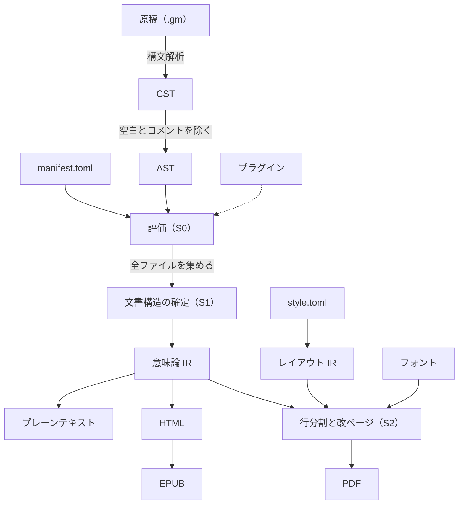
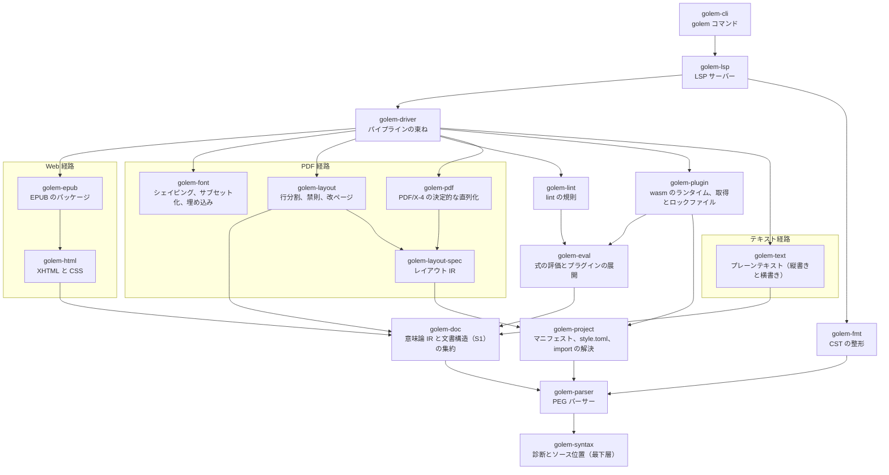

# Golem 仕様書

Golem は CLI で動作する統合組版システムである。
原稿とレイアウトの両方をプレーンテキストで表現し、書籍の組版にバージョン管理と CI/CD を持ち込む。
実装言語は Haskell とする。

この文書は Golem の能力、ユーザーに強いるワークフロー、意図的に採用しなかったもの、モジュール構成の四つを定める。
言語仕様は `markup.md` に置く。
各モジュールの仕様書は `docs/<モジュール名>/specifications.md` に、そのモジュールの設計決定と実装ステップは同じディレクトリの `adr/` に連番の ADR として置く。
特定のモジュールに属さない横断的な決定は `docs/adr/` に置く。
ADR はコミット後、ステータスの行を除いて変更しない。
ADR は、行頭が `ステータス:` のステータスの行をちょうど一つ持つ（[docs/adr/0011](adr/0011-update-adr-guard-to-v0.8.0.md)）。
監査の記録（`docs/audit/`、`docs/audits/`）と性能計測の記録（`docs/benchmarks/`、`docs/benchmark/`）も、コミット後は変更しない（[docs/adr/0011](adr/0011-update-adr-guard-to-v0.8.0.md)、[docs/adr/0012](adr/0012-update-adr-guard-to-v0.8.1.md)）。
この文書には実装の詳細を書かない。

## 目的

Golem が目指すのは、CLI で動き CI/CD に載る InDesign である。
LaTeX の再実装ではない。
InDesign の本質は、内容とレイアウトが分離され、レイアウトが第一級の対象として操作、再利用、バージョン管理できることにある。
Golem はこの性質をプレーンテキストの上で実現する。

### 解決する問題

- **Markdown**：フローレイアウト用であり、書籍組版に必要な語彙（ページ、フレーム、ルビ、禁則、改ページ制約）を持たない。
- **TeX / LaTeX**：テキスト置換マクロの上に構築されており、エラー位置の崩壊と場当たりなエスケープ規則を構造的に抱える。
- **InDesign**：GUI 操作の産物であり、同じ入力から同じ出力が再現される保証がなく、CI に載らない。

### 成果物

同一の原稿から次の四つを生成する。

- 商業入稿に耐える印刷用 PDF（PDF/X-4、ISO 15930-7:2010）
- EPUB
- HTML
- プレーンテキスト（縦書きと横書きの二変種。横書きはブログ等への転載用）

PDF/X-4 への準拠は、Golem が生成しうる要素についての自前の検査と、qpdf による構造の検査で確かめる。
PDF/X-4 の適合を判定できる自由な検証ツールがないためであり、入稿前の最終確認は利用者が商用のプリフライトで行う（[golem-pdf ADR 0003](golem-pdf/adr/0003-pdf-x-4-validator.md)）。

これらは完全に同じ見た目にはならないし、それを目指さない。
かわりに次の**媒体契約**を不変条件として固定する。
意味内容は全媒体で同一とする。
提示と、ページという概念に由来する派生物（ページ番号、柱[^running-head]、脚注の配置、相互参照の実現形）は媒体ごとに分岐する。

## 処理の流れ

この文書の各節が前提にする処理の流れと、その中心となる語をここで定める。
ほかの語は、用語集（[glossary.md](glossary.md)）にまとめている。

Golem が扱う単位は**プロジェクト**である。
プロジェクトは、本の構成を書く**マニフェスト**（`manifest.toml`。章の順、メタデータ、出力する形式）、スタイルとレイアウトを定義する `style.toml`、原稿のファイル（`.gm`）、図版、フォントから成る。

原稿は、次の図の順に処理される。



各段階は、次のことを行う。

1. 原稿を構文解析し、**CST**（具象構文木）を作る。CST は空白とコメントまで含めて原稿を失わずに保持し、整形と LSP が使う。
2. CST から空白、コメント、エスケープを取り除き、意味だけを残した **AST**（抽象構文木）を作る。
3. AST を評価し、**意味論 IR** を作る。意味論 IR は、式やコマンドの評価が済んだ文書の表現であり、位置や大きさの情報を持たない。すべての出力はここから分かれる。
4. Web 経路（HTML、EPUB）とテキスト経路は、意味論 IR をそのまま出力の形式に写す。
5. PDF 経路は、`style.toml` から作る**レイアウト IR**（版面[^type-area]、フレーム、マスターページ[^master]などの幾何の定義）を意味論 IR と合わせ、行分割と改ページを行ってから PDF を書く。

評価で決まる値は、決まる時期によって三つの段階に分かれる。
**S0** は一つのファイルの中で決まる値、**S1** は全ファイルを集めて初めて決まる文書構造（目次や章番号）、**S2** はレイアウトの後に決まるページ番号である。
詳細は「目次と文書構造の参照」の節で定める。

どの段階で見つかった誤りも、原稿の位置と符号を付けた**診断**として報告する。

## Golem が強いるワークフロー

原稿、マニフェスト、スタイルとレイアウトの定義（`style.toml`）のすべてをリポジトリで管理し、push のたびに CI が成果物をビルドする。
このワークフローが成立する根拠は出力の**決定性**にある。
同じ入力からバイト単位で同じ PDF が生成されるとき、そしてそのときに限り、出力の差分は変更の影響と一致する。

決定性が可能にするのはビジュアルリグレッションテストである。
スタイル定義を一箇所変えたとき、数百ページの中で崩れたページだけが差分として検出される。
GUI の組版ツールでは人間が全ページを目視するしかなく、この安全網は原理的に持てない。
ページ画像の差分を取る仕組みは、Golem 自身には持たせず外部のツールを使う。
Golem の責務は、差分が意味を持つ決定的な出力を作るところまでである。
差分の仕組みを自前で持つ可能性はあるが、GUI を作るよりあとになる。
Golem が既存ツールに対して構造的に優位に立てるのはこの一点であり、決定性は他のあらゆる設計判断に優先するハード制約である。

著者や編集者への恩恵は副次的に得られる。
CI が生成した最新のゲラを URL で共有すれば、関係者は常に現在の状態を参照できる。

## 意図的に採用しなかったもの

以下は検討の上で落とした。
それぞれの根拠は対応する ADR に記録する。

- **DVI 出力**：DVI のフォントモデルは OpenType のグリフの置換と配置（GSUB と GPOS）を表現できず、モダンな組版と両立しない。PDF を直接生成する。
- **Markdown のインライン記法**：強調などのインライン要素はすべて角括弧のコマンド記法で書く。行指向の軽量記法はブロック層（見出し、リスト、定義リスト）に限って残す。
- **マクロ**：構文 `[!` の予約のみ行い、実装しない。導入する場合も hygienic な AST 変換[^hygienic]に限り、テキスト置換型は採らない。
- **スポットカラー**：v1 はプロセスカラーのみ。色は名前で指定し、出力インテント[^intent]（Japan Color 2001 Coated）に束縛して解決する。
- **改ページの大域の最適化**：v1 の改ページは、段落の行分割のような大域の最適化をせず、先頭から順に詰める方式とする。見開きの単位の最適化と段の高さの調整も行わない。いずれも v2 以降で扱う。
- **雑誌級のレイアウトエンジン**：レイアウト IR はフレーム間制約（レベル 3）[^frame-levels]まで表現できる型を持つが、v1 のエンジンは単一フローと除外領域（レベル 1、図版の回り込み）のみ実装する。エンジンは未実装の制約に遭遇したらエラーで停止し、黙って無視しない。
- **ユーザー定義の lint / fmt ルールと lint の抑制**：ルールは処理系が固定し、個別の箇所で警告を止める手段も持たない。ユーザー拡張を許すと、ルールの妥当性をめぐる合意コストが処理系の外に漏れ出すためである。
- **数式の組版**：v1 では扱わず、v2 以降に回す。EPUB と HTML は MathML で出せるが、PDF には数式の組版エンジンが必要であり、それだけで独立した大きな仕事になるためである。当面は、数式を画像にして図版として入れる。
- **ソースファイルのプリアンブル**：初期の設計にあった `--- ... ---` によるファイル先頭のメタデータは廃止した。メタデータはマニフェストに一元化する。
- **総ルビ**：全漢字への自動ルビ振りは組み込まない。将来のプラグイン（コンパイル時評価と辞書引き）に委ねる。

## 設計原則

**幾何の隔離**。
意味論 IR は幾何情報を一切持たない。
EPUB と HTML はリフローであり、位置情報が意味論に混入した時点で破綻するためである。
幾何は専用のレイアウト IR に隔離し、PDF 経路だけがそれを読む。

**広い型、狭い実装**。
型は将来の表現力まで先取りして設計し、実装は当面の用途に絞り、未使用の機能は縮退させる。
色、フレーム、内容とレイアウトの結合、行分割、マクロの五つの決定がいずれもこのパターンに従っている。

**構文解釈の安定**。
パースはコマンド表[^command-table]に依存しない。
プラグインの導入が既存文書の構文解釈を変えると、同じ入力から同じ出力という前提が崩れるためである。

## モジュール構成

モジュールの依存の関係を次に示す。
矢印は、元のモジュールが先のモジュールを使うことを表す。
golem-syntax はすべてのモジュールが使うので、golem-parser からの矢印だけを示す。
ほかの依存を通して届く依存の矢印も省いている。
PDF 経路のモジュールだけが、レイアウト IR、シェイピング[^shaping]、フォントのサブセット化[^subset]を扱う。
プラグイン[^wasm]は wasm のモジュールとして配布し、取得した配布物のハッシュをロックファイルに記録する。



処理は `parse → eval → 意味論 IR → 各バックエンド` の順に流れ、分岐点は意味論 IR である（「処理の流れ」の節を参照）。

PDF 経路と Web 経路は対称ではない。
行分割器とフォントエンジンは PDF 経路専用であり、Web 経路はリフローのため一行も使わない。
Web 経路では行分割もシェイピングも読者側のエンジンが行う。
ルビの配置は、`style.toml` の `[composition.ruby]` を CSS の `ruby-align` に写して表す（[golem-layout ADR 0009](golem-layout/adr/0009-ruby-placement.md)）。
`"1:2:1"` は `space-around`、`"0:1:0"` は `space-between`、`"center"` は `center`、`"start"` は `start` になり、モノルビの `<ruby>` には `class="mono"` を付ける。
隣の文字へのかけは、CSS で作者が指定できないので表さず、読者の環境に任せる。

HTML と EPUB は並列のバックエンドではなく親子である。
EPUB の実体は XHTML+CSS にパッケージングを加えたものなので、共通のシリアライザの上に薄い層として EPUB を載せる。

テキスト経路は、意味論 IR からテキストノード（見出しと本文）を抽出するだけの最軽量のバックエンドである。
ルビは「漢字（かんじ）」のように全角丸括弧で読みを併記し、圏点、強調、色は出力しない。
数の表記は縦書き版で漢数字、横書き版で算用数字に解決する。

レイアウト IR は意味論 IR と並ぶ第二の入力であり、これも版管理の対象である。
結合は内容主導を基本とし、レイアウト側から内容ストリームを参照する逆向きの結合点を型として用意する（CLI 用途では縮退する）。

モジュール間のインターフェースは、実装に先立って ADR で定め、モジュールを並行して実装できるようにする。
ADR は下の層から順に作る（ソース位置と診断、CST と AST、意味論 IR、style.toml とレイアウト IR、レイアウトの出力とフォント処理と PDF の直列化）。
ADR はコミット後に変更できないので、上の層を先に固めると、下の層の変更に追随できなくなるためである。

意味論 IR の正典は CDDL[^cddl] で記述する。
プラグインとの ABI[^abi] も同じ CDDL を使い、Haskell の型は CDDL との往復のテストで一致を保証する。
意味論 IR とプラグインの ABI を別々に定義すると、二つが次第にずれていくためである。

Golem のパーサーは PEG で記述する。
汎用 PEG ライブラリ自体は別リポジトリで開発し、本リポジトリのスコープ外とする。

## プロジェクトの構成と import

一冊の本は、複数のソースファイルと、プロジェクトルートに置くマニフェスト `manifest.toml` から成る。
ファイルをまたぐ操作には、性質の違う二つがある。
一つは章を並べて一冊にする内容の合成であり、順序に意味があり、取り込んだ内容は出力に現れる。
もう一つは共通の変数を使えるようにする定義の取り込みであり、出力には何も現れない。
Golem はこの二つを別の仕組みで扱う。

スタイルとレイアウトの定義は、プロジェクトルートの `style.toml` に書く（「style.toml」の節を参照）。

内容の合成はマニフェストに書く。
どの章ファイルをどの順で並べるかはマニフェストの章の配列で表し、章をさらにファイルに分ける場合は配列を入れ子にする。
章の配列の各項目には、そのファイルに使うマスターページを指定できる（例：`{ file = "chapters/01.gm", master = "body" }`）。
ソースファイルが別のソースファイルの内容を取り込む記法は持たない。
このため内容の循環は構造上起こりえず、各ソースファイルは単独で検査、コンパイルできる単位になる。
この単位は、インクリメンタルコンパイル、章単位の並列ビルド、LSP の基礎になる。
コードリストのような Golem 以外のファイルは、内容の合成ではなく専用のコマンドで取り込む。

マニフェストは、本の構成に加えて、出力ターゲット（PDF、EPUB、HTML、プレーンテキスト）ごとの設定（ISBN、プレーンテキストの縦書きと横書き）を持つ。
`golem build` は、`--target` で絞らなければ四つのターゲットをすべて生成する（[golem-cli ADR 0002](golem-cli/adr/0002-build-all-targets-by-default.md)）。
プレーンテキストの設定がなければ、縦書きと横書きの両方を生成する。
使うプラグインは人がマニフェストに宣言し、配布物のハッシュは処理系がロックファイル `plugins.lock` に書き出す。
ロックファイルは手で編集せず、リポジトリにコミットする。
同じ入力から同じ出力を得るには、使うプラグインのバイト列まで入力の一部として固定する必要があるためである。
宣言の形式と取得の手順は「プラグイン」の節で定める。

定義の取り込みはソースファイルに `@import` で書く。
v1 で取り込めるのは `@set` で定義した変数だけである。
名前色やスタイルは `style.toml` に置き、`@import` では扱わない。

```
@import common/values.gm as values
```

取り込んだ定義は `as` で付けた名前空間を通してのみ参照できる（例：`[= values.price]`）。
名前空間を付けずに定義を展開する取り込みは認めない。

import には次の規則を適用する。

- **解決の段階**：import は AST の段階で解決し、テキストとして展開しない。診断のソース位置をファイルごとに保つためである。
- **循環**：評価に先立って import のグラフを作り、循環があればコンパイルエラーとする。エラーには循環の全経路と各 import 文の位置を示す。自分自身の import は長さ 1 の循環として扱う。
- **ファイルの同一性**：ファイルはプロジェクトルートからの正規化パスで同一性を判定する。書き方の違い、大文字と小文字の違い、シンボリックリンクによって同じファイルが別物と扱われると、循環の検出漏れや二重評価が起きるためである。
- **参照できる範囲**：プロジェクトルートの外、絶対パス、URL は import できない。外部のコードはプラグインの配布機構を通してのみ取り込む。決定性と隔離のためである。
- **共通の依存**：複数のファイルが同じファイルを import した場合、そのファイルは一度だけ評価し、結果を共有する。評価は純粋なので、結果は正規化パスをキーに再利用できる。

名前のスコープは二種類ある。
`@set` で定義した変数はファイル単位で有効であり、他のファイルからは import による名前空間を通してのみ見える。
一方、相互参照のラベル（章、節、図などへの参照先）は文書全体で一つの名前空間を持つ。
ページ番号への参照や目次は、ファイルをまたいで参照先を解決する必要があるためである。
ラベルの重複はコンパイルエラーとする。

## メタデータ

書名、著者、発行日などのメタデータは、マニフェストの `[metadata]` に書く。
メタデータは意味内容の一部なので、媒体契約に従い全媒体で同一とする。
処理系はこれを各ターゲットの形式（PDF の XMP、EPUB のパッケージ文書、HTML の meta 要素）に写像する。

```toml
[metadata]
id = "urn:uuid:3f6c..."
title = "Golem 入門"
title-reading = "ゴーレムにゅうもん"
language = "ja"
date = 2026-10-11
edition = "1.0"
publisher = "..."

[[metadata.creators]]
name = "山田 太郎"
reading = "やまだ たろう"
role = "aut"

[targets.pdf]
isbn = "978-..."

[targets.epub]
isbn = "978-..."
```

`id` は本の識別子であり、必須とする。
プロジェクトを作るときに一度だけ生成し、以後は変えない。
著者の役割（`role`）には、EPUB と共通の語彙である MARC relator の符号を使う。
書名と著者の読み（`title-reading`、`reading`）は任意の項目であり、EPUB では電子書店での並べ替えや検索に使われる。

媒体ごとに異なるのは ISBN などの識別子だけであり、これはターゲットの節に書く。
紙の本と電子書籍では ISBN が別の番号になるためである。

### 日時

成果物に書き込む日時（PDF の作成日時と更新日時、XMP の日時、EPUB の更新日時など）は、すべてマニフェストの `date` から作る。
ビルドした時刻は使わない。
環境変数 `SOURCE_DATE_EPOCH` も読まない。
日時の情報源をリポジトリの中の一箇所に限ることで、同じ入力から同じバイト列を得るためである。
日時は、著者が版を改めるときに `date` を書き換えることで更新する。

### 識別子

成果物に書き込む識別子は、乱数を使わずすべて導出する。

- **文書 ID**（XMP の DocumentID と PDF のトレーラー `/ID` の第一要素）：マニフェストの `id` から名前ベースの UUID（v5）で導出する。文書 ID は同じ文書の版をまたいで変わらない値なので、本の識別子から作る。
- **インスタンス ID**（XMP の InstanceID と `/ID` の第二要素）：入力全体のハッシュから導出する。入力全体とは、全ソースファイル、マニフェスト、`style.toml`、`plugins.lock`、使ったフォントのバイト列、出力を変える CLI のオプション（`--marks` と `--profile`）、Golem の版である。`style.toml` はマニフェストの直後に置き、ないときは空のバイト列とする。CLI のオプションは、ソースファイルの後に `options marks=<値> profile=<値>` の形の一つの要素として置き、既定の値も省かない（[golem-pdf ADR 0004](golem-pdf/adr/0004-crop-marks-and-bleed.md)）。Golem の版は `golem-` に `VERSION` の内容を続けた文字列とし、入力の末尾に加える（[docs/adr/0004](adr/0004-binary-distribution-and-release.md)）。
- **EPUB の識別子**：電子版の ISBN があればそれを使い、なければマニフェストの `id` を使う。

シェイピングとフォントの処理に使う HarfBuzz と FreeType、プラグインの実行に使う wasmtime、PDF の圧縮に使う zlib は版を固定する。
これらの版が変わるとグリフの配置が変わり、同じ入力から同じ出力が得られなくなるためである。
使っている版は README に記載し、版を上げるときは ADR を作成する。

式の評価、とくに浮動小数点数の計算は、x86-64 と aarch64 の両方の CI でテストし、結果が一致することを確かめる。

出力は、ファイルの入力、Golem の版、出力を変える CLI のオプション（`--marks` と `--profile`）だけで決まる（[golem-pdf ADR 0004](golem-pdf/adr/0004-crop-marks-and-bleed.md)）。
CLI のオプションは呼び出しに明示されるので、同じオプションで呼べば CI と手元で同じ出力が得られる。
今後 CLI に出力を変えるオプションを加えるときは、インスタンス ID の入力に加える。

v1 で決定性を保証するのは PDF、HTML、プレーンテキストである。
EPUB はパッケージである zip の中に時刻や並び順の揺れを含みうるので、EPUB の決定性は v2 で扱う。

PDF の Producer には Golem の版を書く。
Producer は `Golem ` に `VERSION` の内容を続けた文字列（例：`Golem 0.1.0-rc1`）とし、文書情報辞書の `Producer` と XMP の `pdf:Producer` の両方に書く（[golem-pdf ADR 0005](golem-pdf/adr/0005-producer.md)）。
Git のコミットやビルドの環境は含めない。
このため Golem を更新すると出力のバイト列は変わるが、処理系も入力の一部なので決定性には反しない。

### 本文からの参照

メタデータは、式文脈[^contexts]から読み取り専用の名前空間 `meta` で参照できる（例：`[= meta.title]`）。
奥付のように、メタデータを本文に並べるページをマニフェストと二重に書かずに済ませるためである。
メタデータはマニフェストだけで決まり評価の前に確定しているので、`meta` はファイル内評価（S0）の値であり、見出しの中でも使える。
`meta` は `doc` と同じく予約語であり、import の名前空間には使えない。

## 目次と文書構造の参照

目次には二つの側面がある。
一つは出力される目次であり、媒体ごとに形が変わる。
PDF では章題とページ番号の一覧、EPUB では必須のナビゲーション文書とリンク、HTML ではリンクの一覧、プレーンテキストでは章題の一覧になる。
もう一つはデータとしての目次であり、本文中で別の章の題や番号を参照したり、柱に章題を出したりするのに使う。

データとしての目次は全章の見出しを集めないと決まらないが、見出し自体も式を含みうる。
見出しが目次の値（章の数など）を参照すると、見出しを集めた結果に見出しが依存する循環が生じる。
これを防ぐため、評価を三つの階層に分け、各階層の値は下の階層の値にだけ依存できるとする。

- **S0 ファイル内評価**：変数、import した定義、見出しの文字列。そのファイルと import 先だけで決まる。
- **S1 文書構造**：目次、章番号、ラベルから引く章題と番号。全ファイルの S0 の結果から決まる。
- **S2 レイアウト後**：ページ番号（DeferredRef）。レイアウトの結果から決まる。

見出しは S1 の入力なので、S0 だけで評価できなければならない。
見出しの中で S1 または S2 の値を参照した場合はコンパイルエラーとする。
S0 はソースファイルごとに独立して評価し、S1 は各ファイルが出す見出しの索引を集めて決める。
このためソースファイルの独立性は保たれ、見出しの索引が変わったときだけ、その値を参照するファイルを評価し直せばよい。

見出しなどのブロックには、直前の行のブロックコマンド[^block-command]でラベルを付ける。

```
@label intro
# はじめに

詳しくは第[ref-number intro]章「[ref-title intro]」を参照。
```

`@label` は直後のブロックに付き、直後にブロックがない場合はコンパイルエラーとする。
ラベルや見出しの属性を指定するブロックコマンドが連続した場合は、それらがまとめて次のブロックに付く。
章を参照するときは、題名ではなくラベルで指す。
題名を識別子にすると、題を直すたびに参照が壊れるためである。

ページ番号への参照は、テキストではなく表記の決まっていない数（Number）に解決する。
ページ番号も数なので、縦書きと横書きでの表記の使い分けをほかの数と同じ経路で行う。
このとき、ページ番号の表記の幅が行の幅を変え、それが改ページを変え、改ページがページ番号を変えるという循環が生じうる。
そこでレイアウトを、ページ番号が変わらなくなるまで繰り返す。
上限の回数までに収束しなければコンパイルエラーとする。
繰り返しの過程は入力だけで決まるので、決定性は保たれる。

日常的な参照は `[ref-number ...]`、`[ref-title ...]` のようなコマンドで書く。
計算に使う場合は、予約された読み取り専用の名前空間 `doc` を式文脈から参照する（例：`[= doc.chapters.count]`）。
`doc` は予約語であり、import の名前空間には使えない。

見出しには次の属性を付けられる。
属性もラベルと同じく、見出しの直前の行のブロックコマンドで指定する。

- **短い題**：目次と柱には、本文の見出しより短い題を使えるようにする。指定がない場合は見出しの題を使う。
- **番号の指定**：その見出しの番号を明示する。
- **番号からの除外**：序文やあとがきのように、章番号を振らない見出しを指定する。
- **目次からの除外**：目次に載せない見出しを指定する。

見出しの番号は 1 から始まり、番号を指定しない見出しは直前の番号に 1 を加えた番号になる。
番号を指定した見出しのあとは、その番号から数え続ける。
番号からの除外を指定した見出しは、番号を消費しない。

番号の表記（「第 1 章」か「1.」か）はスタイルで決める。
見出しの文字列は自由に付けてよく、処理系は文字列の中身を検査しない。

目次は見出しが自動で送られるチャネルであり（「チャネル」の節を参照）、出力する位置はブロックコマンド `@toc` で指定し、載せる見出しの深さは引数で指定する（例：`@toc depth=2`）。
目次ページは、マニフェストに並べた前付けのファイルに書く。
v1 では `@toc` は文書に一つだけとし、章ごとの小目次は扱わない。

PDF の目次は、章題とページ番号の一覧である（[golem-driver ADR 0009](golem-driver/adr/0009-pdf-toc-page-numbers.md)）。
項目は、番号、全角の空白、短い題を本文の役割と版面の文字の大きさ fs で組み、階層 l の項目はすべての行を (l − 1) 字下げする。
行の終わりの側には、ページ番号のための幅 R を予約し、項目のすべての行を行長から字下げと R を引いた長さで組む。
R は、ページ番号 999 を項目と同じ環境で組んだ幅 W に、二字分を足した幅である。
ページ番号は、項目の最後の行に、行の終わり（横組みでは版面の右端、縦組みでは版面の下端）にそろえて置く。
題の終わりとページ番号のあいだは、二分の空きを両側に取り、三点リーダー（…）を並べたリーダーで埋める。
リーダーの終わりは、ページ番号が W に収まる限り、どの項目でも同じ位置になるので、上下（縦組みでは左右）の項目の点がそろう。
`style.toml` の `[toc]` の `leader` を `"none"` にすると、リーダーを描かず、ページ番号の位置はそのままにする。
ページ番号はほかの数と同じく `Number` として組み、横組みでは算用数字、縦組みでは `[numbers]` の `vertical` の表記になる。
数はページの通し番号であり、ノンブルの書式は使わない。

目次の行分割は、題、番号、版面の寸法と予約の幅だけで決まり、実際のページ番号によらない。
そのため、目次のページ番号が目次の行数とページ数を変えることはなく、後ろのページの番号も動かさない。
見出しのページは、S2 の繰り返しが収束した後に、最終回のページから一度だけ求める。
HTML、EPUB、プレーンテキストの目次は、ページを持たないので、リンクの一覧と題の一覧のままである。

## style.toml

`style.toml` は、本文中で「スタイルで決める」とした事項（見出しの番号の表記、注の配置、強調の表現、数の表記など）と、レイアウト IR（判型、版面、マスターページ、フレーム、書字方向）、フォント、色のスウォッチ[^swatch]を持つ。
`style.toml` は一つのファイルであり、v1 ではほかのファイルを取り込む機能を持たない。

```toml
[page]
size = "B6"
binding = "right"
writing-mode = "vertical"
bleed = "3mm"

[page.grid]
font-size = "13Q"
characters = 42
lines = 16
line-pitch = "22H"
columns = 1
column-gap = "2zw"
position = { top = "18mm", gutter = "20mm" }

[fonts.body]
ja = "fonts/NotoSerifJP-Regular.otf"
latin = "fonts/SourceSerif4-Regular.otf"
features = ["palt"]

[fonts.heading]
ja = "fonts/NotoSansJP-Bold.otf"
latin = "fonts/SourceSans3-Bold.otf"

[character-styles.term]
font = "heading"
color = "accent"

[paragraph-styles.body]
first-line-indent = "1zw"

[paragraph-styles.quote]
font = "heading"
size = "0.9zw"
space-between = 1
indent = "2zw"

[paragraph-styles.verse]
indent = "2zw"
first-line-indent = "-2zw"

[paragraph-styles.caption]
size = "11Q"

[paragraph-styles.sidenote]
font = "body"
size = "11Q"

[headings.1]
font = "heading"
size = "20Q"
number = "第{n:kanji}章"
page-break = "recto"
running-head = true

[headings.2]
number = "{1}.{n}"

[composition]
kinsoku = "strict"
hanging-punctuation = true
kenten = "sesame"
tolerance = 200
protrusion = true
expansion = { limit = 20, step = 5 }
explicit-hyphen-penalty = 50

[composition.ruby]
mono-align = "center"
group-align = "1:2:1"
base-spacing = "1:2:1"
overhang = "0.5zw"
overhang-onto = "kana"

[numbers]
vertical = "kanji"

[notes]
placement = "page-foot"

[sidenotes]
side = "outside"
width = "14zw"
gap = "2zw"
marker = "number"

[figures]
number = "図{chapter}-{n}"

[toc]
leader = "dots"

[color]
intent = "icc/JapanColor2001Coated.icc"

[color.swatches]
accent = { cmyk = [0, 80, 100, 0] }

[masters.body]
running-head = { position = "top-outside", content = "heading.1.short" }
folio = { position = "bottom-outside", format = "{n}" }
```

版面は、日本語組版の流儀に従い、文字の大きさ、一行の字数、一ページの行数、行送り、段数で定義する。
余白は、版面をページのどこに置くかから決まる従属的な値である。
字数と行数を整数で決めることで、行頭と行末が字送りの格子にそろう。

寸法は `mm`、`pt`、`Q`（級）、`H`（歯）、`zw`（全角一字分）の単位を付けた文字列で書き、処理系の内部では整数の sp に変換する。

`[page]` の `bleed` は塗り足し[^bleed]の幅であり、既定は `0mm` である（[golem-pdf ADR 0004](golem-pdf/adr/0004-crop-marks-and-bleed.md)）。
塗り足しは文字の大きさに依存しない長さなので、`zw` で書くとエラー（G0306）とする。
塗り足しがあれば、PDF の MediaBox と BleedBox は仕上がりの判型の外側に塗り足しの幅だけ広がり、TrimBox が仕上がりの判型になる。
トンボ[^cropmarks]の有無と形は `style.toml` ではなく、`golem build` の `--marks` で選ぶ（CLI の節を参照）。
塗り足しは `--marks none` でも効くので、トンボを付けずに塗り足しだけを含めた PDF も作れる。
v1 には版面の外に描くものがないので、塗り足しの領域は空のままになる。
EPUB と HTML は `bleed` を無視する。

未知のキーはエラーとする。
綴りを誤った設定が黙って無視されると、その誤りは出力の見た目の劣化としてしか現れないためである。
同じ理由で、見出しの `font` が `[fonts]` にない役割を指す場合もエラー（G0308）とする（[golem-driver ADR 0003](golem-driver/adr/0003-pdf-heading-styles.md)）。

`style.toml` が指すファイル（`[fonts]` のフォントと、`[color]` の `intent` の ICC プロファイル）の存在は、`style.toml` を読むときには検査しない。
ファイルの存在は、そのファイルを使うターゲットのビルドと `golem check` でだけ検査する（[golem-project ADR 0004](golem-project/adr/0004-font-file-check-per-target.md)）。
PDF は、使う役割のフォントのファイルがなければ G0802、ICC プロファイルがなければ G0806 のエラーとし、PDF を書かない。
HTML と EPUB は、欠けたフォントを同梱せず、`@font-face` も書かずに出力し、G0310 を報告する。
ブラウザーは `font-family` の並びの残りで組むので、出力は読める。
G0310 は dev のプロファイルでは警告、prod のプロファイルではエラーであり、prod では HTML と EPUB を書かない。
プレーンテキストはファイルを検査しない。
絶対パス、URL、プロジェクトルートの外を指すパスも、存在しないファイルと同じコードで報告する。
診断の位置は `style.toml` の先頭とし、同じコードと同じパスの診断は一つだけ出す。
LSP と `golem lint` はファイルを検査しないので、フォントを置く前でも原稿の診断を出す。

文字の見た目は文字スタイル（`[character-styles.<名前>]`）、段落の見た目は段落スタイル（`[paragraph-styles.<名前>]`）にまとめる（[docs/adr/0005](adr/0005-character-and-paragraph-styles.md)）。
考え方は Adobe InDesign の文字スタイルと段落スタイルに合わせ、スタイルは `based-on` で別のスタイルを引き継ぐ。
スタイルの定義は、`based-on` をたどった鎖の根から順に、子のキーが親のキーを上書きして決める。
スタイルの名前は、英小文字で始まり、英小文字、数字、`-` だけからなる。

文字スタイルのキーは `based-on`、`font`（フォントの役割）、`size`、`color`（スウォッチの名前）、`synthetic-bold`、`synthetic-italic` である。
`font` の役割は、役割が持つ側（和文か欧文）の文字だけをその役割で組み、持たない側の文字は外側の書体のまま組む。
`synthetic-bold` が真なら、`font` の役割が持たない側の文字を合成の太字（輪郭を線で太らせる）にし、`font` がなければ両側を太らせる。
PDF の合成の太字の線の幅は、和文で文字の大きさの 1/80、欧文で 1/60 とする（[golem-driver ADR 0012](golem-driver/adr/0012-synthetic-bold-weight.md)）。
和文は画が多くすきまが狭いので、欧文と同じ幅ではふところが埋まるためである。
太字らしい太さが要る場合は、`[character-styles.bold]` の `font` で太字の書体を指定する。
`synthetic-italic` も同じ規則で合成の斜体（字形を傾ける）をかける。
和文の書体は一般に斜体を持たないので、和文の斜体は字形がゆがむが、強調が黙って消えることを避けるために傾ける。
文字スタイルの `size` は、PDF でその文字を組む大きさになり、`zw` は外側の文字の大きさを一字とする。

組み込みの文字スタイルは `bold`（`synthetic-bold = true`）、`italic`（`synthetic-italic = true`）、`strong`（`based-on = "bold"`）の三つである。
原稿の `[strong: ...]`、`[bold: ...]`、`[italic: ...]` は、これらを付ける `[style 名前: ...]` の別名である。
利用者が組み込みと同じ名前の表を書くと、書いたキーだけが組み込みの定義の同じキーを上書きする。
`[character-styles.bold] font = "gothic"` は、太字の書体を `gothic` の役割にする。
`[character-styles.strong] based-on = "italic"` は、`[strong: ...]` を斜体で表す。

段落スタイルのキーは `based-on`（書かなければ `body`）、`font`、`size`、`line-breaks`（`"join"` か `"keep"`）、`space-between`（同じ段落スタイルの段落が続くときに空ける行の数）である。
段落スタイルの `size` の `zw` は版面の文字の大きさを一字とし、版面の文字の大きさを超える値はエラー（G0311）とする。
行送りの欄は設けない。
PDF の本文を行の格子に載せるので、段落ごとに行送りを変えると見開きの行の位置がそろわなくなるためである。
組み込みの段落スタイルは `body`、`verse`（`line-breaks = "keep"`、`space-between = 1`）、`caption`、`sidenote` の四つであり、段落スタイルを付けない段落は `body` で組む。
図版のキャプションは段落スタイル `caption` の `font` と `size` で組み、ほかの欄（`line-breaks`、`space-between`、字下げ）はキャプションには効かない（[golem-driver ADR 0010](golem-driver/adr/0010-caption-style.md)）。
傍注の本文も同じく、段落スタイル `sidenote` の `font` と `size` で組む（[golem-driver ADR 0011](golem-driver/adr/0011-sidenote-font.md)）。
これらの欄は `@style caption` や `@style sidenote` を付けた原稿の段落には効く。
HTML と EPUB でも、`caption` の `font` と `size` を `figcaption` の CSS に、`sidenote` の `font` と `size` を `.sidenote` の CSS に書く。
`sidenote` の `size` がなければ、HTML の傍注は本文の 0.85 倍の大きさにする。
`size` が絶対の大きさで `[page.grid]` の `font-size` も絶対の大きさなら、その比を `em` で書き、`[page.grid]` がなければ `pt` で書く。

段落スタイルの `indent` はすべての行の始まりの字下げ（InDesign の左インデント）、`first-line-indent` は最初の行に `indent` へ加える量（1 行目左インデント）であり、負ならぶら下げになる（[docs/adr/0006](adr/0006-paragraph-indent.md)）。
どちらも行の始まりの側から測るので、縦組みでは天からの距離になる。
`zw` は段落の文字の大きさを一字とする。
`indent` と `first-line-indent` の和が負になる段落スタイルはエラー（G0312）、字下げの後の行長が段落の文字の大きさの 8 字分に満たない段落スタイルは PDF でエラー（G0725）とする。
`line-breaks = "keep"` の段落では、改行で区切った各行が段落の始まりと同じく最初の行の字下げを受け、折り返した部分は `indent` の位置から始まる。
組み込みの `verse` は `indent = "2zw"`、`first-line-indent = "-2zw"` で、各行の折り返した部分をぶら下げる。
字下げは、文書の最上位の段落、`@style` の本体の段落、定義リストの説明の段落に効き、リストの項目の中の段落と、図版のキャプション、脚注と傍注の本文、表、見出し、目次、索引、参考文献には効かない。

字下げの既定は 0 である。
既定で一字下げると、段落の先頭に全角の空白を書いた既存の原稿が二字下がるためである。
`[paragraph-styles.body] first-line-indent = "1zw"` のように字下げを指定する場合は、原稿の先頭の全角の空白を消す。
全角の空白と併用すると二重に下がり、処理系はそれを指摘しない。
プレーンテキストでは、`indent` と `first-line-indent` がどちらも `zw` で書かれている場合に限り、和の整数部の数の全角の空白を段落の各行の先頭に置く。

文字スタイルと段落スタイルの `font` が `[fonts]` にない役割を指す場合も G0308 とする。
`based-on` が存在しないスタイルを指す場合、循環する場合、`body` に `based-on` がある場合、文字スタイルの `color` が `[color.swatches]` にない場合はエラー（G0313）とする。
廃止した `[emphasis]`、`[verse]`、`[sidenotes]` の `font` と `size` はエラー（G0306）とし、メッセージで書き換え先を示す。
`[verse]` の `indent = I`、`hang = H` は、`[paragraph-styles.verse]` の `indent = I + H`、`first-line-indent = -H` に書き換える。

HTML と EPUB では、組み込みの文字スタイルを `strong`、`b`、`i` の要素に、ほかの文字スタイルを `cs-名前` の class に、段落スタイルを `ps-名前` の class に対応させる。
文字スタイルの `font`、合成の太字と斜体、`color`、段落スタイルの `font`、行の字下げ、`space-between` を CSS に書き、`size` はキャプションと傍注のほかは CSS に書かない。

PDF では、見出しを `[headings.<階層>]` の `font` の役割の書体と `size` の大きさで組む。
`font` を省けば本文の役割、`size` を省けば版面の文字の大きさになる。
本文より大きい見出しは、行の格子からずらさずに置く（行取り）。
見出しの行送りは、本文の行送りと文字の大きさの比を保った値とする。
見出しは、その全体を収める最も少ない数の格子の行を占め、その領域の中央に置く。
見出しの大きさが版面の文字の大きさと同じなら、見出しの各行は本文と同じ格子の位置に来る。
見出しはページをまたいで分けず、一ページの行数を超える見出しはエラー（G0724）とする（[golem-driver ADR 0003](golem-driver/adr/0003-pdf-heading-styles.md)）。

EPUB と HTML は `style.toml` の一部（フォント、文字スタイル、段落スタイル、色、番号の表記）だけを使い、版面とマスターページは無視する。
色は印刷用の値を sRGB に近似して使う。
CSS を直接書く欄は設けない。
CSS を書けると、媒体契約の外で見た目を変える抜け道になるためである。

`[composition.ruby]` は、ルビの配置を決める（[golem-layout ADR 0009](golem-layout/adr/0009-ruby-placement.md)）。
原稿でセグメントを `/` で分けたルビと、一字の親文字に振るルビはモノルビ、一つのセグメントで二字以上の親文字に振るルビはグループルビとする。
五つの欄はどれも省くことができ、既定値は JLReq が一般的な処理として示す組み方である。

| 欄 | 値 | 既定値 | 意味 |
|---|---|---|---|
| `mono-align` | `"center"`、`"start"` | `"center"` | モノルビが親文字より短いときの配置。中付きか肩付きか |
| `group-align` | `"1:2:1"`、`"0:1:0"`、`"center"`、`"start"` | `"1:2:1"` | グループルビが親文字より短いときの読みの配置 |
| `base-spacing` | `"1:2:1"`、`"0:1:0"`、`"center"` | `"1:2:1"` | ルビが親文字より長いときの、親文字の字間の空け方 |
| `overhang` | 寸法 | `"0.5zw"` | 片側で隣の文字にかける量の上限。`zw` は段落の文字の大きさで数える |
| `overhang-onto` | `"kana"`、`"none"` | `"kana"` | `"kana"` は仮名にだけかけ、`"none"` はかけない |

`"1:2:1"` は字の間に等しい空きを入れ、両端にその半分を置く。
`"0:1:0"` は最初と最後の字を両端にそろえ、残りを字の間に等しく配る。
`"center"` は詰めて中央に置き、`"start"` は詰めて始まりの側にそろえる。
読みが一字のときは、`"1:2:1"` と `"0:1:0"` は `"center"` と同じ配置になる。

ルビが親文字より長いときは、はみ出す部分を両側の隣の文字に等しくかけ、残りの分だけ親文字の字間を `base-spacing` で空ける。
かけてよい隣は、圏点のない平仮名、片仮名、小書きの仮名、長音記号で、その字の送りの半分までとする。
モノルビの隣のセグメントには、その読みの空いている場所の分だけかける。
片側にかけられない場合（片側が漢字の場合など）は、どちらの側にもかけない。
行頭と行末に来たルビは、その側のかけを戻し、読みを版面の内側に収める。
寸法が負の値と、列挙にない値は G0306 とする。

`[toc]` の `leader` は、PDF の目次のリーダーを `"dots"`（既定）か `"none"` で選ぶ（[golem-driver ADR 0009](golem-driver/adr/0009-pdf-toc-page-numbers.md)）。

フレーム（レベル 2 と 3）の欄は型として定義するが、v1 では値を書くとエラーになる。

## 色

色は名前で指定する。
名前と CMYK 値の対応は、出力インテント（v1 では Japan Color 2001 Coated）に束縛して定義する。
印刷を第一の媒体とし、色を変換する場合は CMYK から RGB の方向に限る。
EPUB と HTML の色は、印刷用の色を RGB に近似したものになる。
PDF の文字の色（`[color スウォッチ: ...]`）は、スウォッチの CMYK の値をそのまま DeviceCMYK のプロセスカラーとして書き、RGB への変換も特色の色空間も使わない（[golem-driver ADR 0004](golem-driver/adr/0004-pdf-emphasis-and-character-styles.md)）。
色を指定しない文字は、色を設定せずに描く。

写真などの画像は、この規則の例外とする。
Golem は画像の色を変換せず、ICC プロファイルを付けたまま PDF に埋め込み、印刷用の色への変換は印刷所の RIP[^rip] に任せる。
PDF/X-4 はこの形の画像を許している。
プロファイルのない RGB の画像には、sRGB のプロファイルを付けて埋め込む。

## フォント

フォントはプロジェクトの中のファイルだけから読み込み、システムにインストールされたフォントは探さない。
システムのフォントは機械ごとに異なり、同じ入力から同じ出力が得られなくなるためである。

フォントは `style.toml` で役割（本文、見出し、等幅など）ごとに指定する。
各役割には、和文と欧文で別のフォントを指定できる。
和文と欧文で別のフォントを組み合わせるのは日本語組版の標準的なやり方である。
OpenType の機能（縦書き用の字形、プロポーショナルな字詰めなど）も役割ごとに指定し、縦書きの役割では縦書き用の字形を既定で有効にする。
役割より細かく書体を変えたい場合は、`style.toml` に文字スタイルを定義し、本文から適用する。

ライセンスで埋め込みが禁止されているフォントを使った場合は、エラーとする。

PDF は、本文の役割と、見出しの `font`、文字スタイルの `font`、段落スタイル（組み込みの `caption` と `sidenote` を含む）の `font` が指す役割のフォントだけを読み込む（[golem-driver ADR 0003](golem-driver/adr/0003-pdf-heading-styles.md)、[ADR 0004](golem-driver/adr/0004-pdf-emphasis-and-character-styles.md)、[docs/adr/0005](adr/0005-character-and-paragraph-styles.md)、[golem-driver ADR 0011](golem-driver/adr/0011-sidenote-font.md)）。
使わない役割のフォントのライセンスでビルドを止めないためである。
二つの役割が同じバイト列のファイルを指す場合は、一つのフォントとして一度だけ埋め込む。
バイト列が異なるのに PostScript 名が同じフォントを使う場合は、エラー（G0805）とする。

## 図版

図版はブロックコマンドで置き、キャプションを付けられる。
記法は言語仕様に定める。

- 代替テキストは必須とし、欠けていればエラーとする。EPUB のアクセシビリティの要件を満たすためである。
- 画像の形式は、v1 では PDF（ベクター）、PNG、JPEG とする。PDF の図は EPUB と HTML では表示できないので、PDF の図には Web 用の代替画像の指定を必須とする。SVG は、PDF へ変換する処理が重いので v1 では扱わない。
- 図番号は章ごとに振り、文書構造（S1）で決める。図番号は「図 3-2」のように章番号と組み合わせて使うので、章を複数のファイルに分けても章の中で番号が続く必要があるためである。
- ICC プロファイルを持たない RGB の画像は sRGB とみなし、sRGB のプロファイルを付けて埋め込む。

PDF では、図番号とキャプションを、画像の下（縦組みでは左）に、段落スタイル `caption` の `font` と `size` で組む（[golem-driver ADR 0005](golem-driver/adr/0005-pdf-wrapped-figures.md)、[golem-driver ADR 0010](golem-driver/adr/0010-caption-style.md)）。
指定がなければ本文と同じ書体と大きさになる。
本文より小さいキャプションの行は、本文の行送りと文字の大きさの比を保った行送りで送り、画像の直後の行の格子の先頭にそろえて置く。
キャプションは、その全体を収める最も少ない数の格子の行を占め、余りはキャプションの後ろに回る。
画像の行と、キャプションが占める格子の行は行の格子に載せ、図版の後の本文も格子からずらさない。
回り込ませる図版の除外領域の深さは、キャプションの実際の終わりまでとする。
回り込ませない図版の幅は版面の行長とし、回り込ませる図版の幅は `width` とする。
回り込ませる図版は、画像とキャプションを含む矩形に `[figures]` の `wrap-gap` を足した除外領域を作り、その脇の行を除外領域の分だけ短く組む[^line-length]。
脇の行は図版の直後の段落に限り、見出しなどの段落でないブロックが来たら、除外領域の残りを空けたまま、その後から組む。
図版がページの残りに収まらない場合は、脇の行とともに次のページの先頭に送り、前のページの残りは空白にする。
`width` が寸法として読めない場合と、脇の行の長さが本文の文字の大きさの 8 字分に満たない場合はエラー（G0722）、除外領域が一ページの行数を超える場合はエラー（G0723）とする。

## 表

表の記法は言語仕様に定める。
HTML と EPUB は表を `<table>` として出力し、列の幅と罫線は読者側のエンジンに任せる。

PDF では、表を行の格子の上に組む（[golem-driver ADR 0008](golem-driver/adr/0008-pdf-tables.md)）。

- セルの中身は本文と同じ書体と大きさで組み、セルの一行を格子の一行とする。表の行の高さは、その行で最も行数の多いセルの行数とする。
- 列の幅は、セルの最小の幅（改行できる位置のあいだの最も広い部分）と自然な幅（一行に組んだ幅）から決める。列の間隔は一字分とし、自然な幅の合計が収まればその幅で、収まらなければ最小の幅に残りを差に比例して配る。最小の幅の合計が収まらない場合はエラー（G0741）とする。表の幅が行長より短い場合は、行の始まりの側に寄せる。
- セルではぶら下げ組と突き出しを使わない。揃えはセルの各行の内容の幅と列の幅の差で決め、両端揃えの行には効かない。
- 罫線は横の罫だけを引く。表の始まりと終わりに 0.6pt、見出しの行の下に 0.3pt の罫を、格子の行のあいだの空きの中央に引く。
- 改ページは表の行のあいだでだけ行い、次のページの先頭に見出しの行を繰り返す。各ページの表の部分に三本の罫を引く。見出しの行と本体の最初の行が収まらない位置からは表を始めず、次のページに送る。見出しの行と本体の一行がページに収まらない場合はエラー（G0742）とする。
- 縦組みの本では表も縦組みで組み、セルの中の行は上から下へ進み、表の行は右から左へ並ぶ。左寄せは天寄せ、右寄せは地寄せになる。
- セルの中の注、索引の印、ページ番号への参照は、そのセルの行が置かれる格子の行に付き、表のラベルは表の最初の格子の行に付く。

## 構文木と診断

パーサーはロスレスな構文木（CST）を出力し、AST はそこから導出する。
CST はコメント、空白、改行をトリビアとして保持する。
fmt はコメントを含めて元のテキストを書き戻す必要があり、トリビアを捨てる AST からは書き戻せないためである。

パーサーは構文エラーから回復し、エラーを含むファイルからも構文木を作る。
LSP は書きかけのファイルを常に扱うので、最初の構文エラーで解析が止まると補完も診断も出せないためである。
この二つ（トリビアの保持とエラーからの回復）は、別リポジトリで開発する PEG ライブラリへの要件になる。

コンパイルエラー、lint の警告、LSP の診断は、すべて同じ診断の形式で表す。
各診断は、安定した診断コード、重大度、ソース位置、可能な場合は修正案を持つ。

## コメント

コメントは `%%` で始まり `%%` で終わる。
`%%=` で始まるコメントは校正用であり、dev ビルドでのみ出力され、prod ビルドに残っていると警告になる[^profile]。
コメントは段落の境界（空行）を越えられず、段落内で閉じないコメントは構文エラーとする。

コメントの開始を `%` 一文字にしないのは、「50%と70%」のような本文で二つの `%` の間がコメントとして成立し、本文が黙って消えるのを防ぐためである。
`%%` で始めれば、本文中の `%` は構文上コメントになりえず、エスケープも要らない。

## 段落内の改行

段落内の改行は文字を生まない。
改行の前後は、空白を挟まずにそのままつながる。
Golem は日本語の組版を主眼とし、日本語では行の折り返し位置に空白を入れないためである。
欧文の単語の途中や単語の間で改行すると、単語どうしが空白なしにつながる。
詩や戯曲の韻文のように行分けを保つには、`line-breaks = "keep"` の段落スタイル（組み込みの `verse` など）を `@style verse` のように付ける（[docs/adr/0003](adr/0003-verse-line-breaks.md)、[docs/adr/0005](adr/0005-character-and-paragraph-styles.md)）。

## 行分割

PDF 経路の段落は、Knuth と Plass の方式で行に分ける（[golem-layout ADR 0001](golem-layout/adr/0001-knuth-plass-line-breaking.md)）。
不良度、罰点、適合度の分類、許容度による段階の切り替えは、TeX と同じ式にしている。
行の罰点も TeX と同じく、`\linepenalty` に当たる値と不良度の和が 10000 以上になる行では、その二乗の代わりに 100000000 を使う（[golem-layout ADR 0008](golem-layout/adr/0008-explicit-hyphens.md)）。

欧文の語に書かれたハイフンとダッシュの直後は、一回目の段階から分割の候補にする（[golem-layout ADR 0008](golem-layout/adr/0008-explicit-hyphens.md)）。
対象は U+002D（ハイフンマイナス）、U+2010（ハイフン）、U+2013（en ダッシュ）、U+2014（em ダッシュ）であり、U+2011（改行しないハイフン）の後ろは候補にしない。
候補を置くのは、語の中でこれらの文字の連なりの前と後ろに一文字以上ある場合だけである。
`-5` の後ろや `pre-` の後ろには置かず、`a--b` では連なりの最後の文字の後ろにだけ置く。
分けたときに新たなハイフンは足さず、行末には語に書かれたハイフンやダッシュがそのまま残る。
罰則は `[composition]` の `explicit-hyphen-penalty` で決め、既定値は TeX の `\exhyphenpenalty` と同じ 50 とする。
値は −9999 から 10000 までで、10000 にするとこの候補を置かない。
明示のハイフンで分けた行が続くと、パターンによるハイフンと同じく連続するハイフンの罰点を加える。
一回目の段階で除くのは、パターンによるハイフネーションの候補だけである。

U+2010 と U+2013 は、引用符や em ダッシュと同じく、どちらかの側の最も近い文字が欧文の文字なら欧文の語に含める。
そのため `lime‐tree` や `1990–2000` は一つの語として組み、和欧間の空きを入れない。
和文に挟まれたハイフン類は、今までどおり行頭禁則の文字として一字ずつ組む。

ハイフンやダッシュを含む語には、TeX と同じく Liang のパターンを当てない。
`well-known` は `well-` の後ろでだけ分けられ、`self-evident` の後半は分けない。

罰点の合計が最小の経路が複数あるときは、各経路の分割の位置と適合度の分類の組を段落の終わりから並べた列を辞書式に比べ、大きいほうを選ぶ（[golem-layout ADR 0008](golem-layout/adr/0008-explicit-hyphens.md)）。
これは、行長が一定の段落で TeX の選ぶ経路と一致する。
行長の変わる段落では、罰点の等しい経路について TeX と異なる経路を選ぶ場合がある。

この一致は、TeX が組んだ段落を期待値にした参照のテストで確かめる（[golem-layout ADR 0007](golem-layout/adr/0007-knuth-plass-reference-test.md)）。
段落は Knuth と Plass の論文の例の段落（グリム童話「蛙の王さま」の英訳の冒頭）で、plain TeX と cmr10 で複数の行長に組んだ。
テストは、TeX が測った語の幅から段落を作り、分割の位置、段階、罰点の合計、各行の適合度と調整比が TeX と一致することを確かめる。
ハイフネーションは止め、`\frenchspacing` で語間の空きを一つの値にした条件で比べる。
TeX と Golem でハイフネーションのパターンが異なり、Golem はスペースファクターを持たないためである。
明示のハイフンでの分割は止めず、`lime-tree` の `lime-` の後ろで分ける行長も比べる（[golem-layout ADR 0008](golem-layout/adr/0008-explicit-hyphens.md)）。
期待値の生成の手順と出所は、テストのデータのディレクトリ（`modules/golem-layout/test/data/knuth-plass/`）の README に書いている。

## lint

lint の対象は、構文としては正しいが、ほぼ確実に誤りである記述に限る。
表記の好み（全角と半角の使い分け、三点リーダー、ダッシュなど）は扱わない。
lint の規則はユーザーが変更も追加もできないので、規則は誰もが納得できるものでなければならず、合意の取れない表記の規則はこの条件を満たさないためである。
表記の検査は、外部の校正ツールの役割とする。

lint の警告は抑制できない。
規則の設定ファイルも、個別の箇所で警告を止めるコメントも持たない。
このため、誤検知の余地がある規則は採用しない。

v1 の規則の候補は次のとおりである。

- 段落内の改行の前後がともに欧文の文字である箇所（改行は文字を生まないので、単語が空白なしに連結される）。`line-breaks = "keep"` の段落スタイルを付けた段落の行の区切りは対象にしない（[docs/adr/0005](adr/0005-character-and-paragraph-styles.md)）。
- 使われていない `@set` 変数（エラー）。そのファイルの中でも、そのファイルを import するどのファイルからも参照されていない変数を指す。
- 使われていない `@import`（エラー）
- 参照されていない `@label`。dev のプロファイルでは警告、prod のプロファイルではエラーとする。外部からのリンクの受け口として書きかけの原稿に置いておくラベルは許すが、出荷する本に参照されないラベルを残さないためである。

`golem lint` はエラーが一つでもあれば非ゼロで終了し、警告だけなら正常終了する。
警告は表示されるが、抑制する手段はない。

## fmt

fmt は出力を変えない。
整形の前後で AST が一致すること、二度整形しても結果が変わらないことを、プロパティテストで常に検査する。

fmt は本文を折り返し直さず、構造だけを整形する。
整形の対象は、コマンドの引数の空白、ブロックコマンドの書式、リストと定義リストのインデント、空行の数、行末の空白、エスケープの書き方である。
本文の改行の位置は書き手が決めるものとして変更しない。

`golem fmt --check` は、整形されていないファイルがあれば非ゼロで終了する。

fmt は、整形の前に移行の段階を持つ（[docs/adr/0005](adr/0005-character-and-paragraph-styles.md)）。
移行の段階は、廃止した `@verse` を `@style verse` に書き換える。
コードブロックの中の `@verse` は書き換えない。
整形の不変条件は「移行の後の原稿と、整形の結果とで AST が一致する」となる。
`@verse` を含むファイルは、`golem fmt --check` で整形されていないファイルとして報告される。

## LSP

v1 の LSP は次の機能を持つ。

- 診断（コンパイルエラーと lint）
- 定義への移動と参照の検索（`@import`、変数、ラベル）。ラベルは文書単位なので、章をまたいで引ける。
- ラベルの名前変更（章をまたいで一括で書き換える）
- 補完（コマンド名、ラベル、import のパス）
- ホバーによる `[= ...]` の評価結果の表示
- 整形（fmt を呼び出す）
- 見出しによる文書のアウトライン

組版結果のプレビューは LSP の範囲外とする。

位置の単位は、初期化のときにクライアントと交渉して決める（[golem-lsp ADR 0002](golem-lsp/adr/0002-utf8-position-encoding.md)）。
クライアントが UTF-8 を申し出れば UTF-8 を使い、申し出なければ UTF-16 を使う。
UTF-8 は Golem の内部の位置の単位と同じなので、変換に走査が要らない。
UTF-32 は選ばない。
文書の同期は全文の同期である。

## チャネル

脚注、索引、参考文献は、書いた場所と出力される場所が異なる。
これらは目次と同じく、文書の各所から項目を集めて別の位置に一覧として出す形をしている。
Golem はこの形をチャネルとして一般化する。

- 文書には名前付きのチャネルがある。
- インラインのコマンドは、出現位置に印（脚注番号など。何も出さない場合もある）を出し、同時にチャネルへ項目を送る。
- チャネルの項目は、文書構造（S1）の段階で全章から集める。
- ブロックコマンドが、その位置にチャネルの中身を一覧として出す。
- 一覧に含まれるページ番号は、レイアウト後（S2）に決まる。

目次は、見出しが自動で送られるチャネルである。
図目次や表目次も、ラベル付きの図や表が送られるチャネルとして同じ仕組みで追加できる。

チャネルの項目は文書の順（マニフェストの章の順と、章の中の位置）に並ぶ。
索引のように並べ替えの規則を持つチャネルは、その規則に従う。
どちらも入力だけで決まるので、決定性は保たれる。

インラインのコマンドはインラインの要素だけを返し、ブロックはブロックコマンドだけが作る。
インラインの位置からブロックを出力したい場合は、チャネルを通す。

### 脚注

```
Golem は決定性を重視する[note: 同じ入力からバイト単位で同じ出力を得る性質。]。
```

注の本文はインラインの要素に限る。
複数段落の注は v1 では扱わない。

注の番号はファイルごとに振る。
番号はそのファイルだけで決まるので、ファイル内評価（S0）で決まる。
章を複数のファイルに分けた場合は、ファイルごとに番号が振り直される。
ページごとに番号を振り直す方式はページが決まるまで番号が決まらないので、v1 では採らない。

注の配置は、ページ下（脚注）か章末（章末注）かをスタイルで選ぶ。
媒体ごとの出力は次のとおりである。

- **PDF**：スタイルで選んだ位置に出す。
- **EPUB**：本文に注への参照を置き、注は EPUB の脚注として出してポップアップで表示させる。
- **HTML**：章末にまとめ、本文の参照と注を相互にリンクする。
- **プレーンテキスト**：章末にまとめる。

ページ下の脚注は、脚注の分量がページに入る本文の量を変え、それが改ページを変え、改ページが脚注を置くページを変えるという相互依存を持つ。
レイアウトエンジンでは独立した重い項目として扱う。

### 傍注

```
Golem は決定性を重視する[sidenote: 同じ入力から同じ出力を得る性質。]。
```

傍注は、本文の脇に置く短い注である。
出典は脚注に、用語の補足は傍注に、と一冊の中で使い分けられるよう、脚注とは別のコマンドとする。
注の本文はインラインの要素に限り、番号はファイルごとに振る。

PDF では、傍注を版面の外の傍注欄に置く。
傍注欄は、`style.toml` の `[sidenotes]` で、小口[^fore-edge]側の余白に幅（`width`）と版面との間隔（`gap`）を指定して設ける。
`[sidenotes]` には、ほかに本文側の印（`marker`）だけを書く。
本文の版面は字詰めのとおりに組み、傍注は本文の行の長さに影響しない。
傍注がある行だけ本文を短くすると、本文の端がページごとに不ぞろいになるためである。

傍注は、注の印を含む行と同じ高さに置く。
前の傍注と重なる場合は下へずらし、ページの下端からはみ出す場合は、同じページの前の傍注を順序を保ったまま上の空きへ詰め直す。
それでも収まらない場合は、収まらない傍注を示すコンパイルエラーとする。
傍注はページをまたがない。
次のページに続くと、どの行の注かが分からなくなるためである。

本文側の印は、番号、記号（※）、なしから `style.toml` で選ぶ。
印なしは、行の位置で本文と対応させる方式であり、PDF でだけ意味を持つ。
ほかの媒体では番号を付ける。

- **HTML**：画面が広ければ余白に、狭ければ段落の直後に置く。
- **EPUB**：段落の直後に置く。
- **プレーンテキスト**：段落の直後に置く。

v1 では、傍注は横組みに限る。
縦組みの書籍の傍注は配置の慣習が横組みと異なり、それを決める材料がまだないためである。
縦組みで傍注を使った場合はコンパイルエラーとする。

PDF では、さらに次の二つをコンパイルエラーとする（[golem-driver ADR 0006](golem-driver/adr/0006-pdf-sidenotes.md)）。

- `[sidenotes]` のない横組みの版面で傍注を使った場合（G0734）。傍注欄がないのに傍注を黙って捨てたり、脚注に振り替えたりしないためである。
- 脚注の本文と図版のキャプションの中に傍注を置いた場合（G0735）。これらの行は本文の流れの外に置かれるので、傍注を置く高さを決める行がない。

傍注は、本文のページと行が確定した後に傍注欄に置き、傍注の量で本文の改ページを変えない。
傍注の本文は、段落スタイル `sidenote` の `font` の役割の書体と `size` の大きさで組み、省略すれば本文の役割と版面の文字の大きさで組む（[golem-driver ADR 0011](golem-driver/adr/0011-sidenote-font.md)）。
傍注の行送りは本文の行送りを文字の大きさの比で縮めた値とし、傍注どうしの間には本文の行送りの半分を空ける。
本文側の印は、本文の書体と大きさのまま組む。
傍注の本文の先頭には、本文側の印と同じ番号か「※」を付け、印なしでは何も付けない。

### 索引

```
[index reading=くみはん: 組版]
[index reading=くみはん/わぶんくみはん: 組版/和文組版]
```

索引の印は出現位置に何も出さず、語と出現位置をチャネルに送る。
日本語の索引は読みの順に並べるので、読みは必須とし、欠けていればエラーとする。
階層（主項目と副項目）は `/` で区切って表し、v1 では二段までとする。
「〜を見よ」のような項目間の参照は v1 では扱わない。
並べ替えの規則は処理系が固定で持ち、JIS X 4061（日本語文字列照合順番）を基礎とする。

`@index` の位置に一覧を出す。
PDF ではページ番号を、EPUB と HTML では出現位置へのリンクを出す。
プレーンテキストには索引を出力しない。

PDF の索引は、一つの項目を一つの段落として本文と同じ書体と方向で組む（[golem-driver ADR 0007](golem-driver/adr/0007-pdf-index-and-bibliography.md)）。

- 主項目の行は、語、全角の空白、ページ番号の列から成る。
- 副項目は、主項目の行の直後に、全角の空白一つで字下げした行として出す。同じ主項目の副項目が続く場合、主項目の行は一度だけ出し、主項目そのものの印がなければページ番号のない主項目の行を出す。
- ページ番号は昇順に並べ、同じページは一度だけ出す。区切りは横組みでは `, `、縦組みでは `、` とする。
- ページ番号は数として扱うので、縦組みでは `[numbers]` の `vertical` の表記（既定では漢数字）になる。
- 印のページは、印を含む行が置かれたページとする。脚注と傍注の本文の中の印は、その注の印を含む本文の行のページ、図版のキャプションの中の印は図版を置いたページとする。
- 印のページは、ページ番号への参照と同じくレイアウトを繰り返して収束させ、上限の回数までに収束しなければ G0721 とする。

PDF の本文の引用の印は、HTML と同じく番号（`[1]`）を出し、`@bibliography` の位置に `[n] ` と書誌を最初に引用された順に並べる。

### 引用と参考文献

書誌データは CSL-JSON 形式のファイルに置き、マニフェストで宣言する。
CSL-JSON は文献管理ソフトが書き出せる標準の形式である。

本文では `[cite knuth1981]` のように、書誌データのキーで引用する。
引用された文献だけがチャネルに送られ、`@bibliography` の位置に一覧として出る。

v1 の引用の書式は、処理系が持つ一種類だけとする。
引用の書式は数千種類あり、それを解釈する処理系の実装は独立した大きな仕事になるためである。
書式の選択は後の版で扱う。

### プラグインとの関係

プラグインはチャネルに項目を送れるが、チャネルの中身は読めない。
送ることはファイル内評価（S0）でできるので、プラグインの実行範囲の規則を変えずに済む。
用語集のような独自の一覧も、プラグインで作れる。

## プラグイン

プラグインは WebAssembly（wasm）モジュールとして実装する。
プラグインは AST を受け取り AST を返す関数であり、ソーステキストを文字列として書き換える方式は採らない。

wasm を選んだ根拠は三つある。
一つ目は既存の資産である。
最初のプラグインとして想定している総ルビは形態素解析と辞書を必要とし、既存の解析器は辞書ごと wasm にコンパイルできる。
二つ目は決定性である。
ホストはプラグインに時計、乱数、スレッドを渡さず、浮動小数点数の NaN を正規化する。
こうすればプラグインが何をしても出力は非決定的にならず、決定性を言語側の規律ではなく処理系の側で保証できる。
三つ目は隔離である。
プラグインは外部から取得したコードであり、wasm はホストが渡さない限りファイルシステムにもネットワークにも触れられない。
配布物のハッシュをロックファイルに記録すれば、版の固定と改竄の検知を同時に満たせる。

任意の言語でプラグインを書ける点は副次的な利点にとどまる。
wasm の境界を越えて AST を受け渡すにはシリアライズ形式と各言語用の SDK が要り、実際に使える言語は SDK を保守する言語に限られるためである。

このシリアライズ形式はそのままプラグインとの ABI になるため、プラグイン機構の実装に先立って定め、以後は互換性を保つ。

### 種類

プラグインには二つの種類がある。

- **コマンド**：`[furigana: ...]` のように文書から呼び出され、評価済みの引数と散文スロット[^prose-slot]を受け取り、文書の断片を返す。
- **フィルタ**：ソースファイル一つ分の評価済みの文書を受け取り、書き換えた文書を返す。総ルビのように本文全体を対象にする処理に使う。どのファイルにどのフィルタを適用するかはマニフェストで宣言し、複数のフィルタは宣言の順に適用する。

ソースファイルの評価では、まずコマンドを含む本文を評価し、次にフィルタを宣言の順に適用する。

プラグインのコマンドは、マニフェストで宣言した場合に限り、表示に関わる組み込みのインラインのコマンド（ルビ、強調など）を上書きできる。
文書構造やチャネルに関わるコマンドは上書きできない。

### 実行の範囲

プラグインはファイル内評価（S0）の段階でだけ実行する。
目次やページ番号（S1、S2）の値は受け取れない。
出力にラベルへの参照（DeferredRef）を含めることはできるが、その値を読むことはできない。
このため、プラグインが評価の階層に循環を作ることはない。
フィルタも同じ理由で、自分のソースファイルしか見られない。

プラグインが受け渡すのは評価済みの断片であり、出力には評価前の式（`[= ...]`）を含められない。
式を出力できると、プラグインが処理系にコードを注入する経路になり、評価の順序と階層が崩れるためである。

### シリアライズ形式

プラグインとの AST の受け渡しには、CBOR（RFC 8949）の決定的エンコードを使う。
同じ AST は必ず同じバイト列になり、プラグインの出力が決定性を崩さない。
スキーマは CDDL（RFC 8610）で記述し、仕様の一部とする。
ノードの直和型は `[タグ番号, フィールド...]` の配列で表し、マップのキーの順序に依存しない。

ホストは、プラグインの出力を受け取るたびに、スキーマと意味論上の不変条件を検査し、違反はコンパイルエラーとする。
処理系の内部では型で保証している不変条件も、wasm の境界を越えると保証されなくなるためである。

### 呼び出し規約

ホストはプラグインに import を一切渡さず、時計、乱数、ファイル、ネットワークに触れさせない。
呼び出し規約、実行量の上限、出力の検証の詳細は golem-plugin の ADR に定める。

### 配布

v1 では、プラグインの配布機構（レジストリや版の解決）を持たない。
プラグインは、マニフェストに配布物の URL を直接書いて宣言する。
想定する配布元は GitHub などのリリースであり、URL は版ごとに固定されたものを書く。
許容する版の範囲を宣言して解決する方式は、配布機構を作る段階で導入する。

取得と検証は次の規則に従う。

- URL は HTTPS に限る。
- 初めて取得したとき、処理系は配布物のハッシュを `plugins.lock` に記録する。
- 以後の取得では、配布物のハッシュが `plugins.lock` と一致しなければエラーとする。同じ URL の中身が差し替えられても、黙って別のプラグインを実行しないためである。
- 取得した配布物はハッシュをキーに手元にキャッシュし、キャッシュがあればビルドはネットワークに接続しない。
- `plugins.lock` の更新は、ユーザーが明示的に指示したときだけ行う。

v1 は、配布されたバイナリがどのソースから作られたかを検証しない。
ユーザーは URL の配布元を信用して使うことになり、隔離によって被害の範囲を限ることで、この信用の必要を小さくする。

## CLI

| コマンド | 内容 |
|---|---|
| `golem new <dir> [--language ja\|en] [--no-fonts]` | プロジェクトを作る。マニフェストの `id` はここで一度だけ生成する |
| `golem build [--target ...] [--profile dev\|prod] [--marks japanese\|western\|none]` | ビルドする。`--target` を省くと四つのターゲットをすべて生成する（[golem-cli ADR 0002](golem-cli/adr/0002-build-all-targets-by-default.md)）。プロファイルの既定は dev |
| `golem check [--profile dev\|prod] [--marks japanese\|western\|none]` | 出力を作らず、構文、評価、文書構造（S1）までを検査する。四つのターゲットが使う `style.toml` のファイルの存在も検査する（[golem-project ADR 0004](golem-project/adr/0004-font-file-check-per-target.md)） |
| `golem lint` | lint を実行する |
| `golem fmt [--check]` | 整形する |
| `golem lsp` | LSP サーバーを起動する |
| `golem plugin fetch` | `plugins.lock` のとおりにプラグインを取得し、キャッシュする |
| `golem plugin lock` | `plugins.lock` を更新する |
| `golem inspect <file>` | CST、AST、プラグインとの CBOR を人が読める形で表示する |
| `golem --version` | `golem` に版を続けた一行（例：`golem 0.1.0-rc1`）を表示する（[docs/adr/0004](adr/0004-binary-distribution-and-release.md)） |

`golem new` での `id` の生成が、Golem が乱数を使う唯一の箇所である。

`--marks` は PDF に付けるトンボの形を選ぶ（[golem-pdf ADR 0004](golem-pdf/adr/0004-crop-marks-and-bleed.md)）。
値は `japanese`（日本式の二重のトンボ）、`western`（欧文の一重のトンボ）、`none`（トンボなし）で、既定は `none` である。
`--marks` は PDF にだけ効き、PDF を書かないビルドでは何も変えない。
未知の値と値の欠けは使い方の誤りとし、終了コード 2 で終える。
トンボは閲覧用と入稿用の PDF を同じ原稿から作り分けるための出力の設定なので、ファイルではなくオプションで選ぶ。
トンボがあると、MediaBox は仕上がりの判型の外側に、トンボの始点の距離と 13mm を足した幅だけ広がり、ページの内容はその分だけ移して描く。
トンボの線は太さ 0.25pt、長さ 10mm で、CMYK の各 100% で描く。
日本式のトンボの始点は塗り足しの線、欧文のトンボの始点は塗り足しの線と仕上がりから 3mm のうち遠いほうである。
日本式のトンボは仕上がりの線と塗り足しの線の間隔で塗り足しを示すので、塗り足しが 0 ならエラー（G0702）とし、PDF を出力しない。
G0702 は PDF をターゲットに含むときにだけ出し、位置は `style.toml` の先頭（`style.toml` がなければマニフェストの先頭）とする。
`golem check` も、マニフェストのターゲットに PDF があれば G0702 を検査する。
`golem lint`、`golem fmt`、LSP は `--marks` を持たない。

`golem new` の雛形は、そのまま四つのターゲットをすべてビルドできる（[golem-cli ADR 0003](golem-cli/adr/0003-new-project-page-and-fonts.md)）。
`--language` で日本語（既定）と英語を選び、言語に合わせて版面とフォントを決める。
日本語は A6 判の縦組みで Noto Serif JP を、英語はマスマーケットのペーパーバック（4.25in × 6.875in、`mass-market`）の横組みで Source Serif 4 を使う。
フォントとそのライセンスの文書は、配布元のタグで固定した版から取得し、Golem のソースに固定した SHA-256 で検査してから `fonts/` に置く。
取得に失敗すると、プロジェクトのファイルを一つも書かない。
ネットワークに接続するのは、この取得とプラグインの取得だけである。
`--no-fonts` を付けると取得せず、置くべきファイルを表示する。
フォントを置く前でも、HTML、EPUB、プレーンテキストはビルドできる（[golem-project ADR 0004](golem-project/adr/0004-font-file-check-per-target.md)）。
PDF は、フォントを置くまで G0802 で止まる。

診断は人が読む形で出力し、`--format json` を指定すると機械が読む形で出力する。
終了コードは、成功が 0、診断によるエラーが 1、コマンドの使い方の誤りが 2 である。
使い方の誤り（未知のオプション、未知のコマンド、列挙にない値、値の欠け）とヘルプは、日本語で表示する（[golem-cli ADR 0004](golem-cli/adr/0004-usage-error-exit-code.md)）。
`--version` は `golem` 自身のオプションであり、`golem build --version` のようにコマンドに付けると使い方の誤りになる。
コマンドに未知のオプションを付けたときは、そのコマンドの使い方を表示する。

## 配布

`golem` の実行ファイルは GitHub Releases で配布する（[docs/adr/0004](adr/0004-binary-distribution-and-release.md)）。
対象は次の三つである。
Windows と x86-64 の macOS は対象にしない。

| 名前 | OS とアーキテクチャ | リンク |
|---|---|---|
| `x86_64-linux` | Linux の x86-64 | musl で完全に静的。Alpine Linux の上でビルドする |
| `aarch64-linux` | Linux の aarch64 | musl で完全に静的。Alpine Linux の上でビルドする |
| `aarch64-macos` | macOS 14 以降の arm64 | OS 標準のライブラリだけに動的。アドホックの署名だけを付け、公証はしない |

Linux を glibc にリンクしないのは、古い glibc の環境で起動できなくなることと、静的にリンクした glibc の名前解決が実行時に NSS のモジュールを読もうとすることを避けるためである。

### 版

Golem の版は `X.Y.Z` か、プレリリースの識別子を付けた `X.Y.Z-<識別子>`（例：`0.1.0-rc1`）で表す。
1.0.0 までは、原稿の記法、CLI、出力の互換性を壊す変更で `Y` を、それ以外の変更で `Z` を上げる。
版の正本はリポジトリの根の `VERSION` であり、golem-driver の `Golem.Driver.Version` がコンパイルの時点に埋め込む。
全パッケージの cabal ファイルの `version` は、`VERSION` から識別子を除いた `X.Y.Z` と同じにする。
`scripts/release/check-version.sh` が、この一致と、タグと `VERSION` の一致を検査する。

### 配布物

アーカイブの名前は `golem-<タグ>-<プラットフォーム>.tar.gz` とし、展開すると `golem-<タグ>-<プラットフォーム>/` の一つのディレクトリができる。
中には、実行ファイル `golem`、Golem のライセンス `LICENSE`、静的にリンクしたものと同梱したデータのライセンスの文書 `THIRD_PARTY_LICENSES/`、ビルドの情報 `BUILDINFO` が入る。
リリースには、三つのアーカイブのほかに、`SHA256SUMS`、ビルドの来歴の証明、リンクした GMP のソースのアーカイブを添える。
GMP は LGPL-3.0 であり、三つの実行ファイルのどれにも静的にリンクされるためである。

`THIRD_PARTY_LICENSES/` に入れるものは、固定の一覧ではなく、実行ファイルのリンクマップから決める（[docs/adr/0007](adr/0007-third-party-licenses.md)）。
ビルドのスクリプトがリンカーにリンクマップを書かせ、`scripts/release/link-components.sh` が、実行ファイルに入ったアーカイブを一つずつ、ライセンスの文書を持つ構成要素（Haskell のパッケージ、GHC、GMP、wasmtime、Alpine のパッケージ、compiler-rt）に対応させる。
対応の付かないアーカイブが一つでもあれば、配布物を作らずに止まる。
Alpine のパッケージの文書は、そのパッケージの `-doc` から取り、入っていないものだけをリポジトリの `licenses/alpine/` に置く。
`libwasmtime.a` に入った Rust のクレート、Rust の標準ライブラリ、compiler-rt の文書は、wasmtime の版ごとに `scripts/wasmtime-licenses.sh` で `licenses/wasmtime-v<版>/` に生成してコミットする。
リリースのたびに、`libwasmtime.a` のシンボルとパニックの位置から取り出したクレートの一覧と、C のオブジェクトの一覧をこれと照合し、載っていないものがあれば止まる。
リンクマップと照合に使った `nm`、`strings`、`ar` の出力は配布物に入れず、リリースのワークフローの成果物として残す。

配布物はルート証明書を同梱せず、OS の証明書のストアを読む（`SSL_CERT_FILE` と `SSL_CERT_DIR` が優先される）。
ストアが空のときは、HTTPS の取得は接続する前に失敗し、ca-certificates を入れるか `SSL_CERT_FILE` を指定するよう案内する。

### リリースの手順

`.github/workflows/release.yml` が、`v` で始まるタグの push で配布物を作り、検査し、下書きのリリースを作る。
`workflow_dispatch` で起動したときは、配布物を作って検査するところまでを行う。
リリースの前に、CI と同じビルド、テスト、決定性の検査を通し、三つの配布物が CI のビルドと同じ出力を出すことを確かめる。
タグのコミットが `main` に含まれないときは、リリースを作らない。
リリースノートは AI が英語で書き、検査（`scripts/release/check-notes.sh`）に通らなければ変更の一覧をそのまま使う。
人がリリースノートを読んで直してから公開する。
公開の操作はワークフローでは行わない。

同じ版の Golem に同じ入力を与えれば、配布物でも同じ出力が得られる。
同じソースから同じバイト列の実行ファイルが得られること（再現可能なビルド）は、v1 では求めない。
代わりに、`BUILDINFO` にビルドの環境を記録し、来歴の証明でどのワークフローがどのコミットから作ったかを検証できるようにする。

## 開発順序

構文 → 意味論 IR → Web 経路 → レイアウト → 行組版 → フォント / PDF の順に進める。
Web 経路を先行させるのは、行分割器もフォントエンジンも必要とせず、意味論レイヤーを最短で実働させられるためである。
PDF 経路は最重量の工程（フォントのサブセット化と PDF/X-4 準拠の直列化）を含むため、意味論が固まった後の第二段とする。

## 今後の実装項目

v1 の範囲から外した事項と、v1 の実装で次の段階以降に回した項目をここにまとめる。
前者は仕様として v2 以降または v3 以降に送ると決めたものであり、後者は仕様の範囲内だが、まだ実装していないものである。
どちらも、着手するときに ADR を作成する。

### v2 以降に回した事項

それぞれの理由は、対応する節と ADR に記載している。

- **数式の組版**：PDF に数式の組版エンジンが必要になる。当面は、数式を画像にして図版として入れる。
- **EPUB の決定性**：zip のエントリの時刻と順序の固定（[ADR docs/adr/0002](adr/0002-determinism.md)、[golem-epub ADR 0001](golem-epub/adr/0001-epub-packaging.md)）。
- **式の超越関数**：三角関数、指数関数、対数関数と、浮動小数点数の指数による累乗（[golem-eval ADR 0001](golem-eval/adr/0001-expression-language-and-numerics.md)）。
- **改ページの大域の最適化**：見開きの単位の最適化と、段組みの段の高さの調整を含む（[golem-layout ADR 0003](golem-layout/adr/0003-pagination-and-s2.md)）。
- **フレーム**：レベル 2 と 3 のフレーム。型は定義してあり、v1 では値を書くとエラーになる（[golem-layout-spec ADR 0001](golem-layout-spec/adr/0001-page-geometry.md)、[golem-project ADR 0002](golem-project/adr/0002-style-toml.md)）。
- **段組みの拡張**：v1 で実装する段組み（次節の「段組み」）を超える部分。段抜きの見出し、一冊の中で段数を切り替えること（索引だけを段組みにすることなど）、段組みの版面での回り込みと段をまたぐ除外領域を含む（[golem-driver ADR 0003](golem-driver/adr/0003-pdf-heading-styles.md)、[golem-driver ADR 0005](golem-driver/adr/0005-pdf-wrapped-figures.md)、[golem-driver ADR 0007](golem-driver/adr/0007-pdf-index-and-bibliography.md)、[golem-layout ADR 0004](golem-layout/adr/0004-wrapped-figures.md)）。段の高さの調整は「改ページの大域の最適化」に、段組みの版面での傍注欄は「傍注の拡張」に含める。
- **SVG の図版**：PDF へ変換する処理が重いため、v1 では PDF、PNG、JPEG に限る。
- **図版とキャプションの拡張**：版面より大きい図版を縮小する、複数のページに分ける、見開きに置くといった扱い（v1 は空のページにそのまま置く）、回り込ませない図版の幅の指定、ページの端や塗り足しの領域まで伸ばす図版、矩形以外の形の回り込み、キャプションの位置（画像の上、横）と揃え、画像とキャプションのあいだの空き、図番号とキャプションの本文で書体や大きさを変えること（[golem-driver ADR 0010](golem-driver/adr/0010-caption-style.md)、[golem-driver ADR 0005](golem-driver/adr/0005-pdf-wrapped-figures.md)、[golem-pdf ADR 0004](golem-pdf/adr/0004-crop-marks-and-bleed.md)、[golem-layout ADR 0004](golem-layout/adr/0004-wrapped-figures.md)）。
- **複数段落の注**：v1 の注は一つの段落に限る。
- **目次の拡張**：章ごとの小目次（v1 の `@toc` は文書に一つだけ）、`[toc]` の `font` と `size` による項目の書体と大きさ、階層ごとの書体の切り替え、字下げ、空き、リーダーの字の設定、折り返した題のぶら下げ、図目次と表目次（[golem-driver ADR 0009](golem-driver/adr/0009-pdf-toc-page-numbers.md)）。
- **ページ番号と柱の拡張**：ノンブルの書式を目次と索引のページ番号に使うこと、前付けのローマ数字のノンブルと、前付けと本文でのページ番号の振り直し、EPUB の `page-list`、柱とノンブルと目次の項目を見出しの書体で組むこと、柱、ノンブル、罫線、図版の色（[golem-driver ADR 0003](golem-driver/adr/0003-pdf-heading-styles.md)、[golem-driver ADR 0004](golem-driver/adr/0004-pdf-emphasis-and-character-styles.md)、[golem-driver ADR 0009](golem-driver/adr/0009-pdf-toc-page-numbers.md)、[golem-epub ADR 0001](golem-epub/adr/0001-epub-packaging.md)）。
- **縦組みの傍注**：v1 の傍注は横組みに限る（[golem-layout ADR 0006](golem-layout/adr/0006-sidenotes.md)）。
- **索引と参考文献の拡張**：索引の三段以上の階層と「〜を見よ」のような項目間の参照（v1 は二段まで）、索引の見出し（「あ」「か」のような行の区切り）と段組み、ページ番号の範囲の圧縮、副項目の折り返した行の字下げ、縦組みの本の索引を横組みにして巻末から始めること、参考文献の書式の選択（著者名の順の一覧を含む）と書誌のぶら下げ字下げ（[golem-doc ADR 0002](golem-doc/adr/0002-document-assembly.md)、[golem-driver ADR 0007](golem-driver/adr/0007-pdf-index-and-bibliography.md)）。
- **`style.toml` の分割**：ほかのファイルを取り込む機能（[golem-project ADR 0002](golem-project/adr/0002-style-toml.md)）。
- **段落スタイルの拡張**：行送り、段落の前後の空き、行揃え、次のスタイル、ドロップキャップと字取り、先頭文字スタイル、`@style` の引数による段落ごとの上書き、行の終わりの側の字下げ、段落の先頭の始め括弧類の字下げの調整（JLReq）、見出し、リスト、表などへの段落スタイルの適用（[docs/adr/0005](adr/0005-character-and-paragraph-styles.md)、[docs/adr/0006](adr/0006-paragraph-indent.md)）。
- **Web 経路のスタイル**：HTML と EPUB で、見出しの `font` と `size`、文字スタイルの `size`、`caption` と `sidenote` 以外の段落スタイルの `size` を使うこと、Web 経路のフォントのサブセット化（[docs/adr/0005](adr/0005-character-and-paragraph-styles.md)、[golem-driver ADR 0010](golem-driver/adr/0010-caption-style.md)、[golem-html ADR 0001](golem-html/adr/0001-xhtml-serializer.md)）。
- **韻文の拡張**：行番号（5 行ごとの番号など）、連をページで分けない指定（[docs/adr/0003](adr/0003-verse-line-breaks.md)）。
- **ルビの拡張**：熟語の全体の読みが長い熟語ルビをグループルビとして配置し直すこと、片側だけのかけ、約物へのかけ、行頭と行末で親文字を行の端にそろえる配置、ルビの文字の大きさとルビを置く側の設定、ルビごとに配置を指定する記法、両側ルビ、ルビの中の圏点（[golem-layout ADR 0009](golem-layout/adr/0009-ruby-placement.md)）。
- **和文組版の拡張**：割注、傍線、添え字、縦組みの中の欧文を回転せずに一字ずつ組む方式、字送りを文字の大きさと異なる値にした（字間を詰めた）版面（[golem-layout ADR 0002](golem-layout/adr/0002-japanese-composition.md)、[golem-layout-spec ADR 0001](golem-layout-spec/adr/0001-page-geometry.md)）。
- **行分割の拡張**：英語以外の欧文のハイフネーションのパターン、ソフトハイフン（U+00AD）と原稿で分割の位置を指定する記法、パターンによるハイフネーションを含む TeX との参照テスト（[golem-layout ADR 0001](golem-layout/adr/0001-knuth-plass-line-breaking.md)、[golem-layout ADR 0007](golem-layout/adr/0007-knuth-plass-reference-test.md)、[golem-layout ADR 0008](golem-layout/adr/0008-explicit-hyphens.md)）。
- **スポットカラー**：Separation と DeviceN の色空間（[golem-pdf ADR 0002](golem-pdf/adr/0002-pdf-x-4.md)）。トンボをレジストレーションの色（Separation の `All`）で描くかも、このときに決める（[golem-pdf ADR 0004](golem-pdf/adr/0004-crop-marks-and-bleed.md)）。
- **PDF のしおりとリンク**：アウトライン、文書の中のリンク、注釈（[golem-pdf ADR 0001](golem-pdf/adr/0001-deterministic-pdf-writer.md)）。
- **プラグインの配布機構**：レジストリと版の解決、配布されたバイナリがどのソースから作られたかの検証、キャッシュの削除と整理のコマンド（[golem-plugin ADR 0002](golem-plugin/adr/0002-distribution-and-lock.md)）。
- **配布の拡張**：Windows と x86-64 の macOS の実行ファイル、macOS の実行ファイルの署名（Developer ID）と公証、Homebrew の tap とインストール用のスクリプト、再現可能なビルド、`-split-sections` による実行ファイルの縮小（[docs/adr/0004](adr/0004-binary-distribution-and-release.md)）。
- **ビルドと LSP の速度**：インクリメンタルなビルドと結果のキャッシュ、ファイルの変更の監視、ページへの配置の並列化、LSP の差分の同期とインクリメンタルな再解析、コンパイルでの回復しない解析、プラグインの初期化済みのメモリの複製。いずれも速度が問題になってから ADR で検討する（[golem-driver ADR 0001](golem-driver/adr/0001-build-pipeline.md)、[golem-driver ADR 0002](golem-driver/adr/0002-pdf-pipeline.md)、[golem-lsp ADR 0001](golem-lsp/adr/0001-language-server.md)、[golem-parser ADR 0002](golem-parser/adr/0002-parser-on-peg-hs.md)、[golem-plugin ADR 0001](golem-plugin/adr/0001-wasm-host-and-abi.md)）。
- **見出しの行取りの指定**：「3 行取り」のように、見出しが占める行数と、行取りの中の位置を `style.toml` で指定する設定。v1 の PDF は、見出しの大きさから行数を自動で決め、領域の中央に置く（[golem-driver ADR 0003](golem-driver/adr/0003-pdf-heading-styles.md)）。
- **可変フォント**：可変フォントの軸（太さ、幅など）と名前付きのインスタンスの指定。v1 は可変フォントを既定のインスタンスとして扱う（[golem-font ADR 0001](golem-font/adr/0001-shaping-and-metrics.md)、[golem-driver ADR 0004](golem-driver/adr/0004-pdf-emphasis-and-character-styles.md)）。
- **傍注の拡張**：段組みの版面での傍注欄、収まらない傍注を脚注に回すことと傍注のために本文の行を次のページに送ること、脚注の本文とキャプションの中の傍注の配置（[golem-driver ADR 0006](golem-driver/adr/0006-pdf-sidenotes.md)）。
- **表の拡張**：罫線の色と種類（縦の罫、本体の行のあいだの罫を含む）、表のための `style.toml` の設定（文字の大きさ、罫線の太さ、列の間隔、表の寄せ）、本文より小さい文字の表、列の幅の指定、セルの結合とセルの中のブロック、縦組みの本の中の横組みの表、表の行の途中での改ページ、表の番号とキャプション、表の続きを示す文言（[golem-driver ADR 0008](golem-driver/adr/0008-pdf-tables.md)）。
- **正規表現のエンジンを Oniguruma に基づくものにすること**：正規表現スタイルのエンジンを、Oniguruma を土台にしたものに置き換える。InDesign の正規表現の方言は、Oniguruma を改造して受け付けるようにする。v1 の正規表現スタイルのエンジンと方言は、別の ADR で決める（次節の「正規表現スタイル」）。置き換えたときの方言の範囲と、v1 の方言で書いた設定との互換は、置き換えの ADR で決める。
- **漢文の訓点**：漢文に返り点（レ点、一二点、上下点など）、送り仮名、句読点を付けて組む機能。縦組みでは、返り点を漢字の左下に、送り仮名を右下に小さく置く。記法、意味論 IR、各媒体での表現は、JLReq の漢文の扱いを参照して ADR で決める。

### v3 以降に回した事項

- **GUI**：原稿とスタイルを編集し、組版の結果を確かめる画面。v2 までの Golem は CLI と CI で完結させる。ページ画像の差分を取る仕組みを自前で持つ場合も、GUI より後に扱う。
- **HarfBuzz と FreeType の置き換え**：シェイピングとフォントの読み込みを Golem 自身の実装に置き換える。v2 までは、版を固定した HarfBuzz と FreeType を同梱して使う（[golem-font ADR 0001](golem-font/adr/0001-shaping-and-metrics.md)）。

### v1 の実装で次の段階以降に回した項目

v1 のリリースまでに、次の項目を扱う。
仕様や機能を変える項目は、着手するときに ADR を作成する。
採択済みの ADR があり、まだ実装していない項目には「（未実装）」と書き、その ADR へリンクする。

#### 組版

- **強制改行**：段落の中の任意の位置で行を改める（hard break）記法がない。段落の中の改行は文字を生まず、行を改めるのは韻文（`@style verse`）の本体の中だけである（[docs/adr/0003](adr/0003-verse-line-breaks.md)、[docs/adr/0005](adr/0005-character-and-paragraph-styles.md)）。行末の `\` などの記法と、各媒体（PDF、HTML、EPUB、プレーンテキスト）での表現を決める。
- **強制改ページ**：原稿の任意の位置で改ページする記法がない。今は、見出しの `page-break = "recto"`（奇数ページから始める）で章の頭を改めることしかできない（[golem-layout ADR 0003](golem-layout/adr/0003-pagination-and-s2.md)）。改ページ、改丁（奇数ページから始める）、改段（段組みの次の段へ）を原稿から指定する記法と、HTML と EPUB での扱い（CSS の `break-before`）を決める。
- **リストの字下げ**：PDF のリストは、項目の先頭に印か番号を付けるだけで、項目の二行目以降と入れ子のリストを字下げしない。段落スタイルの字下げも、リストの項目の段落には効かせない（[docs/adr/0006](adr/0006-paragraph-indent.md)）。
- **InDesign の文字の組版の機能**：InDesign が文字に対して持つ組版の機能を実装する。カーニングの方式（メトリクス、オプティカル、和文等幅、なし）を選べるようにし、既定はフォントのペアカーニングの情報を使うメトリクスとする。トラッキング、プロポーショナルメトリクス、文字の比率（水平比率と垂直比率）、ベースラインシフトなども含め、v1 で扱う範囲を ADR で決める。今は、フォントの役割ごとに OpenType の機能（`features`）を指定できるだけで、欧文のカーニングは HarfBuzz が既定で適用する機能に任せている。
- **アキの指定**：全角、二分、三分、四分、五分、六分、八分のような、和文組版で慣用のアキ（空き）の量を指定できるようにする。InDesign の文字組みアキ量設定のように、和欧間、括弧類や句読点の前後などの文字のクラスの組ごとに、空きの量と伸縮の範囲を `style.toml` で設定できるようにする。原稿の中の任意の位置に五分アキなどの空きを入れる記法も設ける。今は、和欧間を四分の空きとし、約物の空きを JLReq の規則で決めているが（[golem-layout ADR 0002](golem-layout/adr/0002-japanese-composition.md)）、その量を変える設定はない。原稿の中で空きを入れるには全角の空白を使うしかなく、寸法の単位も `zw` の小数（五分は `0.2zw`）で書くしかない。
- **段組み**：`[page.grid]` の `columns` に 2 以上を書けるが、PDF は最初の段の行長で組み、二段目以降に本文を流さない。論文の組版に段組みが要るので、v1 で実装する。段組みをフレームのレベル 2 に当たるとして v1 から外す ADR（[golem-driver ADR 0007](golem-driver/adr/0007-pdf-index-and-bibliography.md)）と、段組みの版面を前提にする ADR（[golem-layout-spec ADR 0001](golem-layout-spec/adr/0001-page-geometry.md)、[golem-driver ADR 0005](golem-driver/adr/0005-pdf-wrapped-figures.md)、[golem-driver ADR 0006](golem-driver/adr/0006-pdf-sidenotes.md)）が食い違っているので、実装するときに新しい ADR で決着させる。
- **正規表現スタイル**：段落スタイルの中で、正規表現に一致した文字に文字スタイルを当てる（InDesign の正規表現スタイル）。`style.toml` の段落スタイルと、ファイルの中の `@style-def regex`（[docs/adr/0014](adr/0014-in-file-settings.md)）で定義する。ファイルの中の記法と効く範囲は [docs/adr/0014](adr/0014-in-file-settings.md) で決めた。段落スタイルのどの欄に置くか、正規表現の方言、一致の重なりと決定性、エンジンといった意味は別の ADR で決める。それまで `@style-def regex` はエラーになる。

#### PDF

- **縦組みのダッシュ**：縦組みの PDF で、ダッシュ（「——」）を回転させずに横棒のまま描いている。『蟹工船』の「——漁夫は」で確かめた。縦組みの字形への置き換え（OpenType の `vert`）か回転で、縦の線として描く。
- **柱の内容**：マスターページの `running-head` の `content`（`"heading.1.short"` など）と、`[headings.<階層>]` の `running-head` を読み込むが、PDF では使っていない。柱には常に 1 の階層の見出しの短い題を出す（[golem-driver ADR 0003](golem-driver/adr/0003-pdf-heading-styles.md)）。設定のとおりに柱の内容を決めるか、使わない欄をなくす。

#### 記法と設定

- **`golem fmt` の移行の段階を外すこと**：`golem fmt` は、`@verse` を `@style verse` に書き換える移行の段階を持ち、その分だけ整形の不変条件に例外が一つ加わっている。[docs/adr/0005](adr/0005-character-and-paragraph-styles.md) は、移行の段階を v1 の間は残し、外すときは別の ADR で決めるとした。v1 のリリースまでに移行の段階を外し、不変条件の例外をなくす。
- **寸法による判型の指定**：[golem-project ADR 0002](golem-project/adr/0002-style-toml.md) は、表にない判型を寸法で書くと決めたが、実装していない。`style.toml` の読み込みは `x` を含む `size` を通すが、ページの幾何の計算は未知の判型としてエラーにする。書き方は [golem-project ADR 0003](golem-project/adr/0003-mass-market-paperback-size.md) が別の ADR に回している。

#### CLI と LSP

- **診断のコードの説明**：診断のコード（`G0701` など）が何を表しているかを、利用者が CLI で調べられるようにする。たとえば `golem explain G0701` のように、コードごとに意味、主な原因、直し方の例を表示する。今の診断は、コードと一行のメッセージを出すだけで、コードの一覧と説明はどこにもない。
- **LSP の位置の扱い**：UTF-8 の位置の交渉を、実際のエディタ（Neovim）で確かめていない。また、行の長さを超える列を、LSP 3.17 の定めのように行末に丸めず、結果を空にしている（[golem-lsp ADR 0002](golem-lsp/adr/0002-utf8-position-encoding.md)）。

#### 配布

- **配布物のライセンスの一覧**：[docs/adr/0007](adr/0007-third-party-licenses.md) の仕組み（リンクマップからの構成要素の決定、Alpine のパッケージの文書、wasmtime のクレートの照合）は実装し、`licenses/wasmtime-v49.0.2/` にクレート、Rust の標準ライブラリ、compiler-rt の文書を生成した。残りは、Alpine の `-doc` パッケージが入れる文書の確かめで、足りない origin の文書を `licenses/alpine/` に置くことを、リリースの初回の検証で行う。
- **リリースの初回の検証**：リリースのワークフロー、Alpine での musl のビルド、コンテナの中での配布物の検査は、まだ一度も動かしていない。AI にリリースノートを書かせるには、リポジトリの秘密情報 `ANTHROPIC_API_KEY` が要る（[docs/adr/0004](adr/0004-binary-distribution-and-release.md)）。[docs/adr/0008](adr/0008-first-release-verification.md) で、`v0.1.0-rc1` のタグで確かめる手順と項目を決めた（未実施）。タグは [docs/adr/0007](adr/0007-third-party-licenses.md) の実装をマージしてから付ける。

### 課題にしなかった事項

ADR と仕様が扱わないと決めたもので、課題として残さないものをここにまとめる。
扱う必要が出てきた場合は、新しい ADR で決め直す。

- **macOS と Windows での CI、stack によるビルド**：決定性の検査は Linux の二つのアーキテクチャで足り、依存の版は cabal と freeze ファイルで固定できるので採らない（[docs/adr/0001](adr/0001-haskell-workspace-and-ci.md)）。
- **異なる版の Golem の間での出力の一致**：Golem の版は入力の一部であり、版が変われば出力が変わってよいので求めない（[docs/adr/0002](adr/0002-determinism.md)）。
- **決定性に反する処理の静的な検出**：決定性の規則はレビューとテストで守ると決めたので作らない（[docs/adr/0002](adr/0002-determinism.md)）。
- **リリースの運用の自動化**：リリースの自動公開、リリースで確かめる項目の自動化、監査の記録を仕組みで変更できなくすることは、公開を人が行い、確かめは繰り返しが重くなってから自動化を考え、記録は約束とレビューで守ると決めたので扱わない（[docs/adr/0004](adr/0004-binary-distribution-and-release.md)、[docs/adr/0008](adr/0008-first-release-verification.md)、[docs/adr/0011](adr/0011-update-adr-guard-to-v0.8.0.md)）。
- **CI の高速化の候補**：大きいランナー、aarch64 の `build` の省略、HarfBuzz と FreeType の切り出しや翻訳単位の分割、GHC を含むコンテナ、古いキャッシュを消すジョブは、費用、決定性の検査、効果の見込みの理由で採らないと決めた（[docs/adr/0009](adr/0009-ci-speed.md)）。
- **スタイルの仕組みで作らないもの**：組み込みのスタイルを消すことと名前を変えること、`style.toml` の自動の書き換え、組み込みの文字スタイル `emphasis`、段落スタイルの `hang` のキー、原稿の先頭の全角の空白の除去と警告は、ADR が作らないと決め、`hang` は負の `first-line-indent` で表せるので扱わない（[docs/adr/0005](adr/0005-character-and-paragraph-styles.md)、[docs/adr/0006](adr/0006-paragraph-indent.md)）。
- **合成の太字と斜体の設定**：線の幅と傾きを変える設定、フォントや文字の大きさごとの値、太った分だけ送りを広げること、OS/2 テーブルから書体を選ぶことは、品質が要る本では太字や斜体の書体を役割で指定すればよいので作らない（[golem-driver ADR 0004](golem-driver/adr/0004-pdf-emphasis-and-character-styles.md)、[golem-driver ADR 0012](golem-driver/adr/0012-synthetic-bold-weight.md)）。
- **lint の規則の設定と抑制、表記の規則**：規則は処理系が固定し、合意の取れない表記の規則は外部の校正ツールに任せると決めたので持たない（[golem-lint ADR 0001](golem-lint/adr/0001-lint-rules.md)、[「lint」の節](#lint)）。
- **生の CSS**：媒体契約の外で見た目を変える抜け道になるので設けない（[golem-html ADR 0001](golem-html/adr/0001-xhtml-serializer.md)、[「style.toml」の節](#styletoml)）。
- **fmt の表の列揃え、本文の折り返し、整形の規則の設定**：整形の結果が環境によって揺れず、書き手の改行を変えないことを優先したので作らない（[golem-fmt ADR 0001](golem-fmt/adr/0001-formatter.md)）。
- **式の拡張**：ユーザー定義の関数、条件式、繰り返し、文字列の演算子、浮動小数点数の指数表記は、書籍の原稿の計算で要る場面が少ないので、必要が明らかになるまで加えない（[golem-eval ADR 0001](golem-eval/adr/0001-expression-language-and-numerics.md)、[golem-parser ADR 0004](golem-parser/adr/0004-inline-grammar.md)）。
- **フォントの難読化と Type 3 による埋め込み**：v1 の出力に要らないので、ADR が扱わないと決めた（[golem-font ADR 0002](golem-font/adr/0002-subsetting-and-embedding.md)、[golem-html ADR 0001](golem-html/adr/0001-xhtml-serializer.md)、[golem-epub ADR 0001](golem-epub/adr/0001-epub-packaging.md)）。
- **複雑な文字体系の検証**：Golem の対象を和文と欧文に限るので、アラビア文字やインド系の文字は確かめない（[golem-font ADR 0001](golem-font/adr/0001-shaping-and-metrics.md)）。
- **固定レイアウトの EPUB**：EPUB は幾何を持たないリフローの媒体として扱うので作らない（[golem-epub ADR 0001](golem-epub/adr/0001-epub-packaging.md)、[「設計原則」の節](#設計原則)）。
- **ICC プロファイルによる Web の色変換**：画面の色は印刷の色の近似でよいと決めたので、差が問題になるまで扱わない（[golem-html ADR 0001](golem-html/adr/0001-xhtml-serializer.md)）。
- **musl の malloc の速度**：GHC のヒープは RTS が自前で管理して影響が限られるので、問題になるまで扱わない（[docs/adr/0004](adr/0004-binary-distribution-and-release.md)）。
- **utf-32 の交渉と、`lsp` パッケージを使わない LSP の実装**：UTF-16 で常に応えられ、`lsp` への細工は一か所に閉じ込められるので採らない（[golem-lsp ADR 0002](golem-lsp/adr/0002-utf8-position-encoding.md)）。
- **診断と CLI の文言の多言語化**：v1 の診断と使い方の文言は日本語だけと決めたので扱わない（[golem-syntax ADR 0001](golem-syntax/adr/0001-source-spans-and-diagnostics.md)、[golem-cli ADR 0004](golem-cli/adr/0004-usage-error-exit-code.md)）。

## 未決事項

v1 の範囲で、次の事項が決まっていない。
後回しにした事項は、前節の「今後の実装項目」にまとめている。

- **CID の扱い**：PDF に埋め込むフォントでは、CID-keyed の CFF のフォントは FreeType が返す CID を、それ以外のフォントはグリフ ID を CID として書き、`CIDSystemInfo` は常に Adobe-Identity-0 としている（[golem-font ADR 0002](golem-font/adr/0002-subsetting-and-embedding.md)）。Adobe-Japan1 の文字集合を持つ和文フォントで `CIDSystemInfo` を Adobe-Japan1 にするか、それがプリフライトや出力機（RIP）でのフォントの扱いにどう影響するか、異体字の選択（IVS）をどう表すかが決まっていない。
- **PDF/X-4 の要件と規格の本文の照合**：[golem-pdf ADR 0002](golem-pdf/adr/0002-pdf-x-4.md) は、規格の本文を参照せずに要件を書き、本文と照合して差分があれば新しい ADR を作るとしたが、照合の結果を記した ADR はない。文書情報辞書と XMP の値を一致させる要件も、本文では確かめていない（[golem-pdf ADR 0005](golem-pdf/adr/0005-producer.md)）。v1 の PDF を PDF/X-4 として出すまでに、本文と照合するか、商用のプリフライトでの確認で代えるかが決まっていない。
- **トンボのインキの総量**：トンボを CMYK の各 100% で描くので、インキの総量は 400% になり、プリフライトの設定によっては総量の警告が出ると考えられるが、確かめていない（[golem-pdf ADR 0004](golem-pdf/adr/0004-crop-marks-and-bleed.md)）。警告が出る場合に、v1 の範囲（プロセスカラーだけ）を広げてレジストレーションの色を使うかが決まっていない。
- **裸の語の `*`**：`a*[x]` が `a*` と `[x]` の二つの引数として読まれるなど、`*` を含む裸の語の扱いに不整合がある（[golem-parser ADR 0007](golem-parser/adr/0007-grammar-label-safety.md)）。受理する言語をどう決め直すかが決まっていない。

## 仕様が不明瞭な場合

LLM は仕様が不明なとき、適宜 Pandoc の仕様を参照してよい。
ただし、仕様を変更する場合は人間に確認をとらなくてはならない。
和文組版は日本語組版処理の要件（JLReq、https://www.w3.org/TR/jlreq/ ）に従う。
数字の縦書きと横書きの表記は「公文書作成の考え方」に倣う。

[^running-head]: **柱**：ページの余白に置く、章題などの見出し。位置と内容はマスターページで決める。
[^type-area]: **版面**：ページの中で本文を組む領域。定義の方法は「style.toml」の節で定める。
[^hygienic]: **hygienic な AST 変換**：展開した結果が、展開する側とされる側の名前を取り違えない（衝突させない）変換。テキストを置き換えるマクロでは保証できない。
[^intent]: **出力インテント**：印刷の条件を表す ICC プロファイル。色の名前と CMYK の値は、これに結び付けて定義する。
[^frame-levels]: **フレームのレベル**：レイアウトが表現できるものの段階。レベル 1 は一本の本文の流れ（単一フロー）と、図版の周りを避けて組む除外領域、レベル 2 は名前を付けた複数のフレームと、そのあいだを本文が流れる順序（多段組や複数の流れ）、レベル 3 はフレームのあいだの格子の整合や、見開きにまたがる制約である。
[^command-table]: **コマンド表**：その文書で使えるコマンドの名前の一覧。組み込みのコマンドとプラグインのコマンドから成る。
[^master]: **マスターページ**：柱とノンブル（ページ番号）の位置と内容をまとめた、ページの雛形。
[^shaping]: **シェイピング**：文字の並びを、フォントのグリフの並びと位置に変換すること。合字、カーニング、縦書き用の字形の置き換えを含む。
[^subset]: **サブセット化**：PDF に埋め込むフォントを、文書で使ったグリフだけを含む形に縮めること。
[^wasm]: **プラグイン**：wasm（WebAssembly）のモジュールとして配布する拡張。詳細は「プラグイン」の節で定める。
[^cddl]: **CDDL**：CBOR のデータの形を記述するスキーマの言語（RFC 8610）。
[^abi]: **ABI**：処理系とプラグインのあいだの呼び出しの取り決め。関数の名前、引数、受け渡すデータの形を含む。
[^rip]: **RIP**：印刷所で PDF を印刷用のデータに変換する処理系（Raster Image Processor）。
[^profile]: **dev と prod**：ビルドの用途を表すプロファイル。dev は書きかけの原稿のために一部の検査を警告にとどめ、prod は出荷する本のためにエラーにする。CLI の `--profile` で選ぶ。
[^contexts]: **式文脈と命令文脈**：インラインの要素の二つの書き方。`[= ...]` が値を計算する式文脈、`[name ...]` がコマンドを呼ぶ命令文脈である（[markup.md](markup.md)）。
[^block-command]: **ブロックコマンド**：行頭の `@` で始まる命令（`@label`、`@toc`、`@import` など）。
[^swatch]: **スウォッチ**：名前を付けた色。`style.toml` に CMYK の値で定義し、原稿からは名前で指す。
[^prose-slot]: **散文スロット**：命令文脈の `:` の後に書く本文の欄。`|` で区切って複数書ける（[markup.md](markup.md)）。
[^fore-edge]: **小口**：ページの、綴じる側（ノド）と反対の端。
[^line-length]: **L*(i)**：行分割で、i 番目の行に与える目標の行長。行ごとに変えられるので、回り込みの図版の脇の行だけを短くできる。
[^bleed]: **塗り足し**：仕上がりの判型の外側に設ける、断裁のずれを吸収するための領域。ページの端まで届く絵や色は、この領域まで伸ばして描く。日本の印刷所では 3mm が多い。
[^cropmarks]: **トンボ**：断裁の位置を示すために、仕上がりの判型の外側に描く線。日本式は仕上がりの線と塗り足しの線の二重、欧文は仕上がりの線だけの一重である。
