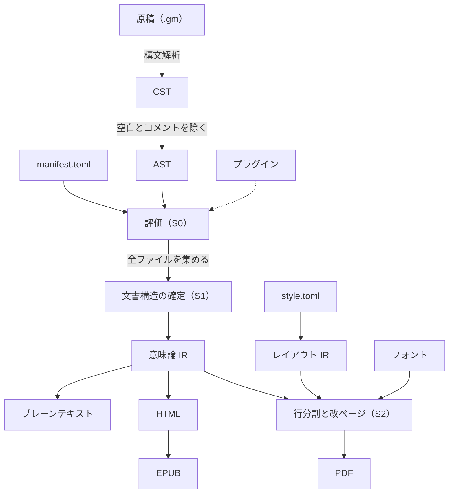
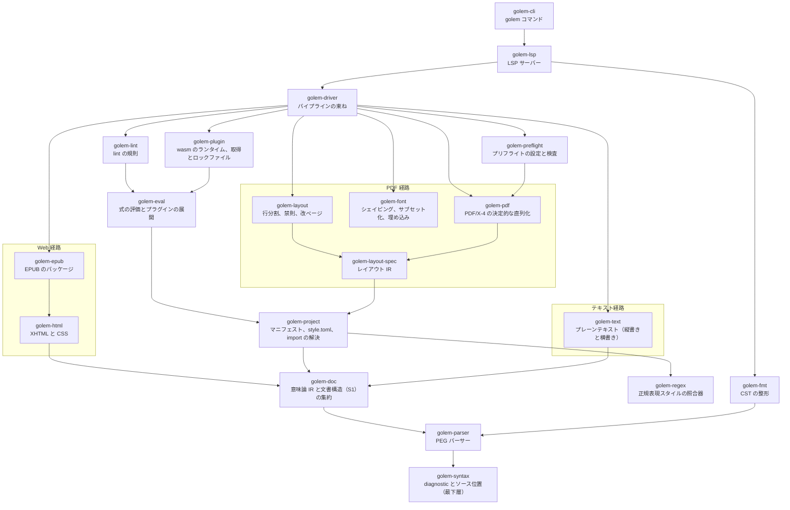

# Golem 仕様書

Golem は CLI で動作する統合組版システムである。
原稿とレイアウトの両方をプレーンテキストで表現し、書籍の組版にバージョン管理と CI/CD を持ち込む。
実装言語は Haskell とする。

この文書は Golem の能力、ユーザーに強いるワークフロー、意図的に採用しなかったもの、モジュール構成の四つを定める。
言語仕様は `markup.md` に置く。
各モジュールの仕様書は `docs/<モジュール名>/specifications.md` に、そのモジュールの設計決定と実装ステップは同じディレクトリの `adr/` に連番の ADR として置く。
特定のモジュールに属さない横断的な決定は `docs/adr/` に置く。
ADR はコミット後、ステータスの行を除いて変更しない。
ADR は、行頭が `ステータス:` のステータスの行をちょうど一つ持つ（[docs/adr/0011](adr/0011-update-adr-guard-to-v0.8.0.md)）。
監査の記録（`docs/audit/`、`docs/audits/`）と性能計測の記録（`docs/benchmarks/`、`docs/benchmark/`）も、コミット後は変更しない（[docs/adr/0011](adr/0011-update-adr-guard-to-v0.8.0.md)、[docs/adr/0012](adr/0012-update-adr-guard-to-v0.8.1.md)）。
この文書には実装の詳細を書かない。

## 目的

Golem が目指すのは、CLI で動き CI/CD に載る InDesign である。
LaTeX の再実装ではない。
InDesign の本質は、内容とレイアウトが分離され、レイアウトが第一級の対象として操作、再利用、バージョン管理できることにある。
Golem はこの性質をプレーンテキストの上で実現する。

### 解決する問題

- **Markdown**：フローレイアウト用であり、書籍組版に必要な語彙（ページ、フレーム、ルビ、禁則、改ページ制約）を持たない。
- **TeX / LaTeX**：テキスト置換マクロの上に構築されており、エラー位置の崩壊と場当たりなエスケープ規則を構造的に抱える。
- **InDesign**：GUI 操作の産物であり、同じ入力から同じ出力が再現される保証がなく、CI に載らない。

### 成果物

同一の原稿から次の四つを生成する。

- 商業入稿に耐える印刷用 PDF（PDF/X-4、ISO 15930-7:2010）
- EPUB
- HTML
- プレーンテキスト（縦書きと横書きの二変種。横書きはブログ等への転載用）

PDF/X-4 への準拠は、Golem が生成しうる要素についての自前の検査と、qpdf による構造の検査で確かめる。
PDF/X-4 の適合を判定できる自由な検証ツールがないためであり、入稿前の最終確認は利用者が商用のプリフライトで行う（[golem-pdf ADR 0003](golem-pdf/adr/0003-pdf-x-4-validator.md)）。

これらは完全に同じ見た目にはならないし、それを目指さない。
かわりに次の**媒体契約**を不変条件として固定する。
意味内容は全媒体で同一とする。
提示と、ページという概念に由来する派生物（ページ番号、柱[^running-head]、脚注の配置、相互参照の実現形）は媒体ごとに分岐する。

## 処理の流れ

この文書の各節が前提にする処理の流れと、その中心となる語をここで定める。
ほかの語は、用語集（[glossary.md](glossary.md)）にまとめている。

Golem が扱う単位は**プロジェクト**である。
プロジェクトは、本の構成を書く**マニフェスト**（`manifest.toml`。章の順、メタデータ、出力する形式）、スタイルとレイアウトを定義する `style.toml`、原稿のファイル（`.gm`）、図版、フォントから成る。

原稿は、次の図の順に処理される。



各段階は、次のことを行う。

1. 原稿を構文解析し、**CST**（具象構文木）を作る。CST は空白とコメントまで含めて原稿を失わずに保持し、整形と LSP が使う。
2. CST から空白とコメントを取り除き、意味だけを残した **AST**（抽象構文木）を作る。エスケープした文字は、`\` を除いた文字に印を付けて残す。評価は、ルビと索引の `/` の区切りのようにエスケープで意味の変わる箇所を読んでから、エスケープした文字を地の文に戻す（[golem-parser ADR 0010](golem-parser/adr/0010-ruby-slash-escape-and-table-cell-breaks.md)）。
3. AST を評価し、**意味論 IR** を作る。意味論 IR は、式やコマンドの評価が済んだ文書の表現であり、位置や大きさの情報を持たない。すべての出力はここから分かれる。
4. Web 経路（HTML、EPUB）とテキスト経路は、意味論 IR をそのまま出力の形式に写す。
5. PDF 経路は、`style.toml` から作る**レイアウト IR**（版面[^type-area]、フレーム、マスターページ[^master]などの幾何の定義）を意味論 IR と合わせ、行分割と改ページを行ってから PDF を書く。

評価で決まる値は、決まる時期によって三つの段階に分かれる。
**S0** は一つのファイルの中で決まる値、**S1** は全ファイルを集めて初めて決まる文書構造（目次や章番号）、**S2** はレイアウトの後に決まるページ番号である。
詳細は「目次と文書構造の参照」の節で定める。

どの段階で見つかった誤りも、原稿の位置と符号を付けた **diagnostic** として報告する。

## Golem が強いるワークフロー

原稿、マニフェスト、スタイルとレイアウトの定義（`style.toml`）のすべてをリポジトリで管理し、push のたびに CI が成果物をビルドする。
このワークフローが成立する根拠は出力の**決定性**にある。
同じ入力からバイト単位で同じ PDF が生成されるとき、そしてそのときに限り、出力の差分は変更の影響と一致する。

決定性が可能にするのはビジュアルリグレッションテストである。
スタイル定義を一箇所変えたとき、数百ページの中で崩れたページだけが差分として検出される。
GUI の組版ツールでは人間が全ページを目視するしかなく、この安全網は原理的に持てない。
ページ画像の差分を取る仕組みは、Golem 自身には持たせず外部のツールを使う。
Golem の責務は、差分が意味を持つ決定的な出力を作るところまでである。
差分の仕組みを自前で持つかどうかと、その時期は、[docs/roadmap.md](roadmap.md) の GUI の項目に書く。
Golem が既存ツールに対して構造的に優位に立てるのはこの一点であり、決定性は他のあらゆる設計判断に優先するハード制約である。

著者や編集者への恩恵は副次的に得られる。
CI が生成した最新のゲラを URL で共有すれば、関係者は常に現在の状態を参照できる。

## 意図的に採用しなかったもの

以下は検討の上で落とした。
それぞれの根拠は対応する ADR に記録する。

- **DVI 出力**：DVI のフォントモデルは OpenType のグリフの置換と配置（GSUB と GPOS）を表現できず、モダンな組版と両立しない。PDF を直接生成する。
- **Markdown のインライン記法**：強調などのインライン要素はすべて角括弧のコマンド記法で書く。行指向の軽量記法はブロック層（見出し、リスト、定義リスト）に限って残す。
- **マクロ**：構文 `[!` の予約のみ行い、実装しない。導入する場合も hygienic な AST 変換[^hygienic]に限り、テキスト置換型は採らない。
- **スポットカラー**：プロセスカラーのみ扱う。色は名前で指定し、出力インテント[^intent]（Japan Color 2001 Coated）に束縛して解決する。トンボのレジストレーションの色（Separation の `All`）だけは例外とする（[golem-pdf ADR 0007](golem-pdf/adr/0007-registration-crop-marks.md)）。特色を扱う予定は [docs/roadmap.md](roadmap.md) に書く。
- **改ページの大域の最適化**：改ページは、段落の行分割のような大域の最適化をせず、先頭から順に詰める方式とする。見開きの単位の最適化と段の高さの調整も行わない。これらを扱う予定は [docs/roadmap.md](roadmap.md) に書く。
- **雑誌級のレイアウトエンジン**：レイアウト IR はフレーム間制約（レベル 3）[^frame-levels]まで表現できる型を持つが、v1 のエンジンは単一フローと除外領域（レベル 1、図版の回り込み）のみ実装する。エンジンは未実装の制約に遭遇したらエラーで停止し、黙って無視しない。
- **ユーザー定義の lint / fmt ルールと lint の抑制**：ルールは処理系が固定し、個別の箇所で警告を止める手段も持たない。ユーザー拡張を許すと、ルールの妥当性をめぐる合意コストが処理系の外に漏れ出すためである。お知らせの抑制（`silence-notices` と `--no-notices`）は lint の警告の抑制ではなく、lint の規則はお知らせを出さない（[golem-syntax ADR 0002](golem-syntax/adr/0002-notice-severity.md)）。
- **数式の組版**：数式の組版エンジンを持たないので、数式は画像にして図版として入れる。数式の組版を扱う予定と理由は [docs/roadmap.md](roadmap.md) に書く。
- **ソースファイルのプリアンブル**：初期の設計にあった `--- ... ---` によるファイル先頭のメタデータは廃止した。メタデータはマニフェストに一元化する。ただし、`[source]` のキーの上書き（`@manifest`）と、文字スタイルと段落スタイルの定義（`@style-def`）に限り、ファイルの先頭のブロックコマンドで書ける（[docs/adr/0014](adr/0014-in-file-settings.md)）。
- **総ルビ**：全漢字への自動ルビ振りは組み込まない。将来のプラグイン（コンパイル時評価と辞書引き）に委ねる。

## 設計原則

**幾何の隔離**。
意味論 IR は幾何情報を一切持たない。
EPUB と HTML はリフローであり、位置情報が意味論に混入した時点で破綻するためである。
幾何は専用のレイアウト IR に隔離し、PDF 経路だけがそれを読む。

**広い型、狭い実装**。
型は将来の表現力まで先取りして設計し、実装は当面の用途に絞り、未使用の機能は縮退させる。
色、フレーム、内容とレイアウトの結合、行分割、マクロの五つの決定がいずれもこのパターンに従っている。

**構文解釈の安定**。
パースはコマンド表[^command-table]に依存しない。
プラグインの導入が既存文書の構文解釈を変えると、同じ入力から同じ出力という前提が崩れるためである。

## モジュール構成

モジュールの依存の関係を次に示す。
矢印は、元のモジュールが先のモジュールを使うことを表す。
golem-syntax は golem-regex、golem-font、golem-fixtures、golem-test-support を除くすべてのモジュールが使うので、golem-parser からの矢印だけを示す。
golem-regex は base、text、containers、array だけに依存する正規表現の照合器である（[docs/adr/0015](adr/0015-regex-styles.md)）。
ほかの依存を通して届く依存の矢印も省いている。
PDF 経路のモジュールだけが、レイアウト IR、シェイピング[^shaping]、フォントのサブセット化[^subset]を扱う。
プラグイン[^wasm]は wasm のモジュールとして配布し、取得した配布物のハッシュをロックファイルに記録する。



`modules/golem-fixtures` は、テストの fixture の原文を Golem の原稿に変換する開発用の実行ファイルなので、図に含めない。
golem の実行ファイルはこのパッケージに依存せず、このパッケージはリリースの配布物にも入らない（[docs/adr/0023](adr/0023-fixture-converters-without-python.md)）。

`modules/golem-test-support` は、テストスイートだけが使うテストの補助のパッケージなので、図に含めない。
外部ツールを使うテストの補助 `Golem.TestSupport.ExternalTool` を持ち、`base` と `tasty` だけに依存する。
golem の実行ファイルはこのパッケージに依存せず、このパッケージはリリースの配布物にも入らない。
リポジトリのライブラリと実行ファイルがこのパッケージに依存しないことは、cabal が解決した計画を読む `scripts/ci/test-only-deps.sh` が CI の `build` ジョブとリリースの `package.sh` で確かめる（[docs/adr/0028](adr/0028-shared-test-support-package.md)）。

処理は `parse → eval → 意味論 IR → 各バックエンド` の順に流れ、分岐点は意味論 IR である（「処理の流れ」の節を参照）。

PDF 経路と Web 経路は対称ではない。
行分割器とフォントエンジンは PDF 経路専用であり、Web 経路はリフローのため一行も使わない。
Web 経路では行分割もシェイピングも読者側のエンジンが行う。
ルビの配置は、`style.toml` の `[composition.ruby]` を CSS の `ruby-align` に写して表す（[golem-layout ADR 0009](golem-layout/adr/0009-ruby-placement.md)）。
`"1:2:1"` は `space-around`、`"0:1:0"` は `space-between`、`"center"` は `center`、`"start"` は `start` になり、モノルビの `<ruby>` には `class="mono"` を付ける。
隣の文字へのかけは、CSS で作者が指定できないので表さず、読者の環境に任せる。

HTML と EPUB は並列のバックエンドではなく親子である。
EPUB の実体は XHTML+CSS にパッケージングを加えたものなので、共通のシリアライザの上に薄い層として EPUB を載せる。

テキスト経路は、意味論 IR からテキストノード（見出しと本文）を抽出するだけの最軽量のバックエンドである。
ルビは「漢字（かんじ）」のように全角丸括弧で読みを併記し、圏点、強調、色は出力しない。
数の表記は縦書き版で漢数字、横書き版で算用数字に解決する。

レイアウト IR は意味論 IR と並ぶ第二の入力であり、これもバージョン管理の対象である。
結合は内容主導を基本とし、レイアウト側から内容ストリームを参照する逆向きの結合点を型として用意する（CLI 用途では縮退する）。

モジュール間のインターフェースは、実装に先立って ADR で定め、モジュールを並行して実装できるようにする。
ADR は下の層から順に作る（ソース位置と diagnostic、CST と AST、意味論 IR、style.toml とレイアウト IR、レイアウトの出力とフォント処理と PDF の直列化）。
ADR はコミット後に変更できないので、上の層を先に固めると、下の層の変更に追随できなくなるためである。

意味論 IR の正典は CDDL[^cddl] で記述する。
プラグインとの ABI[^abi] も同じ CDDL を使い、Haskell の型は CDDL との往復のテストで一致を保証する。
意味論 IR とプラグインの ABI を別々に定義すると、二つが次第にずれていくためである。

Golem のパーサーは PEG で記述する。
汎用 PEG ライブラリ自体は別リポジトリで開発し、本リポジトリのスコープ外とする。

## プロジェクトの構成と import

一冊の本は、複数のソースファイルと、プロジェクトルートに置くマニフェスト `manifest.toml` から成る。
ファイルをまたぐ操作には、性質の違う二つがある。
一つは章を並べて一冊にする内容の合成であり、順序に意味があり、取り込んだ内容は出力に現れる。
もう一つは共通の変数を使えるようにする定義の取り込みであり、出力には何も現れない。
Golem はこの二つを別の仕組みで扱う。

スタイルとレイアウトの定義は、プロジェクトルートの `style.toml` に書く（「style.toml」の節を参照）。

内容の合成はマニフェストに書く。
どの章ファイルをどの順で並べるかはマニフェストの章の配列で表し、章をさらにファイルに分ける場合は配列を入れ子にする。
章の配列の各項目には、そのファイルに使うマスターページを指定できる（例：`{ file = "chapters/01.gm", master = "body" }`）。
ソースファイルが別のソースファイルの内容を取り込む記法は持たない。
このため内容の循環は構造上起こりえず、各ソースファイルは単独で検査、コンパイルできる単位になる。
この単位は、インクリメンタルコンパイル、章単位の並列ビルド、LSP の基礎になる。
コードリストのような Golem 以外のファイルは、内容の合成ではなく専用のコマンドで取り込む。

マニフェストは、本の構成に加えて、出力ターゲット（PDF、EPUB、HTML、プレーンテキスト）ごとの設定（ISBN、プレーンテキストの縦書きと横書き）を持つ。
`golem build` は、`--target` で絞らなければ四つのターゲットをすべて生成する（[golem-cli ADR 0002](golem-cli/adr/0002-build-all-targets-by-default.md)）。
プレーンテキストの設定がなければ、縦書きと横書きの両方を生成する。
出力は、プロジェクトルートの `build` の下のターゲットごとのディレクトリ（`build/html` など）に、前の出力を消してから書く。
`build` かターゲットのディレクトリがシンボリックリンクかディレクトリでないファイルなら、リンクの先を消さないように、何も消さず書かずに G0813 のエラーとする（[docs/adr/0035](adr/0035-security-hardening.md)）。
使うプラグインは人がマニフェストに宣言し、配布物のハッシュは処理系がロックファイル `plugins.lock` に書き出す。
ロックファイルは手で編集せず、リポジトリにコミットする。
同じ入力から同じ出力を得るには、使うプラグインのバイト列まで入力の一部として固定する必要があるためである。
宣言の形式と取得の手順は「プラグイン」の節で定める。

マニフェストの `[diagnostics]` の表は、diagnostics の扱いを決める（[golem-syntax ADR 0002](golem-syntax/adr/0002-notice-severity.md)）。
`silence-notices` に並べたコードのお知らせは、`golem build`、`golem check`、`golem lint`、LSP のどれにも出ない。
並べられるのはお知らせのコードだけであり、ほかのコードと形の誤ったコードはその要素の位置でエラー（G0324）とする。
値が配列でない場合と、`[diagnostics]` の未知のキーは G0301 とする。
すべてのお知らせを抑制する値は設けない。

```toml
[diagnostics]
silence-notices = ["G0262", "G0407"]
```

定義の取り込みはソースファイルに `@import` で書く。
v1 で取り込めるのは `@set` で定義した変数だけである。
名前色やスタイルは `style.toml` に置き、`@import` では扱わない。

```
@import common/values.gm as values
```

取り込んだ定義は `as` で付けた名前空間を通してのみ参照できる（例：`[= values.price]`）。
名前空間を付けずに定義を展開する取り込みは認めない。

import には次の規則を適用する。

- **解決の段階**：import は AST の段階で解決し、テキストとして展開しない。diagnostic のソース位置をファイルごとに保つためである。
- **循環**：評価に先立って import のグラフを作り、循環があればコンパイルエラーとする。エラーには循環の全経路と各 import 文の位置を示す。自分自身の import は長さ 1 の循環として扱う。
- **ファイルの同一性**：ファイルはプロジェクトルートからの正規化パスで同一性を判定する。書き方の違い、大文字と小文字の違い、シンボリックリンクによって同じファイルが別物と扱われると、循環の検出漏れや二重評価が起きるためである。大文字と小文字だけが異なる二つのパスは、書いたパスで比べてエラー（G0304）とし、どのファイルシステムでも同じ結果にする（[golem-project ADR 0006](golem-project/adr/0006-project-diagnostic-codes.md)）。
- **参照できる範囲**：プロジェクトルートの外、絶対パス、URL は import できない。外部のコードはプラグインの配布機構を通してのみ取り込む。決定性と隔離のためである。
- **共通の依存**：複数のファイルが同じファイルを import した場合、そのファイルは一度だけ評価し、結果を共有する。評価は純粋なので、結果は正規化パスをキーに再利用できる。

名前のスコープは二種類ある。
`@set` で定義した変数はファイル単位で有効であり、他のファイルからは import による名前空間を通してのみ見える。
一方、相互参照のラベル（章、節、図などへの参照先）は文書全体で一つの名前空間を持つ。
ページ番号への参照や目次は、ファイルをまたいで参照先を解決する必要があるためである。
ラベルの重複はコンパイルエラーとする。

## 原稿の読み方

原稿の読み方を決める設定は、マニフェストの `[source]` に書く（[docs/adr/0013](adr/0013-paragraph-separator.md)）。
今の設定は、段落の区切り方を選ぶ `paragraph-separator` だけである（「段落内の改行」の節を参照）。

```toml
chapters = [
  "chapters/01.gm",
  { file = "chapters/02-en.gm", paragraph-separator = "blank-line" },
]

[source]
paragraph-separator = "line"
```

| キー | 値 | 既定 | 意味 |
|---|---|---|---|
| `paragraph-separator` | `"blank-line"` か `"line"` | `"blank-line"` | `blank-line` は空行で段落を区切る空行の様式、`line` は改行ひとつで段落を区切る改行の様式 |

ファイルごとに変えられる設定は、`[source]` のキーに限る。
章の配列の項目にも `[source]` のキーを書け、その章のファイルにだけ効く。
ファイルの先頭の `@manifest paragraph-separator=line` でも、そのファイルにだけ効く値を書ける（[docs/adr/0014](adr/0014-in-file-settings.md)）。
一つのファイルに効く値は、ファイルの中の上書き（`@manifest`）、章の項目、`[source]`、既定の順で、最初に見つかったものとする。
`@import` でだけ参照されるファイルには、そのファイルの `@manifest` か `[source]` の値が効き、取り込む側には及ばない。
`@manifest` で上書きできないキー（`title` など）は G0250、不正な値は G0251 とする。

既定を空行の様式とするのは、既存の原稿の出力を変えないためである。
`[metadata]` の `language` からは推定しない。
言語を変えただけで段落の数が変わるのを避けるためである。

未知のキーと不正な値は、マニフェストのほかの誤りと同じく G0301 とする。
同じファイルを章の配列に二度並べ、項目の `[source]` のキーで効く値が異なる場合も G0301 とする。

## メタデータ

書名、著者、発行日などのメタデータは、マニフェストの `[metadata]` に書く。
メタデータは意味内容の一部なので、媒体契約に従い全媒体で同一とする。
処理系はこれを各ターゲットの形式（PDF の XMP、EPUB のパッケージ文書、HTML の meta 要素）に写像する。

```toml
[metadata]
id = "urn:uuid:3f6c..."
title = "Golem 入門"
title-reading = "ゴーレムにゅうもん"
language = "ja"
date = 2026-10-11
edition = "1.0"
publisher = "..."
publisher-person = "佐藤 一郎"

[[metadata.creators]]
name = "山田 太郎"
reading = "やまだ たろう"
role = "author"

[[metadata.contributors]]
name = "鈴木 花子"
role = "editor"

[[metadata.contributors]]
name = "株式会社〇〇印刷"
role = "printer"

[[metadata.printings]]
edition = 1
printing = 1
date = 2026-10-16

[targets.pdf]
isbn = "978-..."

[targets.epub]
isbn = "978-..."
```

`id` は本の識別子であり、必須とする。
プロジェクトを作るときに一度だけ生成し、以後は変えない。
書名と著者の読み（`title-reading`、`reading`）は任意の項目であり、EPUB では電子書店での並べ替えや検索に使われる。

### 関係者と刷

`creators` は主たる著作者（著者、訳者など）を、`contributors` はそのほかの関係者（編集者、印刷所、製本所、装丁者など）を書く表の配列である（[docs/adr/0033](adr/0033-colophon-contributors-and-printings.md)）。
どちらも項目のキーは `name`（必須）、`reading`（任意）、`role`（必須）である。
この区別は、EPUB の `dc:creator` と `dc:contributor` の区別にそのまま対応する。

`role` は次の表の語で書く。
表は Golem が持つ閉じた語彙であり、MARC relator の符号は出力の形式が求める場所でだけ Golem が内部で使う。

| 語 | 奥付の項目 | MARC relator の符号 | 出力のメタデータ |
| --- | --- | --- | --- |
| `author` | 著者 | `aut` | 書く |
| `translator` | 訳者 | `trl` | 書く |
| `editor` | 編集 | `edt` | 書く |
| `illustrator` | 挿絵 | `ill` | 書く |
| `book-designer` | 装丁 | `bkd` | 書く |
| `cover-designer` | カバーのデザイン | `cov` | 書く |
| `typesetter` | 組版 | `cmt` | 書く |
| `printer` | 印刷所 | `prt` | 書かない |
| `binder` | 製本所 | `bnd` | 書かない |

発行所は `publisher` に、発行人（奥付に発行者として載せる個人）は文字列のキー `publisher-person` に書く。
`publisher` がなくても `publisher-person` だけを書ける。

`printings` は版と刷の履歴であり、項目のキーは `edition`（1 以上の整数）、`printing`（1 以上の整数）、`date`（TOML の日付）で、どれも必須とする。
最後の項目を、この出力の版と刷（現在の刷）とする。
刷の番号は飛んでもよい。
`edition`（自由な文字列）と `date` は `printings` とは独立の値であり、出力の日時は `printings` ではなく `date` から作る。

次のどれも、マニフェストのほかの誤りと同じく G0301 とし、位置は誤った値とする。

- `role` が表の語でない。表の符号（`aut` など）を書いた場合は、語を示すメッセージにする。
- `role = "publisher"`。
- `publisher-person` が空の文字列か、改行を含む。
- `name` が空の文字列である。
- `printings` の `edition` か `printing` が 1 より小さい。
- `printings` の項目が、（`edition`、`printing`）の辞書式の順で狭義に増えていない。
- `printings` の `date` が、前の項目の `date` より前である。

出力のメタデータへの写し方は次のとおりである。

- **EPUB**：`creators` を `dc:creator` に、`contributors` を `dc:contributor`（`id` は `contributor1` からの連番）に書き、役割を表の符号にして `refines` の `role`（`scheme="marc:relators"`）で、読みを `file-as` で付ける。
- **PDF**：XMP を書く場合、`creators` を `dc:creator`（`rdf:Seq`）に、`contributors` を `dc:contributor`（`rdf:Bag`）に、名前だけを並べる。
- **HTML**：書かない。

役割が `printer` と `binder` の項目は、`creators` と `contributors` のどちらに書いても、EPUB と XMP に書かない。
印刷所と製本所は紙の本の製造の記録であり、電子書籍と PDF の文書の書誌ではないためである。
連番の `id` は、書く項目だけで振る。
`publisher-person` と `printings` も、出力のメタデータに書かない。

媒体ごとに異なるのは ISBN などの識別子だけであり、これはターゲットの節に書く。
紙の本と電子書籍では ISBN が別の番号になるためである。

### 日時

成果物に書き込む日時（PDF の作成日時と更新日時、XMP の日時、EPUB の更新日時など）は、すべてマニフェストの `date` から作る。
ビルドした時刻は使わない。
環境変数 `SOURCE_DATE_EPOCH` も読まない。
日時の情報源をリポジトリの中の一箇所に限ることで、同じ入力から同じバイト列を得るためである。
日時は、著者が版を改めるときに `date` を書き換えることで更新する。

### 識別子

成果物に書き込む識別子は、乱数を使わずすべて導出する。

- **文書 ID**（XMP の DocumentID と PDF のトレーラー `/ID` の第一要素）：マニフェストの `id` から名前ベースの UUID（v5）で導出する。文書 ID は同じ文書の版をまたいで変わらない値なので、本の識別子から作る。
- **インスタンス ID**（XMP の InstanceID と `/ID` の第二要素）：入力全体のハッシュから導出する。入力全体とは、全ソースファイル、マニフェスト、`style.toml`、`plugins.lock`、使ったフォントのバイト列、出力を変える CLI のオプション（`--marks` と `--profile`）、Golem のバージョンである。`style.toml` はマニフェストの直後に置き、ないときは空のバイト列とする。CLI のオプションは、ソースファイルの後に `options marks=<値> profile=<値>` の形の一つの要素として置き、既定の値も省かない（[golem-pdf ADR 0004](golem-pdf/adr/0004-crop-marks-and-bleed.md)）。Golem の版は `golem-` に `VERSION` の内容を続けた文字列とし、入力の末尾に加える（[docs/adr/0004](adr/0004-binary-distribution-and-release.md)）。
- **EPUB の識別子**：電子版の ISBN があればそれを使い、なければマニフェストの `id` を使う。

シェイピングとフォントの処理に使う HarfBuzz と FreeType、プラグインの実行に使う wasmtime、PDF の圧縮に使う zlib はバージョンを固定する。
これらのバージョンが変わるとグリフの配置が変わり、同じ入力から同じ出力が得られなくなるためである。
使っているバージョンは README に記載し、バージョンを上げるときは ADR を作成する。

式の評価、とくに浮動小数点数の計算は、x86-64 と aarch64 の両方の CI でテストし、結果が一致することを確かめる。

出力は、ファイルの入力、Golem のバージョン、出力を変える CLI のオプション（`--marks` と `--profile`）だけで決まる（[golem-pdf ADR 0004](golem-pdf/adr/0004-crop-marks-and-bleed.md)）。
CLI のオプションは呼び出しに明示されるので、同じオプションで呼べば CI と手元で同じ出力が得られる。
今後 CLI に出力を変えるオプションを加えるときは、インスタンス ID の入力に加える。

v1 で決定性を保証するのは PDF、HTML、プレーンテキストである。
EPUB はパッケージである zip の中に時刻や並び順の揺れを含みうるので、EPUB の決定性はまだ保証しない（予定は [docs/roadmap.md](roadmap.md)）。

ロケールを出力に影響させないため（[ADR 0002](adr/0002-determinism.md)）、Golem が書くテキストは、ロケールの文字コードによらず UTF-8 である。
対象は、HTML とプレーンテキストの出力、`golem new` のひな形、`plugins.lock`、標準出力と標準エラーに書く diagnostics や説明である。

PDF の Producer には Golem のバージョンを書く。
Producer は `Golem ` に `VERSION` の内容を続けた文字列（例：`Golem 0.1.0-rc1`）とし、文書情報辞書の `Producer` と XMP の `pdf:Producer` の両方に書く（[golem-pdf ADR 0005](golem-pdf/adr/0005-producer.md)）。
Git のコミットやビルドの環境は含めない。
このため Golem を更新すると出力のバイト列は変わるが、処理系も入力の一部なので決定性には反しない。

### 本文からの参照

メタデータは、式文脈[^contexts]から読み取り専用の名前空間 `meta` で参照できる（例：`[= meta.title]`）。
奥付のように、メタデータを本文に並べるページをマニフェストと二重に書かずに済ませるためである。
メタデータはマニフェストだけで決まり評価の前に確定しているので、`meta` はファイル内評価（S0）の値であり、見出しの中でも使える。
`meta` は `doc` と同じく予約語であり、import の名前空間には使えない。

`meta` が持つ値は次のとおりである。
マニフェストのキーの `-` は、`meta` では `_` になる。
マニフェストにない値は鍵もなく、引くと G0202 になる。

- `id`、`title`、`language`、`date`（`2026-10-16` の形の文字列）と、あれば `title_reading`、`edition`、`publisher`、`publisher_person`
- `creators`：`creators` の名前の配列
- `roles.<役割>`：`creators` と `contributors` のうち役割が `<役割>` である項目の名前の配列。`<役割>` は役割の語の `-` を `_` にしたもの（`meta.roles.cover_designer`）である。`creators` を先に、それぞれマニフェストの順に並べ、印刷所と製本所も含む（[docs/adr/0033](adr/0033-colophon-contributors-and-printings.md)）
- `printing`：現在の刷の連想配列であり、`edition`、`number`、`year`、`month`、`day` を整数で、`date` を `2026-10-16` の形の文字列で持つ
- `printings`：`printings` の全項目を、`printing` と同じ形の連想配列の配列にしたもの

配列は本文に直接埋め込めないので、組み込み関数 `join(配列, 区切り)` で文字列にする（`[= join(meta.roles.editor, "、")]`）。

発行の履歴は、ブロックコマンド `@printings` で組む。
`printings` の全項目を、マニフェストの順に、一項目を一つの段落にして組み、`@style` などの属性はすべての段落に効く。
一つの段落は `2026年10月16日　初版第1刷発行` の形であり、版の番号が 1 なら「初版」、2 以上なら `第2版` のように番号を入れた形とする。
年、月、日と版、刷の番号は数の値として組むので、縦組みでは漢数字になる。
年は一字ずつの漢数字（`kanji-digits`、二〇二六）とし、ほかは `[numbers]` の `vertical` の既定に従う。
書式はこの一つに固定し、日本語でない本（`language` が `ja` でない本）と `printings` のない本では G0276 とする。
引数か本体を書いた場合も G0276 とする。
書式を変える設定は、v0.1.0-rc4 か v1.0.0 で扱う予定である（[docs/roadmap.md](roadmap.md) の「発行の履歴の書式」）。

## 目次と文書構造の参照

目次には二つの側面がある。
一つは出力される目次であり、媒体ごとに形が変わる。
PDF では章題とページ番号の一覧、EPUB では必須のナビゲーション文書とリンク、HTML ではリンクの一覧、プレーンテキストでは章題の一覧になる。
もう一つはデータとしての目次であり、本文中で別の章の題や番号を参照したり、柱に章題を出したりするのに使う。

データとしての目次は全章の見出しを集めないと決まらないが、見出し自体も式を含みうる。
見出しが目次の値（章の数など）を参照すると、見出しを集めた結果に見出しが依存する循環が生じる。
これを防ぐため、評価を三つの階層に分け、各階層の値は下の階層の値にだけ依存できるとする。

- **S0 ファイル内評価**：変数、import した定義、見出しの文字列。そのファイルと import 先だけで決まる。
- **S1 文書構造**：目次、章番号、ラベルから引く章題と番号。全ファイルの S0 の結果から決まる。
- **S2 レイアウト後**：ページ番号（DeferredRef）。レイアウトの結果から決まる。

見出しは S1 の入力なので、S0 だけで評価できなければならない。
見出しの中で S1 または S2 の値を参照した場合はコンパイルエラーとする。
S0 はソースファイルごとに独立して評価し、S1 は各ファイルが出す見出しの索引を集めて決める。
このためソースファイルの独立性は保たれ、見出しの索引が変わったときだけ、その値を参照するファイルを評価し直せばよい。

見出しなどのブロックには、直前の行のブロックコマンド[^block-command]でラベルを付ける。

```
@label intro
# はじめに

詳しくは第[ref-number intro]章「[ref-title intro]」を参照。
```

`@label` は直後のブロックに付き、直後にブロックがない場合はコンパイルエラーとする。
ラベルや見出しの属性を指定するブロックコマンドが連続した場合は、それらがまとめて次のブロックに付く。
章を参照するときは、題名ではなくラベルで指す。
番号を持つのは `@nonumber` のない見出し、図版、キャプションのあるコードブロックであり、題を持つのは見出し、図版（代替テキスト）、キャプションのあるコードブロック（キャプション）である。
番号を持たない要素を `[ref-number ...]` で参照した場合と、題を持たない要素を `[ref-title ...]` で参照した場合は、コンパイルエラーとする（[golem-doc ADR 0003](golem-doc/adr/0003-document-diagnostic-codes.md)）。
題名を識別子にすると、題を直すたびに参照が壊れるためである。

ページ番号への参照は、テキストではなく表記の決まっていない数（Number）に解決する。
ページ番号も数なので、縦書きと横書きでの表記の使い分けをほかの数と同じ経路で行う。
このとき、ページ番号の表記の幅が行の幅を変え、それが改ページを変え、改ページがページ番号を変えるという循環が生じうる。
そこでレイアウトを、ページ番号が変わらなくなるまで繰り返す。
上限の回数までに収束しなければコンパイルエラーとする。
繰り返しの過程は入力だけで決まるので、決定性は保たれる。

日常的な参照は `[ref-number ...]`、`[ref-title ...]` のようなコマンドで書く。
計算に使う場合は、予約された読み取り専用の名前空間 `doc` を式文脈から参照する（例：`[= doc.chapters.count]`）。
`doc` は予約語であり、import の名前空間には使えない。

見出しには次の属性を付けられる。
属性もラベルと同じく、見出しの直前の行のブロックコマンドで指定する。

- **短い題**：目次と柱には、本文の見出しより短い題を使えるようにする。指定がない場合は見出しの題を使う。柱には、マスターページの柱の内容が `heading.<階層>.short` か `heading.<階層>.numbered`（書式では `{heading.<階層>.short}` などの差し込み）のときに短い題が出る（[golem-driver ADR 0014](golem-driver/adr/0014-running-heads.md)、[golem-driver ADR 0022](golem-driver/adr/0022-running-head-formats.md)）。
- **番号の指定**：その見出しの番号を明示する。
- **番号からの除外**：序文やあとがきのように、章番号を振らない見出しを指定する。
- **目次からの除外**：目次に載せない見出しを指定する。

見出しの番号は 1 から始まり、番号を指定しない見出しは直前の番号に 1 を加えた番号になる。
番号を指定した見出しのあとは、その番号から数え続ける。
番号からの除外を指定した見出しは、番号を消費しない。

番号の表記（「第 1 章」か「1.」か）はスタイルで決める。
見出しの文字列は自由に付けてよく、処理系は文字列の中身を検査しない。

番号と題のあいだには、本の言語で決まる区切りを置く（[golem-html ADR 0002](golem-html/adr/0002-heading-number-spacing.md)）。
`manifest.toml` の `[metadata] language` の主の副タグ（最初の `-` の前を英小文字にしたもの）が `ja` なら全角の空白（U+3000）、それ以外の言語なら半角の空白（U+0020）である。
番号の文字列が空白（U+0020、U+3000、タブ）で終わるときは、区切りを足さない。
`number = "Chapter {n}: "` のように書式の末尾に区切りを書けば、その区切りがそのまま使われる。
番号の書式は区切りを変えないので、同じ本の中では章も節も同じ区切りになる。
この規則は、見出し、図版のキャプション、目次の項目（PDF の目次、本文の `@toc`、HTML の目次のページ、EPUB のナビゲーション文書）、柱の `heading.<l>.numbered` の、すべての出力に効く。
HTML の見出しとキャプションでは、区切りを `<span class="number">` の外に、題の前のテキストとして書く。
番号を持たない見出しと、番号のないキャプションには区切りを置かない。
傍注の番号とリストの印の後の空きは、この規則によらない。

目次は見出しが自動で送られるチャネルであり（「チャネル」の節を参照）、出力する位置はブロックコマンド `@toc` で指定し、載せる見出しの深さは引数で指定する（例：`@toc depth=2`）。
目次ページは、マニフェストに並べた前付けのファイルに書く。
v1 では `@toc` は文書に一つだけとし、章ごとの小目次は扱わない。

PDF の目次は、章題とページ番号の一覧である（[golem-driver ADR 0009](golem-driver/adr/0009-pdf-toc-page-numbers.md)）。
項目は、番号、区切り（上に述べた番号と題のあいだの区切り）、短い題を本文の役割と版面の文字の大きさ fs で組み、階層 l の項目はすべての行を (l − 1) 字下げする。
行の終わりの側には、ページ番号のための幅 R を予約し、項目のすべての行を行長から字下げと R を引いた長さで組む。
R は、ページ番号 999 を項目と同じ環境で組んだ幅 W に、二字分を足した幅である。
ページ番号は、項目の最後の行に、行の終わり（横組みでは版面の右端、縦組みでは版面の下端）にそろえて置く。
題の終わりとページ番号のあいだは、二分の空きを両側に取り、三点リーダー（…）を並べたリーダーで埋める。
リーダーの終わりは、ページ番号が W に収まる限り、どの項目でも同じ位置になるので、上下（縦組みでは左右）の項目の点がそろう。
`style.toml` の `[toc]` の `leader` を `"none"` にすると、リーダーを描かず、ページ番号の位置はそのままにする。
ページ番号はほかの数と同じく `Number` として組み、横組みでは算用数字、縦組みでは `[numbers]` の `vertical` の表記になる。
数はページの通し番号であり、ノンブルの書式は使わない。

目次の行分割は、題、番号、版面の寸法と予約の幅だけで決まり、実際のページ番号によらない。
そのため、目次のページ番号が目次の行数とページ数を変えることはなく、後ろのページの番号も動かさない。
見出しのページは、S2 の繰り返しが収束した後に、最終回のページから一度だけ求める。
HTML、EPUB、プレーンテキストの目次は、ページを持たないので、リンクの一覧と題の一覧のままである。

キャプション（`@caption`）を付けたコードブロックには、リスト番号を振る（[golem-driver ADR 0023](golem-driver/adr/0023-code-block-book-features.md)）。
数え方は図番号と同じく、階層 1 の見出しで数え直し、文書構造（S1）で決める。
図番号とは別に数え、キャプションのないコードブロックは数えない。
表記は `style.toml` の `[code]` の `number`（既定 `リスト{chapter}-{n}`）で決める。
章の外のコードブロックに `{chapter}` を使う書式を当てると、図版と同じくエラー（G0404）とする。
`@label` を付けたキャプションのあるコードブロックは、`[ref-number ...]` で章の番号とリストの番号（`3-2` の形）を、`[ref-title ...]` でキャプションを参照できる。

## style.toml

`style.toml` は、本文中で「スタイルで決める」とした事項（見出しの番号の表記、注の配置、強調の表現、数の表記など）と、レイアウト IR（判型、版面、マスターページ、フレーム、書字方向）、フォント、色のスウォッチ[^swatch]を持つ。
`style.toml` は一つのファイルであり、v1 ではほかのファイルを取り込む機能を持たない。

```toml
[page]
size = "B6"
binding = "right"
writing-mode = "vertical"
bleed = "3mm"

[page.grid]
font-size = "13Q"
characters = 42
lines = 16
line-pitch = "22H"
columns = 1
column-gap = "2zw"
position = { top = "18mm", gutter = "20mm" }

[fonts.body]
ja = "fonts/NotoSerifJP-Regular.otf"
latin = "fonts/SourceSerif4-Regular.otf"
features = ["palt"]

[fonts.heading]
ja = "fonts/NotoSansJP-Bold.otf"
latin = "fonts/SourceSans3-Bold.otf"

[character-styles.term]
font = "heading"
color = "accent"

[paragraph-styles.body]
first-line-indent = "1zw"
regex-styles = [
  { pattern = '(?<=第)[0-9]+(?=章)', style = "bold" },
]

[paragraph-styles.quote]
font = "heading"
size = "0.9zw"
space-between = 1
indent = "2zw"

[paragraph-styles.verse]
indent = "2zw"
first-line-indent = "-2zw"

[paragraph-styles.caption]
size = "11Q"

[paragraph-styles.sidenote]
font = "body"
size = "11Q"

[headings.1]
font = "heading"
size = "20Q"
number = "第{n:kanji}章"
page-break = "recto"

[headings.2]
number = "{1}.{n}"
lines = 3

[composition]
kinsoku = "strict"
hanging-punctuation = true
kenten = "sesame"
tolerance = 200
protrusion = true
expansion = { limit = 20, step = 5 }
explicit-hyphen-penalty = 50

[composition.ruby]
mono-align = "center"
group-align = "1:2:1"
base-spacing = "1:2:1"
overhang = "0.5zw"
overhang-onto = "kana"

[numbers]
vertical = "kanji"

[notes]
placement = "page-foot"
numbering = "chapter"
mark-size = "0.65zw"
mark-format = "*{n}"

[notes.rule]
length = "10zw"
weight = "0.3pt"
space-before = "1zw"
space-after = "0.5zw"
style = "solid"
color = "accent"

[sidenotes]
side = "outside"
width = "14zw"
gap = "2zw"
marker = "number"

[figures]
number = "図{chapter}-{n}"

[toc]
leader = "dots"

[index]
columns = 2
column-gap = "2zw"

[color]
intent = "icc/JapanColor2001Coated.icc"

[color.swatches]
accent = { cmyk = [0, 80, 100, 0] }

[masters.body]
running-head = { position = "top-outside", content = "heading.1.short" }
folio = { position = "bottom-outside", format = "{n}" }
```

`[composition]` の `kenten` は、形を省いた圏点（`[kenten: ...]`）の形である（[golem-driver ADR 0019](golem-driver/adr/0019-pdf-kenten-shapes.md)）。
取れる値は `sesame`、`open-sesame`、`dot`、`open-dot`、`circle`、`open-circle`、`double-circle`、`open-double-circle`、`triangle`、`open-triangle` の十で、既定は `sesame` である。
ほかの値は G0306 とする。
形の一覧と字は [docs/markup.md](markup.md) の「圏点」にある。

`[composition]` の `protrusion` を `true` にすると、欧文の行の端のハイフン、ダッシュ、句読点、引用符を、版面の外に少し出す（[golem-layout ADR 0005](golem-layout/adr/0005-microtypography.md)、[golem-layout ADR 0014](golem-layout/adr/0014-protrusion-amount.md)）。
出す量は、行の端になる字の送りに、字ごとの表の比（千分率）を掛け、1000 で切り捨てて割った値である。
字の送りは、トラッキングと語の中のカーニングを含まない。
パターンの分綴で行末に足したハイフンも、原稿に書いたハイフンと同じ量だけ出す。

版面は、日本語組版の流儀に従い、文字の大きさ、一行の字数、一ページの行数、行送り、段数で定義する。
余白は、版面をページのどこに置くかから決まる従属的な値である。
字数と行数を整数で決めることで、行頭と行末が字送りの格子にそろう。

`[page.grid]` の `columns` が 2 以上なら、版面は段組みになる（[docs/adr/0018](adr/0018-multi-column-layout.md)）。
版面を段数で等しい幅に分け、段のあいだに `column-gap` の段間を空ける。
各段は `lines` の数の行の格子を持ち、隣り合う段の行の位置はそろう。
本文は一本の流れのまま、ページの段を読む順にたどり、最後の段の次は次のページの最初の段に進む。
横組みでは左の段から右の段へ、縦組みでは上の段から下の段へ進み、段の順は綴じの方向によらない。
本文の行、見出し、図版、表、目次、索引、参考文献は、どれも一段の行長で組み、段の中に置く。
索引は、`[index]` がなければ本の全体と同じ段数で組む。
段の高さはそろえないので、本の最後のページや改丁の前のページでは、後ろの段が空のまま残ることがある。
脚注の本文は、注の印を含む行が置かれた段の下部に、段の行長で置く。
傍注欄（`[sidenotes]`）は段組みの版面に設けられず、`pageGeometry` で G0701 とする。
回り込ませる図版（`wrap`）も段組みの版面では使えず、図版の位置で G0726 とする。
柱とノンブルは、段の数によらずページに一度だけ描く。
HTML と EPUB は版面を無視するので、段組みを出力せず、CSS の `columns` も `column-count` も書かない。
プレーンテキストも段組みを出力しない。

`[notes]` の `numbering` は、脚注と傍注の番号を 1 から振り直す範囲を決める（[golem-driver ADR 0018](golem-driver/adr/0018-footnote-marks-and-numbers.md)）。

| 値 | 意味 |
| --- | --- |
| `"chapter"` | マニフェストの章ごとに振る。`chapters` の配列の一つの項目が一つの章であり、入れ子の配列は全体で一つの章になる。既定 |
| `"file"` | ファイルごとに振る |
| `"book"` | 本の全体で通し番号にする |

三つ以外の値は G0306 とする。
`placement` は PDF の注の置き場所であり、`"page-foot"`（ページ下、既定）か `"chapter-end"`（章末）をとる（[golem-driver ADR 0026](golem-driver/adr/0026-chapter-end-notes.md)）。
HTML、EPUB、プレーンテキストは、`placement` によらず注を章末にまとめる。

`[notes.rule]` は、PDF のページ下の脚注の前に引く区切り線を書く（[golem-driver ADR 0024](golem-driver/adr/0024-rule-spec-and-footnote-separator.md)）。
表がなければ区切り線を引かない。
`placement = "chapter-end"` のときに書いても誤りにしないが、章末注には区切り線を引かないので効果はない。
値は、次の「罫線の指定」の形で書く。

| キー | 既定 | 脚注の区切り線での意味 |
| --- | --- | --- |
| `length` | なし（必須） | 区切り線の長さ。`zw` は版面の文字の大きさ（`[page.grid]` の `font-size`）を一字とする |
| `weight` | `"0.3pt"` | 区切り線の太さ |
| `space-before` | なし | 本文の最後の行の字面の下端から、区切り線の上端までの間隔の最小値 |
| `space-after` | なし | 区切り線の下端から、脚注の一行目の字面の上端までの間隔 |

`length` がない場合は、`[notes.rule]` の表の位置で G0306 とする。
`space-before` と `space-after` は、どちらか一方だけを書いてもよく、書かなかった側は 0 とする。
`length` が、区切り線を引く行の行長（段組みでは段の行長）より長い場合は、版面を計算できないエラー（G0701）とする。
この検査は版面の段の行長と比べるので、索引の段（`[index]`）の行長は数えない。
索引の段の行長より長い区切り線は、切り詰めずにそのまま引く。
区切り線の位置は「脚注」の節に書く。

罫線の指定は、`style.toml` で罫線を書くための共通の値の形である（[golem-driver ADR 0024](golem-driver/adr/0024-rule-spec-and-footnote-separator.md)）。
今の使い手は `[notes.rule]` だけである。

| キー | 型 | 意味 |
| --- | --- | --- |
| `length` | 寸法 | 罫線の長さ |
| `weight` | 寸法 | 罫線の太さ。既定は `"0.3pt"` |
| `space-before` | 寸法 | 罫線の前（横組みでは上、縦組みでは右）の間隔 |
| `space-after` | 寸法 | 罫線の後（横組みでは下、縦組みでは左）の間隔 |
| `color` | スウォッチの名前 | 罫線の色。既定はなし（色を設定せずに描く） |
| `style` | 文字列 | 線の種類（次の表）。既定は `"solid"` |
| `dash` | 寸法 | 破線の一つの線分の長さ。既定は `weight` の 3 倍 |
| `gap` | 寸法 | 破線の線分と線分のあいだ、点線の点と点のあいだの間隔。既定は線の種類による |

`color`、`style`、`dash`、`gap` は [golem-driver ADR 0028](golem-driver/adr/0028-rule-colour-and-style.md) で加えた。
線の種類は、InDesign の線の種類のうち罫線として意味のある 12 種である。

| `style` | InDesign の種類 | 形 | `gap` の既定 |
| --- | --- | --- | --- |
| `"solid"` | 実線 | 一本の線 | 書けない |
| `"thin-thin"` | 細線 - 細線 | 二本の線。線、間隔、線の比が 1:1:1 | 書けない |
| `"thick-thick"` | 太線 - 太線 | 二本の線。比が 2:1:2 | 書けない |
| `"thick-thin"` | 太線 - 細線 | 二本の線。比が 2:1:1 | 書けない |
| `"thin-thick"` | 細線 - 太線 | 二本の線。比が 1:1:2 | 書けない |
| `"thick-thin-thick"` | 太線 - 細線 - 太線 | 三本の線。比が 2:1:1:1:2 | 書けない |
| `"thin-thick-thin"` | 細線 - 太線 - 細線 | 三本の線。比が 1:1:2:1:1 | 書けない |
| `"triple"` | 三重線 | 三本の線。比が 1:1:1:1:1 | 書けない |
| `"dashed"` | 破線 | 線分の並び | `weight` の 2 倍 |
| `"dotted"` | 点線 | 丸い点の並び | `weight` の 2 倍 |
| `"japanese-dots"` | 和文の点線 | 四角い点の並び | `weight` と同じ |
| `"wavy"` | 波線 | 波の形の線 | 書けない |

値の検査は、どの使い手でも同じである。
`length` が寸法として読めない場合と 0 以下の場合、`weight` が寸法として読めない場合と 0 以下の場合と `zw` の場合、`space-before` と `space-after` が寸法として読めない場合と負の場合は、その値の位置で G0306 とする。
`style` が表の値のどれでもない場合と、`dash` と `gap` が寸法として読めない場合、0 以下の場合、`zw` の場合も、その値の位置で G0306 とする。
`dash` は `"dashed"` のときだけ、`gap` は `"dashed"`、`"dotted"`、`"japanese-dots"` のときだけ書ける。
ほかの線の種類に書くと G0306 とする。
`color` が `[color.swatches]` にない場合は G0313 とする。
未知のキーは G0306 とする。
`length` が必須か、間隔を何から測るか、`zw` をどの字の大きさで解決するかは、使い手ごとに決める。
四つのキーの意味は、どの使い手でも同じである。

罫線は、長さ `L`、太さ `w` の帯の中に描き、帯の外には描かない。
帯の位置は使い手が決め、帯の「前」は横組みでは上、縦組みでは右である。
どの計算も sp の整数で行う。

- **実線**：帯の全体を一つの矩形で塗る。
- **多重線**：帯を表の比で前から順に線と間隔に分け、線の部分を塗る。比の和を U、前から j 番目の境目までの比の和を c_j とすると、境目の位置は `(c_j × w) div U` である。
- **破線**：両端を線分で終えるよう、線分と間隔の両方の長さを変える（InDesign の「線分と間隔を調整」）。線分の数 n は、`(L + g)` を `(d + g)` で割って四捨五入した値と 1 の大きいほうである（`d` は `dash`、`g` は `gap`）。`T = n × d + (n − 1) × g` とし、i 番目の線分を帯の始まりから `(i × (d + g) × L) div T` から `((i × (d + g) + d) × L) div T` まで塗る。
- **点線**：直径 `w` の丸い点を並べる。点の数 n は、`(L − w)` を `(w + g)` で割って四捨五入した値に 1 を足し、1 との大きいほうである。i 番目の点の中心は、帯の始まりから `w/2 + (i × (L − w)) div (n − 1)` にある。n が 1 なら帯の中央に一つ置く。
- **和文の点線**：一辺 `w` の四角い点を、点線と同じ規則で並べる。
- **波線**：太さ `t = w div 4`、振幅 `a = (w − t) div 2` の波を塗る。半周期の数 m は、`L` を `2 × w` で割って四捨五入した値と 1 の大きいほうである。各半周期の山と谷は一つの 3 次ベジエ曲線であり、制御点を半周期の長さ `h` の `h/3` と `2h/3`、中心線から `4a/3` に置く。

PDF では、罫線をすべて塗りで描く。
実線、多重線、破線、和文の点線は塗った矩形、点線の点は四つの 3 次ベジエ曲線で書いた円（制御点は中心から半径の 0.5523 倍）、波線は 3 次ベジエ曲線の閉じた道である。
線を引く演算子（`S`）、線の端の形（`J`）、破線のパターン（`d`）は使わない。
`color` があれば、罫線をスウォッチの CMYK で DeviceCMYK として塗る。
`color` がなければ色を設定せずに描き、PDF の既定の塗りの色（DeviceGray の黒）になる。
golem preflight は、罫線の太さとして線の種類の最も細い部分の太さを検査する（G0918）。
実線、破線、点線、和文の点線では `w`、多重線では最も細い線の太さ、波線では `t` である。
罫線の色のスウォッチは、総インキ量の検査（G0915）の対象になる。

`[index]` は、PDF の索引だけを版面と異なる段数で組む（[docs/adr/0025](adr/0025-index-columns.md)）。

| キー | 型 | 既定 | 意味 |
| --- | --- | --- | --- |
| `columns` | 1 以上の整数 | 版面の段数（`[page.grid]` の `columns`） | 索引を組む段数 |
| `column-gap` | 寸法 | `[page.grid]` の `column-gap` | 索引の段間。`zw` は版面の文字の大きさを一字とする |

`columns` が 1 以上の整数でない場合と、`column-gap` が寸法として読めないか負の場合は、その値の位置で G0325 とする。
`[index]` の未知のキーは G0306 とする。
`[index]` がない本と、`columns` が版面の段数と等しい本は、版面の段組みのまま索引を組む。

索引の段の行長は、版面の文字の領域の幅 W を `columns` の数の段と段間に等しく分けた値であり、sp に切り捨てる。

```
索引の段の行長 = (W − (columns − 1) × column-gap) ÷ columns
W = 版面の段数 × 版面の段の行長 + (版面の段数 − 1) × 版面の段間
```

W に傍注欄は含めない。
索引のページの傍注欄は空のまま残り、傍注欄と版面の段組みの組を禁じる G0701 は、索引の段数を数えない。
索引の段の行長は字送りの格子の整数倍にそろえず、行の位置だけを版面の行の格子に置く。
索引の段の行長が版面の文字の大きさの 8 字分に満たない場合は、`[index]` の `columns` の値の位置で G0744 とし、PDF をターゲットに含む `golem check` も報告する。
索引の段数を切り替える位置は、「索引」の節に書く。

寸法は `mm`、`pt`、`Q`（級）、`H`（歯）、`zw`（全角一字分）の単位を付けた文字列で書き、処理系の内部では整数の sp に変換する。

`[page]` の `size` は判型であり、仕上がりの寸法である（[golem-project ADR 0002](golem-project/adr/0002-style-toml.md)、[golem-project ADR 0005](golem-project/adr/0005-page-size-by-dimensions.md)）。
判型の表の名前か、幅と高さの寸法で書く。

| 名前 | 幅 × 高さ |
|---|---|
| `"A4"` | 210mm × 297mm |
| `"A5"` | 148mm × 210mm |
| `"A6"` | 105mm × 148mm |
| `"B5"` | 182mm × 257mm |
| `"B6"` | 128mm × 182mm |
| `"四六判"` | 127mm × 188mm |
| `"菊判"` | 150mm × 220mm |
| `"新書判"` | 103mm × 182mm |
| `"mass-market"` | 4.25in × 6.875in（[golem-project ADR 0003](golem-project/adr/0003-mass-market-paperback-size.md)） |

表にない判型は、`size = { width = "148mm", height = "210mm" }` のように、`width` と `height` の二つの欄を持つテーブルで書く。
二つの欄はどちらも必須で、単位は `mm`、`pt`、`Q`、`H` とし、幅と高さで単位が異なってもよい。
判型は文字の大きさに依存しない長さなので、`zw` は使えない。
幅と高さは、組み方向や綴じの方向によらず、ページを正立させたときの横と縦の寸法である。
幅が高さより大きい横長の判型も書ける。
表の名前はどれも縦長の寸法であり、横長にするには寸法で書く。
インチの単位はなく、インチの判型は `mm`（1in = 25.4mm）か `pt`（1in = 72pt）で書く。
表にない名前（`"148mm x 210mm"` のような文字列を含む）、欄の欠落、未知の欄、寸法として読めない値、`zw`、0 以下の値は、読み込みの段階で G0317 とし、位置は `size` の値の位置とする。
読み込みで判型が確定するので、`golem check` と、PDF を含まないビルドでも検出する。
判型を使うのは PDF だけであり、HTML、EPUB、プレーンテキストは判型を読まない。

`[page]` の `bleed` は塗り足し[^bleed]の幅であり、既定は `0mm` である（[golem-pdf ADR 0004](golem-pdf/adr/0004-crop-marks-and-bleed.md)）。
塗り足しは文字の大きさに依存しない長さなので、`zw` で書くとエラー（G0306）とする。
塗り足しがあれば、PDF の MediaBox と BleedBox は仕上がりの判型の外側に塗り足しの幅だけ広がり、TrimBox が仕上がりの判型になる。
トンボ[^cropmarks]の有無と形は `style.toml` ではなく、`golem build` の `--marks` で選ぶ（CLI の節を参照）。
塗り足しは `--marks none` でも効くので、トンボを付けずに塗り足しだけを含めた PDF も作れる。
v1 には版面の外に描くものがないので、塗り足しの領域は空のままになる。
EPUB と HTML は `bleed` を無視する。

`[hidden-folio]` は隠しノンブル[^hiddenfolio]の設定である（[golem-driver ADR 0021](golem-driver/adr/0021-hidden-folios.md)）。
隠しノンブルは入稿用の PDF にだけ入れる。
`--marks japanese` か `--marks western` でトンボを付けた PDF に入れ、`--marks none`（既定）の PDF には入れない。
トンボのない PDF は画面で読むために使われ、仕上がりの線の内側にある数字がノドの側に見えてしまうからである。

| キー | 型 | 既定 | 意味 |
| --- | --- | --- | --- |
| `enabled` | 真偽値 | `true` | トンボを付けた PDF に隠しノンブルを入れるか |
| `pages` | `"unnumbered"` か `"all"` | `"unnumbered"` | 入れるページ |
| `size` | 寸法（`mm`、`pt`、`Q`、`H`） | `"6pt"` | 数字の大きさ |
| `gutter` | 寸法（`mm`、`pt`、`Q`、`H`） | `"1.5mm"` | ノドの仕上がりの線から、数字の列の中心線までの距離 |

`[hidden-folio]` を書かない本は、すべてのキーが既定の値になり、トンボを付けた PDF には隠しノンブルが入る。
中綴じの本ではノドが見開きの中央に見えるので、`enabled = false` を書く。
`size` と `gutter` は文字の大きさに依存しない長さなので、`zw` で書くとエラー（G0306）とする。
0 以下の値、寸法として読めない値、未知のキー、`pages` の表にない値も G0306 とする。
`gutter` が `size` の半分より小さい場合も、数字の列がノドの仕上がりの線を越えるので G0306 とする。
字の送りは書体で決まるので、この検査では `size` の半分を字の送りの半分と見なす。

`pages = "unnumbered"` では、ノンブルを描かないページに入れる。
ノンブルを描かないページとは、白ページ、マスターページがないページ（マスターページを一つも定義しない本のすべてのページ）、マスターページが `folio` を持たないページである。
ノンブルを描くかどうかは一つの関数（`drawsFolio`）で決め、ノンブルの描画と隠しノンブルの両方がそれを使う。
`pages = "all"` では、すべてのページに入れる。

数字は、ページの通し番号を算用数字（ASCII の `0` から `9`）で書いたものとする。
ノンブルの書式（`folio` の `format`）は使わず、縦組みの本でも算用数字とする。
数字は二桁以上でも一字ずつ天から地へ縦に並べ、各字は正立させ、字の送りは `size` とする。
列の中心線は、ノドの側の仕上がりの線から `gutter` の距離に置く。
ノドの側は、綴じの方向とページの偶奇から決める。
各字は、字の送りの幅をこの中心線にそろえて置く。
列の全体（字の数 × `size`）の中央は、仕上がりの判型の高さの中央にそろえる。
位置は仕上がりの判型（TrimBox）に対して決まり、塗り足しとトンボがあれば、ページの内容とともに移して描く。
書体は本文の役割の欧文のフォントとし、欧文のフォントがなければ和文のフォントとする。
色は本文の文字と同じ黒とし、黒ベタの上での白抜きは行わない。
隠しノンブルは、ページのほかのもの（本文、図版、罫、柱、ノンブル）の後に描く。
行の格子の外に描くので、改ページに影響しない。
隠しノンブルの有無と位置は、`style.toml`、`--marks`、収束した最終回のページの列だけで決まる。

数字の列の左右の範囲（中心線から `size` の半分ずつ）が、そのページの版面か傍注欄に左右の方向で重なる場合は、エラー（G0750）とする。
ノドの余白が数ミリしかない判型の設定は、隠しノンブルが本文に重なるか、本文がノドに綴じ込まれる設定であり、どちらにしても入稿できないからである。
G0750 は `pageGeometry` で検査し、位置は `style.toml` の先頭とする。
`enabled = false` の場合とトンボを付けない PDF の場合は検査しない。
`golem check` は、`--marks` に `japanese` か `western` を渡したときだけ G0750 を検査する。
HTML、EPUB、プレーンテキストはページを持たないので、`[hidden-folio]` を読み飛ばす。

未知のキーはエラーとする。
綴りを誤った設定が黙って無視されると、その誤りは出力の見た目の劣化としてしか現れないためである。
同じ理由で、見出しの `font` が `[fonts]` にない役割を指す場合もエラー（G0308）とする（[golem-driver ADR 0003](golem-driver/adr/0003-pdf-heading-styles.md)）。

`style.toml` が指すファイル（`[fonts]` のフォントと、`[color]` の `intent` の ICC プロファイル）の存在は、`style.toml` を読むときには検査しない。
ファイルの存在は、そのファイルを使うターゲットのビルドと `golem check` でだけ検査する（[golem-project ADR 0004](golem-project/adr/0004-font-file-check-per-target.md)）。
PDF は、使う役割のフォントのファイルがなければ G0802、ICC プロファイルがなければ G0806 のエラーとし、PDF を書かない。
`[fonts]` に役割が一つもないか、本文の役割に `ja` も `latin` もなければ、PDF は G0807 のエラーとし、レイアウトに進まない（[golem-driver ADR 0016](golem-driver/adr/0016-output-and-layout-diagnostic-codes.md)）。
G0807 は設定の欠けであり、ファイルを置いても直らないので、G0802 と分ける。
HTML と EPUB は、欠けたフォントを同梱せず、`@font-face` も書かずに出力し、G0310 を報告する。
ブラウザーは `font-family` の並びの残りで組むので、出力は読める。
G0310 は dev のプロファイルでは警告、prod のプロファイルではエラーであり、prod では HTML と EPUB を書かない。
プレーンテキストはファイルを検査しない。
絶対パス、URL、プロジェクトルートの外を指すパスも、存在しないファイルと同じコードで報告する。
diagnostic の位置は `style.toml` の先頭とし、同じコードと同じパスの diagnostic は一つだけ出す。
LSP と `golem lint` はファイルを検査しないので、フォントを置く前でも原稿の diagnostics を出す。

文字の見た目は文字スタイル（`[character-styles.<名前>]`）、段落の見た目は段落スタイル（`[paragraph-styles.<名前>]`）にまとめる（[docs/adr/0005](adr/0005-character-and-paragraph-styles.md)）。
考え方は Adobe InDesign の文字スタイルと段落スタイルに合わせ、スタイルは `based-on` で別のスタイルを引き継ぐ。
スタイルの定義は、`based-on` をたどった鎖の根から順に、子のキーが親のキーを上書きして決める。
スタイルの名前は、英小文字で始まり、英小文字、数字、`-` だけからなる。

文字スタイルのキーは `based-on`、`font`（フォントの役割）、`size`、`color`（スウォッチの名前）、`synthetic-bold`、`synthetic-italic` である。
コードの文字スタイルは、本文の中のコードの背景と余白のキー `background` と `padding` も持つ（後述）。
`font` の役割は、役割が持つ側（和文か欧文）の文字だけをその役割で組み、持たない側の文字は外側の書体のまま組む。
`synthetic-bold` が真なら、`font` の役割が持たない側の文字を合成の太字（輪郭を線で太らせる）にし、`font` がなければ両側を太らせる。
PDF の合成の太字の線の幅は、和文で文字の大きさの 1/80、欧文で 1/60 とする（[golem-driver ADR 0012](golem-driver/adr/0012-synthetic-bold-weight.md)）。
和文は画が多くすきまが狭いので、欧文と同じ幅ではふところが埋まるためである。
太字らしい太さが要る場合は、`[character-styles.bold]` の `font` で太字の書体を指定する。
`synthetic-italic` も同じ規則で合成の斜体（字形を傾ける）をかける。
和文の書体は一般に斜体を持たないので、和文の斜体は字形がゆがむが、強調が黙って消えることを避けるために傾ける。
文字スタイルの `size` は、PDF でその文字を組む大きさになり、`zw` は外側の文字の大きさを一字とする。

文字スタイルと段落スタイルは、文字の送りを決める次の四つのキーも持つ（[docs/adr/0020](adr/0020-indesign-character-features.md)）。
InDesign では文字の属性であり、文字スタイルと段落スタイルの両方が持つので、Golem もそれに合わせる。
`body` はすべての段落スタイルの根なので、`[paragraph-styles.body]` に書けば本の全体の既定になる。
文字スタイルが書かないキーは、外側の値を引き継ぐ。

| キー | 型 | `body` の既定 | 意味 |
|---|---|---|---|
| `kerning` | `"metrics"`、`"japanese-equal-width"`、`"none"` | `"metrics"` | カーニングの方式 |
| `tracking` | 整数 | 0 | 文字ごとに足す空き。単位は文字の大きさの 1/1000。-1000 から 10000 まで |
| `proportional-metrics` | 真偽値 | `false` | 和文に `palt`（縦組みでは `vpal`）を適用する |
| `baseline-shift` | 符号付きの寸法 | `"0pt"` | 文字を、横組みでは上へ、縦組みでは右へずらす量。`zw` はその文字の大きさで数える |

カーニングの方式の意味は次のとおりである。

| 方式 | 欧文 | 和文 |
|---|---|---|
| `metrics` | フォントのペアカーニング | フォントのペアカーニング |
| `japanese-equal-width` | フォントのペアカーニング | カーニングをかけず、`palt` と `vpal` を止める |
| `none` | カーニングをかけない | カーニングをかけない |

`japanese-equal-width` は、役割の `features` に `palt` があっても、`proportional-metrics` が真でも、和文を全角の送りで組む。
和文の送りを字送りの格子にそろえたい本文のための方式である。
既定の `metrics` は和文にもペアカーニングをかけるので、和文のフォントがカーニングの情報を持つと、和文の送りが字送りの格子からずれる行が出る。
格子にそろえたい本は、`[paragraph-styles.body] kerning = "japanese-equal-width"` と書く。
`kerning = "optical"`（オプティカルカーニング）はまだ実装していないので、エラー（G0321）とする（予定は [docs/roadmap.md](roadmap.md)）。
`tracking` の範囲の外の値、寸法として読めない `baseline-shift` など、四つのキーの値の誤りも G0321 とする。

PDF では、四つのキーを次のように扱う。

- 欧文のペアカーニングは、語の中にだけかかる。語間の空白をまたぐペアと、明示のハイフンで分けた部分のあいだのペアにはかからない。
- 和文のペアカーニングは、同じ見た目の和文の一字どうしで、どちらも約物（始め括弧類、終わり括弧類、句点類、読点類、中点類）でも分離禁止文字（`—`、`…`、`‥`、`〳`、`〴`、`〵`）でもない組にかける（[golem-driver ADR 0020](golem-driver/adr/0020-glyph-positioning-and-dash-kerning.md)）。約物と分離禁止文字の前後の空きは JLReq の規則で決めるためである。二倍ダッシュ（`——`）や三点リーダーの並びの間も詰めない。欧文の語の中の `—` は語の全体でシェイピングするので、この規則の外にある。行末に来た字では、次の字とのカーニングを数えない。
- ペアの一方が別の見た目（別の文字スタイルなど）のときは、カーニングしない。
- 縦組みの段落の和文は、縦書きの方向でシェイピングして送りを測るので、`vpal` と `vkrn` が送りに入る。縦組みの中で回転して組む欧文は、横書きの方向で測る。
- トラッキングは、和文の一字、欧文の語の各文字（Unicode のスカラー値の数）、語間の空白に足す。ルビ、縦中横、注の印には足さない。行の最後の文字の後ろの空きは、行分割の幅にも描画にも入れない。版面の端をそろえることを優先するためである。
- プロポーショナルメトリクスは、JLReq の規則で前後の空きを決める約物（括弧類、句読点、中点類）には適用しない。これらの約物の幅は全角を前提に空きを決めるためである。
- ベースラインシフトは、行分割にも行送りにも影響しない。縦組みで回転して組む欧文も、行の方向に直交する向き（右）にずらす。ルビと圏点は、親文字と同じ量だけずらす。
- 描画では、HarfBuzz が返す配置のずらし（GPOS の `XPlacement` と `YPlacement`）だけグリフを動かす（[golem-driver ADR 0020](golem-driver/adr/0020-glyph-positioning-and-dash-kerning.md)）。`palt` と `vpal` で縮めた箱の中で、字は正しい側に寄る。縦書きの方向のシェイピングでは、HarfBuzz がずらしから引いて返す縦組みの原点を足し戻す。伸縮した行の欧文では、x のずらしにも水平比率をかける。ずらしは送りを変えないので、行分割と改ページは変わらない。

HTML と EPUB では、`cs-名前` と `ps-名前` の CSS に次のように書く。
値が `body` の既定と同じキーは書かない。

| キー | CSS |
|---|---|
| `kerning = "metrics"` | `font-kerning: normal` |
| `kerning = "japanese-equal-width"` | `font-kerning: normal` |
| `kerning = "none"` | `font-kerning: none` |
| `tracking` | `letter-spacing: 0.05em`（`tracking` ÷ 1000） |
| `proportional-metrics = true` | `font-feature-settings: "palt" 1`（縦組みの本では `"vpal" 1`） |
| `baseline-shift` | `vertical-align` に長さを書く。`zw` は `em`、絶対の寸法は `pt` |

CSS では、和文と欧文で別のカーニングを指定できない。
`japanese-equal-width` は、欧文のカーニングを保つことを優先して `font-kerning: normal` とし、和文のカーニングは閲覧環境の既定に任せる。
`letter-spacing` は行の最後の文字の後ろにも空きを足すが、PDF との差として受け入れる。
プレーンテキストは、どのキーも使わない。

組み込みの文字スタイルは `bold`（`synthetic-bold = true`）、`italic`（`synthetic-italic = true`）、`strong`（`based-on = "bold"`）、`code`（`font = "code"`）、`url`（キーなし）の五つである。
`url` は参考文献の URL を組む文字スタイルであり、書体、大きさ、色は周りの文字のまま組む（[golem-doc ADR 0005](golem-doc/adr/0005-bibliography-fields.md)）。
PDF では、`url` と、`based-on` をたどって `url` に行き着く文字スタイルの文字に、ハイフネーションをかけず、改行してよい位置を空白と `/` の後に限り、中の文字のあいだにアキ量のセットの空きを入れない。
`/` の後で改行してもハイフンを描かず、`//` のような連なりは最後の `/` の後でだけ改行する。
`code` と違い、カーニングは止めず、`code` の役割の書体を読み込む理由にもならない。
`url` には `[url: ...]` のような別名はなく、原稿では `[style url: ...]` と書く。
原稿の `[strong: ...]`、`[bold: ...]`、`[italic: ...]`、`[code: ...]` は、これらを付ける `[style 名前: ...]` の別名である。
利用者が組み込みと同じ名前の表を書くと、書いたキーだけが組み込みの定義の同じキーを上書きする。
`[character-styles.bold] font = "gothic"` は、太字の書体を `gothic` の役割にする。
`[character-styles.strong] based-on = "italic"` は、`[strong: ...]` を斜体で表す。

段落スタイルのキーは `based-on`（書かなければ `body`）、`font`、`size`、`line-breaks`（`"join"` か `"keep"`）、`space-between`（同じ段落スタイルの段落が続くときに空ける行の数）、`aki-set`（アキ量のセットの名前）と、文字スタイルと同じ `kerning`、`tracking`、`proportional-metrics`、`baseline-shift` である。
段落スタイルの `size` の `zw` は版面の文字の大きさを一字とし、版面の文字の大きさを超える値はエラー（G0311）とする。
行送りの欄は設けない。
PDF の本文を行の格子に載せるので、段落ごとに行送りを変えると見開きの行の位置がそろわなくなるためである。
組み込みの段落スタイルは `body`、`verse`（`line-breaks = "keep"`、`space-between = 1`）、`caption`、`sidenote`、`code` の五つであり、段落スタイルを付けない段落は `body` で組む。
図版のキャプションは段落スタイル `caption` の `font` と `size` で組み、ほかの欄（`line-breaks`、`space-between`、字下げ）はキャプションには効かない（[golem-driver ADR 0010](golem-driver/adr/0010-caption-style.md)）。
傍注の本文も同じく、段落スタイル `sidenote` の `font` と `size` で組む（[golem-driver ADR 0011](golem-driver/adr/0011-sidenote-font.md)）。
これらの欄は `@style caption` や `@style sidenote` を付けた原稿の段落には効く。
HTML と EPUB でも、`caption` の `font` と `size` を `figcaption` の CSS に、`sidenote` の `font` と `size` を `.sidenote` の CSS に書く。
`sidenote` の `size` がなければ、HTML の傍注は本文の 0.85 倍の大きさにする。
`size` が絶対の大きさで `[page.grid]` の `font-size` も絶対の大きさなら、その比を `em` で書き、`[page.grid]` がなければ `pt` で書く。

段落スタイル `code` は、コードブロック（```` ``` ```` と `@listing`）の書体、大きさ、背景、内側の余白を決める（[golem-driver ADR 0017](golem-driver/adr/0017-pdf-code-blocks.md)）。
コードブロックは常にこの段落スタイルで組む。

| キー | 型 | 既定 | 意味 |
| --- | --- | --- | --- |
| `font` | 役割の名前 | `"code"` | コードの書体の役割 |
| `size` | 寸法 | 版面の文字の大きさ | コードの文字の大きさ。`zw` は版面の文字の大きさを一字とする |
| `background` | スウォッチの名前 | なし | 背景の色。書かなければ背景を塗らない |
| `padding` | 寸法 | `"0.5zw"` | 背景の内側の余白。`zw` はコードの文字の大きさを一字とする。上下と左右に同じ量を取る |

`code` は `body` を根にせず、`based-on` を持たない。
`body` の字下げ、正規表現スタイル、アキ量のセットを引き継がないためである。
書けるキーは上の四つだけであり、ほかのキー（`based-on` を含む）を書くとエラー（G0306）とし、メッセージで書けるキーを示す。
ほかの段落スタイルの `based-on` に `code` を書くとエラー（G0313）、原稿の `@style code` はエラー（G0266）とする。
`background` と `padding` は、v1 では `code` にだけ書ける。
ほかの段落スタイルに書くとエラー（G0306）とする。
型は段落スタイルの全体に持たせ、実装を `code` に絞る（「設計原則」の「広い型、狭い実装」）。
`background` のスウォッチが `[color.swatches]` にない場合は G0313、`padding` が負か寸法として読めない場合は G0306 とする。
ファイルの先頭の `@style-def paragraph code` も、同じキーに限って書ける。

技術書のための枠のキーとして、`code` には `border`（スウォッチの名前、既定なし）と `border-width`（`mm`、`pt`、`Q`、`H` の寸法、既定 `"0.25pt"`）も書ける（[golem-driver ADR 0023](golem-driver/adr/0023-code-block-book-features.md)）。
`border` があれば、PDF では背景と同じ矩形の線を、線の中心を矩形の辺に置いて描き、改ページで分かれた部分ごとに閉じた矩形にする。
HTML と EPUB では `pre` に `border` を書く。
`border` と `border-width` も `code` にだけ書け、ほかの段落スタイルに書く場合と、`border-width` を `zw` で書く場合はエラー（G0306）、スウォッチがない場合は G0313 とする。

`[code]` と `[code.colors]` の表は、技術書のためのコードブロックの機能を決める（[golem-driver ADR 0023](golem-driver/adr/0023-code-block-book-features.md)）。

| キー | 型 | 既定 | 意味 |
| --- | --- | --- | --- |
| `number` | 書式 | `"リスト{chapter}-{n}"` | リスト番号の表記 |
| `line-numbers` | 真偽値 | `false` | `numbers` を書かないコードブロックに行番号を付けるか |
| `line-number-color` | スウォッチの名前 | なし | 行番号と折り返した印の色。なければ本文の文字の色 |
| `highlight` | スウォッチの名前 | なし | 強調する行の背景。なければ墨 15% の網 |
| `added`、`removed` | スウォッチの名前 | なし | 差分の追加した行と削除した行の背景。なければ塗らない |
| `wrap-mark` | 文字列 | `""` | 折り返した行の行末に描く印 |
| `continued` | 文字列 | `""` | 改ページで分かれたコードブロックの、分かれる側の末尾に描く文言 |

`[code.colors]` は、skylighting の `TokenType` を kebab-case にした字句の種類（`keyword`、`data-type`、`comment`、`string` など 30 種）から、スウォッチの名前への表であり、PDF と HTML の色分けに使う。
表にない種類の字句と、`[code.colors]` を書かない本の字句は、本文の文字の色で組む。
既定を色なしにするのは、本文を墨一色で刷る本が多いためである。
強調の網の既定だけは、名前を持たないプロセスカラーの墨 15% とする。
強調には行番号や印のような別の手がかりがなく、色を設定しない本で強調が見えなくなるのを避けるためである。
`[code]` と `[code.colors]` の未知のキー、真偽値でない `line-numbers`、差し込みを含まない `number` は G0306、`[color.swatches]` にないスウォッチは G0313 とする。

PDF では、コードブロックを次のように組む。

- 行の送りは、キャプションと同じく本文の行送りと文字の大きさの比を保つ。コードブロックは、コードの行の全体と上下の `padding` を収める最も少ない数の行の格子を占め、その中で行のまとまりを天地の中央に置く。後の本文は格子からずれない。
- `background` があれば、占めた格子の行の領域（最初の格子の行の上の空きから、最後の格子の行の下の空きまで、行の始まりから行長の終わりまで）を、スウォッチの CMYK で DeviceCMYK の矩形として塗り、その上に文字を描く。リストの項目の中では、項目の本文の始まりから塗る。文字は `padding` だけ内側から置く。
- 空白（U+0020）は詰めずに残し、`code` の役割の欧文のフォントの空白の送りで組む（欧文のフォントがなければ和文のフォント）。タブ（U+0009）は、行の文字の始まりから空白の送りの 2 倍ごとに置いたタブの位置のうち、次の位置まで進める。タブの幅は 2 に固定し、設定のキーは設けない。タブの幅 2 はコードブロックの中だけに当て、本文と `[code: ...]` のタブは変えない。
- 両端揃え、ハイフネーション、アキ量のセットの空き、禁則、ぶら下げ組、突き出し、字幅の伸縮、カーニング、正規表現スタイルを使わない。`code` の役割の `features` はシェイピングに渡す。
- 行長から左右の `padding` を引いた幅を超える行は、収まる最後のシェイピングのクラスタの後で折り返す。続きの行は、元の行の行頭の空白とタブの幅に空白の送りの 2 倍を足した位置から始め、その後に空白の送りの 8 倍が残らない場合は空白の送りの 2 倍の位置から始める。折り返した印は描かず、折り返した行のあるコードブロックごとにお知らせ（G0730）を出す。
- 行長から左右の `padding` を引いた幅がコードの文字の大きさの 8 字分に満たない場合と、一行と上下の `padding` が一ページに収まらない場合はエラー（G0743）とする。`style.toml` だけで決まる最上位のコードブロックの行長の不足は、PDF をターゲットに含む `golem check` も報告する。
- コードの行のあいだ（折り返した続きの行を含む）で改ページと段の改めをしてよい。ページに残る格子の行に一行と上下の `padding` が入らなければ、ブロックを次のページから始める。分けた部分ごとに格子の行を占め、背景を塗る。
- 背景、強調と差分の帯、枠のどれかを持つコードブロックの直後の行が、ルビか圏点をコードブロックの側（横組みの上、縦組みの右）に張り出し、その張り出しが背景に届く場合は、コードブロックとその行のあいだに空きの行を一行足す（[golem-driver ADR 0033](golem-driver/adr/0033-ruby-after-code-block.md)）。張り出しは、親文字の字面の端から読みの字面の枠の外側の端、または圏点の外側の端までの距離とし、行の全体で最大のものを取る。行送りを `p`、格子の字面の高さを `h`、枠の太さを `w`（枠がなければ 0）として、張り出しが `(p − h)/2 − w/2` を超えれば届くとする。対象の行は、コードブロックの直後の段落、見出し、定義リストの用語の最初の行と、前に空きの行のない表の見出しの行である。直後に空きの行か改ページがある場合と、直後が図版か別のコードブロックの場合は足さない。足した空きの行は段の先頭では空きを取らないので、コードブロックが段の終わりで終われば、直後の行は次の段の先頭に置く。
- 空行は、先頭と末尾のものも、中身のない一行として残す。
- 縦組みの本では、ほかの本文と同じく縦組みで組み、欧文は UAX #50 で回転する。タブの位置と折り返しは天からの距離で測る。

技術書の機能（[golem-driver ADR 0023](golem-driver/adr/0023-code-block-book-features.md)）は、PDF で次のように組む。
コードブロックの領域は、行の始まりの側から、内側の余白、行番号の列、差分の印の列、コードの列、内側の余白に分ける。
どの列も、コードの文字の大きさとコードの役割のフォントで組む。

- 行番号の列の幅は、そのコードブロックの最大の行番号を組んだ幅とし、各番号を列の終わりにそろえ、列の後に空白の送りの 2 倍を空ける。折り返した続きの行には番号を置かない。縦組みでも行の方向に置く。
- 差分の印の列の幅は空白の送りの 2 倍とし、`+` と `-` を列の始まりに置く。変わらない行には何も置かない。
- G0743 の行長の不足は、行長から左右の `padding`、行番号の列と空き、差分の印の列、`wrap-mark` の幅を引いた幅で検査する。
- `file` があれば、最初の部分の先頭に一行を足し、ファイル名をコードの列の始まりに置く。この行と最初のコードの一行は同じページに置き、改ページの後の部分には繰り返さない。
- キャプションは、リスト番号、全角の空白、キャプションを、背景の外のコードブロックの上に、段落スタイル `caption` の `font` と `size` で、行送りの比を保って組む。キャプションは行の格子の上から始め、最後の行の後からコードブロックの格子の行を占める。キャプションと最初のコードの一行が同じページに収まらなければ、キャプションごと次のページに送る。
- 強調する行と、`added` か `removed` の色を持つ差分の行は、その行（折り返した続きの行を含む）のコードの行送りの帯を背景の左右いっぱいに、背景の上、文字の下に塗る。強調と差分が重なれば強調の色で塗る。
- 言語の名前が skylighting の構文にあれば、HTML と同じく字句に分け、`[code.colors]` の表にある種類の字句の文字の色だけを変える。構文にない言語と、字句に分けるのに失敗した場合は、色を付けずに組み、diagnostic を出さない。
- 注釈の印は丸数字（① は U+2460、㉑ は U+3251、㊱ は U+32B1 から）で描き、同じ行の複数の印は空白の送り一つ分を空けて並べる。印を持つ行の行末の最大に空白の送りの 2 倍を足した位置から並べて、どの印もコードの列に収まれば、すべての印をその位置にそろえる。収まらなければ各行の行末から空白の送りの 2 倍の後に置き、それでも収まらない行は印の前で折り返し、続きの行の始まりの位置に置く。
- `wrap-mark` が空でなければ、次の行に続く各行の行末に、その文字列をコードの列の終わりにそろえて描き、その幅の分だけ折り返しの幅を狭める。
- `continued` が空でなければ、改ページで分かれたコードブロックの最後の部分のほかの各部分の末尾に一行を足し、その文字列をコードの列の終わりにそろえて描く。この行もその部分が占める格子の行に数え、コードの一行、この行、上下の `padding` が一ページに収まらなければ G0743 とする。

文字スタイル `code` と、`based-on` をたどって `code` に行き着く文字スタイルの文字は、PDF でハイフネーションとカーニングをかけず、改行してよい位置を空白と `/` の後に限る（`/` の後で改行してもハイフンを描かない）。
中の文字のあいだにはアキ量のセットの空きを入れず、前後の文字との空きは端の文字のクラスで決める。

本文の中のコードの背景と余白は、コードの文字スタイルの二つのキーで決める（[golem-driver ADR 0029](golem-driver/adr/0029-inline-code-background.md)）。

| キー | 型 | 既定 | 意味 |
| --- | --- | --- | --- |
| `background` | スウォッチの名前か `false` | 段落スタイル `code` の `background` | 背景の色。`false` は背景を塗らない |
| `padding` | 寸法 | `"0.25zw"` | コードの前後に取る、行の方向の余白。`zw` はその文字スタイルの文字の大きさを一字とする |

二つのキーは、文字スタイル `code` と、`based-on` をたどって `code` に行き着く文字スタイルにだけ書ける。
ほかの文字スタイルに書くとエラー（G0306）とする。
型は文字スタイルの全体に持たせ、実装をコードに絞る（「設計原則」の「広い型、狭い実装」）。
二つのキーは、ほかのキーと同じく `based-on` でキーごとに引き継ぐ。
`background` を書かなければ段落スタイル `code` の `background` を使い、そこにもなければ背景を塗らない。
`background = false` は、段落スタイルの背景を引き継がないことを表し、`true` はエラー（G0306）とする。
`background` のスウォッチが `[color.swatches]` にない場合は G0313、`padding` が負か寸法として読めない場合は G0306 とする。
`padding` は背景の有無によらず効き、背景がなければコードの前後の空きとして見える。
`color`（文字の色）と `background` は一緒に書ける。
ファイルの先頭の `@style-def character` にも、同じ条件で書ける。
余白の既定 `0.25zw` は、本文の中のコードを持つすべての本の行の分け方を変えうる。

PDF では、本文の中のコードの背景と余白を次のように扱う。

- 一つの `[code: ...]`（同じ背景と余白のコードの文字が続く範囲）の最初の箱の前と最後の箱の後に、`padding` の幅を足す。足した幅は箱の送りと行分割の幅に入り、箱の中の字は前の余白の分だけ後ろから描く。余白とコードの文字のあいだでは改行しない。
- コードの前後の空き（アキ量のセットの空き、和欧間の空き）は、端の文字のクラスで決め、余白の外に置く。ルビの読みは、コードの字にも余白にもかけない。
- 背景は、行ごとに、同じ背景を持つ箱の並びを一つの矩形で塗る。行の方向は、並びの最初の箱の始まり（前の余白を含む）から最後の箱の終わり（後の余白を含む）までで、並びの中の空白も塗る。行と直交する方向は、その行の字面（横組みでは行の大きさの字面の上端から下端、縦組みでは中心線から左右に行の大きさの半分）である。
- コードが空白か `/` の後で次の行に分かれた場合は、行ごとに別の矩形を塗る。前の余白は最初の行の始まりにだけ、後の余白は最後の行の終わりにだけあり、分かれた側は箱の端で切る。
- 背景はその行の文字より先に、スウォッチの CMYK を DeviceCMYK で塗る。ルビの読みと圏点は字面の外に描くので、背景と重ならない。
- 背景は、本文の段落、見出し、キャプション、表のセル、脚注、傍注の行の中のコードに効く。柱とノンブルは文字スタイルで組まないので、背景を持たない。
- 背景のスウォッチは、golem preflight の使ったスウォッチに入り、総インキ量の検査（G0915）の対象になる。

段落スタイルの `indent` はすべての行の始まりの字下げ（InDesign の左インデント）、`first-line-indent` は最初の行に `indent` へ加える量（1 行目左インデント）であり、負ならぶら下げになる（[docs/adr/0006](adr/0006-paragraph-indent.md)）。
どちらも行の始まりの側から測るので、縦組みでは天からの距離になる。
`zw` は段落の文字の大きさを一字とする。
`indent` と `first-line-indent` の和が負になる段落スタイルはエラー（G0312）、字下げの後の行長が段落の文字の大きさの 8 字分に満たない段落スタイルは PDF でエラー（G0725）とする。
G0725 は `style.toml` だけで決まるので、PDF をターゲットに含むときは `golem check` も報告し、位置は `style.toml` の先頭とする（[golem-driver ADR 0016](golem-driver/adr/0016-output-and-layout-diagnostic-codes.md)）。
`line-breaks = "keep"` の段落では、改行で区切った各行が段落の始まりと同じく最初の行の字下げを受け、折り返した部分は `indent` の位置から始まる。
組み込みの `verse` は `indent = "2zw"`、`first-line-indent = "-2zw"` で、各行の折り返した部分をぶら下げる。
字下げは、文書の最上位の段落、`@style` の本体の段落、定義リストの説明の段落に効き、リストの項目の中の段落と、図版のキャプション、脚注と傍注の本文、表、見出し、目次、索引、参考文献には効かない。
リストの項目の段落は段落スタイルの字下げを受けず、リストの字下げで組む（[golem-driver ADR 0013](golem-driver/adr/0013-list-indents.md)）。
PDF では、項目の印を行の始まりにぶら下げ、項目の二行目以降、二つ目以降の段落、項目の中のコードブロックと定義リストの行を、本文の始まりにそろえる。
入れ子のリストは、外の項目の本文の始まりから下げる。
段落スタイルの `font`、`size`、`space-between` は、リストの項目の段落にも効く。

字下げの既定は 0 である。
既定で一字下げると、段落の先頭に全角の空白を書いた既存の原稿が二字下がるためである。
`[paragraph-styles.body] first-line-indent = "1zw"` のように字下げを指定する場合は、原稿の先頭の全角の空白を消す。
全角の空白と併用すると二重に下がり、処理系はそれを指摘しない。
プレーンテキストでは、`indent` と `first-line-indent` がどちらも `zw` で書かれている場合に限り、和の整数部の数の全角の空白を段落の各行の先頭に置く。

段落スタイルの `regex-styles` は正規表現スタイル（InDesign の正規表現スタイル、英語版の GREP スタイル）の並びであり、段落の中で正規表現に一致した文字に文字スタイルを当てる（[docs/adr/0015](adr/0015-regex-styles.md)）。
値は `{ pattern = '正規表現', style = "文字スタイル" }` の表の配列であり、正規表現は TOML のリテラル文字列（`'...'`）で書くと `\` をそのまま書ける。
`regex-styles` は一つのキーとして `based-on` で引き継ぐ。
子のスタイルが書かなければ親の並びを引き継ぎ、書けば親の並びを置き換え、`regex-styles = []` は引き継がないことを表す。
組み込みの段落スタイルは `regex-styles` を持たない。

正規表現の方言は InDesign の方言（Boost の Perl 互換）の部分集合である。
文字、エスケープした記号、`\t`、`\n`、`\xHH`、`\x{H...}`、`.`、文字クラス（範囲、POSIX の `[:alpha:]` など七つ）、`\d`、`\w`、`\s`、`\l`、`\u` とその補集合、一般カテゴリーの `\p{...}`、欲張りと怠惰な量指定子、選択と群、`^` と `$`（段落の先頭と末尾）、`\b`、`\B`、先読み、固定の長さの後読み、`\K`、先頭の `(?i)` を使える。
文字の分類は Unicode の一般カテゴリーと White_Space で決めるので、`\d` は全角の数字に、`\w` は漢字と仮名に、`\s` は全角の空白に一致する。
部分集合の外の構文（後方参照、名前付きの群、所有的な量指定子、先頭でないフラグ、文字体系の `\p{Han}`、可変長の後読み、InDesign の `~` のメタ文字など）、閉じていない括弧、範囲の両端の逆転、量指定子の展開を含めて 10000 命令を超える正規表現はエラー（G0315）とする。
`style` が文字スタイルにない場合はエラー（G0313）とする。
照合器は再実装したもの（golem-regex）であり、失敗した状態を記録するバックトラックで、一つの組の一つの段落の照合を命令の数と段落の長さの積に比例する手順に収める（仕様は [golem-regex の仕様書](golem-regex/specifications.md)）。

正規表現スタイルは評価の最後に、一致した文字を意味論 IR の文字スタイル（`CharStyle`）で包んで当てる。
媒体はすべて手で書いた `[style 名前: ...]` と同じに扱い、HTML と EPUB では静的な `<span class="cs-名前">`（組み込みの文字スタイルなら `<strong>`、`<b>`、`<i>`）になる。
フィルタのプラグインの後に当てるので、フィルタの返した文字も対象になり、フィルタからは正規表現スタイルの結果は見えない。
一致は段落ごとに求め、段落をまたがない。
ルビは親文字だけを、縦中横、数の表記、相互参照、`doc` を参照する式、文献の引用、注、傍注は一字の置き換え文字として照合し、索引の項目と校正のコメントは照合の対象に入れない。
脚注の本文、見出し、定義リストの用語、表のセル、目次、索引、参考文献には当てない。
傍注の本文には `sidenote` の、図版のキャプションには `caption` の並びを当てる。
各組は最左優先で重ならない一致を求め、空の一致は当てない。
同じ文字に複数の組が一致した場合は、並びの最初の組の文字スタイルを最も外側に、後の組を内側に置くので、後の組が勝つ。
原稿で手で当てた文字スタイル、色、圏点は正規表現スタイルの内側に置き直すので、手で当てた文字スタイルが勝つ。
ルビの親文字の途中で一致が切れる場合は、各セグメントの親文字の中で文字スタイルを当てる。
PDF も、親文字のうち一致した字だけを文字スタイルで組む（[golem-layout ADR 0011](golem-layout/adr/0011-ruby-base-character-styles.md)）。

`[lists]` は、箇条書きの印の字形と、番号付きリストの番号の書式を決める（[golem-driver ADR 0013](golem-driver/adr/0013-list-indents.md)）。
入れ子の深さごとに別の値を書ける。
`[lists]` は本に一つで、リストごとに変える原稿の記法はない。

```toml
[lists]
bullets = ["・", "◦", "▪"]
numbers = ["{n}.", "({a})", "{i}"]
gap = "0.5zw"
```

- **bullets**：箇条書きの印の文字列の配列。一段目のリストに最初の要素、二段目に二つ目の要素を使い、入れ子が配列より深ければ最後の要素を使い続ける。既定は `["・"]` である。
- **numbers**：番号付きリストの番号の書式の配列。深さの扱いは `bullets` と同じである。既定は、横組みの本で `["{n}."]`、縦組みの本で `["{n}、"]` である。
- **gap**：PDF の印と本文の間の空き。寸法で書き、`zw` はその段落の文字の大きさで数える。

入れ子の深さは、箇条書きと番号付きのどちらのリストも数える。
番号の書式は、番号を表す差し込みをちょうど一つ含む文字列であり、差し込みの前後の文字はそのまま印になる。
差し込みでない `{` と `}` は、`{{` と `}}` で書く。

| 差し込み | 表記 | 例（3 番） |
|---|---|---|
| `{n}` | 本の数の表記。横組みでは算用数字、縦組みでは `[numbers]` の `vertical` の表記 | `3`、`三` |
| `{1}` | 算用数字 | `3` |
| `{一}` | 漢数字（`[numbers]` の漢数字の表記と同じ規則） | `三` |
| `{①}` | 丸数字（1 から 50 まで） | `③` |
| `{a}`、`{A}` | ラテン文字の小文字、大文字（26 を超えると `aa`、`ab` と続ける） | `c`、`C` |
| `{i}`、`{I}` | ローマ数字の小文字、大文字（1 から 3999 まで） | `iii`、`III` |
| `{ア}`、`{イ}` | 片仮名のアイウエオ順、イロハ順（46 字と 47 字まで） | `ウ`、`ハ` |

`bullets` か `numbers` が空の配列であるか空の文字列を含む場合、`numbers` の書式が差し込みを含まないか、二つ以上含むか、表にない差し込みを含む場合、`gap` が寸法として読めないか負である場合は、`style.toml` を読むときに G0322 とする。
番号がその深さの書式で表せない（丸数字の 51 番、ローマ数字の 0 番など）項目があれば、PDF、HTML、EPUB、プレーンテキストのどれを組んでも、その項目の位置で G0729 とし、どのターゲットも書かない。
番号は `@number` に従う。
`@number N` のある項目を N とし、以後は N から数え続ける。

PDF の印の幅 M は、リストのすべての項目の印の幅の最大 w と空き G の和を、版面の文字の大きさ fs の全角の字の単位に切り上げた値である。
G は `gap` があればその値、なければ、印の最後の文字が全角の字面の外に空きを持つ約物（`・`、`、`、`。`、閉じ括弧類）なら 0、ほかは `fs / 2` とする。
印の後に空白は置かず、印と本文の間の空きは M が決める。
番号は印の箱の始まりにそろえ、右揃えにはしない。
`{n}` の番号は本文の数と同じ表記で組み、縦組みでは 2 字までの算用数字を縦中横にする。
リストの字下げの後に残る本文の行長が fs の 8 字分に満たない項目は、PDF でエラー（G0727）とする。

HTML と EPUB は、`[lists]` を書いた本では、深さごとの `@counter-style`（`golem-ul-<深さ>`、`golem-ol-<深さ>`）を CSS に書き、`ul` と `ol` に深さの class（`list-<深さ>`）を付けて `list-style-type` を当てる。
CSS に対応する system のない差し込み（`{①}`、`{ア}`、`{イ}`）は、その深さの最大の番号までの記号を並べた `system: fixed` で書く。
プレーンテキストは、深さごとの印と書式で組んだ文字列を項目の前に置く。
`[lists]` を書かない本の HTML、EPUB、プレーンテキストの出力は変わらない。

和文の字間の空き（アキ）の量は、アキ量のセットで決める（[docs/adr/0019](adr/0019-aki-settings.md)）。
考え方は InDesign の文字組みアキ量設定に合わせ、文字のクラスの組ごとに、空きの最小、最適、最大を持つ。
アキの量は、`"ベタ"`（0）、`"全角"`（1）、`"二分"`、`"三分"`、`"四分"`、`"五分"`、`"六分"`、`"八分"`、`"二分四分"`（3/4）の名前か、`"0.2zw"` のような `zw` の小数か、`"25%"` のような百分率（小数を許す）で書く。
値は全角を 1 とする有理数として持ち、sp への変換は一度だけ丸める。
負の量は書けない。
名前と百分率は、アキの量を書く欄（アキ量のセットの規則と、原稿の `[aki]`）でだけ受け付け、`indent` などのほかの寸法の欄に書けばエラー（G0320）とする。

```toml
[aki-sets.wide-waou]
based-on = "gyomatsu-yakumono-hankaku"
rules = [
  { before = "japanese", after = "western", optimum = "三分", minimum = "四分", maximum = "二分" },
  { before = "western", after = "japanese", optimum = "三分", minimum = "四分", maximum = "二分" },
]

[paragraph-styles.body]
aki-set = "wide-waou"
```

`[aki-sets.<名前>]` の `based-on` は基準にするセット（書かなければ `gyomatsu-yakumono-hankaku`）、`rules` は基準のセットの規則の後に足す規則の配列である。
規則の `before` と `after` はクラスの名前かその配列、`optimum` は最適、`minimum` と `maximum` は最小と最大（書かなければ `optimum`）である。
クラスの名前は、`opening`（始め括弧類）、`closing`（終わり括弧類）、`hyphen`（ハイフン類）、`dividing`（区切り約物）、`middle-dot`（中点類）、`full-stop`（句点類）、`comma`（読点類）、`inseparable`（分離禁止文字）、`iteration`（繰返し記号）、`prolonged-sound`（長音記号）、`small-kana`（小書きの仮名）、`ideographic-space`（和字間隔）、`kana`（平仮名と片仮名）、`ideograph`（漢字等）、`western`（欧文）と、`western` 以外のすべてを表す `japanese` である。
`before` には `paragraph-start`（段落の最初の文字の前）と `line-start`（段落の途中で改行した後の行頭の文字の前）、`after` には `line-end`（改行する前の行末の文字の後ろ）も書ける。
規則は `before` の各クラスと `after` の各クラスの組に空きを割り当て、後に書いた規則が同じ組の前の規則を上書きする。
基準のセットの規則は、子のセットの規則より前にある。
規則のない組の空きは 0 で、伸び縮みしない。
行頭と行末の空きは `optimum` の固定の量とし、行の伸縮の調整には使わない。
`minimum <= optimum <= maximum` でない規則、未知のクラスの名前、`before` の `line-end`、`after` の `line-start` と `paragraph-start`、組み込みと同じ名前の節はエラー（G0320）とする。

組み込みのセットは `gyomatsu-yakumono-hankaku`（行末約物半角）と `gyomatsu-yakumono-zenkaku`（行末約物全角）の二つで、名前と考え方を InDesign の同名のセットに合わせ、値は [golem-layout ADR 0002](golem-layout/adr/0002-japanese-composition.md) の組み方から決めた。
`gyomatsu-yakumono-hankaku` が既定で、和欧間は (八分, 四分, 二分)、終わり括弧類と句読点の後ろと始め括弧類の前は (0, 二分, 二分)、中点類の前後は (0, 四分, 四分)、和文どうしの字間は (0, 0, 0.1zw) である。
隣り合う約物の空きは、終わり括弧類と始め括弧類の間が二分、中点類と括弧類や句読点の間が二分四分、中点類どうしが二分になる。
行末の約物の後ろの空きは 0 なので、行末の終わり括弧類と句読点は半角になる。
`gyomatsu-yakumono-zenkaku` は、これに行末の終わり括弧類と句読点の後ろの二分と、行末の中点類の後ろの四分を足したものである。
組み込みのセットの値を変えたい場合は、`based-on` で引き継いだ別の名前のセットを作る。
空きの `zw` は、前後の一方だけが約物ならその約物の大きさ、両方が約物なら大きいほうの大きさ、どちらも約物でなければ段落の文字の大きさとし、行頭、行末、段落の先頭の空きはその文字の大きさとする。
欧文の単語の箱は、両端の引用符やダッシュを含めて欧文（`western`）として扱う。
ルビの箱は、隣が約物のときだけ漢字（`ideograph`）として扱い、それ以外では空きを置かない。
原稿の `[aki]` は、行分割では書いた幅の空の箱として扱う（[golem-layout ADR 0012](golem-layout/adr/0012-aki-glue-marker.md)）。
箱と箱の間には分割の位置がないので、`[aki]` の前後では行を分けない。
`[aki]` の箱と隣の字の間にはセットの空きを置かず、`[aki]` の箱には行頭と行末の空きを付けない。
段落の先頭の `[aki]` の後の最初の字は、段落の先頭の字として扱う。
段落の先頭と末尾や強制改行の前後に書いた `[aki]` が行頭か行末に来たときは、隣の字の行頭と行末の空きを使わない。

段落スタイルの `aki-set` は、その段落を組むセットの名前である。
`body` の既定は `gyomatsu-yakumono-hankaku` で、ほかの段落スタイルは `based-on` から引き継ぐ。
見出し、表、目次、索引、脚注の本文は `body` のセットで、図版のキャプションは `caption` の、傍注の本文は `sidenote` の段落スタイルのセットで組む。
`@style-def` でも `aki-set` を書けるが、セットそのものは `style.toml` にだけ定義できる。
アキ量のセットは PDF にだけ効き、HTML と EPUB はブラウザーの既定で組む。

文字スタイルと段落スタイルの `font` が `[fonts]` にない役割を指す場合も G0308 とする。
`based-on` が存在しないスタイルを指す場合、循環する場合、`body` に `based-on` がある場合、文字スタイルの `color` が `[color.swatches]` にない場合はエラー（G0313）とする。
段落スタイルの `aki-set` とアキ量のセットの `based-on` が存在しないセットを指す場合と、セットの `based-on` が循環する場合も G0313 とする。

文字スタイルと段落スタイルは、原稿のファイルの先頭の `@style-def` でも定義できる（[docs/adr/0014](adr/0014-in-file-settings.md)）。
`@style-def character 名前 key=value...` と `@style-def paragraph 名前 key=value...` の形で一行に一つのスタイルを書き、キーと値の検査、名前の規則（英小文字で始まり、英小文字、数字、`-` だけからなる）、diagnostic のコードは `style.toml` と同じである。
ファイルの中の定義は、そのファイルにだけ効き、`@import` の先にも元にも及ばない。
`style.toml` と組み込みのスタイルと同じ名前を定義すると、そのファイルの中でだけ、書いたキーが `style.toml` の定義の同じキーを上書きする。
`based-on` はそのファイルから見た定義で解決するので、`body` を上書きすると、字下げなどを `body` から引き継ぐスタイルもそのファイルの中で変わる。
同じファイルの中で同じ種類の同じ名前を二度定義するとエラー（G0253）、ファイルの先頭のほかに書いた `@style-def` はエラー（G0249）とする。
`@style-def` の名前と欄の誤り（G0306）、参照の誤り（G0308、G0313）のある定義は捨てる。
HTML と EPUB では、ファイルの中のスタイルを持つ章の `<body>` に class `file-<n>`（`n` は章の順）を付け、`style.toml` の定義と異なるスタイルの規則を `style.css` の最後に `body.file-<n>` の下に、扱う性質をすべて書く。
PDF とプレーンテキストは、文書ごとに、`style.toml` にそのファイルの定義を重ねたスタイルで組む。
`@style-def regex 段落スタイル pattern="正規表現" style=文字スタイル` は、そのファイルの段落スタイルに正規表現スタイルの組を足す（[docs/adr/0015](adr/0015-regex-styles.md)）。
一行が一つの組であり、同じ段落スタイルに何行でも書け、書いた順に `style.toml` から見た並びの後に加わる（G0253 にはしない）。
`regex-styles` を書かずにその段落スタイルを `based-on` で引き継ぐ段落スタイルにも及ぶ。
段落スタイルと文字スタイルは、組み込み、`style.toml`、同じファイルの `@style-def` のどれかの名前でなければならない（G0313）。
`pattern` と `style` の欠けと未知のキーは G0306、正規表現の誤りは G0315 とし、誤りのある組だけを捨てる。
Golem の文字列の中では `\` の後の文字はその文字になるので、正規表現の `\` は `\\` と書く（`pattern="\\d+"`）。
`@style-def paragraph` には `regex-styles` を書けない（G0306）。
廃止した `[emphasis]`、`[verse]`、`[sidenotes]` の `font` と `size` はエラー（G0306）とし、メッセージで書き換え先を示す。
`[verse]` の `indent = I`、`hang = H` は、`[paragraph-styles.verse]` の `indent = I + H`、`first-line-indent = -H` に書き換える。

HTML と EPUB では、組み込みの文字スタイルのうち `strong`、`bold`、`italic`、`code` を `strong`、`b`、`i`、`code` の要素に、ほかの文字スタイル（組み込みの `url` を含む）を `cs-名前` の class に、段落スタイルを `ps-名前` の class に対応させる。
コードブロックは `<pre><code>` で出し、`style.css` の `pre` と `code` の `font-family` を `code` の役割の書体の並びと `monospace` にする（`code` の役割がなければ `monospace` だけ）。
`pre` には `white-space: pre-wrap`、`overflow-wrap: anywhere`、`tab-size: 2`、`hyphens: none`、`font-kerning: none` を書き、`[paragraph-styles.code]` に `background` があれば、その RGB の近似の `background-color` と、`padding` を `em` にした `padding` を書く。
`code` の `size` があれば、キャプションと同じく `pre` の `font-size` を書く。
`code` を `based-on` で引き継ぐ文字スタイルの CSS には、`font-family`（最後に `monospace`）と `hyphens: none` を書く（[golem-driver ADR 0017](golem-driver/adr/0017-pdf-code-blocks.md)）。
文字スタイル `code` の `code` の規則と、`code` を引き継ぐ文字スタイルの `cs-名前` の規則には、解決した背景のスウォッチの RGB の近似の `background-color`（背景がなければ書かない）と、`padding` を `em` にした `padding-inline`（背景の有無によらず書く）を書く（[golem-driver ADR 0029](golem-driver/adr/0029-inline-code-background.md)）。
縦組みの本でも行の方向になるよう、余白は `padding-inline` で書き、行と直交する方向の余白と `box-decoration-break` は書かない。
行をまたぐ `<code>` の分かれた側には、CSS の既定のとおり余白が付かず、PDF と同じ形になる。
網の行と直交する方向の範囲は、ブラウザーの行の内容の領域で決まり、PDF の字面とは一致しない。
キャプションかファイル名のあるコードブロックは `<figure class="listing">` で包み、`<figcaption>` にリスト番号、全角の空白、キャプションを入れ、ファイル名を `<div class="code-file">` に入れて、どちらも `<pre>` の前に置く（[golem-driver ADR 0023](golem-driver/adr/0023-code-block-book-features.md)）。
行番号、強調、差分、注釈の印のどれかを持つコードブロックは、各行を `<span class="line">`（強調は `hl`、追加と削除は `add` と `del` の class を足す）で包み、行番号を `<span class="ln" aria-hidden="true">`、差分の印を `<span class="dm" aria-hidden="true">`、注釈の印を `<span class="callout">①</span>` にする。
そのようなコードブロックのある本の `style.css` には、`.ln` と `.dm` の `user-select: none`、行番号の右揃えの幅（最大の桁数の `ch`）、強調と差分の背景の色（スウォッチの RGB の近似、強調の既定は墨 15% の近似）を書く。
`[code.colors]` があれば `code span.<短い class>` の `color` を書き、なければ字句の色を書かない。
`wrap-mark` と `continued` は HTML と EPUB には出さない。
プレーンテキストには、キャプションの行、ファイル名の行、差分の印のついた行、行末に空白一つを空けた丸数字の注釈の印を出し、行番号、強調、色は出さない。
文字スタイルの `font`、合成の太字と斜体、`color`、段落スタイルの `font`、行の字下げ、`space-between` を CSS に書き、`size` はキャプションと傍注のほかは CSS に書かない。

PDF では、見出しを `[headings.<階層>]` の `font` の役割の書体と `size` の大きさで組む。
`font` を省けば本文の役割になる。
本文より大きい見出しは、行の格子からずらさずに置く（行取り）。
見出しの行送りは、本文の行送りと文字の大きさの比を保った値とする。
見出しは、その全体を収める最も少ない数の格子の行を占め、その領域の中央に置く。
`lines` を書いた見出しは、少なくともその数の格子の行を占める。
見出しの大きさが版面の文字の大きさと同じで `lines` が 1 なら、見出しの各行は本文と同じ格子の位置に来る。
行取りの空きは、ページや段の先頭でも削らない。
見出しはページをまたいで分けず、一ページの行数を超える見出しはエラー（G0724）とする（[golem-driver ADR 0003](golem-driver/adr/0003-pdf-heading-styles.md)）。

`size` と `lines` を省いた見出しは、キーごとに次の既定の値で組む（[golem-driver ADR 0032](golem-driver/adr/0032-default-heading-styles.md)）。
本の言語（マニフェストの `language`）が `ja` で始まる本と、ほかの言語の本とで、`lines` の既定が違う。
`zw` は版面の文字の大きさを一字とする。

| 階層 | `size` | `lines`（`ja`） | `lines`（ほかの言語） |
| --- | --- | --- | --- |
| 1 | `"1.5zw"` | 5 | 6 |
| 2 | `"1.25zw"` | 3 | 4 |
| 3 | `"1zw"` | 2 | 2 |

既定の `lines` が一ページの行数を超える版面では、既定の `lines` を一ページの行数に切り詰める。
書いた `lines` は切り詰めず、一ページの行数を超えれば G0724 とする。
見出しを本文と同じ大きさで、前後に空きを入れずに組むには、各階層に `size = "1zw"` と `lines = 1` を書く。

柱[^running-head]とノンブルは、マスターページ（`[masters.<名前>]`）の `running-head` と `folio` で置く（[golem-driver ADR 0014](golem-driver/adr/0014-running-heads.md)）。
`running-head` の `position` は柱の位置であり、`folio` の `position` と同じ値（`"top-outside"` など）をとる。
`position` は `top-outside`、`top-inside`、`top-center`、`bottom-outside`、`bottom-inside`、`bottom-center` のどれかであり、ほかの値は `style.toml` を読むときに G0318 とし、位置は `position` の値の位置とする（[golem-driver ADR 0016](golem-driver/adr/0016-output-and-layout-diagnostic-codes.md)）。
柱の内容は、`content` に両方のページの値を一つ書くか、`even`（偶数ページ）と `odd`（奇数ページ）の両方に書く。
偶数と奇数は、ノンブルと同じくページの通し番号で決める。

```toml
[masters.book]
# 偶数ページに書名、奇数ページに章の番号と短い題
running-head = { position = "top-outside", even = "title", odd = "heading.1.numbered" }

[masters.dictionary]
# 偶数ページにページの最初の項目、奇数ページに最後の項目
running-head = { position = "top-outside", even = "heading.2.short", odd = "heading.2.short.last" }
```

内容の値は次のどれかとする。
l は 1 以上の整数である。

| 値 | 柱に出すもの |
|---|---|
| `heading.<l>.short` | 階層 l の見出しの短い題（`@toc-title`、なければ見出しの題） |
| `heading.<l>.numbered` | 階層 l の見出しの番号の表記、区切り（「目次と文書構造の参照」の節の番号と題のあいだの区切りの規則による）、短い題。番号のない見出しは短い題だけ |
| `heading.<l>.short.last`、`heading.<l>.numbered.last` | 上と同じ。ページの中の見出しの選び方を「最後」にする |
| `title` | マニフェストの `metadata` の `title`（書名） |
| `none` | 何も出さない |

`.last` を付けない値は、そのページで始まった階層 l の見出しの最初のものを出し、なければページの始まりの時点で有効な階層 l の見出しを出す。
`.last` を付けた値は、そのページで始まった階層 l の見出しの最後のものを出し、なければページの終わりの時点で有効な階層 l の見出しを出す。
有効な見出しは、文書の順に見出しをたどって決める。
階層 l の見出しが現れるとそれが有効な見出しになり、l より上の階層の見出しが現れると階層 l の有効な見出しはなくなる。
章が変わった後に、前の章の最後の節の題を柱に出さないためである。
内容の値が正しくない場合と、`content` と `even` または `odd` を一緒に書いた場合、`even` と `odd` の片方だけを書いた場合、どれも書かない場合は G0314 とする。
柱に使う見出しの階層は内容の値で決めるので、見出しの側の `[headings.<階層>]` には `running-head` を書けない（G0319）。

`content`、`even`、`odd` には、上の語彙の文字列のほかに、文字列の配列で柱の書式を書ける（[golem-driver ADR 0022](golem-driver/adr/0022-running-head-formats.md)）。
配列の各要素が柱の一行であり、配列の順に天から地へ重ねる。
文字列は語彙の名前、配列は書式と、値の型で読み方を分ける。
綴りを誤った語彙の名前が、固定の文言として黙って柱に出ないようにするためである。
`even` と `odd` の片方を文字列、もう片方を配列で書いてもよい。

```toml
[masters.body]
# 書名と章の番号と題を一行に並べる
running-head = { position = "top-outside", content = ["{meta.title}　{heading.1.numbered}"] }

[masters.book]
# 偶数ページに書名、奇数ページに章の題と節の題（節がなければ章の題だけ）
running-head = { position = "top-outside", even = ["{meta.title}"], odd = ["{heading.1.short}　{heading.2.short?}"] }

[masters.twoline]
# 書名の行と章の題の行を重ねる
running-head = { position = "top-outside", content = ["{meta.title}", "{heading.1.short}"] }
```

語彙の値は、読み込みで同じ意味の書式に直す。
`"heading.<l>.short"` などは `["{heading.<l>.short}"]` などと、`"title"` は `["{meta.title}"]` と同じ意味である。
`"none"` は書式では書かない。

書式の各行は、文字と差し込みからなる。
差し込みは `{` と `}` で囲み、差し込みでない `{` と `}` は `{{` と `}}` で書く。

| 差し込み | 値 |
|---|---|
| `{heading.<l>.short}` | 階層 l の見出しの短い題 |
| `{heading.<l>.numbered}` | 階層 l の見出しの番号の表記、本の言語で決まる区切り（[golem-html ADR 0002](golem-html/adr/0002-heading-number-spacing.md)）、短い題。番号のない見出しは短い題だけ |
| `{heading.<l>.number}` | 階層 l の見出しの番号の表記だけ。番号のない見出しでは値がない |
| 上の三つの末尾に `.last` | ページの中の見出しの選び方を「最後」にする |
| `{meta.<キー>}` | マニフェストの `[metadata]` の値。キーは `title`、`title_reading`、`edition`、`publisher`、`date`、`language`、`id` |
| `{set.<名前>}` | そのページのファイルで `@set` した変数 |
| `{set.<名前空間>.<名前>}` | そのページのファイルが `@import ... as <名前空間>` で取り込んだ変数 |

見出しの選び方は、上の語彙の値と同じである。
`meta.creators` は配列なので書けない。
著者名を柱に出す場合は、`@set` で文字列の変数を作る。
`set` の変数は、そのページのファイル（マスターページを選ぶのに使うファイル）の変数である。
本の全体で同じ値を出したい場合は、変数を一つのファイルに置き、各章のファイルで `@import` する。
変数の値は、文字列はそのまま、数は式文脈 `[= ...]` で本文に埋め込んだときと同じ文字列にする。

差し込みの値は、有効な見出しがない場合、`number` で見出しが番号を持たない場合、マニフェストにそのキーがない場合（`edition`、`publisher`、`title_reading`）、値が空の文字列の場合に「ない」とする。
差し込みの名前の末尾に `?` を付けると（`{heading.2.short?}`）、値がないときに空の文字列として扱う。
各行の柱は、次の順に決める。

1. `?` のない差し込みのうち、一つでも値がなければ、その行を描かない。
2. `?` を付けた差し込みのうち、値のないものは空の文字列にする。
3. できた文字列の先頭と末尾の空白（U+0020 と U+3000）を取り除く。
4. 取り除いた結果が空の文字列なら、その行を描かない。

すべての行を描かない場合は、柱を描かない。
3 の手順は、節の題がないときに章の題の後に全角の空白が残らないようにするためである。

柱の各行は、本文の行送り（`[page.grid]` の行送り）で重ね、アンカーの揃え（`outside` なら小口の側、`inside` ならノドの側、`center` なら中央）にそろえる。
行を重ねる向きは、版面との空きを変えないように決める。
天の位置では、最後の行（版面に最も近い行）のベースラインを一行の柱と同じ位置に置き、それより前の行を行送りずつ天の側へ置く。
地の位置では、最初の行のベースラインを一行の柱と同じ位置に置き、それより後の行を行送りずつ地の側へ置く。
描かない行は詰め、残った行を版面の側から順に置く。

書式の diagnostics は次のとおりである。

- 書式の誤りは G0314 とし、位置は誤りのある値とする。閉じていない `{`、対にならない `}`、空の差し込み `{}`、表にない差し込みと `{meta.creators}`、空の配列、空の文字列の要素、改行を含む要素、文字列でない要素、`{` を含む文字列の値（書式は配列で書く）が当たる。
- `{set.<名前>}`（`?` なし）が、そのマスターページを使う章のファイルで定義されていない場合は G0267、参照する変数の値が文字列でも数でもない場合は G0268 とする。どちらも S0 の評価の後に章のファイルごとに検査し、位置はそのファイルの先頭とし、`style.toml` の先頭を関連する位置として添える。PDF をターゲットに含むビルドと `golem check` だけで検査する。
- 描く柱の行の幅が、そのページの版面の幅を超える場合は G0751（警告）とする。柱は折り返さず、余白へ伸ばして組む。同じ行の文字列には一つだけ出す。
- 書式の行の数の最大と行送りから、最も外側の行の字の外枠が仕上がりの判型の外に出る場合は G0752 とする。`style.toml` だけで決まるので `golem check` でも出る。

次のページには柱を描かない。

- 白ページ。ノンブルも描かない。
- `page-break = "recto"` の見出しを置いたページ。章の始まりのページ（章扉を含む）に柱を出さない、和文と欧文の書籍の慣習に合わせる。固定の文言だけの柱も描かない。
- 内容の値が `none` のページと、すべての行を描かないページ（有効な見出しがない、最初の章より前のページなど）。
- マスターページが `running-head` を持たないページ。

各ページには、そのページの内容が属する章のファイルのマスターページを使う。
ページのファイルは、そのページの最初の行を組んだファイルとする。
行を一つも置かないページは前のページのファイルを使い、最初のページに行がなければマニフェストの最初の章のファイルとする。
ファイルのマスターページは、マニフェストの章の項目の `master` とする。
`master` のないファイルは、`body` という名前のマスターページがあればそれを、なければ名前の順で最初のマスターページを使う。
マスターページが一つもなければ、柱もノンブルも描かない。
前付けの目次のページなどで柱を消したい場合は、`running-head` のないマスターページを章の項目の `master` に指定する。
柱は本文の書体と版面の文字の大きさで、縦組みの本でも横書きで描く。
柱は行の格子の外に描き、改ページに影響しない。

EPUB と HTML は `style.toml` の一部（フォント、文字スタイル、段落スタイル、色、番号の表記）だけを使い、版面とマスターページは無視する。
色は印刷用の値を sRGB に近似して使う。
CSS を直接書く欄は設けない。
CSS を書けると、媒体契約の外で見た目を変える抜け道になるためである。

`[composition.ruby]` は、ルビの配置を決める（[golem-layout ADR 0009](golem-layout/adr/0009-ruby-placement.md)）。
原稿でセグメントを `/` で分けたルビと、一字の親文字に振るルビはモノルビ、一つのセグメントで二字以上の親文字に振るルビはグループルビとする。
五つの欄はどれも省くことができ、既定値は JLReq が一般的な処理として示す組み方である。

| 欄 | 値 | 既定値 | 意味 |
|---|---|---|---|
| `mono-align` | `"center"`、`"start"` | `"center"` | モノルビが親文字より短いときの配置。中付きか肩付きか |
| `group-align` | `"1:2:1"`、`"0:1:0"`、`"center"`、`"start"` | `"1:2:1"` | グループルビが親文字より短いときの読みの配置 |
| `base-spacing` | `"1:2:1"`、`"0:1:0"`、`"center"` | `"1:2:1"` | ルビが親文字より長いときの、親文字の字間の空け方 |
| `overhang` | 寸法 | `"0.5zw"` | 片側で隣の文字にかける量の上限。`zw` は段落の文字の大きさで数える |
| `overhang-onto` | `"kana"`、`"none"` | `"kana"` | `"kana"` は仮名にだけかけ、`"none"` はかけない |

`"1:2:1"` は字の間に等しい空きを入れ、両端にその半分を置く。
`"0:1:0"` は最初と最後の字を両端にそろえ、残りを字の間に等しく配る。
`"center"` は詰めて中央に置き、`"start"` は詰めて始まりの側にそろえる。
読みが一字のときは、`"1:2:1"` と `"0:1:0"` は `"center"` と同じ配置になる。

ルビが親文字より長いときは、はみ出す部分を両側の隣の文字に等しくかけ、残りの分だけ親文字の字間を `base-spacing` で空ける。
かけてよい隣は、圏点のない平仮名、片仮名、小書きの仮名、長音記号で、その字の送りの半分までとする。
モノルビの隣のセグメントには、その読みの空いている場所の分だけかける。
片側にかけられない場合（片側が漢字の場合など）は、どちらの側にもかけない。
行頭と行末に来たルビは、その側のかけを戻し、読みを版面の内側に収める。
寸法が負の値と、列挙にない値は G0306 とする。

親文字の中に文字スタイルや色を書くと、PDF はその字だけを内側の設定で組む（[golem-layout ADR 0011](golem-layout/adr/0011-ruby-base-character-styles.md)）。
親文字の各字の送りはその字の書体と大きさで測り、隣のルビへのかけの余地も隣の親文字の各字で測る。
読みは、ルビの外側の書体、色、大きさの半分で組み、親文字の中の文字スタイルを受け継がない。
読みの位置は、親文字のうち最も大きい字に合わせる。
親文字の中ではペアカーニングとトラッキングをかけず、親文字が大きくても行送りは広げない。

`[toc]` の `leader` は、PDF の目次のリーダーを `"dots"`（既定）か `"none"` で選ぶ（[golem-driver ADR 0009](golem-driver/adr/0009-pdf-toc-page-numbers.md)）。

フレーム（レベル 2 と 3）の欄は型として定義するが、v1 では値を書くとエラーになる。

## 色

色は名前で指定する。
名前と CMYK 値の対応は、出力インテント（v1 では Japan Color 2001 Coated）に束縛して定義する。
印刷を第一の媒体とし、色を変換する場合は CMYK から RGB の方向に限る。
EPUB と HTML の色は、印刷用の色を RGB に近似したものになる。
PDF の文字の色（`[color スウォッチ: ...]`）は、スウォッチの CMYK の値をそのまま DeviceCMYK のプロセスカラーとして書き、RGB への変換も特色の色空間も使わない（[golem-driver ADR 0004](golem-driver/adr/0004-pdf-emphasis-and-character-styles.md)）。
色を指定しない文字は、色を設定せずに描く。
罫線の色（罫線の指定の `color`）も、スウォッチの CMYK を DeviceCMYK で塗る（[golem-driver ADR 0028](golem-driver/adr/0028-rule-colour-and-style.md)）。
PDF の色はプロセスカラーだけであり、例外はトンボのレジストレーションの色（Separation の `All`）だけである（[golem-pdf ADR 0007](golem-pdf/adr/0007-registration-crop-marks.md)）。
レジストレーションの色は golem-pdf の中でトンボだけが使え、`style.toml` のスウォッチから使う手段はない。

写真などの画像は、この規則の例外とする。
Golem は画像の色を変換せず、ICC プロファイルを付けたまま PDF に埋め込み、印刷用の色への変換は印刷所の RIP[^rip] に任せる。
PDF/X-4 はこの形の画像を許している。
プロファイルのない RGB の画像には、sRGB のプロファイルを付けて埋め込む。
PDF の図版の DeviceRGB も同じ考え方で、sRGB のプロファイルの ICCBased に置き換える（[golem-pdf ADR 0008](golem-pdf/adr/0008-pdf-figures.md)）。
PDF の図版の DeviceCMYK は、変換せずにそのまま書くので、本の出力インテントの値として印刷される。

## フォント

フォントはプロジェクトの中のファイルだけから読み込み、システムにインストールされたフォントは探さない。
システムのフォントはマシンごとに異なり、同じ入力から同じ出力が得られなくなるためである。

フォントは `style.toml` で役割（本文、見出し、等幅など）ごとに指定する。
各役割には、和文と欧文で別のフォントを指定できる。
和文と欧文で別のフォントを組み合わせるのは日本語組版の標準的なやり方である。
OpenType の機能（縦書き用の字形、プロポーショナルな字詰めなど）も役割ごとに指定し、縦書きの役割では縦書き用の字形を既定で有効にする。
縦書き用の字形がない文字のうち、UAX #50 の縦組みの向き（Vertical_Orientation）が R か Tr のもの（`U+2014` のダッシュなど）は、PDF では横組みの字形を時計回りに 90 度回転し、仮想ボディの中心を行の中心線にそろえて描く（[golem-driver ADR 0015](golem-driver/adr/0015-vertical-dashes.md)）。
フォントに縦書き用の字形があれば、R の文字でもその字形を正立で使う。
HTML と EPUB では、CSS の `text-orientation` の既定の `mixed` に任せる。
役割より細かく書体を変えたい場合は、`style.toml` に文字スタイルを定義し、本文から適用する。

文字スタイルと段落スタイルの `kerning` と `proportional-metrics`（「style.toml」の節）は、役割の `features` の後ろに機能を足して PDF のシェイピングに渡す（[docs/adr/0020](adr/0020-indesign-character-features.md)）。
後ろの機能が前の同じ機能を上書きするのは HarfBuzz の規則なので、役割の `features` に `palt` があっても、`kerning = "japanese-equal-width"` の文字では `-palt` が勝つ。
足す機能は、欧文では `none` のときに `-kern` である。
和文では、`none` のときに `-kern` と `-vkrn`、`japanese-equal-width` のときに `-kern`、`-vkrn`、`-palt`、`-vpal` であり、`japanese-equal-width` 以外で `proportional-metrics` が真なら、横組みで `palt`、縦組みで `vpal` を足す。

ライセンスで埋め込みが禁止されているフォントを使った場合は、エラー（G0804）とする。
OS/2 の `fsType` は OpenType の仕様のとおりに読み、ビット 1（制限付きのライセンス）がビット 2 とビット 3 なしに立っている場合、ビット 8（サブセット化の禁止）が立っている場合、ビット 9（ビットマップの埋め込みだけを許す）が立っている場合に埋め込みを禁じているとみなす（[golem-driver ADR 0016](golem-driver/adr/0016-output-and-layout-diagnostic-codes.md)）。
Golem は常にサブセットを埋め込むので、サブセット化を禁じるフォントは埋め込めない。
読み込めないフォント（G0803）と埋め込めないフォント（G0804）は、パスごとにすべて報告する。

PDF は、本文の役割と、見出しの `font`、文字スタイルの `font`、段落スタイル（組み込みの `caption` と `sidenote` を含む）の `font` が指す役割のフォントだけを読み込む（[golem-driver ADR 0003](golem-driver/adr/0003-pdf-heading-styles.md)、[ADR 0004](golem-driver/adr/0004-pdf-emphasis-and-character-styles.md)、[docs/adr/0005](adr/0005-character-and-paragraph-styles.md)、[golem-driver ADR 0011](golem-driver/adr/0011-sidenote-font.md)）。
コードの書体は役割 `code` で指定し、組み込みの段落スタイル `code` と文字スタイル `code` が既定でこれを指す（[golem-driver ADR 0017](golem-driver/adr/0017-pdf-code-blocks.md)）。
PDF は、本にコードブロックかコードの文字スタイルの文字があるときだけ `code` の役割のフォントを読み込む。
`[fonts.code]` がないのに本にコードがあれば、本文の役割で組み、お知らせ（G0808）を一つ出す。
`golem new` の雛形はコードの書体を持たないので、コードを一つ書いただけで PDF が組めなくならないよう、エラーにしない。
使わない役割のフォントのライセンスでビルドを止めないためである。
二つの役割が同じバイト列のファイルを指す場合は、一つのフォントとして一度だけ埋め込む。
バイト列が異なるのに PostScript 名が同じフォントを使う場合は、エラー（G0805）とする。

PDF に埋め込むフォントは、Type 0 のフォントと CIDFont で書き、文字のコードを `Identity-H`（縦組みでは `Identity-V`）とする（[golem-font ADR 0002](golem-font/adr/0002-subsetting-and-embedding.md)）。
CID-keyed の CFF のフォントは CID を文字のコードとし、CIDFont の `CIDSystemInfo` をフォントの CFF の ROS（Registry、Ordering、Supplement）とする。
それ以外のフォント（TrueType と、CID-keyed でない CFF）はグリフ ID を文字のコードとし、`CIDSystemInfo` を Adobe-Identity-0 とする（[golem-pdf ADR 0006](golem-pdf/adr/0006-cid-system-info.md)）。
原稿の異体字セレクタは、PDF では直前の文字と一緒にシェイピングして字形の選択に使い、ToUnicode には基底の文字だけを書く。
異体字を基底の文字で検索できるようにするためである。
HTML、EPUB、プレーンテキストは、異体字セレクタを原稿のまま出力する（[golem-pdf ADR 0006](golem-pdf/adr/0006-cid-system-info.md)）。

golem-font は HarfBuzz と FreeType の呼び出しを純粋な関数として包む（[golem-font ADR 0001](golem-font/adr/0001-shaping-and-metrics.md)）。
純粋な関数はどのスレッドからでも同時に評価されうるので、包んだ関数はスレッドから同時に呼んでも、一つずつ呼んだときと同じ結果を返す。
FreeType のフェイスは一度に一つのスレッドしか使えない（グリフを一つのスロットに読み込む）ので、フォントごとに一つのロックを持ち、FreeType を呼ぶあいだはそれを取る。
HarfBuzz のフォントは開いた後は読むだけで、HarfBuzz が複数のスレッドからの同時の利用を許しているので、ロックを取らない。

## 図版

図版はブロックコマンドで置き、キャプションを付けられる。
記法は言語仕様に定める。

- 代替テキストは必須とし、欠けていればエラーとする。EPUB のアクセシビリティの要件を満たすためである。
- 画像の形式は、v1 では PDF（ベクター）、PNG、JPEG とする。PDF の図は EPUB と HTML では表示できないので、PDF の図には Web 用の代替画像の指定を必須とする。SVG は、PDF へ変換する処理が重いので v1 では扱わない。
- 形式は拡張子で決め、どの出力を組むときも同じ規則で調べる（[golem-pdf ADR 0008](golem-pdf/adr/0008-pdf-figures.md)）。図版は `.pdf`、`.png`、`.jpg`、`.jpeg`（大文字と小文字を区別しない）で、ほかは G0274 になる。Web 用の代替画像（`web`）は PNG か JPEG で、ほかは G0273 になる。`web` は PNG と JPEG の図版にも書け、HTML と EPUB は `web` があればそれを、なければ図版のファイルを使う。PDF は常に図版のファイルを使う。
- PDF の図版は `page` で何ページ目を置くかを選べる。1 以上の整数で、省けば 1 である。整数でない値、0 以下の値、PDF でない図版の `page` は G0275 になる。
- 図番号は章ごとに振り、文書構造（S1）で決める。図番号は「図 3-2」のように章番号と組み合わせて使うので、章を複数のファイルに分けても章の中で番号が続く必要があるためである。
- ICC プロファイルを持たない RGB の画像は sRGB とみなし、sRGB のプロファイルを付けて埋め込む。
- PNG は、フィルタの前の画素のデータが 512 MiB 以下、ICC プロファイルが 32 MiB 以下のものに限る。画素のデータは画像に要るバイト数までしか展開しない（[docs/adr/0035](adr/0035-security-hardening.md)）。
- PDF に置けない図版（読めない画像と、取り込めない PDF）は、PDF を組むとき（`golem build` の PDF と `golem preflight`）に `@figure` ごとに G0810 のエラーとし、PDF を書かない。dev と prod の両方でエラーである。HTML、EPUB、プレーンテキストは画像を読まないので、G0810 を出さない（[golem-pdf ADR 0008](golem-pdf/adr/0008-pdf-figures.md)）。

PDF の図版は、そのページを Form XObject として PDF に取り込み、ベクターのまま描く（[golem-pdf ADR 0008](golem-pdf/adr/0008-pdf-figures.md)）。
PDF を読む処理は golem-pdf の `Golem.Pdf.Import` に Haskell で書き、ほかのライブラリを使わない。

- 相互参照の表と相互参照のストリーム、オブジェクトのストリーム、`/Prev` と `/XRefStm` を読む。後の改訂の項目が前の改訂に勝つ。壊れた相互参照は直さない。
- ページの `Resources`、`MediaBox`、`CropBox`、`Rotate` はページの木の親から引き継ぐ。切り抜きの枠は、CropBox（なければ MediaBox）を MediaBox との共通部分にしたものとする。`Rotate` は Form XObject の `Matrix` で表す。
- 図版の大きさは、PNG と JPEG では画素の縦横の比、PDF では回転した後の切り抜きの枠の縦横の比で決める。
- 資源から参照をたどって届くオブジェクトだけを、ファイルの中の順にたどって一度ずつ写す。ページの注釈、`Metadata`、しおり、出力インテントは写さない。同じファイルの同じページは Form XObject を一つだけ書き、同じファイルの別のページは共通のオブジェクトを一度だけ写す。
- 内容のストリームは復号し、DeviceRGB を書き換えてから Flate で圧縮し直す。画像などのストリームはそのまま写す。
- DeviceRGB は、sRGB のプロファイルの ICCBased に置き換える。内容のストリームの `r g b rg` は `/GolemSRGB cs r g b sc` に、`RG` は `CS` と `SC` の組に書き換える。
- フォントは埋め込んだものだけを受け付け、取り込んだフォントを本文のフォントとまとめない。
- 次の PDF は拒み、G0810 の理由に示す：暗号化された PDF、`page` のページがない PDF、`LZWDecode`、`JBIG2Decode`、`JPXDecode` などの扱わない圧縮を使う PDF、埋め込んでいないフォントを使う PDF、特色（Separation と DeviceN）を使う PDF、RGB のインライン画像を持つ PDF、レイヤー（オプショナルコンテンツ）を持つ PDF、`UserUnit` が 1 でないページ。

PDF では、図番号とキャプションを、画像の下（縦組みでは左）に、段落スタイル `caption` の `font` と `size` で組む（[golem-driver ADR 0005](golem-driver/adr/0005-pdf-wrapped-figures.md)、[golem-driver ADR 0010](golem-driver/adr/0010-caption-style.md)）。
指定がなければ本文と同じ書体と大きさになる。
本文より小さいキャプションの行は、本文の行送りと文字の大きさの比を保った行送りで送り、画像の直後の行の格子の先頭にそろえて置く。
キャプションは、その全体を収める最も少ない数の格子の行を占め、余りはキャプションの後ろに回る。
画像の行と、キャプションが占める格子の行は行の格子に載せ、図版の後の本文も格子からずらさない。
回り込ませる図版の除外領域の深さは、キャプションの実際の終わりまでとする。
回り込ませない図版の幅は版面の行長とし、回り込ませる図版の幅は `width` とする。
回り込ませる図版は、画像とキャプションを含む矩形に `[figures]` の `wrap-gap` を足した除外領域を作り、その脇の行を除外領域の分だけ短く組む[^line-length]。
脇の行は図版の直後の段落に限り、見出しなどの段落でないブロックが来たら、除外領域の残りを空けたまま、その後から組む。
図版がページの残りに収まらない場合は、脇の行とともに次のページの先頭に送り、前のページの残りは空白にする。
図版は、回り込みの有無にかかわらず、原稿の順に段に置く（[golem-layout ADR 0015](golem-layout/adr/0015-figure-order.md)）。
回り込ませない図版が段の残りに収まらない場合は、次の段の先頭に送り、その後の本文を図版の前に詰める。
送った図版が待っているあいだは、後の図版も、収まるかどうかにかかわらず、待っている図版の後に送る。
待っていた図版は、次の段の先頭に原稿の順に並べ、その後に本文が続く。
待っている図版があるときの回り込ませる図版は、待っている図版をすべて置いた後の段に、脇の行とともに置き、今の段の残りは空白にする。
待っている図版の数に上限はない。
`width` が寸法として読めない場合と、脇の行の長さが本文の文字の大きさの 8 字分に満たない場合はエラー（G0722）、除外領域が一ページの行数を超える場合はエラー（G0723）とする。
脇の段落で、脇の行の長さから字下げを引いた値が 0 以下になる行があれば、その段落を指すエラー（G0728）とする（[golem-driver ADR 0016](golem-driver/adr/0016-output-and-layout-diagnostic-codes.md)）。

## 表

表の記法は言語仕様に定める。
HTML と EPUB は表を `<table>` として出力し、列の幅と罫線は読者側のエンジンに任せる。

`@table` は、CSV（RFC 4180）か TSV（IANA の `text/tab-separated-values`）のファイルから表を作る（[golem-eval ADR 0004](golem-eval/adr/0004-tsv-tables.md)）。
形式は、`format` のキーワード引数（`csv` か `tsv`）があればその値で、なければパスの拡張子で決める。
拡張子が `.tsv`（大文字と小文字を区別しない）なら TSV、それ以外は CSV とする。
TSV は、LF か CRLF で行を、タブでセルを区切り、引用符とバックスラッシュを書いたままの文字とする。
ファイルの末尾の行の終わりを一つだけ捨て、途中の空の行は一つの空のセルを持つ行とする。
TSV の空のセルは、原稿の `|` の表と同じくインラインを持たないセルになる。
CSV は引用符の中の改行をセルの中の改行として残し、空の行を捨てる。
どちらも一行目を見出しの行とし、セルの中身は地の文として扱う。
`align` のキーワード引数は列の揃えを `left`、`center`、`right`、`default` のカンマ区切りで並べ、一つだけ書けばすべての列に当てる。
揃えは意味論 IR の表の揃えに入り、原稿の `|` の表の揃えと同じ経路ですべての出力に届く。
`cells` のキーワード引数は、セルの読み方として予約し、今は `text` だけを受け付ける。
`cells=markup` は名前だけを決めた値であり、まだ実装していないのでエラー（G0284）とする。
セルの `Text` の位置は `@table` のコマンド全体であり、表のファイルの中の位置は、読み込みと表の形の diagnostics にだけ使う。

PDF では、表を行の格子の上に組む（[golem-driver ADR 0008](golem-driver/adr/0008-pdf-tables.md)）。

- セルの中身は本文と同じ書体と大きさで組み、セルの一行を格子の一行とする。表の行の高さは、その行で最も行数の多いセルの行数とする。
- 列の幅は、セルの最小の幅（改行できる位置のあいだの最も広い部分）と自然な幅（一行に組んだ幅）から決める。列の間隔は一字分とし、自然な幅の合計が収まればその幅で、収まらなければ最小の幅に残りを差に比例して配る。最小の幅の合計が収まらない場合はエラー（G0741）とする。表の幅が行長より短い場合は、行の始まりの側に寄せる。
- セルではぶら下げ組と突き出しを使わない。揃えはセルの各行の内容の幅と列の幅の差で決め、両端揃えの行には効かない。
- 罫線は横の罫だけを引く。表の始まりと終わりに 0.6pt、見出しの行の下に 0.3pt の罫を引く（[golem-driver ADR 0031](golem-driver/adr/0031-table-spacing-and-rules.md)）。罫は表の字面の外に、すき間 `c` を空けて引く。横組みでは、表のセルに描くグリフの字面の範囲から、基準線の上の高さ `a` と下の深さ `d` を求める（字面を持つグリフがなければ、`a` は文字の大きさの 0.88 倍、`d` はその残り）。縦組みでは、`a` と `d` を文字の大きさの半分ずつとする。`c` は `max 0 ((p − a − d) div 2)`（`p` は行送り）であり、表の始まりの罫の中心は表の最初の行の基準線（縦組みでは行の中心線）から `a + c` 前、見出しの行の下の罫と表の終わりの罫の中心は、それぞれの行の基準線から `d + c` 後にある。縦組みでは、隣り合う格子の行の字面の枠のあいだの空きの中央になる。
- 表の前と後に、格子の一行の空きを置く（[golem-driver ADR 0031](golem-driver/adr/0031-table-spacing-and-rules.md)）。段の最初の行から始まる表と、見出しの直後の表には前の空きを置かない。段の最後の行で終わる表には後の空きを置かず、次の段の先頭にも持ち越さない。表が二つ続く場合、あいだの空きは一行である。
- 見出しの行のすべてのセルが空白のほかに中身を持たない場合、PDF ではその表を見出しの行のない表として組む。見出しの行の格子の行を取らず、見出しの行の下の罫を引かず、ページをまたいでも見出しの行を繰り返さない。表のラベルは本体の最初の格子の行に付く。HTML と EPUB は空の見出しの行を、今のとおり空のセルの `<thead>` の行として出力する。
- 改ページは表の行のあいだでだけ行い、次のページの先頭に見出しの行を繰り返す。各ページの表の部分に三本の罫（見出しの行のない表では二本）を引く。前の空きと見出しの行と本体の最初の行が収まらない位置からは表を始めず、空きを置かずに次のページに送る。見出しの行と本体の一行がページに収まらない場合はエラー（G0742）とする。
- 縦組みの本では表も縦組みで組み、セルの中の行は上から下へ進み、表の行は右から左へ並ぶ。左寄せは天寄せ、右寄せは地寄せになる。
- セルの中の注、索引の印、ページ番号への参照は、そのセルの行が置かれる格子の行に付き、表のラベルは表の最初の格子の行に付く。

## 構文木と diagnostics

パーサーはロスレスな構文木（CST）を出力し、AST はそこから導出する。
CST はコメント、空白、改行をトリビアとして保持する。
fmt はコメントを含めて元のテキストを書き戻す必要があり、トリビアを捨てる AST からは書き戻せないためである。

パーサーは構文エラーから回復し、エラーを含むファイルからも構文木を作る。
LSP は書きかけのファイルを常に扱うので、最初の構文エラーで解析が止まると補完も diagnostics も出せないためである。
この二つ（トリビアの保持とエラーからの回復）は、別リポジトリで開発する PEG ライブラリへの要件になる。

コンパイルエラー、lint の警告、LSP の diagnostics は、すべて同じ diagnostic の形式で表す。
各 diagnostic は、安定したコード、重大度、ソース位置、可能な場合は修正案を持つ。
diagnostic のコードの一覧と、コードごとの意味、原因、直し方は [docs/diagnostics.md](diagnostics.md) にまとめる（[golem-cli ADR 0005](golem-cli/adr/0005-explain-diagnostic-codes.md)）。
この文書は golem-driver に埋め込み、`golem explain <コード>` で節をそのまま表示する。
節の形（題、重大度、状態、意味、主な原因、直し方）はコンパイルのときに検査し、形の崩れた文書では golem をビルドできない。
新しいコードを足すときは、同じ変更でこの文書に説明を足す。
使わなくなったコードは、節を消さずに状態を廃止にする。
評価の段階のコードのうち G0201 から G0243、G0260、G0261 は、出す条件、メッセージ、位置を [golem-eval ADR 0003](golem-eval/adr/0003-evaluation-diagnostic-codes.md) が定める。
図版、表、ソースコードのリストのパスが、絶対パス、URL、プロジェクトルートの外を指す場合は G0260、ファイルがない場合は G0233 とする。
`@table` の表のファイル（CSV と TSV）の diagnostics は、[golem-eval ADR 0004](golem-eval/adr/0004-tsv-tables.md) が定める。
`format` の値の誤りは G0280、`align` の誤りは G0281、`cells` の誤りは G0284 とし、原稿の引数の位置を指す。
表のファイルの中の誤りは、ファイルの位置を指す。
空の表と、行のセルの数が見出しの行と違う行は G0285、閉じていない CSV の引用符は G0283 とする。
表のファイルには、テキストとして読むファイル（`@table` と `@listing` のファイル）ごとに `plugins.lock` の次から振る `FileId` があり、人が読む形式では `data/sizes.tsv:3:1` の形で表示する。
G0235（`@table` のコマンドを指した CSV の誤り）は、G0285 に置き換えて廃止した。
ソースで使うコードがすべて使用中の節を持ち、使用中の節のコードがすべてソースで使われていることは、golem-driver のテストが確かめる。
プラグインが出す diagnostic のコードは、この文書の対象外である。

プロジェクトの段階の diagnostics（G0301 から G0309、G0316 など）は、プロジェクトの読み込みに失敗したときも、それまでに読んだファイル（`manifest.toml`、原稿、`style.toml`）の位置で表示する（[golem-project ADR 0006](golem-project/adr/0006-project-diagnostic-codes.md)）。
`manifest.toml` がないときは G0316 とし、章や `@import` の指すファイルがないときの G0302 と分ける。
LSP は、これらの diagnostics を位置の指すファイルに載せ、どのファイルも指さない diagnostic を `manifest.toml` に載せる。
構文の段階のコード（G0101 から G0103、G0110 から G0122、G0129）は、出す条件、メッセージ、位置を [golem-parser ADR 0009](golem-parser/adr/0009-syntax-diagnostic-codes.md) が定める。
読み込みの段階（BOM、UTF-8、CR の検査）は、原稿のほかに `manifest.toml` と `style.toml` にも行い、失敗したファイルの位置で表示する。
`style.toml` の G0103 には、`golem fmt` で直す修正案を付けない（`golem fmt` は `style.toml` を整形しない）。
表のファイル（CSV と TSV）は、表のファイルのための読み込みの段階で検査する（[golem-eval ADR 0004](golem-eval/adr/0004-tsv-tables.md)）。
UTF-8 として不正なバイト列は原稿と同じく G0101 とし、先頭の BOM は読み飛ばして G0102 にしない。
CRLF は受け付け、LF の前にない CR（単独の CR）を G0282 とする。
検査に通らないファイルからは表を作らず、同じファイルを複数の `@table` から参照しても、読み込みの段階の diagnostic は一度だけ出す。
`@listing` のファイルは、この検査をしない。
LSP では、エディタで開いているファイルの BOM と CR も G0102 と G0103 にするが、プロジェクトの読み込みは止めない。
プロジェクトの外のファイルに構文エラーがあるときは、構文の diagnostics だけを出し、評価の diagnostics を出さない。
解析の段階の diagnostic の位置は、誤りの文字から始まる（インデントの余分な空白、4 つ目の `#`、用語のない `=:`、本文の `[`）。
`manifest.toml`、`style.toml`、`plugins.lock` の誤りの文言は、toml-parser が作る文言も含めてすべて日本語にする（[golem-project ADR 0007](golem-project/adr/0007-toml-messages-in-japanese.md)）。
未知のキーは `知らないキーです: page.bindng`、値の型の誤りは `page.binding には文字列を書きます（整数が書かれています）` のように、文言の中に `page.bindng` や `chapters[0]` の形の経路を書く。
TOML の構文の誤りと意味の誤り（同じ表を二度書くなど）は、ファイルの先頭ではなく誤りのある行の位置で出す。

diagnostic の重大度は、エラー、警告、お知らせの三つである（[golem-syntax ADR 0002](golem-syntax/adr/0002-notice-severity.md)）。
エラーはビルドを止め、警告は止めないが入稿やデプロイの前に直すべきものを表す。
お知らせは、誤りではないが書き手が知っておいたほうがよいことを表し、直さなくてよい。
お知らせは終了コードに影響せず、プロファイルで重大度が変わらず、出力のバイト列を変えない。
人が読む形式では重大度を `notice`、JSON の形式では `"severity":"notice"` と書き、LSP では `Information` に写す。
お知らせのコードは `Golem.Syntax.Diagnostic.noticeCodes` に一箇所で並べ、docs/diagnostics.md の重大度が「お知らせ」のコードと一致することを golem-driver のテストが確かめる。
lint の規則（G05xx）はお知らせを出さない。
今のお知らせは、ファイルの中のスタイルの上書き（G0262）、数字だけの縦中横（G0263）、`keep` の段落の行頭のエスケープした空白（G0264）、`keep` の段落の行末のエスケープした空白（G0279）、`@listing` の `src=`（G0265、廃止予定）、`style.toml` のないプロジェクト（G0323）、自動の番号と同じ `@number`（G0407）、本の最後の改ページ（G0408）、コードブロックの行の折り返し（G0730）、`[fonts.code]` のない本のコード（G0808）である。

diagnostics は、エラーと警告を先に、お知らせを後に並べる。
エラーと警告のあいだは、ファイルの順、位置の順、コードの順で並べ、お知らせどうしも同じ規則で並べる。
お知らせの多いプロジェクトで、ビルドを止めたエラーが画面の外に流れないようにするためである。
人が読む形式と JSON の形式は同じ順で出す。

抑制できるのはお知らせだけであり、エラーと警告を抑制する手段はどこにも設けない。
抑制の手段は、マニフェストの `[diagnostics]` の `silence-notices`（プロジェクトの方針としてコードを並べる）と、`golem build`、`golem check`、`golem lint` の `--no-notices`（その実行に限り、すべてのお知らせを出さない）の二つである。
原稿の中でお知らせを止める指示と、`style.toml` の設定は設けない。
LSP は `silence-notices` に従い、抑制したお知らせを公開しない。
LSP には `--no-notices` に当たる設定を設けない。
記法と設定のキーを廃止するときは、まず廃止予定のお知らせを少なくとも一つの minor のバージョンで出し、次の ADR でエラーにする（手順は [docs/diagnostics.md](diagnostics.md) の「お知らせ」の節）。

diagnostic は、プログラムが読む事実（`diagFacts`）を持てる（[golem-cli ADR 0006](golem-cli/adr/0006-preflight.md)）。
事実は名前と値（整数、文字列、整数の配列、文字列の配列）の組の並びで、今はプリフライトの diagnostics だけが、ページ番号（`pdf-pages`）や測った値（`ppi` など）を持つ。
JSON の形式では、事実を持つ diagnostic にだけ、書いた順にキーを並べた `"facts"` のオブジェクトを `"fixes"` の後に加える。

```json
{"code":"G0906","severity":"warning","span":{...},"message":"…","related":[],"fixes":[],"facts":{"pdf-pages":[12],"ppi":212,"limit":300}}
```

事実のない diagnostic の JSON は変わらない。
人が読む形式は事実を表示せず、メッセージに同じことを書く。

人が読む形式で diagnostics を出した後に、文書にあるコードが一つでもあれば、標準エラー出力に `コードの説明は golem explain <コード> で表示できます（例: golem explain G0117）` の一行を加える。
例のコードは、出した diagnostics のうち文書にあるコードの最小のものである。
お知らせのコードも数え、抑制した後に残った diagnostics から作る。
この行は一度だけ加え、`--format json` には加えない。
LSP は、文書にあるコードの diagnostic の `codeDescription` に、`main` の `docs/diagnostics.md` の節の URL（`…/docs/diagnostics.md#g0117` の形）を付ける。

## コメント

コメントは `%%` で始まり `%%` で終わる。
`%%=` で始まるコメントは校正用であり、dev ビルドでのみ出力され、prod ビルドに残っていると警告になる[^profile]。
コメントは段落の境界（空行）を越えられず、段落内で閉じないコメントは構文エラーとする。

コメントの開始を `%` 一文字にしないのは、`50%と70%` のような本文で二つの `%` の間がコメントとして成立し、本文が黙って消えるのを防ぐためである。
`%%` で始めれば、本文中の `%` は構文上コメントになりえず、エスケープも要らない。

## 段落内の改行

段落内の改行は文字を生まない。
改行の前後は、空白を挟まずにそのままつながる。
Golem は日本語の組版を主眼とし、日本語では行の折り返し位置に空白を入れないためである。
欧文の単語の途中や単語の間で改行すると、単語どうしが空白なしにつながる。
詩や戯曲の韻文のように行分けを保つには、`line-breaks = "keep"` の段落スタイル（組み込みの `verse` など）を `@style verse` のように付ける（[docs/adr/0003](adr/0003-verse-line-breaks.md)、[docs/adr/0005](adr/0005-character-and-paragraph-styles.md)）。

これは、空行で段落を区切る空行の様式の規則である。
マニフェストの `[source]` に `paragraph-separator = "line"` と書くと、改行ひとつで段落を区切る改行の様式になる（「原稿の読み方」の節、[docs/adr/0013](adr/0013-paragraph-separator.md)）。
和文の原稿（青空文庫の形式など）は、一行を一つの段落として書くことが多いためである。
改行の様式では、一行が一つの段落になり、空行は空きを生まずに無視される。
見出しやリストなどのブロックの記法、`line-breaks = "keep"` の段落スタイルの段落の改行、散文スロットの中の改行は、二つの様式で変わらない。
記法の細部は [markup.md](markup.md) の「段落と改行」の節で定める。

段落を分けずに行を改めるには、行の末尾に `\` を書く（強制改行、[docs/adr/0016](adr/0016-hard-line-breaks.md)）。
住所、署名、手紙の結びのような段落のためである。
意味は二つの様式で変わらない。
改行の様式では、`\` で終わる行と次の行が一つの段落になる。
`\` の次の行は同じ段落の続きの行でなければならず、空行、ファイルの末尾、ブロックの始まりが続くと構文エラー（G0124）になる。
見出し、定義リストの用語、表のセル、散文スロットの中には書けない。
散文スロットの中の強制改行は G0256、中身のない行を作る強制改行は G0257 になる。

強制改行は、AST の `HardBreak` を経て、意味論 IR の `LineBreak` になる。
同じ `LineBreak` が、`line-breaks = "keep"` の段落では韻文の行の区切りを、それ以外の段落では強制改行を表し、どちらの意味かは段落スタイルで決まる。
`keep` の段落では、行末の `\` は改行と同じ意味になり、行ごとに一行目の字下げが掛かる。
それ以外の段落では、強制改行の後の行に一行目の字下げを掛けない。
PDF では、強制改行の前の行を段落の最後の行と同じくフィルのグルーで行末を空けて組み、強制改行を含む段落を孤立行の規則の上で一つの段落として扱う。
HTML と EPUB では `<br/>` にし、プレーンテキストでは改行にする。

様式は評価の段階で扱う。
構文解析と AST はマニフェストを読まずに原稿のテキストだけで決まり、段落の中の改行は AST に `SoftBreak` として残る。
評価の入口で、改行の様式のファイルの段落を最上位の `SoftBreak` で分けて複数の段落にする。
このため、`golem fmt`、構文の diagnostics、LSP の構文解析はマニフェストを知らずに済み、整形の不変条件も様式によらない。
代わりに、改行の様式では AST の段落が出力の段落と一致しない。

## 改ページ

PDF の改ページは、行を版面の格子に先頭から順に詰めて決める（[golem-layout ADR 0003](golem-layout/adr/0003-pagination-and-s2.md)）。
見出しの `page-break = "recto"` は、その階層の見出しを奇数ページから始める。
見出しの直後では改ページしない。
見出しは、続く見出しのすべてと、その後の段落の最初の 2 行までと同じ段に置く（[golem-driver ADR 0032](golem-driver/adr/0032-default-heading-styles.md)）。
それらを合わせて段に収まらないときも、空の段からは送らない。

原稿からは、`@page-break`（改ページ）、`@page-break recto`（改丁）、`@page-break verso`（次の偶数ページから始める）、`@column-break`（改段）で改められる（[docs/adr/0017](adr/0017-forced-page-breaks.md)）。
記法と置ける位置は [markup.md](markup.md) の「改ページ」の節で定める。
改ページは意味論 IR の最上位のブロック（`ForcedBreak`）であり、ページの大きさや位置を持たない。
「次のページから始める」は文書の構造の指定であり、HTML と EPUB でも CSS の `break-before` として意味を持つためである。

- `@page-break` は、今のページに何も置いていなくてもページを閉じる。中身のないまま閉じたページは白ページになるので、二つ続けると白ページが一ページできる。
- `recto` と `verso` は、今のページが空で奇数（偶数）なら何もせず、そうでなければ次の奇数（偶数）ページから続け、途中のページを白ページにする。見出しの `page-break = "recto"` と同じ規則である。
- 改段は、今の段を閉じて次の段から続ける（[docs/adr/0018](adr/0018-multi-column-layout.md)）。今の段が最後の段なら、次のページの最初の段から続ける。今の段に何も置いていなくても進むので、段の先頭の改段は空の段を一つ作る。一段組みの版面では、改ページと同じになる。
- 段組みの版面の改ページ、`recto`、`verso` は、今の段がどの段であっても、次の（奇数、偶数）ページの最初の段から続ける。今のページに残る段は空のままにする。
- 本の最後の改ページは捨てる。印が続く場合は書いた順に適用し、`@page-break` の後の `page-break = "recto"` の見出しは、改ページの後のページが偶数ならさらに白ページを入れる。
- 送った図版と続きの脚注は、改ページの後の新しいページに置き、白ページには置かない。
- 白ページには柱もノンブルも描かない。柱の値は改ページで変えない。

HTML と EPUB では、改ページの後の最初のブロックの要素に `data-break-before` 属性を付け、`style.css` に本で使った種類の規則だけを書く。
改段と文書の最後の改ページは何も出力しない。
EPUB の読書環境は文書の境界で改ページし、見開きの左右も読書環境が決めるので、Golem は改丁のための白ページを足さない。
プレーンテキストは改ページを出力しない。

## 行分割

PDF 経路の段落は、Knuth と Plass の方式で行に分ける（[golem-layout ADR 0001](golem-layout/adr/0001-knuth-plass-line-breaking.md)）。
不良度、罰点、適合度の分類、許容度による段階の切り替えは、TeX と同じ式にしている。
行の罰点も TeX と同じく、`\linepenalty` に当たる値と不良度の和が 10000 以上になる行では、その二乗の代わりに 100000000 を使う（[golem-layout ADR 0008](golem-layout/adr/0008-explicit-hyphens.md)）。

欧文の語に書かれたハイフンとダッシュの直後は、一回目の段階から分割の候補にする（[golem-layout ADR 0008](golem-layout/adr/0008-explicit-hyphens.md)）。
対象は U+002D（ハイフンマイナス）、U+2010（ハイフン）、U+2013（en ダッシュ）、U+2014（em ダッシュ）であり、U+2011（改行しないハイフン）の後ろは候補にしない。
候補を置くのは、語の中でこれらの文字の連なりの前と後ろに一文字以上ある場合だけである。
`-5` の後ろや `pre-` の後ろには置かず、`a--b` では連なりの最後の文字の後ろにだけ置く。
分けたときに新たなハイフンは足さず、行末には語に書かれたハイフンやダッシュがそのまま残る。
罰則は `[composition]` の `explicit-hyphen-penalty` で決め、既定値は TeX の `\exhyphenpenalty` と同じ 50 とする。
値は −9999 から 10000 までで、10000 にするとこの候補を置かない。
明示のハイフンで分けた行が続くと、パターンによるハイフンと同じく連続するハイフンの罰点を加える。
一回目の段階で除くのは、パターンによるハイフネーションの候補だけである。

U+2010 と U+2013 は、引用符や em ダッシュと同じく、どちらかの側の最も近い文字が欧文の文字なら欧文の語に含める。
そのため `lime‐tree` や `1990–2000` は一つの語として組み、和欧間の空きを入れない。
和文に挟まれたハイフン類は、今までどおり行頭禁則の文字として一字ずつ組む。

ハイフンやダッシュを含む語には、TeX と同じく Liang のパターンを当てない。
`well-known` は `well-` の後ろでだけ分けられ、`self-evident` の後半は分けない。

罰点の合計が最小の経路が複数あるときは、まず段落の最後の行の適合度の分類の番号が小さいもの（very loose の側）を選ぶ（[golem-layout ADR 0010](golem-layout/adr/0010-tie-breaking-tex.md)）。
それでも複数あれば、各経路の分割の位置と適合度の分類の組を最後から二つ目の分割から段落の始まりへ並べた列を辞書式に比べ、大きいほうを選ぶ（[golem-layout ADR 0008](golem-layout/adr/0008-explicit-hyphens.md)）。
これは、行長が一定の段落で TeX の選ぶ経路と一致する。
行長の変わる段落では、罰点の等しい経路について TeX と異なる経路を選ぶ場合がある。

この一致は、TeX が組んだ段落を期待値にした参照のテストで確かめる（[golem-layout ADR 0007](golem-layout/adr/0007-knuth-plass-reference-test.md)）。
段落は Knuth と Plass の論文の例の段落（グリム童話「蛙の王さま」の英訳の冒頭）で、plain TeX と cmr10 で複数の行長に組んだ。
テストは、TeX が測った語の幅から段落を作り、分割の位置、段階、罰点の合計、各行の適合度と調整比が TeX と一致することを確かめる。
ハイフネーションは止め、`\frenchspacing` で語間の空きを一つの値にした条件で比べる。
TeX と Golem でハイフネーションのパターンが異なり、Golem はスペースファクターを持たないためである。
明示のハイフンでの分割は止めず、`lime-tree` の `lime-` の後ろで分ける行長も比べる（[golem-layout ADR 0008](golem-layout/adr/0008-explicit-hyphens.md)）。
期待値の生成の手順と出所は、テストのデータのディレクトリ（`modules/golem-layout/test/data/knuth-plass/`）の README に書いている。

## lint

lint の対象は、構文としては正しいが、ほぼ確実に誤りである記述に限る。
表記の好み（全角と半角の使い分け、三点リーダー、ダッシュなど）は扱わない。
lint の規則はユーザーが変更も追加もできないので、規則は誰もが納得できるものでなければならず、合意の取れない表記の規則はこの条件を満たさないためである。
表記の検査は、外部の校正ツールの役割とする。

lint の警告は抑制できない。
規則の設定ファイルも、個別の箇所で警告を止めるコメントも持たない。
このため、誤検知の余地がある規則は採用しない。

v1 の規則の候補は次のとおりである。

- 段落内の改行の前後がともに欧文の文字である箇所（改行は文字を生まないので、単語が空白なしに連結される）。`line-breaks = "keep"` の段落スタイルを付けた段落の行の区切りは対象にしない（[docs/adr/0005](adr/0005-character-and-paragraph-styles.md)）。改行の様式のファイルの段落とリストの項目の改行も、段落の区切りなので対象にしない。散文スロットの中の改行は対象にする（[docs/adr/0013](adr/0013-paragraph-separator.md)）。強制改行（行末の `\`）の改行は、単語をつながないので対象にしない（[docs/adr/0016](adr/0016-hard-line-breaks.md)）。
- 使われていない `@set` 変数（エラー）。そのファイルの中でも、そのファイルを import するどのファイルからも参照されていない変数を指す。
- 使われていない `@import`（エラー）
- 参照されていない `@label`。dev のプロファイルでは警告、prod のプロファイルではエラーとする。外部からのリンクの受け口として書きかけの原稿に置いておくラベルは許すが、入稿やデプロイのために組む本に参照されないラベルを残さないためである。

`golem lint` はエラーが一つでもあれば非ゼロで終了し、警告だけなら正常終了する。
警告は表示されるが、抑制する手段はない。
`golem lint` は評価と文書の組み立ての diagnostics も出すので、その段階のお知らせも出る。
お知らせは `--no-notices` と `silence-notices` で抑制できるが、lint の規則はお知らせを出さない（[golem-syntax ADR 0002](golem-syntax/adr/0002-notice-severity.md)）。

## fmt

fmt は出力を変えない。
整形の前後で AST が一致すること、二度整形しても結果が変わらないことを、プロパティテストで常に検査する。

fmt は本文を折り返し直さず、構造だけを整形する。
整形の対象は、コマンドの引数の空白、ブロックコマンドの書式、リストと定義リストのインデント、空行の数、行末の空白、エスケープの書き方である。
本文の改行の位置は書き手が決めるものとして変更しない。

AST はエスケープした文字を残すので、不要なエスケープを外す規則だけは、AST の比べ方が違う（[golem-parser ADR 0010](golem-parser/adr/0010-ruby-slash-escape-and-table-cell-breaks.md)）。
この規則は、fmt が外してよい文字（空白、ASCII の句読点と記号、数字のどれでもない文字）のエスケープを地の文に戻した AST どうしを比べる。
ほかの規則は、AST をそのまま比べる。
この比べ方が出力の不変を保証するのは、評価がエスケープで意味を変える文字（`/`、空白、タブ）が、すべて外してはいけない文字に入っている場合に限る。
評価が新しい文字をエスケープで区別するようになったら、その文字を外してはいけない文字に加える。

`golem fmt --check` は、整形されていないファイルがあれば非ゼロで終了する。

## LSP

v1 の LSP は次の機能を持つ。

- diagnostics（コンパイルエラーと lint）。お知らせは `Information` として載せ、`silence-notices` に並べたコードのお知らせは公開しない（[golem-syntax ADR 0002](golem-syntax/adr/0002-notice-severity.md)）。
- 定義への移動と参照の検索（`@import`、変数、ラベル）。ラベルは文書単位なので、章をまたいで引ける。
- ラベルの名前変更（章をまたいで一括で書き換える）
- 補完（コマンド名、ラベル、import のパス）
- ホバーによる `[= ...]` の評価結果の表示
- 整形（fmt を呼び出す）
- 見出しによる文書のアウトライン

組版結果のプレビューは LSP の範囲外とする。

位置の単位は、初期化のときにクライアントと交渉して決める（[golem-lsp ADR 0002](golem-lsp/adr/0002-utf8-position-encoding.md)）。
クライアントが UTF-8 を申し出れば UTF-8 を使い、申し出なければ UTF-16 を使う。
UTF-8 は Golem の内部の位置の単位と同じなので、変換に走査が要らない。
UTF-32 は選ばない。
要求の列が、交渉した単位で数えた行の長さ（改行を含まない）より大きい場合は、LSP 3.17 の定めのとおり行末に丸める（[golem-lsp ADR 0003](golem-lsp/adr/0003-position-handling.md)）。
行の番号が文書の行の数を超える場合と、列が文字の途中に当たる場合は、仕様が定めていないので丸めず、結果を空にする。
文書の同期は全文の同期である。

LSP は、`@table` が参照する表のファイルの変更を受けて評価し直す（[golem-eval ADR 0004](golem-eval/adr/0004-tsv-tables.md)）。
クライアントが `workspace/didChangeWatchedFiles` の動的な登録を申し出れば、最後の評価で読んだ表のファイルのパスを、プロジェクトのルートを基準にした `RelativePattern` で登録する。
参照する表のファイルの集合が変わったときだけ、前の登録を外して登録し直す。
監視している表のファイルの通知を受けたら、プロジェクトを評価し直して diagnostics を公開し直す。
エディタで開いている表のファイルは、ディスクのかわりにエディタの内容を読み、その通知は無視する。
動的な登録を申し出ないクライアントでは監視せず、原稿を編集したときに評価し直す。
図版と `@listing` のファイルは監視しない。
表のファイルの diagnostics は、位置の指す表のファイルに載せる。

## チャネル

脚注、索引、参考文献は、書いた場所と出力される場所が異なる。
これらは目次と同じく、文書の各所から項目を集めて別の位置に一覧として出す形をしている。
Golem はこの形をチャネルとして一般化する。

- 文書には名前付きのチャネルがある。
- インラインのコマンドは、出現位置に印（脚注番号など。何も出さない場合もある）を出し、同時にチャネルへ項目を送る。
- チャネルの項目は、文書構造（S1）の段階で全章から集める。
- ブロックコマンドが、その位置にチャネルの中身を一覧として出す。
- 一覧に含まれるページ番号は、レイアウト後（S2）に決まる。

目次は、見出しが自動で送られるチャネルである。
図目次や表目次も、ラベル付きの図や表が送られるチャネルとして同じ仕組みで追加できる。

チャネルの項目は文書の順（マニフェストの章の順と、章の中の位置）に並ぶ。
索引のように並べ替えの規則を持つチャネルは、その規則に従う。
どちらも入力だけで決まるので、決定性は保たれる。

インラインのコマンドはインラインの要素だけを返し、ブロックはブロックコマンドだけが作る。
インラインの位置からブロックを出力したい場合は、チャネルを通す。

### 脚注

```
Golem は決定性を重視する[note: 同じ入力からバイト単位で同じ出力を得る性質。]。
```

注の本文はインラインの要素に限る。
複数段落の注は v1 では扱わない。

注の番号は、`style.toml` の `[notes]` の `numbering` の範囲ごとに 1 から振る（[golem-driver ADR 0018](golem-driver/adr/0018-footnote-marks-and-numbers.md)）。
既定はマニフェストの章ごとであり、章を複数のファイルに分けても、章の途中で番号は 1 に戻らない。
ファイルごと（`"file"`）と本の全体の通し番号（`"book"`）も選べる。
番号を振る範囲が本の構成に依存するので、番号は文書の組み立て（S1）で決まる。
ファイル内評価（S0）もファイルごとに番号を振るが、これは仮の番号であり、`golem check` と LSP だけが使う。
PDF、HTML、EPUB、プレーンテキストは、S1 で振り直した同じ番号を使う。
ページごとに番号を振り直す方式はページが決まるまで番号が決まらないので、v1 では採らない。

PDF の本文の印は、`[notes]` の `mark-format` の `{n}` を番号（算用数字）に置き換えた文字列を、`mark-size` の大きさで組み、前の字に付ける（[golem-driver ADR 0025](golem-driver/adr/0025-note-mark-size-and-format.md)）。
既定は `mark-format = "*{n}"`、`mark-size = "0.5zw"` であり、印は `*1` の形で、本文の文字の半分の大きさになる。
`mark-size` の `zw` は印の位置の文字の大きさに対する比であり、0 より大きく 1 以下とする。
絶対の寸法（`"6pt"` など）も書け、印の位置の文字の大きさを超える場合はその大きさで組む。
`mark-format` は `{n}` をちょうど一つ含む。
`mark-size` と `mark-format` の誤りは G0306 とする。
二つのキーは PDF にだけ効き、HTML、EPUB、プレーンテキストの印は変わらない。
印の前では行を分けず、空きも入れない。
印の後ろには、印がないときに前の字と次の字のあいだに入る空きが入る。
横組みでは、印の字面の枠の上端を本文の字面の枠の上端にそろえる。
縦組みでは、印を横書きの向きで行の中に置き、印の右端を本文の字面の枠の右端にそろえる。
ページの下の注の本文の先頭には、本文の印と同じ文字列と半角の空白を付ける（`*1 注の本文`）。
この印は注の本文の大きさで組み、上げない。
縦組みでは、印の幅が本文の文字の大きさを超えると、印が行の外にはみ出す。
大きい `mark-size` や字の多い `mark-format` では、短い印でも起きる。

注の配置は、PDF ではページ下（脚注）か章末（章末注）かを `[notes]` の `placement` で選ぶ（[golem-driver ADR 0026](golem-driver/adr/0026-chapter-end-notes.md)）。
媒体ごとの出力は次のとおりである。

- **PDF**：`placement` で選んだ位置に出す。
- **EPUB**：本文に注への参照を置き、注は EPUB の脚注として章末に出してポップアップで表示させる。
- **HTML**：章末にまとめ、本文の参照と注を相互にリンクする。
- **プレーンテキスト**：章末にまとめる。

章は、注の番号を振る範囲と同じく、マニフェストの章である（`chapters` の配列の一つの項目。入れ子の配列は全体で一つの章）。
マニフェストの章に属さないファイルは、それぞれが一つの章になる。
章末の注の一覧には、章の中のすべての注（本文、見出し、図版のキャプション、表のセル、定義リスト、リストの項目の中の注）を、文書の中の出現の順に並べる。
注のない章には一覧を置かない。
一覧の前には見出しを置き、その文言は、マニフェストの `language` が `ja` で始まれば「注」、そうでなければ（空の言語を含む）「Notes」とする。
文言を変える設定はない。

PDF の章末の注は次のように組む。

- 本文の印は脚注と同じく組むが、注の本文をページ下に置かず、区切りの領域も取らない。`[notes.rule]` も使わない。
- 一覧は、章の最後のファイルの最後のブロックの後に置く。そのファイルの末尾に改ページの印（`@page-break` など）が続く場合は、一覧をその印の前に置く。
- 一覧は本文の終わりから続けて組み、前で改ページしない。
- 一覧の見出しは、2 の階層の見出しの役割、大きさ、行取りで組む。番号を付けず、目次、柱の値、見出しの番号の数えには入れない。見出しの直後で改ページしない規則は、ほかの見出しと同じである。
- 注は一つずつ段落として組み、先頭に脚注と同じ印と半角の空白を付ける。書体と大きさは本文の役割と版面の文字の大きさ、行長は段の行長とし、二行目以降を字下げせず、注のあいだに空きを入れない。段落は本文の段落と同じ規則でページをまたぐ。
- 注の本文の中の索引の印は、一覧の行に置かれるので、索引のページ番号は一覧のページになる。

HTML、EPUB、プレーンテキストは、章の最後のファイルの出力の末尾に、章のすべての注をまとめる。
章のほかのファイルの出力には注を置かない。
HTML と EPUB では、`<section class="notes">` の最初に `<h2>` で見出しを置き、目次とナビゲーション文書には入れない。
本文の参照の `href` と、一覧の注から本文の参照へ戻るリンクは、文書をまたぐときは相手の文書への相対のリンクになる。
id は `note-N` と `noteref-N` とし、`numbering = "file"` で番号が章の中で重なる場合は、章の中のファイルの順番 k（1 から）を入れて `note-k-N` と `noteref-k-N` とする（[G0327](diagnostics.md#g0327)）。
プレーンテキストでは、注の並びの前に見出しを一行で置き、空の行で本文と隔てる。

PDF のページ下の脚注は、本文とのあいだに区切りの領域を置く。
区切りの領域は格子の行の整数倍であり、`style.toml` に `[notes.rule]` があれば、その領域に区切り線を引く（[golem-driver ADR 0024](golem-driver/adr/0024-rule-spec-and-footnote-separator.md)）。

- 間隔（`space-before`、`space-after`）を書かない場合、区切りの領域は格子の一行で、区切り線をその行の字面の上下（縦組みでは左右）の中央に引く。
- 間隔を書いた場合、区切りの領域の行の数 n を、`max(1, ceil((b + w + a - (p - h)) / p))` で決める。`b` は `space-before`、`w` は `weight`、`a` は `space-after`、`p` は格子の行送り、`h` は格子の字面の高さ（`[page.grid]` の `font-size`）である。区切り線は、脚注の一行目の字面の上端から `a` だけ離して引き、切り上げで余った距離は区切り線の上の間隔に入る。
- n が 2 以上なら、脚注を持つページ（段）の本文の行は n - 1 行少なくなる。行の格子は変わらない。
- 横組みでは版面か段の左端から、縦組みでは上端から、`length` の長さで引く。段組みの版面では、脚注を置いた段ごとに引く。前のページから続く脚注だけを置いたページにも引く。
- HTML、EPUB、プレーンテキストはページ下の脚注を持たないので、区切り線を出力しない。

ページ下の脚注は、脚注の分量がページに入る本文の量を変え、それが改ページを変え、改ページが脚注を置くページを変えるという相互依存を持つ。
レイアウトエンジンでは独立した重い項目として扱う。

PDF のページ下の脚注は、注の印を含む行か見出しと同じページ（段）に置く（[golem-layout ADR 0003](golem-layout/adr/0003-pagination-and-s2.md)、[golem-layout ADR 0013](golem-layout/adr/0013-heading-footnotes.md)）。
行か見出しを置くと注の本文と区切りの領域がページの残りに入らない場合は、その行か見出しを注とともに次のページ（段）に送る。
見出しの直後で改ページしない規則も、見出しの注の本文と区切りの領域を見出しの量に数えて判定する。
注の本文を分けて次のページに続けるのは、ページ（段）の先頭に置いても注の本文が収まらない場合に限る。

### 傍注

```
Golem は決定性を重視する[sidenote: 同じ入力から同じ出力を得る性質。]。
```

傍注は、本文の脇に置く短い注である。
出典は脚注に、用語の補足は傍注に、と一冊の中で使い分けられるよう、脚注とは別のコマンドとする。
注の本文はインラインの要素に限り、番号は脚注と別に、脚注と同じ範囲（「脚注」の節）で振る。

PDF では、傍注を版面の外の傍注欄に置く。
傍注欄は、`style.toml` の `[sidenotes]` で、小口[^fore-edge]側の余白に幅（`width`）と版面との間隔（`gap`）を指定して設ける。
`[sidenotes]` には、ほかに本文側の印（`marker`）だけを書く。
本文の版面は字詰めのとおりに組み、傍注は本文の行の長さに影響しない。
傍注がある行だけ本文を短くすると、本文の端がページごとに不ぞろいになるためである。

傍注は、注の印を含む行と同じ高さに置く。
前の傍注と重なる場合は下へずらし、ページの下端からはみ出す場合は、同じページの前の傍注を順序を保ったまま上の空きへ詰め直す。
それでも収まらない場合は、収まらない傍注を示すコンパイルエラーとする。
傍注はページをまたがない。
次のページに続くと、どの行の注かが分からなくなるためである。

本文側の印は、番号、記号（※）、なしから `style.toml` で選ぶ。
印なしは、行の位置で本文と対応させる方式であり、PDF でだけ意味を持つ。
ほかの媒体では番号を付ける。

- **HTML**：画面が広ければ余白に、狭ければ段落の直後に置く。
- **EPUB**：段落の直後に置く。
- **プレーンテキスト**：段落の直後に置く。

v1 では、傍注は横組みに限る。
縦組みの書籍の傍注は配置の慣習が横組みと異なり、それを決める材料がまだないためである。
縦組みで傍注を使った場合はコンパイルエラー（G0732）とする。
段落の外の傍注（図版のキャプション、脚注の本文の中のものなど）も、傍注一つにつき一つ報告する（[golem-driver ADR 0016](golem-driver/adr/0016-output-and-layout-diagnostic-codes.md)）。

PDF では、さらに次の二つをコンパイルエラーとする（[golem-driver ADR 0006](golem-driver/adr/0006-pdf-sidenotes.md)）。

- `[sidenotes]` のない横組みの版面で傍注を使った場合（G0734）。傍注欄がないのに傍注を黙って捨てたり、脚注に振り替えたりしないためである。
- 脚注の本文と図版のキャプションの中に傍注を置いた場合（G0735）。これらの行は本文の流れの外に置かれるので、傍注を置く高さを決める行がない。

傍注は、本文のページと行が確定した後に傍注欄に置き、傍注の量で本文の改ページを変えない。
傍注の本文は、段落スタイル `sidenote` の `font` の役割の書体と `size` の大きさで組み、省略すれば本文の役割と版面の文字の大きさで組む（[golem-driver ADR 0011](golem-driver/adr/0011-sidenote-font.md)）。
傍注の行送りは本文の行送りを文字の大きさの比で縮めた値とし、傍注どうしの間には本文の行送りの半分を空ける。
本文側の印は、番号の印（`marker = "number"`）なら脚注の印と同じく `[notes]` の `mark-size` の大きさで番号だけを組み（[golem-driver ADR 0018](golem-driver/adr/0018-footnote-marks-and-numbers.md)、[golem-driver ADR 0025](golem-driver/adr/0025-note-mark-size-and-format.md)）、「※」は本文の書体と大きさのまま組む。
傍注の本文の先頭には、本文側の印と同じ番号か「※」を付け、印なしでは何も付けない。

### 索引

```
[index reading=くみはん: 組版]
[index reading=くみはん/わぶんくみはん: 組版/和文組版]
```

索引の印は出現位置に何も出さず、語と出現位置をチャネルに送る。
日本語の索引は読みの順に並べるので、読みは必須とし、欠けていればエラーとする。
階層（主項目と副項目）は `/` で区切って表し、v1 では二段までとする。
「〜を見よ」のような項目間の参照は v1 では扱わない。
並べ替えの規則は処理系が固定で持ち、JIS X 4061（日本語文字列照合順番）を基礎とする。

`@index` の位置に一覧を出す。
PDF ではページ番号を、EPUB と HTML では出現位置へのリンクを出す。
プレーンテキストには索引を出力しない。

PDF の索引は、一つの項目を一つの段落として本文と同じ書体と方向で組む（[golem-driver ADR 0007](golem-driver/adr/0007-pdf-index-and-bibliography.md)）。

- 主項目の行は、語、全角の空白、ページ番号の列から成る。
- 副項目は、主項目の行の直後に、全角の空白一つで字下げした行として出す。同じ主項目の副項目が続く場合、主項目の行は一度だけ出し、主項目そのものの印がなければページ番号のない主項目の行を出す。
- ページ番号は昇順に並べ、同じページは一度だけ出す。区切りは横組みでは `, `、縦組みでは `、` とする。
- ページ番号は数として扱うので、縦組みでは `[numbers]` の `vertical` の表記（既定では漢数字）になる。
- 印のページは、印を含む行が置かれたページとする。脚注と傍注の本文の中の印は、その注の印を含む本文の行のページ、図版のキャプションの中の印は図版を置いたページとする。
- 印のページは、ページ番号への参照と同じくレイアウトを繰り返して収束させ、上限の回数までに収束しなければ G0721 とする。G0721 は、ページの変わり続けたラベルと索引の語を並べ、最初のものの位置（ラベルを付けたブロックか索引の印）を指す（[golem-driver ADR 0016](golem-driver/adr/0016-output-and-layout-diagnostic-codes.md)）。

`style.toml` の `[index]` の `columns` が版面の段数と異なる場合、PDF は `@index` の位置で段数を切り替える（[docs/adr/0025](adr/0025-index-columns.md)）。
段の行長の決め方は「style.toml」の節に書く。

- 版面が一段組みなら、`@index` の前の内容が置かれた行の後から、そのページの残りの行を `columns` の段に分ける。`# 索引` のような見出しは一段の行長のまま、索引の段の上に置かれる。ページに脚注があれば、脚注が占める行をページの下から除いた残りを分ける。残りの行がなければ、次のページの最初から分ける。
- 版面が二段以上なら、今のページを閉じ、次のページの最初から索引の段で組む。今のページの残りの段は空のまま残す。
- 次のページからは、ページの全体の行を索引の段に分ける。縦組みでは段は上から下に並ぶ。
- 索引の最後の項目の後はページを閉じ、次の内容を次のページから版面の段組みで組む。本の最後が索引なら、白ページは作らない。
- 段の高さはそろえない。柱とノンブルは、切り替えによらずページに一度だけ描く。
- HTML と EPUB には索引の段組みを出力しない。

PDF の本文の引用の印は、HTML と同じく番号（`[1]`）を出し、`@bibliography` の位置に `[n] ` と書誌を最初に引用された順に並べる。

### 引用と参考文献

書誌データは CSL-JSON 形式のファイルに置き、マニフェストで宣言する。
CSL-JSON は文献管理ソフトが書き出せる標準の形式である。

本文では `[cite knuth1981]` のように、書誌データのキーで引用する。
引用された文献だけがチャネルに送られ、`@bibliography` の位置に一覧として出る。

v1 の引用の書式は、処理系が持つ一種類だけとする。
引用の書式は数千種類あり、それを解釈する処理系の実装は独立した大きな仕事になるためである。
書式の選択は後のバージョンで扱う。

参考文献の一件は、著者、題、掲載先（誌名、巻と号、ページ）、発行者、発行の年、URL と閲覧日の順に、空でない欄を並べる（[golem-doc ADR 0004](golem-doc/adr/0004-bibliography-formatting.md)、[golem-doc ADR 0005](golem-doc/adr/0005-bibliography-fields.md)）。
書式は golem-doc の `Golem.Doc.Bibliography` が決め、HTML、EPUB、PDF、プレーンテキストが同じ文字列を使う。
一件は文字列と URL の部分の列であり、URL の部分だけを出力が区別して組む。
参考文献のスタイル（誌ごとの書式、TeX と互換の書式）は v1.0.0 で扱う予定であり、今の書式はそのときの既定のスタイルになる。
書誌データにないキーは、キーをそのまま出す。

項目ごとに、和文の項目か欧文の項目かを決める。
項目の `language` があれば、その主の副タグ（最初の `-` の前）が `ja` のとき和文の項目とし、それ以外は欧文の項目とする。
`language` がなければ、題、著者、発行者のうち最初にある欄が和字（平仮名、片仮名、CJK 統合漢字とその拡張 A、CJK 互換漢字、「々」「〆」「〇」）を含むとき和文の項目とする。

| | 欧文の項目 | 和文の項目 |
| --- | --- | --- |
| 欄のあいだ | `. ` | `、` |
| 末尾 | `.` | `。` |
| 著者のあいだ | `, ` | `、` |

欧文の項目では、欄が `.`、`?`、`!` で終わるとき、その後の `. ` を ` ` にし、末尾の `.` を付けない。
和文の項目では、最後の欄が `。`、`？`、`！` で終わるとき、末尾の `。` を付けない。
`language` が `zh` や `ko` の項目は、欧文の項目として組む。

名前は、CSL-JSON の `literal` が文字列ならそれをそのまま書き、`family` と `given` は読まない。
`literal` がなければ `family`、`given` の順に書く。
どちらかが和字を含むときは空白なしでつなぎ（「山田太郎」）、どちらも含まないときは空白でつなぐ（「Knuth Donald」）。
片方しかなければ、その片方だけを書く。
発行の年は `issued` の `date-parts` の最初の数とし、それがなく `literal` が文字列なら、その文字列を書く。
絶対値が 10^15 以上の数は年として使わない（[docs/adr/0035](adr/0035-security-hardening.md)）。
`date-parts` の年、月、日は、整数の数か ASCII の数字だけの文字列のとき読む。
`issued` は月と日まで読むが、一覧に出すのは年だけである。

掲載先と URL の欄は次のように書く（[golem-doc ADR 0005](golem-doc/adr/0005-bibliography-fields.md)）。

| 欄 | 欧文の項目 | 和文の項目 |
| --- | --- | --- |
| 掲載先 | 誌名、巻、号、ページを `, ` でつないだ一つの欄 | 誌名、巻と号、ページを別々の欄にする |
| 巻 | `vol. 11` | `第11巻` |
| 号 | `no. 3` | `第3号`（巻と号の両方があれば `第11巻第3号` の一つの欄） |
| ページの範囲 | `pp. 1119–1184` | `1119–1184頁` |
| 一ページ | `p. 5` | `5頁` |
| URL と閲覧日 | `URL (accessed October 16, 2026)` | `URL（2026年10月16日閲覧）` |

巻と号は、値が ASCII の数字だけのときに印を付け、ほかの値（`Suppl. 2` など）はそのまま書く。
ページは、数字と数字のあいだの ASCII のハイフンの連なりを en dash（U+2013）一つに置き換える。
数字と数字のあいだに en dash かハイフンがあるとき、または `,` を含むとき、範囲とする。
閲覧日（`accessed`）は URL があるときだけ組み、URL のない項目の `accessed` は組まない。
閲覧日は年月日、年月、年、`literal` の形で書き、欧文の月の名前は処理系が持つ表（`January` から `December`）で書く。
月が 1 から 12 の外なら年だけを、日が 1 から 31 の外なら年と月だけを書く。

和文の項目では、題と誌名を項目の種類（CSL-JSON の `type`）で括る。
欧文の項目は括らない。

| 種類 | 題 | 誌名 |
| --- | --- | --- |
| `article`、`article-journal`、`article-magazine`、`article-newspaper`、`chapter`、`entry`、`entry-dictionary`、`entry-encyclopedia`、`paper-conference`、`review`、`review-book` | 「」 | 『』 |
| `webpage`、`post`、`post-weblog` | 「」 | 括らない |
| `book`、`thesis`、`report`、`manuscript`、`pamphlet` | 『』 | 括らない |
| ほかの種類と、`type` のない項目 | 括らない | 括らない |

題や誌名が、すでに同じ括弧の開きで始まり閉じで終わるときは、括弧を足さない。
欧文の項目が閲覧日のない URL で終わるときは、末尾の `.` を付けない。
和文の項目は、URL で終わるときも `。` を付ける。

`type`、`container-title`、`URL` は文字列のとき読む。
`volume`、`issue`、`page` は文字列か整数の数のとき読み、整数でない数は読まない。
空の文字列と空白だけの文字列は、ない欄として扱う。

URL の部分は、PDF では文字スタイル `url` で組む（「style.toml」の節）。
HTML と EPUB では、scheme が `http` か `https`（大文字と小文字を区別しない）の URL を `<a class="cs-url" href="URL">` に、ほかの URL を `<span class="cs-url">` にする。
プレーンテキストは、部分をつないだ文字列を書く。

`manifest.toml` の `bibliography` に並べたファイルがない、JSON として読めない、最上位が配列でないときは、G0326 のエラーを `manifest.toml` の先頭に出す。
パスの形の誤り（URL、絶対パス、ルートの外）は、章のパスと同じく G0303 とする。
読めなかったファイルの項目はないものとして評価を続けるので、そのファイルの文献を引く `[cite ...]` には G0221 も出る。

### プラグインとの関係

プラグインはチャネルに項目を送れるが、チャネルの中身は読めない。
送ることはファイル内評価（S0）でできるので、プラグインの実行範囲の規則を変えずに済む。
用語集のような独自の一覧も、プラグインで作れる。

## プラグイン

プラグインは WebAssembly（wasm）モジュールとして実装する。
プラグインは AST を受け取り AST を返す関数であり、ソーステキストを文字列として書き換える方式は採らない。

wasm を選んだ根拠は三つある。
一つ目は、既存のソフトウェアを使えることである。
最初のプラグインとして想定している総ルビは形態素解析と辞書を必要とし、既存の解析器は辞書ごと wasm にコンパイルできる。
二つ目は決定性である。
ホストはプラグインに時計、乱数、スレッドを渡さず、浮動小数点数の NaN を正規化する。
こうすればプラグインが何をしても出力は非決定的にならず、決定性を言語側の規律ではなく処理系の側で保証できる。
三つ目は隔離である。
プラグインは外部から取得したコードであり、wasm はホストが渡さない限りファイルシステムにもネットワークにも触れられない。
配布物のハッシュをロックファイルに記録すれば、バージョンの固定と改竄の検知を同時に満たせる。

任意の言語でプラグインを書ける点は副次的な利点にとどまる。
wasm の境界を越えて AST を受け渡すにはシリアライズ形式と各言語用の SDK が要り、実際に使える言語は SDK を保守する言語に限られるためである。

このシリアライズ形式はそのままプラグインとの ABI になるため、プラグイン機構の実装に先立って定め、以後は互換性を保つ。

### 種類

プラグインには二つの種類がある。

- **コマンド**：`[furigana: ...]` のように文書から呼び出され、評価済みの引数と散文スロット[^prose-slot]を受け取り、文書の断片を返す。
- **フィルタ**：ソースファイル一つ分の評価済みの文書を受け取り、書き換えた文書を返す。総ルビのように本文全体を対象にする処理に使う。どのファイルにどのフィルタを適用するかはマニフェストで宣言し、複数のフィルタは宣言の順に適用する。

ソースファイルの評価では、まずコマンドを含む本文を評価し、次にフィルタを宣言の順に適用する。

プラグインのコマンドは、マニフェストで宣言した場合に限り、表示に関わる組み込みのインラインのコマンド（ルビ、強調など）を上書きできる。
文書構造やチャネルに関わるコマンドは上書きできない。

### 実行の範囲

プラグインはファイル内評価（S0）の段階でだけ実行する。
目次やページ番号（S1、S2）の値は受け取れない。
出力にラベルへの参照（DeferredRef）を含めることはできるが、その値を読むことはできない。
このため、プラグインが評価の階層に循環を作ることはない。
フィルタも同じ理由で、自分のソースファイルしか見られない。

プラグインが受け渡すのは評価済みの断片であり、出力には評価前の式（`[= ...]`）を含められない。
式を出力できると、プラグインが処理系にコードを注入する経路になり、評価の順序と階層が崩れるためである。

### シリアライズ形式

プラグインとの AST の受け渡しには、CBOR（RFC 8949）の決定的エンコードを使う。
同じ AST は必ず同じバイト列になり、プラグインの出力が決定性を崩さない。
スキーマは CDDL（RFC 8610）で記述し、仕様の一部とする。
ノードの直和型は `[タグ番号, フィールド...]` の配列で表し、マップのキーの順序に依存しない。

ホストは、プラグインの出力を受け取るたびに、スキーマと意味論上の不変条件を検査し、違反はコンパイルエラーとする。
処理系の内部では型で保証している不変条件も、wasm の境界を越えると保証されなくなるためである。

### 呼び出し規約

ホストはプラグインに import を一切渡さず、時計、乱数、ファイル、ネットワークに触れさせない。
呼び出し規約、実行量の上限、出力の検証の詳細は golem-plugin の ADR に定める。

### 配布

v1 では、プラグインの配布機構（レジストリやバージョンの解決）を持たない。
プラグインは、マニフェストに配布物の URL を直接書いて宣言する。
想定する配布元は GitHub などのリリースであり、URL はバージョンごとに固定されたものを書く。
許容するバージョンの範囲を宣言して解決する方式は、配布機構を作る段階で導入する。

取得と検証は次の規則に従う。

- URL は HTTPS に限る。
- 初めて取得したとき、処理系は配布物のハッシュを `plugins.lock` に記録する。
- 以後の取得では、配布物のハッシュが `plugins.lock` と一致しなければエラーとする。同じ URL の中身が差し替えられても、黙って別のプラグインを実行しないためである。
- 取得した配布物はハッシュをキーに手元にキャッシュし、キャッシュがあればビルドはネットワークに接続しない。
- `plugins.lock` の更新は、ユーザーが明示的に指示したときだけ行う。

プラグインの読み込みと検査の誤りは、G0602 から G0611 の diagnostic で報告する（[golem-plugin ADR 0003](golem-plugin/adr/0003-plugin-diagnostic-codes.md)）。
`plugins.lock` が TOML として読めない誤り（G0611）は `plugins.lock` の中の位置を指し、プラグインの実行の失敗（G0609）はコマンドを呼んだ箇所かフィルタを適用したファイルの先頭を指す。
そのほかは `manifest.toml` の先頭を指し、メッセージにプラグインの名前を書く。
プラグインの読み込みか検査が誤りを出したときは、評価で未知のコマンド（G0222）を報告しない。
読み込めなかったプラグインのコマンドが、すべて未知のコマンドになって本当の原因を埋もれさせるためである。

v1 は、配布されたバイナリがどのソースから作られたかを検証しない。
ユーザーは URL の配布元を信用して使うことになり、隔離によって被害の範囲を限ることで、この信用の必要を小さくする。

## CLI

| コマンド | 内容 |
|---|---|
| `golem new <dir> [--language ja\|en] [--no-fonts]` | プロジェクトを作る。マニフェストの `id` はここで一度だけ生成する |
| `golem build [--target ...] [--profile dev\|prod] [--marks japanese\|western\|none] [--no-notices]` | ビルドする。`--target` を省くと四つのターゲットをすべて生成する（[golem-cli ADR 0002](golem-cli/adr/0002-build-all-targets-by-default.md)）。プロファイルの既定は dev |
| `golem check [--profile dev\|prod] [--marks japanese\|western\|none] [--no-notices]` | 出力を作らず、構文、評価、文書構造（S1）までを検査する。四つのターゲットが使う `style.toml` のファイルの存在も検査する（[golem-project ADR 0004](golem-project/adr/0004-font-file-check-per-target.md)） |
| `golem preflight [--rules <ファイル>] [--marks japanese\|western\|none] [--format human\|json]` | PDF を prod で組み、ファイルに書かずに、入稿の前の検査（プリフライト）を行う（[golem-cli ADR 0006](golem-cli/adr/0006-preflight.md)） |
| `golem lint [--profile dev\|prod] [--no-notices]` | lint を実行する |
| `golem fmt [--check] [<file>...]` | 整形する。引数のファイルがないか通常のファイルでなければ G0302 とし、そのファイルを飛ばして残りを整形し、終了コードを 1 とする（[golem-cli ADR 0007](golem-cli/adr/0007-inspect-output.md)） |
| `golem lsp` | LSP サーバーを起動する |
| `golem plugin fetch` | `plugins.lock` のとおりにプラグインを取得し、キャッシュする |
| `golem plugin lock` | `plugins.lock` を更新する |
| `golem inspect <file> [--as cst\|ast\|ir\|cbor]` | CST、AST、意味論 IR を人が読む木の形で、または意味論 IR の CBOR を表示する（[golem-cli ADR 0007](golem-cli/adr/0007-inspect-output.md)） |
| `golem explain [CODE]` | diagnostic のコードの説明を表示する。コードを省くと、すべてのコードと題を一行ずつ表示する。未知のコードと形の誤りは使い方の誤りとする（[golem-cli ADR 0005](golem-cli/adr/0005-explain-diagnostic-codes.md)） |
| `golem --version` | `golem` にバージョンを続けた一行（例：`golem 0.1.0-rc1`）を表示する（[docs/adr/0004](adr/0004-binary-distribution-and-release.md)） |

`golem new` での `id` の生成が、Golem が乱数を使う唯一の箇所である。

`golem inspect` は、diagnostics をほかのコマンドと同じく人が読む形で標準エラー出力に書き、エラーがあれば終了コード 1 とする（[golem-cli ADR 0007](golem-cli/adr/0007-inspect-output.md)）。
表示は、diagnostics があっても作れる限り標準出力に書く。
引数のファイルがないか通常のファイルでなければ、G0302 とし、何も表示しない。
`--as cst` と `--as ast` は、引数のファイルだけを構文解析する。
`--as ir` と `--as cbor` は、作業中のディレクトリをルートとして `golem check --profile dev` と同じく評価し、引数のファイルの文書を出す。
引数のファイルがプロジェクトの原稿なら、その S0 の結果の文書と、評価のすべての diagnostics を出す。
原稿でないファイルは、プロジェクトの文脈（体裁、プラグイン、マニフェスト）で S0 まで評価し、プロジェクトの段階の diagnostics とそのファイルの diagnostics だけを出す。
`manifest.toml` がなければ、LSP がマニフェストから到達しないファイルを扱うのと同じく、組み込みの体裁だけで S0 まで評価する。
`--as ast` と `--as ir` は、導出した `Show` の文字列を、100 桁に収まらない節を字下げした木に組み直して出す（golem-syntax の `Golem.Syntax.ShowTree`）。
文字列の日本語はそのまま書き、位置は `@開始..終わり` の形で書く。
`--as cbor` は、文書の CBOR のバイト列をそのまま書く。

`golem` は計算機のすべてのプロセッサの上で動く（GHC のランタイムの `-N`）。
PDF の段落の組版は複数の OS のスレッドで同時に進む（[golem-driver ADR 0002](golem-driver/adr/0002-pdf-pipeline.md)）。
出力のバイト列はプロセッサの数によらない（[docs/adr/0002](adr/0002-determinism.md)）。

`--no-notices` は、そのコマンドの実行に限り、すべてのお知らせを出さない（[golem-syntax ADR 0002](golem-syntax/adr/0002-notice-severity.md)）。
人が読む形式と JSON の形式の両方に効き、エラーと警告は残す。
出力のバイト列は変えない。
`golem build`、`golem check`、`golem lint` だけが受け付け、`golem fmt` と `golem explain` に付けると使い方の誤りになる。

`--marks` は PDF に付けるトンボの形を選ぶ（[golem-pdf ADR 0004](golem-pdf/adr/0004-crop-marks-and-bleed.md)）。
値は `japanese`（日本式の二重のトンボ）、`western`（欧文の一重のトンボ）、`none`（トンボなし）で、既定は `none` である。
`--marks` は PDF にだけ効き、PDF を書かないビルドでは何も変えない。
未知の値と値の欠けは使い方の誤りとし、終了コード 2 で終える。
トンボは閲覧用と入稿用の PDF を同じ原稿から作り分けるための出力の設定なので、ファイルではなくオプションで選ぶ。
トンボがあると、MediaBox は仕上がりの判型の外側に、トンボの始点の距離と 13mm を足した幅だけ広がり、ページの内容はその分だけ移して描く。
トンボの線は太さ 0.25pt、長さ 10mm で、レジストレーションの色（Separation の `All`）で描く（[golem-pdf ADR 0007](golem-pdf/adr/0007-registration-crop-marks.md)）。
日本式のトンボの始点は塗り足しの線、欧文のトンボの始点は塗り足しの線と仕上がりから 3mm のうち遠いほうである。
日本式のトンボは仕上がりの線と塗り足しの線の間隔で塗り足しを示すので、塗り足しが 0 ならエラー（G0702）とし、PDF を出力しない。
G0702 は PDF をターゲットに含むときにだけ出し、位置は `style.toml` の先頭（`style.toml` がなければマニフェストの先頭）とする。
`golem check` も、マニフェストのターゲットに PDF があれば G0702 を検査する。
同じく、`style.toml` だけで決まる版面の誤り（G0701）、段落スタイルの字下げの誤り（G0725）、本文のフォントの設定の欠け（G0807）も、PDF をターゲットに含む `golem check` が報告する（[golem-driver ADR 0016](golem-driver/adr/0016-output-and-layout-diagnostic-codes.md)）。
これらの位置は、`style.toml` の先頭（`style.toml` がなければマニフェストの先頭）とする。
トンボを付けた PDF には、`style.toml` の `[hidden-folio]` に従って隠しノンブルが入る（[golem-driver ADR 0021](golem-driver/adr/0021-hidden-folios.md)、「style.toml」の節を参照）。
`--marks` が `japanese` か `western` のとき、PDF をターゲットに含むビルドと `golem check` は、隠しノンブルが版面に重なる誤り（G0750）も検査する。
`golem lint`、`golem fmt`、LSP は `--marks` を持たない。

`golem new` の雛形は、そのまま四つのターゲットをすべてビルドできる（[golem-cli ADR 0003](golem-cli/adr/0003-new-project-page-and-fonts.md)）。
雛形には、`manifest.toml`、`style.toml`、最初の章の原稿のほかに、プリフライトの設定 `preflight.toml` が入る（[golem-cli ADR 0006](golem-cli/adr/0006-preflight.md)）。
`preflight.toml` は `based-on = "print"` の一行と、`print` の主な値をコメントで書き写した例からなり、コメントの言語だけを雛形の言語に合わせる。
`--no-fonts` を付けても作り、フォントの取得に失敗したときはほかのファイルと同じく書かない。
雛形のプロジェクトは、そのままでは `print` のプリフライトを通らない（塗り足しの不足の G0910 と、出力インテントの欠けの G0914）。
`--language` で日本語（既定）と英語を選び、言語に合わせて版面とフォントを決める。
日本語は A6 判の縦組みで Noto Serif JP を、英語はマスマーケットのペーパーバック（4.25in × 6.875in、`mass-market`）の横組みで Source Serif 4 を使う。
フォントとそのライセンスの文書は、配布元のタグで固定したバージョンから取得し、Golem のソースに固定した SHA-256 で検査してから `fonts/` に置く。
取得に失敗すると、プロジェクトのファイルを一つも書かない。
ネットワークに接続するのは、この取得とプラグインの取得だけである。
`--no-fonts` を付けると取得せず、置くべきファイルを表示する。
フォントを置く前でも、HTML、EPUB、プレーンテキストはビルドできる（[golem-project ADR 0004](golem-project/adr/0004-font-file-check-per-target.md)）。
PDF は、フォントを置くまで G0802 で止まる。

### golem preflight

`golem preflight` は、印刷所に入稿する前の検査（プリフライト）を行う（[golem-cli ADR 0006](golem-cli/adr/0006-preflight.md)）。
`golem build --target pdf` と同じ手順で PDF を組み、ファイルに書かずに、組んだ結果と PDF を検査する。
プロファイルは常に prod で、`--profile` を付けると使い方の誤りになる。
`manifest.toml` の `[targets.*]` の有無は見ず、常に PDF を組む。
`--marks` は `golem build` と同じ意味で、入稿する PDF と同じトンボで検査するためにある。
構文から出力までの段階の誤りは `golem build` と同じコードで出し、そのどれかのエラーで PDF を作れなければ、プリフライトの検査は行わない。
LSP、`golem check`、`golem build` はプリフライトの検査をしない。
ビルドは原稿と設定の誤りで止まり、プリフライトは印刷の条件で止まる、という分け方である。

InDesign のプリフライトプロファイルにあたるものを、プリフライトの設定と呼ぶ。
プリフライトの設定は TOML のファイルに書き、`--rules` で指す（作業ディレクトリからの相対パスか絶対パスで、プロジェクトの外でもよい）。
`--rules` を付けなければプロジェクトのルートの `preflight.toml` を読み、それもなければ組み込みの `print` を使う。
最上位のキーは `based-on`（`basic`、`print`、`none` のどれか。省けば `print`）と `name`（要約に出す名前）と、検査の名前の表である。
各検査の表は `severity`（`error`、`warning`、`off`）としきい値のキーを持ち、書かなかったキーは `based-on` の設定から引き継ぐ。
お知らせは設定の値として選べない。
長さは `style.toml` と同じ書き方で、`zw` は使えない。
設定のファイルの誤りはすべて G0901 で、G0901 があれば PDF を組まずに終える。

組み込みの設定は次のとおりである。
`basic` は InDesign の `[基本]` にあたり、ビルドを止めない項目だけを検査する。
`print` のしきい値は、日本の印刷所の入稿の案内でよく見る値から選んだもので、特定の規格の値ではない。
`none` はすべての検査を `off` にした設定で、一から設定を書くときの基にする。

| 検査 | コード | `basic` | `print` |
| --- | --- | --- | --- |
| `glyph-missing`（グリフのない文字） | G0902 | error | error |
| `font-formats`（許さない形式のフォント） | G0903 | off | off |
| `type-size`（小さすぎる文字） | G0904 | off | warning（5pt 未満、二版以上の色だけ） |
| `image-resolution`（実効の解像度の不足） | G0906 | なし | カラーとグレーは 150ppi 未満がエラー、300ppi 未満が警告。二値は 600ppi と 1200ppi |
| `image-resolution-max`（実効の解像度の過剰） | G0907 | off | off |
| `image-color-space`（許さない色空間の図版） | G0908 | off | warning（`cmyk` と `gray` を許す） |
| `image-icc`（出力インテントと違うプロファイル） | G0909 | off | warning |
| `bleed-size`（塗り足しの幅の不足） | G0910 | off | error（3mm 以上） |
| `bleed-trim-hazard`（断裁の危険域の図版） | G0911 | off | error（3mm） |
| `live-area`（断裁の危険域の文字と線） | G0912 | off | warning（3mm） |
| `overfull-lines`（行長からはみ出す行） | G0913 | warning | warning |
| `pdf-x`（PDF/X-4 の要件） | G0914 | error | error |
| `ink-coverage`（総インキ量） | G0915 | off | warning（350%） |
| `page-count`（ページ数） | G0916 | off | off |
| `blank-pages`（空白のページ） | G0917 | off | off |
| `stroke-weight`（細すぎる線） | G0918 | off | warning（0.1mm 未満） |

PDF に置けない図版は、プリフライトの検査ではなく G0810 のエラーで、PDF を作れないのでプリフライトは何も検査しない。
`image-unplaceable` の検査（G0905）は廃止し、`preflight.toml` に書くと知らないキー（G0901）になる（[golem-pdf ADR 0008](golem-pdf/adr/0008-pdf-figures.md)）。
PDF の図版も、ページの図版の一覧に載せて検査する。
G0906 と G0907 は PNG と JPEG の図版だけを検査し、PDF の図版の中の画像の解像度は検査しない。
G0908 は、PDF の図版が使う色空間のうち許さないものをすべて並べて一つの diagnostic にする。
sRGB に置き換えた DeviceRGB は `rgb` とし、ICCBased は成分の数で `gray`、`rgb`、`cmyk` とする。
G0909 は、PDF の図版の CMYK の ICCBased のプロファイルが出力インテントと違えば出す。
G0911 は、PDF の図版もその矩形で検査する。

同じ原因の diagnostics は検査ごとの単位で一つにまとめ、最初のページの位置に出す。
ページは PDF の何ページ目か（1 から数える）で示し、メッセージには最初の十ページまでを書き、それより多ければ `ほか <n> ページ` と添える。
長さは mm で、小数点以下が一桁になるように丸めて書く。
検査は golem-preflight の純粋な関数（`Golem.Preflight.check`）が、golem-driver の PDF の書き手が作る組んだ結果の写し（`Golem.Preflight.View`）に対して行う。
写しは `golem preflight` のときだけ作り、`golem build` の速さと出力を変えない。
G0914 の検査は、golem-pdf の `Golem.Pdf.X4.verify` が書く前の PDF のオブジェクトに対して行う、Golem が生成しうる要素に限った自前の検査であり、PDF/X-4 の適合の判定ではない（[golem-pdf ADR 0003](golem-pdf/adr/0003-pdf-x-4-validator.md)）。
入稿の前には、商用のプリフライトでも確かめる。

終了コードはほかのコマンドと同じく、エラーの diagnostic がなければ 0、あれば 1、使い方の誤りは 2 である。
警告だけなら 0 で、警告でも止めたいときは設定で重大度を `error` にする。
人が読む形式では、PDF を作れたときに、diagnostics の後に要約の一行を標準エラー出力に加える。

```
プリフライト（設定: preflight.toml、基にした設定: print）: エラー 1、警告 3。PDF/X-4 の適合の判定ではないので、入稿の前に商用のプリフライトでも確かめます。検査した PDF の SHA-256: 3f2a…（64 桁）
```

設定の名前は、`name` があればそれ、なければファイル名、ファイルがなければ `組み込みの print` である。
SHA-256 は検査した PDF のバイト列のもので、`golem build --target pdf --profile prod` に同じ `--marks` を付けて作った PDF と一致する。
プロファイルは PDF のインスタンス ID の入力に入るので、`--profile prod` を付けずに作った PDF とは一致しない。
`--format json` では要約の行を出さない。

### diagnostics と終了コード

diagnostics は人が読む形で出力し、`--format json` を指定するとプログラムが読む形で出力する。
終了コードは、成功が 0、diagnostic によるエラーが 1、コマンドの使い方の誤りが 2 である。
使い方の誤り（未知のオプション、未知のコマンド、列挙にない値、値の欠け）とヘルプは、日本語で表示する（[golem-cli ADR 0004](golem-cli/adr/0004-usage-error-exit-code.md)）。
`--version` は `golem` 自身のオプションであり、`golem build --version` のようにコマンドに付けると使い方の誤りになる。
コマンドに未知のオプションを付けたときは、そのコマンドの使い方を表示する。

## 配布

`golem` の実行ファイルは GitHub Releases で配布する（[docs/adr/0004](adr/0004-binary-distribution-and-release.md)）。
対象は次の三つである。
Windows と x86-64 の macOS は対象にしない。

| 名前 | OS とアーキテクチャ | リンク |
|---|---|---|
| `x86_64-linux` | Linux の x86-64 | musl で完全に静的。Alpine Linux の上でビルドする |
| `aarch64-linux` | Linux の aarch64 | musl で完全に静的。Alpine Linux の上でビルドする |
| `aarch64-macos` | macOS 14 以降の arm64 | OS 標準のライブラリだけに動的。アドホックの署名だけを付け、公証はしない |

Linux を glibc にリンクしないのは、古い glibc の環境で起動できなくなることと、静的にリンクした glibc の名前解決が実行時に NSS のモジュールを読もうとすることを避けるためである。

### バージョン

Golem のバージョンは `X.Y.Z` か、プレリリースの識別子を付けた `X.Y.Z-<識別子>`（例：`0.1.0-rc1`）で表す。
1.0.0 までは、原稿の記法、CLI、出力の互換性を壊す変更で `Y` を、それ以外の変更で `Z` を上げる。
バージョンの正本はリポジトリの根の `VERSION` であり、golem-driver の `Golem.Driver.Version` がコンパイルの時点に埋め込む。
全パッケージの cabal ファイルの `version` は、`VERSION` から識別子を除いた `X.Y.Z` と同じにする。
`scripts/release/check-version.sh` が、この一致と、タグと `VERSION` の一致を検査する。

### 配布物

アーカイブの名前は `golem-<タグ>-<プラットフォーム>.tar.gz` とし、展開すると `golem-<タグ>-<プラットフォーム>/` の一つのディレクトリができる。
中には、実行ファイル `golem`、Golem のライセンス `LICENSE`、静的にリンクしたものと同梱したデータのライセンスの文書 `THIRD_PARTY_LICENSES/`、ビルドの情報 `BUILDINFO` が入る。
リリースには、三つのアーカイブのほかに、`SHA256SUMS`、ビルドの来歴の証明、リンクした GMP のソースのアーカイブ、二つのマニュアルの PDF と HTML（「マニュアル」の節）を添える。
GMP は LGPL-3.0 であり、三つの実行ファイルのどれにも静的にリンクされるためである。

`THIRD_PARTY_LICENSES/` に入れるものは、固定の一覧ではなく、実行ファイルのリンクマップから決める（[docs/adr/0007](adr/0007-third-party-licenses.md)）。
ビルドのスクリプトがリンカーにリンクマップを書かせ、`scripts/release/link-components.sh` が、実行ファイルに入ったアーカイブを一つずつ、ライセンスの文書を持つ構成要素（Haskell のパッケージ、GHC、GMP、wasmtime、Alpine のパッケージ、compiler-rt）に対応させる。
Linux の GHC が RTS に同梱する libffi（`libCffi.a`）は、構成要素 `ghc-libffi` として、`licenses/ghc-libffi/` にコミットした文書を使う。
対応の付かないアーカイブが一つでもあれば、配布物を作らずに止まる。
Alpine のパッケージの文書は、そのパッケージの `-doc` から取り、入っていないものだけをリポジトリの `licenses/alpine/` に置く。
`libwasmtime.a` に入った Rust のクレート、Rust の標準ライブラリ、compiler-rt の文書は、wasmtime のバージョンごとに `scripts/wasmtime-licenses.sh` で `licenses/wasmtime-v<バージョン>/` に生成してコミットする。
リリースのたびに、`libwasmtime.a` のシンボルとパニックの位置から取り出したクレートの一覧と、C のオブジェクトの一覧をこれと照合し、載っていないものがあれば止まる。
リンクマップと照合に使った `nm`、`strings`、`ar` の出力は配布物に入れず、リリースのワークフローの成果物として残す。

配布物はルート証明書を同梱せず、OS の証明書のストアを読む（`SSL_CERT_FILE` と `SSL_CERT_DIR` が優先される）。
ストアが空のときは、HTTPS の取得は接続する前に失敗し、ca-certificates を入れるか `SSL_CERT_FILE` を指定するよう案内する。

### リリースの手順

`v` で始まるタグのリリースの前には、プレリリースを含め、毎回セキュリティ監査をし、記録を `docs/audits/` に置く（[docs/adr/0035](adr/0035-security-hardening.md)）。
仕様を変える修正には ADR を書く。
`.github/workflows/release.yml` が、`v` で始まるタグの push で配布物を作り、検査し、下書きのリリースを作る。
`workflow_dispatch` で起動したときは、配布物を作って検査するところまでを行う。
リリースの前に、CI と同じビルド、テスト、決定性の検査を通し、三つの配布物が CI のビルドと同じ出力を出すことを確かめる。
タグのコミットが `main` に含まれないときは、リリースを作らない。
リリースノートは AI が英語で書き、検査（`scripts/release/check-notes.sh`）に通らなければ変更の一覧をそのまま使う。
人がリリースノートを読んで直してから公開する。
公開の操作はワークフローでは行わない。
最初のプレリリース v0.1.0-rc1 で確かめた結果は、[docs/audits/releases/v0.1.0-rc1.md](audits/releases/v0.1.0-rc1.md) に記録した（[docs/adr/0008](adr/0008-first-release-verification.md)）。

同じバージョンの Golem に同じ入力を与えれば、配布物でも同じ出力が得られる。
同じソースから同じバイト列の実行ファイルが得られること（再現可能なビルド）は、v1 では求めない。
代わりに、`BUILDINFO` にビルドの環境を記録し、来歴の証明でどのワークフローがどのコミットから作ったかを検証できるようにする。

## マニュアル

Golem には二つのマニュアルがあり、どちらも Golem 自身で組む（[docs/adr/0022](adr/0022-manual-as-typesetting-sample.md)、[docs/adr/0024](adr/0024-manual-audiences-and-policy.md)）。
原稿は Golem のプロジェクトだけであり、同じ中身を Markdown で書いたものは持たない。

- **manual/**：使い手のマニュアル。読み手は、一般的な組版の知識を持ち InDesign を使える編集者と DTP オペレーターである。A5 判の横組みで、敬体で書く。各節は、その節で説明する機能（ルビ、注、表、相互参照など）を実際に使って組む。
- **manual-dev/**：開発者のマニュアル。第一部「Golem で仕組みを作る」はプラグインの作者、CI で自動の組版を組む人、エディタに LSP をつなぐ人に、第二部「Golem を開発する」は Golem そのものを開発する人に向ける。B5 判の横組みで、常体で書く。仕様書、各モジュールの仕様書、ADR、CONTRIBUTING.md をまとめてリンクし、新しい決定はしない。

出力は、どちらも PDF と HTML だけとする。
読み手、文体、説明の厚さ、根拠の示し方、規格の一覧、章立て、コードの表示、更新の決まりは、方針の文書 [docs/manual-policy.md](manual-policy.md) に書く。
マニュアルに書くのは、採択して実装を終えた仕様だけである。
[docs/roadmap.md](roadmap.md) に載っている事項（未決事項を含む）と、提案の ADR は書かない。
マニュアルと ADR や仕様書が食い違ったときは、ADR と仕様書に従ってマニュアルを直す。

マニュアルを Golem 自身で組むのは、配布する PDF をそのまま組版の見本にし、一冊の本の分量の原稿を毎回組むことを回帰の検査にするためである。
二つのマニュアルの体裁は、次の点をそろえる。

- 前付けは、番号のない「はじめに」（`@nonumber`、目次に載せる）、目次の順に置く。ノンブルは「はじめに」から通しで振る。
- 索引は、`[index]` の `columns` で二段に組む（[docs/adr/0025](adr/0025-index-columns.md)）。
- コードブロックは組み込みの段落スタイル `code` に背景の色を付けて組み、本文の中のコードは `[code: ...]` で書く。書体の役割 `code` は、欧文が Source Code Pro、和文が Noto Sans JP の Regular である（[golem-driver ADR 0017](golem-driver/adr/0017-pdf-code-blocks.md)）。
- 奥付に、版と、組んだコミットのハッシュを載せる。

奥付の値は、`scripts/manual/build-info.sh PROJECT` が組む前に `PROJECT/common/build-info.gm` に書き、奥付が `@import` で読む。
`edition` は、組むコミットに `v` で始まるタグがあればそのタグ、なければ `VERSION` の内容に「の開発版」を続けた文字列である。
`commit` は `git rev-parse HEAD` の 40 桁のハッシュで、追跡しているファイルにコミットしていない変更があれば「（コミットしていない変更を含む）」を続ける。
環境変数 `GOLEM_MANUAL_COMMIT` と `GOLEM_MANUAL_TAG` があれば、git を読まずにその値を使う。
どちらもなく、ハッシュを読めない場合は、終了コード 1 で終わり、ファイルを書かない。
`build-info.gm` は生成物であり、Git で管理しない。
これがないまま `golem check` や LSP でマニュアルを開くと G0302 になるので、編集する前に一度 `build-info.sh` を実行する。
奥付のハッシュも入力の一部なので、マニュアルの出力は内容を変えていないコミットでも奥付の分だけ変わる。
決定性の検査は同じコミットを二つのマシンで組んで比べるので、この影響を受けない。

`scripts/manual/build.sh [manual|manual-dev]...`（省くと両方）は、プロジェクトごとに `build-info.sh` を呼び、`scripts/manual/fetch-fonts.sh` でフォントを取得し（あれば検査だけ）、`golem build --target pdf --target html` で組む。
エラー、警告、お知らせのどれか一つでも出れば失敗とする。
マニフェストに `silence-notices` があれば、組む前に失敗とする。
`--no-notices` は付けない。
書体（Noto Serif JP、Noto Sans JP の Regular と Bold、Source Serif 4、Source Sans 3 の Bold、Source Code Pro。どれも SIL Open Font License 1.1）はリポジトリに入れず、`fetch-fonts.sh` がバージョンを固定した URL から取得し、SHA-256 を検査して各プロジェクトの `fonts/` に置く。

`scripts/manual/check-updated.sh` は、ブランチの分岐点からの変更を次の規則で検査する。

1. docs/markup.md か docs/specifications.md を変えたら、`manual/` か `manual-dev/` の下のどれかのファイルを変えていなければならない。
2. CONTRIBUTING.md か CONTRIBUTING.en.md を変えたら、`manual-dev/` の下のどれかのファイルを変えていなければならない。
3. どちらの規則も、範囲のコミットのどれかのメッセージに `Manual: unchanged` のトレーラーがあれば通す。

各モジュールの仕様書と ADR の変更は検査しない。
Git の `pre-push` のフック（`origin/main` からの分岐点で検査する）と、`docs.yml` の `manual` ジョブ（プルリクエストのとき）が、このスクリプトを走らせる。

CI の `build` ジョブは、テストの後に `scripts/manual/build.sh` で二つのマニュアルを組み、x86-64 のジョブで成果物 `manual` と `manual-dev` を上げる。
組んだ PDF と HTML のハッシュは `scripts/determinism.sh` の出力に入り、x86-64 と aarch64 で同じバイト列になることを `determinism` ジョブが確かめる。
docs/manual-policy.md は Golem の振る舞いを定めないので、ビルドが読む文書の一覧（`scripts/ci/needs-build.sh`）に入れない。
`manual/` と `manual-dev/` は `docs/` の外にあるので、その変更はビルドを走らせる。

リリースのワークフローは、そのリリースの x86-64 の Linux の配布物で、`GOLEM_MANUAL_TAG` にタグを渡して二つのマニュアルを組み、`golem-manual-<タグ>.pdf`、`golem-manual-<タグ>-html.tar.gz`、`golem-dev-manual-<タグ>.pdf`、`golem-dev-manual-<タグ>-html.tar.gz` をリリースのアセットと `SHA256SUMS` に加える。

## 開発順序

構文 → 意味論 IR → Web 経路 → レイアウト → 行組版 → フォントと PDF の順に進める。
Web 経路を先行させるのは、行分割器もフォントエンジンも必要とせず、意味論レイヤーを最短で実働させられるためである。
PDF 経路は最重量の工程（フォントのサブセット化と PDF/X-4 準拠の直列化）を含むため、意味論が固まった後の第二段とする。

## ロードマップ

どのバージョンで何を扱うかは、[docs/roadmap.md](roadmap.md) にまとめる。
まだ実装していない項目、ADR が求める手作業の確かめが残っている項目、未決事項、課題にしなかった事項もそこに載せる。
この仕様書は、今の Golem の振る舞いだけを書く。

## 既知の不具合

自動のテストを足すときと文書を書くときに見つかった、仕様や ADR とコードの食い違いと、仕様や ADR が振る舞いを定めていない箇所をここにまとめる。
テストを足すときに見つかったものは、該当する場合をテストに入れずに残している。
直すときは、仕様とコードのどちらに合わせるかを決め、必要なら ADR を作成する。

- **IR の大きな整数**：CDDL は式の整数を `int`（CBOR の major type 0 と 1）と定めているが、絶対値が 2^64 以上の整数は bignum（tag 2 と 3）で書き出される。式の整数は任意精度なので、`@set n = 2 ** 70` のような値が IR に入りうる（[golem-doc ADR 0001](golem-doc/adr/0001-semantic-ir-in-cddl.md)）。
- **浮動小数点数の桁あふれ**：`2.0 ** -1074` は表せる値だが、途中の計算があふれて 0 になる。`10 ** 309 > 1.0` は誤りにならないが、`10 ** 309 + 0.5` は G0204 になる。どちらの扱いも仕様は定めていない（[golem-eval ADR 0001](golem-eval/adr/0001-expression-language-and-numerics.md)）。
- **三点リーダーの後の句点の行頭禁則**：fixture の『牛山ホテル』の 12 ページで、「……」の直後の「。」が行頭に置かれている。句点は行頭禁則の文字なので、行頭禁則に反している可能性がある（原因は確かめていない）。
- **結合文字**：U+0301 のような結合文字を、前の字と一つにせず、別の箱として組む。
- **LSP の古い diagnostics**：見出しやラベルを変えずに、存在しないラベルへの参照を足しても G0403 が出ず、前の S1 の diagnostics が残る。[golem-lsp ADR 0001](golem-lsp/adr/0001-language-server.md) の再評価の規則どおりの振る舞いだが、利用者には誤りが見えない。
- **HTML の引用の印のリンク**：`[cite ...]` の印のリンクは、同じページの `#cite-<キー>` を指す（`modules/golem-html/src/Golem/Html.hs` の `Cite` の分岐）。`@bibliography` を別のファイルに置くと、リンクの先がない。ラベルへの参照と索引のリンクは、参照先のファイルへの相対リンクにしている（[golem-html ADR 0001](golem-html/adr/0001-xhtml-serializer.md)、[golem-doc ADR 0002](golem-doc/adr/0002-document-assembly.md)）。
- **EPUB のナビゲーション文書と `@toc` の深さ**：ナビゲーション文書は、`@toc` の `depth` を見ず、`@notoc` のない見出しをいつもすべて載せる。[golem-epub ADR 0001](golem-epub/adr/0001-epub-packaging.md) は `@toc` がない場合だけを定めており、`@toc` がある場合の振る舞いを定めていない。
- **プラグインの独自の一覧**：「チャネル」の節は、用語集のような独自の一覧をプラグインで作れるとしている。しかし、チャネルを出力するブロック（IR の tag 8）は目次、索引、参考文献の三種類に固定されており、ほかに使えるチャネルは注だけである。プラグインが独自のチャネルに項目を送り、一覧として出す手段はない（[golem-doc ADR 0001](golem-doc/adr/0001-semantic-ir-in-cddl.md)、[golem-plugin ADR 0001](golem-plugin/adr/0001-wasm-host-and-abi.md)）。
- **`@index` と `@bibliography` の重複**：`@index` と `@bibliography` を文書に二つ以上置いても diagnostic は出ず、置いた場所ごとに一覧の全体を出す。HTML では、参考文献の項目の `id` も重複する。重複を誤りにするのは `@toc` の G0402 だけである（[golem-doc ADR 0002](golem-doc/adr/0002-document-assembly.md)、[golem-doc ADR 0003](golem-doc/adr/0003-document-diagnostic-codes.md)）。

## 仕様が不明瞭な場合

LLM は仕様が不明なとき、適宜 Pandoc の仕様を参照してよい。
ただし、仕様を変更する場合は人間に確認をとらなくてはならない。
和文組版は日本語組版処理の要件（JLReq、<https://www.w3.org/TR/jlreq/>）に従う。
数字の縦書きと横書きの表記は「公文書作成の考え方」に倣う。
組版の振る舞いを決めるときは、JLReq、InDesign、TeX と LaTeX の順に拠る。
和文組版で JLReq が定める点は JLReq に従い、InDesign の振る舞いと食い違う場合も JLReq を採る。
JLReq が定めない点は、まず Adobe InDesign の振る舞いを調べ、それに倣う。
InDesign の振る舞いを確かめられない場合に限り、TeX と LaTeX の仕様に従う。
調べた結果と出典は、その仕様を決める ADR に書く。

[^running-head]: **柱**：ページの余白に置く、章題などの見出し。位置と内容はマスターページで決める。
[^type-area]: **版面**：ページの中で本文を組む領域。定義の方法は「style.toml」の節で定める。
[^hygienic]: **hygienic な AST 変換**：展開した結果が、展開する側とされる側の名前を取り違えない（衝突させない）変換。テキストを置き換えるマクロでは保証できない。
[^intent]: **出力インテント**：印刷の条件を表す ICC プロファイル。色の名前と CMYK の値は、これに結び付けて定義する。
[^frame-levels]: **フレームのレベル**：レイアウトが表現できるものの段階。レベル 1 は一本の本文の流れ（単一フロー）と、版面の段を順にたどる単一フロー（[docs/adr/0018](adr/0018-multi-column-layout.md)）と、図版の周りを避けて組む除外領域、レベル 2 は名前を付けた複数のフレームと、そのあいだを本文が流れる順序（名前を付けたフレームのあいだを利用者が決めた順に流れる複数の流れ）、レベル 3 はフレームのあいだの格子の整合や、見開きにまたがる制約である。
[^command-table]: **コマンド表**：その文書で使えるコマンドの名前の一覧。組み込みのコマンドとプラグインのコマンドから成る。
[^master]: **マスターページ**：柱とノンブル（ページ番号）の位置と内容をまとめた、ページの雛形。
[^shaping]: **シェイピング**：文字の並びを、フォントのグリフの並びと位置に変換すること。合字、カーニング、縦書き用の字形の置き換えを含む。
[^subset]: **サブセット化**：PDF に埋め込むフォントを、文書で使ったグリフだけを含む形に縮めること。
[^wasm]: **プラグイン**：wasm（WebAssembly）のモジュールとして配布する拡張。詳細は「プラグイン」の節で定める。
[^cddl]: **CDDL**：CBOR のデータの形を記述するスキーマの言語（RFC 8610）。
[^abi]: **ABI**：処理系とプラグインのあいだの呼び出しの取り決め。関数の名前、引数、受け渡すデータの形を含む。
[^rip]: **RIP**：印刷所で PDF を印刷用のデータに変換する処理系（Raster Image Processor）。
[^profile]: **dev と prod**：ビルドの用途を表すプロファイル。dev は書きかけの原稿のために一部の検査を警告にとどめ、prod は入稿やデプロイのために組む本のためにエラーにする。CLI の `--profile` で選ぶ。
[^contexts]: **式文脈と命令文脈**：インラインの要素の二つの書き方。`[= ...]` が値を計算する式文脈、`[name ...]` がコマンドを呼ぶ命令文脈である（[markup.md](markup.md)）。
[^block-command]: **ブロックコマンド**：行頭の `@` で始まる命令（`@label`、`@toc`、`@import` など）。
[^swatch]: **スウォッチ**：名前を付けた色。`style.toml` に CMYK の値で定義し、原稿からは名前で指す。
[^prose-slot]: **散文スロット**：命令文脈の `:` の後に書く本文の欄。`|` で区切って複数書ける（[markup.md](markup.md)）。
[^fore-edge]: **小口**：ページの、綴じる側（ノド）と反対の端。
[^line-length]: **L*(i)**：行分割で、i 番目の行に与える目標の行長。行ごとに変えられるので、回り込みの図版の脇の行だけを短くできる。
[^bleed]: **塗り足し**：仕上がりの判型の外側に設ける、断裁のずれを吸収するための領域。ページの端まで届く絵や色は、この領域まで伸ばして描く。日本の印刷所では 3mm が多い。
[^cropmarks]: **トンボ**：断裁の位置を示すために、仕上がりの判型の外側に描く線。日本式は仕上がりの線と塗り足しの線の二重、欧文は仕上がりの線だけの一重である。
[^hiddenfolio]: **隠しノンブル**：ノンブルの見えないページのノドの側に入れる、製本で綴じ込まれて見えなくなる小さなページ番号。印刷所と製本所がページの順を確かめるために使う。
